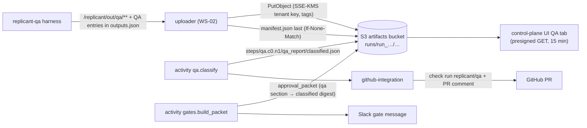

# QA Artifacts and How Reviewers See Them

**Owner:** WS-05 · **Constraints:** D-08, D-21, D-19 · **Contracts:** C-ART (types, keys, manifest, upload semantics), C-STATE (QA artifacts in S3 `artifacts`)

## Purpose

Define every artifact a QA run retains, its registered type, key, size, and retention; what the
harness hands the uploader; and exactly what an approver sees in the approval view, in Slack, and in
the PR (comment and check run) when QA passed, passed with warnings, failed, or was inconclusive.

## Decisions summary

| # | Decision | Constraint |
|---|---|---|
| A1 | QA uses the C-ART types `qa_report`, `junit_xml`, `build_log`, `health_log`, `screenshot`, `playwright_trace`, `video`, `a11y_report`, `sbom`, `image_metadata`, streamed `sandbox_log`, and `secret_scan_report` (accepted CCR-09-05). One new type is requested: **`qa_generated_flow`** (CCR-05-01) | C-ART §4 |
| A2 | Keys follow C-ART: `tenants/<t>/jobs/<j>/runs/<run>/<artifact_type>/<name>`; classification outputs under `steps/qa.c<c>.n<o>/qa_report/`. Names never contain repo-controlled strings (test names, branch names); they use step IDs, ordinals, and hashes, with human labels in the manifest `name` and `attributes` | C-ART §2 rule 1 |
| A3 | The built image is **never pushed** from the sandbox (no registry credentials, D-21). QA retains its digest, config digest, size, base images (`image_metadata`) and an SPDX 2.3 JSON SBOM (`sbom`); the OCI archive itself is discarded with the workspace | D-21, D-08 |
| A4 | The approval packet's QA section references the **classified** report by key and digest, so `presented_digest` (C-MSG V6) binds an approval to specific QA evidence | D-19 |
| A5 | The PR shows a Replicant QA **check run** (conclusion + annotations on diff lines) and a QA section in the Replicant PR comment. Screenshots and traces are linked to the control-plane UI, never embedded (private, presigned links expire in 15 minutes) | C-ART §5 |



---

## 1. Retained artifacts

| Type (C-ART) | Key under `runs/<run>/` | Content | Max (C-ART) | Retention | Redaction | Always? |
|---|---|---|---|---|---|---|
| `qa_report` | `qa_report/report.json` | sandbox report (`replicant.qa-report/v1`) | 16 MiB | r2y | required | yes |
| `qa_report` | `qa_report/diagnosis.json` | QA agent diagnosis (model output, labelled) | 16 MiB | r2y | required | when the task ran |
| `junit_xml` | `junit_xml/<step_id>.xml`, `junit_xml/<step_id>-reruns.xml`, `junit_xml/playwright-<variant>-<suite>.xml` | normalized JUnit per test step and rerun set | 64 MiB | r1y | required | per configured test step |
| `build_log` | `build_log/<stage>-<step_id>.log.zst` (and `-base` suffix for base pass) | stdout+stderr of each install/test/build/image step, timestamped | 256 MiB | r90d | required | per step |
| `health_log` | `health_log/app.log.zst`, `health_log/app-base.log.zst`, `health_log/services/<name>.log.zst` | app and service logs (`replicant-svc-wrap`) | 64 MiB | r90d | required | when the app or services ran |
| `screenshot` | `screenshot/<variant>/<viewport>/<route>.png`, `screenshot/failures/<sha12>.png`, `screenshot/diff/<viewport>/<route>.png` | route captures, failure captures, visual diffs | 16 MiB each, 500 per run | r1y | required (masked); classification Internal, Restricted when `qa.privacy.realData` (R1-121) | web |
| `playwright_trace` | `playwright_trace/<sha12>.zip` | scrubbed traces of failing tests, no DOM snapshots (headless-validation.md §4.1) | 256 MiB | r90d | required; **Restricted** (G-14) | web, on failure |
| `video` | `video/<sha12>.webm` | opt-in `retain-on-failure` | 256 MiB | r30d | required; **Restricted** (G-14) | opt-in |
| `a11y_report` | `a11y_report/change.json`, `a11y_report/base.json`, `a11y_report/delta.json` | axe results and the change-vs-base delta | 8 MiB | r1y | n/a | web with a11y |
| `sbom` | `sbom/image.spdx.json` | SPDX 2.3 JSON from `syft scan oci-archive:/workspace/.qa/image.tar -o spdx-json=…` | 32 MiB | r2y | n/a | image build |
| `secret_scan_report` | `secret_scan_report/image.json` | findings from scanning the built image filesystem: rule ID, path, line, HMAC fingerprint (never the value) (CCR-09-05, WS-09 data-handling §4). QA runs are a producer alongside WS-09's scanner (CCR-05-05, R1-126) | 1 MiB | r2y | n/a | image build with `secretScan` |
| `image_metadata` | `image_metadata/image.json` | digest, config digest, size, platform, base images, layer list, build args (names only) | 1 MiB | r2y | n/a | image build |
| `qa_generated_flow` *(CCR-05-01)* | `qa_generated_flow/flows.tar.zst` | generated Playwright specs + `flows.json` + lint results | 4 MiB | r1y | scan-block | when generated |
| `sandbox_log` (transcripts bucket) | `sandbox_log/part-<seq>.log.zst` (WS-02 shipper) | container logs streamed every 30 s | 256 MiB | r90d | required | always |
| `transcript`, `cli_events` (transcripts bucket) | WS-03 | QA agent CLI session, if agent tasks ran | 512 MiB | r90d | required | agent tasks |

Step prefix (activity-produced, `steps/qa.c<c>.n<o>/`, step manifest `replicant.step-manifest/v1`):

| Type | Key | Content |
|---|---|---|
| `qa_report` | `qa_report/classified.json` | classified report with routing and history snapshot |
| `qa_report` | `qa_report/feedback.json` | `replicant.qa-feedback/v1` (fix loop only) |

`syft` 1.55.0 is current; `oci-archive:` is its source scheme for OCI tarballs and `-o
spdx-json=<file>` writes SPDX JSON to a file [verified: https://github.com/anchore/syft and
https://oss.anchore.com/docs/guides/sbom/scan-targets/, 2026-10-24; version via GitHub API
2026-10-24].

`image_metadata/image.json` example:

```json
{
  "schema": "replicant.qa-image-metadata/v1",
  "builder": "buildkit",
  "builder_version": "v0.34.1",
  "digest": "sha256:44a7cf163a7bbc3915870ccb04b1e9e8a365dc22a569d13ece7ded89017d4b09",
  "config_digest": "sha256:373d35d8b05e1a3fb7d6c2056080a1b1f4bb4130463e3d986d833e1832bd4b3a",
  "platform": "linux/amd64",
  "size_bytes": 28311552,
  "dockerfile": "deploy/Dockerfile",
  "target": "runtime",
  "build_arg_names": [],
  "base_images": ["123456789012.dkr.ecr.us-east-1.amazonaws.com/mirror/gcr.io/distroless/static-debian12:nonroot@sha256:373d35d8b05e1a3fb7d6c2056080a1b1f4bb4130463e3d986d833e1832bd4b3a"],
  "layers": 4,
  "user": "65532:65532",
  "entrypoint": ["/ledger-api"],
  "exposed_ports": ["9090/tcp", "8081/tcp"]
}
```

The digest is the reproducibility handle: CI's own image build of the merged commit can be compared
with it (WS-06 metric "QA image matches CI image", optional).

## 2. Hand-off to the uploader

The harness never uploads and holds no credentials (WS-09 G-01). It writes evidence under
`/replicant/out/qa/<artifact_type>/<name>` and a list of entries in WS-03's `replicant.run-outputs/v1`
entry shape; `replicant-entrypoint` merges them into `/replicant/out/outputs.json` (its last action), and
the WS-02 uploader uploads each entry to `<prefix of bucket_class><type>/<name>`, applies redaction for
`required` types, and writes the manifest last:

```json
{
  "schema": "replicant.run-outputs/v1",
  "run_id": "run_chxtsxqzcpds1fc1c4dvw9e4em",
  "exit_code": 0,
  "partial": false,
  "result": "/replicant/out/run_result/result.json",
  "entries": [
    {"type": "qa_report", "bucket_class": "artifacts", "path": "/replicant/out/qa/qa_report/report.json", "name": "report.json",
     "content_type": "application/json", "required": true, "redaction": "required", "attributes": {"report_stage": "sandbox", "verdict": "fail"}},
    {"type": "junit_xml", "bucket_class": "artifacts", "path": "/replicant/out/qa/junit_xml/go_unit.xml", "name": "go_unit.xml",
     "content_type": "application/xml", "required": false, "redaction": "required", "attributes": {"step_id": "go_unit", "variant": "change", "attempt_set": "initial"}},
    {"type": "secret_scan_report", "bucket_class": "artifacts", "path": "/replicant/out/qa/secret_scan_report/image.json", "name": "image.json",
     "content_type": "application/json", "required": false, "redaction": "n/a"},
    {"type": "playwright_trace", "bucket_class": "artifacts", "path": "/replicant/out/qa/playwright_trace/3f9a1c2e7d4b.zip", "name": "3f9a1c2e7d4b.zip",
     "content_type": "application/zip", "required": false, "redaction": "required", "attributes": {"variant": "change", "browser": "chromium", "scrubbed": true}}
  ]
}
```

WS-03's `run-outputs` schema currently enumerates only implementer/planner/reviewer types; XD-05-17
asks WS-03 to add the QA types (`qa_report`, `junit_xml`, `build_log`, `health_log`, `screenshot`,
`playwright_trace`, `video`, `a11y_report`, `sbom`, `image_metadata`, `secret_scan_report`,
`qa_generated_flow`). Rules: only the report is `required: true` (C-ART "required output" for role
qa, as WS-02's controller.md already lists); text types are truncated at their C-ART cap; the report
is written to `/replicant/out` **before** evidence is staged, so a run cut short by SIGTERM still has its
report in a partial manifest.

## 3. What the approver sees

The approval packet (format owned by WS-07; C-ART type `approval_packet`) contains a QA section built
by `gates.build_packet` from the classified report and the qa_run node's routing decision. WS-05
defines its content as a schema, `schemas/approval-packet-qa.schema.json`
(`replicant.approval-packet.qa/v1`), which WS-07 adopts (XD-FIX-R1-5.1-WS05). The packet builder never
reads `run_result.outcome` (inconclusive QA runs end `failed`, R1-116); it reads `verdict`. A second
example, for an inconclusive run offering `rerun_qa`, is `examples/approval-packet-qa-inconclusive.json`.

```json
{
  "qa": {
    "schema": "replicant.approval-packet.qa/v1",
    "verdict": "fail",
    "reason_code": "regression",
    "decision": "gate_with_failure",
    "summary": "1 blocking failure (unit, caused by the change); 1 known flaky test; image built; app healthy",
    "run_id": "run_chxtsxqzcpds1fc1c4dvw9e4em",
    "classified_report": {"bucket_class": "artifacts", "key": "tenants/payments/jobs/job_01m5p7x7r0bt69j0h0fbxepw90/steps/qa.c0.n1/qa_report/classified.json", "sha256": "a9082f8a0ec4930a6972a2cfcd80bcca822b551f0c1f87a735fa7513164ea031"},
    "iteration": {"fix_iterations_used": 2, "fix_iterations_max": 2},
    "tested_tree": {"base_sha": "8c1e4f2a9b7d3c6e5f0a1b2c3d4e5f6a7b8c9d0e", "head_tree_sha": "5d2b7e9f0a3c4e6b8d1f2a3c5e7b9d0f1a2c4e6b", "diff_bundle_sha256": "1e3a5c7b9d0f2e4a6c8b0d1f3e5a7c9b2d4f6e8a0c3b5d7f9e1a2c4b6d8f0e3a"},
    "counts": {"total": 482, "passed": 479, "failed": 2, "flaky": 1, "skipped": 0, "blocking": 1},
    "by_cause": {"code": 2, "flaky_known": 1},
    "test_inventory_delta": {"method": "listed", "tests_removed": 0, "tests_skipped_added": 0, "deleted_test_files": 0, "skip_markers_added": 0, "deleted_or_skipped": false},
    "stages": [{"stage": "unit", "status": "failed"}, {"stage": "integration", "status": "passed"}, {"stage": "health", "status": "passed"}],
    "findings": [
      {"test_id": "go:github.com/acme-payments/ledger-api/internal/ledger.TestApplyRefund/partial_eur_fx_fee", "cause": "code", "blocking": true,
       "evidence_summary": "failed 3/3 on the change, passed 3/3 on base", "message": "fx_fee_reversal amount = EUR 0.48, want EUR 0.19", "file": "internal/ledger/ledger_test.go", "line": 188}
    ],
    "screenshots": [],
    "image": {"digest": "sha256:44a7cf163a7bbc3915870ccb04b1e9e8a365dc22a569d13ece7ded89017d4b09", "sbom_key": "tenants/payments/jobs/job_01m5p7x7r0bt69j0h0fbxepw90/runs/run_chxtsxqzcpds1fc1c4dvw9e4em/sbom/image.spdx.json"},
    "risk_floor": "critical",
    "banner": "QA still fails after 2 fix attempts; publishing allowed only as a draft PR",
    "actions": ["approve_draft_only", "reject", "request_changes"]
  }
}
```

Rendering requirements for WS-07 (XD-05-09):

| Verdict | Approval view (UI) | Slack gate message | Why |
|---|---|---|---|
| `pass` | One line in the packet header: "QA passed · 477 checks · 13 min · image sha256:9b1c…" with a link to the QA tab; route screenshots as a strip (web) | "QA ✓ passed (477 checks)" in the context block | Approvers should not need to open anything |
| `pass_with_warnings` | Header line plus a collapsed list of non-blocking findings grouped by cause ("2 pre-existing on main", "1 known flaky"); visual changes shown as before/after pairs, **expected** ones labelled with the plan item, **unexpected** ones first | "QA passed with 3 warnings" + link | Warnings are context, not blockers |
| `fail` (after fix budget) | Red banner with the blocking findings (test, evidence summary, message, file:line), screenshots/trace links for web failures, the fix-iteration count, and the draft-only constraint | "QA failing after 2 fixes, draft PR only" | Approver must decide knowingly |
| `inconclusive` | Amber banner "QA inconclusive": which stage could not run and why (signature, service log excerpt), "Operators notified", and a **Re-run QA** button when `actions` contains `rerun_qa` (R2-027) | "QA inconclusive: Kafka did not start" + **Re-run QA** button | Risk floor `high` forces a human look. Re-running is cheaper than approving blind or rejecting good work |
| any, `test_inventory_delta.deleted_or_skipped` | Header chip "Δ vs base: −N tests, +M skips" (amber), expanding to the removed test IDs and added skip markers (file:line) from the classified report | "Δ vs base: +1 skip" appended to the context line | Deleted or skipped tests are a classic way to make QA pass (R2-006). WS-07 risk rule `tests.deleted_or_skipped` reads the same field |

**Re-run QA (R2-027).** Offered only on verdict `inconclusive`, at most twice per gate. The decision
`rerun_qa` (C-MSG 1.6.0, CCR-05-04 accepted) supersedes the gate revision; the qa_run node re-enters at a fresh QA attempt
with the same diff bundle and `base_sha`, without consuming `fix_iterations`, reusing the previous run's checkpoints where `inputs_digest` still matches (stage-design.md §4.7), then
opens a new gate revision with a new packet. V5 rejects it on any other verdict with
`DecisionNotOffered`; `GateView.qa_reruns_used` counts the re-runs.

UI QA tab (WS-07 designs; content defined here): stage timeline with durations; checks table
filterable by cause and stage; per check: attempts (change/base timeline), message, stack, log
excerpt, aria snapshot, evidence links (JUnit, logs, trace viewer, screenshots); services panel
(readiness times, logs); image panel (digest, SBOM download, base images); web panel (route grid of
change/base/diff screenshots per viewport; a11y new/pre-existing/fixed); history panel per test (30-day
runs, flake rate) from `qa.test_stats_30d`.

Traces and videos are never part of the packet or Slack; the QA tab links them only for viewers with
repo write (Restricted, G-14). Screenshots in the packet: at most 12 thumbnails, ordered: failing web checks, unexpected visual
changes, expected visual changes, then routes in configured order.

## 4. What the PR shows

### 4.1 Check run

github-integration (holding `checks:write`, ADR-011) creates or updates check run **`replicant/qa`** (R1-125: the name WS-07 and the branch-protection docs use)
on the PR head SHA after each QA run of a published or updated PR (and on draft PRs):

| Verdict | `conclusion` | Title |
|---|---|---|
| `pass` | `success` | "QA passed: 477 checks" |
| `pass_with_warnings` | `neutral` | "QA passed with 3 warnings" |
| `fail` | `failure` | "QA failed: 1 blocking check" |
| `inconclusive` | `neutral` (not `failure`, so branch protection does not hide that the change itself may be fine) | "QA inconclusive (environment)" |

Annotations: one per finding whose `file` is in the diff, level `failure` for blocking, `warning`
otherwise, up to 50 per API request (more via successive updates) [verified:
https://docs.github.com/en/rest/checks/runs, 2026-10-24]. `summary` (≤ 65,535 characters, Markdown,
verified same source) uses the template in §4.2. The check run links (`details_url`) to the job's QA
tab.

### 4.2 PR comment section

Replicant's PR description/comment (WS-07 owns the overall comment) includes this section,
rendered from the classified report (replicant-generated text; untrusted strings such as test names are
escaped and wrapped in code spans):

Passed:

~~~markdown
### QA ✅ passed · run `run_ata247zxh0zx4y24bdv2vns95e` · 12 min 23 s

Tested tree `c71a0e4` = `main@8c1e4f2` + this PR's diff. Runtime: kata-clh.

| Stage | Result |
|---|---|
| Install · unit · integration | ✅ 476 passed · 1 known flaky (passed on rerun) |
| Build · image | ✅ `sha256:9b1c4e7a0d3f…` · SBOM attached |
| App health | ✅ ready in 2.4 s · stable 30 s · 3 smoke calls |

<details><summary>1 non-blocking finding</summary>

- `go:…/internal/outbox.TestPublisherReconnect`: known flaky (quarantined, owner payments-platform), failed once, passed on rerun.

</details>

[Open QA report](https://replicant.acme.internal/jobs/job_01m5p7x7r0bt69j0h0fbxepw90/qa/run_ata247zxh0zx4y24bdv2vns95e)
~~~

Failed (only when publishing a draft after the fix budget, or for `qa_only` jobs):

~~~markdown
### QA ❌ failed · run `run_9k6kmcy76ry3gphav1p6ym9s5k` · 14 min 51 s

1 blocking check, caused by this change (failed 3/3 here, passed 3/3 on `main@8c1e4f2`):

- `go:…/internal/ledger.TestApplyRefund/partial_eur_fx_fee` at `internal/ledger/ledger_test.go:188`
  ```
  fx_fee_reversal amount = EUR 0.48, want EUR 0.19
  ```

The Replicant attempted 2 fixes. This PR is a draft until a human resolves it.
[Open QA report](https://replicant.acme.internal/jobs/job_01m5p7x7r0bt69j0h0fbxepw90/qa/run_9k6kmcy76ry3gphav1p6ym9s5k) · reproduce: `go test -race -count=1 -run '^TestApplyRefund$/^partial_eur_fx_fee$' ./internal/ledger`
~~~

## 5. Manifest attributes used by QA

(`playwright_trace` also carries `scrubbed: true`.)

C-ART allows up to 20 small `attributes` per artifact entry. QA uses:

| Type | Attributes |
|---|---|
| `screenshot` | `variant` (`change`/`base`/`diff`/`failure`), `viewport` (`1440x900`), `route` (configured name), `diff_ratio` (number) |
| `junit_xml` | `step_id`, `variant`, `attempt_set` (`initial`/`reruns`) |
| `build_log`, `health_log` | `stage`, `step_id`, `variant`, `exit_code` |
| `playwright_trace`, `video` | `test_sha12`, `variant`, `browser` |
| `a11y_report` | `variant`, `violations` (count) |
| `sbom` | `format` (`spdx-json-2.3`), `packages` (count) |
| `qa_report` | `report_stage` (`sandbox`/`classified`), `verdict` |

---

## Open questions

| ID | Question | Who decides | Options | Recommendation |
|---|---|---|---|---|
| OQ-05-13 | Should a QA-built image be pushed to a quarantine registry for later reuse by CD? | WS-09 / platform | never (v1) / push via publisher-side job from the OCI archive | Never in v1 (D-21: no registry credentials in sandboxes; remote deploys out of scope). Revisit with a publisher-side push of a re-built image |
| OQ-05-14 | `inconclusive` check-run conclusion: `neutral` or `action_required`? | WS-07 | neutral / action_required / failure | `neutral`; the publish gate already forces a human decision |

## Risks

- Screenshot PII: masks reduce but do not eliminate PII (seeded data is synthetic, which is the main
  control). WS-08 owns further masking.
- Evidence volume: about 1,400 QA runs per day at peak × typical 50–300 MiB = 70–420 GiB per day in
  `artifacts`, mostly r90d/r1y; WS-10 sizes lifecycle accordingly.

## Interfaces

- **Provided:** artifact list and key names (§1), QA entries for WS-03 `replicant.run-outputs/v1` (§2), approval packet
  QA section content (§3), PR check-run and comment content (§4), `replicant.qa-image-metadata/v1`.
- **Consumed:** C-ART types and upload semantics (incl. `secret_scan_report`, CCR-09-05); WS-03 run-outputs; WS-02 uploader; WS-07 packet builder, UI, Slack,
  github-integration check runs; WS-08 redaction.
