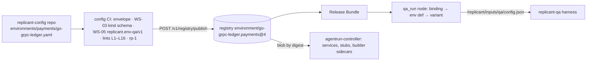

# Per-Codebase QA Configuration

**Owner:** WS-05 (the `qa` section, `replicant.env-qa/v1`) inside WS-03's `EnvironmentDefinition` · **Constraints:** D-12, D-03, D-16 · **Contract:** C-DEF §2 ("EnvironmentDefinition … QA section: WS-05")
**Schema:** [schemas/qa-config.schema.json](schemas/qa-config.schema.json) · **WS-03 kind schema:** `spec/03-agents-and-tools/schemas/environment-definition.schema.json`

## Purpose

Define the QA configuration every codebase declares, how it fits WS-03's environment definition, how
it is validated and published, how it reaches the sandbox, and give complete, validated examples for a
Go gRPC service, a Next.js app, and a Python batch pipeline.

## Decisions summary

| # | Decision | Constraint |
|---|---|---|
| Q1 | QA configuration is `spec.qa` of an `EnvironmentDefinition` (config repo → registry, immutable, pinned by the Release Bundle). Nothing QA-specific lives in target repos; repos contribute tests, fixtures, and scripts referenced by path | D-12, D-03, D-10 |
| Q2 | WS-03's kind schema requires only the discriminator `schema: replicant.env-qa/v1` in `spec.qa`; WS-05's schema validates the rest and evolves additively without a WS-03 change | C-DEF §2 |
| Q3 | QA **reuses** WS-03 fields instead of duplicating them: `spec.services[]` (dependencies; QA gets those with `qa ∈ forRoles`), `spec.bootstrap.steps` (run by the harness as the install stage), `spec.profileByRole.qa` (agent-container resources), `spec.networkProfile.qa_build`, `spec.isolationHint.qa_build`, `spec.caches`, `spec.packageMirrors` | D-12 |
| Q4 | Variants per workflow type only skip optional stages or lower the budget | D-19 |
| Q5 | The sandbox receives the resolved section as `/replicant/inputs/qa/config.json`; it never reads the registry | C-DEF §6 |
| Q6 | Publish-time lint rules L1–L16 run in WS-03's config CI and in `POST /v1/registry/publish` | C-DEF §4.2 |

---

## 1. Structure of `spec.qa`

| Key | Purpose | Detail in |
|---|---|---|
| `schema` | `replicant.env-qa/v1` (required by WS-03) | — |
| `enabled`, `appKind` (`server`, `web`, `batch`, `library`) | which QA applies | stage-design.md |
| `timeouts` | `totalSeconds` (→ `active_deadline_seconds`), `reserveSeconds`, `startupSeconds`, `finalizeSeconds` | stage-design.md §3 |
| `steps.useBootstrap`, `steps.install[]`, `steps.unit[]`, `steps.integration[]`, `steps.build[]` | deterministic commands, JUnit location, rerun command | stage-design.md §4.4 |
| `imageBuild` | builder sidecar image and resources, Dockerfile, SBOM, image secret scan | ADR-05-003 |
| `serviceOptions[]` | QA-only options for `spec.services[]` (log wrapping, readiness timeout, reset) | dependencies.md §3 |
| `stubs[]` | contract stubs (Prism, GripMock, WireMock) | dependencies.md §4 |
| `seed[]` | QA seeds after the services' own `seed` steps | dependencies.md §6 |
| `contractCompat` | run the briefing's compat checks (XD-04-06) | stage-design.md §4.4 |
| `app.start`, `app.health`, `app.stop` | start (process mode) and health criteria | health.md |
| `web` | Playwright version and browsers path, repo tests, routes, generated flows, viewports, masks, a11y, visual, evidence | headless-validation.md |
| `flake` | rerun counts, quarantine | failure-feedback.md §4 |
| `agent` | agent tasks and caps | ADR-05-004 |
| `variants` | per-workflow-type reductions | §3 |
| `env` | non-secret variables for repo code (WS-03 `env_map`: protected names rejected) | stage-design.md §4.3 |

Removed during alignment with WS-03 and WS-09 (do not reintroduce): `qa.services` (use
`spec.services`), `qa.resourceProfile`/`qa.networkProfile` (use `profileByRole.qa`,
`networkProfile.qa_build`), `qa.dockerApi` and `app.start.mode: image` (no container engine in v1,
dependencies.md §5), and `spec.services[].dataVolume` for QA (service data on the workspace, R1-114).

Added in wave 1: `qa.privacy {realData, traceDomSnapshots}` (R1-121) and `testSteps[].listCommand`
(R2-006). `limits.ephemeralStorage` is now required in every resource block (R1-114).

## 2. YAML authoring rule

The registry canonicalizes with the YAML 1.2 core schema (C-DEF §4.1 rule 3), but many tools parse
YAML 1.1, where unquoted `on`, `off`, `yes`, `no` are booleans. Validating this workstream's own
examples with PyYAML turned `screenshot: on` into `true`, which the schema rejected. **Quote every
string value a YAML 1.1 parser could read as a boolean or number** (`'on'`, `'off'`, `'1'`, ports and
counts in `KAFKA_*` variables). Lint L12 flags unquoted occurrences.

## 3. Variants

`variants.<workflow_type>.skip` may list only `integration`, `imageBuild`, `web.repoTests`,
`web.smokeFlows.generated`, `web.visual`, `web.a11y`, `agent`; `totalSeconds` may only lower the
budget. The QA node applies the variant before writing `config.json`.

## 4. Lint rules (publish time)

| ID | Rule | Severity |
|---|---|---|
| L1 | Valid against the C-DEF envelope, WS-03's kind schema, and `replicant.env-qa/v1` | error |
| L2 | `profileByRole.qa` names an existing resource profile | error |
| L3 | Pod limits (agent profile + QA services + stubs + builder + agentd/uploader/watchdog) ≤ 0.45 × allocatable of the smallest node type in the `qa_build` pool (WS-03 §5.5 rule; WS-02 publishes allocatable) | error |
| L4 | `imageBuild.cacheBudget` ≤ 50% of the workspace `sizeLimit`; WS-03's data lint (XD-FIX-R1-074): every profile used by a role in a service's `forRoles` has `workspace.sizeLimit ≥ Σ data.sizeEstimate + 10Gi`. Service data lives at `/workspace/.services/<name>[/<subdir>]` via `data {env, subdir?, sizeEstimate}`; `dataVolume` no longer exists | error |
| L5 | Ports unique across QA services, stubs (GripMock also uses port + 1), and the app; none in 7800–7803 (`replicant-agentd`) | error |
| L6 | `imageBuild.enabled` requires `isolationHint.qa_build: kata-clh` and a `runtime_selection` policy mapping `qa_build` to `replicant-kata-clh` | error |
| L7 | `timeouts.totalSeconds` ≤ 14,400 (C-RUNNER `activeDeadlineSeconds` ceiling for role qa) | error |
| L8 | Variants never skip `unit`, `build`, or `health` for code-changing workflow types (schema vocabulary) | error |
| L9 | `routes × viewports × 2` ≤ 400 (C-ART screenshot cap) | error |
| L10 | Every image digest resolves in the mirror and carries the Replicant signature (WS-03 §7.4) | error |
| L11 | `flake.quarantine[].expires` in the future; > 90 days ahead warns | warning |
| L12 | No unquoted YAML 1.1 boolean-like scalars | error |
| L13 | `web.playwright.version` matches the `@playwright/test` version in `image.build` and its browsers are baked under `web.playwright.browsersPath` | error |
| L14 | No `qa.env` value looks like a secret (entropy > 4.0 bits/char over ≥ 20 chars, known token prefixes), except the `qa-local-only` convention | error |
| L15 | `spec.bootstrap.forRoles` does not include `qa` (the harness runs bootstrap for QA) | error |
| L16 | Every `serviceOptions[].name` is a service with `qa ∈ forRoles`; `wrapLogs` on a service without `command` warns | error / warning |
| L17 | `qa.privacy.traceDomSnapshots: true` requires `qa.privacy.realData: false` and a tenant classification ceiling of Internal or lower; `realData: true` makes screenshots Restricted (R1-121) | error |
| L18 | Every container's `limits` sets `memory` and `ephemeralStorage` (WS-09 VAP), and every profile satisfies A-8 exactly: `workspace.sizeLimit ≤ limits.ephemeralStorage` (XD-FIX-R1-036; the controller adds its own margin H + F + O when rendering, so the lint adds none) | error |
| L19 | Every image (services, stubs, builder, environment image) matches the WS-09 VAP pattern `<account>.dkr.ecr.us-east-1.amazonaws.com/(replicant\|mirror)/<1–4 path segments>@sha256:<64 hex>` (XD-FIX-R1-212); a service with `wrapLogs` (default true) uses a `replicant/svc-<name>` image, a service with `wrapLogs: false` may use the plain `mirror/<upstream path>` image (XD-05-20 ruling). The wrapper itself runs from `/opt/replicant/bin/replicant-svc-wrap` (services start after `prepare`) | error |
| L20 | `networkProfile` values are from WS-09's catalogue (XD-FIX-R1-213): `coding-default`, `review-readonly`, `qa-with-mirror`, `utility-minimal`, `takeover`, `eval-coding`, `eval-scoring`, `eval-snapshot`; `qa_build` must be `qa-with-mirror` (`review` is no longer valid) | error |
| L21 | Every `testSteps[]` of a code-changing variant declares `listCommand` (test inventory, R2-006), or the step's runner is one the harness can list statically (go, pytest, jest/vitest, junit5); otherwise the inventory falls back to `method: static` and warns | warning |

`tools/validate_examples.py` implements L2–L7, L15, L16 for the examples.

## 5. Complete examples

All three validate against the C-DEF envelope, **WS-03's published kind schema**, and
`replicant.env-qa/v1`, and pass the implemented lints (`uv run --with jsonschema --with pyyaml --with
referencing python spec/05-qa/tools/validate_examples.py`, 2026-10-24: all checks passed).

| Codebase type | File | Highlights |
|---|---|---|
| Go gRPC service with Postgres and Kafka | [examples/env-go-grpc-ledger-api.yaml](examples/env-go-grpc-ledger-api.yaml) | gotestsum JUnit with `-race`, Postgres 17.11 and Kafka 4.4.0 services, GripMock stub of `fx-rates`, BuildKit builder + SBOM + image secret scan, gRPC health + log readiness + gRPC smoke, quarantine entry, contract compat |
| Next.js app | [examples/env-nextjs-storefront.yaml](examples/env-nextjs-storefront.yaml) | Playwright 1.64.1 baked under `/opt/ms-playwright`, Postgres service with Prisma, Prism stub of `pricing-service`, repo tests + route crawl + generated flows, desktop/mobile, masks, axe `new_serious`, visual diff on UI paths, 40 GiB workspace |
| Python batch pipeline | [examples/env-python-batch-settlement.yaml](examples/env-python-batch-settlement.yaml) | uv, pytest with node-id reruns, Postgres + S3Mock 5.2.3 services, batch completion with SQL and exec output assertions |

Resource profiles in the examples are `derivation.method: provisional` with a reason and expiry, as
WS-03's schema requires until the rp-1 baseline runs.

---

## Open questions

| ID | Question | Who decides | Options | Recommendation |
|---|---|---|---|---|
| OQ-05-15 | Reusable fragments (a standard Kafka service) across definitions | WS-03 | copy / fragments resolved at bundle build | Fragments; WS-03 decides the mechanism |

## Risks

- Definitions are large; the linter and per-type examples are the main mitigation.
- WS-03's kind schema may evolve; only the non-QA parts of the examples would change.

## Interfaces

- **Provided:** `replicant.env-qa/v1` schema; lints L1–L16; `/replicant/inputs/qa/config.json` contract.
- **Consumed:** WS-03 kind schema, CI, image strategy; C-DEF envelope and publish API; WS-02
  `runtime_selection` and pool allocatable.
