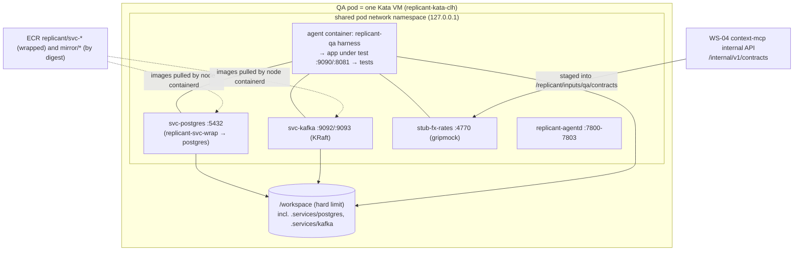

# Dependencies of the App Under Test

**Owner:** WS-05 · **Constraints:** D-16, D-06, D-07, D-12, D-13, D-21 · **ADR:** [ADR-05-002](adr/002-dependency-strategy.md)
**Aligned with:** WS-03 `spec.services[]` (environment-definition.md §4), WS-02 pod rendering (controller.md §4),
WS-09 admission policy (`vap-sandbox-pods.yaml`), WS-04 contracts index

## Purpose

D-16 makes "how the app's dependencies are satisfied" a required decision, including an explicit
answer for Docker-socket approaches such as Testcontainers. This document decides it, shows the pod
the controller renders, sizes a Postgres + Kafka app inside the Kata disk and memory profile, defines
contract stubs for downstream services, and defines data seeding.

## Decisions summary

| # | Decision | Constraint | Reference |
|---|---|---|---|
| D1 | **Infrastructure dependencies** (Postgres, MySQL, Redis, Kafka, RabbitMQ, S3-compatible stores, OpenSearch) are the environment definition's **`spec.services[]`** (WS-03 schema) with `qa` in `forRoles`, rendered as **native sidecars** of the QA pod, images republished under ECR `replicant/` and pinned by digest (WS-09 VAP), data under `/workspace/.services/<name>` (WS-02 XD-02-15). QA adds only QA-specific options (`qa.serviceOptions[]`: log wrapping, readiness timeout, reset between passes) | D-16, D-12, D-21 | [ADR-05-002](adr/002-dependency-strategy.md) |
| D2 | **Downstream services owned by other teams** are **contract stubs** generated from contracts WS-04 extracted: OpenAPI → Prism 5.16.0, gRPC → GripMock v3.23.4, GraphQL/hand mappings → WireMock 3.13.2; static examples by default | D-13, D-16 | §4 |
| D3 | **Testcontainers and other Docker-API clients are not supported in v1.** No Docker or Podman socket exists in any sandbox. The capability list a rootless Podman endpoint would need is recorded (§5) so WS-09 can decide later; it requires `privileged` or a `/dev/net/tun` device, which the exec admission policy forbids | D-16, D-21 | §5 |
| D4 | Embedded dependencies already in the toolchain image (SQLite, in-process test servers) may run inside the agent container; not a general mechanism | D-16 | §2 |
| D5 | Ephemeral managed resources (RDS, MSK, staging services) are out of scope for v1 | D-16, D-21 | §2 |
| D6 | Seeding: `spec.services[].seed` and `qa.seed[]`, run **by the harness** (classified checks), synthetic data only; services reset between change and base passes by `serviceOptions.resetCommand` | D-21 | §6 |



---

## 1. Requirements

1. Works inside the chosen runtime (Kata CLH for `qa_build`, WS-02 R-1) and degrades predictably
   under gVisor (runtime-assumptions.md).
2. Fits the disk and memory profile.
3. Reproducible: images by digest in the pinned environment definition (D-03, D-12).
4. No credentials beyond the run's; no egress beyond `qa-with-mirror`; nothing that the exec
   admission policy forbids (WS-09 VAP).
5. Evidence: readiness timing and logs per dependency in the QA report.
6. Same behavior locally (D-20).

## 2. Options considered

| Option | Fidelity | Security and admission | Startup cost | Accounting | Local parity | Verdict |
|---|---|---|---|---|---|---|
| A. Native sidecars (`spec.services[]`) | Real engines, pinned | No extra privileges; restricted profile | parallel with checkout and install; node image cache | per-container resources; data on the enforced workspace | sibling containers | **Chosen for infrastructure** |
| B. Processes inside the agent container | Real if the image contains them | No extra privileges | fastest | shares agent limits | identical | Embedded/lightweight only (D4) |
| C. Contract stubs | Contract-level | No credentials; deterministic | seconds | tiny | identical | **Chosen for downstream services** |
| D. Rootless Podman Docker API in the guest | Whatever tests request | Needs `privileged` or a `/dev/net/tun` device plus relaxed seccomp and escalation (§5); forbidden by the VAP | image pulls inside the VM each run | workspace | Docker/Podman on laptop | **Not in v1** |
| E. Remote Docker / Testcontainers Cloud | Full | Code and data leave the sandbox; breaks default-deny egress (D-21) | network-bound | outside | different | Rejected |
| F. kubedock (Docker API backed by pods) | Full | Needs Kubernetes API from the sandbox (forbidden, C-CRD §6) | pod start per container | outside | different | Rejected |
| G. Managed resources (RDS, MSK) | Highest | Credentials and paths outside the run | minutes | outside | none | Out of scope v1 |
| H. Host container-runtime socket | Full | Host root equivalent | — | — | — | Never |

## 3. Sidecar services

### 3.1 Rendering (WS-02 controller, from the environment definition blob)

WS-03's schema defines each service (`image`, `command`, `args`, `env`, `data`, `ports`, `readiness`,
`resources`, `forRoles`, `seed`); QA renders only services whose `forRoles` contain `qa` (default
`[qa]`). WS-02 owns the rendering: controller.md §4.2 (containers), §4.2a (QA rules, XD-FIX-R1-045)
and the authoritative example `spec/02-execution/manifests/sandbox-pod.qa-build.example.yaml`. The
fragment below shows only what QA relies on, for the Go example:

```yaml
spec:
  runtimeClassName: replicant-kata-clh
  securityContext: {runAsNonRoot: true, fsGroup: 10002, fsGroupChangePolicy: OnRootMismatch, seccompProfile: {type: RuntimeDefault}}
  volumes:
    - {name: workspace, emptyDir: {sizeLimit: 40Gi}}       # hard limit by guestBlockDevice (WS-02); service data under .services/
    - {name: tools, emptyDir: {sizeLimit: 3Gi}}            # /opt/replicant, filled by prepare
    - {name: inputs, emptyDir: {sizeLimit: 2Gi}}           # /replicant/inputs, filled by prepare
    - {name: qa-svc-logs, emptyDir: {sizeLimit: 1Gi}}      # /var/log/qa-services
    - {name: qa-buildkit-run, emptyDir: {medium: Memory, sizeLimit: 64Mi}}
  initContainers:
    # workspace-guard, replicant-agentd, watchdog (WS-02/WS-03), then prepare: copies /opt/replicant into tools,
    # fetches inputs and repo via agentd, applies the diff. Everything below starts after prepare.
    - name: svc-postgres
      image: 123456789012.dkr.ecr.us-east-1.amazonaws.com/replicant/svc-postgres@sha256:7cf3db853f6e121ab0a65e30deea9ed273833fba95e4f49a2cb9cdf2360d880c
      restartPolicy: Always                                 # native sidecar, no startupProbe (harness owns readiness)
      command: [/opt/replicant/bin/replicant-svc-wrap, --name, postgres, --log, /var/log/qa-services/postgres.log, --, docker-entrypoint.sh]
      args: [postgres, -c, listen_addresses=127.0.0.1, -c, fsync=off, -c, synchronous_commit=off, -c, full_page_writes=off,
             -c, shared_buffers=128MB, -c, max_connections=60, -c, max_wal_size=512MB]
      env:
        - {name: POSTGRES_USER, value: ledger}
        - {name: POSTGRES_PASSWORD, value: qa-local-only}
        - {name: POSTGRES_DB, value: ledger}
        - {name: PGDATA, value: /workspace/.services/postgres/pgdata}   # from data: {env: PGDATA, subdir: pgdata}
      resources:
        requests: {cpu: 500m, memory: 512Mi, ephemeral-storage: 256Mi}
        limits: {cpu: '1', memory: 1Gi, ephemeral-storage: 1Gi}
      volumeMounts:
        - {name: workspace, mountPath: /workspace}
        - {name: tools, mountPath: /opt/replicant, readOnly: true}
        - {name: qa-svc-logs, mountPath: /var/log/qa-services}
    - name: svc-kafka                                       # same pattern; KAFKA_LOG_DIRS=/workspace/.services/kafka
      image: 123456789012.dkr.ecr.us-east-1.amazonaws.com/replicant/svc-kafka@sha256:71f49e81f00688af741c33c41add17781e66fb8e9d8a7753713f1912d83dea4f
      restartPolicy: Always
      command: [/opt/replicant/bin/replicant-svc-wrap, --name, kafka, --log, /var/log/qa-services/kafka.log, --, /etc/kafka/docker/run]
      resources:
        requests: {cpu: 500m, memory: 1Gi, ephemeral-storage: 256Mi}
        limits: {cpu: 1500m, memory: 1536Mi, ephemeral-storage: 1Gi}
    - name: stub-fx-rates
      image: 123456789012.dkr.ecr.us-east-1.amazonaws.com/replicant/qa-stub-gripmock@sha256:85cb12953e4fe406e300e9a8b0eee39c15f57d5901e8dd91758fc0436861e52d
      restartPolicy: Always
      args: [--contracts=/replicant/inputs/qa/contracts/fx-rates, --fixtures=/workspace/repo/testdata/qa/stubs/fx-rates, --grpc-addr=127.0.0.1:4770, --admin-addr=127.0.0.1:4771]
      resources:
        requests: {cpu: 100m, memory: 64Mi, ephemeral-storage: 64Mi}
        limits: {cpu: 250m, memory: 128Mi, ephemeral-storage: 256Mi}
      volumeMounts:
        - {name: inputs, mountPath: /replicant/inputs, readOnly: true}
        - {name: workspace, mountPath: /workspace, readOnly: true}
    # builder (ADR-05-003; only with qa.imageBuild.enabled under replicant-kata-clh), after prepare
  containers:
    - name: agent
      image: 123456789012.dkr.ecr.us-east-1.amazonaws.com/replicant/env-go-grpc-ledger@sha256:f87fc92356d784988038202520f3fbb9a1c92d03a8903da31c3bb455d1c1fe48
      resources:
        requests: {cpu: '3', memory: 6Gi, ephemeral-storage: 26Gi}
        limits: {cpu: '6', memory: 10Gi, ephemeral-storage: 54Gi}   # profile 40Gi + H 3 + F 8 + O 3 (XD-FIX-R1-036)
      volumeMounts:
        - {name: workspace, mountPath: /workspace}
        - {name: tools, mountPath: /opt/replicant, readOnly: true}
        - {name: qa-svc-logs, mountPath: /var/log/qa-services, readOnly: true}
        - {name: qa-buildkit-run, mountPath: /run/buildkit}
    # uploader (WS-02)
```

Rendering rules (WS-02 controller.md §4.2a; what QA depends on):

1. Names `svc-<name>`, `stub-<name>`, `builder`, all native sidecars rendered **after `prepare`**:
   services need `/opt/replicant/bin/replicant-svc-wrap` from the `tools` volume, stubs read staged
   contracts and repo fixtures, the builder reads the build context.
2. Wrapped services (`serviceOptions.wrapLogs`, default true, with a `command`) use
   `replicant/svc-<name>@sha256` images (the mirrored upstream image plus a Replicant layer, built and
   cosign-signed by image CI, XD-FIX-R1-224); unwrapped services may use the plain
   `mirror/<upstream path>@sha256` image (ruling on XD-05-20; the Python example's S3Mock). Both match
   the VAP pattern (XD-FIX-R1-212). The controller prefixes the command with
   `/opt/replicant/bin/replicant-svc-wrap --name <n> --log /var/log/qa-services/<n>.log --`.
3. Every QA service, stub, and the builder mounts the whole `workspace` volume (no `subPath`, Kata
   F-14). Service data goes to `/workspace/.services/<name>[/<subdir>]`; the controller sets the
   variable named by `data.env` (XD-FIX-R1-074).
4. No `startupProbe`, `readinessProbe`, or `livenessProbe` on QA sidecars.
5. Sidecar `ephemeral-storage` limits are fixed by WS-02: services 1Gi, stubs 256Mi, builder 1Gi; every
   container has memory and ephemeral-storage limits (WS-09 VAP, R1-114).
6. Agent container resources = `spec.resourceProfiles[profileByRole.qa]`; the agent's rendered
   `ephemeral-storage` limit is `limits.ephemeralStorage + H + F + O` (XD-FIX-R1-036);
   `RuntimeClass.overhead.podFixed` (250m / 448Mi) is added by admission.
7. The `builder` is the only container with the security exception (stage-design.md §4.6), rendered
   only under `replicant-kata-clh`.

### 3.2 Disk accounting

| Data | Where | Limit |
|---|---|---|
| Repo, base worktree, caches, build outputs, BuildKit state, Playwright output, QA logs (incl. service logs) | workspace volume | enforcing hard limit (`guestBlockDevice`, ENOSPC in the guest) + watchdog |
| Service data (Postgres PGDATA, Kafka logs, S3 mock objects) | `/workspace/.services/<name>` on the same volume | the same hard limit (XD-02-15) |
| Container writable layers | each container's `ephemeral-storage` limit | kubelet; small by design (read-only roots where possible) |

A runaway service now fails with `ENOSPC` inside the guest and a classified `environment` check, not
an eviction. Workspace sizing must include service data (§7).

### 3.3 Readiness

The harness waits for each QA service using the service's own `readiness` (WS-03: `tcpPort`, `exec`,
`httpGet`), executed from the agent container (`exec` commands such as `pg_isready` run there, so the
environment image carries the clients), up to `serviceOptions.readinessTimeoutSeconds` (default
120 s). Readiness runs in parallel with `install`; `seed`, `integration`, and `app_start` wait on it.
A service that is not ready fails check `services:<name>` with cause `environment`
(`service_not_ready`) and the last 200 lines of its log.

## 4. Contract stubs for downstream services

### 4.1 Source of contracts

WS-04's ecosystem indexer normalizes and stores contracts (`contracts`, `contract_versions`, digest
`sha256(JCS(normalized))`; OpenAPI dereferenced, protobuf as a `FileDescriptorSet`) (WS-04
ecosystem-context.md §2). Activity `qa.stage_contract_stubs` (replicant-worker, which is allowed to call
core services) fetches each `qa.stubs[].contract` from context-mcp's internal API (XD-FIX-R1-104):

```
GET /internal/v1/contracts?service_ref=<ref>&name=<name>&revision=default_branch|deployed_prod|deployed_staging|sha256:<hex>
GET /internal/v1/jobs/{job_id}/compat-checks
  Authorization: ServiceAccount token, audience context-mcp-internal
  X-Replicant-Job-Id: <job_id>
```

The revision is `deployed_prod` by default (`api_change` also stages `default_branch`), or a pinned
digest. On `409 revision_unavailable` the activity falls back to `default_branch` and records
`{stub, requested_revision, used: default_branch}` as a warning, which the harness copies into
`qa_report.contract_compat[].revision_warning`. It writes the normalized contracts and the compat checks as QA
input objects (`qa/contracts/<stub>/`, `qa/compat-checks.json`) and returns their keys; WS-04's
`context.stage_inputs` lists them in the manifest with `place: qa_file` (XD-FIX-R1-067). The sandbox
never calls context services for this (it could only reach context-mcp through agentd, and QA runs
have no MCP audience).

Missing contract (`404`) → stub `not_started`, check `stubs:<name>` `environment`
(`contract_unavailable`), operator alert; QA continues if nothing required depends on it.

### 4.2 Stub servers (replicant-maintained images)

| Contract | Server | Behavior | Determinism |
|---|---|---|---|
| OpenAPI 3.x | Prism 5.16.0 (`prism mock`), image `replicant/qa-stub-prism` | responses from documented `examples`; `Prefer: example=<key>` selects one [verified: https://raw.githubusercontent.com/stoplightio/prism/master/docs/getting-started/03-cli.md, 2026-10-24] | static default; `mode: dynamic` → `--dynamic` |
| gRPC | GripMock v3.23.4 (bavix fork), image `replicant/qa-stub-gripmock` | gRPC on the configured port, stub admin HTTP on port + 1 [verified: https://hub.docker.com/r/bavix/gripmock, 2026-10-24] | stubs generated by `replicant-stubgen` from the descriptor set plus repo fixtures |
| GraphQL / hand-written mappings | WireMock 3.13.2, image `replicant/qa-stub-wiremock` | mappings only | — |
| AsyncAPI events | no server | `replicant-stubgen asyncapi-seed` publishes the documented `examples` into the Kafka sidecar during `seed` | example messages only |

Each stub image wraps its server in a small launcher (`qa-stub-<server>`) with the stable flags shown
in §3.1, so upstream CLI changes are absorbed in the image, not the environment definition. `[unverified:
GripMock v3.23.4 CLI flag spelling]` is therefore not load-bearing for definitions. Stubs never proxy
to real services.

## 5. Testcontainers and Docker-API clients (D-16 explicit answer)

**v1: not supported.** No Docker or Podman socket exists in sandboxes (WS-03 environment-definition
§4 agrees). Tests that need one fail with a Testcontainers error; the harness recognizes the
signatures (`Could not find a valid Docker environment`, `DockerClientProviderStrategy`,
testcontainers-go `Cannot connect to the Docker daemon`) and classifies `environment`
(`docker_api_unavailable`) with the remediation: "declare the dependency in `spec.services` and
point the tests at `127.0.0.1:<port>` (for example Spring `@DynamicPropertySource`, Testcontainers
fixed-host patterns, or a `TESTCONTAINERS_*`-free profile)".

**What it would take (answer to WS-09 G-25).** A Docker-API endpoint inside a Kata `qa_build` pod
would be a rootless Podman 5.8 `podman system service` in its own sidecar (`container-engine`), with
the test container reaching it through a unix socket in a shared memory emptyDir. That sidecar needs:

| Need | Reason | Source |
|---|---|---|
| `seccompProfile: Unconfined` | `unshare`, `mount`, `pivot_root`, `keyctl` for nested containers | same class as BuildKit [verified: BuildKit rootless.md, 2026-10-24] |
| `capabilities.add: [SETUID, SETGID]` and `allowPrivilegeEscalation: true` | setuid `newuidmap`/`newgidmap` for the subuid range | stage-design.md §4.6 reasoning |
| `/dev/net/tun` | rootless networking (pasta or slirp4netns) to **publish container ports**, which Testcontainers relies on (`getMappedPort`); with host networking Podman publishes nothing | Podman networking; Testcontainers Podman instructions [verified: https://java.testcontainers.org/supported_docker_environment/, 2026-10-24] |
| `/dev/fuse` (only if the guest kernel refuses unprivileged overlay mounts) | fuse-overlayfs storage | [unverified for the Kata 4.3 guest kernel] |
| Device access requires `privileged: true` **or** a device plugin that injects `/dev/net/tun` into the guest | Kubernetes exposes devices only through privileged or device plugins; Kata hot-plug of a host tun device into the guest is not a documented path | `[unverified: any device-plugin path for /dev/net/tun under Kata]` |
| Image pulls inside the VM through the registry mirror, `registries.conf` mirror mapping, `policy.json` default `reject` plus an allowlist | D-21 | — |
| Env for tests: `DOCKER_HOST=unix:///run/qa/podman/podman.sock`, `TESTCONTAINERS_RYUK_DISABLED=true`, `TESTCONTAINERS_HUB_IMAGE_NAME_PREFIX=<mirror>/` | [verified: Testcontainers supported environments and image name substitution docs, 2026-10-24] | — |

Because the device requirement conflicts with WS-09's rule "privileged containers are forbidden"
(`vap-sandbox-pods.yaml`), WS-05 does not request a VAP change for v1 (OQ-05-19 records the decision
to revisit). Docker-in-gVisor is no alternative: it needs runsc handler flags and cannot publish ports
with iptables disabled [verified: https://gvisor.dev/docs/tutorials/docker-in-gvisor/, 2026-10-24].

## 6. Data seeding and fixtures

Order: services ready → `spec.services[].seed` (per service, declaration order) → `qa.seed[]` →
integration tests and app start. All run as uid 10001 in the agent container, by the harness, so
failures become classified checks (`seed:<id>`).

| Kind | Mechanism | Rules |
|---|---|---|
| Schema | the app's own migration tool | fails on change only → `code` (C2) |
| Reference/test data | repo fixtures or replicant-config fixtures staged under `/replicant/inputs/qa/fixtures` | synthetic only; the publish lint flags fixtures > 50 MiB or paths matching `prod|dump|backup` |
| Topics and queues | explicit creation (auto-create off) or `replicant-stubgen asyncapi-seed` | production names and partition counts |
| Object stores | upload fixtures to the S3-compatible sidecar | buckets via `COM_ADOBE_TESTING_S3MOCK_STORE_INITIAL_BUCKETS` [verified: https://raw.githubusercontent.com/adobe/S3Mock/main/README.md, 2026-10-24] |
| Auth | seeded synthetic users; web login steps | fixed throwaway values valid only on loopback (`qa-local-only`), not secrets |
| Reset between passes | `serviceOptions.resetCommand` | without it the base pass reuses state and reports `base_state_not_reset` |

Postgres runs with `fsync=off`, `synchronous_commit=off`, `full_page_writes=off`, which PostgreSQL
documents as safe when OS-crash durability is not needed [verified:
https://www.postgresql.org/docs/17/non-durability.html, 2026-10-24].

## 7. Must answer: Postgres and Kafka inside Kata, within the profile

Re-based on the current pod design (R1 §5.1): WS-02's container model and resource values, service
data on the enforced workspace (XD-02-15), images under ECR `replicant/` (WS-09 VAP), the Runner A-8
ephemeral-storage rule, and ephemeral-storage limits on every container.

The Go gRPC ledger service ([example](examples/env-go-grpc-ledger-api.yaml)) needs Postgres 17 and
Kafka 4.4 plus a gRPC dependency (`fx-rates`).

**How it runs.** Postgres 17.11 and Kafka 4.4.0 (KRaft combined broker+controller, configured by
`KAFKA_*` variables [verified: https://hub.docker.com/r/apache/kafka, 2026-10-24]; `CMD
/etc/kafka/docker/run` [verified: kafka `docker/jvm/Dockerfile`, 2026-10-24]) are published as
`replicant/svc-postgres` and `replicant/svc-kafka` (wrapped services, XD-05-20 ruling), and run as native
sidecars in the same Kata VM as the harness, listening on `127.0.0.1` only. Their data directories are
`/workspace/.services/postgres/pgdata` and `/workspace/.services/kafka`, on the enforced workspace.
They start right after `prepare` (WS-02 controller.md §4.2a, XD-FIX-R1-045), because their command runs
under `/opt/replicant/bin/replicant-svc-wrap` from the `tools` volume that `prepare` fills; they are ready
(≈ 5 s and 10–15 s) while the harness runs `install`. The harness waits for readiness, runs the `migrate` seed, creates topics,
loads fixtures; integration tests and the app use `DATABASE_URL` and `KAFKA_BROKERS` on loopback.
`fx-rates` is a GripMock stub of the contract deployed to production, started after `prepare`.

**Memory and CPU.** Kafka's start script defaults the heap to 1 GiB when `KAFKA_HEAP_OPTS` is unset
[verified: https://raw.githubusercontent.com/apache/kafka/trunk/bin/kafka-server-start.sh,
2026-10-24]; QA sets 768 MiB under a 1.5 GiB limit.

| Container | Requests CPU / memory / ephemeral | Limits CPU / memory / ephemeral | Basis |
|---|---|---|---|
| agent (harness, `go test -race`, `go build`, app) | 3 / 6 GiB / 26 GiB | 6 / 10 GiB / 54 GiB rendered | profile `qa` (provisional): `limits.ephemeralStorage` 40 GiB = workspace `sizeLimit` (A-8 is `sizeLimit ≤ ephemeralStorage`); the controller renders 40 + H 3 + F 8 + O 3 = 54 GiB (XD-FIX-R1-036) |
| svc-postgres | 0.5 / 512 MiB / 256 MiB | 1 / 1 GiB / 1 GiB | `shared_buffers=128MB`, `max_connections=60`; data on the workspace (`data.sizeEstimate` 3 GiB) |
| svc-kafka | 0.5 / 1 GiB / 256 MiB | 1.5 / 1.5 GiB / 1 GiB | 768 MiB heap; `data.sizeEstimate` 2 GiB |
| stub-fx-rates | 0.1 / 64 MiB / 64 MiB | 0.25 / 128 MiB / 256 MiB | GripMock |
| builder | 1 / 1 GiB / 256 MiB | 4 / 4 GiB / 1 GiB | BuildKit daemon; build state on the workspace |
| replicant-agentd, watchdog, uploader (WS-02 example values) | 0.32 / 384 MiB | 2.2 / 832 MiB | WS-02 sandbox-pod.example.yaml |
| **pod (scheduling)** | **≈ 5.4 CPU / 8.9 GiB** + podFixed 250m / 448 MiB | **14.95 CPU / 17.4 GiB** | validator lint L3 |
| **Kata VM (static sizing)** | — | **memory = Σ limits + `overhead_memory` 256 MiB ≈ 17.7 GiB; vCPUs = ceil(14.95 + 0.25) = 16** | WS-02 runtime-evaluation §9 "Effective VM size" (R1-278) |

Density on `m8id.24xlarge` (≈ 93 vCPU, 360 GiB allocatable, WS-02 §9): CPU requests admit ≈ 16 such
pods, committed VM memory ≈ 20. A codebase without image builds saves 4 CPU / 4 GiB of limits per pod
(static sizing commits the builder's limits for the whole run). WS-02 owns the capacity table and the
single QA footprint used in it (R1-052). The footprint WS-02 cites is exactly this table (R1V-101,
R1V-106): requests 5.42 CPU / 8.94 GiB, limits 14.95 CPU / 17.44 GiB, Kata VM 17.69 GiB, 16 vCPUs,
≈ 16 pods per `m8id.24xlarge` by CPU requests (validator lint L3 prints the same numbers). The rendered
agent ephemeral-storage limit depends on `outputs.maxOutputBytes`: `O = ceil_Gi(maxOutputBytes) + 1`,
so this example's 2 GiB gives 54 GiB (40 + 3 + 8 + 3), and WS-02's example with a 4 GiB output cap
gives 56 GiB; both follow XD-FIX-R1-036.

**Disk.** Workspace (enforcing, 40 GiB), now including service data:

| Consumer | Typical | p95 |
|---|---|---|
| repo checkout + base worktree | 0.4 GiB | 1 GiB |
| Go module cache | 2 GiB | 3.5 GiB |
| Go build cache (`-race` and normal) | 4 GiB | 7 GiB |
| binaries, test artifacts | 0.5 GiB | 1 GiB |
| BuildKit state and cache (`cacheBudget` 6 GiB) | 3 GiB | 6 GiB |
| OCI archive | 0.1 GiB | 0.5 GiB |
| QA logs, reports, web output (service logs are on `qa-svc-logs`, 1 GiB emptyDir) | 0.3 GiB | 1.5 GiB |
| Postgres data + WAL (`max_wal_size=512MB`), `/workspace/.services/postgres` | 0.4 GiB | 2 GiB |
| Kafka logs (256 MiB retention per partition), `/workspace/.services/kafka` | 0.3 GiB | 1 GiB |
| **total** | **≈ 11 GiB** | **≈ 23.5 GiB** |

p95 + 30% ≈ 31 GiB, within the 40 GiB limit (D-12: disk is the most underestimated resource). The
profile satisfies A-8 (`sizeLimit` 40 GiB ≤ `ephemeralStorage` 40 GiB; rendered agent limit 54 GiB),
and WS-03's data lint holds (40 GiB ≥ 3 + 2 GiB service data + 10 GiB); the watchdog reports
`peak_workspace_bytes`, which feeds WS-03's right-sizing.

## 8. Failure modes

| Failure | Signature | Classification | Behavior |
|---|---|---|---|
| Service image missing from mirror | `ImagePullFailed: manifest unknown` | environment (non-retryable) | `operator_and_gate` |
| Service crash loop | `replicant-svc-wrap` exit records; readiness timeout | environment (`service_not_ready`) | `inconclusive` → `retry_qa` once |
| Service OOM | `replicant-svc-wrap: exited status=137` | environment (`service_oom`) | `operator_and_gate` + resize proposal |
| Workspace full because of service data | `ENOSPC` in the service log, watchdog `disk-exceeded` | environment (`disk_full`) or run `WorkspaceDiskExceeded` | `operator_and_gate` with a resize proposal |
| Migration fails on change only | seed vs base | code (C2) | `fix_loop` |
| Migration fails on both | seed on both | environment (E3) | `operator_and_gate` |
| Contract unavailable | `qa.stage_contract_stubs` 404 | environment (`contract_unavailable`) | stub not started |
| Stub shape drifted from what the app expects | failure on change and base | pre_existing (P1), hint to WS-04 | non-blocking notice |
| Tests need a Docker API | Testcontainers signatures | environment (`docker_api_unavailable`) | operator alert with remediation text |

---

## Open questions

| ID | Question | Who decides | Options | Recommendation |
|---|---|---|---|---|
| OQ-05-05 | Default contract revision for stubs | WS-04 with WS-05 | `deployed_prod` / `default_branch` | `deployed_prod`; both for `api_change` |
| OQ-05-17 | No `startupProbe` for QA services | WS-02 / WS-03 | as WS-03 renders / harness waits | Harness waits for role qa |
| OQ-05-18 | Service data on the workspace device | — | — | **Decided** by WS-02 XD-02-15: `/workspace/.services/<name>` |
| OQ-05-19 | Offer Testcontainers via rootless Podman later? | WS-09 with WS-05 | never / per-tenant opt-in with a `/dev/net/tun` device plugin | Revisit after the WS-02 benchmark proves a device path without `privileged` |

## Risks

- Stubs are contract-level only; error paths and business logic of other services are not exercised.
- Teams with Testcontainers-heavy suites must adapt them to declared services before QA can run their
  integration tests; until then those tests show as `environment` failures, not regressions.
- MinIO no longer publishes community images (V05-29, and WS-11's V11-01): S3-compatible QA sidecars
  use Adobe S3Mock.

## Interfaces

- **Provided:** `qa.serviceOptions`, `qa.stubs`, `qa.seed` semantics; rendering rules (§3.1);
  `replicant-svc-wrap`, `replicant-stubgen`, stub images.
- **Consumed:** WS-03 `spec.services[]`; WS-02 pod rendering and runtime; WS-09 VAP; WS-04 contracts.
