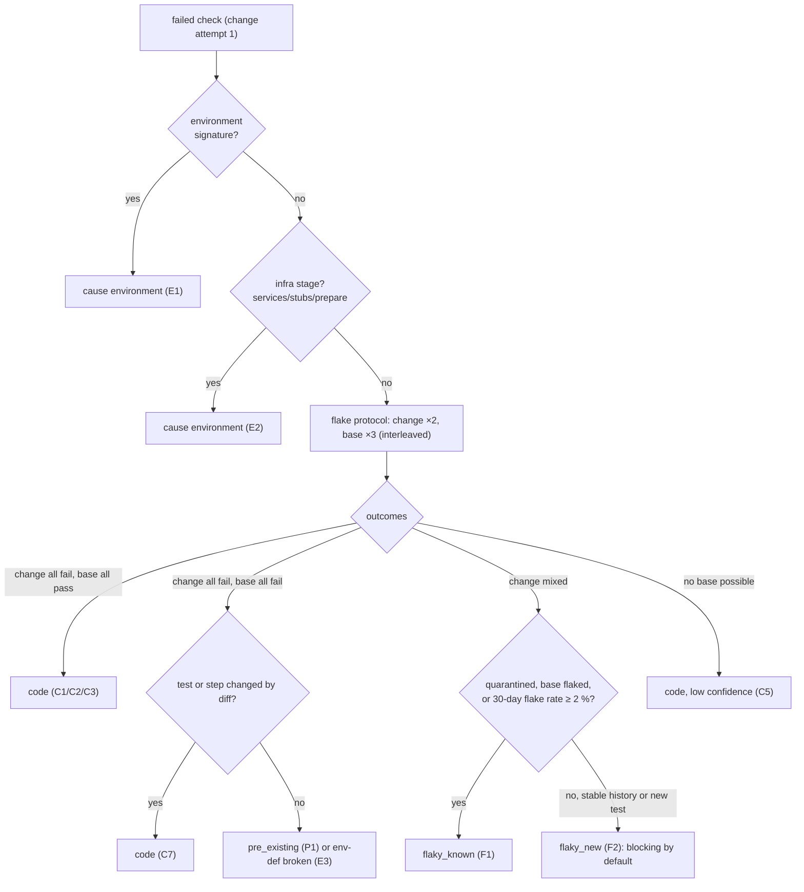

# Failure Feedback: QA Result Schema, Classification, Routing, Flakes

**Owner:** WS-05 · **Constraints:** D-15 (bounded loops), D-19 (QA may raise risk only), D-21 · **ADR:** [ADR-05-005](adr/005-flake-classification.md)
**Schemas:** [qa-report](schemas/qa-report.schema.json) · [role-result-qa](schemas/role-result-qa.schema.json) · [qa-feedback](schemas/qa-feedback.schema.json) · [DDL `qa`](sql/qa-schema.sql)

## Purpose

A failed check is only useful if Replicant knows **whose problem it is**: the change (send it back
to the implementer), the environment definition (tell operators), the test (flaky or broken; do not
waste a fix loop), or something nobody can decide automatically (tell the user). This document
defines the structured result, the deterministic classification rules, the flake protocol that
separates flaky tests from regressions, and how each class routes.

## Decisions summary

| # | Decision | Constraint |
|---|---|---|
| F1 | Three documents: `role_result` (`replicant.role-result.qa/v1`, ≤ 20 failures, read by the workflow from `run_result`), `qa_report` (`replicant.qa-report/v1`, full, `report_stage: sandbox`, written in the sandbox), and the **classified** `qa_report` (`report_stage: classified`, written by activity `qa.classify` under the step prefix, with history and `classification_facts`; the routing decision is the `qa_run` node's alone, R1-118) | C-ART, run-result contract |
| F2 | Every check has a **stable `test_id`** (normalization §3.2), a list of **attempts on change and base trees**, a **cause** in a closed set (`code`, `flaky_new`, `flaky_known`, `pre_existing`, `environment`, `test_defect`, `unknown`), the **rule ID** that fired, a confidence, and evidence URIs | brief §5 |
| F3 | Classification is **deterministic**: environment signatures (§3.3) and evidence rules (§3.4). The QA agent's diagnosis may only escalate a cause to blocking (and only for failures touching diff files); history may only decide between `flaky_known` and `flaky_new` for **mixed** outcomes; **history never dismisses a consistent failure** | D-19 (spirit) |
| F4 | **Flake protocol in-run**: each failed test is re-run individually `changeReruns` (2) times on the change tree and `baseReruns` (3) times on a base worktree, interleaved; a 30-day history per `(tenant, repo, test_id)` comes from Postgres schema `qa` (CCR-05-02) | — |
| F5 | Routing: `code`/`flaky_new` → bounded implementer fix loop with a feedback packet; `environment` → one QA retry, then operator alert plus publish gate with QA `inconclusive`; `pre_existing`, `flaky_known`, `test_defect` → non-blocking, shown to approver and requester; `unknown` on a required check → `inconclusive` | D-15, D-19 |
| F6 | QA never lowers risk: `fail` → risk floor ≥ `medium` during fix loops and `critical` after the budget; `inconclusive` → ≥ `high` (publish gate opens) | D-19 |



---

## 1. Result documents and who reads them

| Document | Writer | Location | Reader | Purpose |
|---|---|---|---|---|
| `run_result` with `role_result` (`replicant.role-result.qa/v1`) | entrypoint (WS-03) from harness output `/replicant/out/qa/role_result.json` | `runs/<run>/run_result/result.json` | workflow (`runner.get_run` → result), projector (QA chip), UI | Verdict, counts, top 20 failures, stage statuses; ≤ 1 MiB |
| `qa_report` (sandbox) | harness | `runs/<run>/qa_report/report.json` | `qa.classify`, UI QA tab, reviewer agent | Every check with attempts, evidence, provisional cause (without history) |
| `qa_report` (classified) | activity `qa.classify` | `steps/qa.c<c>.n<o>/qa_report/classified.json` | `qa_run` node (via the small `ClassifyOutput`), approval packet, PR comment, `qa.index_results` | Final causes (with history), `classification_facts`, `history_snapshot`, `test_inventory` |
| `qa_feedback` | `qa.classify` (whenever the verdict is `fail`; staged for the implementer only if the node decides `fix_loop`) | `steps/qa.c<c>.n<o>/qa_report/feedback.json` | context assembler → next implementer run | What to fix, with reproduce commands |
| `qa_report` diagnosis (optional) | QA agent task | `runs/<run>/qa_report/diagnosis.json` | `qa.classify` (escalation only), feedback packet (quoted) | Model hypothesis |

`run_result.outcome` mapping (envelope enum is fixed by C-RUNNER): `pass` and `pass_with_warnings` →
`completed`; `fail` → `failed`; `inconclusive` → `failed`; `not_applicable` → `no_changes`. QA never uses
`blocked`, which C-RUNNER reserves for "needs a human (clarification)" (R1-116). Consumers read
`role_result.verdict`; `outcome` alone cannot distinguish a regression from an inconclusive run.

The activity payloads (`qa.stage_contract_stubs`, `qa.classify`, `qa.index_results`) are fixed by
[schemas/qa-activities-io.schema.json](schemas/qa-activities-io.schema.json) (R1-118).

**AgentRun failure reason mapping (C-RUNNER 3.0.0, C-CRD 3.0.0).** Causes map onto the closed failure-reason
set as follows: `code`, `flaky_*`, `pre_existing`, `test_defect` never fail the AgentRun (phase
`Succeeded`, verdict carries them). `environment` in a setup stage (prepare, install, build tooling →
exit 44; services, stubs, seed → exit 45) fails the run with **`EnvironmentSetupFailed`** (retryable),
with the report and `run_result` uploaded. Resource exhaustion keeps its own reasons
(`WorkspaceDiskExceeded`, `OOMKilled`), and security automation gives `SecurityViolation`. The
complete table is in [stage-design.md §4.4](stage-design.md#44-stage-sequence).

Examples: [examples/qa-report-failed-classified.json](examples/qa-report-failed-classified.json),
[examples/run-result-qa-passed.json](examples/run-result-qa-passed.json),
[examples/qa-feedback-fix-loop.json](examples/qa-feedback-fix-loop.json). All validate
(`tools/validate_examples.py`).

## 2. Verdict rules

| Verdict | Condition (evaluated in order) | `reason_code` |
|---|---|---|
| `not_applicable` | `qa.enabled: false` | `qa_disabled` |
| `inconclusive` | a required stage is `not_run` or `error` for environment reasons, or any required check has cause `environment` or `unknown`, or `budget_exhausted` before a required stage, or the run's profile is not allowed on the runtime | `environment_failure`, `budget_exhausted`, `unsupported_runtime`, `unknown_failure` |
| `fail` | at least one check with `blocking: true` | `regression`, `new_flake`, `build_broken`, `secret_in_image`, `app_unhealthy`, `a11y_regression`, `contract_breaking`, `visual_unexpected` (the first matching, by stage order) |
| `pass_with_warnings` | non-blocking findings exist: `flaky_known`, `pre_existing`, `test_defect`, warning checks, a11y/visual notes | `non_blocking_findings` |
| `pass` | otherwise | `all_passed` |

`blocking` is true for a check with `required: true` and cause `code`, or cause `flaky_new` when
`flake.newFlakeBlocks` is true (default). It is false for everything else.

Note that `inconclusive` wins over `fail` when both apply: if Kafka never started, integration tests
were not run, and a unit test also failed, the verdict is `inconclusive` (QA cannot vouch) while the
unit failure is still included in the feedback, so the fix loop can address it after the retry.

## 3. Classification

### 3.1 Inputs

- The check's attempts (`variant: change|base`, status per attempt).
- Stage and step metadata (`required`, `alsoOnBase`).
- Diff facts from the diff bundle's `metadata.json`: changed files, and whether any changed file is a
  dependency manifest or lockfile (`go.mod`, `go.sum`, `package.json`, `package-lock.json`,
  `pnpm-lock.yaml`, `yarn.lock`, `pyproject.toml`, `uv.lock`, `poetry.lock`, `requirements*.txt`,
  `Cargo.toml`, `Cargo.lock`, `pom.xml`, `build.gradle*`, `gradle.lockfile`), and whether the
  failing test's file was added or modified.
- Environment signatures matched in the check's log excerpt (§3.3).
- History from `qa.test_stats_30d` (classified stage only).
- The quarantine list (`qa.flake.quarantine`, pinned in the bundle).
- The QA agent's diagnosis (escalation only).

### 3.2 Test identity

`test_id` must be identical for the same test across runs, trees, and machines:

| Source | `test_id` format | Example |
|---|---|---|
| Go (`go test -json` / gotestsum JUnit) | `go:<package import path>.<TestName>[/<subtest>]` | `go:github.com/acme-payments/ledger-api/internal/ledger.TestApplyRefund/partial_eur_fx_fee` |
| JUnit generic (JVM, pytest, vitest) | `junit:<classname>::<name>` with whitespace collapsed and pytest parametrization ids kept | `junit:tests.test_settle::test_fee_rounding[EUR-0.19]` |
| Playwright | `pw:<file relative to repo>::<title path joined by ' > '> [<project>]` | `pw:e2e/checkout.spec.ts::checkout > applies coupon [chromium]` |
| Generated flow | `gen:<sha256(flow file)[0:12]>::<title>` | `gen:3f9a1c2e7d4b::partial refund shows prorated FX fee` |
| Steps | `step:<stage>/<step id>` | `step:build/go_build` |
| Health and smoke | `health:<readiness|stability|pattern>/<name>`, `smoke:<name>`, `completion:<output name>` | `health:readiness/grpc_health` |
| Services | `services:<name>`, `stubs:<name>` | `services:kafka` |
| Web | `routes:<name>@<viewport>`, `a11y:<route>@<viewport>:<rule_id>`, `visual:<route>@<viewport>` | `a11y:checkout@desktop:color-contrast` |

Random parts in test names (timestamps, UUIDs, temp paths) are normalized by the harness with fixed
regexes (`[0-9a-f]{8}-[0-9a-f]{4}-…` → `<uuid>`, `/tmp/[^ ]+` → `<tmp>`, ISO timestamps → `<ts>`)
before hashing. Tests whose identity is still unstable show up as "new test" every run, never
accumulate history, and so can never be classified `flaky_known`; that is the conservative failure
direction.

### 3.3 Environment signatures

A signature is a fixed regex set evaluated over the failing check's log excerpt and the stage log.
Signatures ship with the harness (in the environment image's QA layer, so they are pinned through the
bundle). A match makes the cause `environment` (rule E1), **except** rule C4 (dependency change) and
memory signatures, which require the base comparison.

| Signature | Pattern (RE2, abbreviated alternation) | Stages | Notes |
|---|---|---|---|
| `mirror_5xx` | `(?i)(npm ERR!|ERR_PNPM|error: Failed to download|pip.*HTTPError|go: .*: reading .*: (502|503|504))` combined with mirror host `artifactory\.acme\.internal` | install | retry_qa |
| `dns_failure` | `EAI_AGAIN|Temporary failure in name resolution|no such host|getaddrinfo ENOTFOUND` | any | network profile issue if repeated |
| `egress_denied` | `connect: connection refused|ECONNREFUSED|i/o timeout` with a non-loopback address in the same line | any | non-allowlisted dependency; env-def or code (tests calling the internet) → `environment` + hint |
| `registry_pull_failed` | `manifest unknown|toomanyrequests|pull access denied|unauthorized: authentication required` | services, Podman pulls | |
| `image_not_allowlisted` | `Source image rejected: .*policy` | Testcontainers | definition update needed |
| `docker_api_unavailable` | `Could not find a valid Docker environment|Cannot connect to the Docker daemon|DOCKER_HOST` | tests | dependencies.md §5.1 |
| `service_not_ready` | harness-generated (readiness timeout) | services | |
| `service_oom` | `replicant-svc-wrap: exited status=137` | services | |
| `disk_full` | `ENOSPC|No space left on device` | any | normally the run fails `WorkspaceDiskExceeded` first |
| `playwright_version_mismatch` | harness-generated | prepare | |
| `browser_launch_failed` | `browserType.launch: .*(Failed to launch|Target page, context or browser has been closed)` at launch | web | |
| `contract_unavailable` | harness-generated | stubs | |
| `clock_skew` | `certificate is not yet valid|x509: certificate has expired or is not yet valid` | install | |
| `package_blocked_by_curation` | curated-repo refusals: HTTP 403/404 from `artifactory\.acme\.internal/api/(npm|pypi|go)/.*-virtual` with the mirror's block reason (72 h freshness quarantine, malicious-package feed, first-seen name; WS-09 agent-capabilities §7) | install | not retried; if the diff added the dependency → `code` (C4) with the block reason in the feedback, else operator alert |
| `memory_pressure` *(needs base)* | `JavaScript heap out of memory|java.lang.OutOfMemoryError|signal: killed|exit status 137` | test, build | classified by base comparison: passes on base → `code` (the change uses more memory); fails on base → `environment` (profile too small) |

### 3.4 Rules (first match wins, in this order)

| Rule | Condition | Cause | Confidence | Blocking (required check) |
|---|---|---|---|---|
| P0 | all attempts passed | none | high | no |
| E1 | environment signature matched (not `memory_pressure`) and C4 does not apply | environment | high | n/a (verdict `inconclusive`) |
| E2 | stage ∈ {prepare, services, stubs} | environment | high | n/a |
| C4 | stage = install, failed, and the diff touches a dependency manifest or lockfile | code | high | yes |
| C7 | test (or flow) file added or modified by the diff, and the test failed every change attempt | code | high | yes |
| C1 | test failed every change attempt (≥ 2) and passed every base attempt (≥ 2) | code | high if history is stable (flake rate < 0.5% over ≥ 20 runs) or no history; else medium | yes |
| C2 | stage ∈ {build, image_build, seed, app_start, health, smoke} failed on change and the same step passed on base | code | high | yes |
| C3 | web route check failed (status, waitFor, page error, console pattern) on change, passed on base | code | high | yes |
| A1 | new a11y violation (absent on base) whose impact matches `failOn` | code | high | yes |
| S1 | `secret_scan` found a secret in the built image's filesystem (gitleaks rules pinned in the QA tools; `secret_scan_report`, CCR-09-05) | code | high | yes (the finding shows rule, path, line, HMAC fingerprint; never the value) |
| K1 | `contract_compat`: breaking change on a contract that has consumers, and `contractCompat.blockOnBreaking` | code | high | **no in graph runs**: the node passes `contract_compat: report_only` (XD-FIX-R1-120), so K1 only exports `role_result.contract_compat`; WS-01's `contract_check` node applies the workflow-type policy. Blocking applies only to standalone `qa_only` runs with `blockOnBreaking`. WS-07 risk rules raise risk in all cases (`contract_breaking_with_consumers`, WS-04) |
| V1 | visual change not in `expected_ui_changes` with `visual.blocking: true` | code | medium | yes |
| G1–G3 | generated flows | headless-validation.md §5.4 | | |
| E3 | build/seed/app/health stage failed on change **and** base | environment (env definition broken on base) | high | n/a; operator alert `environment_definition` |
| P1 | test failed every change attempt and every base attempt, test not changed by the diff | pre_existing | high | no; user notice |
| F1 | mixed outcome on change, and (test quarantined, or ≥ 1 base failure, or 30-day flake rate ≥ 2% over ≥ 20 runs) | flaky_known | high | no |
| F2 | mixed outcome on change, all base attempts passed, and (30-day flake rate < 0.5% over ≥ 20 runs, or the test is new/modified by the diff) | flaky_new | medium | yes if `newFlakeBlocks` |
| F3 | mixed outcome on change, otherwise (sparse history, 0.5–2% rate) | flaky_known | low | no; counted in the flake budget |
| C5 | failed every change attempt, no base evidence possible (base worktree could not build, or budget) and no signature | code | low | yes ("could not confirm on base" in feedback) |
| C6 | non-required step failed; the failing location (file:line) is in the diff | code | medium | no (feedback only) |
| U1 | anything else | unknown | low | n/a (verdict `inconclusive` if required) |

**Agent escalation (D-19 spirit).** If the diagnosis names a non-blocking check as caused by the
change and the check's `failure.file` or any stack frame is a file in the diff, `qa.classify` sets
`escalated_by_agent: true` and the cause to `code` (blocking if required). No other effect of the
diagnosis exists: it can never set `blocking: false`, never change `environment` or `pre_existing`
into anything milder, and never add a check.

**Quarantine never hides a consistent regression.** F1 applies only to mixed outcomes. A
quarantined test that fails 3/3 on change and passes 3/3 on base is C1 (`code`), with a note that it
is quarantined.

### 3.5 Implementation (`qa.classify`, replicant-worker)

```python
# replicant_worker/activities/qa_classify.py (WS-05). Pure classification core; I/O wrappers omitted.
from __future__ import annotations

from dataclasses import dataclass, field
from typing import Literal, Optional

Cause = Literal["none", "code", "flaky_new", "flaky_known", "pre_existing", "environment", "test_defect", "unknown"]
INFRA_STAGES = {"prepare", "services", "stubs"}
STEP_STAGES = {"build", "image_build", "seed", "app_start", "health", "smoke"}
WEB_STAGES = {"routes"}


@dataclass(frozen=True)
class History:
    runs: int
    flaky_runs: int
    code_failures: int
    base_attempts: int
    base_failures: int

    @property
    def flake_rate(self) -> Optional[float]:
        denom = self.runs - self.code_failures
        return None if denom <= 0 else self.flaky_runs / denom


@dataclass
class Check:
    stage: str
    test_id: str
    required: bool
    change: list[bool]           # True = passed, per change attempt in order
    base: list[bool]             # per base attempt
    env_signature: Optional[str] = None
    test_file_in_diff: bool = False
    failure_file_in_diff: bool = False
    quarantined: bool = False
    history: Optional[History] = None
    a11y_new_matches_fail_on: bool = False
    visual_unexpected_blocking: bool = False
    generated: Optional[Literal["regression_guard", "new_behavior"]] = None
    agent_says_change_caused: bool = False
    contract_breaking_blocks: bool = False
    result: dict = field(default_factory=dict)


def _stable(h: Optional[History]) -> bool:
    return h is None or h.runs < 20 or (h.flake_rate is not None and h.flake_rate < 0.005 and h.base_failures == 0)


def _known_flaky(h: Optional[History]) -> bool:
    return h is not None and h.runs >= 20 and ((h.flake_rate or 0) >= 0.02 or h.base_failures > 0)


def classify(c: Check, *, deps_changed: bool, new_flake_blocks: bool) -> tuple[Cause, str, str, bool]:
    """Returns (cause, rule, confidence, blocking). Deterministic for identical inputs."""
    chg_fail = [not p for p in c.change]
    all_fail = bool(chg_fail) and all(chg_fail)
    mixed = any(chg_fail) and not all_fail
    base_ok = bool(c.base) and all(c.base)
    base_all_fail = bool(c.base) and not any(c.base)
    blocking = lambda cause: c.required and (cause == "code" or (cause == "flaky_new" and new_flake_blocks))

    def done(cause: Cause, rule: str, conf: str) -> tuple[Cause, str, str, bool]:
        b = blocking(cause)
        if not b and c.agent_says_change_caused and c.failure_file_in_diff and cause in {"flaky_known", "flaky_new", "unknown"}:
            cause, rule, b = "code", rule + "a", c.required  # escalation only (never de-escalation)
        return cause, rule, conf, b

    if not any(chg_fail):
        return done("none", "P0", "high")
    if c.env_signature and c.env_signature != "memory_pressure" and not (c.stage == "install" and deps_changed):
        return done("environment", "E1", "high")
    if c.stage in INFRA_STAGES:
        return done("environment", "E2", "high")
    if c.stage == "install" and deps_changed:
        return done("code", "C4", "high")
    if c.generated is not None:
        return done(*_classify_generated(c, all_fail, base_ok, base_all_fail))
    if c.test_file_in_diff and all_fail:
        return done("code", "C7", "high")
    if all_fail and base_ok and len(c.change) >= 2 and len(c.base) >= 2:
        if c.stage in STEP_STAGES:
            return done("code", "C2", "high")
        if c.stage in WEB_STAGES:
            return done("code", "C3", "high")
        return done("code", "C1", "high" if _stable(c.history) else "medium")
    if all_fail and base_ok and c.stage in STEP_STAGES | WEB_STAGES:
        return done("code", "C2" if c.stage in STEP_STAGES else "C3", "high")
    if c.a11y_new_matches_fail_on:
        return done("code", "A1", "high")
    if c.stage == "secret_scan":
        return done("code", "S1", "high")
    if c.stage == "contract_compat" and c.contract_breaking_blocks:
        return done("code", "K1", "high")
    if c.visual_unexpected_blocking:
        return done("code", "V1", "medium")
    if all_fail and base_all_fail:
        if c.stage in STEP_STAGES:
            return done("environment", "E3", "high")
        return done("pre_existing", "P1", "high")
    if mixed:
        if c.quarantined or _known_flaky(c.history) or any(not p for p in c.base):
            return done("flaky_known", "F1", "high")
        if base_ok and (c.test_file_in_diff or (c.history is not None and c.history.runs >= 20 and _stable(c.history))):
            return done("flaky_new", "F2", "medium")
        return done("flaky_known", "F3", "low")
    if all_fail and not c.base:
        return done("code", "C5", "low")
    if not c.required and c.failure_file_in_diff:
        return done("code", "C6", "medium")
    return done("unknown", "U1", "low")


def _classify_generated(c: Check, all_fail: bool, base_ok: bool, base_all_fail: bool) -> tuple[Cause, str, str]:
    if c.generated == "regression_guard":
        if all_fail and base_ok:
            return "code", "G1", "medium"
        if all_fail and base_all_fail:
            return "test_defect", "G2", "high"
    return "unknown", "G3", "low"
```

(`_classify_generated` returns a non-blocking `unknown` for every new-behavior failure, because the
check's `required` is set to `false` for new-behavior flows by the harness.)

Unit-test vectors for this function live with the code (WS-05 deliverable for implementation):
every row of the §3.4 table has at least one positive and one negative vector, including "quarantined
+ C1 evidence → code".

## 4. The flake protocol (must answer: flaky test vs regression)

### 4.1 In-run evidence

For each failed test (stages `unit`, `integration`, `e2e_repo`, `e2e_generated`) after the step
finished:

1. If more than `maxFailedTestsForReruns` (25) tests failed in the step, skip per-test reruns: the
   failure is systematic (build-level). Run the whole step once on the base worktree; the step-level
   outcome decides (C2/E3/P1).
2. Otherwise create the base worktree (`git worktree add --detach /workspace/base <base_sha>`, install
   with cache reuse) and run, **interleaved**, `change, base, change, base, base` (for the defaults
   `changeReruns: 2`, `baseReruns: 3`), using the step's `rerun.command` with a selector for exactly
   the failed tests. Interleaving spreads both trees over the same time window, so a transient
   environment problem (noisy neighbor, slow mirror) hits both.
3. Services that hold state are reset before switching trees when `resetBetweenPasses: command`.
4. Each attempt is recorded (`attempts[]`), and the reruns' JUnit is uploaded
   (`junit_xml/<step>-reruns.xml`).

Cost: re-running a handful of failed tests is seconds to a few minutes; the base install is the main
cost (cache reuse makes it 10–60 s for unchanged lockfiles).

### 4.2 Why this separates the two

Treat a flaky test as failing independently with probability `p` per attempt, and a regression as
failing on the change with probability near 1 and on base with probability `p_base` (its usual
flakiness).

- **A flaky test misread as a regression (C1)** requires failing the first attempt and both change
  reruns and passing all three base attempts: `p³(1−p)³`. For `p = 0.05`: 1.1 × 10⁻⁴; for an extremely
  flaky `p = 0.3`: 0.9%. History catches the latter (F1 by flake rate ≥ 2%).
- **A deterministic regression misread as flaky** is impossible: it fails every change attempt, so
  it is never "mixed"; it lands in C1 or, if the base also fails, P1.
- **An intermittent regression** (the change introduced a race) shows as mixed on change, clean on
  base, and stable history: F2 `flaky_new`, which blocks by default. That is the intended outcome:
  the change made a stable test flaky.
- **A pre-existing failure** fails on base too: P1, non-blocking, reported to the requester and
  repo owners.

### 4.3 History

`qa.index_results` (replicant-projector, after each classified report) writes one row per test to
`qa.test_results` and upserts `qa.test_stats_daily` (DDL: [sql/qa-schema.sql](sql/qa-schema.sql),
applied cleanly to PostgreSQL 17 during this workstream). The classifier reads `qa.test_stats_30d`:

- `flake_rate = flaky_runs / (runs − code_failures)`: runs where the same tree produced both a pass
  and a failure, excluding runs where the test legitimately caught a regression.
- `base_failure_rate = base_failures / base_attempts`: failures on unmodified base trees, the
  cleanest flakiness signal.

History is operational data (ADR-013): read live, recorded in `history_snapshot` (`as_of`,
`lookback_days`, `available`). If Postgres is unavailable, `available: false` and F1/F2/F3 fall back to
in-run evidence plus the quarantine list (history-dependent branches take their "no history" path).

The schema needs a contract change (CCR-05-02). If it is rejected, the fallback is the same table
inside `jobs_read` written by the projector, or no history at all; the in-run protocol alone still
decides C1/P1 correctly and only loses the F1-vs-F2 distinction for tests without quarantine
entries.

### 4.4 Flake budget and quarantine workflow

- Metric `replicant_qa_checks_total{tenant, reason="flaky_known"}` per tenant per day. When a tenant's
  `flaky_known` checks exceed 5% of failing checks for 7 days, `qa.classify` sets
  `operator_alert: flake_budget` on new reports for that tenant, and the control-plane QA view lists
  the top 20 flakiest tests (from `qa.test_stats_30d`) with "add to quarantine" proposals.
- Quarantine entries live in the environment definition (`qa.flake.quarantine`, owner + expiry);
  adding one is a config-repo PR (behavioral config, pinned in the bundle). The linter flags expired
  entries.

## 5. Routing

### 5.1 To the implementer (bounded fix loop)

When the `qa_run` node's `route_after_qa` returns `fix_loop` (stage-design.md §6):

1. `qa.classify` writes `feedback.json` (`replicant.qa-feedback/v1`): all blocking findings (≤ 20) and
   up to 10 non-blocking ones, each with `evidence_summary` (replicant-generated sentence such as
   "failed 3/3 on the change, passed 3/3 on base (8c1e4f2)"), message, stack excerpt, file:line,
   `in_diff`, log excerpt, aria snapshot for web checks, and **reproduce commands** taken from the
   environment definition's `rerun.command` with the selector filled in.
2. The context assembler (WS-04) stages it into the implementer's inputs and renders it in the task
   packet inside an untrusted-content block (test output is repo-controlled text), framed by the
   Replicant prompt `qa-feedback-frame` (pinned in the bundle). Screenshots of failing web checks are
   staged as input files for multimodal CLIs (`screenshot_path_in_inputs`).
3. The implementer run (`implementer.c<c>.n<o+1>.run`) resumes its session or starts from the handoff
   (WS-04 decides per role) and produces a new diff bundle against the same `base_sha`.
4. QA runs again (`trigger: after_fix`) with `qa/previous-blocking.json` so the report shows, per
   earlier blocking test, `now: passing|failing`. If a test that was fixed in iteration 1 fails again
   in iteration 2 (oscillation), the report carries warning `fix_oscillation` and the routing
   function treats the cycle as exhausted (`gate_with_failure`) rather than spending the remaining
   budget.
5. The loop is bounded by `repair_limits.qa.fix_iterations` (default 2) and by the job budget.

### 5.2 To operators (environment-definition issues)

When the cause is `environment` (E1/E2/E3) or the run failed with `WorkspaceDiskExceeded`/`OOMKilled`:

- One QA retry for transient signatures (`mirror_5xx`, `dns_failure`, `registry_pull_failed`,
  `clock_skew`, run-level `NodeLost`/`PodEvicted`/`Preempted`). No retry for definition-level
  signatures (`playwright_version_mismatch`, `image_not_allowlisted`, `docker_api_unavailable`, E3,
  `contract_unavailable`) or resource exhaustion.
- Operator alert: activity `notify.operator` (WS-07, R1-119), which calls control-plane-api
  `POST /internal/v1/notifications` with exactly:
  `{dedupe_key: "qa-env:<run_id>", event_key: "qa.environment_failure", tenant_id, job_id,
  recipients: {roles: [operators, environment_owners]}, vars: {run_id, stage, check_id,
  evidence_key, verdict}, operator: {definition_ref: "<name>@<version>", signature,
  proposed_patch_uri?}}`. WS-01's `qa_run` node calls it on `operator_and_gate` and on qa_only
  `fail_job` with an environment cause, with the payload built from `qa.classify`'s output; metric
  `replicant_qa_environment_failures_total{tenant, reason=<signature>}`; Loki log line with structured
  metadata `job_id`, `run_id`. When the QA agent task `repair_harness_config` is enabled, its proposed
  environment-definition patch is attached; it is never applied automatically.
- For `WorkspaceDiskExceeded`/`OOMKilled`, WS-03's right-sizing proposal uses the report's
  `peak_workspace_bytes`/`peak_memory_bytes` and the partial manifest.
- The job continues to the publish gate with risk floor `high` and QA `inconclusive` clearly marked;
  approvers may approve with that knowledge, reject, or decide `rerun_qa` once operators have fixed
  the definition (C-MSG 1.6.0, CCR-05-04).

### 5.3 To the user (requester and approver)

| Situation | Where shown | Text (replicant-generated) |
|---|---|---|
| `pre_existing` failures | approval packet, PR comment, job timeline | "2 tests fail on `main` too (not caused by this change): …" |
| `flaky_known` | approval packet, PR comment (collapsed) | "1 known flaky test failed once and passed on rerun: …" |
| `test_defect` (generated flows) | approval packet | "1 generated check was discarded (fails on `main` too)" |
| QA `inconclusive` | gate packet banner, Slack/GitHub gate message, PR comment | "QA could not run completely: Kafka sidecar did not become ready (environment). Operators notified." |
| QA failing after fixes | gate packet banner (risk critical) | "QA still fails after 2 fix attempts: …; publishing allowed only as a draft PR" |

## 6. Retry policy summary

| Level | What | Max | Decided by |
|---|---|---|---|
| Test | change reruns / base reruns | 2 / 3 per failed test (≤ 25 tests) | harness, `qa.flake` |
| Step | whole-step base run when > 25 tests fail | 1 | harness |
| Run | QA re-run for transient environment causes or retryable AgentRun failures (never for `SecurityViolation`, CCR-09-04) | 1 per cycle | `route_after_qa` |
| Node | implementer fix loop | `repair_limits.qa.fix_iterations` (2) per cycle | `route_after_qa`, `repair_limits` |
| Activity | Temporal retries of `qa.classify`, `runner.*` | per activity retry policy | Temporal (do not change run identity) |

## 7. Metrics (names; WS-08 owns dashboards)

| Metric | Type | Labels | Meaning |
|---|---|---|---|
| `replicant_qa_runs_total` | counter | `tenant`, `workflow_type`, `isolation`, `outcome` (verdict) | QA runs by verdict |
| `replicant_qa_run_duration_seconds` | histogram | `tenant`, `isolation`, `outcome` | harness wall time |
| `replicant_qa_stage_duration_seconds` | histogram | `tenant`, `isolation`, `qa_stage` | per stage |
| `replicant_qa_checks_total` | counter | `tenant`, `qa_stage`, `reason` (cause) | failing checks by cause |
| `replicant_qa_tests_deleted_or_skipped_total` | counter | `tenant`, `workflow_type` | QA runs whose test inventory shows removed or newly skipped tests (R2-006) |
| `replicant_qa_checkpoint_stages_reused_total` | counter | `tenant`, `qa_stage` | stages skipped on a retry by checkpoint reuse (R2-033) |
| `replicant_qa_environment_failures_total` | counter | `tenant`, `reason` (signature) | operator-facing |
| `replicant_qa_fix_iterations` | histogram | `tenant`, `workflow_type` | QA-driven fix loops per cycle |
| `replicant_qa_flake_reruns_total` | counter | `tenant`, `outcome` (`change`/`base`) | rerun volume |

`qa_stage` is an allowed label key since C-IDS 1.10.0 (CCR-05-03 accepted) with the 22 stage values
of `replicant.qa-report/v1`. The QA first-pass rate is **not** a WS-05 metric: replicant-projector emits it
from the projected node results with WS-06/WS-08's `release_cohort` and `bundle` labels, so WS-05 emits
no `replicant_qa_first_pass_total` (R1-130, avoids double counting).

---

## Open questions

| ID | Question | Who decides | Options | Recommendation |
|---|---|---|---|---|
| OQ-05-10 | How does an approver re-run QA after operators fix an environment definition? | WS-01 / WS-07 | new job-control Update `job.rerun_node` (contract change) / reject and re-trigger / bundle migration | A `qa_rerun` decision on the publish gate (`request_changes` with a reason code) mapped by WS-01 to a QA re-run; avoids a new message type. If WS-01 prefers an explicit Update, it files the CCR |
| OQ-05-11 | Should `flaky_new` block by default? | Tenant owners | block / warn | Block (default `newFlakeBlocks: true`): a change that makes a stable test flaky is usually a real race |
| OQ-05-12 | Thresholds 0.5% / 2% / 20 runs | WS-05 with WS-06 data | tune after 30 days of history | Start as specified; WS-06 measures misclassification against human labels on 200 sampled failures |

## Risks

- **Base reruns cost time** when many tests fail for a systematic reason; the 25-test cutoff bounds
  it.
- **Test identity instability** (dynamic names) defeats history; the conservative direction (treat as
  new, never `flaky_known` from history) keeps that safe but noisy.
- **Pre-existing failures** on the default branch make QA permanently `pass_with_warnings` for a repo.
  The user notice routes this to repo owners; it does not block Replicant work.

## Interfaces

- **Provided:** `replicant.qa-report/v1`, `replicant.role-result.qa/v1`, `replicant.qa-feedback/v1`
  schemas; rule table §3.4; `qa.classify` and `qa.index_results` activities; `qa` schema DDL (pending
  CCR-05-02); metrics (§7).
- **Consumed:** run-result envelope (C-RUNNER), diff bundle `metadata.json` (WS-03), context assembler
  staging (WS-04), `repair_limits` (WS-01), `notify.operator` (WS-07), Prometheus label keys (C-IDS §11,
  CCR-05-03).
