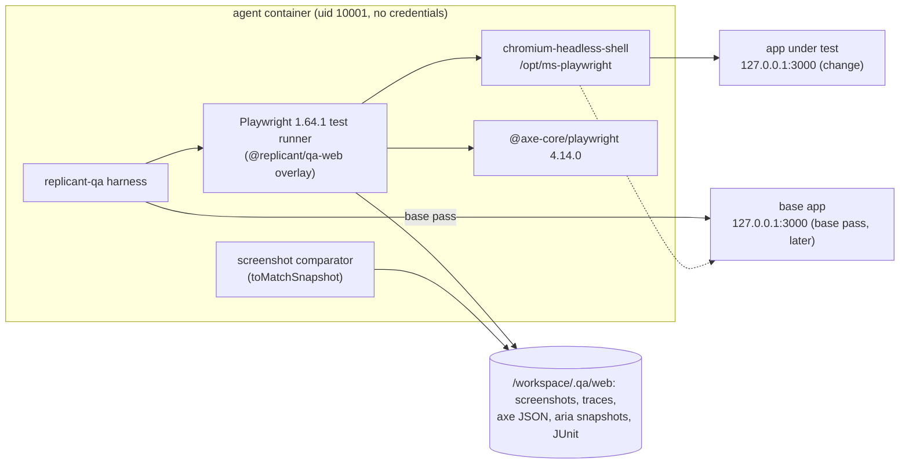

# Headless Web Validation

**Owner:** WS-05 · **Constraints:** D-16 (headless Playwright: DOM assertions, screenshots, traces; no GUI), D-08, D-21 · **ADR:** [ADR-05-006](adr/006-visual-baseline-same-run.md)

## Purpose

For web apps, prove in a headless browser that the changed app renders, that its own end-to-end
tests pass, that the user-facing behavior described in the plan works, that accessibility did not
regress, and show the approver what changed visually. Everything runs inside the QA AgentRun with
browsers baked into the image. There is no GUI, no VNC, no window manager, and no headed browser.

## Decisions summary

| # | Decision | Constraint |
|---|---|---|
| W1 | **Playwright 1.64.1** (`@playwright/test`), browsers baked into the environment image at build time under `PLAYWRIGHT_BROWSERS_PATH=/opt/ms-playwright` (a WS-03 `image` cache); Chromium as **headless shell** only (`--only-shell`). Runtime downloads are disabled. The configured version must equal the repo's `@playwright/test` lockfile version for repo tests | D-16, D-12, D-21 |
| W2 | Three test sources, all run by the harness against the already-healthy app: (1) the repo's own Playwright tests through a **Replicant overlay config**, (2) a **deterministic route crawl** from `web.smokeFlows.routes`, (3) **agent-generated smoke flows** from the plan's acceptance criteria (linted, base-checked, never blocking on their own unless they are regression guards that pass on base) | D-16 |
| W3 | Evidence policy: screenshots for every crawled route × viewport (always) and for failing repo tests; Playwright **traces `retain-on-failure`**; **video off by default**; aria snapshots (text) at every failure. Traces and videos are **Restricted** (WS-09 G-14): scrubbed at capture (§4.1), never embedded in packets, Slack, or PRs, presigned only to job viewers with repo write | D-08, D-21 |
| W4 | **Visual diff against the base branch** built and run **in the same AgentRun** (base worktree), only when the diff touches configured UI paths; compared with Playwright's own screenshot comparator; advisory by default | D-16 |
| W5 | **Accessibility**: `@axe-core/playwright` 4.14.0 with WCAG 2.0/2.1/2.2 A and AA tags on every crawled route; **only new serious/critical violations** (absent on base) block by default | D-16 |
| W6 | The browser may reach only `127.0.0.1`/`localhost`: every other request is aborted by a context route handler and recorded, in addition to the network policy | D-21 |
| W7 | PII masking in screenshots: environment-definition locators plus defaults (`input[type=password]`, `input[type=email]`, `[autocomplete*=cc-]`, `[data-replicant-mask]`) via Playwright `mask` (resolves the C-ART open question) | D-21 |



---

## 1. Browsers in the image

WS-03 builds environment images from `spec.image.build` (prebuilt by config CI, signed, pinned by
digest; WS-03 ADR-010). For `appKind: web`, WS-05 requires these build steps (shown as they appear in
[examples/env-nextjs-storefront.yaml](examples/env-nextjs-storefront.yaml); XD-05-07):

```yaml
image:
  build:
    packages:
      apt: [fonts-noto-core, fonts-noto-cjk, fonts-noto-color-emoji]   # deterministic rendering
      npmGlobal: ['@playwright/test@1.64.1']
    steps:
      - name: playwright-browsers
        run: |
          PLAYWRIGHT_BROWSERS_PATH=/opt/ms-playwright PLAYWRIGHT_SKIP_BROWSER_GC=1 \
            npx --yes playwright@1.64.1 install --with-deps --only-shell chromium
          chmod -R a+rX /opt/ms-playwright
        workingDir: /tmp
        timeoutSeconds: 1200
      - name: replicant-qa-web
        run: |
          mkdir -p /opt/replicant-qa/web && cd /opt/replicant-qa/web
          npm install --no-audit --no-fund @replicant/qa-web@1.0.0 @axe-core/playwright@4.14.0 @playwright/test@1.64.1
        workingDir: /tmp
        timeoutSeconds: 600
caches:
  - {name: playwright-browsers, path: /opt/ms-playwright, kind: image}
env:
  PLAYWRIGHT_BROWSERS_PATH: /opt/ms-playwright
  PLAYWRIGHT_SKIP_BROWSER_DOWNLOAD: '1'
```

`@replicant/qa-web` (overlay config, fixtures, route crawl, a11y and visual helpers, reporter, trace
scrubber) is published to the internal npm registry by Replicant and pinned to the same
Playwright version; the image build resolves it through the curated npm mirror like any package.

Verified facts: each Playwright version needs specific browser binaries; `PLAYWRIGHT_BROWSERS_PATH`
sets both install and lookup location; `--with-deps` installs OS dependencies; `--only-shell` skips
the full Chromium when only headless shell is used; `PLAYWRIGHT_SKIP_BROWSER_GC=1` disables removal
of older browser builds [verified: https://playwright.dev/docs/browsers, 2026-10-24]. Playwright
1.57 moved to Chrome for Testing, and headless mode uses `chrome-headless-shell` [verified:
https://playwright.dev/docs/release-notes, 2026-10-24]. Playwright 1.64.1 is the current release
[verified: GitHub API microsoft/playwright releases/latest, published 2026-10-14, checked
2026-10-24].

**Version matching.** `prepare` reads the repo's resolved `@playwright/test` version (from
`package-lock.json` / `pnpm-lock.yaml` / `yarn.lock`) and compares it with `web.playwright.version`.
A mismatch fails check `prepare:playwright_version` with cause `environment` (signature
`playwright_version_mismatch`) and an operator alert naming both versions, because Playwright
cannot run a different version's browsers. Images may carry several versions' browsers in one
`PLAYWRIGHT_BROWSERS_PATH` (GC disabled) so a codebase can upgrade Playwright without waiting for a
new image. `[unverified: that two Playwright versions can share one PLAYWRIGHT_BROWSERS_PATH without
conflict; the docs describe tracking and GC of versions in a shared path, implying it]`. Fallback:
one image per Playwright minor version, selected by the environment definition.

**Chromium sandbox.** Playwright's `chromiumSandbox` launch option defaults to `false` [verified:
https://playwright.dev/docs/api/class-browsertype, 2026-10-24], and the Chromium sandbox needs a
seccomp profile that permits user-namespace cloning [verified: https://playwright.dev/docs/docker,
2026-10-24]. QA keeps the default (sandbox off): the browser loads only the app under test from
loopback (W6), runs as uid 10001 without credentials, and the VM is the isolation boundary.

**Shared memory.** Playwright recommends `--ipc=host` for Chromium because otherwise "Chromium can
run out of memory and crash" [verified: https://playwright.dev/docs/docker, 2026-10-24]. Kubernetes
has no `--ipc=host`; the pod mounts `/dev/shm` as `emptyDir: {medium: Memory, sizeLimit: 2Gi}`
(counted in the agent container's memory limit) whenever `appKind: web` (XD-05-01).

## 2. The Replicant overlay configuration

The harness never runs a repo's `playwright.config.ts` unmodified. It runs
`/opt/replicant-qa/web/playwright.replicant.config.mts`, which imports the repo config and overrides what
QA must control:

```ts
// /opt/replicant-qa/web/playwright.replicant.config.mts (WS-05, @replicant/qa-web 1.0.0, Playwright 1.64.1)
import { defineConfig, type PlaywrightTestConfig } from '@playwright/test';
import { loadQaRuntime } from './runtime';

const qa = loadQaRuntime(); // reads /workspace/.qa/out/web-runtime.json written by the harness (no env-var parsing of untrusted data)

// The repo config is imported only when repo tests are enabled; its webServer is dropped because the
// harness already started and health-checked the app.
const repo: PlaywrightTestConfig = qa.repoTests.enabled
  ? (await import(qa.repoTests.configPath)).default
  : {};

const { webServer: _ignoredWebServer, reporter: _ignoredReporter, ...repoRest } = repo;

export default defineConfig({
  ...repoRest,
  outputDir: `/workspace/.qa/web/${qa.variant}/test-results`,
  forbidOnly: true,
  retries: 0, // reruns are done by the harness flake protocol, not by Playwright, so attempts are attributable
  workers: qa.workers,
  timeout: repoRest.timeout ?? 30_000,
  reporter: [
    ['list'],
    ['junit', { outputFile: `/workspace/.qa/out/playwright-${qa.variant}-${qa.suite}.xml` }],
    ['json', { outputFile: `/workspace/.qa/out/playwright-${qa.variant}-${qa.suite}.json` }],
    ['/opt/replicant-qa/web/replicant-reporter.ts', { evidenceDir: `/workspace/.qa/web/${qa.variant}/evidence` }],
  ],
  use: {
    ...repoRest.use,
    baseURL: qa.baseUrl,
    trace: { mode: qa.artifacts.trace, snapshots: { dom: false, aria: true }, screenshots: true, sources: false }, // G-14, section 4.1
    video: qa.artifacts.video,           // 'off' default
    screenshot: qa.artifacts.screenshot, // 'only-on-failure' default for repo tests
    timezoneId: 'UTC',
    locale: 'en-US',
    colorScheme: 'light',
    reducedMotion: 'reduce',
    deviceScaleFactor: 1,
    serviceWorkers: 'block',
    launchOptions: { chromiumSandbox: false },
  },
  projects: qa.projects, // filtered to qa.web.playwright.browsers and repoTests.projects
});
```

The overlay is an ES module (`.mts`) so it can `await import()` either a CommonJS or an ESM repo
config. `[unverified: Playwright 1.64's config loader accepts a top-level-await `.mts` config that
dynamically imports a `.ts` config from another directory]`. Fallback: the harness generates a
per-run `playwright.replicant.config.ts` next to the repo config with a static `import repo from
'./playwright.config'` line, which is the documented pattern for TypeScript configs.

`retries: 0` matters: the flake protocol (failure-feedback.md §4) reruns failed tests individually
with `--grep` on change and base worktrees, so each attempt is recorded with its tree. Playwright's
own retries would hide which tree an attempt ran against.

Every test gets the Replicant fixture `qaNetworkGuard` (auto fixture) that installs:

```ts
// @replicant/qa-web/fixtures.ts (excerpt)
import { test as base } from '@playwright/test';

export const test = base.extend<{ qaNetworkGuard: void }>({
  qaNetworkGuard: [async ({ context }, use, testInfo) => {
    const blocked: string[] = [];
    await context.route('**/*', (route) => {
      const host = new URL(route.request().url()).hostname;
      if (host === '127.0.0.1' || host === 'localhost') return route.continue();
      blocked.push(route.request().url());
      return route.abort('blockedbyclient');
    });
    await use();
    if (blocked.length) {
      await testInfo.attach('blocked-requests.json', { body: JSON.stringify(blocked.slice(0, 200)), contentType: 'application/json' });
    }
  }, { auto: true }],
});
```

Repo tests import the repo's own `test` object, and Playwright offers no supported way to inject a
fixture into test files the Replicant did not write. For repo tests the guarantee therefore comes from
the network policy alone: requests to non-allowlisted hosts fail at the egress layer and appear as
page or network errors in the trace. The guard applies to the route crawl and to generated flows,
which import `@replicant/qa-web`.

## 3. Test sources

### 3.1 Repo e2e tests (`e2e_repo`)

- Command: `npx playwright test --config /opt/replicant-qa/web/playwright.replicant.config.mts
  --project <projects> [--grep-invert <grepInvert>]`, as uid 10001, cwd `/workspace/repo`.
- Tests tagged by `grepInvert` (e.g. `@external`) are excluded because they need real external
  systems; the count of excluded tests is reported.
- Blocking: yes, through the flake protocol and classification.

### 3.2 Deterministic route crawl (`routes`)

For each `routes[]` × `viewports[]` (in a fresh context; with `auth` using a `storageState` produced
once by the `login` steps file):

1. `page.goto(path, { waitUntil: 'networkidle' })` with a 30 s timeout; main document status < 400.
2. If `waitFor` is set, the locator must become visible within 10 s.
3. No `pageerror` events; no console messages of type `error` matching `consoleErrorPatterns` (any
   other console error is a warning).
4. Full-page screenshot: `animations: 'disabled'`, `caret: 'hide'`, `scale: 'css'`, masks applied,
   `stylePath` applied [option semantics verified: https://playwright.dev/docs/api/class-pageassertions,
   2026-10-24].
5. Aria snapshot (`page.ariaSnapshot()`, YAML [verified: https://playwright.dev/docs/aria-snapshots,
   2026-10-24]) saved as text evidence and used as input to flow generation.
6. axe scan (desktop viewport only, unless `a11y` lists more) (§6).

Check IDs: `routes:<name>@<viewport>`, `a11y:<name>@<viewport>:<rule_id>`.

### 3.3 Generated smoke flows (`e2e_generated`)

See §5.

## 4. DOM assertions, screenshots, traces, video

| Evidence | When | Artifact type | Typical size | Retention |
|---|---|---|---|---|
| Route screenshots (change; base when a base pass runs) | always for crawled routes | `screenshot` (`attributes: {variant, viewport, route}`) | 0.2–1.5 MiB each | r1y |
| Failure screenshots of repo tests and flows | on failure | `screenshot` | same | r1y |
| Visual diff images | when a compared page changed | `screenshot` (`attributes: {variant: "diff"}`) | ≤ 1 MiB | r1y |
| Playwright traces | `retain-on-failure` (default) or `on` (opt-in) | `playwright_trace` (zip) | 2–40 MiB per failing test | r90d |
| Video | `off` default; `retain-on-failure` opt-in | `video` (webm) | 1–10 MiB per failing test | r30d |
| Aria snapshots | every route; every failure | stored inside `qa_report` check `failure.aria_snapshot` (≤ 16 KiB) and in the evidence bundle | KiB | r2y (with report) |
| JUnit / JSON results | always | `junit_xml` | — | r1y |

**Why traces on failure only and video off by default.** A trace contains DOM snapshots, network
log, console, and screenshots per action; it answers "what happened" better than video and replays
in the Trace Viewer, so video adds little and costs storage (C-ART caps 256 MiB per run for each).
Traces for passing tests would multiply size for evidence nobody reads. Teams with
animation-sensitive UIs can opt into `video: retain-on-failure`. Playwright 1.61+ supports the same
retention modes for video as for traces [verified: https://playwright.dev/docs/test-use-options,
2026-10-24].

C-ART limits: at most 500 screenshots per run, 16 MiB each. The harness caps the crawl at
`routes × viewports × variants ≤ 400` (lint L9) and drops lowest-priority evidence (base screenshots
of unchanged pages) first if the cap would be exceeded.

### 4.1 Traces and videos are Restricted (WS-09 G-14)

Traces carry DOM snapshots, network request and response bodies, console output, and screencast
frames; videos carry every rendered frame. Playwright's `mask` applies to screenshots taken with
`page.screenshot`/`toHaveScreenshot`, not to trace snapshots or video frames. QA therefore controls
them at three points:

1. **Capture settings.** The overlay sets `use.trace` to the object form `{ mode:
   'retain-on-failure', snapshots: { dom: false, aria: true }, screenshots: true, sources: false }`
   (Playwright's trace options: `mode`, `snapshots` with `dom`/`aria`/`screen`, `screenshots`,
   `sources`, `attachments` [verified: https://playwright.dev/docs/api/class-testoptions,
   2026-10-24]). No DOM snapshots and no source files enter the trace; aria snapshots (text) and
   action screenshots remain, which is what reviewers use. Codebases opt into `snapshots: { dom:
   true }` only through `qa.privacy.traceDomSnapshots: true`, which lint L17 accepts only when
   `qa.privacy.realData` is false and the tenant's data classification ceiling is Internal or lower
   (WS-08 decision, R1-121). Video stays `off` by default.
2. **Scrub before staging** (`replicant-qa trace-scrub`, inside the sandbox, before the file reaches
   `/replicant/out`): drop every network resource body whose content type is not a static asset
   (`image/*`, `font/*`, `text/css`, `application/javascript`), keeping headers minus `cookie`,
   `set-cookie`, and `authorization`; run WS-08's text redaction over console messages, aria
   snapshots, and action parameters (typed values from `fill()` into fields matching
   `web.masks` or the default masks are replaced by `•••`). The trace format is internal to
   Playwright `[unverified: stability of the trace zip layout across 1.64.x]`; the scrubber is pinned
   with the Playwright version in `@replicant/qa-web` and fails closed: if it cannot parse a trace, the
   trace is **not uploaded** and the report lists `trace_dropped_unscrubbable`.
3. **Access.** `playwright_trace` and `video` are classified **Restricted** (WS-09 data-handling DC-07):
   never embedded in approval packets, Slack messages, PR comments, or check runs; presigned (15
   minutes) only to job viewers who have **write** permission on the target repo, checked live by
   control-plane-api (XD-05-09, WS-07/WS-08). Screenshots are **Internal** (masked at capture), or **Restricted** when `qa.privacy.realData` is true, in which case they follow the trace rules above (WS-08 §5.6, R1-121).

Seeded data is synthetic (dependencies.md §6), which is the main control; the three steps above
protect against the cases where it is not.

**Viewing traces.** Authorized viewers open traces from the control-plane UI through a replicant-hosted copy of
the Playwright Trace Viewer (static assets from the pinned `playwright-core` package), loading the
trace through a presigned URL (15 minutes, C-ART §5). The public `trace.playwright.dev` site is not
used, so traces never leave Replicant's domain (XD-05-09, WS-07).
`[unverified: that the Trace Viewer static bundle in playwright-core 1.64 can be served standalone and
load a trace from an arbitrary same-origin URL]`. Fallback: download link plus `npx playwright
show-trace <file>` instructions.

## 5. Agent-generated smoke flows

Purpose: cover the acceptance criteria of **this** change, which existing tests may not exercise.

### 5.1 Inputs to the agent

- `/replicant/inputs/qa/plan-acceptance.json`: from the planner's `agent_report` via `plan/plan.json`
  (XD-FIX-R1-075): `acceptance_criteria[] {id: "ac<n>", text, verifiable_by}` and
  `expected_ui_changes[] {route, description, acceptance_criteria[]}`. Flows are generated only for
  criteria with `verifiable_by` `ui_flow` or `api_check`; each generated flow carries the `ac<n>` IDs
  it covers, so the report can say which criteria were demonstrated. Untrusted (plans are model output
  informed by issue text), quoted as data.
- Route crawl results: aria snapshots and screenshots of the **change** build.
- The flow DSL reference and two worked examples (from the QA agent's Langfuse prompt, pinned in the
  bundle).

### 5.2 Output contract

The agent (Claude Code via `claude -p`, agent definition `qa-runner`, tools restricted per
stage-design.md §5) writes at most `maxFlows` files `/workspace/.qa/generated/flow-<n>.spec.ts` plus
`/workspace/.qa/generated/flows.json`:

```json
{
  "schema": "replicant.qa-generated-flows/v1",
  "flows": [
    {
      "file": "flow-1.spec.ts",
      "title": "partial refund shows prorated FX fee on the order page",
      "criterion_ref": "AC-2",
      "kind": "new_behavior",
      "expect_on_base": "fail"
    },
    {
      "file": "flow-2.spec.ts",
      "title": "full refund still shows the full FX fee reversal",
      "criterion_ref": "AC-3",
      "kind": "regression_guard",
      "expect_on_base": "pass"
    }
  ]
}
```

Example generated flow (what passes the lint):

```ts
import { test, expect } from '@replicant/qa-web';

test('partial refund shows prorated FX fee on the order page', async ({ page, qaLogin }) => {
  await qaLogin('shopper');
  await page.goto('/account/orders/ord_qa_eur_100');
  await page.getByRole('button', { name: 'Refund' }).click();
  await page.getByLabel('Amount').fill('40.00');
  await page.getByRole('button', { name: 'Confirm refund' }).click();
  await expect(page.getByRole('row', { name: /FX fee reversal/ })).toContainText('€0.19');
  await test.info().attach('after-refund', { body: await page.screenshot({ fullPage: true }), contentType: 'image/png' });
});
```

### 5.3 Lint (deterministic, before any generated flow runs)

`replicant-qa lint-flows` parses each file with the TypeScript compiler API and rejects it
(`flows_rejected_by_lint`) unless all hold:

1. Imports only `@replicant/qa-web` (re-exports `test`, `expect`, and fixtures).
2. Only these identifiers are called on `page`/locators: `goto` (relative paths only), `getByRole`,
   `getByLabel`, `getByText`, `getByTestId`, `getByPlaceholder`, `locator`, `click`, `fill`,
   `press`, `check`, `selectOption`, `hover`, `waitFor`, `screenshot`; plus `expect(...)` matchers
   from a fixed list (`toBeVisible`, `toHaveText`, `toContainText`, `toHaveURL`, `toHaveValue`,
   `toBeEnabled`, `toBeChecked`, `toHaveCount`).
3. No `require`, `import()`, `eval`, `Function`, `process`, `fs`, `child_process`, `fetch`,
   `request` fixture, `page.route`, `page.evaluate`, `addInitScript`, or absolute URLs.
4. At most `maxStepsPerFlow` awaited actions; one `test()` per file; no `test.skip`/`only`.

This keeps generated code a narrow, reviewable browser script with no capability beyond driving the
page on loopback.

### 5.4 Execution and classification

Generated flows run on the change (`e2e_generated`). Then, when a base app is (or will be) running
for the base pass, they run on base too, which is the key validation of generated tests:

| `kind` | Change | Base | Cause | Blocking |
|---|---|---|---|---|
| `regression_guard` | pass | pass | none | — |
| `regression_guard` | fail (2/2 reruns) | pass | code (rule G1, confidence medium) | **yes** |
| `regression_guard` | fail | fail | test_defect (G2) | no; flow dropped from feedback |
| `new_behavior` | pass | fail | none: acceptance criterion **demonstrated** (shown to the approver) | — |
| `new_behavior` | pass | pass | none; flagged "does not distinguish the change" | — |
| `new_behavior` | fail | any | unknown (G3, confidence low) | no; risk floor `medium`; non-blocking feedback |
| any | mixed attempts | — | flaky_new / flaky_known per §4 rules | per rules |

Without a base pass (e.g. visual disabled and no other failures), `regression_guard` failures trigger
a targeted base pass for the failing flows only. Generated flows are uploaded as artifact type
`qa_generated_flow` (C-ART §4; CCR-05-01 accepted), so approvers can read exactly what was checked and teams can
copy good flows into their repo.

## 6. Accessibility (axe-core)

```ts
// @replicant/qa-web/a11y.ts (excerpt)
import AxeBuilder from '@axe-core/playwright';
import type { Page } from '@playwright/test';

export async function scan(page: Page, cfg: { tags: string[]; disableRules: string[]; exclude: string[] }) {
  let builder = new AxeBuilder({ page }).withTags(cfg.tags).disableRules(cfg.disableRules);
  for (const sel of cfg.exclude) builder = builder.exclude(sel);
  const r = await builder.analyze();
  return r.violations.map((v) => ({
    rule_id: v.id,
    impact: v.impact, // 'minor' | 'moderate' | 'serious' | 'critical'
    help_url: v.helpUrl,
    nodes: v.nodes.map((n) => ({ target: n.target, html_sha256: sha256(n.html) })),
  }));
}
```

`AxeBuilder` with `withTags`, `include`/`exclude`, `disableRules`, and `analyze()` returning
`violations` with `id` and `nodes[].target` [verified: https://playwright.dev/docs/accessibility-testing,
2026-10-24]; tags `wcag2a`, `wcag2aa`, `wcag21a`, `wcag21aa`, `wcag22aa`, `best-practice` and impact
values minor/moderate/serious/critical [verified:
https://github.com/dequelabs/axe-core/blob/develop/doc/API.md, 2026-10-24]; current versions axe-core
4.14.0 and `@axe-core/playwright` 4.14.0 [verified: GitHub releases and npm registry, 2026-10-24].

**Delta against base.** A violation fingerprint is `sha256(route ∥ viewport ∥ rule_id ∥
join(target))`. New = present on change, absent on base. `failOn`:

- `new_serious` (default): new violations with impact `serious` or `critical` block; others warn.
- `new_any`: any new violation blocks.
- `never`: report only.

Violations present on base are reported as pre-existing (non-blocking), and violations fixed by the
change are counted (`fixed`), which approvers like to see. The full results go to `a11y_report`
(`a11y_report/<variant>.json`).

Automated axe checks find only a subset of WCAG failures; the report says so in its a11y section
heading ("automated checks; manual review still applies").

## 7. Visual comparison against the base branch

See [ADR-05-006](adr/006-visual-baseline-same-run.md) for why the base is built in the same run.

1. **Trigger.** `visual.enabled` and the diff touches a `whenPathsChanged` glob (empty list = always).
   Otherwise stage `visual` is `skipped (paths_unchanged)`.
2. **Baseline reuse.** If `/replicant/inputs/qa/baseline/` exists (staged from an earlier QA run in the same job
   with identical `base_sha`, environment digest, and route-list digest), the base pass for web is
   skipped (`reused_from_run_id`).
3. **Base pass.** After all change-side web stages: stop the change app; `git worktree add --detach
   /workspace/base <base_sha>`; install (reusing `node_modules` by hard-link copy when the lockfile
   is unchanged by the diff, else `npm ci`); build (reusing `.next/cache`); reset services
   (`resetCommand`); start the base app on the same port; health; crawl the same routes with the same
   context options; axe; capture.
4. **Compare** with Playwright's comparator (`expect(buffer).toMatchSnapshot(name, { threshold,
   maxDiffPixelRatio })` with the base captures as the snapshot directory). Results per page:
   `unchanged`, `changed` (diff ratio and diff image), `new_page`, `missing_on_change`.
5. **Expected vs unexpected.** A changed route listed in the plan's `expected_ui_changes` is
   `expected_by_plan: true`. With `blocking: false` (default) nothing blocks; the approver sees
   expected and unexpected changes side by side. With `blocking: true`, unexpected changes beyond
   `maxDiffPixelRatio` block (rule V1).

Rendering determinism: base and change render in the same VM, same browser build, same fonts, UTC,
`reducedMotion`, disabled animations, masks, and `stylePath`. Playwright warns that rendering varies
by host OS, version, settings, and hardware, and recommends generating baselines in the same
environment [verified: https://playwright.dev/docs/test-snapshots, 2026-10-24]; same-run baselines
satisfy that by construction.

## 8. Failure modes

| Failure | Classification | Notes |
|---|---|---|
| Browser fails to launch (missing deps, shm) | environment (`browser_launch_failed`) | operator alert; `/dev/shm` size in the message |
| Playwright version mismatch | environment (`playwright_version_mismatch`) | operator alert with both versions |
| Repo test fails on change, passes on base (3/3) | code (C1) | blocking |
| Repo test fails on both | pre_existing (P1) | non-blocking; user notice |
| Route returns 500 on change, 200 on base | code (C3) | blocking |
| Console error matching pattern, change only | code (C3) | blocking |
| External request blocked (generated/crawl) | warning `external_request_blocked` | listed in report; repo tests see it as their own failure |
| Hydration error only on change | code (C3) when it matches `consoleErrorPatterns` | otherwise warning |
| Screenshot cap reached | warning `screenshot_cap` | lowest-priority evidence dropped first |
| Trace exceeds 256 MiB | binary type over cap: upload fails for that file only; report links the test without trace (`truncated_types` in manifest) | C-ART size enforcement |
| Base app fails to build/start during visual base pass | visual `skipped`, warning `base_unavailable`; does not fail the change | the change already passed its own health |
| Generated flow lint rejects all flows | `e2e_generated` warning; agent task `failed` | no effect on verdict |

---

## Open questions

| ID | Question | Who decides | Options | Recommendation |
|---|---|---|---|---|
| OQ-05-08 | Should visual diffs block for UI-owning tenants by default? | Tenant owners via environment definitions | advisory / blocking for unexpected changes | Advisory in v1; revisit with false-positive data per tenant |
| OQ-05-09 | Default browsers for repo tests: Chromium only, or the repo config's projects? | WS-05 with tenants | chromium only / all configured | Chromium only by default (cost); `web.playwright.browsers` opts in |

## Risks

- Repo Playwright configs with custom `globalSetup` that call external services will fail under
  default-deny egress. These show as `pre_existing` (fail on base too) and need `grepInvert` or a
  QA-specific project.
- Generated flows can be shallow. Their value is measured by WS-06 (do generated-flow failures predict
  reviewer-found bugs?) before teams rely on them.
- The Replicant overlay config imports the repo config, which executes repo code at config load (as uid
  1001, in the sandbox). This is the same trust level as running the repo's tests.

## Interfaces

- **Provided:** `@replicant/qa-web` (overlay config, fixtures, route crawl, a11y, visual comparator,
  reporter), generated-flow DSL and lint, check IDs `routes:*`, `a11y:*`, `visual:*`, `e2e_repo:*`,
  `e2e_generated:*`.
- **Consumed:** WS-03 image layer (§1), WS-02 `/dev/shm` mount, plan artifact `expected_ui_changes`
  and acceptance criteria (WS-01/WS-03 planner output contract, XD-05-05), WS-07 trace viewer hosting
  (XD-05-09).
