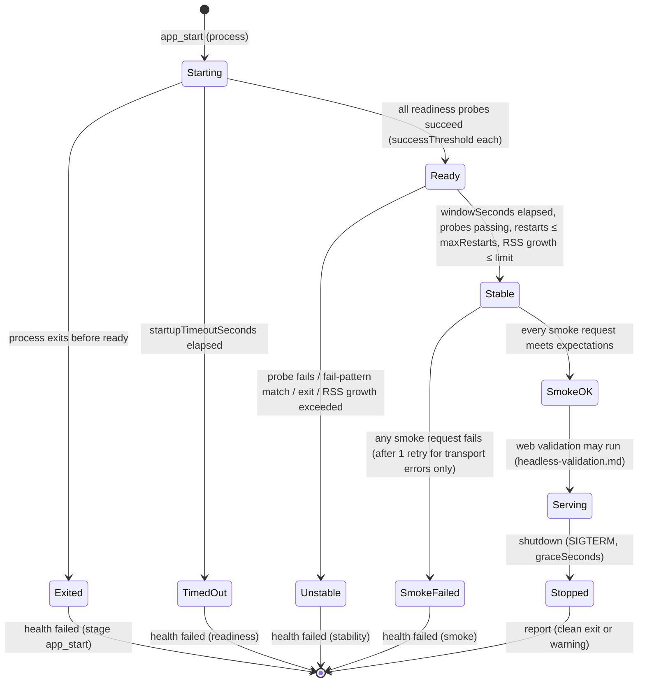

# Health Criteria

**Owner:** WS-05 · **Constraints:** D-16, D-12 · **Schema:** `$defs/healthSpec` in [schemas/qa-config.schema.json](schemas/qa-config.schema.json)

## Purpose

"The app started" is not evidence. This document defines a declarative health specification per
codebase (readiness endpoints, log patterns, port checks, smoke requests, startup timeout, stability
window, and run-to-completion criteria for batch jobs), exactly how the harness evaluates it, and
complete definitions for a Go gRPC service, a Next.js app, and a Python batch pipeline.

## Decisions summary

| # | Decision | Constraint |
|---|---|---|
| H1 | Health is evaluated **by the harness**, not by kubelet probes: the app is a child process of the harness, and every probe result becomes a check with evidence | D-16 |
| H2 | Healthy = all readiness probes pass within `startupTimeoutSeconds` → stability window passes (probes keep passing, no restart, no `fail` failure pattern, bounded RSS growth) → all smoke requests pass. Failure patterns stay armed until shutdown | D-16 |
| H3 | Batch apps use `completion`: exit code within `maxRuntimeSeconds`, then read-only output assertions (files, SQL `SELECT`, exec checks) | D-16 |
| H4 | Graceful shutdown is checked (SIGTERM, grace, exit code) and reported as a warning, never blocking | — |
| H5 | When health fails on the change, the harness re-runs the same health evaluation on the **base build** to separate code-caused from environment-caused failures (failure-feedback.md rules C2/E3) | D-16 |



---

## 1. Specification

Field reference (full schema in `qa-config.schema.json`, `$defs/healthSpec`, `$defs/probe`,
`$defs/smokeRequest`, `$defs/completion`):

| Field | Meaning | Default |
|---|---|---|
| `startupTimeoutSeconds` | Deadline from process start to all readiness probes passing | required |
| `readiness[]` | Named probes: `http` (status, body contains / JSONPath equals), `grpc` (`grpc.health.v1.Health/Check`, `SERVING`), `tcp` (connect), `exec` (exit 0), `log` (RE2 regex over captured stdout+stderr) | required for `server` and `web` |
| `readiness[].successThreshold` | Consecutive successes required | 1 |
| `stability.windowSeconds` | Time after ready during which probes are re-run every `probeIntervalSeconds` and must all pass | 0 (off) |
| `stability.maxRestarts` | Self-supervised restarts tolerated (detected by a log probe or process tree change) | 0 |
| `stability.maxRssGrowthPercent` | Max growth of the app process tree's RSS between ready and the end of the window | off |
| `failurePatterns[]` | RE2 regexes armed from start (or from ready with `ignoreBefore: ready`) to shutdown; `fail` fails health, `warn` adds a warning check | none |
| `smoke[]` | Requests after stability: `http`, `grpc` (method, JSON request, expected status code and JSONPath assertions, latency bound), `exec` | none |
| `completion` | Batch: expected exit code, `maxRuntimeSeconds`, output assertions | required for `batch` |

Conventions:

- Probes target `127.0.0.1` only. Ports must be ≥ 1024 (the app runs as uid 10001, unprivileged) and must not be 7800–7803
  (`replicant-agentd` loopback listeners, lint L5).
- JSONPath is RFC 9535. Regexes are RE2 (linear time; untrusted log volume cannot cause catastrophic
  backtracking in the harness).
- Each probe has `timeoutSeconds` (default 2 s) and `intervalSeconds` (default 2 s). Probe
  timeouts count as failures.
- gRPC probes use the standard health service; the empty service name means overall server health
  [verified: https://github.com/grpc/grpc/blob/master/doc/health-checking.md, 2026-10-24]. gRPC
  smoke requests use server reflection when enabled, else the `descriptorSet` file (built during
  `build`, e.g. `buf build -o /workspace/.qa/out/desc.binpb`).
- SQL output assertions run a single `SELECT`/`WITH` statement inside `BEGIN READ ONLY` against the
  named service with the service's QA credentials (schema pattern and runtime enforce read-only).

## 2. Evaluation algorithm (harness)

```go
// Package health is part of replicant-qa (WS-05). Simplified for the spec: logging and evidence
// capture are omitted; every result below becomes a qa_report check with stage "health",
// "app_start", or "smoke".
package health

import (
	"context"
	"time"
)

type Result struct {
	Stage    string // app_start | health | smoke
	TestID   string // e.g. "health:readiness/grpc_health"
	Passed   bool
	Severity string // fail | warn
	Detail   string
}

type App interface {
	Exited() (code int, exited bool)
	RSSBytes() int64
	RestartCount() int
	LogMatches(pattern string, since time.Time) []string // RE2 over captured output
}

type Probe interface {
	Name() string
	Check(ctx context.Context) error
	SuccessThreshold() int
	Interval() time.Duration
}

func Evaluate(ctx context.Context, spec Spec, app App, probes []Probe, smoke []Probe, started time.Time) []Result {
	var out []Result
	deadline := started.Add(time.Duration(spec.StartupTimeoutSeconds) * time.Second)

	// 1. Readiness: run all probes concurrently until each reaches its success threshold.
	ready := waitAllReady(ctx, probes, app, deadline) // returns per-probe results; stops early on exit
	out = append(out, ready.Results...)
	if !ready.AllPassed {
		return append(out, failurePatternResults(spec, app, started, time.Time{})...)
	}
	readyAt := time.Now()

	// 2. Stability window.
	rss0 := app.RSSBytes()
	windowEnd := readyAt.Add(time.Duration(spec.Stability.WindowSeconds) * time.Second)
	for t := time.Now(); t.Before(windowEnd); t = time.Now() {
		if code, exited := app.Exited(); exited {
			return append(out, Result{"health", "health:stability/exited", false, "fail", exitDetail(code)})
		}
		for _, p := range probes {
			if err := p.Check(ctx); err != nil {
				return append(out, Result{"health", "health:stability/" + p.Name(), false, "fail", err.Error()})
			}
		}
		if app.RestartCount() > spec.Stability.MaxRestarts {
			return append(out, Result{"health", "health:stability/restarts", false, "fail", "restart detected"})
		}
		sleep(ctx, time.Duration(spec.Stability.ProbeIntervalSeconds*float64(time.Second)))
	}
	if g := spec.Stability.MaxRssGrowthPercent; g > 0 && rss0 > 0 {
		growth := float64(app.RSSBytes()-rss0) * 100 / float64(rss0)
		out = append(out, Result{"health", "health:stability/rss_growth", growth <= float64(g), "fail", percent(growth)})
	}

	// 3. Smoke requests, sequential, in declaration order. Transport errors (connection refused,
	// reset) are retried once after 1 s; assertion failures are not retried.
	for _, s := range smoke {
		out = append(out, runSmoke(ctx, s))
	}

	// 4. Failure patterns over the whole log so far (re-evaluated again at shutdown).
	return append(out, failurePatternResults(spec, app, started, readyAt)...)
}
```

Rules that the code above relies on:

1. A process that exits before readiness fails `app_start` with its exit code and the last 200 log
   lines; no readiness checks are reported as "timed out" in that case (one root cause, one check).
2. A `fail` failure pattern that matches **before** ready fails `app_start`; after ready it fails
   `health`. Matches are deduplicated per pattern; the first 5 matches with 20 lines of context each
   go into the check's `log_excerpt`.
3. Failure patterns are evaluated a final time after web validation and after shutdown, so errors
   triggered by browser flows (for example an unhandled promise rejection during checkout) fail
   health too.
4. `exec` probes and smoke commands run as uid 10001 with the scrubbed environment and no
   credentials (stage-design.md §4.3).
5. The app log (stdout + stderr, timestamped by the harness) is uploaded as `health_log`
   (`health_log/app.log.zst`); service logs (from `/var/log/qa-services`) as
   `health_log/services/<name>.log.zst`.

## 3. Process mode only (v1)

The harness starts the app as a child process in the agent container (`app.start.mode: process`).
Running the **built image** instead (image mode) needs a container engine in the sandbox, which v1
does not offer (dependencies.md §5, WS-09 admission policy). The image is still verified by building
it, generating its SBOM, and scanning its filesystem for secrets (stage-design.md §4.4); a broken
`ENTRYPOINT` or missing file in the image is therefore caught by CI's own deploy pipeline, not by QA,
until image mode returns (OQ-05-19).

## 4. Example definitions

The three complete environment definitions are in [examples/](examples/). Their health sections:

### 4.1 Go gRPC service (`ledger-api`)

From [examples/env-go-grpc-ledger-api.yaml](examples/env-go-grpc-ledger-api.yaml):

```yaml
app:
  start:
    mode: process
    command: ./bin/ledger-api --config deploy/qa.yaml
    ports: [9090, 8081]
    env:
      LEDGER_GRPC_ADDR: 127.0.0.1:9090
      LEDGER_ADMIN_ADDR: 127.0.0.1:8081
      LOG_FORMAT: json
  health:
    startupTimeoutSeconds: 90
    readiness:
      - name: grpc_health
        probe: {type: grpc, port: 9090, grpcService: '', intervalSeconds: 1}
      - name: readyz
        probe: {type: http, port: 8081, path: /readyz, expectStatus: [200]}
      - name: kafka_consumer_started
        probe: {type: log, logPattern: '"msg":"consumer group joined".*"topic":"refunds\.events\.v1"'}
    stability:
      windowSeconds: 30
      probeIntervalSeconds: 5
      maxRestarts: 0
      maxRssGrowthPercent: 50
    failurePatterns:
      - pattern: '^panic: '
      - pattern: 'WARNING: DATA RACE'
      - pattern: '"level":"(fatal|dpanic)"'
      - pattern: '"level":"error"'
        severity: warn
        ignoreBefore: ready
    smoke:
      - name: get_balance
        type: grpc
        grpc:
          port: 9090
          method: acme.ledger.v1.LedgerService/GetBalance
          requestJson: '{"account_id":"acct_qa_eur_001"}'
          expectCode: OK
          expectJson:
            - {jsonPath: '$.balance.currency', equals: EUR}
            - {jsonPath: '$.balance.units', exists: true}
          maxLatencyMs: 500
      - name: apply_partial_refund
        type: grpc
        grpc:
          port: 9090
          method: acme.ledger.v1.LedgerService/ApplyRefund
          requestJson: '{"payment_id":"pay_qa_eur_100","refund_id":"rf_qa_001","amount":{"currency":"EUR","units":"40"}}'
          expectCode: OK
          expectJson:
            - {jsonPath: '$.entries[?(@.kind=="fx_fee_reversal")]', minLength: 1}
      - name: metrics_exposed
        type: http
        http: {method: GET, port: 8081, path: /metrics, expectStatus: [200]}
  stop: {signal: SIGTERM, graceSeconds: 20, expectCleanExit: true}
```

Why each element: the gRPC health service proves the server registered; `/readyz` proves its own
dependency checks (DB ping, Kafka metadata) passed; the log probe proves the consumer joined its
group (the failure mode that a port check never sees); `DATA RACE` catches races only exercised by
real traffic (the binary is built normally, while `-race` is used in tests; codebases can build the
QA binary with `-race` if CPU budget allows); smoke requests exercise the changed code path
(`ApplyRefund`) with seeded data.

### 4.2 Next.js app (`storefront-web`)

From [examples/env-nextjs-storefront.yaml](examples/env-nextjs-storefront.yaml):

```yaml
app:
  start:
    mode: process
    command: npx next start -H 127.0.0.1 -p 3000
    ports: [3000]
  health:
    startupTimeoutSeconds: 60
    readiness:
      - name: http_health
        probe: {type: http, port: 3000, path: /api/health, expectStatus: [200], expectBody: {jsonPath: '$.db', equals: ok}}
      - name: ready_log
        probe: {type: log, logPattern: 'Ready in [0-9.]+m?s'}
    stability:
      windowSeconds: 20
      probeIntervalSeconds: 4
    failurePatterns:
      - pattern: 'Error: '
        severity: warn
        ignoreBefore: ready
      - pattern: 'unhandledRejection|uncaughtException'
      - pattern: 'PrismaClientInitializationError'
    smoke:
      - name: home
        type: http
        http: {method: GET, port: 3000, path: /, expectStatus: [200], maxLatencyMs: 3000}
      - name: product_api
        type: http
        http:
          method: GET
          port: 3000
          path: /api/products/sku-qa-tee-001
          expectStatus: [200]
          expectJson:
            - {jsonPath: '$.price.currency', equals: USD}
  stop: {signal: SIGTERM, graceSeconds: 15}
```

The page-level checks (console errors, hydration errors, a11y, screenshots) belong to web validation
([headless-validation.md](headless-validation.md)); health only establishes that the server serves
and can reach Postgres and the pricing stub. `[unverified: the exact wording of Next.js 16's
"Ready in …" startup log line]`; not load-bearing because `/api/health` is the required probe, and a
log probe that never matches fails with a clear message that operators fix in the environment
definition.

### 4.3 Python batch pipeline (`settlement-pipeline`)

From [examples/env-python-batch-settlement.yaml](examples/env-python-batch-settlement.yaml):

```yaml
app:
  start:
    mode: process
    command: >-
      uv run python -m settlement_pipeline.run --run-date "$SETTLEMENT_RUN_DATE"
      --input "s3://$S3_INPUT_BUCKET/acquirer=*/date=$SETTLEMENT_RUN_DATE/"
      --output-table settlements_daily --output-s3 "s3://$S3_OUTPUT_BUCKET/reports/"
  health:
    startupTimeoutSeconds: 30
    readiness:
      - name: started
        probe: {type: log, logPattern: '"event": "pipeline_started"'}
    failurePatterns:
      - pattern: '^Traceback \(most recent call last\):'
      - pattern: '"level": "error"'
      - pattern: 'SettingWithCopyWarning|FutureWarning'
        severity: warn
    completion:
      expectExitCode: 0
      maxRuntimeSeconds: 600
      outputs:
        - name: rows_written
          type: sql
          service: postgres
          query: SELECT count(*) FROM settlements_daily WHERE run_date = DATE '2026-10-01'
          expectRows: {equalsScalar: 1284}
        - name: no_negative_net
          type: sql
          service: postgres
          query: SELECT count(*) FROM settlements_daily WHERE net_amount_minor < 0 AND kind <> 'chargeback'
          expectRows: {equalsScalar: 0}
        - name: totals_balance
          type: sql
          service: postgres
          query: >-
            SELECT abs(sum(gross_amount_minor) - sum(fee_amount_minor) - sum(net_amount_minor))
            FROM settlements_daily WHERE run_date = DATE '2026-10-01'
          expectRows: {equalsScalar: 0}
        - name: report_object
          type: exec
          command: [uv, run, python, -m, settlement_pipeline.tools.qa_check_report, --bucket, qa-settlement-output, --prefix, reports/2026-10-01/, --min-bytes, '1024']
        - name: idempotent_rerun
          type: exec
          command: [uv, run, python, -m, settlement_pipeline.tools.qa_rerun_and_compare, --run-date, '2026-10-01', --table, settlements_daily]
```

For batch apps "healthy" means: started (log probe), ran to completion within 10 minutes with exit
0, no traceback, and the outputs are correct and idempotent. Expected row counts come from the
fixture dataset in the repo (`tests/fixtures/qa/2026-10-01`), so a change that alters them must also
update the fixture expectations, which reviewers see in the diff.

## 5. Results in the report

| Check `test_id` | Stage | Blocking |
|---|---|---|
| `app_start:process` | `app_start` | yes |
| `health:readiness/<name>` | `health` | yes |
| `health:stability/<probe or rule>` | `health` | yes |
| `health:pattern/<n>` (fail) | `health` | yes |
| `health:pattern/<n>` (warn) | `health` | no |
| `smoke:<name>` | `smoke` | yes |
| `completion:exit`, `completion:output/<name>` | `health` | yes |
| `shutdown:clean_exit` | `shutdown` | no (warning) |

---

## Open questions

| ID | Question | Who decides | Options | Recommendation |
|---|---|---|---|---|
| OQ-05-07 | Should `warn` log patterns count toward a "noise budget" that blocks when exceeded (e.g. > 50 error lines)? | WS-05 with tenant owners | no budget / per-codebase budget | Not in v1; report counts only, revisit with data |

## Risks

- Log-pattern probes depend on log formats that change with the code under test. A changed log
  line fails readiness on the change and passes on base, so it is classified `code`: correct but
  annoying when the log change was intentional. The implementer receives the probe's pattern in the
  feedback and must update the environment definition through the config repo (it cannot do so
  itself), which the QA feedback says explicitly.
- Smoke expectations encode business facts (row counts, currencies). They must evolve with the
  fixtures, in the repo.

## Interfaces

- **Provided:** `healthSpec`, `probe`, `smokeRequest`, `completion` schema definitions; health check
  IDs (§5).
- **Consumed:** environment definition (WS-03), seeded services ([dependencies.md](dependencies.md)),
  classification rules ([failure-feedback.md](failure-feedback.md)).
