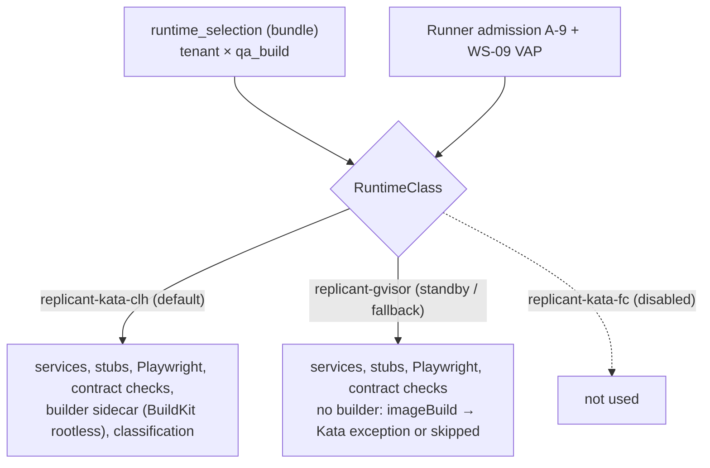

# Runtime Assumptions: QA under Kata, and What Changes under gVisor

**Owner:** WS-05 · **Constraint:** D-06 · **Recorded in:** `spec/_coordination/cross-ws-dependencies.md` (XD-05-01, XD-05-02, XD-05-13)
**Input:** WS-02 [runtime-evaluation.md](../02-execution/runtime-evaluation.md) (published during this workstream)

## Purpose

WS-02 evaluated gVisor, Kata + Firecracker, and Kata + Cloud Hypervisor in parallel with this
workstream. This document states the runtime properties the QA design relies on, confirms the design
against WS-02's recommendation, and specifies exactly what changes if gVisor is selected for
`qa_build` (WS-02's standby runtime and automatic fallback when Kata fails a benchmark gate).

## Decisions summary

| # | Decision |
|---|---|
| R1 | QA targets **`replicant-kata-clh`** (Kata 4.x, runtime-rs shim, Cloud Hypervisor), which WS-02 recommends as the default for **all** workload classes (WS-02 R-1). WS-05 had designed for "Kata for QA/build"; the recommendation matches |
| R2 | `replicant-kata-fc` is **disabled by WS-02 policy** (no filesystem sharing, guest-local emptyDirs without kubelet enforcement; WS-02 R-3). QA does not target it |
| R3 | Nothing runtime-dependent is implicit: the RuntimeClass comes from the bundle-pinned `runtime_selection` policy, and Runner admission rejects the `builder` exception on any RuntimeClass other than `replicant-kata-clh` (WS-02 runner-service A-9) |
| R4 | Under gVisor, QA keeps services, stubs, process-mode apps, Playwright, contract checks, and classification unchanged; **image builds are not available** (codebases with `imageBuild.enabled` stay on a Kata pool via `runtime_selection`, or skip image builds) |

---

## 1. Properties QA relies on (Kata CLH)

| # | Property | Status | Source | Used by |
|---|---|---|---|---|
| P1 | All containers of a pod run in one VM and share the pod network namespace | verified | Kata architecture README; Kubernetes pod shared networking [verified: https://kubernetes.io/docs/concepts/workloads/pods/, 2026-10-24] | services, stubs, agentd on loopback |
| P2 | Native sidecars behave as upstream (start order, no Job blocking, reverse-order stop) | verified | https://kubernetes.io/docs/concepts/workloads/pods/sidecar-containers/ (stable 1.33) | stage-design §4.1 |
| P3 | `RuntimeClass.overhead.podFixed` counted for scheduling and quota; WS-02 sets `replicant-kata-clh` to 250m/448Mi (kata-deploy default 250m/130Mi), and the guest adds `overhead_memory` 256Mi to the static VM size | verified | pod-overhead doc; WS-02 F-11 and controller.md §4.2 | sizing (dependencies §7) |
| P4 | Static sandbox sizing: VM = sum of limits + overhead (`static_sandbox_resource_mgmt = true` for CLH) | verified | WS-02 F-6 | dependencies §7 (density uses limits) |
| P5 | Workspace hard limit with ENOSPC inside the guest (`guestBlockDevice`, NRI-provisioned direct block volume) mountable in several containers of the pod (agent, QA services for `/workspace/.services`, builder, stubs read-only, watchdog, uploader). Service data now depends on it too (R1-114) | **unverified** | WS-02 F-9 and benchmark B-DISK-01/03; WS-02's own example already mounts the workspace in 3 containers | stage-design §4.2 |
| P6 | **No `subPath`** under Kata | verified (constraint) | WS-02 F-14 (Kata Limitations.md) | all mounts in dependencies §3.1 avoid subPath |
| P7 | Container seccomp is enforced inside the guest (`disable_guest_seccomp = false`) | verified as WS-02 configuration | WS-02 F-13 | restricted profile is real inside the VM; builder's `Unconfined` is the only relaxation |
| P8 | Rootless BuildKit works in the guest: unprivileged user namespaces, multi-UID mapping via setuid `newuidmap` (needs `allowPrivilegeEscalation: true` + SETUID/SETGID), native overlayfs in a user namespace (kernel ≥ 5.11) | **unverified** | BuildKit rootless.md (requirements) [verified]; guest kernel config and the VAP interaction unverified; WS-02 B-BUILD-01 | ADR-05-003 |
| P9 | `emptyDir medium: Memory` is guest tmpfs counted against memory | verified (Kata default creates emptyDirs in the guest) | configuration-clh.toml.in | `/dev/shm`, buildkit socket dir |
| P10 | Sidecar images pulled by node containerd from the ECR pull-through mirror and shared into the guest | assumed (WS-02 fast-path) | — | dependencies §2 |
| P11 | `replicant-agentd` loopback ports reachable from the agent container and unreachable from outside the pod | verified as WS-03 design | WS-03 cli-invocation §1 | stage-design §4.3 |

## 2. If gVisor is chosen for `qa_build`

This happens if Kata fails WS-02's gates for `qa_build` (fallback rule §8.5 keeps `qa_build` on Kata
even when `coding` moves to gVisor, so this is the less likely case), or for Graviton-only tenants.

| Feature | Under gVisor | Change |
|---|---|---|
| Services and stubs | Work (one Sentry per pod, shared netstack); I/O through Gofer/directfs is slower; "resource limits are not enforced within the sandbox" between processes [verified: https://gvisor.dev/docs/user_guide/compatibility/, 2026-10-24]; cAdvisor may see only pod scope (WS-03 §5.3) | Sizing by pod total; budgets re-derived (rp-1 per runtime class) |
| Workspace limit | `xfsProjectQuota` on the host dir (WS-02 R-5) | none for QA |
| Playwright | expected to work; `chromiumSandbox: false` already `[unverified: chrome-headless-shell 156 under runsc systrap; WS-02 W-QA]` | none |
| Image builds | **Not offered.** BuildKit rootless in the Sentry is unverified (WS-02 §6), gVisor's own rootless mode maps only the caller's UID [verified: https://gvisor.dev/docs/user_guide/rootless/, 2026-10-24, about runsc itself], and Docker-in-gVisor needs handler flags `--net-raw`/`--allow-packet-socket-write` [verified: https://gvisor.dev/docs/tutorials/docker-in-gvisor/, 2026-10-24] that a separate RuntimeClass would require (the CRD enum is closed) | Admission rejects the builder (A-9); codebases with images stay on Kata via `runtime_selection`, or set `imageBuild.enabled: false` (QA reports `image_build: skipped (runtime_unsupported)`) |
| Testcontainers | not supported in v1 anyway | none |
| Performance | gVisor slowest on `npm ci`-style metadata storms (WS-02 §5) | `timeouts.totalSeconds` +30–100% from WS-02 measurements |

**Unchanged under any runtime:** schemas, harness, stage order, classification, routing, artifacts,
QA node code. Only policy, admission, budgets, and which definitions may use which pool change.

## 3. Local profiles (D-20)

| Profile | Runtime | QA difference |
|---|---|---|
| compose (`runner-local`) | Docker/Podman on the laptop | builder exception mapped to `seccomp=unconfined` on the developer's own engine; listed in WS-11 parity |
| kind/k3d on Linux + KVM | Kata | as production |
| kind/k3d on macOS | runc | as compose |

---

## Open questions

| ID | Question | Who decides | Options | Recommendation |
|---|---|---|---|---|
| OQ-05-16 | If gVisor wins for `coding`, keep `qa_build` on Kata (mixed fleet)? | WS-02 / WS-10 | single runtime / mixed | Mixed; WS-02's fallback rule already does this |

## Risks

- P5 and P8 are unverified and load-bearing for image builds; the fallback is skipping QA image
  builds (CI still builds images).
- A late runtime change moves budgets more than design; re-derive QA profiles after WS-02's benchmark.

## Interfaces

- **Consumed:** WS-02 runtime evaluation, RuntimeClasses, `runtime_selection`, admission A-9; WS-09 VAP.
- **Provided:** property list P1–P11 as benchmark inputs (XD-05-02).
