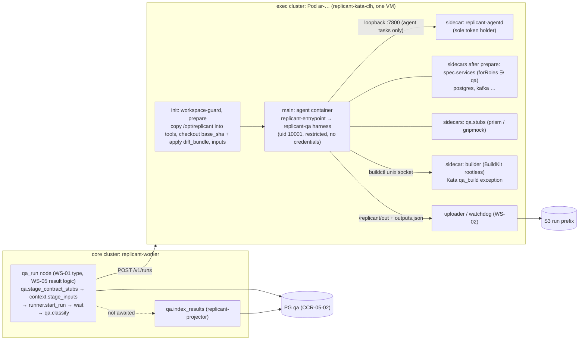
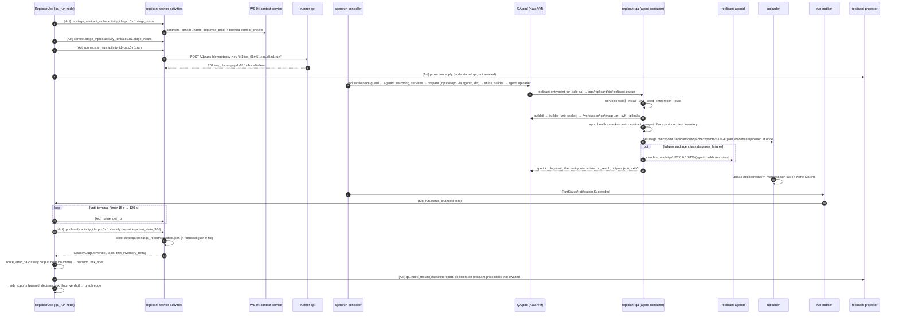

# QA/QE Stage Orchestration

**Owner:** WS-05 · **Constraints:** D-16, D-06, D-07, D-08, D-10, D-12, D-19, D-21 · **Contracts consumed:** C-RUNNER, C-CRD, C-ART, C-DEF, C-IDS, C-MSG, C-STATE
**Aligned with:** WS-01 graphs (`qa_run` node, `spec/01-orchestration/graphs/definitions/`), WS-02 pod rendering
(`spec/02-execution/controller.md` §4), WS-03 `replicant-entrypoint`/`replicant-agentd` and the environment kind
schema, WS-04 compat checks (XD-04-06), WS-09 control review (G-01, G-10, G-14, G-25)

## Purpose

This document defines where the QA/QE stage sits in every graph shape, why it runs as its own
AgentRun, exactly what happens inside that AgentRun from checkout to artifact upload, which parts are
fixed scripts and which parts an agent drives, and how the graph consumes the result. The goal of the
stage: prove that the diff the Publisher will push builds, runs, stays healthy, and (for web apps)
works in a headless browser, before a human looks at it, and leave evidence a reviewer can trust.

## Decisions summary

| # | Decision | Constraint | ADR |
|---|---|---|---|
| S1 | QA is a **separate AgentRun** (`role: qa`, `workload_class: qa_build`) on a **fresh checkout of `base_sha` with the diff bundle applied**, the exact bytes the Publisher pushes | D-05, D-16, D-21 | [ADR-05-001](adr/001-separate-qa-agentrun-fresh-checkout.md) |
| S2 | Dependencies are the environment definition's **`spec.services[]` native sidecars** (WS-03 schema) plus QA **contract stubs**; **Testcontainers (Docker API) is not supported in v1** under the exec-cluster admission policy | D-16, D-06 | [ADR-05-002](adr/002-dependency-strategy.md) |
| S3 | Image builds run in a dedicated **`builder` native sidecar** (BuildKit v0.34.1 rootless daemon), the single security exception WS-02 renders for Kata `qa_build` pods; the agent container stays on the restricted profile | D-16, D-21 | [ADR-05-003](adr/003-image-builder.md) |
| S4 | **Deterministic harness decides**; an agent (native CLI via agentd, D-10) only generates extra smoke flows and diagnoses; it may raise severity, never lower it | D-10, D-19 | [ADR-05-004](adr/004-deterministic-harness-agent-split.md) |
| S5 | Flake vs regression: in-run change/base evidence plus 30-day history, fixed rules | — | [ADR-05-005](adr/005-flake-classification.md) |
| S6 | Visual and a11y baselines from a **same-run base pass**, reused within a job | D-08, D-21 | [ADR-05-006](adr/006-visual-baseline-same-run.md) |
| S7 | QA can only **raise** the job's risk floor | D-19 | §6 |
| S8 | **Credential custody (WS-09 G-01):** the QA harness, like the CLI, holds **no credential**. Inputs come pre-staged in `/replicant/inputs`, outputs go to `/replicant/out` for the uploader, and the only network call needing a token (gateway, for agent tasks) goes through `replicant-agentd` on loopback | D-21 | §4.3 |
| S10 | **Test inventory vs base** (R2-006): enumerated test IDs on head and base plus a static diff scan; `deleted_or_skipped` feeds WS-07's risk rule `tests.deleted_or_skipped` and the packet | T-PI-08 | §4.4 |
| S11 | **Checkpoints at stage boundaries** (R2-033): a retry after node loss reuses result-only stages with identical inputs | — | §4.7 |
| S12 | **Routing has one owner** (R1-118): the `qa_run` node; `qa.classify` returns facts. Approvers can **re-run QA** from an inconclusive gate (R2-027, CCR-05-04) | D-19 | §6 |
| S9 | Runtime: designed for **`replicant-kata-clh`** (WS-02's default for all classes); `replicant-kata-fc` is disabled by WS-02 policy; the gVisor delta is in [runtime-assumptions.md](runtime-assumptions.md) | D-06 | [runtime-assumptions.md](runtime-assumptions.md) |



---

## 1. Placement in each graph shape

WS-01 owns the graphs and already places a node of type **`qa_run`** (agent `qa-runner`, workload
class `qa_build`) after implementation in every shape (`spec/01-orchestration/graphs/definitions/*.yaml`).
WS-05 owns that node's QA-specific behavior: inputs staging, classification, and the result exports
the graph switches on (§6). Node keys are `qa` and `qa_repair` (repair cycles), so logical activity
IDs are `qa.c<cycle>.n<ordinal>.run` (C-IDS §2); the C-IDS test vector `run_chxtsxqzcpds1fc1c4dvw9e4em`
is the first QA run of the reference job.

| Workflow type | Position (WS-01 graphs) | QA variant | On QA fail | Notes |
|---|---|---|---|---|
| `bugfix` | implement → **qa** → review → verify → risk_diff → publish gate | default | fix loop to `implement` | QA before review, so the reviewer reads the QA report |
| `feature`, `api_change` | implement → **qa** → skeptic/review → verify → publish gate | default; `contractCompat` matters most here | fix loop | QA runs WS-04's compat checks (`buf breaking`, `oasdiff`…) against base (XD-04-06) |
| `hotfix` | implement → **qa** → verify → publish gate | `hotfix` variant | fix loop (1), then `repair_limits.qa.on_fail_after_fixes` (WS-01 default `fail_job`; `gate_with_failure` only if OQ-05-01 chooses it) | unit, build, health never skippable (lint L8) |
| `docs` | implement → **qa** → publish | `docs` variant or `not_applicable` | fix loop | router may not route code-touching diffs to a binding with QA disabled |
| `maintenance` (per child job) | implement → **qa** → publish | `maintenance` variant | fix loop (1), then the child fails | largest QA load; batch concurrency bounds it |
| repair cycle `c≥1` / `pr_repair` | repair → **qa_repair** → push | default | fix loop inside the cycle | `qa_repair.c1.n1.run` |
| `qa_only` | **qa** only | default | no fix loop: `proceed` → `end:qa_completed`; verdict `fail` → `end:qa_failed`; `inconclusive` → one `retry_qa`, then `end:qa_inconclusive` (R1-131, XD-FIX-R1-131) | `/replicant qa` on a PR; the report is posted as the `replicant/qa` check run either way |
| base moved at publish | `base_check` → moved & clean → **qa** (`trigger: rebase_reverify`) | default | fix loop | D-19 |

**Ordinals.** Each QA visit in a cycle increments the node's ordinal (`qa.c0.n1`, after a fix
`qa.c0.n2`, after an environment retry also +1). WS-01 bounds visits with `maxVisits` (5 for `qa`);
WS-05's routing ends the loop earlier with WS-01's keys `repair_limits.qa.fix_iterations` (default 2;
hotfix and maintenance 1), `repair_limits.qa.env_retries` (1), and `repair_limits.qa.on_fail_after_fixes`
(WS-01 default `fail_job`). Whether an exhausted fix budget opens a draft-only publish gate
(`gate_with_failure`) depends on OQ-05-01; with the shipped default the job fails (R1-123).

## 2. Why a separate AgentRun on a fresh checkout

Summary of [ADR-05-001](adr/001-separate-qa-agentrun-fresh-checkout.md): QA tests the publishable
artifact (diff bundle on `base_sha`, recorded as `head_tree_sha`), the implementer cannot grade its
own work, QA needs a different pod shape (`qa_build`, services, builder sidecar), and the extra
sandbox start is cheap relative to the run (p95 sandbox-ready target < 90 s). The WS-09 red-team
case RT-08 ("QA run deletes failing tests in its workspace") is harmless for the same reason: the
verdict is computed by the harness from a fresh checkout and QA produces no diff.

## 3. The QA RunSpec

```json
{
  "schema": "replicant.run-spec/v1",
  "tenant_id": "payments",
  "job_id": "job_01m5p7x7r0bt69j0h0fbxepw90",
  "workflow_id": "job_01m5p7x7r0bt69j0h0fbxepw90",
  "logical_activity_id": "qa.c0.n1.run",
  "role": "qa",
  "workload_class": "qa_build",
  "workflow_type": "bugfix",
  "release_bundle_id": "rb_ds5p3wmcj4dag2e9a8ncp4py6k",
  "agent_definition": {"kind": "agent", "name": "qa-runner", "version": 3, "digest": "sha256:85cb12953e4fe406e300e9a8b0eee39c15f57d5901e8dd91758fc0436861e52d"},
  "environment_definition": {"kind": "environment", "name": "go-grpc-ledger", "version": 4, "digest": "sha256:f87fc92356d784988038202520f3fbb9a1c92d03a8903da31c3bb455d1c1fe48"},
  "resource_profile": "qa",
  "repo": {
    "provider": "github", "host": "github.com", "owner": "acme-payments", "name": "ledger-api",
    "repo_id": "R_kgDOK2a9Xw", "base_ref": "main",
    "base_sha": "8c1e4f2a9b7d3c6e5f0a1b2c3d4e5f6a7b8c9d0e", "fetch_depth": 50
  },
  "inputs": {
    "manifest_uri": "s3://acme-replicant-prod-artifacts/tenants/payments/jobs/job_01m5p7x7r0bt69j0h0fbxepw90/runs/run_chxtsxqzcpds1fc1c4dvw9e4em/inputs/manifest.json",
    "manifest_sha256": "a9082f8a0ec4930a6972a2cfcd80bcca822b551f0c1f87a735fa7513164ea031"
  },
  "artifact_prefixes": {
    "artifacts": "s3://acme-replicant-prod-artifacts/tenants/payments/jobs/job_01m5p7x7r0bt69j0h0fbxepw90/runs/run_chxtsxqzcpds1fc1c4dvw9e4em/",
    "transcripts": "s3://acme-replicant-prod-transcripts/tenants/payments/jobs/job_01m5p7x7r0bt69j0h0fbxepw90/runs/run_chxtsxqzcpds1fc1c4dvw9e4em/",
    "session": "s3://acme-replicant-prod-session/tenants/payments/jobs/job_01m5p7x7r0bt69j0h0fbxepw90/runs/run_chxtsxqzcpds1fc1c4dvw9e4em/"
  },
  "isolation_hint": "kata-clh",
  "network_profile": "qa-with-mirror",
  "timeouts": {"startup_seconds": 300, "active_deadline_seconds": 2700, "finalize_seconds": 600},
  "limits": {"max_cost_usd": 3, "max_output_bytes": 2147483648},
  "steering": {"enabled": false},
  "priority": "normal",
  "trace_context": {"traceparent": "00-fc0575170c8597ce9805552723c08d6e-7d1f3a5c9e0b2d4f-01"},
  "callback": {"kind": "temporal_signal", "namespace": "replicant-prod", "workflow_id": "job_01m5p7x7r0bt69j0h0fbxepw90", "signal_name": "run.status_changed"},
  "run_grant": "eyJhbGciOiJFUzI1NiIsImtpZCI6InJnLTIwMjYtMTAiLCJ0eXAiOiJmYWN0b3J5LXJ1bi1ncmFudCtqd3QifQ.eyJpc3MiOiJmYWN0b3J5LXByb2QtY29yZSIsInR5cCI6ImZhY3RvcnktcnVuLWdyYW50K2p3dCIsImp0aSI6InJncl8wMW01cDd4Ynd5ZjJyN2s4cTNtNmQ5dzBoMSIsImlhdCI6MTc5MjgyMjc2MCwiZXhwIjoxNzkyODI2OTYwLCJ0ZW5hbnRfaWQiOiJwYXltZW50cyIsImpvYl9pZCI6ImpvYl8wMW01cDd4N3IwYnQ2OWowaDBmYnhlcHc5MCIsInJ1bl9pZCI6InJ1bl9jaHh0c3hxemNwZHMxZmMxYzRkdnc5ZTRlbSIsInJvbGUiOiJxYSIsInJlcG9faWRzIjpbIlJfa2dET0syYTlYdyJdLCJhdWRpZW5jZXMiOlsiYWktZ2F0ZXdheSIsInJlcG8tbWlycm9yIiwicnVubmVyLXNhbmRib3giXSwic2NvcGVzIjpbImdhdGV3YXk6aW52b2tlIiwicmVwbzpmZXRjaCIsImNyZWRlbnRpYWxzOmF3cyJdLCJidWRnZXRfdXNkIjozLCJhY3RpbmdfZm9yIjoidXNyXzAxa25rOGRmcjBmdmpjN3YwYjl2aHZremJwIiwic3BlY19kaWdlc3QiOiJzaGEyNTY6MGQxNWVhNWUwZDE1ZWE1ZTBkMTVlYTVlMGQxNWVhNWUwZDE1ZWE1ZTBkMTVlYTVlMGQxNWVhNWUwZDE1ZWE1ZSJ9.Ujo9BvRrDazllOKsi0UijvzBa1nE3Zcq0uz6M2HNzeJGLTPlJrHZ8ryuV4YyiQPxy8_vD1ujzwmLgYx5E_-CzA"
}
```

The `run_grant` payload above decodes to (illustrative signature; WS-09 ADR-09-005 defines signing):

```json
{"iss": "replicant-prod-core", "typ": "replicant-run-grant+jwt", "jti": "rgr_01m5p7xbwyf2r7k8q3m6d9w0h1",
 "iat": 1792822760, "exp": 1792826960, "tenant_id": "payments", "job_id": "job_01m5p7x7r0bt69j0h0fbxepw90",
 "run_id": "run_chxtsxqzcpds1fc1c4dvw9e4em", "role": "qa", "repo_ids": ["R_kgDOK2a9Xw"],
 "audiences": ["ai-gateway", "repo-mirror", "runner-sandbox"],
 "scopes": ["gateway:invoke", "repo:fetch", "credentials:aws"], "budget_usd": 3,
 "acting_for": "usr_01knk8dfr0fvjc7v0b9vhvkzbp",
 "spec_digest": "sha256:0d15ea5e0d15ea5e0d15ea5e0d15ea5e0d15ea5e0d15ea5e0d15ea5e0d15ea5e"}
```

QA grants carry no `memory-mcp`/`context-mcp` audiences and no `memory:*`/`context:*` scopes; `ai-gateway`
and `gateway:invoke` appear only when `qa.agent.enabled` (XD-05-15). `exp` = `iat` + startup + active +
finalize + 300 s (C-RUNNER `RunGrantClaims`).

| Field | Source | Why |
|---|---|---|
| `workflow_type` | the job's routed workflow type (job state) | C-RUNNER 2.4 (CCR-08-03): sandbox telemetry identity; included in `spec_digest` |
| `run_grant` | minted by the `runner.start_run` activity through the core run-grant signer (WS-09 ADR-09-005; WS-01 activity) from the job's intake record, before `createRun`; excluded from `spec_digest` | C-RUNNER 2.0+ required field (CCR-09-02); WS-05 only specifies the QA audiences and scopes (XD-05-15) |
| `agent_definition` | node config `agent: qa-runner` (WS-01) | RunSpec requires one. Its CLI image delivers `replicant-entrypoint`, `replicant-agentd`, **and `replicant-qa`** (§4.1). The CLI itself is launched only for agent tasks (§5) |
| `resource_profile` | `spec.profileByRole.qa` (WS-03) | Agent container only; the controller adds services, stubs, builder, agentd, WS-02 sidecars (lint L3) |
| `network_profile` | `spec.networkProfile.qa_build` | `qa-with-mirror`: curated package virtual repos and the Artifactory container-image virtual repo `docker-virtual` on `artifactory.acme.internal` (anonymous read, base images for `builder`; WS-02 network.md §5, WS-09 agent-capabilities §1), S3 via the uploader, gateway via agentd only when agent tasks are on. No ECR endpoint: ECR needs an auth token the uncredentialed builder cannot hold (D-21, R1-115) |
| `timeouts` | `qa.timeouts` (variant-adjusted); node config may lower | Harness self-limits at `totalSeconds − reserveSeconds` |
| `limits.max_cost_usd` | `min(qa.agent.maxCostUsd, agent limit, remaining job budget)`; omitted when agent tasks are off | Gateway (via agentd) enforces |
| `steering.enabled` | `false` | QA runs are not steered |

### 3.1 Inputs staged before `createRun`

The node computes `run_id` ahead (ADR-008) and stages under `<artifacts prefix>inputs/`. WS-04's
`context.stage_inputs` is the **single writer** of `inputs/manifest.json` (`replicant.run-inputs/v1`,
XD-FIX-R1-067): QA objects are listed there with `place: qa_file` and a `path`, which `prepare` places
at `/replicant/inputs/qa/<path>`; the run plan is `place: run_plan` (`/replicant/inputs/run-plan.json`).
`qa.stage_contract_stubs` only fetches and writes the contract objects and returns their keys to the
node, which passes them to `context.stage_inputs`. Contracts come from context-mcp's internal API
(XD-FIX-R1-104): `GET /internal/v1/contracts?service_ref=&name=&revision=default_branch|deployed_prod|deployed_staging|sha256:<hex>`
with ServiceAccount audience `context-mcp-internal` and header `X-Replicant-Job-Id`, and the job's
checks with `GET /internal/v1/jobs/{job_id}/compat-checks`; on `409 revision_unavailable` the activity
falls back to `default_branch` and records a warning that the harness copies into
`qa_report.contract_compat`. WS-03's `prepare` init container fetches and verifies everything into
`/replicant/inputs/` through agentd before any repo code runs.

| Input | Source | Purpose |
|---|---|---|
| `diff_bundle/changes.tar.zst` | latest implementer/repair diff bundle | Applied by prepare (`DiffApplyFailed` on mismatch) |
| `qa/config.json` | pinned environment definition | `spec.qa` after variant application, the `spec.services` / `spec.bootstrap` entries QA needs, and `{name, version, digest}` of the definition. The sandbox never reads the registry (C-DEF §6) |
| `qa/variant.json` | QA node | workflow type, variant, trigger, previous QA run, iteration counters, resolved stub contracts |
| `qa/plan-acceptance.json` | `plan/plan.json` (planner `agent_report`, XD-FIX-R1-075) | `acceptance_criteria[] {id: "ac<n>", text, verifiable_by ∈ unit_test, integration_test, ui_flow, api_check, manual}` and `expected_ui_changes[] {route, description, acceptance_criteria[]}`; generated smoke flows target `ui_flow`/`api_check` criteria, and visual changes on listed routes count as expected |
| `qa/compat-checks.json` | job briefing `compat_checks` (WS-04) | commands for stage `contract_compat` |
| `qa/contracts/<stub>/…` | WS-04 contracts at the configured revision | stub servers |
| `qa/baseline/…` (optional) | earlier QA run of this job, same `base_sha`, env digest, routes digest | skips the web base pass |
| `qa/previous-blocking.json` (after_fix) | previous classified report | oscillation detection |
| `inputs/qa-checkpoints/<stage>.json` → `/replicant/inputs/qa/checkpoints/<stage>.json` (retry, new ordinal; `place: qa_file`) | the previous run's per-stage checkpoints (§4.7) | lets the harness skip deterministic stages whose `inputs_digest` matches (R2-033, XD-FIX-R2-033) |

## 4. Inside the AgentRun

### 4.1 Pod layout under Kata

WS-02 renders the pod (bare Pod, `restartPolicy: Never`, ADR-02-002) from the AgentRun plus the
environment definition blob; WS-03 owns the entrypoint/agentd containers; WS-05 specifies the
QA-specific additions (XD-05-01). A Kata pod is one VM; all containers share its network namespace.

The container list follows WS-02 controller.md §4.2 (the agreed WS-02/WS-03 process model); the
QA-specific rows are WS-05's (re-based for R1 §5.1 and R1-045).

| Order | Container | Kind | Image | UID | QA notes |
|---|---|---|---|---|---|
| 1 | `workspace-guard` | init | `replicant/sandbox-utils` (WS-02) | 10001 | Fails closed unless the workspace hard limit is in force |
| 2 | `replicant-agentd` | native sidecar | CLI image of `qa-runner` (WS-03) | 10000 | Sole holder of the per-audience run tokens; loopback proxy (gateway `:7800`, MCP `:7801`, git/inputs `:7802`/`:7803` only until prepare is done) |
| 3 | `watchdog` | native sidecar | `replicant/sandbox-utils` | 10003 | 85 % warn; at 98 % the entrypoint stops the harness and exits 30 → `WorkspaceDiskExceeded` |
| 4 | `prepare` | init | CLI image of `qa-runner` (`replicant/cli-claude-code`, which ships `/opt/replicant/bin/{replicant-qa,replicant-svc-wrap,replicant-stubgen,replicant-redact}` from WS-05's release; WS-03 §4.10) | 10001 | Copies `/opt/replicant` into `tools`; fetches inputs and repo via agentd; applies the diff; writes `/workspace/.qa/head_tree_sha` |
| 5 | `svc-<name>` per `spec.services[]` with `qa ∈ forRoles` | native sidecar **after `prepare`**, **no startupProbe** (WS-02 controller.md §4.2a) | `replicant/svc-<name>@sha256` when wrapped (mirrored upstream plus a Replicant layer, image CI-signed), plain `mirror/<upstream path>@sha256` when `wrapLogs: false` (XD-05-20, accepted) | per image, non-root | `tools` read-only at `/opt/replicant`; command prefixed by `/opt/replicant/bin/replicant-svc-wrap --name <n> --log /var/log/qa-services/<n>.log --` when `serviceOptions.wrapLogs`; data under `/workspace/.services/<name>[/<subdir>]`, the controller sets the variable named by `data.env` (XD-FIX-R1-074); `ephemeral-storage` limit 1Gi |
| 6 | `stub-<name>` per `qa.stubs[]` | native sidecar, after `prepare` | `replicant/qa-stub-<server>@sha256` | 10001 | Reads contracts from `inputs` and fixtures from the repo (both read-only); limit 256Mi |
| 7 | `builder` (only with `qa.imageBuild.enabled` and runtime `replicant-kata-clh`) | native sidecar, after `prepare` | `qa.imageBuild.builderImage` (`replicant/buildkit-rootless@sha256`) | 1000 (BuildKit rootless user) | The single Kata `qa_build` security exception (§4.6); limit 1Gi (cache lives in the workspace) |
| 8 | `agent` | main | environment image (`spec.image.resolved`) | 10001 | `replicant-entrypoint run` with `REPLICANT_ROLE=qa` runs `/opt/replicant/bin/replicant-qa run --inputs /replicant/inputs --out /replicant/out/qa --plan /replicant/inputs/run-plan.json` instead of a CLI; agent tasks call back `replicant-entrypoint agent-task --task <name> --prompt-file <file>` (WS-03 cli-invocation.md §4.10, XD-FIX-R1-073) |
| 9 | `uploader` | regular container (outlives the agent) | `replicant/sandbox-uploader` | 10003 | Uploads `/replicant/out/**` per `outputs.json` and each stage's evidence as soon as its checkpoint appears in `/replicant/out/qa-checkpoints/` (§4.7, WS-02 controller.md §9); streams `/replicant/spool/**`; writes the manifest last; STS through agentd's `uploader-ipc` |

Pod `fsGroup: 10002` gives WS-02's trusted containers (uid 10003) read access to `out` and `spool`
(WS-02 controller.md §4.2, XD-FIX-R1-045). Every QA-declared container carries memory **and
ephemeral-storage** limits (WS-09 VAP, R1-114).
Readiness of services is checked by the harness, not by a `startupProbe` (WS-02 adopted XD-05-14 as
XD-02-15), so a broken service yields a classified `environment` check with its log instead of
`SandboxStartTimeout`.

### 4.2 Filesystem layout

Kata does not support `volumeMounts.subPath` (WS-02 runtime-evaluation F-14), so nothing below relies
on it.

```
/workspace                      # workspace volume, hard limit (guestBlockDevice under Kata, WS-02)
├── repo/                       # base_sha + diff (head). Only results from this tree gate
├── base/                       # git worktree --detach at base_sha, created on demand (base pass)
├── .cache/                     # workspace caches from spec.caches (go-build, npm …)
├── .services/<name>/           # QA service data (Postgres PGDATA, Kafka log dirs), XD-02-15
├── .buildkit/                  # builder state (--root; WS-02 qa-build example; builder mounts the whole workspace)
└── .qa/                        # QA scratch: out/ (JUnit, reports), logs/ (steps, app),
                                #   web/ (screenshots, traces, axe), generated/ (agent flows), dist/
/replicant/inputs                 # read-only staged inputs (prepare), incl. qa/config.json
/replicant/out                    # outputs for the uploader (WS-03 run-outputs): qa/** evidence, qa/result.json,
                                #   qa/outputs.entries.json, qa-checkpoints/<stage>.json (§4.7)
/var/log/qa-services            # qa-svc-logs emptyDir (1Gi): replicant-svc-wrap logs per service (read-only in agent)
/opt/replicant                    # read-only binaries (tools volume, populated by prepare)
/replicant/spool                  # streamed outputs (transcripts, logs) read by the uploader
/run/buildkit                # emptyDir (memory) shared by agent and builder: buildkitd.sock
/dev/shm                        # emptyDir medium Memory, 2Gi, when appKind = web (Chromium)
/home/agent                     # HOME (WS-03)
```

Service data lives under `/workspace/.services/<name>` on the enforced workspace device (WS-02 XD-02-15
resolved OQ-05-18): an overrun gives `ENOSPC` and a classified failure, never an eviction. QA service
definitions declare `data {env, subdir?, sizeEstimate}` instead of a volume (XD-FIX-R1-074; lint L4:
`workspace.sizeLimit ≥ Σ data.sizeEstimate + 10Gi`), and workspace sizing includes service data
(dependencies.md §7).

### 4.3 Credentials and identities (WS-09 G-01 adopted)

| Process | Container / UID | Holds | Reaches |
|---|---|---|---|
| `replicant-entrypoint`, `replicant-qa` harness, repo code (installs, tests, builds, the app, Playwright) | `agent` / 10001 | **nothing**: no run token, no STS credentials, no Secret volume | loopback services; `/run/buildkit` socket; curated package mirrors (anonymous read, network profile); agentd `:7800` (gateway) only when agent tasks run |
| QA agent CLI (`claude -p`) | `agent` / 10001 | placeholder gateway credential only (WS-03) | agentd `:7800`, which adds the run token |
| `replicant-agentd` | own container / 10000 | run token (Secret mounted only here) | gateway shim, MCP, repo-mirror, runner-sandbox |
| uploader (WS-02) | own container / 10003 (pod `fsGroup` 10002 for read access to `out`/`spool`) | nothing at rest: S3 session credentials served by agentd on the private `uploader-ipc` socket (WS-02 controller.md §4.2, XD-FIX-R1-045) | S3 run prefixes |

What changed from the first draft of this section: the harness no longer holds a token file, and
there is no in-container UID switch (the restricted profile has no `CAP_SETUID`, so it would not
work anyway). The harness still starts repo code with an explicit, scrubbed environment (no
`REPLICANT_*`, no `OTEL_*`, plus `qa.env` and `spec.env`), which is hygiene, not a boundary. Because
repo code and the CLI share uid 10001, a malicious test could talk to agentd's gateway port during a
QA run that has agent tasks enabled; the exposure is bounded by `limits.max_cost_usd` (default
$3–5) and agentd's per-run budget. QA runs without agent tasks request no `gateway:invoke` scope
(XD-05-15).

### 4.4 Stage sequence

| # | Stage | What runs | Blocking failure? | Typical p50 / p95 (Go example) |
|---|---|---|---|---|
| 0 | `prepare` | Verify `head_tree_sha`, `/replicant/inputs/qa/config.json`, Playwright version vs config, disk free, builder socket (if any) | environment | 5 s / 15 s |
| 1 | `services`, `stubs` | Wait for readiness of each QA service and stub (parallel with stage 2) | environment unless base also fails → env-definition issue | 12 s / 40 s |
| 2 | `install` | `spec.bootstrap.steps` (harness-run for role qa, lint L15), then `qa.steps.install` | code if the diff touches a manifest/lockfile, else by signature | 40 s / 3 min |
| 3 | `unit` | `steps.unit[]`, JUnit normalized | yes | 3.5 min / 8 min |
| 4 | `seed` | `spec.services[].seed` steps, then `qa.seed[]` | code or environment by rule | 20 s / 60 s |
| 5 | `integration` | `steps.integration[]` | yes | 4 min / 10 min |
| 6 | `build` | `steps.build[]` | yes for `required: true` | 50 s / 3 min |
| 7 | `image_build`, `sbom`, `secret_scan` | `buildctl` → builder sidecar → OCI archive; syft SPDX; gitleaks over the image filesystem → `secret_scan_report` | yes (S1 for secrets in the image) | 1.5 min / 5 min |
| 8 | `app_start`, `health`, `smoke` | start app, readiness, stability, failure patterns, smoke | yes | 40 s / 2 min |
| 9 | `routes`, `e2e_repo`, `e2e_generated`, `a11y`, `visual` | web only (headless-validation.md) | per rules | Next.js 9 / 18 min |
| 10 | `contract_compat` | commands from `qa/compat-checks.json` against the base tree (XD-04-06). The **only** compatibility run of the job (XD-FIX-R1-120): the node passes run input `contract_compat: report_only`, which forces `blockOnBreaking` false, and the result is exported as `role_result.contract_compat {outcome, breaking, consumers, report_uri}` → `role_exports.contract_compat`; WS-01's `contract_check` node applies the per-workflow-type policy (feature `warn_on_breaking`, api_change `block_on_breaking`) | never blocks QA (rule K1 is report-only under `report_only`) | 20 s / 2 min |
| 11 | flake protocol | reruns on change and base, base build/app if needed | — | 1 / 6 min |
| 11a | test inventory (R2-006) | each test step's `listCommand` on the head and base trees (no execution), JUnit IDs and skip states, and a static scan of the diff for deleted test files and added skip markers → `qa_report.test_inventory` | never blocks; sets `deleted_or_skipped`, which raises risk to `high` (WS-07 rule `tests.deleted_or_skipped`) | 10 s / 60 s |
| 12 | `agent` | optional diagnosis after evidence is complete | never directly | 2 / 7 min |
| 13 | `shutdown` | SIGTERM app, grace, exit code | warning only | 2 / 20 s |
| 14 | report | write `/replicant/out/qa/report.json`, the QA `role_result`, and QA entries for `outputs.json` | — | 2 s |

Planning totals (inside the run): Go gRPC p50 ≈ 13 min, p95 ≈ 30 min; Next.js p50 ≈ 24 min (≈ 31 with
base web pass), p95 ≈ 45 min; Python batch p50 ≈ 9 min, p95 ≈ 20 min. WS-02's benchmark workload
W-QA and WS-03's rp-1 baselines replace these.

**Exit and result contract (with WS-03; C-RUNNER 3.0.0, C-CRD 3.0.0; `EnvironmentSetupFailed` added in C-CRD 2.1.0; R1-116).** The harness always writes its
report first, then hands `replicant-entrypoint` a verdict and an exit class; the entrypoint writes
`run_result` (with `role_result` = `replicant.role-result.qa/v1`) and `outputs.json`, then exits per
WS-03's exit-code table:

| QA situation | Entrypoint exit | AgentRun result (C-CRD 3.0.0) | `run_result.outcome` | Retryable |
|---|---|---|---|---|
| Verdict `pass` / `pass_with_warnings` | 0 | `Succeeded` | `completed` | — |
| Verdict `fail` (code-caused, incl. C4 dependency changes) | 0 | `Succeeded` | `failed` | — (fix loop) |
| Verdict `inconclusive`, first environment check in `prepare`, `install`, or `build` tooling (E1 signatures such as `mirror_5xx`, `package_blocked_by_curation`, `playwright_version_mismatch`; E3 on build) | **44** | `Failed` / **`EnvironmentSetupFailed`** | `failed` | yes |
| Verdict `inconclusive`, first environment check in `services`, `stubs`, or `seed` (`service_not_ready`, `service_oom`, `contract_unavailable`, E3 on seed) | **45** | `Failed` / **`EnvironmentSetupFailed`** | `failed` | yes |
| Verdict `inconclusive` for other reasons (`budget_exhausted`, `unknown`, environment failure in a later web stage such as `browser_launch_failed`) | 0 | `Succeeded` | `failed` | per routing |
| Verdict `not_applicable` | 0 | `Succeeded` | `no_changes` | — |
| Harness crash / cannot write a report | 10 / 11 | `AgentExitedNonZero` / `AgentResultMissing` | — | yes |
| Watchdog `disk-stop` / OOM | 30 / 31 | `WorkspaceDiskExceeded` / `OOMKilled` | partial | no |
| Security automation | — | `SecurityViolation` (controller; CCR-09-04) | — | no |

Exits 44/45 still upload the report and `run_result` (WS-03: "run_result written: yes"), so the
workflow always has the classified evidence; `EnvironmentSetupFailed` lets WS-02/WS-08 alert and
right-size on environment problems separately from code-caused QA failures, which stay `Succeeded`.

**Harness hand-off (WS-03 cli-invocation.md §4.10; orchestrator ruling on R1V-023).** The entrypoint
runs `replicant-qa run --inputs /replicant/inputs --out /replicant/out/qa --plan /replicant/inputs/run-plan.json`;
the harness reads `/replicant/inputs/qa/config.json` itself. It writes `/replicant/out/qa/result.json` =
`{verdict, exit_class, role_result}` (schema `role-result-qa.schema.json#/$defs/harness_result`) and
`/replicant/out/qa/outputs.entries.json` (`replicant.run-outputs/v1` entries, `producer: replicant-qa`, paths
under `/replicant/out/qa/`, or `/replicant/out/qa-checkpoints/` for checkpoint entries, types from the 12
QA types). `exit_class` ∈ `pass`, `pass_with_warnings`, `fail`, `inconclusive_other`,
`not_applicable` (exit 0), `environment_setup` (44), `environment_services` (45); the same value is
`role_result.agentrun_exit_class`.

**Consumer semantics (R1-116, XD-W2-05-01 ruling).** QA never sets `outcome: blocked`, which C-RUNNER
2.5.2 reserves for "needs a human (clarification)": `pass`, `pass_with_warnings` → `completed`;
`not_applicable` → `no_changes`; `fail` and every `inconclusive` (including exits 44/45) → `failed`.
WS-03 §4.10 states the same mapping. For role `qa`, exits 44/45 carry `role_result` =
`replicant.role-result.qa/v1`, not WS-03's implementer `role_result.bootstrap` object. The WS-01
`qa_run` node and the WS-07 packet read `role_result.verdict` (through `qa.classify`), never `outcome`.

**Budget.** At `totalSeconds − reserveSeconds` the harness stops starting stages, marks the rest
`not_run (budget_exhausted)`, shuts down and reports.

**Test inventory (R2-006).** Tests that disappear or become skipped are how a prompt-injected
implementer hides a regression from QA (WS-09 T-PI-08). The harness therefore always compares head with
base, by enumeration rather than execution:

1. For every test step with `listCommand`, run it on `/workspace/repo` and `/workspace/base` (the base
   worktree is created here if the flake protocol has not already created it; enumeration needs no
   install for Go/pytest collection beyond what install already did on head, and reuses head's
   dependencies when the lockfile is unchanged). Normalize to `test_id` (failure-feedback.md §3.2).
   Playwright repo tests use `npx playwright test --list` automatically.
2. `tests_removed` = base IDs − head IDs. `tests_skipped_added` = IDs present on both trees whose head
   JUnit/Playwright status is `skipped` while base listing marks them runnable (or that sit under a new
   skip marker).
3. Static diff scan (always, even without `listCommand`): deleted files matching test globs
   (`*_test.go`, `test_*.py`, `*_test.py`, `*.spec.*`, `*.test.*`, `src/test/**`) and added lines with
   skip markers (`t.Skip`, `t.SkipNow`, `@pytest.mark.skip(if)`, `pytest.skip(`, `unittest.skip`, `it.skip`,
   `describe.skip`, `test.skip`, `xit`, `xdescribe`, `test.fixme`, `@Disabled`, `@Ignore`, `#[ignore]`).
4. `deleted_or_skipped = true` when any list is non-empty. It does not block QA (a deliberate test
   removal can be correct) but feeds WS-07's risk predicate `deleted_or_skipped_tests`, so the publish
   gate opens at `high`, and the packet shows "Δ vs base: −1 test, +1 skip" (XD-FIX-R2-006). WS-01's
   verifier recomputes step 3 from the diff when QA was skipped or inconclusive.

**Checkpoints (R2-033).** See §4.7.

### 4.5 Sequence: one QA run



| Activity | Task queue | start_to_close | Retry | Explicit ID |
|---|---|---|---|---|
| `qa.stage_contract_stubs` | `replicant-jobs` | per WS-01 `activity_options.py` (XD-FIX-R1-124) | per WS-01 | `qa.c<c>.n<o>.stage_stubs` |
| `context.stage_inputs` | `replicant-jobs` | 120 s | WS-04 | `qa.c<c>.n<o>.stage_inputs` |
| `runner.start_run` / `runner.get_run` | `replicant-runner-calls` | 30 s / 10 s | C-RUNNER mapping | `qa.c<c>.n<o>.run` |
| `qa.classify` | `replicant-jobs` | per WS-01 `activity_options.py` | per WS-01 (non-retryable `QaReportInvalid`) | `qa.c<c>.n<o>.classify` |
| `qa.index_results` | `replicant-projections` (replicant-projector, PROJECTION class, not awaited) | per WS-01 `activity_options.py` `QA_INDEX` (60 s, max 5 attempts; XD-FIX-R1-118, R1V-126) | per WS-01 (non-retryable `QaReportInvalid`) | not needed (idempotent on `qa.indexed_runs`) |

Inputs and outputs of the three QA activities are fixed by [schemas/qa-activities-io.schema.json](schemas/qa-activities-io.schema.json)
(R1-118). WS-01's `activity_options.py` is the single table of timeouts and retries; the values above
are WS-05's requirements to it (R1-124). `qa.index_results` must be listed in WS-01's CATALOG as a
PROJECTION-class activity on `replicant-projections` and called by `QaRun` after routing
(XD-FIX-R1-118); without it the flake history is never written.

### 4.6 Security exceptions (WS-09 G-25 answered)

The agent container always uses WS-02's restricted profile (`runAsNonRoot`, uid 10001,
`allowPrivilegeEscalation: false`, `capabilities.drop: [ALL]`, `seccompProfile: RuntimeDefault`
enforced inside the guest, read-only root). QA adds exactly one exception, and only for Kata
`qa_build` pods:

| Container | Needed | Why (verified source) | WS-09 VAP today |
|---|---|---|---|
| `builder` (BuildKit rootless daemon) | `seccompProfile: Unconfined` | `unshare`, `mount`, `pivot_root` for build containers [verified: BuildKit rootless.md, 2026-10-24] | allowed (Kata `qa_build`) |
| `builder` | `capabilities.add: [SETUID, SETGID]` (after `drop: [ALL]`) | `newuidmap`/`newgidmap` need these in the bounding set to write a multi-range uid map for `/etc/subuid` (100000+) | allowed |
| `builder` | **`allowPrivilegeEscalation: true`** | `newuidmap`/`newgidmap` are setuid (or file-capability) binaries; `no_new_privs` (set by `allowPrivilegeEscalation: false`) makes the kernel ignore both, so rootlesskit cannot map more than one UID `[unverified: tested behavior of BuildKit rootless with no_new_privs; WS-02 benchmark B-BUILD-01 must run with the exact VAP]` | allowed by orchestrator decision (WS-02 controller.md §4.1 builder exception); WS-09's VAP is to admit exactly this combination (XD-05-16) |
| `builder` | `appArmorProfile: Unconfined` | BuildKit doc requires it on AppArmor hosts; inside a Kata guest no AppArmor profile applies `[unverified: whether containerd/Kata apply the pod's AppArmor field in the guest]` | not needed under Kata if confirmed |
| `builder` | BuildKit flag `--oci-worker-no-process-sandbox` | avoids unmasked `/proc` (`procMount: Unmasked` requires user namespaces, not available with Kata) [verified: BuildKit rootless.md] | n/a |
| `builder` | **no** `privileged`, **no** devices, **no** `hostUsers: false` | native overlayfs in a user namespace (guest kernel ≥ 5.11) needs no `/dev/fuse` | — |

Base images for builds come from the Artifactory container-image virtual repo, not ECR (R1-115). The
builder image bakes `/etc/buildkit/buildkitd.toml`:

```toml
# replicant/buildkit-rootless: base-image pulls go only to the curated Artifactory Docker virtual repo
# (anonymous read inside the exec VPC; network profile qa-with-mirror). No ECR (would need a token).
[registry."docker.io"]
  mirrors = ["artifactory.acme.internal/docker-virtual"]
[registry."ghcr.io"]
  mirrors = ["artifactory.acme.internal/docker-virtual"]
[registry."gcr.io"]
  mirrors = ["artifactory.acme.internal/docker-virtual"]
[registry."quay.io"]
  mirrors = ["artifactory.acme.internal/docker-virtual"]
[registry."mcr.microsoft.com"]
  mirrors = ["artifactory.acme.internal/docker-virtual"]
```

`[unverified: BuildKit mirror entries with a path component (Artifactory repository-path access method)]`.
Fallback: Artifactory's subdomain access method (`docker-virtual.artifactory.acme.internal`), which needs
a `toFQDNs` entry that WS-02/WS-09 add to `qa-with-mirror` (XD-FIX-R1-115). Pulls of images the virtual
repo does not serve fail the build with a classified `environment` (`registry_pull_failed`) check.

If a codebase's build cannot run under the exception (for example the run resolves to
`replicant-gvisor`), the QA node removes `imageBuild` from `config.json` **before** `createRun` (it reads
the bundle's `runtime_selection` for `qa_build`), so no builder is rendered and the report shows
`image_build: skipped (runtime_unsupported)` (R1-122). The same applies when a runtime override
(`replicant-runner/replicant-runtime-overrides`, XD-FIX-R2-045) moves new runs from `kata-clh` to
`gvisor` outside the bundle: the controller does not render the `builder`, the harness finds no
`/run/buildkit/buildkitd.sock`, and reports every image-build stage (`image_build`, `sbom`,
`secret_scan`) `skipped` with `skip_reason: runtime_unsupported`; WS-07 shows QA as partial.

### 4.7 Checkpoints at stage boundaries (R2-033, XD-FIX-R2-033)

A node loss during a 40-minute QA run used to cost all 40 minutes. The harness now writes a checkpoint
after every completed stage, the uploader ships that stage's evidence at once, and a retry skips
deterministic stages whose inputs are unchanged. Shapes are WS-02's (controller.md §9, 18:40Z row).

1. **Write.** After each stage the harness writes `/replicant/out/qa-checkpoints/<stage>.json` =
   `{"stage", "inputs_digest", "image_digest", "diff_digest", "status": "passed" | "failed" | "skipped"}`,
   where `inputs_digest = sha256(JCS({base_sha, head_tree_sha, environment-definition digest,
   config.json digest, stage, step ids and commands}))`, `image_digest` is the environment image digest
   and `diff_digest` the diff bundle's sha256. The uploader uploads that stage's evidence (`junit_xml`,
   `build_log`, `image_metadata`, and the checkpoint itself as a per-stage `qa_report`) as soon as the
   file appears, not only at finalize.
2. **Resume.** On a retry (new ordinal) after `NodeLost`, `PodEvicted`, `Preempted`,
   `ArtifactUploadFailed`, a transient `retry_qa`, or `rerun_qa`, WS-01 stages the previous run's
   checkpoints as inputs `inputs/qa-checkpoints/<stage>.json`, listed by `context.stage_inputs` with
   `place: qa_file`, `path: checkpoints/<stage>.json` (→ `/replicant/inputs/qa/checkpoints/<stage>.json`,
   XD-W2-05-04).
3. **Skip rule.** The harness skips a stage only if it is **deterministic and its result is the whole
   product**: `unit`, `integration`, `e2e_repo`, `contract_compat`, `secret_scan`; the checkpoint status
   is `passed` or `failed`; and `inputs_digest` matches (which already covers the image and diff
   digests). Stages that produce state later stages need (`install`, `build`, `image_build`, `seed`,
   `app_start`, `health`, web stages that need a running app) always run again. The skipped stage's
   checks are copied from the previous run's uploaded evidence into the new report, with
   `checkpoints.reused[] {stage, from_run_id, inputs_digest}` naming the source.
4. **Never reused across trees.** A new diff bundle, a rebase, or an environment-definition change
   changes `inputs_digest`, so nothing is reused after a fix or rebase.

Expected saving for the Go example on a retry: unit and integration (≈ 7.5 of ≈ 13 minutes p50). S3
throttling is handled by the uploader's per-part retries (adaptive mode, 8 attempts, 200 ms → 20 s;
WS-02), not by re-running QA.

### 4.8 Not offered in v1: Testcontainers

**Testcontainers (Docker API) is not offered in v1.** Rootless Podman as a Docker-API endpoint would
need, beyond the builder list: a writable `/dev/net/tun` (pasta/slirp4netns networking for published
ports, which Testcontainers depends on) and therefore either `privileged: true` or a device plugin
exposing `/dev/net/tun` into the Kata guest; plus `/dev/fuse` if native rootless overlay is
unavailable. WS-09's VAP forbids `privileged` without exception, and WS-03's position is "sidecars
only for v1". The exact list is recorded for a future VAP decision (ADR-05-002 Revisit).

## 5. Deterministic harness versus agent-driven QA

Summary of [ADR-05-004](adr/004-deterministic-harness-agent-split.md):

| Activity | Deterministic | Agent (bounded) | Can it block? |
|---|---|---|---|
| Install, tests, build, image build, SBOM, image secret scan | ✓ | — | yes |
| Services, stubs, seeds | ✓ | — | via classification |
| App start, health, smoke | ✓ | — | yes |
| Repo e2e, route crawl, axe, visual | ✓ | — | per rules |
| Contract compatibility checks | ✓ | — | K1 |
| Smoke flows from acceptance criteria | executes, lints, base-checks | writes Playwright specs into `/workspace/.qa/generated` | regression guards only when they fail on change and pass on base |
| Failure diagnosis | supplies evidence | reads logs, may rerun single tests | may only raise severity, only for diff-touching failures |
| `repair_harness_config` | — | proposes env-definition patches to operators | never |
| Classification and routing | ✓ | — | — |

The agent runs `claude -p` through `replicant-entrypoint`'s CLI adapter with the `qa-runner` agent
definition (WS-03): tools `Read`, `Grep`, `Glob`, `Write` limited to `/workspace/.qa/generated/**` and
`/workspace/.qa/out/agent/**`, `Bash` limited to an allowlist (single-test rerun commands from
`config.json`, `npx playwright test --list`, `ls`, `cat`), no MCP servers, model traffic via agentd.
WS-09 asked whether QA uses an LLM at all (threat-model §7.1 open question): only for these advisory
tasks, never for the verdict.

## 6. Graph routing after QA

Routing is decided in **one place**: the WS-01 `qa_run` node calls `route_after_qa` (below) with the
`qa.classify` output and its own counters (R1-118). `qa.classify` returns facts and writes the
classified report and, for verdict `fail`, `feedback.json`; it never writes a decision. The node's
decision is what the projection, the approval packet, and the PR comment show, and it is passed to
`qa.index_results`. Exports:

| Export | Values | Meaning |
|---|---|---|
| `passed` | bool | verdict `pass`, `pass_with_warnings`, or `not_applicable` (aligned with WS-01's QaRun, R1-123) |
| `decision` | `proceed`, `fix_loop`, `retry_qa`, `operator_and_gate`, `gate_with_failure`, `fail_job` | output of `route_after_qa` |
| `risk_floor` | `low` … `critical` | `risk_diff` takes `max(current, risk_floor)` (D-19) |
| `verdict`, `qa_report_key` | as in the classified report | approval packet, projection |

Proposed edge (bugfix):

```yaml
- from: qa
  switch:
    - {when: "nodes['qa'].decision == 'proceed'", to: review}
    - {when: "nodes['qa'].decision == 'retry_qa'", to: qa}
    - {when: "nodes['qa'].decision in ['operator_and_gate', 'gate_with_failure']", to: verify}
    - {when: "nodes['qa'].decision == 'fail_job'", to: "end:qa_failed"}
  default: implement
```

qa_only (R1-131, XD-FIX-R1-131):

```yaml
- from: qa
  switch:
    - {when: "nodes['qa'].decision == 'proceed'", to: "end:qa_completed"}
    - {when: "nodes['qa'].decision == 'retry_qa'", to: qa}
    - {when: "nodes['qa'].verdict == 'inconclusive'", to: "end:qa_inconclusive"}
  default: "end:qa_failed"
```

```python
# replicant_worker/nodes/qa_stage.py (WS-05 logic used by the qa_run node type)
from __future__ import annotations

from dataclasses import dataclass
from typing import Literal

Decision = Literal["proceed", "fix_loop", "retry_qa", "operator_and_gate", "gate_with_failure", "fail_job"]


@dataclass(frozen=True)
class QaRoutingInput:
    verdict: Literal["pass", "pass_with_warnings", "fail", "inconclusive", "not_applicable"]
    reason_code: str
    run_failure_reason: str | None   # AgentRun failure reason when the run itself failed
    run_failure_retryable: bool
    fix_iterations_used: int         # QA-driven implementer re-runs already done in this cycle
    fix_iterations_max: int          # repair_limits.qa.fix_iterations (WS-01)
    env_retries_used: int            # QA re-runs for environment reasons in this cycle
    on_fail_after_fixes: Literal["gate_with_failure", "fail_job"]   # repair_limits.qa.on_fail_after_fixes (default fail_job)
    workflow_type: str
    oscillation: bool                # a test fixed in an earlier iteration fails again
    env_signature_transient: bool    # first environment signature is retry-worthy (mirror_5xx, dns_failure, registry_pull_failed, clock_skew)


def route_after_qa(i: QaRoutingInput) -> tuple[Decision, str]:
    """Pure function (replay-safe). Returns (decision, risk_floor)."""
    if i.run_failure_reason == "EnvironmentSetupFailed":          # C-CRD 2.1.0; report and run_result exist
        transient = i.reason_code == "environment_failure" and i.env_retries_used < 1 and i.env_signature_transient
        return ("retry_qa", "low") if transient else ("operator_and_gate", "high")
    if i.run_failure_reason == "AdmissionDenied":                # 422 at createRun or controller-side VAP denial (R1-122)
        return "operator_and_gate", "high"                       # classify synthesized verdict inconclusive/unsupported_runtime
    if i.run_failure_reason is not None:
        if i.run_failure_reason in {"WorkspaceDiskExceeded", "OOMKilled"}:
            return "operator_and_gate", "high"
        if i.run_failure_reason == "SecurityViolation":       # CCR-09-04: never retried
            return "fail_job", "critical"
        if i.run_failure_retryable and i.env_retries_used < 1:
            return "retry_qa", "low"
        return "operator_and_gate", "high"
    if i.verdict == "not_applicable":
        return "proceed", "low"
    if i.verdict == "inconclusive":
        if i.env_retries_used < 1 and i.reason_code == "environment_failure":
            return "retry_qa", "low"
        if i.workflow_type == "qa_only":
            return "fail_job", "high"                            # graph ends at end:qa_inconclusive by verdict
        return "operator_and_gate", "high"
    if i.verdict == "fail":
        if i.workflow_type == "qa_only":
            return "fail_job", "high"                            # nothing to publish: end:qa_failed
        if i.fix_iterations_used < i.fix_iterations_max and not i.oscillation:
            return "fix_loop", "medium"
        return i.on_fail_after_fixes, "critical"
    if i.verdict == "pass_with_warnings":
        return "proceed", "medium"
    return "proceed", "low"
```

| Decision | Graph effect | User-visible |
|---|---|---|
| `proceed` | review / skeptic / publisher | "QA passed" or "passed with warnings" |
| `fix_loop` | `implement` with `feedback.json` staged, then QA (`after_fix`) | "QA found 1 regression; fixing (1/2)" |
| `retry_qa` | QA again (`env_retry`) | "QA environment issue; retrying" |
| `operator_and_gate` | operator alert; publish gate opens with QA inconclusive (risk ≥ high); the approver may decide **`rerun_qa`** (R2-027) | "QA inconclusive: Kafka did not start" + **Re-run QA** |
| `gate_with_failure` | publish gate, risk critical; approval publishes only a draft PR (WS-07) | "QA still failing after 2 fixes" |
| `fail_job` | job `failed` (`qa_failed`, `qa_inconclusive` for qa_only, or security outcome) | failure with evidence |

**Re-run QA from the gate (R2-027).** When the publish gate shows QA `inconclusive` (typically after
operators fixed an environment definition, or a transient outage outlasted the one automatic retry),
the approver can choose a fourth decision, `rerun_qa` (C-MSG 1.6.0 rule V5, CCR-05-04 accepted). The
handler (WS-01) closes the gate revision, increments the QA ordinal, and re-enters `qa` with
`trigger: env_retry` and **no code change** (same diff bundle, same `base_sha`). The QA run uses the
environment definition of the job's pinned bundle, or of the bundle the job was migrated to if
operators shipped the fix as a new environment version (consented migration, ADR-006). When QA
finishes, the gate re-opens as a new packet revision. `rerun_qa` is allowed only on `publish_approval`
gates whose packet carries a QA verdict of `inconclusive` (a V5 extension), at most twice per gate,
and it does not consume `fix_iterations` (`GateView.qa_reruns_used` counts them). The interim fallback
(`request_changes` with reason `qa_rerun`) is no longer needed now that CCR-05-04 is accepted.


## 7. Local mode (D-20)

| Aspect | Production | Local compose (`runner-local`) | Local `k8s` profile |
|---|---|---|---|
| Services, stubs, builder | native sidecars | sibling containers of the run's pod group, sharing the pause container's network namespace (WS-02 runner-local, XD-FIX-R1-263) | native sidecars; Kata on Linux+KVM, runc on macOS |
| agentd custody | as production | same binaries (static dev keys, XD-11-02) | same |
| Builder exception | Kata `qa_build` only | runner-local renders the `builder` with `seccomp=unconfined`, `apparmor=unconfined`, `cap_add=[SETUID,SETGID]`, `no_new_privileges=false`, gated by `RUNNER_ALLOW_BUILDER_RELAXATION_ON_RUNC` (default `true`); parity gap P-33 (High) (XD-FIX-R1-263) | as production on Linux+KVM |
| Images | ECR `replicant/…`, `mirror/…` by digest | `localhost/replicant/<name>:dev`: `cli-claude-code` (carries `replicant-qa`, `replicant-svc-wrap`, `replicant-stubgen`), `env-<name>`, `qa-svc-postgres`, `qa-svc-s3mock`, `qa-builder`, `contract-probe` (XD-FIX-R1-256) | same, loaded into kind |
| Mirrors | curated Artifactory virtual repos | local mirrors (Verdaccio, Athens, proxpi; WS-11) | same |
| S3 | S3 | SeaweedFS (C-ARCH 1.0.1, CCR-11-02) | same |

## 8. Failure modes

| Failure | Detected by | Behavior | User-visible |
|---|---|---|---|
| Diff does not apply | prepare | `DiffApplyFailed` (non-retryable); WS-01 rebases first | "Diff no longer applies; rebasing" |
| Service image missing in mirror | kubelet | `ImagePullFailed`; `retry_qa` once, then `operator_and_gate` | "QA environment could not start" |
| Service never ready (no startupProbe rendered) | harness | check `services:<name>` environment; dependent stages `not_run`; `inconclusive`; exit 45 → `EnvironmentSetupFailed` | "Kafka did not become ready in 120 s" + log |
| Mirror 5xx / curated-repo block during install | signature | `environment` (`mirror_5xx`, `package_blocked_by_curation`); exit 44 → `EnvironmentSetupFailed`; `retry_qa` (transient) / operator | "Package blocked by mirror policy: …" |
| Lockfile changed and install fails | diff facts | `code` (C4) → `fix_loop` | "Dependency install fails with this change" |
| Builder rejected by admission | prevented: the node drops `imageBuild` before `createRun` when `runtime_selection` resolves `qa_build` to a non-Kata class. If runner-api still returns `422 admission_denied` (A-9) or the controller fails the run with `AdmissionDenied` (VAP at pod creation), `QaRun` catches it and calls `qa.classify` with `run_phase: NotCreated`/`failure_reason: AdmissionDenied`; classify synthesizes a classified report (verdict `inconclusive`, reason `unsupported_runtime`) (R1-122, XD-FIX-R1-122) | `operator_and_gate`, alert `environment_definition` | "This codebase's image build needs a Kata QA pool" |
| Secret found in built image | `secret_scan` | check blocking (S1), `secret_scan_report`; feedback names path + rule only | "Built image contains a secret (rule aws-access-key, /app/.env)" |
| App crashes on change, starts on base | health + base | `code` (C2) | "App fails health with this change" |
| Workspace full | watchdog | `WorkspaceDiskExceeded` via Finalizing; `operator_and_gate`; WS-03 right-sizing | "QA ran out of disk (40 GiB)" |
| OOM (agent container) | kubelet / guest | `OOMKilled`; same path | "QA ran out of memory" |
| Node lost mid-QA | controller | `NodeLost`; `retry_qa` once; next report links `previous_qa_run_id` | "QA restarted after node loss" |
| Security automation kills the run | WS-09 (Tetragon, token misuse) | `SecurityViolation` (CCR-09-04, non-retryable) → `fail_job`, security alert | "QA run stopped by security policy" |
| Harness exceeds budget | harness | `inconclusive / budget_exhausted`; no retry; `operator_and_gate` | "QA exceeded its 45-minute budget" |
| Agent task over budget / gateway down | harness | task `skipped_budget` / `failed`; verdict unaffected | note |
| Report invalid | entrypoint | `AgentResultInvalid` → `operator_and_gate` | "QA produced an invalid report" |
| History store unavailable | `qa.classify` | in-run evidence only (`history_snapshot.available: false`) | note |

---

## Open questions

| ID | Question | Who decides | Options | Recommendation |
|---|---|---|---|---|
| OQ-05-01 | After `repair_limits.qa.fix_iterations`, gate with failing QA (draft only) or fail? | Product with WS-01/WS-07 | gate / fail | Gate with failure (draft only); fail for maintenance children |
| OQ-05-02 | QA as an internal child workflow? | WS-01 | node in parent / child `QaStage` | Node in parent (as WS-01's graphs already do) |
| OQ-05-03 | Default `repair_limits.qa.fix_iterations` | WS-01 | 1 / 2 / 3 | 2 |
| OQ-05-04 | Allow `allowPrivilegeEscalation: true` for the `builder` sidecar? | **Decided** by the orchestrator: allowed (WS-02 controller.md §4.1); WS-09's VAP admits exactly this combination | — | — |
| OQ-05-17 | Render service readiness as harness waits for role qa? | **Decided**: WS-02 XD-02-15 renders QA services without `startupProbe` | — | — |
| OQ-05-18 | Put service data on the enforcing workspace device? | **Decided**: WS-02 XD-02-15, `/workspace/.services/<name>` | — | — |

## Risks

- QA dominates sandbox minutes; variants, path-gated visual passes, and baseline reuse bound it.
- Image builds depend on one VAP relaxation (OQ-05-04) and on unverified guest behavior; CI image
  builds remain the fallback.
- Environment definitions will cause most `inconclusive` verdicts; alerts and patch proposals shorten
  the loop.

## Interfaces

- **Provided:** `qa_run` node result logic (`route_after_qa`, exports), activities
  `qa.stage_contract_stubs`, `qa.classify`, `qa.index_results`; `replicant.role-result.qa/v1`,
  `replicant.qa-report/v1`, `replicant.qa-feedback/v1`; `replicant-qa`, `replicant-svc-wrap`,
  `replicant-stubgen` (shipped in the CLI image).
- **Consumed:** C-RUNNER 3.0.0, C-CRD 3.0.0, C-ART 2.0.0, C-DEF 3.0.0, C-IDS 2.0.0, C-MSG 2.0.0, C-STATE 2.0.0, C-PG 2.0.0; WS-01 graphs and
  `repair_limits`; WS-02 pod rendering, runtime, VAP-compatible exceptions; WS-03 entrypoint, agentd,
  `run-outputs`, environment kind schema; WS-04 contracts and `compat_checks`; WS-09 VAP and custody
  model.
