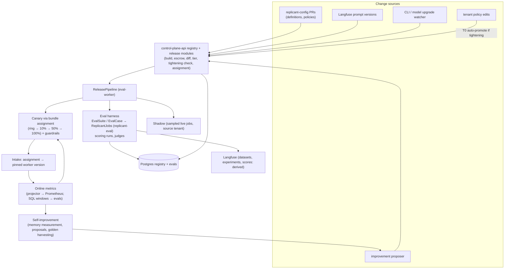

# 06 — Release Bundles, Evaluation Harness, and Self-Improvement (WS-06)

## Purpose

Every change to Replicant behavior (graphs, worker code, prompts, models, CLI versions, agent and environment
definitions, policies, memory snapshot policy) becomes a versioned, evaluated, reversible release. This
section specifies the Release Bundle machinery around the frozen bundle schema, the evaluation harness that
gates promotion, the promotion pipeline (offline eval → shadow → canary → full → holdback), online metrics,
the self-improvement loop, and the procedure for CLI and model upgrades.

## Decisions summary

| Area | Decision | Constraint / ADR |
|---|---|---|
| Bundle document | Exactly the frozen C-DEF schema; promotion state, tier, change classes, assignment live beside it in `registry` | D-03, ADR-005 |
| Requests | `ReleaseBundleRequest` with **full** and **overlay** modes; overlays produce one-change candidates and fail on undeclared changes | D-03; [ADR-06-005](adr/005-overlay-requests-one-change-bundles.md) |
| Prompt durability | Every pinned prompt version is escrowed by digest in the registry blob mirror (Langfuse versions can be deleted) | D-03, D-17; CCR-06-02 |
| Diff and tiering | Structural, document, and prompt-text diff; change classes map deterministically to eval tier T0–T3 and the shadow requirement | D-03 |
| **OQ-00-05** | **Decided: yes.** Tenant-derived bundles whose layer is mechanically *tightening* or *neutral* pass harness tier T0 and auto-promote (system actor, admin-configured policy). Behavioral layers go to a targeted T1 plus two-person sign-off | D-03; [ADR-06-001](adr/001-tightening-only-derived-bundles-auto-promote.md) |
| Eval execution | Each eval case is a real ReplicantJob in tenant `replicant-eval` through `POST /v1/jobs`; evaluation mode resolves gates from scripts inside the workflow; scoring, snapshot and compatibility runs are owned by separate harness jobs, so every Runner run has a live job workflow and a core-signed grant | D-04, D-19; [ADR-06-002](adr/002-eval-cases-run-as-replicant-jobs.md), [ADR-06-006](adr/006-evaluation-mode-gates-resolved-in-workflow.md) |
| Scoring | Deterministic first (hidden FAIL_TO_PASS / PASS_TO_PASS in a separate scoring run); calibrated, tool-less, closed-schema LLM judges second | D-16, D-17 |
| Statistics | Paired, hierarchical, cluster bootstrap; T1 60×1, T2 300×1, T3 450×2; non-inferiority margins 16 / 7.5 / 4.5 pt | [ADR-06-003](adr/003-paired-hierarchical-statistics.md) |
| Records | Postgres `evals` is the system of record; Langfuse datasets, experiments (OTel), and scores are a derived export | D-09; [ADR-06-007](adr/007-postgres-system-of-record-langfuse-export.md) |
| Promotion | `ReleasePipeline` workflow; ramp by bundle assignment on up to 3 ramps (ADR-006, C-DEF 3.0.0); shadow sampled for high-risk changes and paid from the platform eval budget; 3-stage canary with Bayesian guardrails; two-person sign-off for instruction-, capability-, and gate-altering changes (WS-09 G-09); weekly and monthly spend ceilings | D-02; [ADR-06-004](adr/004-shadow-sampled-for-high-risk-changes.md) |
| Rollback | One transaction on the assignment row; under 2 s system path; previous default's worker version never drained. Gates on the rolled-back bundle are marked and blocked; a failed canary preselects operator-forced migration | D-02, CC-3 |
| Upgrades | Weekly CLI candidates from the vendor's stable channel; compatibility suite C1–C9 before any eval | D-10; [ADR-06-008](adr/008-cli-candidate-cadence-stable-channel.md) |
| Self-improvement | Proposals are Replicant jobs on `replicant-config`, evaluated for superiority with holdout confirmation, reviewed by humans, never auto-promoted | D-03, D-14 |

## Files

| File | Content |
|---|---|
| [release-bundle.md](release-bundle.md) | Schema mapping, content addressing, resolution (full and overlay), storage, escrow, diff, change classes, tiers, assignment, tenant layers |
| [eval-harness.md](eval-harness.md) | Golden set (collection, storage, labeling, coverage, refresh), execution, scoring, judge calibration and drift, statistics and power, replay limits, cost |
| [promotion.md](promotion.md) | State machine, ReleasePipeline workflow, gates, shadow, canary guardrails, rollback, expedited path, sign-off rules, end-to-end sequence |
| [online-metrics.md](online-metrics.md) | Cohort attribution, metric definitions, Prometheus series and rules, SQL windows, holdback power, dashboards, alerts |
| [self-improvement.md](self-improvement.md) | Signals, failure taxonomy, memory measurement, golden harvesting, proposals, judge-gaming guardrails |
| [upgrades.md](upgrades.md) | CLI and model upgrade procedure and compatibility suite |
| [adr/](adr/) | ADR-06-001 to ADR-06-008 |
| [schemas/](schemas/) | `release-bundle-request`, `golden-task`, `evaluation-options` (incl. gate script), `judge-definition`, `promotion-policy` (JSON Schema 2020-12) |
| [sql/](sql/) | `registry-releases.sql`, `evals.sql` (PostgreSQL 17 DDL) |
| [api/releases.openapi.yaml](api/releases.openapi.yaml) | Release, bundle, eval, and webhook endpoints (OpenAPI 3.1.1) |
| [config/](config/) | Promotion policy, bundle request examples, judge definition example, Prometheus rules |
| [examples/](examples/) | Golden task example |
| [tools/](tools/) | `eval_sizing.py` (power and cost), `canary_guardrails.py` (guardrail operating characteristics) |

**Validation performed (2026-10-24):** all JSON Schemas meta-validate (Draft 2020-12) and every example and
config document validates against its schema (`jsonschema` 4.x); the OpenAPI document passes
`openapi-spec-validator`; both SQL files apply cleanly to PostgreSQL 17 (container `postgres:17`), and the
promotion-transition trigger rejects illegal edges and spec mutation; the Prometheus rules (7 recording rules, 8 alerts) pass
`promtool check rules` (Prometheus v3.1.0); all 13 Mermaid diagrams render with `@mermaid-js/mermaid-cli` 11.4.2; `tools/eval_sizing.py --simulate` reproduces the analytic power
(T = 450, R = 2: 0.841 empirical).

## Must-answer index

| Question | Answer |
|---|---|
| How many golden tasks are needed to detect a 5-point change in success rate? | About **400 tasks run twice per arm** (393 at the reference assumptions μ = 0.60, ρ = 0.5; 543 if ρ = 0.3). The full tier uses 450 × 2 (power 0.84 by simulation). Single-rep paired needs 758 tasks; unpaired needs 1,471 runs per arm. [eval-harness.md §6.3](eval-harness.md#63-power-calculation-golden-tasks-needed-to-detect-a-5-point-change-must-answer) |
| What does a full eval run cost? | T3 = 1,800 cases: **≈ $6.6k** at the modelled token profile ($3.65 per case), $11.4k at 2× tokens, $16.3k at 3×; ≈ 21 h at 90 parallel cases; half with a reused baseline arm. [eval-harness.md §8](eval-harness.md#8-cost-model-must-answer-what-a-full-eval-run-costs) |
| How does an operator roll back a bad prompt change in under five minutes, and what happens to pinned jobs? | One API call or click: a single transaction moves the default to the previous promoted bundle (worker still running, prompts escrowed) and transitions the bad bundle (`canary` or `promoted` → `rolled_back`); the pipeline only records it (`already_rolled_back`), so no second transition. The next intake uses the target, < 2 s system path. Pinned jobs: their approval gates are always marked and blocked; the operator chooses `none`, `offer`, `required`, or `required_by_operator` (preselected for a failed canary: migration at the next safe point without consent); undecided required migrations end `cancelled`. [promotion.md §7](promotion.md#7-rollback-in-under-five-minutes-must-answer) |
| How is LLM-judge drift detected? | Served-model assertion on the response body's `model` field (no gateway header needed), weekly anchor re-judging (κ drop ≥ 0.10, self-agreement < 0.85, mean shift > 0.30), known negatives in every batch, CUSUM on the incumbent's sentinel scores, a 3% human audit sample plus all judge/deterministic disagreements, and quarterly online validity; a drifting judge is excluded from gating. [eval-harness.md §5](eval-harness.md#5-judge-drift-detection-must-answer) |
| OQ-00-05: may tightening-only tenant-derived bundles auto-promote? | **Yes**, as harness tier T0 with closure identity, per-type safety order, budget sufficiency, and base state checks. [ADR-06-001](adr/001-tightening-only-derived-bundles-auto-promote.md) |

## Fix round, wave 1 (R1 and R2 findings led by WS-06)

| Finding | Resolution | Where |
|---|---|---|
| R1-132 (blocker) | `ramps[]` of C-DEF 3.0.0 in DDL (slots 0–2, non-overlap trigger), API (`…/assignment/ramps/{slot}`), and intake resolution; cadence recomputed (two canaries plus one holdback) | sql/registry-releases.sql, api/, release-bundle.md §8, promotion.md §12 |
| R1-133 (blocker) | Shadow jobs submitted by `svc_release-controller` on behalf of the live requester, pinning a `shadowing` (derived) bundle built at `shadowing`; CCR-06-12 adds the C-DEF row | promotion.md §5.2, release-bundle.md §8.2, §9.2 |
| R1-134 (blocker) | Harness jobs own every scoring, snapshot and compatibility run; core signs the grants; eval toolchain definitions admitted by CCR-06-07 | eval-harness.md §3.8, §2.2, upgrades.md §4 |
| R1-135 | Edges added (`evaluating/shadowing → withdrawn`, `promoted → rolled_back`); diagram, table and trigger identical (31 edges); abort per stage honoring `already_rolled_back`; hold handler | promotion.md §2–§3 |
| R1-136 | 0% ramping-version fallback removed; precondition = registered worker build | promotion.md §6.1 |
| R1-137 | 503 with no intake row; hold = freeze progression; C-DEF slot table; one retire guard | release-bundle.md §8.2, §8.5, §10; promotion.md §6.2 |
| R1-138 | WS-06 components authoritative; `getBundle` → `getReleaseBundle` | api/releases.openapi.yaml |
| R1-139 | Bootstrap endpoint and single-arm floor; `PUT …/assignment/default` (not prod); `local` env; `golden_set_id` | release-bundle.md §8.6, eval-harness.md §6.7, §10 |
| R1-140 | Six alert rules and their series added; `owner: ws-06` | config/replicant-release.rules.yaml, online-metrics.md §3, §7 |
| R1-141 | `AdmissionDenied` / `DefinitionUnavailable` replace `DefinitionDigestMismatch`; `deployment_version` label | rules file, online-metrics.md §3, promotion.md §6.2 |
| R1-142 | Curation and labeling write path through control-plane-api to eval-worker | eval-harness.md §2.3, api/ |
| R1-143 | Script locations readable by replicant-worker; three activities specified; round → batch mapping; `stop_case` semantics | eval-harness.md §3.3, promotion.md §7.3 |
| R1-144 | Release evidence packet artifact, digest, revisions, exposure, change notification | promotion.md §10.1, api/ |
| R1-145 | New sign-off points (CCR-06-11); tenant-scoped sign-off permission; `memory_snapshot` global only | promotion.md §10, release-bundle.md §9.1, ADR-06-001 |
| R1-146 | `spec.overlay.declaredChangeClasses`; selector description fixed | schemas/release-bundle-request.schema.json |
| R1-147 | Per-bundle `bundle-ref-<first 20 chars of rb_ body>` tags (superseded the per-digest form in wave 2), applied by `svc_release-controller` at build, removed by `sys:retention-sweeper`; 14-day untagged expiry | upgrades.md §8 |
| R1-148, XD-ORCH-01 | Expected assignment window (60 days, inherited by derived bundles), retirement calendar, `model_retiring` with forced migration | release-bundle.md §3.4, upgrades.md §6.5, sql/ |
| R1-151 | Component suites, DR resync endpoint, `eval_only` bundles | eval-harness.md §11, api/, release-bundle.md §3.5 |
| R1-152, R1-281 | WS-02 PriorityClass (50), per-env eval Git host, core-span experiment attributes, WS-02 node shape | eval-harness.md §3.5, §3.7 |
| R1-153 | RLS on holdout membership; canonical scope vocabulary; FORCE RLS on every table | sql/evals.sql, sql/registry-releases.sql |
| R1-154, R1-156 | Pre-acceptance conditionals removed; editorial fixes (stage vocabulary, dedupe key, Langfuse project, cohort CHECK, anchors key via CCR-06-14, example request via CCR-06-16) | several |
| R1-155 | One set of numbers: annual $0.65M (1×) to $1.13M (2×); shadow $150–$690; production $3.05–$5.75 per job; `holdback.byChangeClass` | eval-harness.md §8.2, promotion.md, tools/eval_sizing.py |
| R1-284 | Write order blob → pointer → row | release-bundle.md §3.1 |
| R1-285 | Reader CCR-06-15; no cross-owner view in `evals` | online-metrics.md §4 |
| R2-021 | Gates on a rolled-back bundle bannered and blocked; blast-radius preview; `required_by_operator` preselected for a failed canary; cancelled (not expired) | promotion.md §7, api/, CCR-06-13 |
| R2-056 | Budget stop = `cost_regression` fail; one invalid re-run; preemptions separate; weekly and monthly ceilings; proposal budget | promotion.md §4.6–§4.7, config/promotion-policy.yaml |
| R2-061 | Shadow charged to `fgw:pipeline:<pipeline_id>`, enforced by the gateway | promotion.md §5.2, §4.7 |
| R2-063 | Judge role, service caller, per-case judge counters | eval-harness.md §3.4, sql/evals.sql |
| §5.1 must-answers | Rollback: single transition, `already_rolled_back` honored, promoted target state `rolled_back`. Judge drift: J1 uses the response body's `model` | promotion.md §3, eval-harness.md §5 |

## Fix round, wave 2 (co-owner entries naming WS-06)

Contract versions cited: FROZEN.md (C-DEF 3.0.0, C-JOBREQ 2.0.0, C-MSG 2.0.0, C-RUNNER 3.0.0, C-PG 2.0.0,
C-IDS 2.0.0, C-ART 2.0.0, C-STATE 2.0.0); the final batch CCR-07-06..12 and CCR-01-06..11 is treated as accepted.

| Entry | Change | Where |
|---|---|---|
| XD-FIX-R1-013 | `registry.worker_deployment_versions` DDL (WS-01 shape); `set_ramp` requires `ready_at` and no `retired_at` | sql/registry-releases.sql, promotion.md |
| XD-FIX-R1-085 | Per-bundle ECR tag `bundle-ref-<first 20 chars of rb_ body>`, applied by the registry at build | upgrades.md §8, release-bundle.md |
| XD-FIX-R1-150 | Gateway caller purpose `eval_judge`, J1 on the response body's `model` (header informational, R1V-036), no batch path in v1 (`use_batch` is `const false`) | eval-harness.md §3.4, §3.6, schemas/judge-definition.schema.json, config/judges |
| XD-FIX-R1-101 | Memory replay cases (`memory_replay_job_id`, CCR-04-05) | eval-harness.md, schemas/evaluation-options.schema.json |
| XD-FIX-R2-017 | 14-day post-merge revert rate (guardrail and holdback metric), `F-REGRESS`, golden harvesting from reverts | online-metrics.md §2, self-improvement.md §1–§4, promotion.md |
| XD-FIX-R2-060 | Absolute per-case cap `min(budget_usd_max, jobHardCapUsd, jobBaseUsd + extensions + cycles × repairCycleUsd)` | eval-harness.md §3.4 |
| XD-FIX-R1-SYNTAX-OPENAPI | `Problem`, `responses/Problem`, `IdempotencyKey`, `ReleaseBundleId`, `TenantId` `$ref` WS-07 common-components; local copies deleted | api/releases.openapi.yaml |
| XD-FIX-R1-237 | `/v1/admin/evals/resync` follows the restore envelope (`restore:execute`, 409 `restore_not_open`, 202 `{restore_step_id, state}`, poll endpoint) | api/releases.openapi.yaml |
| XD-FIX-R1-207, R1-116, R1-196 | `replicant_jobs_*` names, `replicant_release_window_value{kind}`, verdict-based QA first pass | online-metrics.md, config/replicant-release.rules.yaml |
| XD-ORCH-04 | Explicit per-table grants (no `ON ALL TABLES IN SCHEMA`); FORCE RLS on every table | sql/*.sql |
| CCR-06-15 (accepted with constraint) | eval-worker reads across tenants only through WS-10's audited `ops.eval_*` functions (`ddl/40-eval-metrics-reader.sql`); two more functions and PR timestamps requested (XD-W2-06-01, -03) | online-metrics.md §4, self-improvement.md §1, eval-harness.md §2.4 |
| XD-W2-07-05, tagging owner | `svc_release-controller` (WS-06) applies bundle-ref tags at build, `sys:retention-sweeper` removes them; `evals.memory_entry_outcomes` dropped, per-entry counters are WS-04's, WS-06 reads `memory_snapshot_id` and `memory.v_job_outcomes` via audited functions | upgrades.md §8, release-bundle.md §4, self-improvement.md §3, sql/evals.sql |
| WS-01 model successors (R2-044) | `registry.model_successors`, successor bundles B′, `lineage=model_successor`; SR-1 handoff continuation only | sql/registry-releases.sql, upgrades.md §6.5, §7 |

New seams: XD-W2-06-01 (WS-10, WS-04 audited functions), XD-W2-06-02 (local cassette selection; correction row
supersedes the first), XD-W2-06-03 (WS-07 `job_prs` timestamps, `job_runs.qa_verdict`), XD-W2-06-04 (revert
counter labels), XD-W2-06-05 (WS-08 catalog rows).

**Validation (wave 2, 2026-10-24):** JSON Schemas and every config/example validate; `openapi-spec-validator` OK
(with external `$ref`s resolved); `promtool check rules` (prom/prometheus v3.1.0) 15 rules OK; WS-10
`tools/validate.sh` applies both SQL files OK, partitions OK, eval reader OK, `check_grants.py` reports 0 tenant
tables without FORCE RLS and 1 grant problem, which is WS-08's `audit.emit` (not WS-06); all 13 Mermaid
diagrams render with mermaid-cli 11.4.2; tools parse; no broken relative links.

## Fix round, wave 3 (R1-verification rows naming WS-06)

Citations follow the final FROZEN.md versions (C-MSG 2.0.0, C-RUNNER 3.0.0, C-PG 2.0.0, C-IDS 2.0.0, C-ART 2.0.0,
C-STATE 2.0.0, C-JOBREQ 2.0.0, C-DEF 3.0.0).

| Row | Fix | Where |
|---|---|---|
| R1V-014 | `eval.read_review_round {gate_script_uri, round}`; the key comes from the GateScript (XD-W3-R1V-014) | eval-harness.md §3.3 |
| R1V-016 | Smoke-local runs are deterministic through the stub selector set by replicant-worker | eval-harness.md §10 |
| R1V-032, R1V-034 | Shadow JobRequest on channel `eval`, with `options.evaluation.pipeline_id` | promotion.md §5.2 |
| R1V-033 | `RestoreStep` from WS-07 common components | api/releases.openapi.yaml |
| R1V-035 | `POST /v1/evals/runs` `purpose: bootstrap` produces `eval_passed` (XD-W3-R1V-035) | api, eval-harness.md §6.7, promotion.md §2, release-bundle.md §8.6 |
| R1V-036 | J1 and served-model mismatch decide on the response body's `model`; header informational (XD-W3-R1V-036) | eval-harness.md §3.6, §5 |
| R1V-037, R1V-129 | Model retirement migrates on the notice itself (no offer); ineligible jobs keep running; outcome `model_retired_not_migrated` | upgrades.md §6.5 |
| R1V-044 | `release:revoke` held by `replicant-release-managers` (matches 07 identity.md §5.2) | api/releases.openapi.yaml |
| R1V-130 | Bucket-range allocation and `waiting_for_bucket_range` | promotion.md §12 |
| R1V-131, R1V-132, R1V-134, R1V-136 | README tag row, env-qualified eval Git host, OM-1 cohorts, UP-3 without cross-version resume | README, examples, schemas, online-metrics.md, upgrades.md |
| R1V-133, R1V-135 | ADR-004 shadow-everything cost; m8id.24xlarge cost basis (unchanged per-vCPU price) | adr/004, eval-harness.md A-C6, tools/eval_sizing.py |
| R1V-137 | Judge calls send `X-Replicant-Role: eval-judge` | eval-harness.md §3.4 |
| R1V-138 | Orphan registry objects are never deleted (registry denies deletes) | release-bundle.md §3.1 |
| R1V-159 | Operator CLI verb table | promotion.md §12.1 |

## Responses to WS-09 control review

| Finding | Response |
|---|---|
| G-09 two-person rule | **Accepted and extended.** `twoPersonFor` now covers prompt and in-worker prompt changes, agent configuration, graphs, router, behavioral policies (gate, risk, network, runtime selection), codebase bindings, memory policy, worker code, CLI minor and major, models, and expedited releases. Behavioral tenant layers need a release manager plus a non-author tenant admin. Tightening-only tenant layers remain system-promoted at T0, as WS-09 recommends. [promotion.md §10](promotion.md#10-sign-off-rules) |
| G-24 worker-side LLM calls | **Confirmed** for WS-06's call sites: judges, failure labeler, and miner pre-screen are tool-less, closed-schema, and selection-only. Curator statement suggestions are free text but never applied without a human. [eval-harness.md §4.2.1](eval-harness.md#421-untrusted-text-in-worker-side-llm-calls-ws-09-g-24-confirmed) |

## Open questions (top; full lists in each file and in `spec/_coordination/open-questions.md`)

| ID | Question | Recommendation |
|---|---|---|
| OQ-06-05 | Annual eval budget: $0.65M–$1.13M at 1–2× tokens for the projected cadence; policy ceiling $1.2M per year | Fund the ceiling for two quarters, then decide on measured cost per case |
| OQ-06-04 | Tenant consent for using tenant repository content in the shared golden set | Per-tenant opt-in with erasure on withdrawal |
| OQ-06-08 | 72-hour minimum canary for prompt-only changes | Keep until guardrail data justify shortening |
| OQ-06-06 | Gateway batch path and record mode for `replicant-eval` | Metering required; batch and record are optional improvements |

## Risks

- Low online power for small regressions at 300 jobs/day; offline margins carry most of the weight.
- Eval spend dominates harness cost; batching, baseline reuse, and tier discipline are the levers.
- Several mechanisms depend on other workstreams (evaluation mode in WS-01, eval Git server behind repo-mirror in
  WS-02, gateway metering in WS-03, scoped snapshots in WS-04); see XD-06-* in the coordination file.

## Interfaces consumed / provided

- **Provided:** `ReleaseBundleRequest`; registry bundle, promotion, and assignment DDL; `evals` DDL; bundle diff;
  promotion state machine and ReleasePipeline; release APIs; promotion policy; golden-task, evaluation-options,
  judge-definition schemas; metric definitions and Prometheus rules; upgrade procedure.
- **Consumed:** C-DEF, C-IDS, C-PG, C-ART, C-MSG, C-JOBREQ, C-RUNNER, C-STATE; ADR-005, ADR-006, ADR-013.
