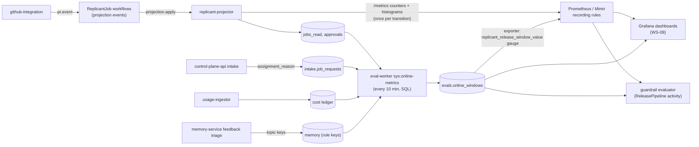

# Online Metrics

**Workstream:** WS-06 (definitions, cohort attribution, release analysis) with WS-08 (pipelines,
dashboards, alert routing) · **Contracts conformed to:** C-IDS 2.0.0 §11 (Prometheus label keys), §9
(Loki), §10 (Langfuse); C-STATE 2.0.0 (read models are derived); C-PG 2.0.0 (`jobs_read`, `approvals`,
`cost`, `evals`) · **Constraints:** D-09, D-14, D-15, D-17, D-19

## Purpose

Offline evals tell us whether a candidate is at least as good on the golden set. Online metrics tell us
what real engineers experience, and they are the only evidence for lagging outcomes such as merges and
review rounds. This document defines each metric exactly (numerator, denominator, window, exclusions,
source), attributes every job to a release cohort so that bundles can be compared, names the Prometheus
series and recording rules, and specifies the dashboards WS-08 builds.

## Decisions summary

| # | Decision | Constraint |
|---|---|---|
| OM-1 | A job's cohort is fixed at intake from its assignment (`intake.job_requests.assignment_reason`): `default`, `candidate`, `holdback`, `experiment`, `override`, `eval`, or `shadow` (the C-IDS §11 set, §1 table). A job that migrates bundles gets cohort `migrated` from the migration onward and is excluded from release comparisons | D-03 |
| OM-2 | Two pipelines. **Real-time** counters and histograms are emitted by `replicant-projector` at projection apply and evaluated in Prometheus (leading indicators, guardrails). **Windowed** lagging metrics (merge, review rounds, repeated comments) are computed in SQL by eval-worker into `evals.online_windows`, every 10 minutes | D-09, D-17 |
| OM-3 | Prometheus labels add `release_cohort` and `bundle` (base bundle short ID, bounded to bundles with an active assignment) to the C-IDS §11 allowed set. CCR-06-04 | C-IDS §11 |
| OM-4 | Every rate is reported with a Wilson 95% interval, and every comparison with a difference interval. No vanity totals | Shared context §4 (visual bar) |



---

## 1. Cohort attribution

| Field | Source | Rule |
|---|---|---|
| `release_bundle_id` (as started) | `intake.job_requests.release_bundle_id` | Written in the intake transaction |
| Base bundle | `registry.release_bundles.base_release_bundle_id` (or the bundle itself) | Derived bundles roll up to their base for release comparisons. Per-tenant analysis uses the derived ID |
| `release_cohort` | Function of `assignment_reason` (exact vocabulary in release-bundle.md §8.3): `default` → `default`; `ramp:canary:<slot>` → `candidate`; `ramp:holdback:<slot>` → `holdback`; `ramp:experiment:<slot>` → `experiment`; `tenant_override:<kind>` and `explicit_pin` → `override`; `eval_pin` → `eval`; `shadow_pin` → `shadow`. A `+layer` suffix does not change the cohort. Stored in `intake.job_requests.release_cohort` (XD-FIX-R1-158) | Fixed at intake |
| Migration | timeline event `bundle.migrated` | From that event on, metrics carry `release_cohort = migrated`. Release comparisons exclude migrated jobs entirely |

Eval and shadow jobs are excluded from every online metric and dashboard except the Eval dashboard.

## 2. Metric definitions

Notation: *terminal* statuses are those of C-IDS §6. A *PR job* is a job that opened a pull request. Time
windows refer to the job's `created_at` unless stated otherwise. "Active time" excludes human waits
(gates open) and external waits (`waiting_external`).

| Metric | Definition | Numerator / denominator | Exclusions | Leading or lagging | Source |
|---|---|---|---|---|---|
| **Job success rate** | Share of finished jobs that achieved their outcome | `succeeded` / (`succeeded` + `failed` + `rejected` + `expired` + `taken_over`) | `cancelled` (tracked separately); eval, shadow | lagging (PR jobs finish on merge) | `jobs_read.jobs` |
| **Ready-to-PR rate** (leading proxy) | Share of jobs past routing that reach a publishable state within 24 h of active time | jobs with `pr.opened` (or no-PR success) / jobs that left `routing` | clarification-blocked jobs still waiting | leading | `jobs_read.job_timeline` |
| **PR merge rate** | Share of Replicant PRs merged within 30 days of opening | PRs `merged` / PRs opened, counted for PRs opened ≥ 30 days ago or closed | drafts never marked ready (tracked) | lagging (30 d) | `jobs_read.job_prs` |
| **Review rounds per PR** | Repair cycles triggered by authorized human review before merge | mean and p90 of `ReplicantRepairCycle` at merge or close, over PRs with ≥ 1 human review | bot comments (never trigger, D-15) | lagging | `jobs_read.jobs.cycle` |
| **Repeated-comment rate** | Share of human review comments that repeat feedback Replicant already received | comments whose feedback-triage topic key matches an **active** memory entry's rule key in scope, or a comment topic seen on a prior Replicant PR in the same repo in the last 90 days / all triaged human review comments | non-actionable comments (praise, questions) | lagging | memory-service triage records (WS-04) + `jobs_read` |
| **QA first-pass rate** | Share of jobs whose first QA run passed | jobs whose QA `c0.n1` run has `role_result.verdict` ∈ {`pass`, `pass_with_warnings`} / jobs with a QA `c0.n1` run whose verdict is not `not_applicable`. The run's C-RUNNER `outcome` is never read (QA never uses `blocked`; XD-FIX-R1-116). Counter `replicant_qa_first_pass_total` has one emitter, the projector (XD-FIX-R1-201) | jobs with no QA stage | leading | `jobs_read.job_runs` + `qa_report` summary |
| **Time to PR (active)** | Active time from job creation to `pr.opened` | p50, p90 | jobs without a PR | leading | timeline |
| **Time to PR (wall)** | Wall time to `pr.opened` | p50, p90 | — | leading | timeline |
| **Human wait time** | Total time gates were open per job | p50, p90 of Σ(gate decided_at − opened_at) | expired gates count until expiry | leading | `approvals.gates` |
| **Cost per job** | Ledger cost of all model calls and sandbox compute attributed to the job | p50, p90, mean (USD) | — | leading (final at terminal) | `cost` rollups |
| **Gate override rate** | Share of approval-gate decisions in which the human did not accept Replicant's proposal | (`reject` + `request_changes`) / all decided approval gates, per `gate_kind` | clarification gates (they have no proposal); expired gates (tracked separately as **gate expiry rate**) | leading | `approvals.gate_decisions` |
| **Risk raise rate** | Share of jobs where an LLM raised the deterministic risk level (D-19) | jobs with `risk.raised_by_llm` / jobs classified | — | leading | snapshot |
| **Take-over rate** | Share of jobs ending `taken_over` | `taken_over` / terminal | — | lagging | jobs |
| **Post-merge revert rate (14 d)** (R2-017) | Share of merged Replicant jobs whose result was reverted or reported wrong within 14 days of merge | jobs with a `reverted` or `wrong_fix` outcome report (WS-04 `memory.v_job_outcomes.post_merge_reverted` with `merged_at` and `reported_at`, read through `ops.eval_job_outcomes`, fed by WS-07's revert detector, `/replicant wrong`, and "Report a problem with this result") within 14 d / jobs merged ≥ 14 d ago | — | lagging (14 d) | counter `replicant_jobs_post_merge_reverted_total{tenant, release_cohort, bundle}` (memory-service; labels per XD-W2-06-04) over `replicant_pr_outcomes_total{outcome="merged"}` |
| **Cancellation rate** | Share of jobs cancelled by a human | `cancelled` with a `usr_` actor / terminal | system cancels (eval timeouts) | leading | jobs, audit |
| **Bundle-attributable run failure rate** | Share of AgentRuns failing with a bundle-attributable reason (promotion.md §6.2) | those runs / all terminal runs | infrastructure reasons | leading | `jobs_read.job_runs` |
| **Scope-violation rate** | Share of jobs whose diff touched paths outside the planned scope or a policy-forbidden path (verifier node) | violations / jobs with a diff | — | leading | verifier result in the timeline |
| **Budget exhaustion rate** | Share of jobs that hit a budget gate or `GatewayBudgetExceeded` | / jobs | — | leading | timeline, run reasons |
| **Memory-attributed repeat rate** (admin-only, D-25) | Repeated comments whose topic matches a memory entry **that was injected** into that job | / repeated comments | — | lagging | WS-04 `memory.entry_outcome_stats` (per-entry attribution is WS-04's, XD-W2-07-05); shown only on WS-04's curation screen |

## 3. Prometheus series (emitted by replicant-projector)

The projector emits each series exactly once per transition. It increments a counter only when its seq-guarded
upsert actually changed the row (`UPDATE … WHERE excluded.seq > jobs.seq RETURNING (xmax = 0)`), so
redelivered projection events cannot double-count. WS-07 implements this in the projector; WS-08 owns the
metric list (C-IDS §11).

| Metric | Type | Labels | Emitted when |
|---|---|---|---|
| `replicant_jobs_started_total` | counter | `env, tenant, workflow_type, release_cohort, bundle` | `job.routed` |
| `replicant_jobs_terminal_total` | counter | `env, tenant, workflow_type, outcome, release_cohort, bundle, deployment_version` | `job.terminal` (`outcome` = terminal status; `deployment_version` = the job's pinned `replicant-worker` version as `replicant-worker:<build_id>`, XD-07-07, R1-141) |
| `replicant_runs_terminal_total` | counter | `env, tenant, role, workload_class, outcome, reason, release_cohort, bundle` | run terminal (`outcome` = phase; `reason` = CRD failure reason or `none`) |
| `replicant_qa_first_pass_total` | counter | `env, tenant, workflow_type, outcome, release_cohort, bundle` | first QA run (`c0.n1`) terminal; `outcome ∈ {pass, fail}` |
| `replicant_gate_decisions_total` | counter | `env, tenant, gate_kind, outcome, channel, release_cohort, bundle` | `gate.decided` / `gate.expired` (`outcome ∈ {approve, reject, request_changes, answer, expired}`) |
| `replicant_jobs_cost_usd` | histogram (buckets 0.25, 0.5, 1, 2, 4, 8, 16, 32, 64, 128) | `env, workflow_type, release_cohort, bundle` | job terminal (from the snapshot's cost summary) |
| `replicant_jobs_time_to_pr_active_seconds` | histogram (buckets 300, 600, 900, 1200, 1800, 2700, 3600, 5400, 7200, 14400) | `env, workflow_type, release_cohort, bundle` | `pr.opened` |
| `replicant_jobs_human_wait_seconds` | histogram (buckets 60, 300, 900, 3600, 14400, 43200, 86400, 259200, 604800) | `env, gate_kind, release_cohort, bundle` | gate decided or expired |
| `replicant_jobs_scope_violations_total` | counter | `env, tenant, workflow_type, release_cohort, bundle` | verifier result with a violation |
| `replicant_pr_outcomes_total` | counter | `env, tenant, workflow_type, outcome, release_cohort, bundle` | PR merged, closed, or expired (`outcome`) |
| `replicant_pr_review_rounds` | histogram (buckets 0, 1, 2, 3, 4, 6, 8) | `env, workflow_type, release_cohort, bundle` | PR merged or closed |

Series emitted by other components (R1-140):

| Metric | Type | Labels | Emitter |
|---|---|---|---|
| `replicant_release_rollback_failures_total` | counter | `env, reason` | control-plane-api (rollback endpoint) |
| `replicant_intake_bundle_unresolvable_total` | counter | `env, tenant, reason` | control-plane-api (intake, release-bundle.md §8.5) |
| `replicant_release_prompt_version_deleted_total` | counter | `env` | control-plane-api (Langfuse webhook receiver) |
| `replicant_release_guardrail_last_evaluation_timestamp_seconds` | gauge | `env` | eval-worker (ReleasePipeline guardrail activity) |
| `replicant_eval_sentinel_resolved_rate`, `replicant_eval_sentinel_control_lower`, `replicant_eval_sentinel_control_upper` | gauges | `env` | eval-worker (after each sentinel run) |
| `replicant_eval_judges_suspect` | gauge | `env` | eval-worker (count of judges in state `suspect`) |
| `replicant_release_online_regression` | gauge (0 or 1) | `env` | eval-worker (`sys:online-metrics`, §4) |
| `replicant_release_window_value` | gauge | `kind` (`merge_rate`, `merge_rate_ci_low`, `merge_rate_ci_high`, `review_rounds_mean`, `repeated_comment_rate`, `revert_rate_14d`), `release_cohort`, `bundle` (WS-08 catalog form) | eval-worker (`sys:online-metrics`, §4) |
| `replicant_release_rollback_duration_seconds`, `replicant_release_rollback_effective_seconds` | histograms | `env` | control-plane-api (promotion.md §7.2) |

**Cardinality.** `bundle` takes at most about 4 values at a time (default, candidate or holdback, rollback
target, `other`). Counters with `tenant`: about 43 tenants × 9 workflow types × 6 outcomes × 5 cohorts × 4
bundles is the theoretical maximum (≈ 46k series), but only one or two cohorts exist per tenant at a time,
which leaves about 5k–10k live series per counter. Histograms omit `tenant` (about 720 label sets × 11
buckets ≈ 8k series each). Per-tenant percentiles come from SQL, not Prometheus.

### 3.1 Recording rules and alerts

The authoritative rules file is [config/replicant-release.rules.yaml](config/replicant-release.rules.yaml) (7
recording rules and 8 alerts; `promtool check rules` passes on Prometheus v3.1.0). The bundle-attributable
failure ratio counts the C-CRD failure reasons `AgentExitedNonZero`, `AgentResultMissing`,
`AgentResultInvalid`, `SessionRestoreFailed`, `GatewayBudgetExceeded`, `AdmissionDenied` and
`DefinitionUnavailable`; `DefinitionDigestMismatch` is only a condition reason and never appears as a run's
failure reason (R1-141). All alerts carry `owner: ws-06`.

The Prometheus alert is a human-facing early warning. The authoritative guardrail decision is the
ReleasePipeline's `evaluate_guardrails` activity, which applies the Bayesian rule of promotion.md §6.2 to
counts it reads through WS-10's audited `ops.eval_*` functions (not from Prometheus rates). Prometheus is never the sole input to a rollback.

## 4. Windowed lagging metrics (SQL)

`sys:online-metrics` (Temporal Schedule, every 10 minutes, eval-worker) computes windows into
`evals.online_windows` for every (base bundle, cohort, metric) with an active assignment in the last 45 days,
plus per-tenant windows daily. Example: PR merge rate by cohort for PRs opened in a window, counted once
their outcome is known or 30 days have passed.

**Cross-tenant reads (CCR-06-15, accepted with a constraint).** eval-worker reads other owners' tenant data
**only** through WS-10's audited read functions in `spec/10-data-platform/ddl/40-eval-metrics-reader.sql`. Each
is `SECURITY DEFINER`, owned by the NOLOGIN role `eval_metrics_reader` (column-level SELECT on an allowlist of
IDs, status, metrics, digests and timestamps, never free text), pins `replicant.principal_scope =
'system:all-tenants'` for its own duration, takes a window of at most 46 days and returns at most 200,000 rows,
and writes one `audit.emit` event `data.cross_tenant_read` `{function, window, row_count}` per call (no audit,
no read). `svc_eval_worker` holds EXECUTE on them and no USAGE on `jobs_read`, `intake`, `approvals` or `cost`.
WS-06 uses nothing else:

| Function (WS-10) | Columns WS-06 uses | WS-06 use |
|---|---|---|
| `ops.eval_jobs(from, to)` | `job_id, tenant_id, workflow_type, status, terminal_outcome, terminal_at, release_bundle_id, release_cohort, migrated, worker_build_id, evaluation_mode, cycle, repair_used` | success, take-over, review rounds (`repair_used`), cohort; production mix (eval-harness.md §2.4, two calls of ≤ 46 days for 90 days) |
| `ops.eval_job_prs(from, to)` | `job_id, repo_id, pr_number, state, opened_at, merged_at, closed_at` (windowed on `opened_at`) | PR merge rate |
| `ops.eval_job_requests(from, to)` | `assignment_reason, release_cohort, release_bundle_id, received_at, started_at` | cohort at intake (OM-1) |
| `ops.eval_gates(from, to)` | `kind, state, decided_at, opened_at, expires_at` | human wait time, gate override rate (`state` carries the decision outcome; no comment text) |
| `ops.eval_job_costs(from, to)` | `llm_cost_micros, worker_llm_cost_micros, compute_cost_micros, budget_micros` | cost per job, `F-COST` |
| `ops.eval_job_runs(from, to)` | `job_id, role, node_key, cycle, ordinal, reason, result_outcome, qa_verdict` | QA first-pass, bundle-attributable run failures |
| `ops.eval_job_memory_usage(from, to)` (XD-W2-07-05 shape) | `job_id, tenant_id, memory_snapshot_id` (no per-entry column) | which snapshot a job used; per-entry outcomes are WS-04's (self-improvement.md §3) |
| `ops.eval_job_outcomes(from, to)` over WS-04 `memory.v_job_outcomes` | `job_id, tenant_id, release_bundle_id, pr_merged, merged_at, post_merge_reverted, report_kind, reported_at, review_rounds, first_pass_qa` | 14-day revert rate, outcome-report signals |

All eight functions exist in WS-10's DDL (XD-W2-10-04). eval-worker never reads `cost.usage_events`: eval and pipeline spend comes
from the gateway pipeline counters and `evals.spend_periods` (eval-harness.md §3.4).

```sql
-- Query text owned by eval-worker (sys:online-metrics). Tenant data comes only from WS-10's audited functions
-- (each call writes its own data.cross_tenant_read audit event); the one table read directly is WS-06's own
-- platform table registry.release_bundles (no tenant data; svc_eval_worker holds SELECT on it).
-- Inputs: :window_start, :window_end (online windows are 14 days). ops.eval_jobs is windowed on created_at,
-- so it is called from window_start - 32 days (46-day cap) to catch PRs of jobs created before the window;
-- PRs of jobs created earlier than that are not counted.
WITH prs AS (
    SELECT p.job_id, p.opened_at, p.merged_at, p.closed_at, j.release_bundle_id,
           coalesce(b.base_release_bundle_id, b.release_bundle_id) AS base_bundle,
           j.release_cohort
    FROM ops.eval_job_prs(:window_start, :window_end) p
    JOIN ops.eval_jobs(:window_start - interval '32 days', :window_end) j ON j.job_id = p.job_id
    JOIN registry.release_bundles b ON b.release_bundle_id = j.release_bundle_id
    WHERE j.release_cohort IN ('default', 'candidate', 'holdback', 'experiment')
      AND NOT j.migrated
),
decided AS (
    SELECT *, (merged_at IS NOT NULL AND merged_at <= opened_at + interval '30 days') AS merged30
    FROM prs
    WHERE merged_at IS NOT NULL OR closed_at IS NOT NULL OR opened_at <= now() - interval '30 days'
)
SELECT base_bundle, release_cohort,
       count(*)                                  AS n,
       count(*) FILTER (WHERE merged30)          AS successes,
       count(*) FILTER (WHERE merged30)::numeric / nullif(count(*), 0) AS merge_rate
FROM decided
GROUP BY base_bundle, release_cohort;
```

(`release_cohort` and `migrated` are WS-07 columns (XD-FIX-R1-158) that `ops.eval_jobs` exposes. The cohort is computed from `assignment_reason` at intake.)

Wilson intervals are computed in Python in the same activity (`statsmodels` 0.14
`proportion_confint(method="wilson")`) and stored in `ci_low` and `ci_high`. The windows are also exported as
`replicant_release_window_value{kind, release_cohort, bundle}` (WS-08 catalog form; `env` is the Mimir external
label).

## 5. Lagging metrics: holdback and experiments

Lagging outcomes need far more traffic than a 72-hour canary has. Their power at 300 jobs per day, assuming
70% of jobs open PRs and a merge rate of 0.60:

| Design | Treatment n | Control n | MDE on merge rate (two-sided α = 0.05, power 0.8) |
|---|---|---|---|
| Holdback 5% for 7 days | 1,397 PRs (new default) | 74 PRs (previous bundle) | ≈ 16.4 pt |
| Holdback 5% for 30 days | 5,985 | 315 | ≈ 7.9 pt |
| Experiment 50/50 for 7 days | 735 | 735 | ≈ 7.2 pt |
| Experiment 50/50 for 30 days | 3,150 | 3,150 | ≈ 3.5 pt |

(210 PRs per day. Two-proportion normal approximation, `MDE = (1.96 + 0.84) × sqrt(0.24 / n1 + 0.24 / n2)`.)

Consequences:

* The 7-day holdback catches only gross merge-rate regressions (≥ 16 pt). It is kept short, because it costs
  the 5% holdback group the improvement.
* Claims that a change **improves** merge rate or review rounds need an explicit 50/50 experiment of at least
  30 days, or are not made. The improvement proposer must use the experiment path for such claims
  (self-improvement.md §5.4).
* Review rounds and repeated-comment rate are compared with a task-free analysis: the mean difference with a
  bootstrap over PRs, stratified by repository so that repos with chronically picky reviewers do not dominate.

## 6. Dashboards (specification for WS-08)

All dashboards follow the WS-07 design system: dense, no vanity tiles, intervals on every rate,
monospace IDs, and colors from the semantic status palette. Every panel answers a stated question.

| Dashboard | Question it answers | Panels |
|---|---|---|
| **Release health** (`replicant-release-health`) | Is the candidate in flight worse than the default, and by how much? | For each guardrail R1–R10: candidate vs control with intervals over the canary timeline; stage markers (ring-early, pct-10, pct-50) as annotations; current pause and rollback state; jobs per cohort per hour; pinned running jobs per bundle (from `TemporalWorkerDeploymentVersion` and `ReplicantReleaseBundleId` visibility counts via the control-plane API) |
| **Online quality** (`replicant-online-quality`) | How is the Replicant doing for engineers, by tenant and workflow type? | Job success, ready-to-PR, merge rate, review rounds, repeated-comment rate, QA first-pass, take-over, cancellation: 90-day trend by base bundle with release annotations; tenant × workflow-type heatmap of success rate (cells with n < 20 grayed) |
| **Speed and cost** (`replicant-speed-cost`) | Where does time and money go? | Time to PR (active, wall) p50 and p90; human wait by gate kind; cost per job p50 and p90 by workflow type and bundle; budget exhaustion rate |
| **Approvals** (`replicant-approvals`) | Are gates useful or noise? | Gate override rate by gate kind and tenant; expiry rate; risk raise rate; wait-time distributions |
| **Evals** (`replicant-evals`) | What did the last comparisons say, and what did they cost? | Comparison list with verdicts and margins; per-stratum forest plots; harness error rate; cost per case; sentinel control chart (§9 of eval-harness.md) |
| **Judge health** (`replicant-judges`) | Can the judges be trusted this week? | κ per judge over time vs thresholds; self-agreement; known-negative failures; served-model mismatches; CUSUM state |
| **Golden set** (`replicant-golden-set`) | Does the golden set still cover the work? | Strata counts vs targets; production mix vs set mix; task states; saturation and quarantine counts; age distribution |
| **Memory impact** (admin-only, D-25) | Is memory helping? | Memory-attributed repeat rate; per-entry outcomes; repeated-comment rate before and after an entry's activation |

## 7. Alerts (defined by WS-06 in the rules file; routed by WS-08 on `owner: ws-06` to the `replicant-release` receiver)

WS-08 also loads `ReplicantReleaseFailureSpike` (07 architecture.md §9) next to this file and inhibits it while a
ReleasePipeline guardrail alert for the same bundle fires (XD-FIX-R1-5.1-release-alert); WS-08's
`ReplicantJobFailureRateByVersion` (owner ws-06, XD-FIX-R1-195) uses `replicant_jobs_terminal_total{deployment_version}`.

| Alert | Condition | Severity |
|---|---|---|
| `ReplicantCandidateRunFailureElevated` | §3.1 | page |
| `ReplicantReleaseGuardrailDataStale` | §3.1 | page |
| `ReplicantReleaseRollbackBlocked` | `replicant_release_rollback_failures_total` increased for 2 minutes | page |
| `ReplicantIntakeBundleUnresolvable` | `replicant_intake_bundle_unresolvable_total` increased in 5 minutes | page |
| `ReplicantSentinelOutOfControl` | `replicant_eval_sentinel_resolved_rate` outside its control-limit gauges (mean ± 3 SE of the last 30 days) | ticket |
| `ReplicantJudgeDrift` | `replicant_eval_judges_suspect > 0` | ticket |
| `ReplicantOnlineQualityRegression` | `replicant_release_online_regression == 1` for 1 h (14-day merge-rate interval of the default entirely below the previous default's) | ticket |
| `ReplicantPromptVersionDeleted` | `replicant_release_prompt_version_deleted_total` increased in 1 h | ticket |

## Open questions

| ID | Question | Who decides | Options | Recommendation |
|---|---|---|---|---|
| OQ-06-12 | Repeated-comment detection uses WS-04's feedback-triage topic keys. Is that classification stable enough to be a release metric? | WS-04, WS-06 | topic keys / embedding similarity of comments / both | Topic keys as the metric; embedding similarity over comments (not code, consistent with D-13) as a diagnostic for unmatched repeats |
| OQ-06-13 | Should the 5% holdback extend to 30 days for model changes? | Release managers | 7 days / 30 days for T3 changes | 30 days for model changes only (MDE 7.9 pt), 7 days otherwise |

## Risks

- **Confounding by tenant mix.** Ring-early tenants differ from the rest. The control cohort for each stage is
  restricted to tenants present in the candidate cohort for rate comparisons (stratified by tenant), so the
  comparison is within-tenant.
- **Lagging metric latency.** Merge outcomes arrive days to weeks after a release. Releases attribute by the
  bundle at intake, so later releases do not contaminate earlier windows.
- **Projection lag** distorts real-time rates. Guardrails freeze on stale data (promotion.md §11).

## Interfaces

- **Provided:** metric definitions (§2), cohort attribution (§1), Prometheus series and rules (§3), window
  SQL (§4), dashboard specifications (§6), alert list (§7).
- **Consumed:** C-IDS §11 (labels; CCR-06-04 adds two); C-STATE §2 (projection); `jobs_read`, `approvals`,
  `cost`, `intake` schemas (WS-07, WS-03); feedback triage topic keys (WS-04); Grafana, Prometheus or Mimir (WS-08).
