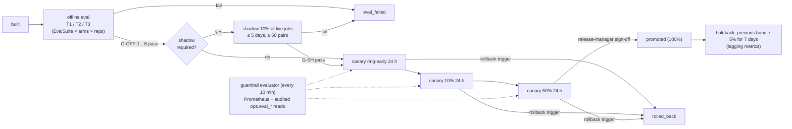
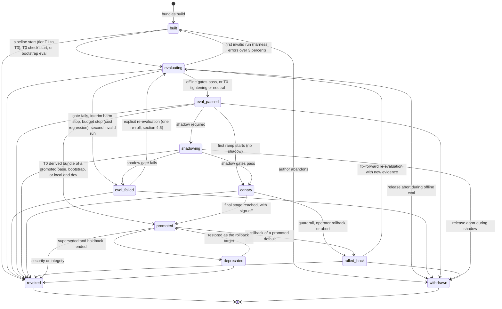
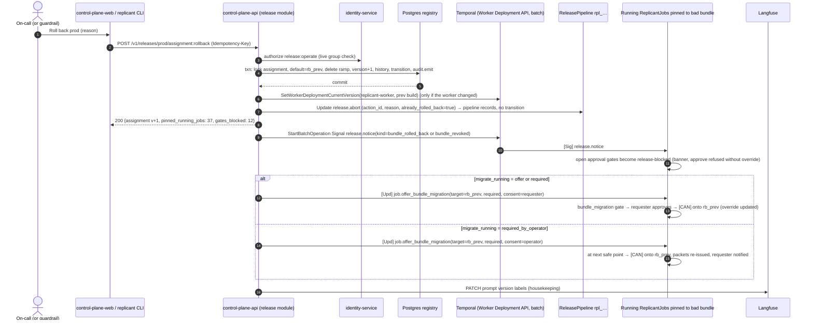
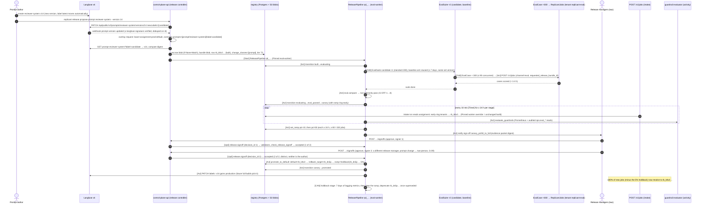

# Promotion Pipeline

**Workstream:** WS-06 · **Contracts conformed to:** C-DEF 3.0.0 (§4.4 promotion states, §4.5 assignment),
C-MSG 2.0.0 (`release.notice`, `job.offer_bundle_migration`), C-IDS 2.0.0, C-STATE 2.0.0, ADR-005, ADR-006,
ADR-013 · **Constraints:** D-02, D-03, D-19, D-25

## Purpose

This document specifies how a built bundle becomes the bundle that 100% of new jobs run on: offline eval,
optional shadow, a staged canary ramp through bundle assignment (which drives the pinned Worker Deployment
Version, ADR-006), full promotion, and a holdback. It also specifies the gates with their numeric
thresholds, the automatic rollback triggers, the human sign-off rules, and the five-minute rollback.

## Decisions summary

| # | Decision | Constraint / ADR |
|---|---|---|
| PR-1 | A **`ReleasePipeline`** Temporal workflow (eval-worker, task queue `replicant-eval`, workflow ID `rpl_<ulid>`) drives every promotion. Human sign-offs are Updates (`release.signoff`) with validators, mirroring gate semantics (ADR-001). The policy it applies is read once at start and recorded | D-01, D-02; CCR-06-03 |
| PR-2 | Ramping is by **bundle assignment** (job-hash percent plus a tenant ring), never Temporal's ramping version, exactly as ADR-006 decides. Temporal's current version follows the default bundle's worker | D-02, ADR-006 |
| PR-3 | **Shadow is affordable and used selectively**: required for model, CLI minor or major, graph, router, and memory-policy changes. It samples 10% of eligible live jobs for up to 5 days (≥ 50 pairs). It costs about $150–$690 per pipeline (1× to 2× tokens), capped at $1,500 and charged to the platform eval budget, never to the tenant | [ADR-06-004](adr/004-shadow-sampled-for-high-risk-changes.md) |
| PR-4 | Canary stages are ring-early (24 h) → 10% (24 h) → 50% (24 h, then sign-off) → 100%, followed by a 5% holdback of the previous bundle for 7 days (30 days for model changes). Up to two canaries and one holdback run at once on C-DEF 3.0.0's three ramps | D-02 |
| PR-5 | Online guardrails compare the candidate cohort with the **concurrent** control cohort. Each rate trigger has a *pause* tier (P > 0.99 and observed ≥ θ/2) and a *rollback* tier (P > 0.999 and observed ≥ θ). Simulated false-pause rates are 1.6–6.0% per trigger per canary, and false-rollback rates ≤ 0.4% | §6 |
| PR-6 | **Rollback is one transaction** on the assignment row (`POST /v1/releases/{env}/assignment:rollback`). It takes effect for the next intake, with no build, no eval and no deploy, because the rollback target is a previously promoted bundle whose worker version is never drained (RB-7). Running jobs stay pinned unless the operator chooses a migration mode, but their open approval gates are always marked and blocked; a failed canary preselects `required_by_operator` | D-02, CC-3; §7 |
| PR-7 | No improvement proposal is ever auto-promoted. Tenant-derived tightening-only bundles are the only automatic promotions, and they are T0 by construction ([ADR-06-001](adr/001-tightening-only-derived-bundles-auto-promote.md)) | D-03; brief §5 |
| PR-8 | **Two-person sign-off** for every production change that can alter agent instructions, capabilities, or gates (WS-09 G-09, accepted and extended, §10) | D-19, D-25 |
| PR-9 | Weekly and monthly **spend ceilings** per category (eval, shadow, proposal, component); a budget stop is a `cost_regression` failure, and `invalid` re-runs are capped at one per bundle | R2-056; §4.6–§4.7 |



---

## 1. Promotion policy

The pipeline's numbers live in [config/promotion-policy.yaml](config/promotion-policy.yaml)
([schema](schemas/promotion-policy.schema.json)). This is operational configuration in the sense of
ADR-013: it decides **when** and **whether** a bundle reaches jobs, never **how** an agent behaves. It is
published from the config repo to `registry.promotion_policies` (one active version per name). A pipeline
reads the active version at start, records `(name, version)` in its state and in `evals.comparisons`, and
keeps it for its whole lifetime, so a policy edit never changes a pipeline in flight.

## 2. Promotion state machine

The diagram, the table, and the trigger `registry.check_promotion_transition`
([sql/registry-releases.sql](sql/registry-releases.sql)) carry **exactly the same 31 edges** (R1-135d).



| Edge | Actor | Required evidence (in `bundle_promotion_events.evidence`) |
|---|---|---|
| `built → evaluating` | `svc_eval-worker` (pipeline, or a bootstrap eval run `POST /v1/evals/runs` with `purpose: bootstrap`, R1V-035) or `svc_release-controller` (T0) | `pipeline_id` (or `eval_run_id` for bootstrap), tier, policy version, spend-ceiling check result (§4.7) |
| `evaluating → eval_passed` | `svc_eval-worker` | `comparison_id` with verdict `pass` (for bootstrap: the single-arm floor of eval-harness.md §6.7), every G-OFF result, and the `decision_id`s of required sign-offs. For T0, the tightening report |
| `evaluating → eval_failed` | `svc_eval-worker` | `verdict_reason` (`gate_failed`, `interim_harm`, `cost_regression`, `harness_errors`) and failing gate IDs |
| `evaluating → built` | `svc_eval-worker` | first `invalid` comparison (harness errors); the next attempt is attempt 2 of at most 2 (R2-056) |
| `evaluating → withdrawn`, `shadowing → withdrawn` | `svc_eval-worker` on `release.abort` | abort `action_id`, actor, reason |
| `eval_failed → evaluating`, `rolled_back → evaluating` | `usr_` with `release:operate` | justification; re-roll counter (§4.6) |
| `eval_passed → shadowing`, `shadowing → canary` | `svc_eval-worker` | shadow summary and G-SH results |
| `eval_passed → canary` | `svc_cpa_registry` in the ramp-start transaction requested by the pipeline | assignment version, ramp slot |
| `eval_passed → promoted` | `svc_release-controller` (T0), or control-plane-api bootstrap / local and dev promotion | tightening report, or bootstrap sign-offs |
| `canary → promoted` | `svc_eval-worker` | stage history, guardrail evaluations, `canary_pct50_to_full` sign-off `decision_id`s |
| `canary → rolled_back`, `promoted → rolled_back` | control-plane-api in the rollback transaction (§7.2), whether triggered by the pipeline's guardrail or by an operator | trigger ID and evaluation, or operator reason; `preview_digest` |
| `promoted → deprecated` | `svc_release-controller` | superseding bundle, holdback end |
| `deprecated → promoted` | control-plane-api in the rollback transaction (restoring the rollback target) | rollback reason |
| `* → revoked` | `usr_` with `release:revoke`, or `svc_release-controller` on integrity trigger R7 or on revocation of a contained definition version | reason; affected job count |
| `* → withdrawn` (other) | `usr_` with `release:operate`, or the change author | reason |

Every transition goes through `POST /v1/releases/bundles/{id}:transition` or a release-operation transaction
in control-plane-api (the single writer, C-PG), with optimistic concurrency on `state_version`. Rollback is a
release operation: **only the rollback transaction transitions the bundle**, never the pipeline afterwards
(R1-135b).

## 3. The ReleasePipeline workflow

### 3.1 Shape

| Aspect | Value |
|---|---|
| Workflow type | `ReleasePipeline` (C-IDS §4, CCR-06-03 accepted) |
| Worker | `eval-worker`, task queue `replicant-eval`, `VersioningBehavior.PINNED` |
| ID | `rpl_<ulid>` |
| Input | `{pipeline_id, env, candidate_bundle_id, baseline_bundle_id, required_tier, require_shadow, policy_ref, requested_by, change_author}` |
| Updates | `release.signoff` (Update ID = `decision_id`), `release.abort`, `release.hold` (`action: hold | resume`; Update ID = `action_id`), all with the C-MSG 2.0.0 payloads |
| Query | `release.snapshot` (C-MSG `ReleaseSnapshot` envelope; `stage` ∈ `offline`, `shadow`, `canary`, `holdback`, `done`, `rolled_back`, `aborted`; WS-06 adds `canary_stage`, `evidence[]`, `projection_seq`) |
| Signals | none. Guardrails are polled by timer and activity |
| Continue-As-New | At each stage boundary. The guardrail loop's 10-minute timer runs for at most about 300 hours (canary plus a 30-day holdback is longer: Continue-As-New every 1,000 iterations, about 4,000 events, well under the 10,240-event warning, V00-05) |
| Projection | Non-awaited activity `release.project` → `evals.release_pipelines` after every state change, then `NOTIFY replicant_release_updates, '<env>:<pipeline_id>:<seq>'`; control-plane-api fans this out as SSE event `release.changed` (XD-FIX-R1-144) |

### 3.2 Reference code (abridged by omission of helper bodies, not of logic)

```python
# eval_worker/workflows/release_pipeline.py — temporalio 1.34, Python 3.12
from __future__ import annotations

import asyncio
from datetime import timedelta

from temporalio import workflow
from temporalio.common import RetryPolicy, VersioningBehavior
from temporalio.exceptions import ApplicationError

with workflow.unsafe.imports_passed_through():
    from eval_worker.activities import release as act
    from eval_worker.models import (ControlRequest, ControlResult, GuardrailVerdict, PipelineInput,
                                    PipelineState, SignoffRequest, SignoffResult)

RETRY = RetryPolicy(initial_interval=timedelta(seconds=2), backoff_coefficient=2.0,
                    maximum_interval=timedelta(minutes=2), maximum_attempts=0)
T30 = timedelta(seconds=30)


class Aborted(Exception):
    pass


@workflow.defn(name="ReleasePipeline", versioning_behavior=VersioningBehavior.PINNED)
class ReleasePipeline:
    def __init__(self) -> None:
        self.s: PipelineState | None = None
        self.abort_req: ControlRequest | None = None
        self.signoffs: dict[str, SignoffResult] = {}
        self.controls: dict[str, ControlResult] = {}
        self.lock = asyncio.Lock()

    @workflow.run
    async def run(self, inp: PipelineInput) -> str:
        self.s = inp.state or PipelineState.initial(inp)
        try:
            if self.s.stage == "offline":
                await self._offline()
                self._next("shadow" if inp.require_shadow else "canary", inp)
            if self.s.stage == "shadow":
                await self._shadow()
                self._next("canary", inp)
            if self.s.stage == "canary":
                await self._canary()             # returns after promotion, raises Aborted after rollback
                self._next("holdback", inp)
            await self._holdback()
            self.s.stage = "done"
            return "promoted"
        except Aborted:
            return self.s.stage                   # "aborted" or "rolled_back"
        finally:
            await self._project()

    def _next(self, stage: str, inp: PipelineInput) -> None:
        self.s.stage = stage
        workflow.continue_as_new(inp.with_state(self.s))

    # ---- offline -----------------------------------------------------------------------------
    async def _offline(self) -> None:
        if self.s.offline_attempt == 0:
            await self._spend_check()                                      # §4.7, R2-056
            await self._transition("built", "evaluating")
        self.s.offline_attempt += 1
        child = workflow.start_child_workflow(
            "EvalComparisonRun", self.s.comparison_input(), id=f"{self.s.pipeline_id}:cmp:{self.s.offline_attempt}",
            task_queue="replicant-eval")
        handle = await child
        result = await self._await_or_abort(handle, on_abort=self._abort_offline)
        if result.verdict == "invalid":                                    # harness errors only
            if self.s.offline_attempt >= 2:                                # maxInvalidRerunsPerBundle = 1
                await self._transition("evaluating", "eval_failed", reason="harness_errors")
                raise ApplicationError("eval invalid twice", type="EvalFailed", non_retryable=True)
            await self._transition("evaluating", "built", reason="harness_errors")
            await self._spend_check()
            await self._transition("built", "evaluating")
            return await self._offline()
        if result.verdict == "fail":                                       # includes cost_regression
            await self._transition("evaluating", "eval_failed", reason=result.verdict_reason, evidence=result.gates)
            raise ApplicationError("offline gates failed", type="EvalFailed", non_retryable=True)
        for point in result.signoff_points:      # t3_eval_pass, stratum_flag, cost_acceptance, judge_acceptance, ...
            await self._await_signoff(point, timeout=timedelta(days=7), on_abort=self._abort_offline)
        await self._transition("evaluating", "eval_passed", evidence=result.gates)

    async def _abort_offline(self) -> None:
        await workflow.execute_activity(act.cancel_comparison, self.s, start_to_close_timeout=T30, retry_policy=RETRY)
        await self._transition("evaluating", "withdrawn", reason=self.abort_req.reason)
        self.s.stage = "aborted"
        raise Aborted()

    # ---- shadow ------------------------------------------------------------------------------
    async def _shadow(self) -> None:
        await self._transition("eval_passed", "shadowing")
        await workflow.execute_activity(act.start_shadow_sampling, self.s, start_to_close_timeout=T30, retry_policy=RETRY)
        result = await self._shadow_loop()                                 # G-SH gates, spend from fgw:pipeline:<pipeline_id>
        await workflow.execute_activity(act.stop_shadow_sampling, self.s, start_to_close_timeout=T30, retry_policy=RETRY)
        if not result.passed:
            await self._transition("shadowing", "eval_failed", reason="gate_failed", evidence=result.gates)
            raise ApplicationError("shadow gates failed", type="ShadowFailed", non_retryable=True)

    async def _abort_shadow(self) -> None:
        await workflow.execute_activity(act.stop_shadow_sampling, self.s, start_to_close_timeout=T30, retry_policy=RETRY)
        await self._transition("shadowing", "withdrawn", reason=self.abort_req.reason)
        self.s.stage = "aborted"
        raise Aborted()

    # ---- canary ------------------------------------------------------------------------------
    async def _canary(self) -> None:
        for stage in self.s.policy.canary.stages:
            if stage.percent == 100:
                if self.s.needs_final_signoff:
                    await self._await_signoff("canary_pct50_to_full", timeout=timedelta(days=3),
                                              on_abort=self._abort_canary)
                await workflow.execute_activity(act.promote_to_default, self.s, start_to_close_timeout=T30, retry_policy=RETRY)
                return
            # The first set_ramp transitions eval_passed/shadowing → canary inside the assignment transaction.
            await workflow.execute_activity(act.set_ramp, self.s, stage, start_to_close_timeout=T30, retry_policy=RETRY)
            self.s.canary_stage, started = stage.name, workflow.now()
            while True:
                await workflow.wait_condition(lambda: self.abort_req is not None, timeout=timedelta(minutes=10))
                if self.abort_req is not None:
                    await self._abort_canary()
                verdict: GuardrailVerdict = await workflow.execute_activity(
                    act.evaluate_guardrails, self.s, start_to_close_timeout=timedelta(minutes=2), retry_policy=RETRY)
                if verdict.rollback:
                    await self._rollback(reason=verdict.reason, trigger=verdict.trigger_id, revoke=verdict.revoke)
                if verdict.pause and not self.s.held:
                    self.s.held, self.s.held_by = True, "guardrail"
                    self.s.pause_started = workflow.now()
                    await workflow.execute_activity(act.page_release_oncall, verdict, start_to_close_timeout=T30, retry_policy=RETRY)
                if (self.s.held and self.s.held_by == "guardrail"
                        and workflow.now() - self.s.pause_started > verdict.escalate_after):
                    await self._rollback(reason=f"pause not resolved: {verdict.reason}", trigger=verdict.trigger_id)
                done = (workflow.now() - started >= timedelta(hours=stage.min_hours)
                        and verdict.candidate_jobs >= stage.min_candidate_jobs)
                if done and not self.s.held:
                    if stage.advance == "signoff":
                        self.s.needs_final_signoff = True
                    break
                self.s.iterations += 1
                if self.s.iterations % 1000 == 0:
                    workflow.continue_as_new(self._input_with_state())

    async def _abort_canary(self) -> None:
        req = self.abort_req
        if req.rollback is not False and not req.already_rolled_back:
            # The API did not roll back yet: do it through the same release operation (one transaction that
            # also transitions canary → rolled_back). Never transition again afterwards (R1-135b).
            await workflow.execute_activity(act.rollback_assignment, self.s, req.reason, False, "manual",
                                            start_to_close_timeout=T30, retry_policy=RETRY)
        self.s.stage = "rolled_back" if (req.rollback is not False) else "aborted"
        raise Aborted()

    async def _rollback(self, reason: str, trigger: str, revoke: bool = False) -> None:
        # The rollback operation transitions canary → rolled_back (or → revoked) in its own transaction and
        # defaults migrate_running to required_by_operator (a failed canary, promotion.md §7.3).
        await workflow.execute_activity(act.rollback_assignment, self.s, reason, revoke, "guardrail:" + trigger,
                                        start_to_close_timeout=T30, retry_policy=RETRY)
        self.s.stage = "rolled_back"
        raise Aborted()

    # ---- Updates -----------------------------------------------------------------------------
    @workflow.update(name="release.signoff")
    async def signoff(self, req: SignoffRequest) -> SignoffResult:
        async with self.lock:
            if req.decision_id in self.signoffs:
                return self.signoffs[req.decision_id]
            allowed = await workflow.execute_activity(act.check_release_signoff, req, self.s,
                                                      start_to_close_timeout=timedelta(seconds=10),
                                                      retry_policy=RetryPolicy(maximum_attempts=5))
            result = SignoffResult.from_check(req, allowed, required=self.s.signers_required(req.signoff_point))
            self.signoffs[req.decision_id] = result
            if allowed.ok:
                self.s.record_signoff(req)        # completes the point when enough distinct signers approved
            return result

    @signoff.validator
    def _validate_signoff(self, req: SignoffRequest) -> None:
        if not req.actor.principal_id.startswith("usr_"):
            raise ApplicationError("services never sign off", type="ActorNotHuman")
        if req.signoff_point not in self.s.pending_signoffs:
            raise ApplicationError("no such pending sign-off", type="UnknownSignoffPoint")
        if req.presented_digest != self.s.evidence_digest[req.signoff_point]:
            raise ApplicationError("evidence changed", type="StaleEvidenceView")

    @workflow.update(name="release.abort")
    async def abort(self, req: ControlRequest) -> ControlResult:
        if req.action_id in self.controls:
            return self.controls[req.action_id]
        if self.s.stage in ("done", "aborted", "rolled_back"):
            result = ControlResult.no_op(req)
        elif self.s.stage == "holdback":
            # The candidate is already the default: abort only ends the holdback (clears the holdback ramp).
            # Rolling back a promoted default is the rollback endpoint's job (promoted → rolled_back).
            await workflow.execute_activity(act.clear_holdback, self.s, start_to_close_timeout=T30, retry_policy=RETRY)
            self.s.stage, result = "done", ControlResult.accepted(req)
        else:
            # offline: _await_or_abort observes abort_req; shadow: _shadow_loop does; canary: the 10-minute
            # wait_condition wakes immediately.
            self.abort_req, result = req, ControlResult.accepted(req)
        self.controls[req.action_id] = result
        return result

    @workflow.update(name="release.hold")
    async def hold(self, req: ControlRequest) -> ControlResult:
        if req.action_id in self.controls:
            return self.controls[req.action_id]
        if req.action == "hold":
            self.s.held, self.s.held_by = True, "operator"       # freezes progression only; traffic stays (§6.2)
        elif req.action == "resume" and self.s.held:
            self.s.held, self.s.held_by, self.s.pause_started = False, None, None
        else:
            result = ControlResult.no_op(req)
            self.controls[req.action_id] = result
            return result
        await self._project()
        result = ControlResult.accepted(req)
        self.controls[req.action_id] = result
        return result

    @workflow.query(name="release.snapshot")
    def snapshot(self) -> dict:
        return self.s.to_snapshot()          # ReleaseSnapshot + canary_stage, evidence[], projection_seq
```

Notes on the code:

* **Abort semantics by stage (R1-135a).** Offline: the comparison is cancelled and the bundle goes
  `evaluating → withdrawn`. Shadow: sampling stops and the bundle goes `shadowing → withdrawn`. Canary: the
  assignment is rolled back in one release-operation transaction, which also performs `canary → rolled_back`;
  when the API already did it (`already_rolled_back = true`, the fast rollback of §7.2), the pipeline only
  records the outcome. Holdback: the holdback ramp is cleared; the promoted bundle is not touched. Done,
  aborted or rolled back: `no_op`.
* **Hold** freezes stage progression and leaves the ramp traffic as it is. Setting a ramp to 0% (no traffic)
  is a separate operation, `PUT …/assignment/ramps/{slot}` with `percent: 0`, not a hold (R1-137b).
* `act.check_release_signoff` asks identity-service for live group membership (no cached grant, D-25 style),
  rejects the change author (`change_author`, §10), and enforces the two-person rule and tenant scoping.

## 4. Promotion gates

Every gate has a numeric threshold or an explicit human decision.

### 4.1 Offline (all tiers)

| Gate | Threshold | Kind |
|---|---|---|
| G-OFF-1 Harness health | (harness + infra + timeout) ≤ 3% of cases per arm. `Preempted` cases are excluded from this rate and retried separately (at most 2 retries each); if more than 10% of cases are still preempted after retries, the comparison is `invalid` | numeric (fail = `invalid`; at most one re-run per bundle, §4.6) |
| G-OFF-2 Primary (`resolved`) | one-sided 95% lower bound of the difference > −16 pt (T1), −7.5 pt (T2), −4.5 pt (T3); > 0 when superiority is required | numeric |
| G-OFF-3 Strata | stratum drop ≥ 10 pt with lower bound < −15 pt | human decision (`stratum_flag`) |
| G-OFF-4 Stable set | candidate − baseline failure rate on the stable subset ≤ 5 pt | numeric |
| G-OFF-5 Safety | zero D10 secret findings; zero D14 test tampering; D9 scope-violation delta ≤ 1 pt; zero D11 misses on high or critical tasks | numeric |
| G-OFF-6 Cost and time | median cost per resolved case ≤ 1.15×; p95 wall ≤ 1.25×. A suite stopped by its `maxUsd` cap is a **fail** with reason `cost_regression`, not `invalid` (R2-056) | numeric; between 1.15× and 1.5×, human acceptance at sign-off point `cost_acceptance` |
| G-OFF-7 Judges | one-sided 95% lower bound of mean judge difference > −0.25 (1–5 scale), gating judges only | numeric, or human decision at `judge_acceptance` |
| G-OFF-8 Judge health | all judges used are `gating` or `decision`, calibrated ≤ 30 days ago | numeric. If violated, judge metrics are excluded; for prompt-only changes, human decision at `judge_acceptance` |
| G-OFF-9 T3 sign-off | — | human decision (`t3_eval_pass`; two-person for `model` and `cli_major`) |

### 4.2 T0 (tenant-derived)

| Gate | Threshold |
|---|---|
| G-T0-1 Closure identity | Every element of the derived spec except `policies` and `tenant_layer` is digest-equal to the base's |
| G-T0-2 Tightening | Every tenant policy is classified `tightening` or `neutral` ([ADR-06-001](adr/001-tightening-only-derived-bundles-auto-promote.md) §2) |
| G-T0-3 Budget sufficiency | Each tenant per-run cap ≥ p75 of the base's eval per-run cost for that role, and each per-job cap ≥ p75 of the base's per-case cost for the tenant's workflow types. Otherwise human decision (tenant admin acknowledgment) |
| G-T0-4 Base state | Base is `shadowing`, `canary` or `promoted`; the derived bundle follows its base's state |

### 4.3 Shadow (§5)

| Gate | Threshold |
|---|---|
| G-SH-1 Volume | ≥ 50 completed shadow–live pairs; after 5 days with fewer, human decision at `shadow_extension` (extend 5 more days, accept, or fail) |
| G-SH-2 Run failures | Shadow bundle-attributable run failure rate − live rate ≤ 3 pt (point estimate) |
| G-SH-3 Publishing | zero publish attempts by shadow jobs (any attempt is an integrity violation) |
| G-SH-4 Cost | median shadow cost / median live cost ≤ 1.3 |
| G-SH-5 QA | shadow QA first-pass rate ≥ live rate − 10 pt (point estimate) |

### 4.4 Canary

Guardrails R1–R10 (§6.2), plus the stage minimums: `minHours` and `minCandidateJobs` per stage (24 h / 40,
24 h / 80, 24 h / 150), and the human decision `canary_pct50_to_full`.

### 4.5 Holdback

The holdback is not a gate. Its lagging metrics (online-metrics.md §5), including the **14-day post-merge revert
rate** (R2-017), are compared at day 7 (day 30 for model holdbacks). A significant
regression (two-sided 95% interval entirely below 0 on merge rate, or entirely above 0 on review rounds)
opens a release incident with a rollback recommendation. A human decides, because the bundle is already the
default and several days of evidence are needed.

### 4.6 Re-roll and re-run caps (R2-056)

Identical content returns the same `release_bundle_id` (§2 of release-bundle.md).

* **Re-roll after a failure:** a bundle that fails may be re-evaluated once (`eval_failed → evaluating` or
  `rolled_back → evaluating`, actor `usr_`, with stated new evidence). A second failure is final for that
  content. Without the cap, repeated evaluation of an unchanged candidate would eventually pass by chance.
* **Re-run after `invalid`:** `maxInvalidRerunsPerBundle = 1`. A second `invalid` comparison is recorded as
  `eval_failed` with reason `harness_errors`; further attempts then consume the re-roll above.
* **Budget stop:** a suite that reaches its tier `maxUsd` stops and the comparison is `fail` with reason
  `cost_regression` (the candidate costs more than the tier allows). It is never `invalid`, so it cannot be
  re-run for free.

### 4.7 Spend ceilings (R2-056, R2-061, R2-063)

Before every `EvalSuite` start, shadow-sampling start, and proposer job, eval-worker checks
`evals.spend_periods` (refreshed every 10 minutes from the cost ledger by budget account):
`spent + reserved + this run's maxUsd ≤ limit` for both the category and `total`, for the current week and
month. A refusal is not a failure: the pipeline waits (`waiting_for_budget` in its snapshot) and pages
release managers, who can wait for the next period or raise the limit in the promotion policy (a reviewed
config change).

| Category (budget account) | Weekly | Monthly | Notes |
|---|---|---|---|
| `eval` (tenant `replicant-eval` period counter, plus `fgw:eval:<eval_run_id>` per run) | $25,000 | $90,000 | T1/T2/T3 suites, sentinels, harness jobs |
| `judge` (same counters, `purpose = eval_judge`) | inside `eval` | inside `eval` | recorded separately per case (`evals.cases.judge_cost_usd`, `judge_calls`) |
| `shadow` (`fgw:pipeline:<pipeline_id>`) | $3,000 | $8,000 | never charged to the source tenant's quota (R2-061) |
| `proposal` (`fgw:proposal:<prop_id>`, `evaluation_mode = eval`) | $2,000 | $6,000 | proposer jobs and their evaluations (self-improvement.md §5.1) |
| `component` (`fgw:eval:<eval_run_id>`) | $500 | $2,000 | WS-04 component suites (eval-harness.md §11) |
| `total` | $28,000 | $100,000 | $1.2M per year: the 2×-token projection ($1.13M, eval-harness.md §8.2) plus a small margin; the funded ceiling recommended in OQ-06-05 |

The gateway enforces each budget account's cap at request time (XD-FIX-R2-061): control-plane-api registers
every eval, shadow, and proposer job with its budget account at intake, so these jobs never draw on a
tenant's quota, and a runaway suite is stopped by the gateway even if eval-worker's check is stale.

## 5. Shadow stage

### 5.1 Decision: affordable, used selectively

| Quantity | Value |
|---|---|
| Eligible live jobs | Workflow types bugfix, feature, api_change, maintenance, hotfix, in tenants whose setting `shadow_eligible` is true (default true; false for tenants with `restricted` data). Assumption: 80% of 300 jobs/day = 240 |
| Sample rate | 10% → about **24 shadow jobs per day** |
| Duration | until ≥ 50 pairs complete, at most 5 days |
| Cost per shadow job | $3.05 at the modelled profile (agent + compute, no judge); $5.75 at 2× tokens (eval-harness.md §8) |
| Cost per pipeline | 50–120 jobs → **$150–$690** (1× to 2× tokens); policy cap $1,500, charged to budget account `fgw:pipeline:<pipeline_id>` |
| Capacity | +24 job pipelines per day ≈ +1 concurrent AgentRun on average |

Shadow is cheap compared with T3 (about $6.6k), and it is the only stage that runs the candidate on the
**production distribution** of repositories, sizes, and environments before any user sees its output. It
cannot measure merge outcomes (nothing is published). It is therefore required only where distribution
shift is the main risk: models, CLI minor or major versions, graphs, routers, and memory policy (release-bundle.md §7).

### 5.2 Mechanics

1. When a pipeline enters `shadowing`, the registry has already built `derived(candidate, L_T)` for every
   tenant with a layer (release-bundle.md §9.2) and moved the tightening or neutral ones to `shadowing` with
   the base. Tenants whose derived bundle is behavioral and not yet evaluated are excluded from sampling. The
   release controller sets `shadow_sampling = {pipeline_id, candidate, rate, excluded_tenants}` in release
   state (no ramp slot is used, because shadow jobs do not change any live job's bundle).
2. In the `POST /v1/jobs` transaction, after a live job J is created, control-plane-api checks
   `bucket(J) < rate × 10000` using a hash salted by `"shadow:"` so that shadow samples are independent of
   the ramps. If J is sampled, it writes an outbox row. The release controller then submits a shadow
   JobRequest (R1-133):
   * a copy of J's request (targets, intent, attachments, `base_sha` pinned to J's resolved base);
   * `tenant_id = J.tenant`;
   * `requester = {kind: service, principal_id: svc_release-controller, on_behalf_of: J.requester}`, so the
     D-18 repository check is J's requester's while the privileged options are the service's
     (`release:pin`, `eval:run`);
   * `requested_release_bundle_id` = `derived(candidate, L_T)` if T has a layer, else the candidate, in state
     `shadowing` (the C-DEF §4.4 row added by CCR-06-12);
   * `options.evaluation = {mode: shadow, shadow_of_job_id: J, pipeline_id: <rpl_…>}` (C-JOBREQ 2.0.0 requires
     `pipeline_id` for `mode: shadow`; XD-FIX-R1-133, R1V-034), `dedupe_key = shadow:<J>:<pipeline_id>`,
     `source.channel = eval` (the only channel intake accepts from `svc_release-controller`, 07 architecture.md
     §2.3; R1V-032).
   control-plane-api registers the job with gateway budget account `fgw:pipeline:<pipeline_id>` (§4.7), so its
   spend is charged to the platform eval budget and never to T's quota (R2-061).
3. The shadow job runs in J's tenant namespace with J's tenant keys (data never leaves the tenant) but outside
   J's tenant quota. Gates auto-approve, clarifications stop the case, nothing is published, nobody is
   notified. The release controller stops sampling when the pipeline account reaches `shadow.maxUsd`, and the
   gateway enforces the same cap.
4. At shadow completion, `eval-worker` pairs it with J (once J passes its QA, or terminally), computes the
   G-SH metrics, and scores both with the deterministic checks that apply without hidden tests (D2, D3, D6,
   D9, D10, D12, D13, D14). If J's PR later merges, it records `touched_files_jaccard` between the shadow diff
   and the merged diff (informational).
5. Shadow outputs are retained `r30d`. They are visible to release operators only.

## 6. Canary

### 6.1 Stages and traffic

At 300 jobs per day, with early-ring tenants (tenancy setting `release_ring: early`) carrying about 15% of
traffic (assumption A-R1):

| Stage | Assignment | Candidate jobs/day | Min duration | Min candidate jobs | Advance |
|---|---|---|---|---|---|
| ring-early | `tenants_included = early ring`, percent 0 | ≈ 45 | 24 h | 40 | auto |
| pct-10 | early ring + 10% | ≈ 70 | 24 h | 80 | auto |
| pct-50 | early ring + 50% | ≈ 172 | 24 h | 150 | **release-manager sign-off** |
| full | default = candidate | 300 | — | — | auto (→ `promoted`, holdback starts) |

**Worker-code candidates (R1-136).** When the candidate pins a new `replicant-worker` build, its jobs start with
a pinned versioning override to a version that is neither Temporal's current nor its ramping version. WS-01
verified that Temporal accepts this once the version has registered its task queues (V01-01, C-DEF 3.0.0 §4.5).
The only precondition is therefore that the candidate build has registered: `set_ramp` refuses a ramp whose
candidate build is not ready in `registry.worker_deployment_versions` (`ready_at IS NOT NULL AND retired_at IS
NULL`, set by the release controller once `DescribeWorkerDeploymentVersion` shows pollers on every task queue of
the build; XD-FIX-R1-013) with `409 worker_build_not_registered`. Temporal's ramping
version is never used for `ReplicantJob`, and any of the three ramps may carry a new worker build.

Tenants that declare `release_ring: conservative` are excluded (`tenants_excluded`) until the full stage. A
derived bundle that is not yet `canary` excludes its tenant automatically (release-bundle.md §9.4).

### 6.2 Guardrail triggers

Candidate cohort: jobs with `release_cohort = candidate`. Control cohort: jobs resolved to `default` in the
same window. Both exclude eval and shadow jobs. "Bundle-attributable" run failures are the CRD reasons
`AgentExitedNonZero`, `AgentResultMissing`, `AgentResultInvalid`, `SessionRestoreFailed`,
`GatewayBudgetExceeded`, `AdmissionDenied` (the run failure reason when the controller rejects a definition
digest mismatch; `DefinitionDigestMismatch` is only a condition reason), `DefinitionUnavailable`, plus job-level
`prompt_digest_mismatch` (R1-141). Infrastructure reasons (`NodeLost`, `Preempted`, `ImagePullFailed`, quota)
are excluded.

| ID | Metric | θ | Rule | Action |
|---|---|---|---|---|
| R1 | bundle-attributable run failure rate | +5 pt | pause: P > 0.99 and observed ≥ 2.5 pt; rollback: P > 0.999 and observed ≥ 5 pt | pause → rollback after 4 h unresolved |
| R2 | same-reason burst | 4 runs | ≥ 4 candidate runs fail with the same bundle-attributable reason within 60 min, while that reason's control rate in the trailing 24 h is < 2% | rollback |
| R3 | job failure rate | +10 pt | as R1 with θ = 10 | pause → rollback |
| R4 | QA first-pass rate | −15 pt | as R1 with θ = 15 (decrease) | pause → rollback |
| R5 | cost per job (median) | ×1.5 | ratio of medians > 1.5 with n ≥ 20 and Mann–Whitney one-sided p < 0.01 | pause |
| R6 | active time to PR (p50) | ×1.5 | as R5 | pause |
| R7 | integrity violation | any | prompt or definition digest mismatch, a shadow or eval publish attempt, a secret-scan block on a candidate diff where control shows none in 7 days | rollback and revoke |
| R8 | plan-gate reject or request-changes rate | +15 pt | pause rule only | pause (8 h escalation) |
| R9 | takeover + cancellation rate | +10 pt | pause rule only | pause (8 h escalation) |
| R10 | scope-violation rate (D9 on candidate diffs, computed by the verifier node) | +3 pt | as R1 with θ = 3 | pause → rollback |

`P` is the posterior probability that the candidate's rate is worse than the control's, with independent
Jeffreys priors Beta(x + ½, n − x + ½). A pause freezes the ramp, pages release on-call, and shows the
trigger on the releases screen. On-call may resume (`release.hold` with `action: resume`, with a reason) or roll
back. If unresolved after `escalateAfterHours`, the pipeline rolls back automatically. A pause, like an operator
hold, freezes progression only: traffic stays at the current stage's percentage. To stop candidate traffic
without a rollback, an operator sets that ramp's `percent` to 0 (R1-137b).

### 6.3 Operating characteristics (simulated)

Output of `python3 tools/canary_guardrails.py` (1,000 simulated staged canaries per row; 72 hours across
the three stages in §6.1; evaluation every 10 minutes on cumulative data):

| Trigger | Base rate | Tier | False fire (true Δ = 0) | Fires when true Δ = θ (median time) |
|---|---|---|---|---|
| R1 run failure | 5% | pause | 4.0% | 72.5% (48.3 h) |
| R1 | | rollback | 0.0% | 36.2% (58.0 h) |
| R3 job failure | 20% | pause | 4.8% | 90.3% (35.8 h) |
| R3 | | rollback | 0.4% | 65.5% (50.7 h) |
| R4 QA first-pass | 70% | pause | 6.0% | 99.3% (26.3 h) |
| R4 | | rollback | 0.2% | 76.3% (35.2 h) |
| R10 scope violation | 3% | pause | 1.6% | 44.3% (53.7 h) |
| R10 | | rollback | 0.0% | 13.0% (61.5 h) |

How to read this. At 300 jobs per day, the canary reliably catches **large** regressions (job failure +10 pt,
QA first-pass −15 pt) within one to two days. It catches small or rare-event regressions (run failure +5 pt
on a 5% base, scope +3 pt on a 3% base) only about half the time. That is why the offline harness (T2 and T3,
non-inferiority margins of 7.5 and 4.5 pt) is the primary quality gate and the canary is a backstop for
regressions that appear only on the production distribution. Across the four rate triggers, the chance that
at least one false pause occurs in a canary is about 15% (union bound). A false pause costs one on-call
review, not a rollback. The false-rollback rate is ≤ 0.4% per trigger.

## 7. Rollback in under five minutes (must-answer)

### 7.1 Why it is fast

* A bad prompt change reaches jobs only through a bundle (D-03). Editing or relabeling in Langfuse has no
  effect on any job, because bundles pin prompt **versions**. Rollback is therefore in Replicant, not in
  Langfuse.
* The rollback target is `assignment.rollback_release_bundle_id`, the previous promoted default. It needs no
  build, no eval, and no deploy. Its worker deployment version is still running (RB-7), and its prompt
  versions are escrowed.
* Assignment is read inside each intake transaction, with no cache, so the change applies to the very next job.

### 7.2 Procedure

| t | Step | Mechanism |
|---|---|---|
| 0 | Detection: guardrail rollback tier (automatic), on-call page from a pause, or a human report | §6 |
| ≤ 2 min | Decision. The on-call engineer opens the rollback dialog, which first loads `GET …/assignment:rollback-preview` (blast radius: pinned jobs by status, by tenant, open gates by kind, derived bundles affected) and preselects `migrate_running = required_by_operator` when the rollback ends a failed canary, and nothing otherwise (R2-021). CLI: `replicant release rollback --env prod --migrate required_by_operator --reason "…"` | UI or CLI (WS-07) |
| +0.3 s | control-plane-api authorizes `release:operate` (and `release:revoke` for `required*`) live through identity-service, checks `preview_digest`, then in one transaction: `SELECT … FOR UPDATE` on `registry.bundle_assignments`; set `default = rollback target` (scope `default_and_ramp`) or only clear the bad bundle's ramp (`ramp_only`, canary in progress); `version + 1`; `bundle_assignment_history` row `change_kind = rollback`; the bad bundle `canary → rolled_back` or `promoted → rolled_back` (`→ revoked` for `required*`); the target `deprecated → promoted` if needed; `audit.emit()` | [api/releases.openapi.yaml](api/releases.openapi.yaml) `rollback` |
| +0.5 s | If the worker build differs: `SetWorkerDeploymentCurrentVersion(replicant-worker, rollback build)` so that system workflows land on it (ADR-006). Retried in the background; it does not affect job routing, which uses the pinned override | Temporal Worker Deployment API |
| +1 s | The next `POST /v1/jobs` resolves to the rollback target | §8.3 of release-bundle.md |
| +5 s | **Always** (whatever `migrate_running` is): Temporal batch Signal `release.notice(kind = bundle_rolled_back)` (CCR-06-13), or `bundle_revoked` for `required*`, to `ReplicantReleaseBundleId IN (<bad>, <its derived bundles>) AND ExecutionStatus = 'Running'`. Each job marks its open approval gates release-blocked (§7.3) | C-MSG §2.2 |
| +60 s | Housekeeping: move the Langfuse `production` label back to the previous prompt version (`PATCH /api/public/v2/prompts/{name}/versions/{version}` with `newLabels`) [verified: https://python.reference.langfuse.com/langfuse/api/prompt_version/raw_client, 2026-10-24], so future full builds do not reselect it. Not required for the rollback itself | Langfuse API |

Budget: the system path (authorization through first job on the target) is under 2 seconds at p99. The
five-minute objective is dominated by human reaction time for manual rollbacks, and is met by automatic
triggers without a human. Metric: `replicant_release_rollback_duration_seconds` (decision click to commit) and
`replicant_release_rollback_effective_seconds` (commit to first job assigned the target). Alert if p99 exceeds 30 s.



### 7.3 What happens to jobs already pinned to the bad prompt

Rule CC-3: a running job never changes bundle by itself. Two things happen to every pinned job regardless of
the operator's choice (R2-021):

1. **Banner and approval block.** On `release.notice(bundle_rolled_back | bundle_revoked)`, the workflow marks
   each open `plan_approval` and `publish_approval` gate `release_blocked` and emits a projection. Every
   channel shows the banner "Produced by `<bundle short id>`, rolled back at `<time>` by `<actor>`: `<reason>`.
   Consider Request changes." `gate.decide` with `approve` on a blocked gate is rejected
   (`GateBlockedByRelease`) unless the request carries `override_release_block: {reason}` (CCR-06-13); the
   override is audited and shown on the gate. `reject` and `request_changes` are always allowed. The block is
   lifted when the job migrates.
2. **Notice on the job page** with the migrate action, whatever the mode.

The operator chooses `migrate_running` (no server default; the dialog preselects `required_by_operator` for a
failed canary):

| `migrate_running` | Effect on running jobs | When to use |
|---|---|---|
| `none` | They finish on the bundle they started with; gates stay blocked unless overridden. PRs and repairs continue under the bad prompt version, which is still escrowed and readable | The regression is about cost, and the jobs are close to done |
| `offer` | `job.offer_bundle_migration(required = false, consent = requester)`. The requester approves the `bundle_migration` gate, and the workflow does Continue-As-New onto the target at the next safe point (WS-01) | Quality regressions in a promoted default, where requesters may prefer to finish |
| `required` | The bundle is **revoked** (with its derived bundles). Each job pauses at its next safe point and gets `job.offer_bundle_migration(required = true, consent = requester)`. If the requester declines, or does not decide by the deadline (default 24 h), the job ends **`cancelled`** with reason `bundle_revoked_not_migrated` (one outcome, matching WS-01 versioning §6.1; it does not "expire") | Safety problems where the requester's judgment is wanted |
| `required_by_operator` | The bundle is revoked. Each job migrates at its next safe point **without requester consent** (`consent = operator`, permission `release:revoke`); approval packets are re-issued on the target bundle and the requester is notified | **Default for a failed canary**: those jobs were assigned the candidate by job hash, not by anyone's choice, and the target is the bundle they would otherwise have received. Also for integrity incidents |

`release.check_migration_eligibility` (activity on replicant-worker, called by the `job.offer_bundle_migration`
handler; R1-143) returns `eligible` only when all of these hold, otherwise `ineligible` with the first failing
reason:

| Check | Ineligible reason |
|---|---|
| Job status is `running`, `waiting_human`, `waiting_external`, or `paused` (not terminal) | `job_terminal` |
| Job is not in evaluation mode | `evaluation_job` |
| Target bundle is `promoted` or `deprecated`, and not `eval_only` | `target_state` |
| Target bundle is for the job's tenant (the derived bundle of the job's current tenant layer, or a base when the tenant has no layer) | `target_tenant_mismatch` |
| Target's worker build is ready (`registry.worker_deployment_versions.ready_at` set, not retired) | `target_worker_not_serving` |
| Job age is below `repair_limits.job_max_age_days` (60, WS-01) | `job_too_old` |
| The target's diff from the job's bundle fits the requested `lineage` (input ∈ `any`, `patch`, `model_successor`; `model_successor` allows only agent-definition `model` fields and the `models` index to differ, XD-FIX-R2-044) | `lineage_mismatch` |

Notes:

* A run that is executing when the notice arrives completes its current node; the safe point is the next node
  boundary or gate (C-MSG). For an urgent risk, the operator also cancels active runs through a batch
  `job.cancel`, which is a separate, explicit action.
* For a **prompt-only** bundle the worker build is unchanged, so migration is a configuration switch at a
  Continue-As-New boundary, which carries working memory and counters (C-IDS §3).
* Session continuity: a migrated job **always continues with the handoff summary**, never with a cross-version
  CLI resume (WS-03 rule SR-1, cli-invocation.md §2.8; XD-FIX-R2-053). SR-1 forbids resume after any bundle
  migration since capture.

### 7.4 Rollback failure modes

| Failure | Behavior |
|---|---|
| Postgres unavailable | Rollback cannot commit. Fallback: the **bundle-scope kill switch** (`scope: bundle`, value = the bad bundle; WS-07, R2-016), which is delivered independently of Postgres (out-of-band store with a 30 s cache read by intake, `runner.start_run` and the Publisher). It stops new starts and publishing for that bundle while control-plane-api retries the rollback with backoff. Alert `ReplicantReleaseRollbackBlocked` |
| Temporal unavailable | Assignment still commits (new jobs are recorded with the target bundle and `start_status = pending`, and start on it when Temporal returns). The worker current-version reset and batch notices are retried |
| Rollback target's worker version is not running (violation of RB-7) | Jobs assigned to it would wait for pollers. The rollback API checks `DescribeWorkerDeploymentVersion` before committing and refuses with `409 rollback_target_not_serving`, then suggests the newest promoted bundle whose worker is serving |
| Rollback target was revoked meanwhile | `409`. The operator picks another promoted or deprecated bundle |
| Concurrent operator actions | Rollback takes the row lock and wins. Concurrent ramp edits fail their `If-Match` |

## 8. Expedited path (security fixes)

For a CLI or base-image CVE, or an actively exploited prompt-injection bypass:
`evaluation.expedited = true` → T1 smoke + compatibility checks (upgrades.md §4) → two sign-offs from
`replicant-release-managers` (two-person, neither the author) plus one from `replicant-security` → canary with
stages `ring-early 4 h / pct-50 8 h / full`, with all guardrails active → the normal T2 runs after promotion
as a **post-hoc** check. If it fails, a regular release (fix-forward) follows. Target: under 24 hours from
advisory to 100%.

## 9. Sequence: prompt edited in Langfuse → 100% of new jobs



Timeline for a prompt-only change (T2 with a reused baseline): build in about 1 minute, offline eval about
3.4 hours, canary at least 72 hours plus sign-off. Roughly **3.2 days** to 100%, with a 7-day holdback after that.

**Unattributed label changes.** If a human sets the `candidate` label directly in the Langfuse UI, the webhook
still starts a pipeline. Langfuse's webhook payload carries no author field (it has `id`, `timestamp`, `type`,
`apiVersion`, `action`, and a `prompt` object) [verified:
https://langfuse.com/docs/prompt-management/features/webhooks-slack-integrations, 2026-10-24], and Langfuse
audit logs need the Enterprise license [verified: https://langfuse.com/self-hosting/license-key, 2026-10-24].
The pipeline therefore records `change_author = unknown` and requires **two-person** sign-off at every sign-off
point. `replicant release propose-prompt` is the attributed path.

## 10. Sign-off rules

| Sign-off point | Required signers (Okta groups, checked live) | Evidence packet | Excluded |
|---|---|---|---|
| `t3_eval_pass` | 1 × `replicant-release-managers`; for `model` and `cli_major`, plus 1 × `replicant-security` | comparison stats, diff, cost, strata | change author |
| `canary_pct50_to_full` | 1 × `replicant-release-managers`; **2 distinct signers** (two release managers, or one release manager plus one `replicant-security` member) when the bundle's change classes intersect `twoPersonFor` (G-09: prompts, in-worker prompts, agent configuration, graphs, router, behavioral policies including gate, risk, network and runtime selection, codebase bindings, memory policy, worker code, CLI minor and major, models) | stage history, guardrail values, online deltas | change author |
| `stratum_flag` | 1 × release manager + 1 owner of the workflow-type graph (`metadata.owners` of the graph definition) | strata table | change author |
| `judge_only_gain`, `superiority_claim` | 1 × release manager + prompt owner; holdout confirmation must be attached | holdout comparison | change author, proposer job requester |
| `expedited` | 2 × release managers + 1 × `replicant-security` | advisory, T1 results, compatibility report | change author |
| unattributed change (§9) | every point above becomes two-person | — | — |
| `tenant_layer_behavioral` (CCR-06-11) | 1 × `replicant-release-managers` + 1 tenant admin of that tenant holding `release:signoff_tenant_layer` (scoped to their tenant; WS-07) who did not author the layer | tightening report, targeted T1 results | layer author |
| `cost_acceptance` (CCR-06-11) | 1 × release manager (2 when the change class is in `twoPersonFor`) | G-OFF-6 values, cost distribution per stratum | change author |
| `judge_acceptance` (CCR-06-11) | 1 × release manager + 1 × `replicant-eval-curators` | G-OFF-7/G-OFF-8 values, judge calibration state | change author |
| `shadow_extension` (CCR-06-11) | 1 × release manager | shadow pairs so far, G-SH values, spend | change author |
| `bootstrap_default` (CCR-06-11) | 2 × release managers (staging, prod) | single-arm T1 result against the absolute floor (eval-harness.md §6.7) | change author |

**Two-person rule (WS-09 G-09, accepted).** In production, every change class that can alter what agents are
told, what they can do, or which gates exist requires two distinct signers, neither the change author
(`twoPersonFor` in the promotion policy). WS-06 extends WS-09's list (prompt, behavioral policy, runtime
selection, network profiles) with in-worker prompts, agent configuration (tools and MCP servers widen
capabilities), graphs, router, codebase bindings, memory policy, and worker code, for the same insider-threat
reason (T-INS-06). The CODEOWNERS review of the config-repo PR does not count as one of the two signers: it
reviews the text, while the sign-off reviews the evidence. Tightening-only tenant layers stay system-promoted
(T0), because they cannot weaken a gate. Dev and staging environments keep one signer.

Validators (structural, no I/O): actor is `usr_`; the sign-off point is pending; `presented_digest` matches the
current evidence packet. Handler (activity `check_release_signoff`): live group membership, author exclusion,
two-person distinctness, tenant scoping for tenant admins. Every decision is audited and projected to
`evals.release_signoffs`, including the `presented_digest`.

### 10.1 Release evidence packet (R1-144)

A sign-off point becomes pending only together with its evidence packet:

| Aspect | Value |
|---|---|
| Artifact | type `release_evidence_packet`, `eval` bucket, key `pipelines/<pipeline_id>/evidence/<signoff_point>-r<revision>.json`, write-once (CCR-06-14 adds the type and key to C-ART) |
| Digest | `evidence_digest = "sha256:" + hex(sha256(JCS(packet)))`. This is the value a signer's client sends as `presented_digest` |
| Content | `{schema: "replicant.release-evidence/v1", pipeline_id, signoff_point, revision, created_at, candidate_release_bundle_id, baseline_release_bundle_id, change_classes, change_author, diff_uri (bundle diff), comparison: {comparison_id, stats_uri, gate_results}, shadow: {pairs, gates}?, canary: {stage_history, guardrail_evaluations[]}?, strata[]?, cost: {per_case_p50, ratio}, judges: [{name, version, state, weighted_kappa}], signers_required, signers_recorded[]}`. Every referenced object is itself write-once, so the digest covers the evidence |
| Revisions | The packet is frozen when the point becomes pending. If the evidence changes before the point completes (for example a guardrail pause during `canary_pct50_to_full`), the pipeline writes revision `r+1`, replaces `evidence_digest`, and discards approvals given on the old revision (their Updates were accepted against the old digest; `record_signoff` keeps only approvals whose digest equals the current one) |
| Exposure | `release.snapshot` and `GET /v1/releases/pipelines/{id}` return `evidence[] = {signoff_point, evidence_digest, packet_uri, signers_required, signers_recorded}`; `GET /v1/releases/pipelines/{id}/evidence/{signoff_point}` returns the packet with its digest as `ETag` |
| Change notification | Every revision triggers `release.project`, whose `NOTIFY replicant_release_updates` becomes the SSE event `release.changed` (WS-07, XD-FIX-R1-144); clients reload the packet before enabling the sign-off buttons |

## 11. Pipeline failure modes

| Failure | Behavior | Visible as |
|---|---|---|
| eval-worker down | Pipelines and suites pause (durable). Running eval ReplicantJobs continue (they run on replicant-worker) and are picked up on recovery | Pipeline "stalled" > 30 min alert |
| Comparison `invalid` (harness errors) | First time: `evaluating → built`, then one automatic re-run (attempt 2). Second time: `eval_failed` with reason `harness_errors` (§4.6) | Pipeline status `re-running` then `failed: harness_errors` |
| Suite reaches its `maxUsd` | Comparison `fail`, reason `cost_regression`; `evaluating → eval_failed` | `failed: cost_regression` |
| Spend ceiling reached (§4.7) | Pipeline waits before starting the suite or shadow; no state change | `waiting_for_budget` |
| Sign-off not given within timeout (7 days offline, 3 days canary) | Offline: `evaluating → withdrawn`, stage `aborted`. Canary: rolled back (`canary → rolled_back`), stage `rolled_back` | Notification to the release channel |
| Guardrail data source down (Prometheus or projection lag > 15 min) | The guardrail activity returns `unknown`. The ramp freezes (no advance), with no rollback on missing data. After 2 hours unknown, page on-call | Releases screen banner |
| Candidate worker version loses pollers during the canary | New candidate jobs wait. R6 (time to PR) and stalled-job alerts fire. On-call rolls back | Alerts |
| A third canary is ready while two canaries already hold ramps | Slots 0–1 serve canaries and slot 2 the holdback (§12). The pipeline waits in `eval_passed` (`waiting_for_ramp_slot`) | Queue position in the UI |

## 12. Release cadence and capacity

Projection (assumption A-R2): 3–5 base candidates per week (prompt edits about 2, CLI bump 1, definition and
graph changes about 1, model changes about 1 per month), plus tenant-layer changes (T0, near-instant).

Slot plan with C-DEF 3.0.0's three ramps (R1-132):

| Slot | Use | Bucket range |
|---|---|---|
| 0, 1 | canaries (or one canary plus one experiment) | lowest free range starting at a multiple of 100 |
| 2 | holdback of the previous default | `[9500, 10000)` |

**Range allocation (R1V-130).** Before each stage the pipeline asks for the lowest free range of the needed
width (`percent × 100` buckets, starting at a multiple of 100) below the holdback. Ranges of the other ramps
are fixed, so at most one canary can be at 50% at a time (50 + 50 + 5 > 100); two canaries at ring-early or 10%
always fit (10 + 50 + 5 ≤ 100). If no free range exists, the pipeline does **not** call `setRamp` (no `409
overlap`): it stays at its current stage (the `release.snapshot` evidence shows `waiting_for_bucket_range`), re-checks every 10 minutes and
on every assignment change, and after 72 h of waiting raises a `release.hold` for an operator. The 100% stage
is the switch of `default`, which needs no ramp range.

Throughput: the 50% stage (24 h plus sign-off, about 1.5 days) is the serial bottleneck, so two concurrent
canaries of about 3.5 days each give at most about **4 canaries per week** (7 / 1.5 ≈ 4.6), with the second
canary waiting at 10% while the first is at 50%. Prompt and CLI changes are batched into one compound overlay (tier = max, or T3 if it
becomes compound) only when more than two candidates are waiting. Canaries in parallel do not contaminate
each other's guardrails, because their bucket ranges are disjoint and each is compared with the same default
control cohort.

Holdbacks: there is one holdback slot. A new promotion's holdback replaces a running one early (the shortened
window is recorded and the lagging comparison is reported as truncated), except a **model** holdback
(`holdback.byChangeClass.model: 30 days`), which is never replaced; promotions during it run without their own
holdback and rely on canary guardrails.

### 12.1 Operator CLI (R1V-159)

WS-07 owns the `replicant` CLI (07 triggers.md §6). The verbs WS-06's procedures use, and the endpoints of
[api/releases.openapi.yaml](api/releases.openapi.yaml) they call:

| Verb | Endpoint | Used in |
|---|---|---|
| `replicant releases bundles build --request <file> [--worker-build b…]` | `POST /v1/registry/bundles:build` | release-bundle.md §3 |
| `replicant releases bundles evaluate <rb> --suite <set> [--purpose bootstrap]` | `POST /v1/evals/runs` | eval-harness.md §6.7, §10 |
| `replicant releases bootstrap --env <env> <rb>` | `POST /v1/releases/{env}/assignment:bootstrap` | release-bundle.md §8.6 |
| `replicant releases pipelines start --env <env> --candidate <rb> --canary-ramp slot=<0-2>,percent=<p>,include-tenant=<t>` | `POST /v1/releases/pipelines` | §3, §6 |
| `replicant releases pipelines signoff --env <env> --candidate <rb> --point <signoff point>` | `POST /v1/releases/pipelines/{pipeline_id}/signoffs` (Update `release.signoff`) | §10 |
| `replicant releases assignment set-default --env <env> <rb>` (not `prod`) | `PUT /v1/releases/{env}/assignment/default` | release-bundle.md §8.6 |
| `replicant releases rollback --env <env> --to <rb> --migrate-running <mode>` | `GET …/assignment:rollback-preview`, then `POST …/assignment:rollback` | §7.2 |

## Open questions

| ID | Question | Who decides | Options | Recommendation |
|---|---|---|---|---|
| OQ-06-08 | Is a 72-hour minimum canary acceptable to product owners for prompt-only changes? | Product, WS-07 | 72 h / 24 h for prompt-only / risk-based | Keep 72 h until 3 months of guardrail data show prompt regressions are caught earlier. The 24-hour option halves canary detection power (§6.3) |
| OQ-06-09 | Which tenants form the early ring? | Tenant admins, release managers | volunteer / platform-chosen | Volunteer tenants that together carry 10–20% of traffic, including at least one per major codebase type |
| OQ-06-10 | Should holdback regressions trigger automatic rollback? | Release managers | human decision / automatic | Human decision. The evidence is lagging and confounded by PR review latency |

## Risks

- **Low canary power for small regressions** (§6.3). Mitigation: offline margins, holdback lagging metrics,
  and growing traffic. At 1,000 jobs per day, the canary sees 3.3× the data.
- **Holdback contention** with one holdback slot (§12). Mitigation: replacement rules; model holdbacks protected.
- **Sign-off fatigue.** Mitigation: sign-offs only where the policy demands them, with evidence packets that
  answer one question each.
- **Rule-5 interpretation.** Guardrails read derived data (projections, Prometheus). C-STATE rule 5 forbids
  derived copies as authority for decisions. The guardrail action is fail-safe (it reverts to a known-good
  bundle), and promotion still needs offline evidence from the system of record plus a human sign-off. This
  reading is recorded as OQ-06-11 in the coordination file.

## Interfaces

- **Provided:** promotion state machine (§2), `ReleasePipeline` workflow and its messages (CCR-06-03), release
  APIs ([api/releases.openapi.yaml](api/releases.openapi.yaml)), promotion policy
  ([schema](schemas/promotion-policy.schema.json), [config](config/promotion-policy.yaml)), guardrail evaluator
  ([tools/canary_guardrails.py](tools/canary_guardrails.py)).
- **Consumed:** C-DEF §4.4–§4.5; C-MSG `release.notice`, `job.offer_bundle_migration`; ADR-006 (pinned
  override, current version); Temporal Worker Deployment APIs (`SetWorkerDeploymentCurrentVersion`,
  `DescribeWorkerDeploymentVersion`); WS-01 migration at safe points; WS-07 releases UI and CLI; WS-08 metrics
  and dashboards; identity-service live group checks.
