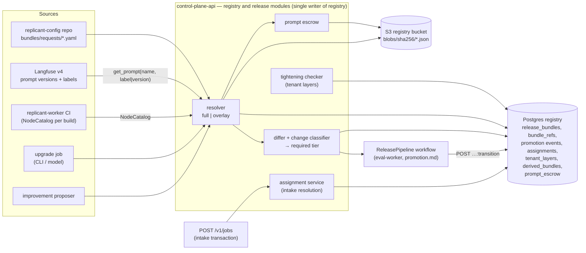

# Release Bundles: Schema, Resolution, Diff, Assignment

**Workstream:** WS-06 · **Contracts conformed to:** C-DEF 3.0.0 (bundle schema, resolution, assignment),
C-IDS 2.0.0, C-PG 2.0.0 (`registry` bundle tables), C-ART 2.0.0 (`registry` bucket class), ADR-005,
ADR-006, ADR-013 · **Constraints:** D-02, D-03, D-09, D-10, D-14, D-26

## Purpose

Every change to Replicant behavior (graphs, worker code, prompts, models, CLI versions, agent and
environment definitions, policies, memory snapshot policy) reaches jobs only as a new, immutable,
content-addressed Release Bundle (D-03). This document specifies what WS-06 owns around the frozen
bundle document: the `ReleaseBundleRequest` format, the resolution process (full and overlay), storage
and immutability in the Postgres `registry` schema, prompt escrow, the bundle diff and the change
classification that selects an eval tier, bundle assignment (default, overrides, ramps, cohorts,
holdbacks), and tenant-derived bundles, including the answer to OQ-00-05.

## Decisions summary

| # | Decision | Constraint / ADR |
|---|---|---|
| RB-1 | The bundle document is exactly the frozen `release-bundle.schema.json` (C-DEF §5). WS-06 adds no `spec` fields. Promotion state, assignment, required tier and change classes live beside the bundle in `registry` tables | D-03, ADR-005 |
| RB-2 | Two request modes. **Full** resolves every selector. **Overlay** starts from an existing bundle's pinned spec and re-resolves only the named overrides, so a candidate differs from the incumbent by exactly the intended change. Every release in normal operation (prompt edits, CLI bumps, model changes, proposals) is an overlay | D-03; [ADR-06-005](adr/005-overlay-requests-one-change-bundles.md) |
| RB-3 | Every prompt version a bundle pins is **escrowed**: its canonical body is written to the registry blob mirror under its digest. Langfuse lets versions be deleted, so Langfuse alone cannot guarantee that a pinned job (up to `repair_limits.job_max_age_days` = 60) can still read its prompt. Escrow blobs are permanent (registry bucket, no delete), which covers the 67-day requirement of XD-FIX-R2-044 | D-03, D-17; CCR-06-02 |
| RB-4 | The diff between two bundles is computed structurally (pinned references), then per document (RFC 6902 JSON Patch), then per prompt (unified text diff). Each diff entry carries a **change class**. The required eval tier and the shadow requirement are a pure function of the change classes | D-03 |
| RB-5 | Assignment follows C-DEF 3.0.0 §4.4–§4.5 exactly: up to 3 ramps on disjoint bucket ranges, the C-DEF slot/state table, and (CCR-06-12) shadow and live-tenant explicit pins. Resolution failures return 503 with no intake row | D-02, ADR-006 |
| RB-6 | **OQ-00-05 decided: yes.** A tenant-derived bundle whose layer is classified *tightening* or *neutral* by the mechanical policy-differential check (tier **T0**) auto-promotes, performed by `svc_release-controller` under the admin-configured promotion policy. Bindings that change which agent or environment a repo uses are *behavioral* and go to a targeted T1 eval. Justified against D-03 in [ADR-06-001](adr/001-tightening-only-derived-bundles-auto-promote.md) | D-03, ADR-013 |
| RB-7 | The worker deployment version of the environment's current default **and** of its rollback target are never drained. That is what makes rollback a single transaction | D-02, ADR-006 |



---

## 1. The bundle document

The authoritative schema is the frozen
[`release-bundle.schema.json`](../00-contracts/schemas/release-bundle.schema.json) (C-DEF §5). WS-06 does
not extend `spec`. The table maps each D-03 element to its field and to how WS-06 uses it.

| D-03 element | Field | WS-06 use |
|---|---|---|
| Graph definition version | `spec.graphs.*`, `spec.router` | change class `graph` / `router` |
| Worker deployment version | `spec.worker_deployment`, `spec.node_catalog` | change class `worker_code`; drives the pinned versioning override (ADR-006) |
| Agent definition versions | `spec.agents` | change classes `agent_config`, `cli_*`, `model`, `prompt` (derived through the agent) |
| Tool/environment definition versions | `spec.environments` | change class `environment` |
| Prompt versions (labels resolved) | `spec.prompts[]` | change class `prompt` / `prompt_inworker`; escrowed (§4.3) |
| CLI versions (image digests) | `spec.cli_images` | change class `cli_patch` / `cli_minor` / `cli_major` |
| Model identifiers | `spec.models` | change class `model` |
| Policy versions | `spec.policies`, `spec.tenant_layer.policies` | `policy_tightening`, `policy_neutral`, `policy_behavioral` |
| Memory snapshot policy | `spec.memory_snapshot_policy` | change class `memory_policy` |

`spec.lineage.parent_release_bundle_id` is set to the overlay base (§3.2) or, for full builds, to the
environment's current default at build time. Lineage is informational. It is part of the content, so
two identical overlays on different bases yield different IDs, which is intended: their histories differ.

Model identifiers used in examples in this section are the current exact IDs at the time of writing,
`anthropic/claude-sonnet-5-5` and `anthropic/claude-opus-5-5` [verified:
https://platform.claude.com/docs/en/about-claude/pricing, 2026-10-24]. C-DEF's example uses older IDs
illustratively.

## 2. Content addressing

1. `digest = "sha256:" + hex(sha256(JCS(spec)))`, RFC 8785 canonicalization of the `spec` object only.
   `metadata` (display version, timestamps, author, change summary) is excluded, so rebuilding identical
   content always yields the same `release_bundle_id` (C-DEF §4.3 step 4, C-IDS §2).
2. `release_bundle_id = "rb_" + b32_130(digest)` using the C-IDS reference implementation.
3. Every list in `spec` is sorted by `ref` (prompts by `name`, `cli_images` by `cli`, `models` by
   `gateway_model_id`) before hashing. The resolver rejects its own output if re-sorting changes it.
4. Numbers: the bundle spec contains only integers (versions) and strings. The resolver asserts this,
   which keeps JCS number serialization out of the hashing path entirely.
5. `display_version` is `YYYY.MM.DD-N[.tenant]`, with `N` a per-day counter from
   `registry.release_bundles`. It is a label for humans and is never used as a key.

A rebuild returning an existing ID returns the existing row, including its promotion state. A bundle that
previously failed evaluation stays `eval_failed`. Re-evaluating it is an explicit operator action
(`eval_failed → evaluating`, §6), because a second attempt on identical content is a re-roll, and the
promotion record must show it (promotion.md §4.6 caps re-rolls).

## 3. Resolution process

### 3.1 Full mode

The normative algorithm is C-DEF §4.3 steps 1–5. WS-06 specifies these additional details.

| Step | Detail |
|---|---|
| Prompt resolution | For each prompt selector, call Langfuse `GET /api/public/v2/prompts/{name}?label=<label>` or `?version=<n>` (never both, which is an error [verified: https://langfuse.com/docs/prompt-management/features/prompt-version-control, 2026-10-24]). Langfuse never silently falls back from one label to another [verified: same page, 2026-10-24]. Compute `digest = sha256(JCS({type, prompt, config}))` from the response. Record `{name, version, digest, resolved_from_label}` |
| Escrow | Before inserting the bundle row, write each prompt body to the registry bucket (§4.3). The build fails if escrow fails |
| Closure | C-DEF §4.3 step 2. Reference fields are discovered generically through `x-replicant-ref` markers in each kind schema (C-DEF Risks; WS-03 and WS-01 mark their fields) |
| In-worker prompts and models | `full.inWorkerPrompts` and `full.inWorkerModels` add the router, feedback-triage and memory-extraction calls that no AgentDefinition reaches. `used_by` is `worker/<purpose>` |
| Checks | C-DEF §4.3 step 3, plus: (a) the worker deployment version is registered in Temporal with pollers present, via `DescribeWorkerDeployment` (ADR-006); (b) every model ID passes the gateway's model catalog lookup (WS-03 gateway interface); (c) every CLI image digest exists in ECR and carries a valid cosign signature (upgrades.md §3.2); (d) no prompt is reachable only through a `latest` label; (e) the model retirement window check (§3.4); (f) the eval-only mark (§3.5) |
| Write order | C-DEF §4.3 steps 5–6, exactly: prompt escrow blobs, then the bundle blob `blobs/sha256/<hex>.json`, then the write-once pointer `bundles/<release_bundle_id>.json` = `{"release_bundle_id", "digest": "sha256:<hex>"}` (CCR-02-02; runner-api admission reads it), then the row. Every write uses `If-None-Match: *`; a 412 with an equal body is success (C-ART §2 rule 3). Derived bundles (§9) follow the same order. A crash between steps leaves only orphan write-once objects. They are harmless and are **never deleted**: the `registry` bucket denies every delete (C-ART 2.0.0 rule 5, WS-10 `registry.policy.json` NoDeletes), and a retried build of the same spec reuses them (same digest, `412` with equal body = success). Orphans are counted by a weekly report (objects with no `registry.release_bundles` row); at a few KB per failed build their storage cost is negligible (R1-284, R1V-138) |
| Row | Insert `registry.release_bundles` with `promotion_state = 'built'`, `required_tier` and `change_classes` computed against the lineage parent (§5), `assignment_window_end` (§3.4), `eval_only` (§3.5), and one `registry.bundle_refs` row per pinned reference |

### 3.2 Overlay mode

Overlay mode builds a candidate that differs from a base by a declared set of overrides. It is what the
Langfuse webhook, the CLI/model upgrade job and the improvement proposer generate.

1. Resolve `overlay.base`. `assignment:<env>:default` reads `registry.bundle_assignments.default_release_bundle_id`
   in a `REPEATABLE READ` transaction and records the resolved ID.
2. Load the base spec. Remove `tenant_layer` (overlays are always built on a **base** bundle; derived
   bundles are rebuilt from the new base automatically, §9).
3. Apply overrides in this order: `workerDeployment` (also replaces `node_catalog` with the catalog
   published for that build ID), `router`, `graphs`, `policies`, `memorySnapshotPolicy`, `environments`,
   `agents`, `prompts`. A prompt override replaces the pinned version of that prompt name wherever it
   appears. An agent override replaces every reference to that agent name.
4. Recompute the closure from the overridden roots. Anything newly reachable is resolved with the
   **base's** selectors where it has them (pinned refs stay pinned) and the request's selectors otherwise.
   Anything no longer reachable is dropped.
5. Run every full-mode check. Additionally, the build fails if the resulting diff against the base
   contains a change class that is not listed in `spec.overlay.declaredChangeClasses` (required for overlay
   requests; the enum is the change-class vocabulary of §5.3). This catches accidental drift: for example,
   an agent override whose new version also changed the model is reported as `model`, and the request
   fails with `422 undeclared_change` until `model` is declared (which also raises the tier) or the override
   is split (R1-146).

```python
# Reference implementation (control-plane-api, module replicant_cp.registry.overlay). Python 3.12.
from __future__ import annotations

from dataclasses import dataclass

from replicant_cp.registry import closure, langfuse_prompts, refs
from replicant_cp.registry.diff import diff_specs
from replicant_ids import derived_bundle_id  # rb_ + b32_130(sha256(JCS(spec)))


@dataclass(frozen=True)
class OverlayResult:
    spec: dict
    release_bundle_id: str
    change_classes: frozenset[str]
    required_tier: str
    require_shadow: bool


ORDER = ("workerDeployment", "router", "graphs", "policies", "memorySnapshotPolicy",
         "environments", "agents", "prompts")


def build_overlay(base_spec: dict, overrides: dict, declared_classes: frozenset[str] | None) -> OverlayResult:
    spec = {k: v for k, v in base_spec.items() if k != "tenant_layer"}
    for key in ORDER:
        if key in overrides:
            spec = refs.apply_override(spec, key, overrides[key])          # pins via the registry
    spec = closure.recompute(spec, prefer_pinned_from=base_spec)          # C-DEF §4.3 step 2
    spec["prompts"] = [langfuse_prompts.pin(p) for p in spec["prompts"]]  # escrow happens in pin()
    closure.check(spec)                                                   # C-DEF §4.3 step 3 + §3.1
    spec = refs.sort_all(spec)
    spec["lineage"] = {"parent_release_bundle_id": base_spec_id(base_spec)}
    d = diff_specs(base_spec, spec)
    if declared_classes is not None and not d.change_classes <= declared_classes | {"lineage"}:
        raise closure.UndeclaredChange(sorted(d.change_classes - declared_classes))
    return OverlayResult(spec, derived_bundle_id(spec), d.change_classes, d.required_tier, d.require_shadow)


def base_spec_id(base_spec: dict) -> str:
    return derived_bundle_id(base_spec)
```

### 3.3 Failure modes of a build

| Failure | Behavior | Visible as |
|---|---|---|
| Langfuse unavailable | Build fails fast (no partial bundle). The webhook-triggered build is retried by the release controller with backoff (1 min → 30 min, 24 h cap) | Build status `failed: langfuse_unavailable` in the releases UI |
| Label points to a deleted version, or the label does not exist | `422 prompt_not_resolvable` | Build error with the prompt name |
| Escrow PutObject fails | Build fails; no row. An orphan blob is harmless (digest-named, C-DEF §4.1 rule 5) | `422 escrow_failed` |
| Worker version not registered or no pollers | `422 worker_version_not_ready`. The upgrade job waits for the worker rollout and retries | Build error |
| Model not in the gateway catalog | `422 model_not_available` | Build error |
| Undeclared change class in an overlay | `422 undeclared_change` listing the classes | Build error |
| A model retires inside the assignment window | `422 model_retiring_in_window` (§3.4) | Build error naming the model, its retirement date, and the successor if known |
| Closure references a `revoked` version | `422 revoked_reference` | Build error |
| Two builds of identical content race | Unique `digest` constraint; the loser reads the winner's row and returns `200 created: false` | none |

### 3.4 Expected assignment window and model retirement (XD-ORCH-01, R1-148)

C-DEF §4.3 step 3 rejects a model whose published retirement date falls before the bundle's **expected
assignment window** ends. WS-06 defines the window and supplies the calendar.

| Term | Definition |
|---|---|
| Retirement calendar | `registry.model_retirements(gateway_model_id, retires_at, announced_at, source_url, successor_model_id)`, maintained by `svc_release-controller` by a daily import of WS-03's catalog `GET /internal/v1/models` → `{models: [{gateway_model_id, protocol, upstream_model, price_book_version, retires_at, retires_at_source, zdr}], as_of}` (rows with `retires_at` set; `retires_at_source` goes to `source_url`) and provider deprecation announcements, correctable through `PUT /v1/releases/model-retirements/{id}` (`release:operate`) |
| Window length `W` | **60 days.** It covers the longest life a bundle normally has while it can still receive new jobs: shadow and canary (≤ 8 days), default (typically 2–4 weeks before it is superseded), rollback target and holdback (≤ 30 days more). It exceeds the 45-day upgrade lead time of upgrades.md §6.5, so a bundle that passes is never forced into an emergency migration by its own model |
| `assignment_window_end` of a **new base** bundle (full or overlay build) | `built_at + W`, stored on the row |
| `assignment_window_end` of a **derived** bundle | The base's `assignment_window_end` (inherited, never recomputed). A derived bundle passes whenever its base passed, so tenant-layer changes, T0 builds, and builds for a new ramp never fail the check late in a base's life |
| Rebuild of existing content (rollback target, holdback, re-evaluation) | No check runs: an identical spec returns the existing row (§2), and its window was fixed when it was first built |
| Check | For each model in the closure: `retires_at > assignment_window_end`, else `422 model_retiring_in_window` with the model and its date |
| After the build | A row added to the calendar later can make an existing bundle's window cross a retirement date. The release controller then starts the retirement procedure of upgrades.md §6.5: a model-upgrade candidate, the C-MSG notice kind **`model_retiring`** to running jobs on affected bundles, and forced migration at the next safe point without requester consent (orchestrator decision on R2-044) |

### 3.5 Eval-only capabilities (R1-151, XD-03-11)

The build sets `eval_only = true` when the closure contains an agent definition with `codex.mode: app_server`
or `cli: claude-agent-sdk` (WS-03 marks these as not yet production-approved). An eval-only bundle can be
evaluated (eval tenant pins accept it) but every assignment slot refuses it: `default`, tenant overrides, and
ramps return `409 eval_only_bundle`, and explicit pins for non-eval tenants are rejected at intake. The flag is
derived from content, so it cannot be cleared on an existing bundle. A production-approved definition version
yields a different bundle.

## 4. Storage and immutability

**Image retention tags.** At build, `svc_release-controller` (WS-06 owns tagging; WS-07 does not tag) applies
the ECR tag `bundle-ref-<first 20 chars of the rb_ body>` to every CLI and environment image in the bundle's
closure; `sys:retention-sweeper` removes it once the bundle is revoked or retired (upgrades.md §8, XD-FIX-R1-085). Derived bundles add no tags.

### 4.1 Tables

DDL: [sql/registry-releases.sql](sql/registry-releases.sql) (applied to PostgreSQL 17 in a disposable
container and exercised: legal and illegal transitions, immutability trigger). Writer: control-plane-api.

| Table | Content |
|---|---|
| `registry.release_bundles` | One row per bundle: `spec` (exact JSON), `digest`, `blob_key`, `worker_build_id`, base and parent IDs, request name and digest, `change_classes`, `required_tier`, `require_shadow`, `promotion_state`, `state_version`, `eval_only`, `assignment_window_end` |
| `registry.bundle_refs` | Inverted index of every pinned reference (kind, name, version, digest, JSON pointer). Drives revocation fan-out, "which bundles contain prompt X v13", and blast radius |
| `registry.bundle_promotion_events` | Append-only transitions with tier, actor, pipeline and comparison IDs, evidence, audit event ID |
| `registry.bundle_assignments` + `_tenant_overrides` + `_ramps` + `_history` | §8 |
| `registry.tenant_layers`, `registry.derived_bundles` | §9 |
| `registry.prompt_escrow` | §4.3 |
| `registry.model_retirements`, `registry.model_successors` | §3.4, upgrades.md §6.5 |
| `registry.worker_deployment_versions` | Every `replicant-worker` build known to releases: `image_digest`, `node_catalog_digest`, `registered_at`, `ready_at` (all task queues polled), `retire_after`, `retired_at`, `patch_of_build_id`, `incident_id` (XD-FIX-R1-013). `version_ready` = `ready_at IS NOT NULL AND retired_at IS NULL`; ramps, rollback targets, and intake pins require it |
| `registry.promotion_policies` | Versioned promotion policy documents (promotion.md §1) |

### 4.2 Immutability guarantees

1. **Row level.** The trigger `registry.check_promotion_transition` rejects any `UPDATE` that changes
   `spec` or `digest`, rejects illegal promotion edges, and requires `state_version` to increment by
   exactly 1 (optimistic concurrency between the release controller, the ReleasePipeline and operators).
2. **Blob level.** `blobs/sha256/<hex>.json` is written with `If-None-Match: *` (C-ART §2 rule 3).
   The registry bucket policy denies `DeleteObject` (C-ART §1).
3. **Reader level.** Every reader verifies `sha256(body) == digest` (C-DEF §6) and fails closed.
4. **No deletes.** Bundles are never deleted, only `deprecated` or `revoked` (C-IDS: "bundles are
   never deleted"). `UPDATE`/`DELETE` on promotion events and assignment history are revoked even
   from the writer role.

### 4.3 Prompt escrow (CCR-06-02)

Langfuse prompt webhooks fire on `created`, `updated` (labels or tags), and **`deleted` ("a version is
removed")** [verified: https://langfuse.com/docs/prompt-management/features/webhooks-slack-integrations,
2026-10-24]. Protected labels, which block deletion for non-admin roles, require the self-hosted
Enterprise Edition license key [verified: https://langfuse.com/self-hosting/license-key, 2026-10-24].
Without escrow, a deleted version strands every job pinned to a bundle that references it. That could
be a 30-day PR-review job.

Design:

1. At build, for every prompt in `spec.prompts`, the resolver writes
   `blobs/sha256/<hex>.json` in the registry bucket. `<hex>` is the prompt digest and the body is
   exactly `JCS({type, prompt, config})`. It inserts `registry.prompt_escrow(name, version, digest, blob_key)`.
2. The context assembler (WS-04) and the in-worker prompt loader read Langfuse by `(name, version)` and
   verify the digest (C-DEF §6). **On 404 only**, they read the escrow blob and verify the same digest.
   On a digest mismatch from Langfuse they fail closed with `prompt_digest_mismatch`. That indicates
   tampering or a Langfuse defect, never a deletion, and integrity trigger R7 fires (promotion.md §6).
3. The release controller subscribes to `deleted` webhooks and raises an alert
   (`replicant_release_prompt_version_deleted_total`) when a deleted version is referenced by any bundle
   that is not `revoked`. The escrow keeps jobs running, but authors need to know.
4. Langfuse retention: WS-08 configures Langfuse data retention so that prompts are never subject to it.
   Prompt objects are configuration, not traces. Escrow makes this defense in depth, not load-bearing.

C-DEF §4.3 step 6 and §6 and C-ART `registry_blob` (CCR-06-02, accepted) make escrow and the 404-only
fallback normative.

## 5. Bundle diff

### 5.1 Algorithm

`diff(A, B)` is computed by `replicant_cp.registry.diff` and cached in memory by `(A, B)`. Content is
immutable, so the cache never needs invalidation.

1. **Reference level.** Walk both specs by element (`worker_deployment`, `node_catalog`, `router`,
   `graphs.<type>`, `agents[name]`, `environments[name]`, `policies[name]`, `prompts[name]`,
   `cli_images[cli]`, `models[id]`, `memory_snapshot_policy`, `tenant_layer.policies[name]`). Emit
   `added`, `removed`, or `changed` per element, keyed by name, not by list position.
2. **Document level.** For each `changed` definition reference, load both documents from the registry
   and compute an RFC 6902 JSON Patch (`jsonpatch` 1.33 `make_patch`), with paths rendered against
   the YAML source for display. Patches over 200 operations are truncated in the response with
   `truncated: true`; the full patch is downloadable.
3. **Prompt level.** For changed prompts, fetch both bodies (Langfuse or escrow) and render a unified
   diff (`difflib.unified_diff`, 3 context lines). Chat prompts are diffed per message.
4. **NodeCatalog level.** Node types added or removed and `configSchema` changes per node type.
5. **CLI level.** Version change plus links to the upstream changelog between the two versions, and the
   image SBOM diff (package additions and removals) from the image metadata (upgrades.md §3.2).
6. **Worker level.** Build ID change plus a Git compare link `…/compare/<sha_a>...<sha_b>` from the
   build IDs' embedded commit SHAs.
7. **Classification.** Each entry gets a change class (§5.3). The diff carries the union and the derived
   tier (§7).

### 5.2 Diff document

Served by `GET /v1/registry/bundles/{id}/diff?against=…` ([api/releases.openapi.yaml](api/releases.openapi.yaml)).

```json
{
  "from": "rb_ds5p3wmcj4dag2e9a8ncp4py6k",
  "to": "rb_k8v2q4m7x1c9d3f6h0j5n8p2r4",
  "worker_changed": false,
  "change_classes": ["prompt"],
  "required_tier": "T2",
  "require_shadow": false,
  "entries": [
    {
      "element": "prompts/reviewer-system",
      "op": "changed",
      "from_ref": "prompt/reviewer-system@13#sha256:4c6e8a0f2b3d5c7e9a1f3b5d7c0e1a3f5b7d9c1e2a4f6b8d0c2e3a5f7b9d1c3e",
      "to_ref": "prompt/reviewer-system@14#sha256:9a1c3e5f7b9d0a2c4e6f8b0d1a3c5e7f9b2d4a6c8e0f1b3d5a7c9e2f4b6d8a0c",
      "change_class": "prompt",
      "text_diff": "@@ -12,7 +12,9 @@\n Review the diff for correctness first.\n-Flag style issues.\n+Flag style issues only when a linter would not catch them.\n+Cite the file and line for every finding.\n",
      "links": ["https://langfuse.replicant.example.com/project/replicant-prod/prompts/reviewer-system?version=14"]
    },
    {
      "element": "agents/reviewer-codex",
      "op": "changed",
      "from_ref": "agent/reviewer-codex@5",
      "to_ref": "agent/reviewer-codex@5",
      "change_class": "prompt",
      "document_patch": []
    }
  ]
}
```

The agent entry appears because the agent pins the prompt. Its own document is unchanged, so its patch is
empty. The UI (WS-07) collapses such entries under the prompt.

### 5.3 Change classes

| Class | Triggered by |
|---|---|
| `prompt` | An agent prompt version changed |
| `prompt_inworker` | A router, triage or extraction prompt changed |
| `model` | Any `spec.models[].gateway_model_id` added, removed or changed |
| `cli_patch` | Same CLI, same major.minor, at most 7 releases apart and at most 14 days apart by publish time |
| `cli_minor` | Same CLI, different minor; or a patch jump beyond the `cli_patch` bounds. Claude Code publishes about one release per day: 40 releases from 2.1.268 (2026-09-10) to 2.1.310 (2026-10-23), all `2.1.x` [verified: https://registry.npmjs.org/@anthropic-ai/claude-code, 2026-10-24]. Semver alone would classify six weeks of changes as a patch, so distance bounds are needed |
| `cli_major` | Different major. For `0.x` CLIs (Codex 0.164.0 [verified: https://registry.npmjs.org/@openai/codex, 2026-10-24]) a change of `0.y` counts as `cli_minor` and `0.y.z` within bounds as `cli_patch` |
| `agent_config` | AgentDefinition change other than prompt, model, or CLI image: tools, MCP servers, limits, gateway config, effort, steering |
| `environment` | EnvironmentDefinition change (base image, packages, setup, services, resource profiles) |
| `graph` | GraphDefinition change |
| `router` | `router_rules` policy change |
| `worker_code` | `worker_deployment` or `node_catalog` change |
| `memory_policy` | `memory_snapshot_policy` change |
| `codebase_binding` | Global `codebase_bindings` change |
| `policy_tightening` | Tenant layer change classified tightening ([ADR-06-001](adr/001-tightening-only-derived-bundles-auto-promote.md)) |
| `policy_neutral` | `retention`, `runner_polling`, or tenant-layer changes inside platform bounds that cannot affect agent behavior |
| `policy_behavioral` | Any other policy change (global risk, gate, budget, network, runtime selection, or a non-tightening tenant layer) |

## 6. Promotion state (summary)

`built → evaluating → eval_passed | eval_failed → [shadowing] → canary → promoted → deprecated → revoked`,
plus `rolled_back` (canary aborted) and `withdrawn` (author abandoned). This is a superset of the C-DEF
§4.4 minimum set. The full state machine, with the actor and evidence required per edge, is in
[promotion.md §2](promotion.md#2-promotion-state-machine). The database trigger enforces the same edge list.

## 7. Required tier and shadow (pure function of change classes)

| Change classes present (max wins) | Tier | Shadow |
|---|---|---|
| only `policy_tightening`, `policy_neutral` | **T0**: mechanical (no runs) | no |
| `policy_behavioral`, `environment`, `codebase_binding` | **T1**: smoke 60 tasks, plus a **targeted** subset of the golden tasks whose codebase type uses the changed environment or binding (minimum 40 tasks) | no |
| `prompt`, `prompt_inworker`, `agent_config`, `graph`, `router`, `worker_code`, `cli_patch` | **T2**: standard 300 tasks | `graph`, `router`: yes |
| `model`, `cli_minor`, `cli_major`, `memory_policy` | **T3**: full 450 tasks × 2 reps | yes |
| Three or more distinct classes at T2 level, or more than 3 prompts changed | **T3** (compound change) | yes |
| Request `evaluation.tierFloor` | max(derived, floor) | `requireShadow` OR derived |
| Request `evaluation.expedited` | T1 plus compatibility checks (upgrades.md §4) and two sign-offs | no |

Tier definitions, sizes, and statistics: [eval-harness.md §6](eval-harness.md#6-comparison-and-statistics).

## 8. Bundle assignment

### 8.1 Model

C-DEF 3.0.0 §4.5 is normative. Per environment there is a `default` (a promoted base bundle),
`tenant_overrides` (tenant → bundle), and up to **3 ramps** in slots 0–2. Each ramp is
`{candidate, purpose (canary | holdback | experiment), bucket_lo (0–10000), percent (two decimals),
tenants_included[], tenants_excluded[], pipeline_id?}`, and the bucket ranges
`[bucket_lo, bucket_lo + percent × 100)` of different ramps never overlap (enforced by the constraint
trigger `registry.check_ramp_ranges` and by the API). WS-06 adds operational fields that do not change the
resolution formula:

| Field | Meaning |
|---|---|
| `rollback_release_bundle_id` | The previous promoted default. Set automatically when the default changes. It is the default target of `:rollback` (promotion.md §7). Its worker version is never drained (RB-7, §10) |
| `ramps[*].purpose` | `canary` (candidate under evaluation), `holdback` (the *previous* default kept on a small slice after promotion to measure lagging metrics), `experiment` (a `canary`-state candidate held at a fixed split for analysis, compared with the default; C-DEF §4.4) |
| `tenant_overrides[t].kind` | `holdback_tenant` (tenant asked to stay on the previous release, max 30 days), `pinned_by_operator` (incident), `layer_pending` (the tenant's derived bundle for the new base is still in T1; §9.4) |

Bucket allocation by the ReleasePipeline: a canary takes the lowest free range starting at a multiple of
1000; a holdback takes `[9500, 10000)` (5%); an experiment takes the next free range. Because ranges are
disjoint, a job hashes into at most one ramp, so the order of evaluation matters only for
`tenants_included`, where slot order decides.

### 8.2 Which states may be assigned (C-DEF 3.0.0 §4.4, plus CCR-06-12)

| Slot | Allowed promotion states | Source |
|---|---|---|
| `default` | `promoted` | C-DEF §4.4 |
| `tenant_overrides[*]` | `promoted`, `deprecated` (never `revoked`) | C-DEF §4.4 |
| `ramps[*]` with `purpose: canary` | `canary` (a ramp start transitions `eval_passed`/`shadowing → canary` in the same transaction) | C-DEF §4.4 |
| `ramps[*]` with `purpose: holdback` | `promoted`, `deprecated` | C-DEF §4.4 |
| `ramps[*]` with `purpose: experiment` | `canary` | C-DEF §4.4 |
| Eval tenant (`replicant-eval`), `requested_release_bundle_id` | any state except `revoked` and `withdrawn` | C-DEF §4.4 |
| Shadow job (`options.evaluation.mode = shadow`), `requested_release_bundle_id`, requester `svc_release-controller` | `shadowing` (the candidate, or its derived bundle for the tenant) | CCR-06-12 (R1-133) |
| Other explicit pin in a live tenant (`release:pin`, incident reproduction) | `promoted`, `deprecated` | CCR-06-12 |

Every slot also refuses `eval_only` bundles (§3.5) outside `replicant-eval`.

### 8.3 Intake resolution (reference implementation)

This runs inside the `POST /v1/jobs` transaction (C-DEF §4.5). No cache: the assignment row is read in
the same transaction that inserts the intake row, so a rollback takes effect for the very next job.

**`assignment_reason` vocabulary (exact; WS-07's CHECK adopts it, XD-FIX-R1-158):**

```
^(default|eval_pin|shadow_pin|explicit_pin|ramp:(canary|holdback|experiment):[0-2]|tenant_override:(holdback_tenant|pinned_by_operator|layer_pending))(\+layer)?$
```

There is no fallback reason: when the target build is not registered, intake answers `503 bundle_unresolvable`
and writes no row (XD-FIX-R1-137 (a), ruling XD-W2-01-03).

`release_cohort` is a function of the reason: `default` → `default`; `ramp:canary:*` → `candidate`;
`ramp:holdback:*` → `holdback`; `ramp:experiment:*` → `experiment`; `tenant_override:*` and `explicit_pin`
→ `override`; `eval_pin` → `eval`; `shadow_pin` → `shadow`.

```python
# replicant_cp.releases.assignment — called by control-plane-api intake. Python 3.12, SQLAlchemy 2.0.
from __future__ import annotations

import hashlib
from dataclasses import dataclass
from decimal import Decimal

from sqlalchemy import select
from sqlalchemy.orm import Session

from replicant_db.models.registry import (BundleAssignment, BundleAssignmentRamp, DerivedBundle,
                                        ReleaseBundle, TenantLayerHead, TenantOverride)

EVAL_TENANT = "replicant-eval"
COHORT = {"canary": "candidate", "holdback": "holdback", "experiment": "experiment"}


def bucket(job_id: str) -> int:
    """C-DEF §4.5: int(sha256('ramp:' + job_id)[0:8], 16) mod 10000."""
    return int(hashlib.sha256(f"ramp:{job_id}".encode()).hexdigest()[:8], 16) % 10000


@dataclass(frozen=True)
class Resolution:
    release_bundle_id: str
    base_release_bundle_id: str
    assignment_reason: str          # intake.job_requests.assignment_reason (vocabulary above)
    release_cohort: str             # intake.job_requests.release_cohort
    assignment_version: int


class AssignmentError(Exception):
    """Maps to 503 bundle_unresolvable. No intake row is written (§8.5)."""


def resolve(session: Session, env: str, tenant_id: str, job_id: str, requested: str | None,
            may_pin: bool, evaluation_mode: str | None, requester: str) -> Resolution:
    a = session.execute(select(BundleAssignment).where(BundleAssignment.env == env)).scalar_one_or_none()
    if a is None:
        raise AssignmentError(f"environment {env} has no assignment (bootstrap it, §8.6)")
    if requested is not None:
        return _resolve_pin(session, a, tenant_id, requested, may_pin, evaluation_mode, requester)

    override = session.get(TenantOverride, (env, tenant_id))
    ramps = session.scalars(select(BundleAssignmentRamp).where(BundleAssignmentRamp.env == env)
                            .order_by(BundleAssignmentRamp.slot)).all()
    if override is not None:
        base, reason, cohort = override.release_bundle_id, f"tenant_override:{override.kind}", "override"
    else:
        hit = next((r for r in ramps if _in_ramp(r, tenant_id, job_id)), None)
        if hit is not None:
            base, reason, cohort = hit.candidate_bundle_id, f"ramp:{hit.purpose}:{hit.slot}", COHORT[hit.purpose]
        else:
            base, reason, cohort = a.default_release_bundle_id, "default", "default"
    return _apply_layer(session, a, tenant_id, base, reason, cohort,
                        allowed=("promoted", "canary", "deprecated"))


def _resolve_pin(session, a, tenant_id, requested, may_pin, evaluation_mode, requester) -> Resolution:
    if not may_pin:
        raise PermissionError("release:pin required")                     # 403 (C-JOBREQ)
    rb = session.get(ReleaseBundle, requested)
    if rb is None or rb.promotion_state in ("revoked", "withdrawn"):
        raise AssignmentError("requested bundle not assignable")
    if tenant_id == EVAL_TENANT:
        return Resolution(requested, rb.base_release_bundle_id or requested, "eval_pin", "eval", a.version)
    if rb.eval_only:
        raise AssignmentError("eval-only bundle outside replicant-eval")
    if evaluation_mode == "shadow":
        if requester != "svc_release-controller" or rb.promotion_state != "shadowing":
            raise AssignmentError("shadow pins need svc_release-controller and a shadowing bundle")
        if rb.tenant_id not in ("replicant-system", tenant_id):
            raise AssignmentError("derived bundle of another tenant")
        return Resolution(requested, rb.base_release_bundle_id or requested, "shadow_pin", "shadow", a.version)
    if rb.promotion_state not in ("promoted", "deprecated"):
        raise AssignmentError("live-tenant pins accept only promoted or deprecated bundles (C-DEF §4.4, CCR-06-12)")
    return Resolution(requested, rb.base_release_bundle_id or requested, "explicit_pin", "override", a.version)


def _apply_layer(session, a, tenant_id, base, reason, cohort, allowed) -> Resolution:
    layer = session.get(TenantLayerHead, tenant_id)                  # current layer_version or None
    if layer is None:
        return Resolution(base, base, reason, cohort, a.version)
    d = session.get(DerivedBundle, (base, tenant_id, layer.layer_version))
    if d is None:
        # The derived bundle is built synchronously when a base or layer changes (§9.2). A missing row
        # here means the build failed: fail closed rather than run without the tenant's policies.
        raise AssignmentError(f"derived bundle missing for {base}/{tenant_id}@{layer.layer_version}")
    rb = session.get(ReleaseBundle, d.release_bundle_id)
    if rb.promotion_state not in allowed:
        raise AssignmentError(f"derived bundle {rb.release_bundle_id} is {rb.promotion_state}")
    return Resolution(rb.release_bundle_id, base, reason + "+layer", cohort, a.version)


def _in_ramp(r: BundleAssignmentRamp, tenant_id: str, job_id: str) -> bool:
    if tenant_id in r.tenants_excluded:
        return False
    if tenant_id in r.tenants_included:
        return True
    width = int(Decimal(r.percent) * 100)                            # 12.34% -> 1234 buckets
    return r.bucket_lo <= bucket(job_id) < r.bucket_lo + width
```

### 8.4 Cohorts: canary, holdback, experiment

* **Canary.** `purpose = canary`: the job-hash slice plus `tenants_included` (the early ring). The **control
  cohort** is every job resolved to `default` in the same window (online-metrics.md §1).
* **Holdback.** After promotion, the previous default takes a `holdback` ramp at `[9500, 10000)` for 7 days
  (30 days for model changes; promotion policy `holdback.byChangeClass`). Here the new default is the
  treatment and the holdback the control.
* **Experiment.** A `canary`-state candidate held at a fixed split (for example 50%) against the default for
  the duration a lagging metric needs (online-metrics.md §5), with no automatic promotion. It ends by an
  operator decision: promote through the pipeline's sign-off, or clear.
* **Concurrency.** With three slots, one canary, one holdback and one experiment (or two canaries and a
  holdback) run at once. The pipeline cadence of promotion.md §12 follows from this.

### 8.5 When resolution fails

`AssignmentError` maps to `503 bundle_unresolvable` with `Retry-After: 30`, and **no intake row is written**
(R1-137a): writing a row needs a bundle, and a row without one would start a job that skips its tenant
layer. The calling channel adapter keeps the trigger in its own outbox and retries with the same
`dedupe_key`, so the eventual job is the same job. control-plane-api increments
`replicant_intake_bundle_unresolvable_total{env, tenant, reason}` and the alert
`ReplicantIntakeBundleUnresolvable` pages release on-call (online-metrics.md §7).

### 8.6 Bootstrapping an empty environment (R1-139)

A new environment has no assignment row and therefore no `default`, and `default` must be `promoted`.
`POST /v1/releases/{env}/assignment:bootstrap` is the only path that creates the row: it accepts a bundle
in `eval_passed` from a **single-arm** T1 run that meets the absolute floor of eval-harness.md §6.7 (no
baseline exists to compare with; started by `POST /v1/evals/runs` with `purpose: bootstrap`, the one ad hoc
run that changes promotion state, R1V-035), transitions it `eval_passed → promoted`, and sets it as `default` and
`rollback_release_bundle_id`. In `local` and `dev` one `release:operate` caller suffices. In `staging` and
`prod` it also needs two `bootstrap_default` sign-offs (CCR-06-11). After bootstrap, every change goes through
pipelines, rollback, or (outside `prod`) `PUT …/assignment/default`.

## 9. Tenant layers and derived bundles

### 9.1 Layer

A tenant's layer is the set of its **tenant-scoped** `Policy` versions (`metadata.scope.level = tenant`).
`registry.tenant_layers` records each layer version: the sorted pinned refs and
`digest = sha256(JCS(policies))`. A layer version is created whenever a tenant admin publishes a tenant
policy (through the config repo or the control-plane policy editor, WS-07).

Tenant-layer-eligible policy types: `gate_rules`, `risk_rules`, `approval_channels`, `budgets`,
`repair_limits`, `codebase_bindings`, `network_profiles`, `runtime_selection`, `retention`.
`router_rules`, `runner_polling` and **`memory_snapshot`** are global only. A tenant document of those types
is rejected at publish. `memory_snapshot` is excluded because it decides which memory scopes and states are
injected, and D-25 reserves every memory-management decision to the Replicant admin group, which tenant admins
are not (R1-145).

### 9.2 Build triggers

`derived(B, L_T)` is built synchronously by control-plane-api in two situations:

1. **Layer change.** Tenant T publishes layer version `L_T'`. The registry builds `derived(B, L_T')` for
   the current default B and for every ramp candidate and `shadowing` candidate C.
2. **Base change.** B' enters `shadowing`, `canary` or `promoted`. The registry builds `derived(B', L_T)`
   for every tenant T with a layer (40 at most). Building at `shadowing` lets shadow jobs pin the tenant's
   derived candidate (R1-133); a derived bundle classified tightening or neutral moves to `shadowing` with
   its base, and a behavioral one excludes its tenant from shadow sampling until its targeted T1 passes.

Construction of `derived(B, L)` (ADR-013): copy B's spec. For each tenant policy in L, add it to
`spec.policies` (the global policy of the same type remains, because consumers merge global and tenant
documents by the rules of each policy type). Set `spec.tenant_layer = {tenant_id, base_release_bundle_id: B,
policies: L}`. Recompute the closure, since tenant `codebase_bindings` may reach tenant-scoped definitions.
Hash. Insert with `tenant_id = T`, `base_release_bundle_id = B`, and `display_version` suffix `.T`.

### 9.3 Classification and auto-promotion (OQ-00-05)

For each derived bundle the tightening checker produces a `tightening_report` and a classification.

* **Tightening**: every tenant policy is ≤ the base policy in the safety order of its type, and the
  closure outside `policies` is digest-identical to B's.
* **Neutral**: only `retention` within platform bounds, or notification-only fields.
* **Behavioral**: anything else.

The per-type order and the full argument against D-03 are in
[ADR-06-001](adr/001-tightening-only-derived-bundles-auto-promote.md). Summary of the rule:

| Classification | Base B state | Action |
|---|---|---|
| tightening or neutral, and the budget-sufficiency check passes | `promoted` | Auto: `built → evaluating → eval_passed → promoted`, tier T0, actor `svc_release-controller`, evidence = tightening report |
| tightening or neutral, and the budget-sufficiency check passes | `canary` | Auto: `… → eval_passed → canary`. It follows B's ramp and is promoted together with B |
| tightening, but the budget-sufficiency check fails | any | Held in `eval_passed` until the tenant admin acknowledges (`derived_bundles.acknowledged_by`), then as above. This is an explicit human decision, not an eval |
| behavioral | any | Targeted T1 on golden tasks matching the tenant's codebase types (min 40 tasks), candidate-only against `derived(B_prev, L_T)`'s latest results. On pass, two-person sign-off (a release manager plus a tenant admin who is not the author; WS-09 G-09), then as above |

### 9.4 Interaction with ramps and new bases

* When B' starts its canary and `derived(B', L_T)` for some tenant T is not yet `canary` (a behavioral
  layer awaiting T1), the release controller adds T to that ramp's `tenants_excluded` (history row
  `tenant_exclusion_sync`) until it passes. Tenants are never ramped onto a derived bundle that has not
  passed its tier.
* When B' is promoted while `derived(B', L_T)` is still pending, T gets
  `tenant_overrides[T] = {kind: layer_pending, release_bundle_id: derived(B, L_T)}`, which keeps T on its
  previous fully evaluated combination. The override is removed automatically when the derived bundle passes.
  If it is still pending after 7 days, it pages release on-call.

## 10. Deprecation, revocation, worker retention

| Event | Rule |
|---|---|
| A new default is promoted | The previous default becomes `rollback_release_bundle_id`. The one before that becomes `deprecated` once the holdback ends |
| `deprecated` | Not assignable as default. It may still back holdbacks and tenant holdback overrides. Running pinned jobs continue |
| `rolled_back` | A canary or a promoted bundle that was rolled back. Assignable nowhere (not even as a holdback). It can be re-evaluated (`rolled_back → evaluating`) only with new evidence, withdrawn, or revoked |
| `revoked` (security issue, integrity violation, or legal) | C-DEF §4.1 rule 4 fan-out: every bundle whose `bundle_refs` contains a revoked definition version is revoked; derived bundles follow their base. `release.notice(bundle_revoked)` is sent by Temporal batch Signal to workflows with `ReplicantReleaseBundleId IN (…) AND ExecutionStatus='Running'`, followed by `job.offer_bundle_migration(required=true)` to the rollback target (C-MSG §2.2) |
| Worker version retirement (the single retire guard, R1-137d; WS-01 uses the same one) | A `replicant-worker` build may be drained only when **none** of these references it in any environment: the default, the rollback target, any ramp candidate (any purpose), any tenant override, any bundle in `shadowing` or `canary`, or any running pinned workflow (visibility query `TemporalWorkerDeploymentVersion = 'replicant-worker:<build>' AND ExecutionStatus = 'Running'`). Temporal reports a version as *drained* once all pinned workflows on it have closed, and its workers can then be stopped [verified: https://docs.temporal.io/worker-versioning, 2026-10-24]. WS-01 owns the drain mechanics |
| Langfuse prompt versions | Never delete a version referenced by a non-revoked bundle (`bundle_refs` query in the Langfuse admin runbook). Escrow covers mistakes |

## Open questions

| ID | Question | Who decides | Options | Recommendation |
|---|---|---|---|---|
| OQ-06-02 | Should the self-hosted Langfuse run the Enterprise Edition for protected labels and audit logs? | WS-08, budget owner | OSS + escrow / EE | OSS + escrow is sufficient for integrity. EE is worth it for the prompt audit trail, but nothing in this spec depends on it |
| OQ-06-03 | CLI patch-distance bounds (7 releases, 14 days) | WS-06 with WS-03 | as proposed / semver only | As proposed. Revisit after six months of eval data on whether patch bumps ever regress |

## Risks

- **Closure drift.** If a kind owner forgets an `x-replicant-ref` marker, overlays can silently miss a
  dependency. Mitigation: the overlay `UndeclaredChange` check and a CI test that compares the generic
  closure walker against each kind's hand-written reference list.
- **Bundle count.** About 3–5 base candidates per week × 40 tenants of derived bundles gives roughly
  10,000 rows per year. Trivial for Postgres. The UI groups them by base (WS-07).
- **Escrow gaps.** Escrow is keyed by digest, so it cannot diverge. A bundle built before escrow existed
  has no escrow blobs; a deleted Langfuse version then fails its pinned jobs closed. No such bundles exist
  in production (escrow is part of the first build path).

## Interfaces

- **Provided:** `ReleaseBundleRequest` format ([schema](schemas/release-bundle-request.schema.json)), the
  registry bundle DDL ([sql/registry-releases.sql](sql/registry-releases.sql)), the bundle diff
  ([api/releases.openapi.yaml](api/releases.openapi.yaml)), assignment resolution (§8.3), derived-bundle
  classification (§9).
- **Consumed:** C-DEF (bundle schema, selectors, envelope, publish API), C-IDS (`rb_`, `b32_130`), C-PG
  (`registry` writer, RLS), C-ART (`registry` bucket), C-MSG (`release.notice`, `job.offer_bundle_migration`),
  ADR-005, ADR-006, ADR-013; WS-03 kind schemas with `x-replicant-ref`; WS-01 NodeCatalog; Langfuse v4 prompt API.
