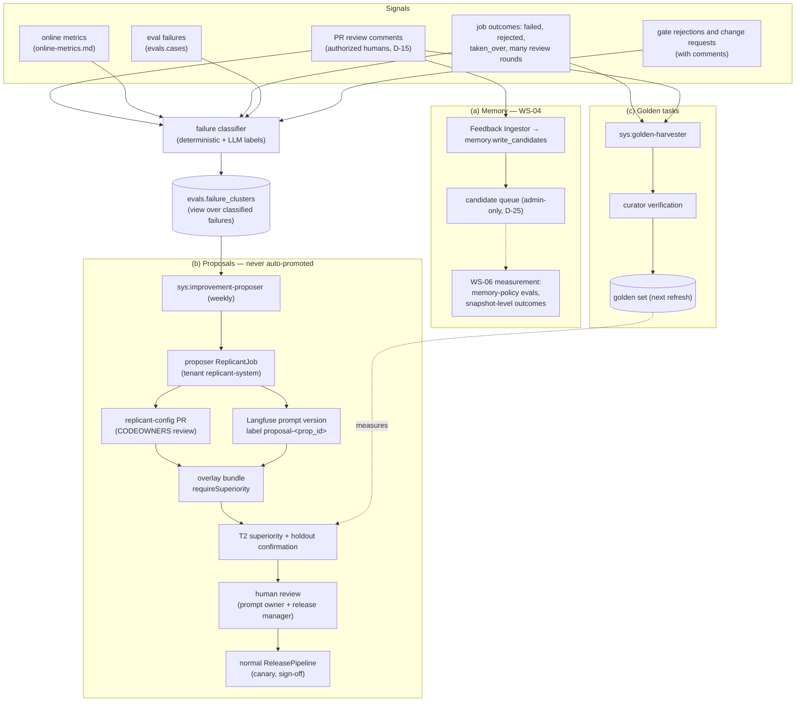
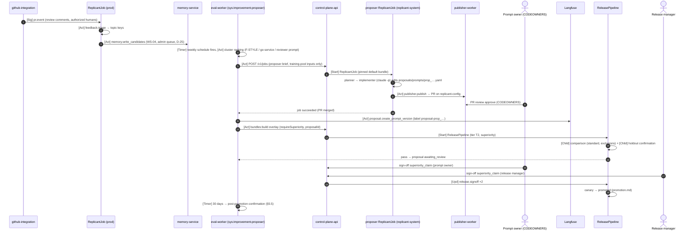

# Self-Improvement Loop

**Workstream:** WS-06 (loop, proposals, measurement) with WS-04 (memory lifecycle) · **Contracts
conformed to:** C-JOBREQ 2.0.0, C-DEF 3.0.0, C-PG 2.0.0 (`evals`, `memory` via API), C-ART 2.0.0
(`memory_candidates`) · **Constraints:** D-03, D-14, D-15, D-19, D-25

## Purpose

Replicant should get better over time, not merely change. Online signals and PR feedback flow into
three channels: (a) memory (WS-04 owns the subsystem; WS-06 measures it), (b) proposed prompt or definition
changes, which are generated as candidate bundles and **never auto-promoted**, and (c) new golden tasks built
from failures. This document specifies each channel and the guardrails that keep the loop optimizing for
what reviewers want rather than for what the judge rewards.

## Decisions summary

| # | Decision | Constraint / ADR |
|---|---|---|
| SI-1 | One **failure taxonomy** with deterministic first-pass classification (run reasons, check results, gate outcomes) and LLM-assisted labeling of free text (review comments, gate comments) that may only add labels. Failure clusters are keyed by `(taxonomy code, workflow_type, codebase_type)` | D-19 (LLMs may raise, not lower, applies by analogy) |
| SI-2 | Memory candidates from PR feedback follow WS-04's lifecycle unchanged. Every activation decision is an admin decision or an admin-configured system policy (D-25). WS-06 supplies the evidence: per-entry outcome counters and memory-policy evals | D-14, D-25 |
| SI-3 | The **improvement proposer** runs as an ordinary Replicant job (tenant `replicant-system`, target repo `replicant-config` for definitions; prompt drafts as artifacts). Its output goes through a pull request with CODEOWNERS review, an overlay bundle, a **superiority** comparison, holdout confirmation, human review, and then the normal promotion pipeline | D-03, D-10; [ADR-06-005](adr/005-overlay-requests-one-change-bundles.md) |
| SI-4 | Data separation is structural: the proposer never has access to the holdout, hidden tests, judge prompts or rubrics, or golden tasks derived from the jobs it learned from. This is enforced by run-token scopes and bucket prefix policies, not by instructions | D-21 |
| SI-5 | Judge-measured gains alone never justify a promotion. A gain must appear on deterministic metrics, or be confirmed online by reviewers, within 30 days, or the proposal class is flagged and its judge is re-examined | §6 |

---

## 1. Signals

eval-worker reads tenant data across tenants **only** through WS-10's CCR-06-15 audited read functions
(online-metrics.md §4; IDs, status, metrics and digests, never free text; every call writes `audit.emit`
`data.cross_tenant_read`). Free text (review comments, gate comments) is never read by eval-worker: it is
labeled inside the tenant's own job by WS-04's feedback-triage node and by the `failure-labeler` node
(replicant-worker, tenant scope), and only closed-enum outputs (topic key, `F-*` codes, entry IDs) leave the tenant.

| Signal | Source (view) | Use |
|---|---|---|
| Review comments by authorized humans on Replicant PRs | WS-04 feedback-triage output only: topic key, actionable flag, matched memory entry ID (`memory.feedback_items` columns exposed to `svc_eval_worker` by WS-04; no comment text) | memory candidates (a); repeated-comment metric; cluster labels |
| Job outcomes | `ops.eval_jobs` terminal status, take-over, review rounds (`repair_used`); `ops.eval_job_prs` | clusters; golden harvesting (c) |
| Post-merge outcome reports (R2-017) | WS-04 view `memory.v_job_outcomes` (`post_merge_reverted`, `report_kind`, `reported_at`; IDs and enums only; XD-FIX-R2-017), read through `ops.eval_job_outcomes` | `F-REGRESS` (below); golden harvesting (c); revert-rate guardrail (online-metrics.md §2) |
| Run and check failures | `ops.eval_job_runs` reasons and QA verdicts (requested, XD-W2-06-01); verifier results in eval cases | deterministic taxonomy |
| Gate rejections and change requests | `ops.eval_gates` (`kind`, `state`; no comment text) | clusters (for example "plan too broad") |
| Eval failures | `evals.cases` and `evals.scores` | clusters; proposer evidence (training split only) |
| Cost and time anomalies | `ops.eval_job_costs`, online windows | clusters (`F-COST`) |

## 2. Failure taxonomy and clusters

| Code | Meaning | Deterministic evidence |
|---|---|---|
| `F-ENV` | environment or build setup broken | `D3_build` fails on base; `ImagePullFailed`; setup step failures |
| `F-BUILD` | agent change breaks the build | QA build fails after the diff |
| `F-TEST` | tests fail after the change | QA tests fail; hidden tests fail (evals) |
| `F-SCOPE` | change outside planned or allowed scope | verifier scope violation; `D9` |
| `F-MISREAD` | task misunderstood | plan gate `request_changes` or `reject`; review comment labeled `misread` |
| `F-STYLE` | conventions not followed | review comment labeled `convention`; repeated-comment match |
| `F-INCOMPLETE` | partial fix | hidden tests partially pass; review labeled `incomplete` |
| `F-TOOL` | tool or MCP misuse, CLI error | `AgentExitedNonZero` with tool errors in `cli_events` |
| `F-BUDGET` | ran out of budget or turns | `GatewayBudgetExceeded`, budget gates |
| `F-RISK` | risk under-classified (a gate should have opened) | `D11` miss; post-hoc reviewer escalation |
| `F-COST` | cost or time far above the stratum norm | > p95 of the stratum |
| `F-SAFETY` | secret, tamper, policy violation | `D10`, `D14`, egress denials attributed to the agent |
| `F-REGRESS` | merged result later reverted or reported wrong (R2-017) | `memory.job_outcomes.post_merge_reverted` or a `wrong_fix` report within 14 days of merge |

Classification: deterministic rules assign codes first. An LLM labeler (in-worker prompt
`failure-labeler`, pinned in the bundle like every in-worker prompt; it runs in the tenant's job, so eval-worker
never sees the text it reads) may **add** codes from free text. It
never removes a deterministic code. The labeler is tool-less and returns only codes from the closed `F-*` enum (eval-harness.md §4.2.1, WS-09 G-24). Clusters are the view `evals.v_failure_clusters` over classified
failures in the last 28 days, with counts, cost impact (Σ cost of the failed jobs plus a human-time estimate
from take-overs), and up to 20 example job IDs.

## 3. Channel (a): memory

WS-04 owns the memory subsystem: candidates, scopes, lifecycle (candidate → active → deprecated),
poisoning defenses, and the admin-only curation UI (D-25). WS-06 does not change memory state. It supplies
measurement:

1. **Outcome measurement (XD-W2-07-05).** Per-entry outcome counters (jobs an entry was injected into,
   repeats despite memory, QA first-pass, merges, post-merge reverts and `wrong_fix` reports) are WS-04's
   (`memory.entry_outcome_stats`, shown on the admin-only curation screen, D-25): only memory-service knows which
   entries a snapshot injected. `jobs_read.job_memory_usage` carries only `memory_snapshot_id`, so WS-06 reads
   `ops.eval_job_memory_usage` (job → snapshot) and `ops.eval_job_outcomes` over WS-04's `memory.v_job_outcomes`
   (R2-017) to compare outcomes by snapshot policy and by bundle, never per entry. WS-06 keeps no per-entry table.
2. **Activation evidence threshold** (recommendation to WS-04 for its admin-configured auto-activation
   policy, if WS-04 allows one): a convention entry may be system-activated only if (i) at least 3 distinct
   authorized reviewers on at least 3 PRs raised the same topic key in the scope within 90 days, (ii) no
   active entry conflicts, and (iii) poisoning checks pass. Otherwise it waits for an admin. This is the
   "performed by the system under an admin-configured policy" path of D-25.
3. **Memory-policy evals.** A change to `memory_snapshot_policy` (scopes, ranking, limits) is change class
   `memory_policy` → tier T3 with shadow (release-bundle.md §7). The harness always includes the mechanism
   check (eval-harness.md §9): one arm with memory disabled, to show that memory matters on tasks with
   `expect_rule_key`.
4. **Memory corpus snapshots for evals.** Eval cases use `memory_scope_context` and `as_of` so retrieval
   behaves as for the original job (eval-harness.md §3.3). When memory content changes a lot (for example
   after a bulk activation), the daily sentinel shows it as a shift in incumbent performance, which is the
   intended signal: memory is part of the system being measured, with the bundle held fixed.

## 4. Channel (c): new golden tasks from failures

`sys:golden-harvester` (daily) selects candidate tasks from the last 28 days of failures:

1. Jobs ending `taken_over` whose takeover branch was merged by a human, jobs ending `rejected` where a later
   human PR fixed the same issue (linked by issue reference), Replicant PRs with ≥ 3 review rounds, and merged
   jobs reported `reverted` or `wrong_fix` within 14 days (R2-017), with the revert or follow-up fix as the
   reference.
2. Snapshot construction as in eval-harness.md §2.2, with the human fix as the reference and hidden tests
   written or extracted by curators.
3. **Cluster balancing:** at most 10 new tasks per failure cluster per quarter, and the strata quotas of
   eval-harness.md §2.4 still apply. Without these limits the golden set would drift toward last month's
   failures and overstate any fix for them.
4. **Provenance tagging:** each harvested task records `source_job_id`. A proposal that used a job as an
   example must not be evaluated on the task built from that job (§5.3).
5. Target: failure-derived tasks reach ≥ 15% of the gating set within two quarters of production use.

## 5. Channel (b): proposed prompt and definition changes

### 5.1 Selection

`sys:improvement-proposer` (Temporal Schedule, Mondays 06:00 UTC, eval-worker) ranks clusters by
`impact = failures × (mean cost + human minutes × $1.50)` over 28 days. It skips clusters with an open
proposal and clusters whose dominant code is `F-ENV` (environment fixes are engineering work, routed as a
ticket to the environment owner). It creates at most **3 open proposals** at a time and at most 1 per agent
role. Proposals have their own budget category `proposal` (gateway budget account `fgw:proposal:<prop_id>`, jobs recorded with `evaluation_mode = eval`, XD-W2-03-06; $2,000 per week and $6,000 per month, promotion.md §4.7), which covers the proposer jobs **and** their evaluations, including any T3-size evidence (R2-056).

### 5.2 Generation

The proposer is a Replicant job, so it runs the native CLI in an isolated sandbox like any other (D-10).

* `JobRequest`: tenant `replicant-system`, `workflow_type: feature`, target repo `replicant-config`,
  requester `svc_improvement-proposer` with `on_behalf_of` the platform's proposal owner (a human in
  `replicant-platform`), intent = a structured brief: cluster description, examples (redacted transcripts, review
  comments, diffs), the current prompt or definition, and the constraint "change only <target_ref>".
* Inputs are staged by an activity from the **training pool** only: online failures and eval failures on
  the *standard* subset, excluding tasks derived from those jobs (§5.3). The run token's scopes do not
  include the `eval` bucket, and holdout task IDs are never written into staged inputs.
* Definition changes come back as a normal diff bundle. The job's publish gate opens a PR on `replicant-config`
  through the Publisher. CODEOWNERS from the definition's `metadata.owners` must approve it (Replicant's
  own review flow, D-19).
* Prompt changes come back as a `prompt_proposal` file inside the diff (a YAML file under
  `proposals/prompts/<prop_id>.yaml` in `replicant-config`, so it is reviewed in the same PR). After the PR is
  approved, activity `proposal.create_prompt_version` (eval-worker, outside the sandbox) creates the Langfuse
  version and sets label `proposal-<prop_id>`. It never sets `production` or `candidate`.

### 5.3 Evaluation

1. Overlay bundle request with `proposalId`, `evaluation.requireSuperiority: true`, and tier ≥ T2.
2. **Exclusion set:** every golden task whose `source_job_id` appears in the proposal's examples is excluded
   from this comparison and recorded in `comparisons.stats.excluded`.
3. **Superiority comparison** on the standard subset: the lower bound of the two-sided 95% interval of the
   `resolved` difference > 0, with all G-OFF guardrails passing. Standard (300 × 1) has a 7.9-point MDE, so a
   real 5-point gain is often not detectable there. The proposer may request T3-size evidence (450 × 2,
   MDE 4.7 pt) for proposals whose expected gain is small; the cost ($3.3k–$11.4k) is charged to the `proposal` category, so at most about one such proposal fits per month.
4. **Holdout confirmation** (150 × 2 reps): point estimate > 0 and lower bound of the one-sided 95% interval
   > −8 pt (holdout MDE 8.1 pt). The holdout cannot prove a gain, but it catches overfitting to the standard
   subset, which shows up as a gain on standard with a flat or negative holdout.
5. **Cluster check:** the targeted failure code's rate on matching tasks drops (point estimate). A proposal
   that improves overall but not on its cluster is accepted only with an explicit human note.

### 5.4 Human review and promotion

* State `awaiting_review`: the prompt owner (definition `metadata.owners`) and a release manager review the
  evidence packet (diff, comparison, holdout, cluster check) and sign off (`superiority_claim`). They may
  decline with a reason, which is recorded and fed back to the proposer's next brief as a negative example.
* Accepted proposals enter the normal ReleasePipeline (canary, guardrails, sign-off). **Proposals are never
  auto-promoted**, and the pipeline cannot be started by `svc_improvement-proposer`; it is started by the
  accepting human.
* Claims about lagging outcomes (merge rate, review rounds) need a 50/50 experiment of at least 30 days
  (online-metrics.md §5) before a proposal is reported as having improved them.

### 5.5 Post-promotion confirmation

At 30 days after full promotion, eval-worker compares the cluster's online rate for the default before and
after, stratified by tenant. If it has not fallen (point estimate) and the lagging metrics are flat or worse,
the proposal becomes `post_promotion_unconfirmed`. Two unconfirmed proposals in a row that relied on the same
judge rubric for part of their evidence freeze proposals that use that rubric until the judge is recalibrated
and its online validity (J6) is checked.

## 6. Guardrails against optimizing for the judge

| # | Guardrail | Mechanism |
|---|---|---|
| G1 | The primary metric is deterministic | `resolved` (hidden tests, build, QA health, scope, tamper). Judges are secondary: they can block (G-OFF-7) but never pass a candidate |
| G2 | The proposer cannot see the judge | Judge prompts, rubrics, anchor sets, and scores are absent from proposer inputs. The proposer's run token has no `eval` bucket scope. Judge prompts live under `judge/*` in Langfuse, readable only by eval-worker's Langfuse key |
| G3 | The proposer cannot see the test | Hidden tests and the holdout are structurally inaccessible (SI-4). Tasks derived from its examples are excluded (§5.3) |
| G4 | Holdout confirmation | §5.3 step 4. The holdout is refreshed separately from the gating subsets, so it is not tuned against over time |
| G5 | Tamper and shortcut detection | `D14_test_tamper` is a hard fail. Verbosity and padding are a judge known negative. PR descriptions are compared against the diff by the `pr_description` rubric's accuracy criterion (no unsupported claims) |
| G6 | Goodhart monitors | Weekly trends of diff size, PR description length, test-file churn, and judge score vs `resolved` on the sentinel. A judge-score rise without a `resolved` rise opens a review |
| G7 | Reviewer outcomes outrank the judge | Online validity (J6): judge scores must correlate with reviewer outcomes. Proposal acceptance cites deterministic and reviewer evidence first |
| G8 | Judge and candidate never change together | A comparison freezes one judge version for both arms. A bundle request that also changes a judge prompt is rejected (judges are not bundle members, but a proposer PR that touches `judges/` is rejected by CI) |
| G9 | Rate limits | ≤ 3 open proposals, ≤ 1 per role, ≤ 1 promoted proposal per role per 14 days, so effects can be attributed |
| G10 | Diversity of judges | Two-family juries (eval-harness.md §4.2). A proposal written by a Claude-backed proposer is judged with a non-Claude juror present |

## 7. Sequence: from review comments to a promoted improvement

## 8. Failure modes

| Failure | Behavior |
|---|---|
| Proposer job fails or produces an out-of-scope diff | Verifier scope check fails the job. Proposal `expired`; the cluster gets a cooldown of 14 days |
| Proposal PR not reviewed within 14 days | Proposal `expired`; the PR is closed by the job's PR wait expiry (ADR-009) |
| Comparison invalid | Re-run once; then `expired` |
| Holdout shows overfitting (gain on standard, ≤ 0 on holdout) | `rejected_eval` with reason `holdout_unconfirmed`; the cluster gets a cooldown of 28 days |
| Langfuse unavailable when creating the version | Activity retries for 24 h, then the proposal pauses with an alert |
| A proposer prompt or definition change touches memory content | Impossible by construction: memory entries are not definitions. A `memory_snapshot` policy change is allowed only as a definition change with T3 |

## Open questions

| ID | Question | Who decides | Options | Recommendation |
|---|---|---|---|---|
| OQ-06-14 | Should the proposer be allowed to propose `GraphDefinition` changes (insert existing node types)? | WS-01, WS-06 | no / yes with T2 + shadow | Not in the first two quarters. Prompts and agent configuration first, where attribution is clearest |
| OQ-06-15 | WS-04 system auto-activation of memory candidates under an admin policy: adopt WS-06's evidence threshold (§3 item 2)? | WS-04, Replicant admins | adopt / stricter / admin-only always | Adopt for convention entries, admin-only for playbooks and cross-scope promotions |

## Risks

- **Loop amplification.** A bad proposal that passes could create failure patterns that later proposals then
  chase. Mitigation: post-promotion confirmation, cooldowns, one promoted proposal per role per 14 days.
- **Reviewer-preference drift.** Reviewers' preferences change. Memory entries and proposals need
  deprecation. WS-04 lifecycle plus the `post_promotion_unconfirmed` state cover this.
- **Self-reference.** The proposer runs on the Replicant it modifies. Its own bundle is pinned at start (CC-3),
  so a proposal never changes the proposer mid-run, and a proposal that targets the proposer's own prompts is
  rejected by CI.

## Interfaces

- **Provided:** failure taxonomy (§2), memory measurement (§3, snapshot-level; per-entry counters are WS-04's), harvesting
  rules (§4), proposal lifecycle (`evals.improvement_proposals`), judge-gaming guardrails (§6).
- **Consumed:** WS-04 feedback triage topic keys, memory candidate API, snapshot API; C-JOBREQ for proposer
  jobs; Publisher and CODEOWNERS on `replicant-config` (WS-07); Langfuse prompt API; the promotion pipeline.
