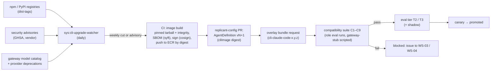
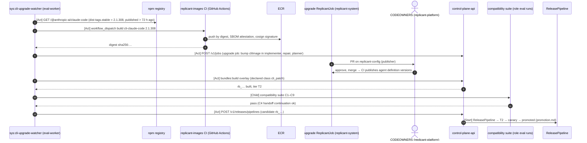

# CLI and Model Upgrades

**Workstream:** WS-06 (procedure, gates) with WS-03 (images, agent definitions, output parsing) and WS-04
(session capture) · **Contracts conformed to:** C-DEF 3.0.0 (`cli_images`, `models`, CC-1), C-RUNNER 3.0.0,
C-ART 2.0.0 (`cli_session_state`, `cli_events`) · **Constraints:** D-03, D-10, D-11, D-14

## Purpose

Coding CLIs and models change fast. Claude Code shipped 40 npm releases between 2026-09-10 (2.1.268) and
2026-10-23 (2.1.310), about one a day. Its `stable` dist-tag is 2.1.308 and `latest` is 2.1.310 [verified:
https://registry.npmjs.org/@anthropic-ai/claude-code, 2026-10-24]. Codex CLI released 25 versions between
2026-09-01 and 2026-10-23 (latest 0.164.0) [verified: https://registry.npmjs.org/@openai/codex, 2026-10-24]. The
Claude Agent SDK is at 0.3.310 on npm and 0.2.174 on PyPI [verified:
https://registry.npmjs.org/@anthropic-ai/claude-agent-sdk and https://pypi.org/pypi/claude-agent-sdk/json,
2026-10-24]. Under D-10 a CLI version changes only through a Release Bundle. This document is the procedure that
turns an upstream release or a new model into a candidate bundle, checks compatibility mechanically, evaluates
it, canaries it, and rolls it back if needed.

## Decisions summary

| # | Decision | Constraint / ADR |
|---|---|---|
| UP-1 | Track the vendor's **stable** channel (Claude Code npm dist-tag `stable`; Codex npm `latest`, which has no stable tag), never `latest` or `next` for Claude Code. One candidate per CLI per week (Monday cut). Security advisories bypass the cadence (expedited path) | D-10; [ADR-06-008](adr/008-cli-candidate-cadence-stable-channel.md) |
| UP-2 | A CLI bump is a one-change **overlay** bundle: new `AgentDefinition` versions differing only in `cliImage` (and any flag changes the compatibility suite requires), built by the upgrade job | D-03, CC-1 |
| UP-3 | A mechanical **compatibility suite** (C1–C9) runs before any eval: output event format, flags and config, session capture and same-version resume plus handoff continuation (never cross-version resume, SR-1), steering, gateway routing and headers, telemetry, exit codes, egress, and repo-config isolation. Failure blocks the bundle. No eval money is spent on an incompatible CLI | D-10, D-21 |
| UP-4 | Eval tier by change class: `cli_patch` → T2; `cli_minor` / `cli_major` → T3 + shadow; `model` → T3 + shadow + 30-day holdback | release-bundle.md §7 |
| UP-5 | Model upgrades pin every model-behavior parameter explicitly in the agent definition (effort, thinking display, max tokens), because provider defaults differ by model and change between models | D-11 |
| UP-6 | Images referenced by any live bundle carry a `bundle-ref-<rb body>` tag and are kept until 67 days (maximum job age 60 + 7) after their last bundle stops being assignable, so rollback and the longest pinned job always find their CLI (XD-FIX-R1-085, XD-FIX-R2-044) | D-03 |



---

## 1. Sources and cadence

| Component | Source | Channel tracked | Cadence |
|---|---|---|---|
| Claude Code CLI | `npm view @anthropic-ai/claude-code dist-tags` | `stable` | weekly candidate (Monday 04:00 UTC). A new `stable` within the week is not picked until the next cut |
| Claude Agent SDK (Python or TS, if used by an agent definition) | PyPI `claude-agent-sdk`, npm `@anthropic-ai/claude-agent-sdk` | `latest` (no stable tag) aged ≥ 72 h | weekly |
| Codex CLI | `npm view @openai/codex dist-tags` | `latest` aged ≥ 72 h (no stable tag) | weekly |
| Models | Gateway model catalog (WS-03 interface), provider announcements | new exact snapshot IDs | on availability; deprecation-driven migrations start ≥ 45 days before the provider's retirement date |
| Security | GitHub Security Advisories for the CLI repositories and their dependency trees (SBOM matching), vendor bulletins | — | immediate (expedited path, promotion.md §8) |

"Aged ≥ 72 h" protects against yanked releases. A release that is deprecated or unpublished from the registry
within 72 hours is never picked. `sys:cli-upgrade-watcher` (Temporal Schedule on eval-worker, daily 03:00 UTC)
records candidates in `evals.improvement_proposals` with `kind = agent_definition` and `failure_cluster =
'upgrade'`, so all generated changes share one queue and one rate limit.

**Why weekly and not per release.** At about one Claude Code release per day, per-release T2 evals would cost
roughly 365 × $3.8k ≈ $1.4M per year at 2× tokens for one CLI alone, and serialize every other release behind
CLI canaries. Weekly batching gives 52 candidates per year, each about 5–7 upstream releases apart. That
usually stays inside the `cli_patch` bounds (≤ 7 releases, ≤ 14 days), so it is T2 rather than T3.

## 2. Image build (CI, WS-03 owns the Dockerfiles)

```dockerfile
# images/cli-claude-code/Dockerfile — built by replicant-images CI for each candidate version.
FROM 123456789012.dkr.ecr.us-east-1.amazonaws.com/replicant/sandbox-base@sha256:5b1e0c9d8a7f6e5d4c3b2a1f0e9d8c7b6a5f4e3d2c1b0a9f8e7d6c5b4a3f2e1d
ARG CLAUDE_CODE_VERSION=2.1.308
# Integrity is pinned: CI resolves `npm view @anthropic-ai/claude-code@${CLAUDE_CODE_VERSION} dist.integrity`
# into a lockfile committed with the build, and `npm ci` verifies it.
COPY images/cli-claude-code/package.json images/cli-claude-code/package-lock.json /opt/cli/
RUN cd /opt/cli && npm ci --omit=dev --ignore-scripts=false --audit=false --fund=false \
 && ln -s /opt/cli/node_modules/.bin/claude /usr/local/bin/claude \
 && claude --version | grep -qx "${CLAUDE_CODE_VERSION} (Claude Code)"
# Never self-update inside a sandbox; never send nonessential traffic.
ENV DISABLE_UPDATES=1 \
    CLAUDE_CODE_DISABLE_NONESSENTIAL_TRAFFIC=1
USER 10001:10001
```

`DISABLE_UPDATES` blocks all updates, including manual `claude update`, and
`CLAUDE_CODE_DISABLE_NONESSENTIAL_TRAFFIC` disables auto-updates, telemetry, and error reporting [verified:
https://code.claude.com/docs/en/env-vars, 2026-10-24]. The `claude --version` output format in the `grep` is
`[unverified: exact version-string format; CI asserts it and fails loudly if it differs]`.

Post-build: `syft` SBOM (SPDX JSON) attached as an image attestation, `grype` scan (no Critical or High with a
fix available), `cosign sign` with the Replicant KMS key, push by digest. The image digest and SBOM digest go into
the `image_metadata` artifact. The bundle diff (release-bundle.md §5.1 step 5) uses the SBOM diff.

## 3. Candidate bundle

1. The upgrade job opens a PR on `replicant-config` bumping `cliImage` in every AgentDefinition that uses the
   CLI (for Claude Code: implementer, repair, planner; for Codex: reviewer), as new versions. The PR is
   produced by the Publisher from a Replicant job in tenant `replicant-system`, like proposals, and CODEOWNERS
   approval is required.
2. After merge and publish, the job submits an overlay request (example:
   [config/bundle-requests/cli-claude-code-2.1.308.yaml](config/bundle-requests/cli-claude-code-2.1.308.yaml)).
   The declared change class must match: a `cli_patch` declaration with a diff that also changes the model is
   rejected (release-bundle.md §3.2 step 5).
3. The required tier follows from the change class. A CLI bump batched with any other change is compound (T3).

## 4. Compatibility suite (blocking, before eval)

Runs as a **compatibility harness job** (eval-harness.md §3.8, `harness_task.kind = compat_check`): a ReplicantJob
in tenant `replicant-eval` pinned to the candidate bundle, whose runs `compat_check.c0.n1..n9.run` (`role: eval`) are
started and grant-signed by that job's own Runner-call activity (R1-134). Checks use a gateway-stub in scripted mode
(WS-03's `gateway-stub` Deployment in namespace `replicant-eval`, XD-FIX-R1-134; WS-06 supplies its scripts as
ConfigMap `gateway-stub-scripts`, format `replicant.gateway-script/v1`, one key per check C1–C9) wherever determinism is needed, and the real gateway in
metered mode for C5. Duration about 40 minutes; cost under $20. Results are stored as `evals.scores` on a dedicated
`adhoc` eval run and attached to the bundle's promotion evidence.

| Check | What | Pass condition | Owner of fixtures |
|---|---|---|---|
| **C1 Output event format** | Run each role's standard invocation (`claude -p --output-format stream-json --verbose --input-format stream-json …`; `codex exec --json …`) on 12 scripted conversations (tool use, edits, errors, compaction, budget stop, permission denial). Parse with the **production** entrypoint parser (WS-03) | Every event parses under the parser's schema; the derived `run_result` validates against `replicant.run-result/v1`; `usage` and cost fields are present; no unknown event types reach the `unknown_event` path more than 0 times (new event types are allowed only after the parser is updated) | WS-03 |
| **C2 Flags and configuration** | Diff `claude --help` and `codex exec --help` against the previous version; validate the materialized user-scope settings (`~/.claude/settings.json` from the agent definition) with `claude doctor`; check every flag the entrypoint uses: `-p`, `--output-format`, `--input-format`, `--resume`, `--session-id`, `--setting-sources`, `--mcp-config`, `--permission-mode`, `--allowedTools`, `--max-turns` [verified flag list: https://code.claude.com/docs/en/cli-reference, 2026-10-24] | No flag the entrypoint uses is removed or changed in meaning; `claude doctor` reports no rejected keys; MCP servers from the agent definition connect | WS-03 |
| **C3 Session capture round-trip** (same version only, WS-03 rule SR-1) | Same version: start a session, capture `cli_session_state` (WS-04 format; Claude Code transcripts are JSONL under `~/.claude/projects/…`, and `--resume` also accepts a path to a session `.jsonl` file [verified: https://code.claude.com/docs/en/cli-reference, 2026-10-24]), restore in a fresh sandbox, `--resume`, continue | The resumed session sees the prior turns (scripted probe question answered from earlier context) | WS-04 |
| **C4 Handoff continuation** | A job migrated from the previous bundle to the candidate continues from its handoff summary (WS-03 rule SR-1 forbids cross-version resume; XD-FIX-R2-053) | The candidate's first run after migration consumes the handoff and completes the scripted continuation task | WS-04 |
| **C5 Gateway routing** | Real gateway in metered mode, tenant `replicant-eval`: base URL from the agent definition (`ANTHROPIC_BASE_URL` for Claude Code [verified: https://code.claude.com/docs/en/env-vars, 2026-10-24]), run-token auth, `X-Replicant-*` headers (C-IDS §7), budget enforcement | Requests reach the gateway with all attribution headers; `budget_usd` exhaustion produces `GatewayBudgetExceeded`; served model equals the agent definition's model | WS-03 |
| **C6 Steering** | ADR-010: inject a steering message mid-run through the inbox | Delivered as a user turn (Claude stream-json input; Codex app-server `turn/steer` where the agent definition uses it) | WS-03 |
| **C7 Telemetry** | OTel export with `CLAUDE_CODE_ENABLE_TELEMETRY=1` and the Replicant exporter environment [verified variable: https://code.claude.com/docs/en/env-vars, 2026-10-24]; resource attributes from `OTEL_RESOURCE_ATTRIBUTES` (C-IDS §5) | Spans or events arrive at the collector with `replicant.job_id`, `replicant.run_id`; trace ID equals the job trace | WS-08 |
| **C8 Exit codes and failure mapping** | Scripted failures: gateway 500 storm, budget exhaustion, max turns, invalid MCP server, SIGTERM during a tool call | Each maps to the expected C-CRD failure reason; SIGTERM yields a partial manifest | WS-03 |
| **C9 Egress and repo-config isolation** | Run under egress logging with a fixture repository that contains a hostile `.claude/settings.json`, `CLAUDE.md`, and `.codex/` configuration. Claude Code reads shared project settings from `.claude/settings.json` in the working directory [verified: https://code.claude.com/docs/en/settings, 2026-10-24], which is why the entrypoint restricts setting sources (D-10) | Only allowlisted FQDNs are contacted (gateway, package mirror, repo-mirror, MCP endpoints); none of the fixture repo's agent configuration takes effect (hooks do not run, permissions are not widened, instructions are not followed) | WS-03, WS-09 |

C9 exists because CLI behavior around configuration discovery changes between versions. For example, the
location of `.claude/settings.local.json` changed in v2.1.211 [verified: https://code.claude.com/docs/en/settings,
2026-10-24]. A version that starts honoring a new repo-sourced file would silently violate D-10.

## 5. Eval, shadow, canary

| Change | Offline | Shadow | Canary | Holdback |
|---|---|---|---|---|
| `cli_patch` (≤ 7 releases, ≤ 14 days apart) | T2 (300 × 1, baseline reused if ≤ 7 days old) | no | standard 3 stages | 7 days |
| `cli_minor` / `cli_major` | T3 (450 × 2, paired concurrent) | yes | standard; two-person sign-off for major | 7 days |
| `model` | T3 + judge self-preference check (§6.4) | yes | standard; two-person sign-off (release manager + security) | **30 days** (OQ-06-13) |
| Security advisory | T1 + C1–C9 | no | expedited | post-hoc T2 |

## 6. Model upgrades

### 6.1 Candidate creation

A model upgrade is a new AgentDefinition version with a new `model` (exact gateway ID; aliases ending in
`latest` are rejected by the bundle schema). Prompts are reused unchanged in the first candidate, so the
comparison isolates the model. Prompt adjustments for the new model are a **separate** follow-up candidate,
evaluated against the model-only candidate.

### 6.2 Parameters that must be pinned explicitly (WS-03 lint)

| Parameter | Why |
|---|---|
| Effort | Defaults differ by model: Claude Opus 5.5 and Haiku 5.5 default to `medium`, other current models to `high`; and levels are recalibrated between model versions (Sonnet 5.5 vs Sonnet 5) [verified: https://platform.claude.com/docs/en/build-with-claude/effort, 2026-10-24]. A model swap without an explicit effort silently changes reasoning depth and cost |
| Thinking mode | Some models reject `thinking: {type: "disabled"}` (for example Claude Opus 5.5 at every effort level) [verified: same page, 2026-10-24]. A carried-over setting can turn into a 400 error |
| Sampling parameters | The current Anthropic API version rejects `temperature`, `top_p`, `top_k` on every model [verified: https://platform.claude.com/docs/en/api/versioning, 2026-10-24]. Agent definitions and in-worker calls must not set them |
| Max output tokens | Thinking counts toward `max_tokens` [verified: https://platform.claude.com/docs/en/build-with-claude/effort, 2026-10-24]. Too low a value truncates agent turns |
| Context window and tokenizer | Context budgets (WS-04) are in tokens. Tokenizer changes shift how much fits. The compatibility run measures tokens for the standard briefing packet on both models and fails if the packet exceeds the new budget |

### 6.3 Cost and budget check

Before eval, the release controller computes the expected per-job cost under the new model's prices, using the
incumbent's token profile from the cost ledger (median and p90 by role). If p75 per-run cost exceeds any
tenant's per-run cap (`budgets` policy), it reports which tenants' derived bundles would fail G-T0-3, so that
tenant admins can be asked before the canary reaches them.

### 6.4 Judge interaction

If the new agent model is also a juror model in any `gating` judge, the comparison would be judged by the
model under test (self-preference). The pipeline then requires the second-family juror to be present
(JudgeDefinition `jurors`), and the judge's calibration is re-run with the new model's outputs added to the
anchor sets before T3 starts (eval-harness.md §4.3).

### 6.5 Deprecation-driven migrations

The retirement calendar is `registry.model_retirements` (release-bundle.md §3.4). When the provider announces a
retirement date for a model in any non-revoked bundle, the release controller records it and:

1. opens a model-upgrade candidate at least 45 days before that date (T3 about 1 day, shadow up to 5 days, canary
   at least 3 days, holdback, plus margin for one failed attempt). From then on, new base builds with that model
   fail the 60-day assignment-window check, so nobody can ship a fresh bundle that retires soon;
2. once the model-upgrade candidate's T3 has passed, release managers approve the **successor mapping**
   `registry.model_successors {retiring_model, successor_model, approved_by (two people), approved_at,
   evidence_comparison_id}` (XD-FIX-R2-044);
3. the registry derives a **successor bundle B′** for every live bundle B that uses the retiring model (default,
   rollback target, holdback, tenant overrides, and every bundle with running pinned jobs). B′ differs from B only
   in agent-definition `model` fields and the `models` index, with `lineage.parent_release_bundle_id = B`. B′
   inherits B's promotion state up to `promoted`, with evidence = the upgrade's comparison plus the compatibility
   suite on B′ (a mechanical model-only diff evaluated once on the default; D-03 evidence by construction, like
   T0);
4. control-plane-api sends `release.notice(kind = model_retiring, recommended_release_bundle_id = B′,
   deadline = retirement date)` (C-MSG) to every running job pinned to B;
5. retirement **forces migration at the next safe point without requester consent** (orchestrator decision on
   R2-044), triggered by the notice itself (C-MSG 2.0.0; WS-01 versioning.md §6.1 rule 6): the job checks the
   lineage by activity (`release.check_migration_eligibility` with `lineage: model_successor`, which returns
   `lineage_mismatch` if B′ differs from B in anything but the model), records `consent:
   not_required:model_retiring` with no gate, and migrates at its next safe point. WS-06 sends no
   `job.offer_bundle_migration` for this (R1V-037). An ineligible job **keeps running**; operators may offer
   another bundle with `job.offer_bundle_migration(required = true, consent = operator)` before the deadline,
   and a job still on B at the deadline ends `cancelled` with outcome `model_retired_not_migrated` (terminal
   reason "model_retired", R1V-129). Migrated jobs continue from their handoff summary (SR-1).

`worker_version_retire_scheduled` is not used for models; it stays reserved for worker retirement (R1-148).

## 7. Rollback and pinned jobs

Rollback is the standard one-transaction rollback (promotion.md §7). Specific to upgrades:

* Jobs pinned to the new CLI keep it (CC-3). Their image is retained (UP-6).
* A job migrated back to the previous bundle continues from its handoff summary, never by resume (SR-1,
  XD-FIX-R2-053).
* A model retired by the provider cannot be rolled back to. The rollback target check (promotion.md §7.4)
  refuses targets whose models the gateway reports as unavailable.

## 8. Retention of images

ECR repositories use tag immutability (WS-10), so one tag names one image; an image may carry many tags.
Retention uses **one tag per bundle** (WS-03's form, XD-FIX-R1-085, which supersedes the per-digest form of
wave 1): `bundle-ref-<first 20 chars of the rb_ body>`, which WS-10's lifecycle (`keep bundle-ref*`, untagged
14 days, rest 180 days) keeps:

* **Who applies it:** WS-06 owns tagging. `svc_release-controller` (the release controller identity in the
  registry module of control-plane-api; WS-07 does not tag) applies it with ECR
  `PutImage` of the existing manifest under the new tag), at build, on every CLI image in `spec.cli_images` and
  every environment image referenced by the bundle's environment definitions. Derived bundles do not add tags:
  their images are exactly their base's. Idempotent: an existing identical tag is success.
* **Who removes it:** `sys:retention-sweeper` (WS-10's ECR policy for it allows tag removal only), with `BatchDeleteImage` of that tag only, when the bundle is `revoked`, or is
  `deprecated`, `rolled_back` or `withdrawn` with no pinned running jobs for **67 days**
  (`repair_limits.job_max_age_days` 60 + 7; XD-FIX-R2-044, replacing 37). An image stays as long as any bundle's
  tag remains.
* WS-03's own `bs-<hex12>` build tags carry no retention meaning.

## 9. Sequence: Claude Code weekly upgrade



## Open questions

| ID | Question | Who decides | Options | Recommendation |
|---|---|---|---|---|
| OQ-06-16 | Track Claude Code `stable` or `latest`? | WS-03, WS-06 | stable / latest aged 72 h | `stable`. It lags `latest` by a few releases and exists for this purpose |
| OQ-06-17 | Should CLI and model upgrades be allowed to batch with prompt changes? | Release managers | never / when queued | Never batch a model change. CLI patches may batch with prompt changes only when the queue exceeds 2 candidates (promotion.md §12), and the result is T3 |

## Risks

- **Upstream cadence outpaces evaluation.** Weekly cuts mean Replicant runs CLI versions 1–2 weeks behind
  `stable`. Security fixes use the expedited path.
- **Session format churn.** Claude Code session files are internal and unstable (V00-42). C3 detects
  same-version breakage; across versions, jobs never resume (SR-1) and always use the handoff summary (C4).
- **Silent behavior changes inside a patch.** A patch can change tool behavior without changing formats. Only
  T2 (MDE 7.9 pt) and the canary can catch the effect; smaller regressions surface in lagging metrics.

## Interfaces

- **Provided:** upgrade cadence and selection (§1), compatibility suite C1–C9 (§4), model-upgrade rules (§6),
  image retention rule (§8).
- **Consumed:** WS-03 entrypoint parser, materializer, agent definition schema, gateway interface; WS-04
  session capture and handoff; WS-08 OTel collector; WS-09 egress policy; WS-10 ECR lifecycle; C-DEF `cli_images`.
