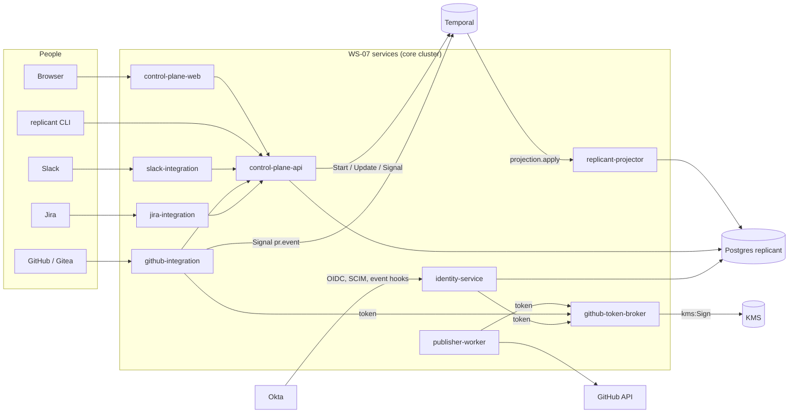

# 07 — Control plane, user experience, identity, and approvals (WS-07)

## Purpose

Every surface humans touch: the control-plane UI and API, the Replicant CLI, Slack, GitHub (the
companion GitHub App, D-24), Jira, and the identity and authorization model behind them; plus the
services WS-07 owns per C-ARCH: `control-plane-web`, `control-plane-api`, `identity-service`,
`github-integration`, `github-token-broker`, `slack-integration`, `jira-integration`,
`publisher-worker`, `replicant-projector`.

Conforms to the final frozen contracts (FROZEN.md): C-ARCH 2.0.0, C-STATE 2.0.0, C-IDS 2.0.0,
C-RUNNER 3.0.0, C-CRD 3.0.0, C-MSG 2.0.0, C-JOBREQ 2.0.0, C-DEF 3.0.0, C-ART 2.0.0, C-PG 2.0.0, including the
accepted CCR-07-06..12; ADR-011 as amended by the accepted CCR-09-06; WS-06's release API; WS-09's control review; WS-11's local stack.

## Decisions summary

| Area | Decision | Constraint / ADR | Where |
|---|---|---|---|
| Visual identity | "Drafting table": warm paper/graphite neutrals, hairlines not boxes, IBM Plex Sans + Plex Mono, **one signal colour (orange) that means only "a human is needed"** (primary buttons are ink; a separate olive/yellow `warning` family carries escalations, kill switches, stale data and paused canaries, R2-034), shapes for every status; WCAG 2.2 AA and CVD separation computed and gated in CI | §4 design bar | [design/direction.md](design/direction.md) |
| Frontend | React 19.3 + Vite 8.3 + TanStack Router/Query + `radix-ui` primitives fully restyled; generated OpenAPI client | D-23 | [architecture.md](architecture.md) §1 |
| Backend | FastAPI modular monolith with per-schema DB roles; UI reads Postgres only | D-09, ADR-004 | [architecture.md](architecture.md) §2 |
| Live updates | SSE with reference-only events | C-STATE OQ | [ADR-07-001](adr/001-sse-for-live-updates.md) |
| Human actions | Temporal Updates through sender outboxes; 202 "recording" on timeout | C-MSG §3, ADR-001 | [architecture.md](architecture.md) §2.4 |
| Release UI | Implements WS-06's pipeline: staged canary with guardrails, two-person sign-off in the approvals inbox, one-call rollback with `migrate_running` choice; up to three ramps (`ramps[]`, C-DEF 3.0.0) | D-02, D-03 | [architecture.md](architecture.md) §2.5, §2.8 |
| Authentication | BFF session cookie (browser); Okta device grant (CLI) | D-18 | [ADR-07-006](adr/006-bff-session-and-device-flow.md) |
| Authorization | One in-code evaluator: groups (SCIM replica, live Okta for decisions) ∧ bindings ∧ live repo permission ∧ action rules; per request, no cached grants | D-18, D-25 | [ADR-07-002](adr/002-authorization-in-code-evaluator.md), [identity.md](identity.md) |
| D-25 | `memory:admin` only from `replicant-admins` membership; checked in control-plane-api and again in memory-service; denials audited; non-admins see read-only "memory used" | D-25 | [identity.md](identity.md) §7 |
| Linking | Provider proof only (GHEC SAML external identities, GitHub App user OAuth, Sign in with Slack, Atlassian 3LO, Gitea OAuth2) | D-18 | [ADR-07-003](adr/003-identity-linking.md) |
| Approvals | All channels → `gate.decide`; packets digest-bound; deterministic risk rules (WS-09 sensitive classes in the base); fatigue controls | D-19 | [approvals.md](approvals.md) |
| GitHub | Replicant gates before the PR; reviews are feedback; issue/PR commands and reviews map to `gate.decide` after a live permission check; no draft-PR check-run decision mode (a draft PR already runs target CI, R2-001) | D-19 | [ADR-07-005](adr/005-github-review-to-gate-mapping.md) |
| GitHub App | Least-privilege manifest (no `workflows`); broker is sole key holder (KMS-held key, WS-09 ADR-004); Publisher ships only the approved digest; verified API commits | D-21, D-24 | [github-app.md](github-app.md) |
| Target CI safety (R2-001) | Non-removable `critical` risk class `ci_executed_paths` evaluated on every publish, repair push and takeover push against the pushed digest; test-file changes are at least `medium`; onboarding requires tenants to keep secrets-bearing CI off `replicant/**` and `replicant-takeover/**` without approval | D-21 | [onboarding.md](onboarding.md), [github-app.md](github-app.md) §10.1, [schemas/examples/risk-rules.global.yaml](schemas/examples/risk-rules.global.yaml) |
| Publisher idempotency (R2-031) | Deterministic branch `replicant/<job_id>`, commit trailer `Replicant-Activity: <idempotency key>`, force-update only of the replicant-owned branch, PR lookup by head before create; a crash at any step re-runs to the same PR | C-MSG, XD-01-03 | [github-app.md](github-app.md) §10.1 |
| Channel decisions (R2-032) | Slack and GitHub clicks are validated by the workflow's Update validator, never by the read model; the read model only renders | C-MSG §3 | [approvals.md](approvals.md) §10 |
| Kill switches (R2-016) | Global, tenant, repo and bundle scope; S3 mirror (plus worker ConfigMap) first, Temporal batch Signal `ops.kill_switch` second, Postgres record third, so a Postgres outage never blocks a switch | C-STATE 1.8.0, C-MSG 1.5.0 | [architecture.md](architecture.md) §2.9 |
| Spend limits (R2-055, R2-059) | Tenant monthly and daily budgets are required (platform defaults $5,000 / $400), a platform-wide daily ceiling ($30,000), and at most 3 repair jobs per PR | — | [architecture.md](architecture.md) §2.10, [data/ddl/tenancy.sql](data/ddl/tenancy.sql) |
| Dev webhooks | Cloudflare quick tunnel + automatic hook-URL patch (overrides WS-11's provisional smee) | D-24 | [ADR-07-004](adr/004-dev-webhook-forwarding.md) |
| Local identity | Dex (WS-11 ADR-11-003) + SCIM seeding; dev seed token only in dev-target images with WS-09's guards | D-20, OQ-11-04 | [identity.md](identity.md) §9 |
| Database | DDL for nine schemas on WS-10's grant model v2 (parents only, `r_<schema>_read/write`, no `grafana_ro` on `tenancy`), RLS forced on every tenant table including the seven platform-scoped ones (XD-W2-07-04); admin operations replace SQL | D-26, C-PG 2.0.0 |
| Wave-2 conformance | Memory admin is a 1:1 proxy of WS-04's verb table (38 operations generated from `x-public-path`); `job_memory_usage` keyed by snapshot (R1-099); `rerun_qa`, `release_block`, `qa_reruns_used`, shared `decision_channel`; restore, leak, audit and identity endpoints from WS-10, WS-08, WS-01; `ramps[]`; break-glass kill-switch role `replicant-<env>-killswitch-operator` with an `INC-*` ticket | C-MSG 2.0.0, C-DEF 3.0.0 | [approvals.md](approvals.md) §11, [github-app.md](github-app.md) §10a, [architecture.md](architecture.md) | [data/](data/README.md), [architecture.md](architecture.md) §7 |

## Files

| File | Content |
|---|---|
| [architecture.md](architecture.md) | Frontend, backend, Temporal interaction, SSE, authz middleware, projector, run-grant endpoints, Temporal UI, admin operations, must-answers on first 60 s and rollback |
| [identity.md](identity.md) | OIDC, SCIM, event hooks, deprovisioning, linking, roles/permissions, evaluator, D-25, enforcement points E1–E22, local identity and seed token, must-answer on in-flight group removal |
| [approvals.md](approvals.md) | Gate lifecycle, routing, packet, Slack Block Kit, GitHub, UI, reminders/escalation/expiry, fatigue, must-answer on the Slack/GitHub race |
| [github-app.md](github-app.md) | Manifest, permissions, events, webhook ingestion, replay, dev app CLI, forwarding, triggers, broker, Publisher |
| [triggers.md](triggers.md) | Channel → JobRequest mapping, dedupe, Slack/Jira/UI/schedules, CLI |
| [notifications.md](notifications.md) | Personas, event catalogue, preferences, digest |
| [ui/](ui/README.md) | Information architecture and annotated wireframes with empty/loading/error states for every screen |
| [design/](design/direction.md) | Direction, tokens ([tokens.json](design/tokens.json), [contrast-report.md](design/contrast-report.md)), components, critique, prototype (including failed, capacity, stale, degraded, empty, rolled-back and phone states and Slack/GitHub renderings), 70 screenshots |
| [api/control-plane-api.openapi.yaml](api/control-plane-api.openapi.yaml), [api/identity-service.openapi.yaml](api/identity-service.openapi.yaml), [api/github-token-broker.openapi.yaml](api/github-token-broker.openapi.yaml), [api/common-components.yaml](api/common-components.yaml) | OpenAPI 3.1.1, validated with `openapi-spec-validator`. control-plane-api merges with WS-06's release API at build; both `$ref` the shared components so the merged document has one definition per name |
| [onboarding.md](onboarding.md) | Tenant onboarding checklist (CI exclusion of Replicant branches, environments, branch rules, budgets) |
| [github-app/manifest.json](github-app/manifest.json) | GitHub App manifest, validated by [validate_manifest.py](github-app/validate_manifest.py) |
| [slack-app/manifest.yaml](slack-app/manifest.yaml) | Slack app manifest |
| [schemas/](schemas/) | Kind schemas for `risk_rules`, `gate_rules`, `approval_channels`; tenant settings; notification preferences; validated examples |
| [data/](data/README.md) | DDL for `tenancy`, `identity`, `intake`, `jobs_read`, `approvals`, `notify`, `github_app`, `slack_app`, `jira_app`, validated on PostgreSQL |
| [adr/](adr/) | ADR-07-001 … 006 |

## Must-answer index

| Question | Answer |
|---|---|
| A user is removed from the approver group while their approval click is in flight | [identity.md §10](identity.md#10-must-answer-a-user-is-removed-from-the-approver-group-while-their-approval-click-is-in-flight): the Update validator re-checks live; if removal lands after acceptance the decision is marked `gate.decision_identity_contested` and, when nothing was published yet, the gate is reopened (`reopen_if_unpublished`) |
| Same gate approved in Slack and rejected in GitHub within one second | [approvals.md §9](approvals.md#9-must-answer-the-same-gate-is-approved-in-slack-and-rejected-in-github-within-one-second) |
| What does a requester see in the first 60 seconds | [architecture.md §8](architecture.md#8-must-answer-what-does-a-requester-see-in-the-first-60-seconds-after-triggering-a-job) |
| How does an operator find and roll back the release that caused a failure spike | [architecture.md §9](architecture.md#9-must-answer-how-does-an-operator-find-and-roll-back-the-release-that-caused-a-spike-in-failed-jobs): alert `ReplicantReleaseFailureSpike` (cohort-labelled failure rate, 15 min) links to the releases page; the rollback dialog shows the blast radius and preselects WS-06's suggestion (`required_by_operator`, migrate now) for a failed canary; open packets on the bundle get a rolled-back banner |

## Validation performed

| Artifact | Tool | Result |
|---|---|---|
| Design tokens | `design/tools/build_tokens.py` (coloraide; WCAG + CVD) | all thresholds pass |
| Chart palette | dataviz `validate_palette.js` | CVD/contrast pass; chroma-floor on the grey context series is the intended emphasis pattern |
| Prototype | `design/tools/screenshots.py` (Playwright, Chromium headless) at 1440/1024 × light/dark, plus 390 px for the phone approve flow | 70 screenshots; fonts verified loaded; overflow/clipping check 0 findings |
| OpenAPI (4 files) | `openapi-spec-validator` with file base URI | valid; no operationId, path or component collisions with WS-06 `releases.openapi.yaml` |
| Mermaid (14 diagrams) | `@mermaid-js/mermaid-cli@11.4.2` | all render (re-run in wave 2) |
| Slack app manifest | YAML parse | parses |
| GitHub App manifest (prod + dev variant) | `github-app/validate_manifest.py` | valid |
| Policy schemas and examples | `schemas/validate_policies.py` against the frozen envelope | valid |
| DDL | `data/validate_ddl.py` on PostgreSQL via `pgserver` | applied; seq guard, dedupe, D-25 constraint, WS-06 `assignment_reason` grammar, required budgets, 64 RLS policies via `ops.apply_tenant_rls` |
| DDL on WS-10's framework | `10-data-platform` bootstrap + Alembic head + `apply_owner_ddl.sh` on pgvector pg17, then `check_grants.py`, `check_rls.py`, `check_partitions.py` | all nine WS-07 files OK; 0 WS-07 grant problems, 0 WS-07 tables without forced RLS, partitions OK (job_timeline partitions RLS forced) |

## Open questions (top; all in the coordination file)

| ID | Question | Recommendation | Who decides |
|---|---|---|---|
| OQ-07-01 | Live Okta group read on every gate decision (adds Okta API dependency to approvals) | Yes, with bounded replica fallback | WS-09, identity owners |
| OQ-07-02 | Slack one-click approval for `critical` gates | No: UI only | WS-09, product |
| OQ-07-03 | Two-person rule for critical **job** gates (quorum) | Single winner in v1 (C-MSG); rely on GitHub required reviews as the second person | Product, orchestrator |
| OQ-07-04 | ~~GitHub decision surface default~~ Closed in wave 1: draft-PR check-run actions removed (R2-001) | — | — |
| OQ-07-05 | GHEC SAML or EMU for GitHub identity | Either; SAML external identities give zero-click linking | Enterprise GitHub owners |

## Risks

- Approvals and actions depend on the job's pinned worker version being available (ADR-001); outboxes
  make failures delays, not losses.
- The live Okta read makes Okta's Users API part of the approval path; mitigated by a freshness-bounded
  replica fallback and fail-closed for critical gates.
- control-plane-api carries many responsibilities (intake, actions, releases, registry, grants JWKS);
  per-module DB roles and the separate grants app limit blast radius; splitting is a later option.
- Several third-party details are unverified and are listed with fallbacks in the documents
  (Jira webhook signing, Slack thread-read scopes, Keycloak/Dex SCIM, localhost manifest redirect).

## Interfaces

- **Provided:** control-plane-api (incl. WS-06's release API implementation, run-grant JWKS and
  revocation list), identity-service APIs and the `identity.check_*` activity backends, github-token-broker,
  github-integration (webhooks, `pr.event`, comments, check runs), slack-integration, jira-integration,
  publisher-worker activities, replicant-projector `projection.apply`, policy kind schemas `risk_rules` /
  `gate_rules` / `approval_channels`, DDL for nine schemas, the `replicant` CLI, the design system.
- **Consumed:** C-JOBREQ, C-MSG, C-STATE, C-DEF, C-ART, C-PG, C-IDS, ADR-011/CCR-09-06; WS-01 (handlers,
  timers, notify and identity activity call sites, `approved_diff_sha256`), WS-03 (cost ledger,
  right-sizing proposals), WS-04 (memory-service admin API), WS-05 (QA report), WS-06 (release pipeline),
  WS-08 (audit views, alerts, dashboards), WS-09 (keys, policies, reviews), WS-10 (roles, migrations),
  WS-11 (local stack).
