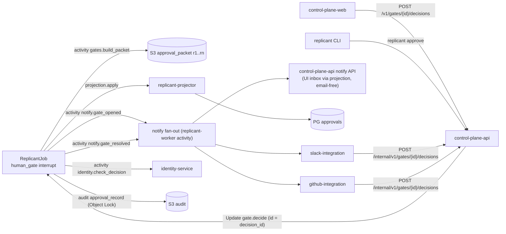
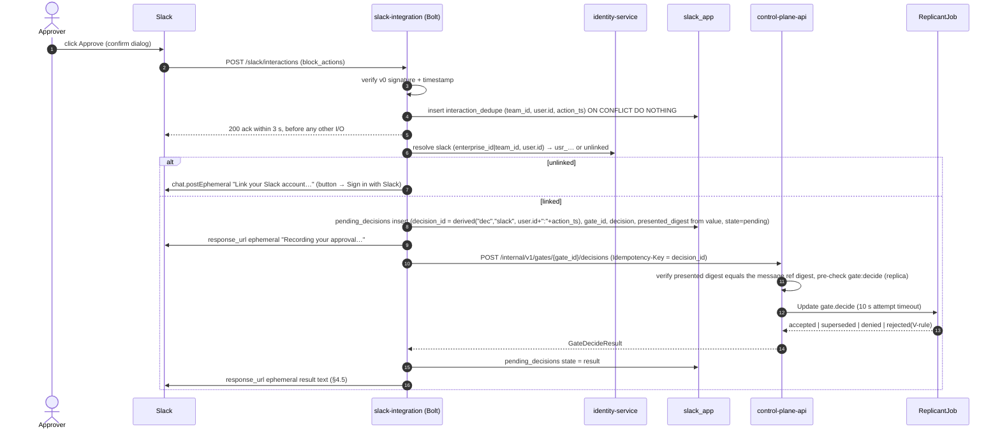
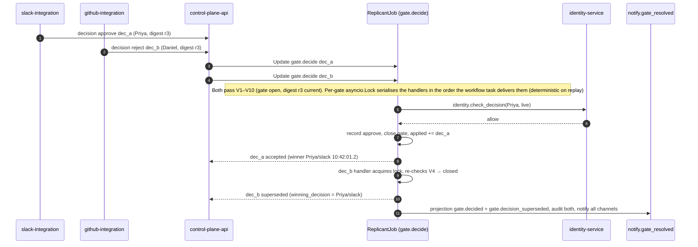

# Approvals

**Owner:** WS-07 · **Constraints:** D-19, D-18, D-25, D-15 · **Contracts:** C-MSG (`gate.decide`,
V1–V10, handler steps 1–6, sender obligations §3), C-STATE (gate state in Temporal, `approvals`
projection), C-ART (`approval_packet`, `approval_record`), C-IDS (`gate_id`, `decision_id`) ·
**Policy schemas (WS-07-owned policy types):** [risk_rules](schemas/policy-risk-rules.schema.json),
[gate_rules](schemas/policy-gate-rules.schema.json),
[approval_channels](schemas/policy-approval-channels.schema.json), examples in
[schemas/examples/](schemas/examples/) (validated by
[schemas/validate_policies.py](schemas/validate_policies.py))

## Purpose

Specify how a human gate is opened, routed, presented, decided, reminded, escalated, expired, and
audited across the UI, Slack, GitHub, and CLI, so that all channels resolve to the same Temporal
Update with the decider's Okta identity, the first valid decision wins, duplicates are no-ops, and
every channel shows who decided and where.

## Decisions summary

| # | Decision | Reference |
|---|---|---|
| A-1 | Gate presence is decided by `risk_rules` (deterministic; LLM may only raise) and `gate_rules`; JobRequest `require_gates` can only add | D-19 |
| A-2 | Channel **types** per gate come from `approval_channels` (bundle); channel **targets** (Slack channel IDs, escalation targets) from `tenancy.tenant_settings` (operational, read at gate open and recorded) | ADR-013 |
| A-3 | Every channel → control-plane-api → `gate.decide` Update. Slack and GitHub adapters keep their own outboxes and retry with the same `decision_id` (C-MSG §3) | D-19, ADR-001 |
| A-4 | Authority is the handler's `identity.check_decision` with live Okta groups and live GitHub permission; adapters and the API pre-check only for fast feedback | D-18 |
| A-5 | One approval packet per gate revision (`packet-r<n>.json`, immutable, digest = `presented_digest`). Every channel renders from the packet; every decision names the digest it was made on (V6) | C-MSG, C-ART |
| A-6 | Replicant gates come **before any push**. GitHub decisions use `/replicant` issue commands; GitHub reviews afterwards are feedback and never decide a Replicant gate. The draft-PR check-run decision mode is removed (it pushed code before approval, R2-001) | [ADR-07-005](adr/005-github-review-to-gate-mapping.md) |
| A-7 | Slack one-click approval is allowed up to `high` risk by default; `critical` gates show "Review in Replicant" (the decision is made in the UI where the full diff is visible) | approval fatigue, §8 |
| A-8 | Approval fatigue controls: risk-based routing, batching of low-risk docs gates, a rotating **suggested approver** among reachable people, delegation with expiry (also to non-eligible principals with the repo permission), OOO detection, inbox filters and grouping, one consolidated reminder per approver per slot, rubber-stamp detection metrics | R2-024, R2-025 |
| A-9 | Approval text (comments, answers) is stored in the `approval_text` artifact and referenced by key and digest from `approval_record` and the projection (C-ART 1.9.0, R2-004) | C-ART 1.9.0 |
| A-10 | Packet content is labelled by provenance: plan, PR description, review notes, and diff are **agent-written, untrusted**; diff lines are soft-wrapped, never truncated, and lines over 160 characters or containing bidi or zero-width characters are flagged as deterministic facts | R2-007, T-PI-04 |



---

## 1. Gate lifecycle (states as projected in `approvals.gates.state`, values from C-MSG `GateView.state`)

```mermaid
stateDiagram-v2
  [*] --> open: gates.build_packet r1 + notify.gate_opened
  open --> open: packet revision (QA re-run, rebase) → r(n+1), all channels re-rendered
  open --> approved: gate.decide approve (accepted)
  open --> rejected: gate.decide reject (accepted)
  open --> changes_requested: gate.decide request_changes (accepted)
  open --> answered: gate.decide answer (clarification)
  open --> expired: expiry timer (policy on_expiry)
  open --> cancelled: job cancelled / taken over / bundle migration
  approved --> [*]
  rejected --> [*]
  changes_requested --> [*]: workflow re-plans; a new gate opens with ordinal+1
  answered --> [*]
  expired --> [*]
  cancelled --> [*]
```



Gates with `eligible.min_approvers > 1` (C-MSG 1.5.0, today only `leak_purge`) stay `open` while
approvals are recorded: each valid `approve` returns `recorded` with `approvals_recorded` /
`approvals_required`, every channel shows "1 of 2 approvals · Priya Raman approved 10:42 · needs one more
from replicant-security, not the purge requester", and the gate closes as approved only at the required number
of distinct principals (V11 rejects a second approval by the same principal and approval by the initiator).

Timers inside the workflow (WS-01 implements; WS-07 specifies via `gate_rules.timing`):
reminders at each offset, escalations at each `after`, expiry at `expires_after`. All are durable
Temporal timers started at gate open; quiet hours shift reminder/escalation fire times (computed
by an activity at gate open from the approvers' Okta `timezone`, and recorded).

## 2. Channel selection

At gate open, activity `gates.resolve_routing({gate_kind, facts})` (WS-01 node, WS-07 logic) evaluates the
bundle's `gate_rules` and `approval_channels` and returns **GateRouting v1**
([spec/01-orchestration/schemas/gate-routing.v1.json](../01-orchestration/schemas/gate-routing.v1.json),
XD-01-02, R1-165): `{schema: "replicant.gate-routing/v1", gate_kind, required, rule_id, reasons[], channels[],
eligible{okta_groups, principals, min_repo_permission, requester_may_decide}, timing{reminder_seconds[],
reminder_repeat_seconds, escalation_seconds[], expiry_seconds, on_expiry}, reapprove_after_rebase,
amount_usd?}`. The policy's ISO 8601 durations are converted to **integer seconds** here, so workflow timers
never parse durations. The result is deterministic for a pinned bundle and facts and is recorded in history.

1. `channels` = first matching `approval_channels.routes[]` entry (by gate kind and risk) ∩
   `gate_rules.channels_override` (if any).
2. `eligible`: `okta_groups` (with `{tenant}` expanded), CODEOWNERS of changed paths resolved to linked
   principals (teams through GitHub team membership with `members:read`), `min_repo_permission`, and
   `requester_may_decide`. For `budget_extension`, `requester_may_decide` is true **only** when
   `amount_usd ≤ budgets.extension.requesterSelfApproveMaxUsd` (default 0, WS-09 G-07); otherwise the
   tenant leads decide and the requester is informed, not asked (R2-022).
3. **Empty or unreachable eligibility** (R2-025): if, after resolution, no eligible principal is linked,
   active, and not OOO, routing returns `escalation_seconds[0] = 0` with reason `no_reachable_approver`: the
   gate escalates at open, and the requester sees "No reachable approver in ledger-core; escalated to
   #payments-leads". Re-resolution on `identity.principal_changed` is **immediate** (identity.md §3.4;
   WS-01 gates.md §8 aligns, XD-FIX-R2-025).
4. Targets (operational): `tenancy.tenant_settings.approval_targets` (read at gate open, recorded):

```yaml
# PATCH /v1/tenants/payments/settings  (tenant_admin; tenancy schema)
approval_targets:
  slack:
    approval_channel: C07PAYFAC1        # #payments-replicant
    escalation_target_1: C07PAYLEAD     # #payments-leads
    escalation_target_2: C02SECOPS1     # #secops-oncall (critical only)
    workspace: {team_id: T024BE7LD, enterprise_id: E01ACME}
  github:
    escalation_team: "@acme-payments/ledger-core"
  suggested_approver_rotation: least_recent_decision   # or none
```

5. **Suggested approver** (fatigue control): one eligible principal, chosen by least-recent decision
   among principals who are linked on the gate's channels, decided or viewed a packet in the last 30 days,
   and are not OOO (R2-025; ties: deterministic by `gate_id`). The suggestion is shown and DM'd, but every
   eligible principal can still decide.

`gates.build_packet` returns `{packet_uri, digest, diff_sha256, plan_sha256}` (XD-01-02): `digest` is the
`presented_digest`, `diff_sha256` is what the Publisher later enforces as `approved_diff_sha256`.

## 3. The approval packet

Built by activity `gates.build_packet` (replicant-worker) as an `approval_packet` manifest
(C-ART: references only, ≤ 1 MiB) at
`tenants/<t>/jobs/<j>/gates/<gate_id>/packet-r<n>.json`; `presented_digest =
sha256(JCS(packet))`.

```json
{
  "schema": "replicant.approval-packet/v1",
  "gate_id": "gate_5fgbq8n2xz4k7m1c9v0t3h6r2e",
  "revision": 3,
  "gate_kind": "publish_approval",
  "job": {"job_id": "job_01m5n2a9qe0k3d7v5w8x2y4z6a", "title": "Stale FX rate cache after deploy", "workflow_type": "bugfix",
          "requester": "usr_01knk8dfr0fvjc7v0b9vhvkzbp", "repo": "github.com/acme-payments/ledger-api", "base_ref": "main",
          "base_sha": "9a0c27e41b55f3d8c6e2a9b07d4f1e3c5a8b2d6f", "release_bundle_id": "rb_ds5p3wmcj4dag2e9a8ncp4py6k"},
  "risk": {"level": "high", "policy_ref": "policy/risk-rules.payments@6#sha256:5d1f3b7a9c2e4f6a8b0d1c3e5f7a9b2c4d6e8f0a1b3c5d7e9f2a4b6c8d0e1f3a",
           "rules_fired": [
             {"id": "path.money_movement", "level": "high", "evidence": "changed ledger/fx/cache.go matches ledger/**"},
             {"id": "service.tier1", "level": "high", "evidence": "ledger-api is tier1 in the service catalog"},
             {"id": "diff.size_medium", "level": "medium", "evidence": "87 changed lines (threshold 50)"}],
           "raised_by_llm": false},
  "plan": {"bucket_class": "artifacts", "key": "tenants/payments/jobs/job_01m5n2a9qe0k3d7v5w8x2y4z6a/runs/run_7kq2m9x4w1c8b5n0d3f6h2j9t4/plan/plan.json", "sha256": "4a2c6e8b0d1f3a5c7e9b2d4f6a8c0e1b3d5f7a9c2e4b6d8f0a1c3e5b7d9f2a4c", "revision": 2,
           "approved_by": {"principal_id": "usr_01knm4q8z2w6v0b3c9x7d5f1h3", "channel": "slack", "decided_at": "2026-10-23T08:12:40Z"}},
  "diff": {"bucket_class": "artifacts", "key": "tenants/payments/jobs/job_01m5n2a9qe0k3d7v5w8x2y4z6a/runs/run_m3x8c1v6b9n2q5w0e4r7t1y8u2/diff_bundle/changes.tar.zst", "sha256": "6c8e0a2b4d5f7c9e1a3b5d7f9c2e4a6b8d0f1c3e5a7b9d2f4c6e8a0b1d3f5c7e",
           "files_changed": 3, "insertions": 61, "deletions": 26},
  "qa": {"schema": "replicant.approval-packet.qa/v1",
         "verdict": "pass", "reason_code": "all_checks_passed", "decision": "proceed",
         "summary": "477 checks passed · image built · app healthy · 12 Playwright checks",
         "run_id": "run_q8w2e5r1t7y4v0j3m6p9a2s5d8",
         "classified_report": {"bucket_class": "artifacts", "key": "tenants/payments/jobs/job_01m5n2a9qe0k3d7v5w8x2y4z6a/steps/qa.c0.n1/qa_report/classified.json", "sha256": "8e0a2c4b6d7f9e1c3a5b7d9f1e4c6a8b0d2f3e5c7a9b1d4f6e8c0a2b3d5f7e9c"},
         "iteration": {"fix_iterations_used": 0, "fix_iterations_max": 2},
         "tested_tree": {"base_sha": "9a0c27e41b55f3d8c6e2a9b07d4f1e3c5a8b2d6f", "head_tree_sha": "3f5b7d9e1a2c4b6d8f0e2a4c6b8d0f1e3a5c7b9d", "diff_bundle_sha256": "6c8e0a2b4d5f7c9e1a3b5d7f9c2e4a6b8d0f1c3e5a7b9d2f4c6e8a0b1d3f5c7e"},
         "counts": {"total": 477, "passed": 477, "failed": 0, "flaky": 0, "skipped": 0, "blocking": 0},
         "by_cause": {},
         "test_inventory_delta": {"method": "listed", "tests_removed": 0, "tests_skipped_added": 0, "deleted_test_files": 0, "skip_markers_added": 0, "deleted_or_skipped": false},
         "stages": [{"stage": "unit", "status": "passed"}, {"stage": "integration", "status": "passed"}, {"stage": "health", "status": "passed"}, {"stage": "web", "status": "passed"}],
         "findings": [],
         "screenshots": [{"key": "tenants/payments/jobs/job_01m5n2a9qe0k3d7v5w8x2y4z6a/steps/qa.c0.n1/screenshot/refund-detail@1280.png", "label": "Refund detail", "variant": "change", "expected_by_plan": true, "classification": "internal"}],
         "risk_floor": "low",
         "actions": ["approve", "reject", "request_changes"]},
  "review": {"reviewer_notes": 2, "blocking": 0},
  "cost": {"usd_so_far": 11.40, "usd_cap": 40.00, "runs": 4},
  "memory": {"memory_snapshot_id": "msnap_my7g26p6dy194fr4kjdehzb5hr", "entries": ["mem_01m4b7c2d9e5f8g1h3j6k0m4n7@2", "mem_01kz5c0n9t2v6w8x1y3z5a7b9c@2"]},
  "base_drift": {"commits_behind": 2, "rebase_required_on_approval": true},
  "created_at": "2026-10-24T08:20:11Z"
}
```

The QA section is WS-05's (artifacts.md §3, XD-05-09, R1-170): the packet carries the **classified**
report (`steps/qa.c<c>.n<o>/qa_report/classified.json`), its verdict (`pass`, `pass_with_warnings`, `fail`,
`inconclusive`), `risk_floor`, and `banner`, and `presented_digest` covers it. `test_inventory_delta` is WS-05's
base-vs-head inventory (R2-006). Rendering per verdict follows WS-05's table: `pass` is one header line;
`pass_with_warnings` adds a collapsed list grouped by cause; `fail` shows a danger banner with the blocking
findings and the "draft PR only" constraint; `inconclusive` shows an amber banner with the stage that could
not run and offers **Re-run QA** (R2-027, decision `rerun_qa`, C-MSG 2.0.0 V5; §11). Playwright traces and
videos are never in the packet, Slack, or PRs; the QA tab links them only for job viewers with repo
**write** (WS-09 G-14), presigned per object, and opens traces in the statically hosted Playwright Trace
Viewer (`/trace-viewer/`, served by control-plane-web with `connect-src` limited to the presigned URL).
Environment-definition alerts from QA go through `notify.operator` (`POST /internal/v1/notifications` with
the `operator` payload, R1-119).

Memory in packets (C-ART 1.9.0, normative): the packet and the `approval_record` written to the
Object-Locked audit bucket carry memory **references only** (`mem_…@v` plus `memory_snapshot_id`), never
memory text, so an admin purge (D-25) never has to touch a locked object. Every renderer (UI packet,
Slack, GitHub comment) resolves memory text live from memory-service at view time; the UI shows the text
read-only to anyone who can see the job, and a purged entry renders as "mem_01m4b7…@2 · removed by a
Replicant admin" with no text. Slack and GitHub gate messages show only the count of memory entries used
and a link, never memory text.

### 3.1 Provenance labels and diff rendering (R2-007)

| Packet part | Label | Rendering |
|---|---|---|
| Plan, PR description, review notes, run summaries | Eyebrow **"Agent-written · untrusted"** | Plain text (Markdown not executed: no links, images, or HTML rendered; code spans only) |
| Diff | **"Agent-written change"** | Unified diff, **soft-wrapped** with a continuation glyph `↪` in the gutter; never truncated with an ellipsis at any width |
| Deterministic diff facts | Fact chips above the diff | "1 line over 160 characters (ledger/fx/cache.go:45)", "Bidi control character U+202E (ledger/fx/cache.go:51)", "Zero-width character U+200B …"; each links to the line. Computed by `gates.build_packet` from the diff bundle; a bidi/zero-width finding also raises risk to `high` through the built-in rule `diff.unicode_controls` (predicate `diff_unicode_controls`, R1V-175) |
| Risk rules, QA verdict, cost, bundle | none (Replicant facts) | Structured data |
| Approver comments, answers, steering text | **"Human-written · untrusted"** | Quote block; text loaded from `approval_text` by key and checked against `text_sha256` |

### 3.2 Packet banners (in priority order)

| Banner | Source | Effect on decision buttons |
|---|---|---|
| **Bundle rolled back or revoked** (R2-021): "Produced by rb_k7wq0f2e9n, rolled back at 06:52 by Sam Whitfield: AgentResultInvalid spike. Consider Request changes." | `approvals.gates.release_block` (C-MSG 2.0.0 `GateView.release_block`, projected) | Approve becomes "Approve with override…" (typed reason → `override_release_block`, audited); lifted when the job migrates (§11) |
| Kill switch `publishing` engaged for this scope | `jobs_read.jobs.kill_switches` | Approve stays enabled; the banner says the publish will wait |
| Packet revised while viewing (StaleApprovalView) | SSE `inbox.changed` with a new revision | Disabled until the changed sections are viewed |
| QA failing or inconclusive | `qa.verdict` | Approve allowed (draft-only for `fail`) |
| Escalated, base moved | gate state, `base_drift` | none |

New revisions are produced when QA re-runs, a rebase changes the diff, the risk level rises, or
the plan is revised. Each revision re-renders every channel message (Slack `chat.update`, GitHub
comment edit, UI live update) and invalidates prior views (V6).

## 4. Slack

### 4.1 App configuration

[slack-app/manifest.yaml](slack-app/manifest.yaml). Bot scopes: `chat:write`, `im:write`,
`commands`, `users:read`, `users:read.email`. HTTP request URLs in production; Socket Mode for
local development (Socket Mode delivers interactivity and slash commands without a public URL,
and Socket Mode apps cannot be listed in the public Marketplace, which is irrelevant for an
internal app [verified: https://docs.slack.dev/apis/events-api/using-socket-mode, 2026-10-24]).
Service: Bolt for Python `slack-bolt` 1.30.0 with the FastAPI adapter [verified: PyPI, 2026-10-24].

### 4.2 Request verification

Every inbound request: `X-Slack-Request-Timestamp` within 300 s of now; signature
`v0=` + hex HMAC-SHA256(signing secret, `v0:{timestamp}:{raw body}`) compared in constant time
with `X-Slack-Signature` [verified: https://docs.slack.dev/authentication/verifying-requests-from-slack,
2026-10-24]. Bolt's built-in verification is enabled and additionally the raw-body check runs in
our middleware (explicit, tested). Two signing secrets are accepted during rotation.

### 4.3 Gate message (Block Kit)

Posted with `chat.postMessage` to the approval channel and, for `high`/`critical`, DMs to up to
5 eligible approvers (suggested approver first). Limits respected: ≤ 50 blocks per message,
section text ≤ 3,000 chars, ≤ 10 fields of ≤ 2,000 chars, button `value` ≤ 2,000 chars,
`action_id` ≤ 255, button text ≤ 75 chars, `primary` style on one button only
[verified: https://docs.slack.dev/reference/block-kit/blocks,
https://docs.slack.dev/reference/block-kit/blocks/section-block,
https://docs.slack.dev/reference/block-kit/block-elements/button-element, 2026-10-24]. Top-level
`text` is always set (notification and screen-reader fallback) [verified:
https://docs.slack.dev/reference/methods/chat.postMessage, 2026-10-24]. `unfurl_links` and
`unfurl_media` are false.

```json
{
  "channel": "C07PAYFAC1",
  "text": "Approval needed (publish, high risk): Stale FX rate cache after deploy · acme-payments/ledger-api · expires Oct 24 14:20 UTC",
  "unfurl_links": false,
  "unfurl_media": false,
  "metadata": {"event_type": "replicant_gate", "event_payload": {"gate_id": "gate_5fgbq8n2xz4k7m1c9v0t3h6r2e", "revision": 3}},
  "blocks": [
    {"type": "header", "text": {"type": "plain_text", "text": "Publish approval · high risk"}},
    {"type": "section", "block_id": "summary-r3",
     "text": {"type": "mrkdwn", "text": "*<https://replicant.acme.example.com/approvals/gate_5fgbq8n2xz4k7m1c9v0t3h6r2e|Stale FX rate cache after deploy>*\n`acme-payments/ledger-api` · bugfix · requested by <@U04MTORRES>\nVersion cache keys by rates snapshot so pods never serve stale rates after a deploy."}},
    {"type": "section", "block_id": "facts-r3",
     "fields": [
       {"type": "mrkdwn", "text": "*Why a human*\n`path.money_movement` high\n`service.tier1` high\n`diff.size_medium` medium"},
       {"type": "mrkdwn", "text": "*QA*\nPassed · 1,284 tests · 12 Playwright checks"},
       {"type": "mrkdwn", "text": "*Diff*\n3 files · +61 −26"},
       {"type": "mrkdwn", "text": "*Cost*\n$11.40 of $40"},
       {"type": "mrkdwn", "text": "*Expires*\n<!date^1792851600^{date_short_pretty} {time}|Oct 24 14:20 UTC> (then auto-cancel)"},
       {"type": "mrkdwn", "text": "*Suggested approver*\n<@U03PRAMAN>"}
     ]},
    {"type": "context", "block_id": "ctx-r3", "elements": [
       {"type": "mrkdwn", "text": "Packet r3 · `sha256:9be1…07c2` · base moved 2 commits: Replicant rebases and re-runs QA after approval · also decidable in the replicant UI and on GitHub"}]},
    {"type": "actions", "block_id": "decide-r3", "elements": [
       {"type": "button", "action_id": "gate_approve", "style": "primary",
        "text": {"type": "plain_text", "text": "Approve"},
        "value": "{\"j\":\"job_01m5n2a9qe0k3d7v5w8x2y4z6a\",\"g\":\"gate_5fgbq8n2xz4k7m1c9v0t3h6r2e\",\"r\":3,\"d\":\"sha256:9be14c0a7e2d5f8b1c3a6e9d0f2b4c7a8e1d3f5b6c9a0e2d4f7b8c1a3e5d07c2\"}",
        "confirm": {"title": {"type": "plain_text", "text": "Approve and publish?"},
                    "text": {"type": "mrkdwn", "text": "Replicant will rebase on `main`, re-run QA, and open the PR."},
                    "confirm": {"type": "plain_text", "text": "Approve"}, "deny": {"type": "plain_text", "text": "Back"}}},
       {"type": "button", "action_id": "gate_request_changes", "text": {"type": "plain_text", "text": "Request changes"},
        "value": "{\"j\":\"job_01m5n2a9qe0k3d7v5w8x2y4z6a\",\"g\":\"gate_5fgbq8n2xz4k7m1c9v0t3h6r2e\",\"r\":3}"},
       {"type": "button", "action_id": "gate_reject", "style": "danger", "text": {"type": "plain_text", "text": "Reject"},
        "value": "{\"j\":\"job_01m5n2a9qe0k3d7v5w8x2y4z6a\",\"g\":\"gate_5fgbq8n2xz4k7m1c9v0t3h6r2e\",\"r\":3}"},
       {"type": "button", "action_id": "gate_open", "text": {"type": "plain_text", "text": "Review in replicant"},
        "url": "https://replicant.acme.example.com/approvals/gate_5fgbq8n2xz4k7m1c9v0t3h6r2e"}
    ]}
  ]
}
```

Request changes and Reject open a modal (`views.open` with the `trigger_id`, which expires in
3 s, so the modal is opened before any other I/O) with a required comment (≤ 8,000 chars, the
C-MSG limit). `critical` gates replace the three decision buttons with only "Review in Replicant"
(A-7).

### 4.4 Interaction handling (normative)



Slack `response_url` may be used up to 5 times within 30 minutes [verified:
https://docs.slack.dev/interactivity/handling-user-interaction, 2026-10-24]; the adapter uses at
most 2 (recording, result). When the outbox retries beyond 30 minutes (worker outage), the result
is delivered by DM (`chat.postMessage` to the user's IM channel) instead.

### 4.5 Messages after a decision (every channel, every case)

`notify.gate_resolved` → slack-integration `POST /internal/v1/gates/{gate_id}/resolved` → for each
`slack_app.message_refs` row of the gate, `chat.update` (bot may update only its own messages;
tier 3, 50+/min [verified: https://docs.slack.dev/reference/methods/chat.update, 2026-10-24])
replacing the actions block with a context line. Updates are idempotent (keyed by
`(gate_id, message_ts, final_state)`).

| Outcome | Shared message becomes | Ephemeral to the clicker |
|---|---|---|
| accepted (approve) | "✓ Approved by Priya Raman in Slack · 10:42 UTC" (the check mark is the only glyph; emoji are not used elsewhere) | "Approved. Replicant is rebasing and will open the PR." |
| recorded (min_approvers > 1) | "1 of 2 approvals · Priya Raman 10:42 · waiting for a second approver (not the requester)"; buttons stay | "Recorded. One more approval from replicant-security is needed." |
| superseded | (already updated by the winner) | "Not recorded: Daniel Okafor already rejected this on GitHub at 10:42:01 UTC: 'Cache invalidation must also cover the batch path.'" |
| denied | unchanged (gate still open) | "You can't decide this gate: you are not in payments-approvers (checked with Okta just now)." / "…you need write access to acme-payments/ledger-api." / "…you requested this job." |
| `StaleApprovalView` | message re-rendered to r4 by the revision path | "This approval request changed (QA re-ran after a rebase). Review revision 4, then decide again." |
| `GateClosed` (expired / cancelled) | "Expired after 5 days · job cancelled" / "Cancelled by Maya Torres" | "This gate is closed." |
| outbox still retrying after 60 s | — | "Still recording (Replicant is catching up). You don't need to click again." |

### 4.6 Reminders and escalations in Slack

- Reminder: a threaded reply under the gate message in the approval channel ("Waiting 4 h ·
  suggested: <@U03PRAMAN>"). Approvers get no per-gate reminder DM: each approver receives **one consolidated
  reminder DM per reminder slot** ("12 waiting for you · 3 expire today", notifications.md `gate.reminder`,
  R2-024; R1V-153).
- Escalation level 1: a new gate message (same blocks, header "Escalated · publish approval")
  in `escalation_target_1`; the original message gets a context line "Escalated to
  #payments-leads after 12 h". If `widen_eligibility`, the new eligible set is recorded in the
  gate (Signal-free: the timer fires inside the workflow, which updates eligibility and projects).
- App Home tab (`views.publish`): "Waiting on you" list (same query as the UI inbox), refreshed on
  `app_home_opened` and on projection changes for that user.

## 5. GitHub

1. **Before the PR** (normal case): gates are decided in the UI, Slack, CLI, or by
   `/replicant approve|reject|changes` comments on the job's source issue. The App posts the gate as
   a comment on the issue (edited in place per revision), with the commands listed. The command
   comment's delivery GUID gives the `decision_id`; `presented_digest` = digest of the revision
   the App's comment showed when the command was posted (`github_app.comment_refs`), so a decision
   on an outdated comment is rejected as stale (V6) and the App replies with the new revision.
2. **No draft-PR decision mode.** It would push code before approval, and target CI runs on Replicant
   pushes (R2-001). WS-05's "draft PR only" for a failing QA verdict applies after approval.
3. **After the PR**: reviews and comments are `pr.event` Signals (repair loop, D-15). They do not
   decide Replicant gates.
4. **The Replicant App cannot approve its own PR.** GitHub prevents PR authors from approving their
   own pull requests [verified: https://docs.github.com/en/pull-requests/collaborating-with-pull-requests/reviewing-changes-in-pull-requests/approving-a-pull-request-with-required-reviews
   (search excerpt), 2026-10-24]. The App also never submits `APPROVE` reviews on any other PR.
   `pull_requests:write` would technically allow that, so it is enforced in code: the GitHub
   client wrapper has no method for `POST /repos/{o}/{r}/pulls/{n}/reviews` with
   `event=APPROVE`, and a unit test plus a Semgrep rule fail the build if one appears.
5. **Branch protection interplay.** Replicant gates (before the PR) and GitHub required reviews
   (after the PR) are independent controls in sequence. Required reviews count approvals from
   people with write access [verified:
   https://docs.github.com/en/repositories/configuring-branches-and-merges-in-your-repository/managing-protected-branches/about-protected-branches,
   2026-10-24]. With "Require approval of the most recent reviewable push", the latest push must be
   approved by someone other than the pusher [verified: same page]; Replicant is the pusher of
   repair commits, so every repair cycle needs a fresh human approval on GitHub, which is the
   intended behaviour. A human who approved the Replicant gate may also approve on GitHub; tenants
   that want two different people set `gate_rules.eligible.exclude_authors_of_last_commit` and a
   CODEOWNERS/ruleset requirement on GitHub.
6. **Requested reviewers and labels:** the Publisher requests CODEOWNERS of changed paths and sets
   `replicant:pr-open`; the label `replicant:needs-approval` is set on the issue while a Replicant gate
   is open, so GitHub users can filter.

## 6. Reminder, escalation, expiry: what the requester sees

| Time since gate open (publish, high, defaults) | Approvers | Requester (UI, Slack DM if opted in, issue comment) |
|---|---|---|
| 0 | Slack channel message + DMs (≤ 5); UI inbox; issue comment | Job status `waiting_human` · "Waiting for approval from ledger-core (suggested: Priya Raman) · expires in 5 d" |
| 4 h | Thread reminder + DM to suggested approver | Timeline "Reminder sent (4 h)" |
| 12 h | Escalation 1 → #payments-leads | Banner "Escalated to #payments-leads" |
| 1 d | Reminder | — |
| 2 d | Escalation 2 → `escalation_target_2` for critical risk, otherwise tenant admins (`{tenant}-leads`); eligibility widened. notifications.md uses the same rule (R2-050) | Banner "Escalated to payments tenant admins" |
| 5 d − 24 h | Final reminder "expires tomorrow" | "Expires in 24 h. Ask an approver or cancel." |
| 5 d | Expiry → `on_expiry: expire`; all channels updated "Expired" | Job `expired`; issue comment "Expired after 5 days without approval. The approved plan is kept: the job page offers "Restart from the approved plan" for 14 days, which submits a new JobRequest with `related.supersedes_job_id` so the graph reuses the approved plan instead of re-planning (XD-FIX-R2-050), or comment `/replicant run` for a fresh job." (R2-050) |

Base drift: if `expiry_bounded_by_base_drift` and the base branch moves while the gate is open,
the packet gains `base_drift` and Replicant rebases and re-verifies after approval (D-19). If
the rebase changes the diff's patch-id or raises risk, the workflow opens a new gate (ordinal+1)
instead of publishing; the approver sees "The change differs after rebasing on main; please
review again."

## 7. UI inbox

Rendered in the prototype ([approvals.html](design/prototype/approvals.html); wireframes in
[ui/approval-inbox.md](ui/approval-inbox.md)). Query: gates `state=open` where the viewer is
eligible (principal listed, or member of an eligible group via the SCIM replica, or delegate),
sorted by expiry. "My teams" shows gates where the viewer's groups are eligible but someone else
is suggested; "Delegated to me" shows active delegations. Actions: Approve (`A`), Request changes
(`R`), Reject (`X`), comment, open full diff (`D`), next (`N`). Bulk: only `batchable` gates
(default: docs publish at low risk), each sent as its own `gate.decide` with its own
`decision_id` and digest; the batch view requires every packet in the batch to have been opened
(digests fetched).

CLI: `replicant approve gate_5fgbq8n2xz [--comment …]` prints the packet summary and fired rules,
asks for `y/N`, sends the decision with the digest it printed, and reports the outcome
(`accepted`, `superseded by Priya Raman (slack) 10:42:01`, `denied: insufficient_repo_permission`).

## 8. Approval fatigue

| Control | Mechanism | Default |
|---|---|---|
| Fewer gates | Deterministic risk rules; low-risk work has no plan gate; docs-only diffs batch | `plan.high`, `publish.medium` in gate_rules example |
| Batching | `batchable` gates appear in a twice-daily digest (`approval_channels.digest`) and a batch view; each decision still individual | docs publish at low risk |
| Routing | Suggested approver rotation (least recent decision among linked, recently active, non-OOO principals); DMs only to ≤ 5 people | on |
| Inbox triage (R2-024) | Filters `repo`, `gate_kind`, `risk`, `requester`, `expires_within_hours`; `group_by=repo|job`; batch actions on batchable gates; two-person rules preserved (each decision individual) | on |
| Reminder consolidation (R2-024) | One reminder DM per approver per slot: "12 waiting · 3 expire today" with links; `gate.requested` (risk ≥ high), `gate.expiring` and `gate.escalated` are exempt from the DM rate limit; overflow becomes one summary DM, never the digest | on |
| Delegation | `POST /v1/me/delegations {to_principal, starts_at, ends_at, tenants}` (control-plane-api proxies to identity-service, the writer of `identity.delegations`, R1-178); max 21 days; the delegate need not be in the eligible groups but must hold `min_repo_permission`, checked live at decision time (R2-025); shown on every packet ("Decided by Lena Fischer as delegate of Priya Raman") | on |
| Out of office | Slack status `out of office` or Okta profile `ooo_until` (if the tenant provisions it) removes the person from suggestions and DMs; delegations take over | on |
| Quiet hours | Reminders and escalations deferred out of 20:00–08:00 and weekends in the approver's timezone; expiry is deferred too for budget and requester-only gates (`expiry_deferred_in_quiet_hours`, R2-022) and for gates held by `pause at next gate` (clock suspended while held, WS-01 R2-023) | on |
| Rubber-stamp detection | Metric `replicant_gate_decision_seconds{gate_kind,channel,risk}`; decisions on `high` in < 30 s without opening the diff are counted in `replicant_gate_fast_approvals_total` and reported weekly to tenant admins (not blocked) | on |
| Load metrics | Approvals per approver per week, time to decision p50/p90 per tenant, expiry rate; Grafana dashboard "Approvals" | — |

## 8a. `gate_rules` field mapping for WS-01

WS-01's [gate-routing.fixture.yaml](../01-orchestration/policies/gate-routing.fixture.yaml) shows the
fields its workflow consumes. The authoritative schema is
[policy-gate-rules.schema.json](schemas/policy-gate-rules.schema.json); the mapping is:

| WS-01 example field | WS-07 schema field |
|---|---|
| `gates.<kind>` (map) | `gates[]` list with `gate_kind` (several rules per kind allowed; first match wins in list order) |
| `always_for: [feature, api_change]` + `risk_at_least: high` | `when: {any_of: [{workflow_type_in: [feature, api_change]}, {risk_at_least: high}]}` |
| `channels` | from `approval_channels.routes[]` (bundle), narrowed by `channels_override` |
| `approvers: {codeowners, okta_groups, min_repo_permission}` | `eligible: {codeowners_of_changed_paths, okta_groups, min_repo_permission}` |
| `approvers: {requester_only: true}` | `eligible: {requester: true}` |
| `requester_may_decide` | `eligible.requester_may_decide` |
| `reminder_seconds`, `reminder_repeat_seconds` | `timing.reminders` (ISO 8601 durations), `timing.reminder_repeat` |
| `escalation_seconds` | `timing.escalations[].after` (+ `to`, `widen_eligibility`) |
| `expiry_seconds` | `timing.expires_after` |
| `on_expiry: expire \| decline` | `timing.on_expiry: expire \| decline \| keep_open_and_alert` |
| `reapprove_after_rebase` | `reapprove_after_rebase` |

## 9. Must-answer: the same gate is approved in Slack and rejected in GitHub within one second

Setting: gate `gate_5fgbq8…` (publish, high) is open with channels `ui, slack, github`. Priya
clicks Approve in Slack at 10:42:01.200. Daniel comments `/replicant reject Cache invalidation must
also cover the batch path` on the issue at 10:42:01.900.



What each channel shows:

| Channel | Shows |
|---|---|
| Slack (shared message) | "✓ Approved by Priya Raman in Slack · 10:42 UTC" (buttons removed) |
| Slack (Priya, ephemeral) | "Approved. Replicant is rebasing and will open the PR." |
| GitHub (reply to Daniel's comment) | "Not recorded: this gate was already **approved by Priya Raman in Slack at 10:42:01 UTC**. Your objection is preserved in the job's audit trail. To stop the job, comment `/replicant cancel` (requires write access); to discuss, see #payments-replicant." The gate comment on the issue is edited to "Approved by Priya Raman in Slack". |
| UI (job timeline) | "Publish approved by Priya Raman in Slack" and, beneath it, "Reject by Daniel Okafor on GitHub arrived 0.7 s later and was not applied (superseded)" with his reason in a "Human-written · untrusted" quote block. The row comes from `GateView.decision_log` in the snapshot (CCR-07-07) and the reason from the `approval_text` artifact (C-ART 1.9.0), so the projector derives it from Temporal only (R1-172) |
| UI (inbox) | Gate disappears for everyone; Daniel's decided list shows "superseded" |
| Requester | Status stays `running`; phase moves to `rebase_reverify` or `publishing` (R1-180); notification "Approved by Priya Raman" |
| Audit | `gate.decided` (dec_a, evidence) and `gate.decision_superseded` (dec_b, comment, channel), plus the `approval_record` in the Object Lock bucket for dec_a |

If the order of delivery is the reverse, the outcome is the mirror image: the job ends
`rejected` at the gate (`terminal.outcome = rejected_at_gate`), Slack shows "✕ Rejected by Daniel
Okafor on GitHub · 'Cache invalidation must also cover the batch path'", and Priya's ephemeral
says her approval was not recorded. "Within one second" changes nothing: the decision order is
the order of Update handling in the workflow, which history makes deterministic and auditable.
If Daniel had been denied (not eligible), the denial would not close the gate, and if his check
ran first the approval would still win.

## 10. Decision endpoint (control-plane-api)

`POST /v1/gates/{gate_id}/decisions` (UI/CLI) and `POST /internal/v1/gates/{gate_id}/decisions`
(adapters) share one implementation (OpenAPI in [api/control-plane-api.openapi.yaml](api/control-plane-api.openapi.yaml)):

1. Validate the body; require `Idempotency-Key` (UI/CLI: client ULID; adapters: the
   `decision_id`). `decision_id = derived("dec", channel, channel_event_id)` (C-IDS).
2. Resolve the target workflow **without the read model** (R2-032): UI/CLI requests carry `job_id` in the
   body, Slack buttons carry it in the button value (`"j"`), and GitHub commands get it from
   `github_app.comment_refs` (the hidden routing tuple). The projection is consulted only as a fallback
   for UI deep links; a 404 there never drops a decision that names its `job_id`.
3. Pre-check (fast feedback) with `replicant-authz` (`freshness=request`).
4. Persist `intake.pending_actions` **before** any routing I/O (UI/CLI; adapters already wrote their own
   outbox as their first step), so a projection outage or Aurora failover delays a decision but never loses
   it; validation against the gate happens in the Update validator (Temporal), not in the read model.
5. `handle = client.get_workflow_handle(job_id)`; `await handle.execute_update("gate.decide",
   GateDecideRequest, id=decision_id, rpc_timeout=10 s)`.
6. Map: `accepted`/`superseded`/`denied` → 200 with `GateDecideResult`; validator rejection
   `DuplicateDecision` → 200 with the original result (details); `GateAlreadyDecided` → 409 with
   `winning_decision`; `StaleApprovalView` → 409 `stale_view` with the current digest;
   `GateClosed` → 410; `UnknownGate` → 404; `ActorNotHuman`/`ChannelNotAllowed` → 403;
   `SelfApprovalForbidden` → 403; `InvalidPayload` (V1) → 400 `invalid_payload`; `DecisionNotAllowed` (V5)
   → 422 `decision_not_allowed`; `DuplicateApprover` / `InitiatorCannotApprove` (V11, C-MSG 1.5.0) → 409;
   `recorded` (min_approvers > 1) → 200 with `approvals_recorded`/`approvals_required` (R1-180); timeout → 202 `recording` (the outbox retry continues; the
   client subscribes to the job's SSE stream for the outcome).

## 11. Wave-2 conformance (co-owner entries; C-MSG 2.0.0, C-ART 2.0.0)

| Entry | What WS-07 does |
|---|---|
| XD-FIX-R2-021, CCR-06-13 | On `GateView.release_block` every channel shows promotion.md §7.3's banner exactly: "Produced by `<bundle short id>`, rolled back at `<time>` by `<actor>`: `<reason>`. Consider Request changes." Approve is replaced by "Approve with override…", which requires a typed reason and sends `override_release_block: {reason}`; the override is audited and shown on the gate. Reject and Request changes are always offered. Slack and GitHub do not offer the override (UI only) |
| XD-FIX-R2-027, CCR-05-04 | When the packet's `qa.verdict = inconclusive` and `qa.actions` contains `rerun_qa`, the UI decision bar and the Slack message add **Re-run QA** (`{decision: "rerun_qa", comment?}`), shown with "n of 2 used" from `qa_reruns_used`; otherwise the API answers `409 decision_not_offered` (V5) |
| XD-FIX-R2-011 | On `denied` with `identity_unverifiable` the outbox re-submits after 60 s, up to 5 times, with `decision_id = derived("dec", <original>, "r<n>")` as the Update ID and the same `presented_digest`, `actor`, `channel`, `comment` and original `decided_at`. UI: "Identity service unavailable, retrying (n of 5)", then "Could not verify your identity; try again". Slack and GitHub adapters use the same rule |
| XD-FIX-R2-014, CCR-01-07 | `decided_at` is control-plane-api's receipt time (its own NTP clock), stamped when the outbox row is written and unchanged on re-submission; slack-integration and github-integration forward their receipt time and control-plane-api keeps the earlier of the two. Browser, Slack and GitHub timestamps are never used |
| XD-FIX-R2-019 | Packet revision n+1 has a section "Addressed feedback from r(n)": each approver comment (rendered from `approval_text`, labelled untrusted) and the run that addressed it, from `approver_feedback_consumed` |
| XD-FIX-R2-023 | `notify.job_event{kind: gate_held}` renders to the pauser as "Your pause is holding the plan approval for job …. Its expiry clock is stopped until you resume"; the pause popover states "Gates opened while paused are held and do not expire" |
| XD-FIX-R1-020 | `gates.resolve_routing` accepts `exclude_principals[]` and `reroute_reason ∈ deprovisioned \| suspended \| groups_changed \| identity_link_removed` and returns eligibility without them; for requester-only gates it returns the tenant admins with `requester_may_decide: false`. Activity IDs `identity.c<cycle>.n<k>.reroute`, re-notify `identity.c<cycle>.n<k>.renotify`; tenant admins get `requester_deprovisioned` |
| XD-FIX-R1-116, R1-5.1-WS05 | `gates.build_packet` reads `role_result.verdict` and the classified report, never `run_result.outcome` |
| XD-FIX-R1-121 | Screenshots are presigned per `screenshots[].classification`: `internal` to anyone who can view the packet; `restricted` (real data) only in the UI after job authorization, audited, never in Slack or GitHub; `playwright_trace` and `video` are always restricted and shown as counts |
| XD-FIX-R2-006 | Risk predicate `deleted_or_skipped_tests` (built-in rule `tests.deleted_or_skipped`, level `high`) reads `role_result.test_inventory_delta.deleted_or_skipped` of the cycle's latest QA run and the packet's `qa.test_inventory_delta`; the packet header shows the chip "Δ vs base: −<tests_removed> tests, +<tests_skipped_added> skips" |
| XD-FIX-R2-045 | When the job's runs carry a runtime override, the packet's QA section and the gate header show "QA partial (runtime override)", with the image-build stages marked `runtime_unsupported` |
| XD-FIX-R2-042 | Slack Enterprise Grid: when org-wide payload fields (`enterprise.id`, `user.team_id`) are absent, the approver is resolved by (`team.id`, `user.id`) through `identity.links`; an unresolvable pair rejects the decision with the link prompt and never falls back to display name or email |
| XD-FIX-R2-005, R1-192 | `leak_purge` gates are eligible to `replicant-admins` only, need two distinct approvers, and exclude the initiator (V11). The inbox has a view "Leak purges awaiting approval"; CLI `replicant admin leak approve <leak_id>` |
| Ruling on XD-W2-08-05 (R1V-046) | One writer of `approval_text`: replicant-worker's `gates.write_approval_record` (C-STATE 2.0.0, WS-01 gates.md), which hashes the text it writes and reports `text_key` and `text_sha256` in `GateView.decision_log[]` (C-MSG 2.0.0). replicant-projector copies both into `approvals.gate_decisions` (set exactly when `text_key` is set); control-plane-api only carries the comment inside the `gate.decide` Update and never writes `approval_text`. `gates.build_packet` stores the packet revision's memory references (`mem_…@v`) in `approvals.gates.memory_refs`. audit-exporter's reconciler reads both from Postgres and never decrypts tenant content |
| C-MSG 2.0.0 `decision_channel` | Decisions arrive only through `ui`, `cli`, `api`, `slack`, `github`, `gitea`, `system`. Jira is a trigger and notification channel, never a decision channel |

## Failure modes

| Failure | Behaviour | User-visible |
|---|---|---|
| Worker for the job's pinned version down | Updates time out; outboxes retry with the same ID every 10 s, backing off to 2 min | "Recording…" in UI/Slack; after 60 s "Still recording" |
| Slack API down when posting the gate | notify activity retries (Temporal); UI inbox and issue comment still work | gate visible in UI first |
| Slack message deleted by a user | `chat.update` returns `message_not_found`; ref marked dead; a new message is posted on the next revision | — |
| Approver clicks an old message (revision r2) | V6 `StaleApprovalView` | ephemeral asks to review r3 |
| Projection lag or Postgres failover when a decision arrives | The decision carries its `job_id`; outbox written first; the Update validator in Temporal is the gate check (R2-032) | "Recording…" until Temporal answers |
| Projection lag hides a new gate in the inbox | The Slack/GitHub messages come from the workflow's notify activity, not from the projection; the inbox catches up within seconds; the reconciler covers losses | brief delay in UI only |
| Okta live read fails | Replica fallback (fresh < 5 min, non-critical) else deny `identity_unverifiable` (C-MSG 1.5.0) | "Okta is not responding; try again" |
| All eligible approvers deprovisioned | `identity.principal_changed` → eligibility re-resolution → escalation to tenant admins | banner "No eligible approver; escalated" |
| Expiry while a decision is in flight | V10 rejects decisions after `expires_at` (workflow time) | "This gate expired at 14:20" |

## Open questions

| Question | Who decides | Options | Recommendation |
|---|---|---|---|
| Two-person rule for critical **job** gates | Product, WS-09 | single winner / `eligible.min_approvers = 2` (C-MSG 1.5.0 now supports it, used by `leak_purge`) | Allow `min_approvers` in `gate_rules` for `critical` publish gates per tenant opt-in; the UI already renders the partial state. Default stays single winner plus GitHub required reviews |
| Slack one-click for `critical` | WS-09 | allow / UI only | UI only (A-7) |

## Risks

- Approvals depend on worker availability (ADR-001); outboxes make it delayed, not lost.
- Slack message updates are best effort: if `chat.update` fails permanently the message can show
  a stale "open" state; the buttons still go through the full check and return "already decided".
- Packet revisions during an active review cause friction ("review again"). Mitigation: revisions
  are produced only on material change (QA status, diff patch-id, risk level, plan revision).

## Interfaces

- **Provided:** policy kind schemas `risk_rules`, `gate_rules`, `approval_channels`; decision
  endpoints; slack-integration and github-integration decision adapters; notify activities' WS-07
  logic (`gates.resolve_routing`, `gates.build_packet` content, `notify.gate_opened`,
  `notify.gate_resolved`, reminder/escalation rendering).
- **Consumed:** C-MSG 2.0.0 `gate.decide` and its validators (V1–V12, outcome `recorded`), C-ART 2.0.0
  `approval_text`, WS-01 GateRouting v1; WS-01 timers and handler implementation;
  WS-04 memory snapshot entries for packets; WS-05 QA report summary; WS-09 review of risk rules.
