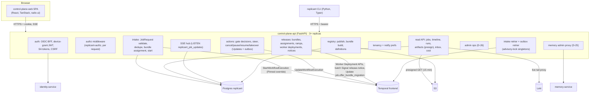

# Control-plane architecture

**Owner:** WS-07 · **Constraints:** D-02, D-03, D-09, D-18, D-19, D-23, D-25, D-26, §4 UX ·
**Contracts (final versions in FROZEN.md):** C-ARCH 2.0.0 (components `control-plane-web`, `control-plane-api`, `identity-service`,
integrations, `github-token-broker`, `publisher-worker`, `replicant-projector`), C-STATE 2.0.0 §2,
C-MSG 2.0.0, C-JOBREQ 2.0.0, C-DEF 3.0.0 §4, C-PG 2.0.0, C-ART 2.0.0 §5, C-IDS 2.0.0, C-RUNNER 3.0.0 · **API:** [api/control-plane-api.openapi.yaml](api/control-plane-api.openapi.yaml),
[api/github-token-broker.openapi.yaml](api/github-token-broker.openapi.yaml) · **DDL:** [data/](data/README.md)

## Purpose

Specify how the UI and CLI talk to Replicant: the frontend stack, the control-plane API and
its modules, how it reads Postgres read models and calls Temporal (start, Updates, Signals,
Worker Deployment operations), live updates, the authorization middleware, the projector that
maintains the read models, and the role of the Temporal UI.

## Decisions summary

| # | Decision | Reference |
|---|---|---|
| CP-1 | SPA in TypeScript: React 19.3, Vite 8.3, TanStack Router 1.170 / Query 5.104, `radix-ui` 1.8 primitives restyled with our tokens; no component-library theme | D-23, [design/components.md](design/components.md) |
| CP-2 | `control-plane-api`: Python 3.12, FastAPI 0.162, SQLAlchemy 2.1 (async, asyncpg 0.32), `temporalio` 1.34, `authlib` 1.9; modular monolith with per-schema DB roles | D-23, D-26, C-PG risk mitigation |
| CP-3 | Browser auth: BFF session cookie; CLI: Okta device grant bearer tokens | [ADR-07-006](adr/006-bff-session-and-device-flow.md) |
| CP-4 | **Server-Sent Events** for live updates; events carry IDs and sequence numbers only, never data; the client re-fetches through authorized GETs | [ADR-07-001](adr/001-sse-for-live-updates.md), C-STATE OQ |
| CP-5 | The UI reads only Postgres (`jobs_read`, `approvals`, `cost`, `registry`, `evals`, `tenancy`, `identity`); Temporal Queries only for explicit operator "refresh" and the decision pre-render digest check | ADR-004 |
| CP-6 | All human actions are Temporal Updates sent by control-plane-api through the `intake.pending_actions` outbox | C-MSG §3, ADR-001 |
| CP-7 | Authorization middleware: each route declares a permission; `replicant-authz` evaluates per request (no cached grants) | D-18, D-25, [identity.md](identity.md) §6 |
| CP-8 | Temporal UI is for `replicant-operators` only, behind Okta, with the codec server (`codec.<env>.replicant.internal`); cancel/terminate per C-MSG §1, reset is break-glass only (`replicant-operators`, CCR-01-08); the supported retry is `ops.retry_node` | C-MSG §1, R2-048 |
| CP-10 | Kill switches at global, tenant, repo, and bundle scope: S3 out-of-band mirror (with a worker ConfigMap copy), Temporal batch Signal `ops.kill_switch`, Postgres record, written in that order | C-STATE 1.8.0, C-MSG 1.5.0, R2-016 |
| CP-11 | Required tenant monthly and daily budgets with platform defaults and a platform-wide ceiling; per-PR repair-job cap | R2-055, R2-059 |
| CP-9 | Routine database work is exposed as named, audited admin operations (API + CLI + UI), never SQL | D-26 |



---

## 1. Frontend (`control-plane-web`)

| Concern | Choice (versions checked on npm 2026-10-24) |
|---|---|
| Framework | React 19.3.1, TypeScript (compiler `typescript` 7.0), Vite 8.3 |
| Routing | `@tanstack/react-router` 1.170 (typed routes, search-param state for filters) |
| Server state | `@tanstack/react-query` 5.104; query keys per resource; SSE events invalidate keys |
| API client | `openapi-typescript` 7.13 generates types from [api/control-plane-api.openapi.yaml](api/control-plane-api.openapi.yaml); `openapi-fetch` 0.17 |
| Primitives | `radix-ui` 1.8.1, `cmdk` 1.1.1 (restyle rules in components.md §1) |
| Styling | Plain CSS with custom properties from `tokens.css` (generated), CSS Modules per component, `stylelint` rules banning raw values |
| Code/diff | `shiki` 4.5 (token theme), `parse-diff` 0.12, `diff` 9.0, Web Workers |
| Live | `@microsoft/fetch-event-source` 2.0.1 (credentials, `Last-Event-ID`, backoff) |
| Tests | Vitest 5.0 (unit), Playwright 1.64 (e2e + visual regression against [design/screenshots/](design/screenshots/)), `axe-core` 4.14 |
| Delivery | Static bundle in an nginx `Deployment` (2 replicas) behind the same ALB host as the API (`/api/*` → control-plane-api) so cookies are first-party; CSP `default-src 'self'; script-src 'self'; style-src 'self'; img-src 'self' https://acme-replicant-prod-artifacts.s3.us-east-1.amazonaws.com; connect-src 'self'; frame-ancestors 'none'`; Trusted Types enforced (`require-trusted-types-for 'script'`) |

Route map (wireframes in [ui/](ui/README.md)):

| Route | Screen | Permission |
|---|---|---|
| `/jobs`, `/jobs?view=mine` | Job list | `job:read` (filtered per tenant/repo) |
| `/jobs/:jobId` (+ `/plan`, `/diff`, `/qa`, `/runs`, `/transcripts`, `/artifacts`) | Job detail | `job:read` |
| `/jobs/new` | New job form | `job:create` |
| `/approvals`, `/approvals/:gateId` | Inbox + packet | eligible, or `job:read` (read-only view) |
| `/releases`, `/releases/bundles/:rbId`, `/releases/workers` | Releases | `release:read` |
| `/registries/:kind`, `/registries/:kind/:name` | Registries | `release:read` |
| `/cost`, `/cost/tenants/:tenantId` | Cost and quotas | `cost:read` |
| `/admin/memory/*` | Memory curation | `memory:admin` (D-25) |
| `/releases?focus=failures&bundle=<short>&since=-24h` | Releases with the failure chart focused (alert link target, §9) | `release:read` |
| `/admin/kill-switches` | Kill switches | `ops:kill-switch` |
| `/admin/tenants`, `/admin/identity`, `/admin/ops` | Admin | `admin:platform` / `identity:admin` |
| `/tenant/:tenantId/settings` | Tenant settings | `tenant:ops:edit` (view: tenant members) |
| `/link/:channel` | Identity link flows | signed in |

## 2. Backend (`control-plane-api`)

### 2.1 Modules and database roles

control-plane-api connects with **one login role, `svc_control_plane_api`, in one pool**. Its modules
`SET ROLE` per transaction to WS-10's NOLOGIN module roles (`10-data-platform/ddl/10-roles-and-grants.sql`),
which limits each module's write blast radius (the C-PG "four schemas" mitigation) without four pools:

| Module | `SET ROLE` (NOLOGIN, WS-10) | Writes | Reads |
|---|---|---|---|
| intake, human-action outbox | `svc_cpa_intake` | `intake` | `registry`, `tenancy`, `identity` |
| tenancy, kill switches, quotas | `svc_cpa_tenancy` | `tenancy` | `identity` |
| registry, releases | `svc_cpa_registry` | `registry` | `evals`, `jobs_read` (grants: XD-10, R1-160) |
| notify | `svc_cpa_notify` | `notify` | — |
| read API, SSE, search | `svc_cpa_read` (inherited by the login) | — | `jobs_read`, `approvals`, `cost`, `registry`, `evals`, `tenancy`, `identity` (columns WS-07 grants), `audit` views |

Row-level security uses WS-10's `ops.apply_tenant_rls()` on every tenant table and the **canonical**
`replicant.principal_scope` vocabulary (WS-10 schema-management §4.2; C-PG 1.2.0 rule 4). Every request sets
`replicant.tenant_id` for tenant-scoped reads and writes. Operator routes (`release:*`, `admin:platform`,
`audit:read`) set `replicant.principal_scope = 'operator:all-tenants'`, which is honoured only through the
`r_cross_tenant_read` membership WS-10 grants to `svc_control_plane_api` and only for SELECT. No WS-07
policy or role uses the earlier `platform`/`projector` scopes or `svc_cpa_ops_read` (R1-159). The projector
sets `replicant.tenant_id` per event transaction, so it needs no cross-tenant scope.

### 2.2 Request pipeline

`TraceMiddleware` (OTel, `traceparent`) → `RequestId` (`X-Request-Id`, ULID) → `AuthN` (cookie |
bearer | SA token) → `CSRF` (non-GET with cookie) → `RateLimit` (per principal: 20 req/s burst
40; per `(principal, job)` Updates 1/s, C-MSG §3) → route `Depends(require(<permission>,
resource=...))` → handler → RFC 9457 problem responses with `code`, `request_id`, and (on 403)
`audit_id`.

```python
# control_plane_api/authz.py
from fastapi import Depends, HTTPException, Request
from replicant_authz import Request as AzRequest, evaluate, Decision

def require(action: str, *, tenant_from=None, repos_from=None, gate_from=None):
    async def dep(request: Request, principal=Depends(current_principal), ctx=Depends(authz_ctx)):
        res = await evaluate(AzRequest(
            principal_id=principal.id, action=action,
            tenant_id=await tenant_from(request) if tenant_from else None,
            repos=tuple(await repos_from(request)) if repos_from else (),
            job_requester=await job_requester(request) if gate_from else None,
            gate=await gate_from(request) if gate_from else None), ctx)
        if res.decision is Decision.DENY:
            audit_id = await ctx.audit.emit(type="authz.denied", actor=principal.id, action=action,
                                            resource=request.url.path, reason=res.reason)
            # 404 for job-scoped reads (no existence leak); 403 elsewhere
            raise ProblemError(status=404 if action == "job:read" else 403, code=res.reason, audit_id=audit_id)
        request.state.authz = res
        return res
    return Depends(dep)
```

A startup check walks `app.routes` and fails fast if any route lacks a `require(...)`
dependency (explicit `public=True` for `/healthz`, `/auth/*`), and if any route under
`/v1/admin/memory` does not require exactly `memory:admin` (D-25).

### 2.3 Intake (`POST /v1/jobs`)

1. Validate the body against C-JOBREQ 2.0.0 (`jsonschema` with the frozen schema file; Pydantic models
   generated from it for typing).
2. **Kill switch** (R2-016): read the effective `intake` switch for (global, tenant, each target repo)
   from Postgres, or from the out-of-band mirror when Postgres is unavailable (§2.9). `paused` returns
   409 `intake_paused`; `closed` returns 403 `intake_closed`. The reason is shown in the channel.
3. Authenticate the submitter. A person (UI/CLI) must have `principal_id == requester.principal_id`.
   A service principal may submit only for its channel (R1-161):

   | Service principal | `source.channel` | Requester rule |
   |---|---|---|
   | `svc_github-integration` | `github` | linked `usr_` |
   | `svc_slack-integration` | `slack` | linked `usr_` |
   | `svc_jira-integration` | `jira` | linked `usr_` |
   | `svc_scheduler` (via `ScheduledIntake`) | `schedule` | `kind=service` + `on_behalf_of` |
   | `svc_eval-worker` | `eval` | `kind=service` + `on_behalf_of`; `options.evaluation.mode=eval` |
   | `svc_release-controller` | `eval` only (eval cases and shadow jobs; WS-06 promotion.md §5.2, R1V-032) | `kind=service` + `on_behalf_of`; `options.evaluation.mode=eval\|shadow` |

4. Authorize the **requester** (or `on_behalf_of`): `job:create` on each target repo with the live repo
   permission (identity.md §6). Eval jobs target the golden repos on
   `git.eval.<env>.replicant.internal`; their permission source is the identity-service grant of `read` to
   `replicant-release-operators` on `git.eval.<env>.replicant.internal/golden/*` (XD-06-07, identity.md §6.2). Shadow
   jobs copy the live job's real targets and are authorized as `on_behalf_of` = that job's requester, with the
   normal live repo check (WS-06 promotion.md §5.2, XD-FIX-R1-133; R1V-140).
   `requested_release_bundle_id` requires `release:pin`; `priority=urgent` requires
   `workflow_type=hotfix` and the hotfix permission.
5. **Quota** (R2-055): the tenant's `quotas.monthly_budget_usd` and `daily_budget_usd` are required
   settings (tenant default from `tenancy.platform_caps`). Intake refuses with 429 `tenant_budget_exhausted`
   (reset time in the body) when the cost ledger says the tenant is over its monthly or daily budget, and
   with 429 `platform_budget_exhausted` when platform spend for the day exceeds `platform_daily_usd_max`.
   The gateway shim enforces the same limits in real time from `GET /internal/v1/tenants/{t}/gateway-quota`
   (XD-03-13, XD-FIX-R2-055); a tenant without a resolvable quota is denied (`tenant_quota_unset`), never
   unlimited.
6. **Per-PR repair cap** (R2-059): for `workflow_type=pr_repair`, count earlier jobs with the same
   `(pr_repo_id, pr_number)` (index `job_requests_pr`). At `repair_limits.max_pr_repair_jobs_per_pr`
   (bundle policy, default 3; floor `pr_repair_jobs_per_pr_max` in `platform_caps`) intake returns 409
   `pr_repair_cap_reached`, and github-integration replies on the PR with the cap and the "take over" link.
   The PR's cumulative spend across those jobs is also checked against `spec.prLifetimeUsd` of WS-03's `policy-budgets.schema.json` (default 300 USD, tenants may only lower it; R1V-116)
   (XD-FIX-R2-059).
7. In one transaction (`SET ROLE svc_cpa_intake`): `INSERT … ON CONFLICT (tenant_id, dedupe_key) DO
   NOTHING RETURNING job_id`; on conflict, `SELECT` the existing row and return **200** with it
   (C-JOBREQ). If WS-06's `resolve()` raises `AssignmentError`, the transaction is rolled back and intake
   answers **503 `bundle_unresolvable`** with `Retry-After: 30` and **no intake row**; channel adapters retry from
   their outbox with the same `dedupe_key`; counter `replicant_intake_bundle_unresolvable_total{env,tenant,reason}`.
   There is never a fallback to `default` (it would drop tenant layers; XD-FIX-R1-137), and there is no
   fallback `assignment_reason` (WS-01 confirms in XD-W2-01-03). Shadow requests
   (XD-FIX-R1-133) are accepted only from `{kind: service, principal_id: svc_release-controller, on_behalf_of: <the
   original requester>}` with `options.evaluation = {mode: shadow, shadow_of_job_id, pipeline_id}` and a
   `requested_release_bundle_id` in state `shadowing` that is the candidate or its derived bundle for the job's
   tenant; the D-18 repository check uses `on_behalf_of`. Otherwise mint `job_id` (ULID), resolve the bundle with WS-06's `resolve()` (C-DEF 2.4.0
   §4.5, reading `registry.bundle_assignments` in the same transaction), store `release_bundle_id`,
   `assignment_reason` (grammar in intake.sql, R1-158), `release_cohort` (C-IDS 1.11.0 §11 set: `eval` or
   `shadow` from `options.evaluation`, otherwise WS-06's cohort), `start_status='pending'`, and
   `audit.emit(job.requested)`.
8. After commit (the workflow is never started inside the intake transaction; XD-FIX-R2-048a), register the
   job's **budget account** with WS-03's gateway for eval, harness, shadow and proposer jobs:
   `PUT /internal/v1/budgets/jobs/{job_id} {account: fgw:eval:<eval_run_id> | fgw:pipeline:<pipeline_id> |
   fgw:proposal:<prop_id>, cap_usd, evaluation_mode?}` (`evaluation_mode` defaults by prefix: `fgw:eval:` and
   `fgw:proposal:` → `eval`, `fgw:pipeline:` → `shadow`; `409 account_cap_conflict` if the account was registered
   with another cap, which intake surfaces as an alert, never a silent overwrite; XD-W2-03-05), retried until done before the workflow's first run; such spend is not
   charged to the tenant quota (XD-FIX-R2-061, XD-FIX-R1-133). Then **register the job's tenant with the tenant-routed codec** (`TenantContextCodec`,
   XD-01-08: `codec.register(job_id, tenant_id)` before any Start, Update, or Signal; the codec fails closed
   otherwise), then start the workflow. `workflow_type=maintenance` with `target_selector` starts
   **`MaintenanceBatch`**; everything else starts `ReplicantJob` (XD-01-12):
   `client.start_workflow(<type>, input, id=job_id, task_queue="replicant-jobs",
   id_conflict_policy=WorkflowIDConflictPolicy.USE_EXISTING,
   id_reuse_policy=WorkflowIDReusePolicy.REJECT_DUPLICATE,
   versioning_override=PinnedVersioningOverride(WorkerDeploymentVersion("replicant-worker", build_id)),
   search_attributes=…)`. Mark `start_status='started'`. On failure leave `pending`: the intake retrier
   (singleton, every 5 s) restarts pending rows; `USE_EXISTING` makes retries idempotent.
9. Return **201** `{job_id, status: "queued", links}` and start the job root span with a link to
   `trace_context` (C-IDS T-2). For jobs with `related.eval_case`, copy WS-06's Langfuse experiment
   attributes onto the root span (`langfuse.experiment.id`, `.name`, `.dataset.id`, `.item.id`,
   `.item.root_observation_id`, `.item.version`; XD-06-05, R1-171).

Every Replicant Temporal client in WS-07 services (control-plane-api, github-integration, publisher-worker,
replicant-projector) is created by WS-01's `replicant_temporal.connect()` with `plugins=[OpenTelemetryPlugin()]`,
`interceptors=[ReplicantContextInterceptor()]` (WS-08) and `header_codec_behavior=NO_CODEC` (XD-FIX-R1-016).
Locally every WS-07 Python service uses the boto3 default credential chain, so the shared-credentials file in
`AWS_SHARED_CREDENTIALS_FILE` (identity `replicant-services`) works without code changes (XD-W2-11-07).

The codec registration also runs in every other sender: before each Update and Signal from
control-plane-api (looking up the tenant from `intake.job_requests`) and in github-integration before
`pr.event` (github-app.md §3.4). The codec host is `codec.<env>.replicant.internal` (WS-01
temporal-platform.md), used by the Temporal UI too (§6).

### 2.4 Human actions (Updates)

| Endpoint | Update | ID |
|---|---|---|
| `POST /v1/gates/{gate_id}/decisions` | `gate.decide` | `decision_id = derived("dec", "ui"|"cli", Idempotency-Key)` |
| `POST /v1/jobs/{job_id}/steering` | `job.steer` | `message_id` (client ULID) |
| `POST /v1/jobs/{job_id}:cancel` / `:pause` / `:resume` / `:takeover` | `job.cancel` / `job.pause` / `job.resume` / `job.takeover` | `action_id` (client ULID) |
| `POST /v1/releases/bundles/{rb}:offer-migration` (per job or batch) | `job.offer_bundle_migration` | `action_id` |
| `POST /v1/jobs/{job_id}:batch-cancel` (MaintenanceBatch parent) | `batch.cancel` | `action_id` |
| `POST /v1/admin/ops/jobs/{job_id}:retry-node` | `ops.retry_node` (C-MSG 2.0.0) | `action_id` (`opr_` ULID) |
| `POST /v1/releases/pipelines/{rpl}/signoffs`, `:abort`, `:hold` (WS-06 paths) | `release.signoff` / `release.abort` / `release.hold` on `ReleasePipeline` | `decision_id` / `action_id` |

Outbox protocol (C-MSG §3): insert `intake.pending_actions(action_ref, kind, workflow_id, payload,
state='pending', next_attempt_at=now())` (the target is a `job_…` or `rpl_…` workflow ID, so release
sign-offs get the same at-least-once delivery, R1-174), call `execute_update(…, id=…, rpc_timeout=10 s)`; on
result write `state='done'` and `result`. On timeout or `Unavailable`, return **202
`{state: "recording"}`** and let the outbox retrier (every 2 s, exponential to 2 min) continue with
the same ID. The UI shows "Recording…" and receives the outcome via SSE (`action.completed`
event with the `action_id`).

On an accepted `job.cancel` or `job.takeover`, control-plane-api also calls WS-03's gateway
`POST /internal/v1/revocations {job_id, reason: cancelled|taken_over}` (XD-03-13, gateway.md GW-11), so model
access stops within 5 s instead of waiting for `/grants/revoked` polling; the call is retried from the outbox
until it succeeds (R1V-147).

### 2.5 Release operations

WS-06 specifies the release API ([releases.openapi.yaml](../06-releases-and-evals/api/releases.openapi.yaml),
[promotion.md](../06-releases-and-evals/promotion.md)); control-plane-api implements it as the single writer of
`registry` (C-PG), and this section states how WS-07 implements and presents it.

| Operation (WS-06 path) | Implementation in control-plane-api | UI |
|---|---|---|
| `POST /v1/registry/bundles:build` | Resolution algorithm C-DEF §4.3; optional `start_pipeline` | Releases → Bundles "Build" (operators) and CI |
| `POST /v1/releases/pipelines` | Starts the `ReleasePipeline` workflow (eval-worker, `rpl_<ulid>`) | Bundle panel "Start pipeline" |
| `POST /v1/releases/pipelines/{id}/signoffs` | Update `release.signoff` (Update ID = `decision_id`), same outbox and stale-digest rules as gates; the evidence packet digest is `presented_digest`. Two-person rule, author exclusion, and live group checks run in the pipeline's handler activity (WS-06 §10) | **Approvals inbox, view "Release sign-offs"** for `replicant-release-managers` / `replicant-security`, with the evidence packet; shows "1 of 2 signers" and who signed |
| `POST /v1/releases/pipelines/{id}:abort`, `release.hold` (pause/resume) | Updates `release.abort` / `release.hold` with `action_id` | Bundle panel: "Abort pipeline", "Resume with reason" |
| `GET /v1/releases/{env}/assignment`, `PUT/DELETE …/assignment/ramps/{slot}` (slot 0–2, `Assignment.ramps[]` max 3; C-DEF 3.0.0, XD-FIX-R1-132), `…/tenant-overrides/{t}` | Versioned rows in `registry.bundle_assignments` with `If-Match`; applied by the next intake transaction | Assignment view; operators normally let the pipeline drive the ramp |
| `POST /v1/releases/{env}/assignment:rollback` | One call, no `If-Match`; `migrate_running ∈ {none, offer, required, required_by_operator}` (required, no default); resets Temporal current version when needed | "Roll back…" dialog ([releases-rollback-dialog screenshots](design/screenshots/)) |
| `POST /v1/releases/bundles/{rb}:revoke` | Promotion state → `revoked`, batch Signal `release.notice(bundle_revoked)`, then `job.offer_bundle_migration(required=true)` | Inside the rollback dialog (third option) or bundle menu |
| `POST /v1/releases/bundles/{rb}:transition` | Service principals only (`svc_eval-worker`, `svc_release-controller`) | — |

WS-07-only operations (this service's OpenAPI): `GET /v1/releases/bundles` (grouped list with
failure rates and pinned counts), `GET /v1/releases/bundles/{rb}/failures` (chart and table view),
`POST /v1/releases/bundles/{rb}:offer-migration` (per-job `job.offer_bundle_migration`, rate-limited
20/s, dry run first), and worker-version operations: `…/workers/{build}:set-current`
(`SetWorkerDeploymentCurrentVersion` with `conflict_token`), `:drain-notice` (batch Signal
`release.notice(worker_version_draining)` to `TemporalWorkerDeploymentVersion = 'replicant-worker:<build>' AND
ExecutionStatus='Running'`), `:retire` (only when the visibility count of pinned workflows has been 0 for
24 h; `DeleteWorkerDeploymentVersion` `[unverified: exact client method name in temporalio 1.34; WS-01 confirms]`;
the Deployment is scaled down through the GitOps repo).

Guardrails (WS-06 §6.2, R1–R10) are evaluated by the pipeline every 10 minutes; a pause freezes the
ramp and pages release on-call; the releases screen shows the trigger, its numbers (observed delta,
posterior P(worse), n), and the automatic-rollback deadline. Pinned-job counts per bundle and worker
build come from the projection (`jobs_read.v_pinned_counts`), not from Temporal visibility, so the page
load stays inside C-STATE §2's "Postgres only" rule (R1-188). Visibility counts are used only by the
`:retire` precondition (an explicit operator action, C-STATE §2 exception 3).

Right-sizing proposals (WS-03 `profile-rightsizer`): listed under Registries → Environments with the
evidence table and estimated cost delta (`GET /v1/registry/rightsizing-proposals`); the human approval
is the CODEOWNERS review of the config-repo PR the proposal becomes, so the UI's "Review" action opens
that PR and shows its state. No proposal changes a profile without that merge and a new bundle.

### 2.6 Reading the read models

All list/detail queries hit `jobs_read`/`approvals` with the indexes defined in
[data/ddl/jobs_read.sql](data/ddl/jobs_read.sql) and [data/ddl/approvals.sql](data/ddl/approvals.sql).
Cost columns come from `cost.job_rollups` (WS-03 owns DDL) joined by `job_id`. Responses carry
`X-Replicant-Projection-Seq` and `X-Replicant-Projection-Lag-Seconds` (now − `jobs.as_of` for running
jobs) so the UI can show the stale banner (components.md §9).

For tenants of isolation class `restricted`, Langfuse has no spans (WS-08 ADR-003, XD-FIX-R2-009), so the job
LLM view renders from the S3 transcript instead of `llm-observations`. The releases route
`/releases?focus=failures&deployment_version=<v>` (target of WS-08's `ReplicantJobFailureRateByVersion`) is served
alongside `&bundle=` (XD-FIX-R1-195). Cost reads use exactly `cost.job_rollups` and `cost.rightsizing_proposals`
(XD-FIX-R1-078), plus `cost.v_daily_spend` and `cost.v_pr_spend` for intake's budget and per-PR checks
(XD-W2-03-05). All four are `security_invoker` views under FORCE RLS: control-plane-api reads them in a
transaction that sets `replicant.tenant_id` (or principal scope `operator:all-tenants` for operator views);
the platform-wide daily ceiling uses the operator scope. The projector fills `jobs_read.jobs.pr_repo_id` and
`pr_number` (from `intake.job_requests` for `pr_repair`, otherwise from `JobSnapshot.pull_request`), which
WS-03's usage ingestor copies into `cost.job_costs.repo_id` and `pr_number`.

Exceptions to "Postgres only" (C-STATE §2): artifact bodies via presigned GET (15 min, audited,
C-ART §5), live transcript tail from Loki (`GET /v1/jobs/{job_id}/runs/{run_id}/live`, SSE,
LogQL `{service="replicant-sandbox", tenant="payments", source="transcript"} | run_id="run_…"`
using structured metadata; the LogQL is always built server-side with a fixed `{tenant="<t>"}` selector from the authorized job, and no endpoint accepts user-supplied LogQL (WS-09 control-review G-08); tenant users get no direct Loki access), operator `POST /v1/admin/ops/jobs/{job_id}:refresh` (Query
`job.snapshot` → synthetic projection). Job logs (`GET /v1/jobs/{job_id}/logs`) and the job LLM view
(`GET /v1/jobs/{job_id}/llm-observations`, Langfuse observations by trace ID after job authorization) use
WS-08's fixed-selector query builder (XD-08-06); the projector also runs WS-08's `projection.redact_text`
before storing any summary text.

### 2.7 Run grants: JWKS and revocation list

control-plane-api also serves, on the internal host `grants.<env>.replicant.internal` (C-ARCH 1.2.0):
`/.well-known/jwks.json` (public keys of the KMS `run-grant` key class; the signing happens in the
Runner-call activity, WS-01/WS-09) and `/grants/revoked` (C-STATE 1.2.0: `job_id`s whose status became
`cancelled`, `failed`, or `taken_over`, and `run_id`s cancelled or terminal with `SecurityViolation`, read
from `jobs_read`; `ETag` + `Cache-Control: max-age=30`; verifiers poll every 60 s). The list is derived
(C-STATE rule 5) and bounded by projection lag + 60 s; entries are dropped 24 h after the last possible grant
`exp`. Served by a separate, minimal ASGI app in the same image on its own Service and NetworkPolicy so
that exec-side verifiers (through PrivateLink) reach nothing else of the API. Entrypoint
`control-plane-api serve-grants --port <p>`; env `REPLICANT_RUN_GRANT_JWKS_SOURCE=file|kms` (`file` reads the JWK
Set at `REPLICANT_RUN_GRANT_JWKS_FILE`); locally the compose service `run-grants` at `grants.replicant.localhost:8403`
(XD-FIX-R1-253). `/grants/revoked` also merges the exec revocation feed: control-plane-api polls runner-api
`GET /v1/revocations?since=<cursor>` (orchestration listener, audience `revocations`, C-RUNNER 3.0.0) every 10 s and
lists those `run_id`s until the run appears from the projection. It never reads the ops bucket (the corrected
XD-W2-09-02 row; R1V-049, XD-W3-R1V-049). The control-plane-api and identity-service Dockerfiles have build targets `prod` (default) and
`dev` (= `prod` plus package `replicant_dev_auth` only; XD-FIX-R1-259).

### 2.8 Ramp safety and evaluation jobs

- **Ramps are `ramps[]`** (C-DEF 3.0.0, XD-FIX-R1-132): up to three slots, 0–1 canary or experiment and 2 the
  holdback at buckets `[9500, 10000)`; the releases screen shows one row per slot. The one-build-ramp limit is
  lifted (V06-14 verified). The only precondition shown before a ramp is "candidate worker build registered on
  all task queues" (`409 worker_build_not_registered` from `setRamp`; XD-FIX-R1-136); there is no "0% ramping
  version" step. Stopping candidate traffic sets that ramp's `percent` to 0; `release.hold` freezes stage
  progression only (XD-FIX-R1-137b).
- **Release events and metrics** (XD-FIX-R1-144, R1-140): control-plane-api `LISTEN replicant_release_updates`
  (payload `<env>:<pipeline_id>:<seq>`) and fans out SSE `release.changed {pipeline_id, seq}`; the sign-off view
  loads `GET /v1/releases/pipelines/{id}/evidence/{signoff_point}` (served from the eval bucket with the packet
  digest as `ETag`), sends that digest as `presented_digest`, and reloads on `release.changed`. control-plane-api
  emits `replicant_release_rollback_failures_total{env,reason}`, `replicant_intake_bundle_unresolvable_total{env,tenant,reason}`,
  `replicant_release_prompt_version_deleted_total{env}`, and the histograms `replicant_release_rollback_duration_seconds`
  and `replicant_release_rollback_effective_seconds{env}`. Tenant admins hold `release:signoff_tenant_layer` for their
  own tenant only (checked in `check-release-signoff` against the derived bundle's `tenant_id`, XD-FIX-R1-145).
- **Eval curation** (XD-FIX-R1-142): Okta group `replicant-eval-curators` → permission `eval:curate`. control-plane-api
  serves WS-06's `POST /v1/evals/labels`, `GET /v1/evals/labeling-queue`, `POST /v1/evals/golden-tasks/{id}:verify`
  and `:transition` (erase also needs `release:operate`) by forwarding over mTLS to eval-worker
  `/internal/v1/evals/…` (caller allowlist: control-plane-api). The Labeling screen is blind (no judge output, no arm).
- **Model retirement calendar** (XD-ORCH-01): the releases screen lists `GET /v1/releases/model-retirements` with
  the bundles that use each retiring model and the successor mapping state.
- **Unpinned selectors resolve to registry head** (C-DEF 2.1.0). The registry screens show the head
  marker per name; the bundle build preview states which head each selector resolved to.
- **Evaluation and shadow jobs** (C-JOBREQ 1.2.0 `options.evaluation`, C-MSG 1.2.0
  `JobSnapshot.evaluation`) are excluded by default from job lists, inbox counts, notifications, cost
  views, and the failure chart's control cohort; `include_evaluation` brings them back, and their rows carry
  an `eval`/`shadow` tag. They never page approvers.

### 2.9 Kill switches (R2-016; C-STATE 1.8.0, C-MSG 1.5.0 `ops.kill_switch`)

| Element | Design |
|---|---|
| Scopes and switches | `scope ∈ {global, tenant, repo, bundle}`; switches `intake` (open/paused/closed, enforced by intake only), `starts`, `runs`, `publishing` (open/paused). The most restrictive engaged switch across the matching scopes applies |
| API | `PUT /v1/admin/kill-switches/{scope}/{scope_value}` (`global` uses `*`), body `{intake?, starts?, runs?, publishing?, reason_code, note?}` with `reason_code ∈ {incident, security, cost, drill, maintenance}`; `GET /v1/admin/kill-switches`. Permission `ops:kill-switch` (bound to `replicant-operators` and `replicant-release-operators`; tenant admins hold it for their own tenant and repos only). Audited |
| Order on engage or release | Mirror first, then Signal, then Postgres (WS-09 secrets.md §12, XD-FIX-R2-016), so that a Postgres outage never blocks a kill switch |
| 1. Out-of-band mirror | One versioned S3 object `s3://acme-replicant-<env>-ops/kill-switches/v1/state.json`, schema `replicant.kill-switches/v1` (complete state, never a delta: `{schema, generation, updated_at, switches: [{scope, scope_value, mode, engaged, notice_id, issued_at, issued_by, reason_code}]}`), SSE-KMS `alias/replicant/<env>/ops`. control-plane-api is the only writer, with compare-and-swap (`If-Match: <etag>`, `If-None-Match: *` on first write; a 412 re-reads and retries, max 5). In the same operation it writes ConfigMap `replicant-workers/replicant-kill-switches` (key `state.json`, same body); readers take the higher `generation`. Readers (replicant-worker `ops.read_kill_switches` and before `runner.start_run`, publisher-worker before every push, eval-worker, intake, channel integrations, runner-api) cache ≤ 30 s and fail closed for `starts` and `publishing` when their copy is older than 5 min. Locally the mirror is the same `ops` bucket key `kill-switches/v1/state.json` in the local S3 store (XD-W2-11-06 withdraws XD-11-16's shared-volume file) |
| 2. Running workflows | Temporal batch Signal `ops.kill_switch` (`KillSwitchSignal`, one per changed mode, `notice_id` ULID) over the visibility query for the scope: `ExecutionStatus='Running' AND WorkflowType IN ('ReplicantJob','MaintenanceBatch')` plus `ReplicantTenantId = 't'`, `ReplicantRepos = '<host>/<owner>/<name>'`, or `ReplicantReleaseBundleId = 'rb_…'`. Independent of Postgres |
| 3. Record | Upsert `tenancy.kill_switches` (one row per scope, scope value and mode; authoritative history and the UI's source, C-STATE 1.8.0) with `mirror_generation` and `signal_batch_job_id`. Free-text `note` lives only here and in the audit event |
| Postgres down | Steps 1 and 2 still succeed and the API returns `202` with `record_pending: true`; the reconciler writes the row when Postgres returns (`source='out_of_band_backfill'` when the mirror was written by the break-glass CLI path `replicant admin kill-switch set --break-glass --ticket INC-<n> --duration <≤ 4h>`, which assumes IAM role `replicant-<env>-killswitch-operator` (prod `replicant-prod-killswitch-operator`, CCR-09-12, XD-W2-09-03) with session tags `breakglass-ticket=INC-<n>` and an expiry (`DurationSeconds` ≤ the requested duration); the CLI refuses without an `INC-*` ticket, and the ticket is recorded on the back-filled row and the audit event and the Temporal client directly). The reconciler compares mirror and table every 60 s and exports `replicant_kill_switch_mirror_generation` (the S3 mirror's `generation`) and `replicant_kill_switch_recorded_generation` (highest `tenancy.kill_switches.mirror_generation`), which WS-08's `ReplicantKillSwitchMirrorDrift` compares (XD-W2-08-01). Tenancy gauges for Grafana use only C-IDS §11 label keys: `replicant_tenants{status}`, `replicant_kill_switches_engaged{kind,type}` (`kind` = scope `global`/`tenant`/`repo`/`bundle`, `type` = mode), `replicant_platform_cap_usd{kind}` (`kind` = cap name) (XD-W3-R1V-054) |
| Effects | `starts`: no new `runner.start_run` (job sub-status `kill_switch_starts`, "Waiting: starts paused by operators"). `runs`: active runs cancelled with reason `operator`, job held. `publishing`: publisher activities raise retryable `PublishingPaused` (job shows "Publishing paused by operators", sub-status `kill_switch_publishing`); approved gates stay approved and publish when released. Released switches resume at the next safe point |
| UI | Admin → Kill switches (one table across scopes with state, reason, who, when, mirror version and the Signal batch status) and a red global banner when any global or tenant switch is engaged |

### 2.10 Spend limits (R2-055)

Tenant settings require `quotas.monthly_budget_usd` and `quotas.daily_budget_usd`; onboarding fills
them from `platform_caps.tenant_monthly_usd_default` / `tenant_daily_usd_default`, and tenant admins may
set values up to `*_max`. `platform_daily_usd_max` and `platform_monthly_usd_max` bound the whole
installation. control-plane-api serves `GET /internal/v1/tenants/{tenant_id}/gateway-quota` to the
gateway shim (caller `svc_replicant-gateway-shim` only):
`{tenant_id, monthly_budget_usd, daily_budget_usd, platform_daily_usd_max, platform_monthly_usd_max,
version, as_of}`; an unset tenant is impossible by schema, and an unknown tenant returns 404, which the
shim treats as deny (`tenant_quota_unset`).

## 3. Projector (`replicant-projector`)

Worker for task queue `replicant-projections`, activity `projection.apply(ProjectionEvent)`
(C-STATE §2.1; DDL in [data/ddl/jobs_read.sql](data/ddl/jobs_read.sql)):

```python
GATE_AUDIT_TYPES = ("gate.opened", "gate.decided", "gate.decision_denied", "gate.decision_superseded",
                    "gate.decision_recorded", "gate.expired", "gate.reminded", "gate.escalated")


@activity.defn(name="projection.apply")
async def apply(ev: ProjectionEvent) -> None:
    snap = ev.snapshot
    # C-MSG 1.5.0: accept both the single `event` and the batched `events[]` (CCR-01-05).
    items = ev.events or [TimelineItem(seq=ev.seq, event=ev.event)]
    async with engine.begin() as tx:                      # role svc_replicant_projector
        await tx.execute(text("SELECT set_config('replicant.tenant_id', :t, true)"), {"t": ev.tenant_id})
        new_rows = []
        for it in items:                                  # one timeline row per element, idempotent
            res = await tx.execute(
                insert(JobTimeline).values(job_id=ev.job_id, seq=it.seq, tenant_id=ev.tenant_id,
                    type=it.event.type, at=it.event.at, summary=await redact(it.event.summary),
                    actor=it.event.actor, refs=it.event.refs)
                .on_conflict_do_nothing(index_elements=["job_id", "seq"]).returning(JobTimeline.seq))
            if res.first() is not None:
                new_rows.append(it)
        # C-STATE §2.1: audit every gate and decision event exactly once, independent of the snapshot
        # seq guard. "Newly inserted timeline row" is the once-only key (ON CONFLICT above).
        for it in new_rows:
            if it.event.type in GATE_AUDIT_TYPES:
                await audit_emit(tx, ev.job_id, ev.tenant_id, it)        # audit.emit(), same transaction
        # The seq guard applies to the snapshot (and the rows derived from it) only.
        res = await tx.execute(upsert_job_stmt(snap).where(Job.seq < snap.seq))
        if res.rowcount:
            await sync_children(tx, snap)   # job_runs, job_prs, job_memory_usage (snapshot id only, R1-099), job_steering,
                                            # approvals.gates/eligibility/gate_decisions (decision_log, CCR-07-07)
            await emit_online_metrics(snap, new_rows)    # XD-06-08: replicant_jobs_terminal_total etc., once per transition
        await tx.execute(text("SELECT pg_notify('replicant_job_updates', :p)"),
                         {"p": f"{ev.tenant_id}:{ev.job_id}:{snap.seq}"})
```

`emit_online_metrics` increments, exactly once per newly inserted `job.terminal` timeline row,
`replicant_jobs_terminal_total{env, tenant, workflow_type, outcome, release_cohort, bundle,
deployment_version}` (labels allowed by C-IDS 1.11.0 §11; `bundle` is the 12-character base bundle short
ID or `other`). The once-only key is the timeline insert, so redelivery never double-counts.

Snapshot mapping rules added in wave 2:

- `JobSnapshot.waiting` (C-MSG 1.7.1) → `jobs.sub_status` = `waiting_capacity_tenant` (`tenant_run_quota`),
  `waiting_capacity_cluster`, `tenant_budget_exhausted`, `platform_budget_exhausted`, `dependency_outage`,
  `operator_hold`, `bundle_revoked`, with the object copied to `sub_status_detail`; budget and capacity waits are
  excluded from `needs_human`.
- `MaintenanceBatch` snapshots (`workflow_type: maintenance`, phases `fan_out`, `done`) create or update the
  `jobs_read.batches` row (status, phase, title, requester); `children_total` and `children_by_status` are computed
  from child `jobs_read.jobs` rows with `parent_job_id`, never from the `batch.snapshot` Query (XD-FIX-R1-010).
- The timeline event WS-01 emits when it schedules `artifacts.expire_session_state` (WS-01 decides the name and
  carries the due time in `refs.purge_due_at`, computed from the bundle's `sessionStateGraceDays`; R1V-010) sets
  `jobs.session_purge_due_at`, shown on the job page; the retention sweeper never reads it
  (XD-FIX-R1-238).
- `GateView.qa_reruns_used` and `GateView.release_block` (C-MSG 2.0.0) are copied to `approvals.gates`;
  `decision_log[]` rows to `approvals.gate_decisions` (channel ∈ the shared `decision_channel` enum: `ui`, `cli`,
  `api`, `slack`, `github`, `gitea`, `system`; there is no Jira decision channel).
- `JobSnapshot.memory_snapshot_id` → one `jobs_read.job_memory_usage` row per (job, snapshot) (R1-099).
- Timeline events `pr.opened`, `pr.merged`, `pr.closed` set `jobs_read.job_prs.opened_at`, `merged_at`, `closed_at`;
  for QA runs the projector copies `role_result.verdict` into `jobs_read.job_runs.qa_verdict` (never derived from
  `result_outcome`, whose values are C-RUNNER 3.0.0's `completed`, `no_changes`, `blocked`, `failed`). WS-06's
  30-day PR merge rate and QA first-pass rate read these columns (XD-W2-06-03, XD-FIX-R1-116 erratum).
- The projection reconciler exports `replicant_jobs_held{tenant,kind}` (`kind="dependency"`: status `paused` whose
  latest event is `job.blocked_on_dependency`) for `ReplicantJobsHeldOnDependency`, and `replicant_jobs_stalled{tenant}`
  = jobs that are not terminal, have no `waiting`, and whose `jobs.last_progress_at` is more than 30 min old
  (XD-W2-08-01).
- `waiting.reason = cluster_capacity` is set by WS-01 after a run has been `Pending` with `Scheduled=False` for
  60 s; the Runner has no queue, so there is no queue position (XD-W2-02-04 ruling).

Reconciler restore branch (XD-10-14): while an `ops.restore_events` row is open, a job whose stored
`jobs.seq` is **greater** than its `ReplicantProjectionSeq` ("Postgres ahead of Temporal") is repaired by
deleting `job_timeline` rows with `seq > ReplicantProjectionSeq` and overwriting the snapshot from Query
`job.snapshot` (bypassing the seq guard, audited as `projection.restore_repair`).

Compatibility: accepts every `replicant.job-snapshot/v*` emitted by any live worker version for
≥ 37 days (CC-4); unknown optional fields are kept in `jobs.snapshot` (JSONB). Rebuild:
`replicant admin projections rebuild --since <ts> [--job <id>] [--reset-seq]` (C-PG rule 5) runs as the
`ProjectionRebuild` system workflow (C-IDS 1.11.0, CCR-07-03 accepted; ID `sys:projection-rebuild:<ulid>`,
task queue `replicant-projections`). `--reset-seq` (restore only) truncates the job's projection rows first.

## 4. Route → permission map (excerpt; the full map is the `x-replicant-permission` extension on every OpenAPI operation)

| Route | Permission | Resource scoping |
|---|---|---|
| `GET /v1/jobs`, `GET /v1/jobs/{id}…` | `job:read` | tenant + repo read |
| `POST /v1/jobs` | `job:create` (requester) | repo write |
| `POST /v1/jobs/{id}/steering`, `:pause`, `:resume`, `:cancel`, `:takeover` | `job:control:own` if requester else `job:control:any` | repo write |
| `POST /v1/jobs/{id}/artifacts/{aid}:presign` | `artifact:download` | type rules (C-ART §5) |
| `GET /v1/approvals` | signed in (results filtered by eligibility) | — |
| `POST /v1/gates/{gate_id}/decisions` | `gate:decide` (pre-check) | eligibility, repo |
| `GET/PUT /v1/releases/**` | `release:read` / `release:operate` / `release:revoke` | platform |
| `POST /v1/registry/publish`, `bundles:build`, promotion | `registry:publish` (service) | — |
| `/v1/admin/memory/**` | `memory:admin` | D-25 |
| `/v1/tenants/{t}/settings/**` | `tenant:ops:edit` | tenant |
| `/v1/admin/ops/**` | `admin:platform` | platform |
| `/v1/admin/identity/**` | `identity:admin` | platform |
| `/v1/audit/**` | `audit:read` | tenant or platform |
| `/internal/v1/**` | service principal allow-list | — |

## 5. Live updates (SSE)

`GET /v1/stream?topics=jobs:payments,job:job_01m5p7x7r0bt69j0h0fbxepw90,inbox` (`text/event-stream`,
`sse-starlette` 3.5.1).

- On connect: authenticate, authorize each topic (`job:read` on the job / tenant membership /
  signed-in for `inbox`), register the subscription. Re-authorize every 5 minutes and on
  `NOTIFY replicant_identity_changed` for that principal; a revoked topic gets an `unsubscribed`
  event.
- Source: each replica holds **one** asyncpg connection that `LISTEN`s on `replicant_job_updates`,
  `replicant_gate_updates`, `replicant_action_results`, `replicant_identity_changed`. Payloads are
  `<tenant>:<job_id>:<seq>` (C-STATE §2.1). Fan-out is in process (asyncio queues per
  connection, bounded 1,000 events; on overflow the client receives `resync` and re-fetches).
- Event format (no data, only references):

```
id: 01m5pd3q7x9k2c4v6b8n0m1z3a
event: job.updated
data: {"job_id":"job_01m5p7x7r0bt69j0h0fbxepw90","seq":42}

event: inbox.changed
data: {"gate_id":"gate_5fgbq8n2xz4k7m1c9v0t3h6r2e","state":"approved"}

event: action.completed
data: {"action_id":"act_01m5pd2w4e6r8t0y2u4i6o8p0a","outcome":"accepted"}

: keep-alive
```

- `Last-Event-ID`: replicas keep a 5-minute ring buffer of event IDs; a reconnect inside it
  replays missed events, otherwise the server sends `resync`.
- Keep-alive comment every 15 s (ALB idle timeout set to 120 s). HTTP/2 between browser and ALB,
  so SSE does not consume the 6-connection HTTP/1.1 limit.
- Capacity: 2,000 engineers, about 30% with a tab open at peak → ~600 streams; 3 replicas × 400
  connections headroom. One LISTEN connection per replica regardless of clients.

## 6. Temporal UI and codec server

- Deployed from the Temporal Helm chart (`temporal-ui`), behind Okta: `TEMPORAL_AUTH_ENABLED=true`,
  `TEMPORAL_AUTH_PROVIDER_URL=https://acme.okta.com/oauth2/aus8f2k1replicant`,
  `TEMPORAL_AUTH_CLIENT_ID`, `TEMPORAL_AUTH_CLIENT_SECRET`, `TEMPORAL_AUTH_CALLBACK_URL`,
  `TEMPORAL_AUTH_SCOPES=openid,profile,email,groups`, `TEMPORAL_CODEC_ENDPOINT=https://codec.<env>.replicant.internal`
  (the WS-01 host, R1-167), `TEMPORAL_CODEC_PASS_ACCESS_TOKEN=true`, `TEMPORAL_BATCH_ACTIONS_DISABLED=true`
  [verified: https://docs.temporal.io/references/web-ui-environment-variables, 2026-10-24].
- Access follows C-MSG §1: `replicant-operators` read, and **cancel and terminate** only (writes enabled,
  `TEMPORAL_DISABLE_WRITE_ACTIONS=false`), enforced by the Temporal Authorizer, not by hiding UI. **Reset
  is break-glass only** (CCR-01-08, XD-FIX-R1-021): the Authorizer grants `ResetWorkflowExecution` only to the
  `replicant-operators` group through the UI, and every reset is audited; deterministic activity IDs make a reset
  replay old run results (R2-048), so the runbook uses it only when retry-node cannot. The supported path is WS-01's admin "retry
  node" through control-plane-api (`POST /v1/admin/ops/jobs/{id}:retry-node {node_key}`, which bumps the
  ordinal; Update `ops.retry_node`, CCR-07-12, XD-FIX-R2-048). Cancel from the UI is the operator fallback named in ADR-001; normal
  cancels go through `job.cancel` so they are authorized, outboxed, and audited (R1-189).
- Requesters and approvers never need the Temporal UI: the Replicant UI shows the merged timeline. Job detail
  shows a "Temporal workflow ↗" link only to holders of `temporal:ui`.
- Codec server (WS-01/WS-09): decodes payloads only for tokens carrying the operator group and the
  tenant authorization of WS-09; every decode is audited.

## 7. Admin operations that replace database access (D-26)

Shapes and paths follow WS-10 (schema-management.md §9, recovery.md §3–6, lifecycle.md §4); R1-164.

| Operation | API | CLI | UI |
|---|---|---|---|
| Migration status: `{current_revision, head_known_to_api, compat_by_service[], last_runs[], pending_contracts[]}` (WS-10's MigrationStatus) | `GET /v1/admin/migrations` | `replicant admin db status` | Admin → Database |
| Projection rebuild (all / since / one job / `reset_seq` after restore) | `POST /v1/admin/projections/rebuild {since, reset_seq}` | `replicant admin projections rebuild --since --reset-seq` | Admin → Database |
| Refresh one job from Temporal | `POST /v1/admin/ops/jobs/{id}:refresh` | `replicant admin job refresh` | Job detail (operators) |
| Retry a node (bumps the ordinal; replaces Temporal reset) | `POST /v1/admin/ops/jobs/{id}:retry-node` | `replicant admin job retry-node` | Job detail (operators) |
| Intake retry for stuck `pending` starts | `POST /v1/admin/ops/intake:retry` | `replicant admin intake retry` | Admin → Database |
| Outbox inspection; requeue or abandon (with reason) | `GET /v1/admin/ops/outboxes/{name}`, `POST …/{name}/{ref}:requeue`, `POST …/{name}/{ref}:abandon` | `replicant admin outbox …` | Admin → Database |
| Post-restore (XD-FIX-R1-237; each idempotent, `since` RFC 3339, permission `restore:execute`, `409 restore_not_open` unless an `ops.restore_events` row is open, `202 {restore_step_id, state}` polled at `GET <path>/{restore_step_id}`): intake resync from Temporal, identity resync, review of lost changes, projection rebuild | `POST /internal/v1/admin/restore/intake-resync?since=`, `POST /v1/admin/identity/resync {since, mode: full}` (proxied to identity-service `/internal/v1/identity:resync`), `GET /v1/admin/restore/review-changes?since=` → `[{aud_id, action, target, direction: tightening|loosening, auto_reapplied}]`, `POST /v1/admin/restore/review-changes/reapply {aud_ids}`, `POST /v1/admin/projections/rebuild {since, reset_seq: true}` | `replicant admin restore …` | Admin → Database |
| Maintenance mode (ConfigMap `replicant-maintenance`; mutating routes return 503 `maintenance`, reads keep working) | `PUT /v1/admin/maintenance` | `replicant admin maintenance on|off` | Admin → Database |
| Tenant create / offboard (tombstone; starts WS-10's offboarding workflow) | `POST /v1/admin/tenants`, `POST /v1/admin/tenants/{t}:offboard` | `replicant admin tenant …` | Admin → Tenants |
| Kill switches (§2.9) | `PUT /v1/admin/kill-switches/{scope}/{value}` | `replicant admin kill-switch …` | Admin → Kill switches |
| Identity link conflicts, unlink | `/v1/admin/identity/links/*` | `replicant admin identity …` | Admin → Identity |
| Role bindings, admin group name | `PUT /v1/admin/role-bindings` | `replicant admin roles …` | Admin → Access |
| Named data operations (reviewed, idempotent Python functions registered with `@data_operation`, run as WS-10's `DataOperation` workflow) | `POST /v1/admin/data-operations/{name}:run` (dry run first) | `replicant admin data-ops run <name> --dry-run` | Admin → Operations |
| Dev seed (local profile only, dev images only) | `GET/PUT /v1/admin/dev/seed-status[/{step}]` (identity.md §9.3) | `replicant dev seed` | — |

While a restore row is open, control-plane-api enters `revocation_degraded` by itself (polls `ops.restore_events`
every 10 s) and the maintenance ConfigMap `replicant-maintenance` carries `{mode: db_restore, since, incident}`.
Deletes before expiry (tenant offboarding, takeover-archive cleanup, memory purges) call WS-10's executors, which
write the deletion-ledger entry first; control-plane-api never deletes S3 objects directly (XD-FIX-R1-233).
Leaks (XD-FIX-R1-192): `POST /v1/admin/leaks`, `POST /v1/admin/leaks/{leak_id}:purge` (starts `LeakPurge`, workflow
ID = `leak_id`), `GET /v1/admin/leaks/{leak_id}`; permission `security:leak` (group `replicant-security`); the
`leak_purge` gate is decided by two `replicant-admins` other than the initiator. Callers without a database login
append audit events through `POST /internal/v1/audit/events` (temporal-codec-server `temporal.payload_decoded`,
XD-FIX-R1-287; langfuse-retention-sweeper `observability.langfuse_expired`, XD-FIX-R1-193; XD-W2-07-02).

Every operation runs as the caller's principal, requires `admin:platform` (kill switches: `ops:kill-switch`;
job refresh and retry-node: `release:operate`; restore steps: `restore:execute`), writes an audit event with parameters and row counts,
supports a dry run where it changes data, and is idempotent. Ad hoc SQL is not a supported path;
break-glass is WS-09/WS-10's runbook.

## 8. Must-answer: what does a requester see in the first 60 seconds after triggering a job?

Example: label `replicant` on issue #1423 at T0 (UI and Slack triggers are analogous).

| t | What happens | What the requester sees |
|---|---|---|
| T0 | GitHub sends `issues.labeled` | — |
| T0 + 0.3 s | github-integration verifies, stores, acks 202 | — |
| T0 + 1 s | Consumer resolves the user, builds the JobRequest, `POST /v1/jobs` → 201 `job_01m5…`; workflow started (Pinned) | — |
| T0 + 1–4 s | App posts the acknowledgement comment (github-app.md §7.3) and label `replicant:running` | **Issue comment** "Replicant job started · job_01m5p7x7r0 · bugfix · requested by @mtorres-acme" with link; status "Routing" |
| T0 + 2 s | Workflow emits `job.created` (seq 1) → projector → NOTIFY → SSE | **UI** job appears in "My jobs" with status Queued (if the UI is open; otherwise the link opens a live page) |
| T0 + 4 s | Router decides `bugfix` (deterministic rules first) | Timeline "Routed to bugfix"; issue comment edited |
| T0 + 5 s | Memory snapshot pinned, context assembly starts | Timeline rows; phase track at "context" |
| T0 + 12 s | `runner.start_run planner` → run Pending | Live node strip "planner · Pending" |
| T0 + 15–55 s | Sandbox provisioning (p95 < 90 s per §2 SLOs) | "planner · Provisioning 23 s" ticking; cost $0.00 |
| T0 + ≤ 60 s | Typically Running; if capacity is short, `sub_status=waiting_capacity_tenant` or `waiting_capacity_cluster` from `JobSnapshot.waiting` (CCR-07-10, XD-FIX-R2-020) | "planner · Running", or "Waiting: tenant run quota 12 of 12 in use · waiting 2 min" with the actions "View running jobs" and "Ask payments-leads"; no ETA unless computed (R2-020) |

Guarantees: the acknowledgement in the originating channel and a live job page within 60 s are
both met by the intake path alone (no sandbox needed). If Temporal is unavailable, intake still
returns 201 with `start_status=pending` and the comment says "Queued: Replicant will start this
shortly" (C-ARCH §5.1). If the requester is unlinked or lacks permission, the reply arrives within
seconds instead and no job exists.

## 9. Must-answer: how does an operator find and roll back the release that caused a spike in failed jobs?

1. **Detection.** Usually the release pipeline finds it first: WS-06 guardrail R3 (job failure rate,
   candidate cohort vs the concurrent control cohort) **pauses** the canary when P(worse) > 0.99 and the
   observed delta ≥ 5 pt, pages release on-call, and rolls back automatically after the escalation window
   if nobody acts; at P > 0.999 and ≥ 10 pt it rolls back immediately. Independently of the pipeline (for
   example a bad default bundle, or a worker build that is not under a canary), this alert fires. The
   projector emits the metric (§3); WS-08 loads the rule into Mimir (XD-FIX-R1-5.1-release-alert) in this
   corrected form: the per-(env, bundle) rate is compared with the per-env baseline through
   `on (env) group_left ()`. The wave-1 text compared them without it, so the alert could never fire
   (XD-W2-08-01; promtool test in 08 rules/mimir/replicant-rules.test.yaml):

```yaml
groups:
  - name: replicant-release
    rules:
      - alert: ReplicantReleaseFailureSpike
        expr: |
          (
            sum by (env, bundle) (increase(replicant_jobs_terminal_total{outcome="failed", release_cohort!~"eval|shadow"}[1h]))
            /
            clamp_min(sum by (env, bundle) (increase(replicant_jobs_terminal_total{release_cohort!~"eval|shadow"}[1h])), 1)
          )
          > on (env) group_left ()
          2 * (
            sum by (env) (increase(replicant_jobs_terminal_total{outcome="failed", release_cohort="default"}[7d]))
            /
            clamp_min(sum by (env) (increase(replicant_jobs_terminal_total{release_cohort="default"}[7d])), 1)
          )
          and on (env, bundle)
          sum by (env, bundle) (increase(replicant_jobs_terminal_total{release_cohort!~"eval|shadow"}[1h])) >= 10
        for: 15m
        labels:
          severity: page
          team: replicant-release
        annotations:
          summary: "Bundle {{ $labels.bundle }} failure rate is more than twice the 7-day default baseline"
          ui: "https://replicant.acme.example.com/releases?focus=failures&bundle={{ $labels.bundle }}&since=-24h"
          runbook: "https://replicant.acme.example.com/docs/runbooks/release-failure-spike"
```

2. **Find it.** The alert link opens the releases screen ([releases.html](design/prototype/releases.html))
   focused on that bundle: "Failed jobs by bundle" (from `jobs_read.jobs` terminal rows grouped by
   `release_bundle_id` and hour, with stage markers) shows canary `rb_k7wq0f2e9n` at 9.7% vs 4.3% for the
   default, the R3 pause at 06:40, and its row in the bundle table.
3. **Diagnose.** The side panel shows the pipeline stage track, the guardrail evidence (+5.4 pt,
   P(worse) 0.993, n = 62), the top failure reason (9 of 11 `AgentResultInvalid` on the implementer from
   `jobs_read.job_runs.reason`), and the changes vs parent (prompt v21→v22, claude-code
   2.1.240→2.1.244, env @12→@13, worker build). Links open the filtered job list
   (`bundle:rb_k7wq0f2e9n status:failed`) and the Grafana dashboard.
4. **Roll back.** "Roll back…" opens the dialog ([releases-rollback-dialog](design/screenshots/)). It calls
   WS-06's `GET /v1/releases/{env}/assignment:rollback-preview` and sends the returned `preview_digest` with the
   rollback (XD-FIX-R2-021). It shows
   the blast radius first (pinned jobs by status: running, at a gate, in PR review; by tenant; derived
   bundles affected, from WS-06's rollback preview). `migrate_running` has no server default; the dialog
   preselects WS-06's `suggested_migrate_running`, which is `required_by_operator` when the rollback ends a
   failed canary (those jobs got the candidate by hash, not by choice), and preselects nothing otherwise
   (R2-021). It calls `POST /v1/releases/prod/assignment:rollback` with the previous default and a
   required reason. One call; new jobs resolve to `rb_ds5p3wmcj` from the next intake transaction; the
   canary becomes `rolled_back`; the pipeline ends; audit records before/after. Permission
   `release:operate`.
5. **Running jobs.** `migrate_running`: `required_by_operator` (revokes the bundle and migrates every
   pinned job at its next safe point without requester consent, re-issuing packets; `release:revoke`),
   `offer` (requesters get a `bundle_migration` gate), `required` (revokes the bundle; jobs stop at the next
   safe point until the requester migrates), or `none` (they finish on the
   bad bundle, CC-3). In every case open gates on the rolled-back bundle carry the packet banner "Produced by
   rb_k7wq…, rolled back at 06:52 by Sam Whitfield: AgentResultInvalid spike" and approval is blocked until
   the job migrates or the approver explicitly overrides with a reason (R2-021, WS-06 lead).
6. **Stop the bleeding first if needed.** If bad PRs are already being opened, the operator engages the
   bundle-scope kill switch `publishing` (§2.9) before or alongside the rollback; it reaches running jobs
   through Temporal even if Postgres is degraded.
7. **After.** The bundle is not re-rampable without a new pipeline run; the incident note attaches to the
   bundle; WS-06's re-roll cap applies.

Time from page to rollback: under 2 minutes; no deploy, no database access.

## 10. Deployment and capacity

| Component | Replicas | Resources (request / limit) | Notes |
|---|---|---|---|
| control-plane-api | 3 (HPA 3–10 on CPU 60% and in-flight SSE) | 500m / 2 CPU, 768 Mi / 1.5 Gi | PDB minAvailable 2; readiness requires schema revision match (C-PG rule 8) and Temporal reachability (degraded mode allows reads) |
| control-plane-web | 2 | 50m / 200m, 64 Mi | static |
| identity-service | 3 | 250m / 1 CPU, 512 Mi | PDB 2 |
| github-integration | 3 ingress + 3 consumer + 1 reconciler | 250m / 1 CPU | consumer scales on queue depth (`replicant_github_inbound_pending`) |
| slack-integration | 2 | 250m / 1 CPU | |
| github-token-broker | 2 | 100m / 500m | |
| replicant-projector | 2 (HPA on `replicant-projections` backlog) | 250m / 1 CPU | |
| publisher-worker | 2 | 500m / 2 CPU, 1 Gi; ephemeral 20 Gi for partial clones | |

Availability (99.9%, shared context §2): reads depend on Postgres only; actions additionally on
Temporal and the job's worker version; both degrade gracefully (reads keep working; actions queue
in outboxes).

## Failure modes

| Failure | Effect | Handling | User-visible |
|---|---|---|---|
| Postgres primary down | API reads fail; projections queue in Temporal | Multi-AZ failover (WS-10); API returns 503 with retry-after; SPA shows cached data with banner | "Replicant data is temporarily unavailable" |
| Temporal frontend down | Starts and Updates fail | Intake rows `pending` + retrier; actions return 202 recording + outbox | "Queued" / "Recording…" |
| Worker for a pinned version absent | Updates for those jobs time out | Outbox retries; operator alert `ReplicantPinnedVersionNoPollers` | "Recording…" |
| Projector lag | UI stale | Lag header + banner; reconciler | stale banner |
| identity-service down | Authorization from control-plane-api still works (in-process evaluator reading `identity`); adapters cannot resolve links | adapters retry; Slack users get "try again"; GitHub deliveries stay in the queue | delayed |
| Okta down | New logins fail; existing sessions continue until refresh (60 min) then end | — | login error page |
| SSE disconnect | No live updates | Client reconnects with backoff and `Last-Event-ID`; polls every 30 s while disconnected | "Live updates paused" |
| S3 presign failure | Artifact bodies unavailable | 503 per artifact | inline error in the artifact pane |

## Open questions

| Question | Who decides | Options | Recommendation |
|---|---|---|---|
| Separate deployments per module (intake vs read) | WS-10 | one deployment with per-schema roles / split | One deployment now; split the read path if it needs independent scaling |
| Search backend | WS-07/WS-10 | Postgres `pg_trgm` / OpenSearch | `pg_trgm` over titles and IDs (1,000 jobs/day × 2 years ≈ 730k rows is fine) |

## Risks

- control-plane-api is the single sender of human Updates: a bug in its outbox affects every
  channel. Mitigation: one shared, heavily tested outbox library used by all three senders.
- The SPA depends on `jobs_read` snapshot completeness; fields not in `JobSnapshot` (cost) are
  joined from other schemas; a C-MSG snapshot change requires a coordinated projector release.

## Interfaces

- **Provided:** control-plane-api OpenAPI; SSE stream contract; projector `projection.apply`;
  github-token-broker API; admin operations; `replicant` CLI commands (see [triggers.md](triggers.md) §6).
- **Consumed:** C-JOBREQ, C-MSG (all Updates, Signals `release.notice`/`identity.principal_changed`,
  Queries), C-STATE §2, C-DEF §4 (publish, build, assignment), C-PG, C-ART §5, WS-06 promotion API
  semantics, WS-01 Worker Deployment mechanics, WS-04 memory-service admin API, WS-03 `cost` schema.
