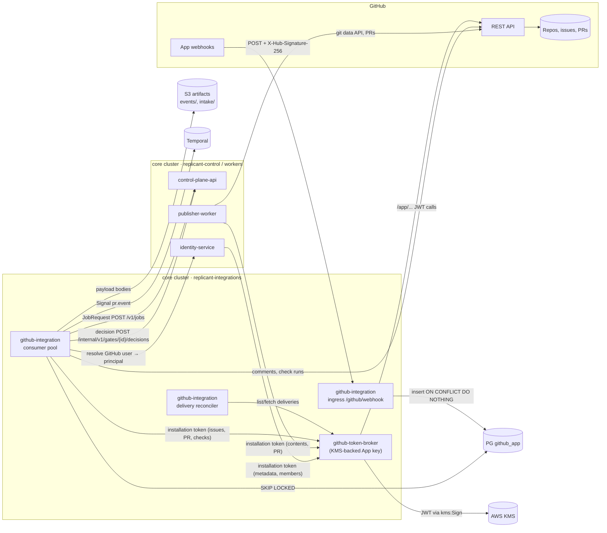
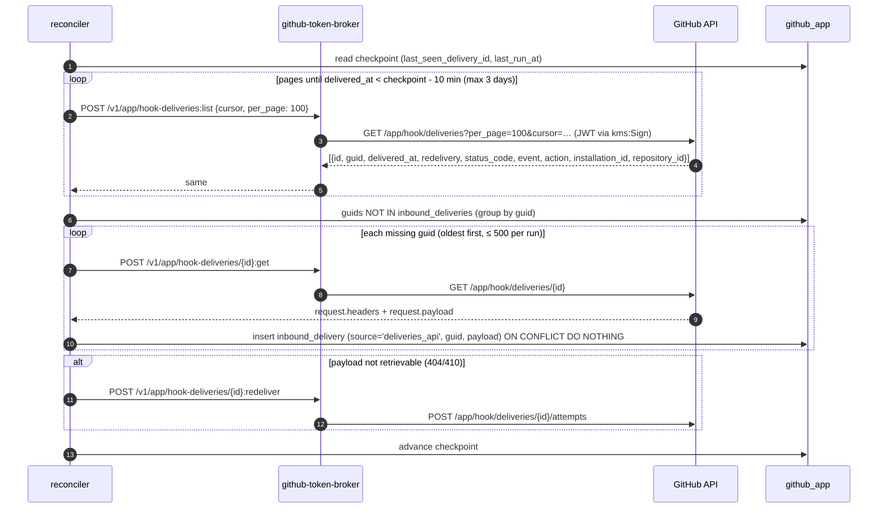
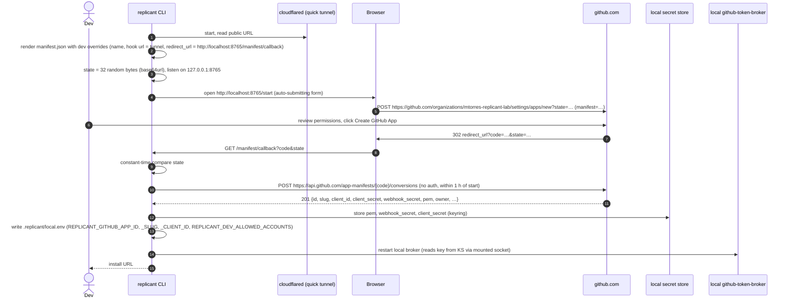

# GitHub App, webhook ingestion, token broker, and Publisher

**Owner:** WS-07 · **Constraints:** D-24, D-15, D-18, D-19, D-21 · **Contracts:** C-JOBREQ, C-MSG
(`pr.event`, `gate.decide`), C-PG (`github_app`), C-ART (`pr_event_payload`, `intake_attachment`),
ADR-011 (as amended by the orchestrator's OQ-00-04 adjudication) · **Files:**
[github-app/manifest.json](github-app/manifest.json),
[github-app/manifest.schema.json](github-app/manifest.schema.json),
[github-app/validate_manifest.py](github-app/validate_manifest.py)

## Purpose

Specify Replicant's companion GitHub App (D-24) end to end: the manifest and its permissions,
how a developer registers a personal dev app with one command, how webhooks are verified,
deduplicated, replayed, and turned into `JobRequest`s, `pr.event` Signals, or gate decisions; how
installation tokens are minted (only by `github-token-broker`); and how `publisher-worker` turns
a diff bundle into a branch and pull request.

## Decisions summary

| # | Decision | Constraint / ADR |
|---|---|---|
| G-1 | One manifest, many registrations: `prod`, `staging`, and one **dev app per developer** on a personal org. Same code; registration chosen by config `REPLICANT_GITHUB_APP_REGISTRATION` | D-24 |
| G-2 | Least privilege: `metadata:read`, `contents:write`, `issues:write`, `pull_requests:write`, `checks:write`, `members:read`. No `workflows`, `administration`, `secrets`, `actions`, `statuses` | D-21 |
| G-3 | `github-token-broker` is the only holder of the App private key. In AWS the key is **imported into KMS** (`RSA_2048`, `SIGN_VERIFY`) and JWTs are signed with `kms:Sign` `RSASSA_PKCS1_V1_5_SHA_256` (= RS256), so the key never exists in process memory. Token holders (ADR-011 as amended by the accepted CCR-09-06): `publisher-worker`, `github-integration`, `repo-mirror` (read-only), `identity-service` (`metadata:read`, `members:read`), `zoekt-indexer` and `ecosystem-indexer` (`contents:read`, `metadata:read`, opted-in repos only). No caller may ever request `workflows`, `administration`, `secrets`, or `actions`, and the registration does not hold them | ADR-011, OQ-00-04, CCR-09-06, [WS-09 ADR-004](../09-security/adr/004-github-app-key-in-kms.md) |
| G-4 | Webhooks: verify `X-Hub-Signature-256` over the raw body before parsing, persist to `github_app.inbound_deliveries` keyed by `X-GitHub-Delivery`, acknowledge `202` in < 1 s, process asynchronously | D-19, C-ARCH §5 |
| G-5 | Missed deliveries are recovered by a reconciler that pages `GET /app/hook/deliveries` through the broker every 5 min and **fetches** missing payloads (`GET /app/hook/deliveries/{id}`), falling back to redelivery | D-24 |
| G-6 | Local webhook forwarding: **Cloudflare quick tunnel** (`cloudflared tunnel --url`), with the dev app's webhook URL patched automatically through `PATCH /app/hook/config`. Not smee (its client re-serialises the body, verified in `smee-client` 5.0.0 source), not `gh webhook forward` (no App webhooks). This **overrides WS-11's provisional smee default** (ADR-11-006, XD-11-07), as WS-07 owns the decision | D-24, [ADR-07-004](adr/004-dev-webhook-forwarding.md) |
| G-9 | One SCM abstraction: the shared `replicant-scm` package (`ScmProvider` with `github` and `gitea` adapters, one normalized event model) is used by github-integration (routes `/github/webhook` and `/webhooks/gitea`), publisher-worker, identity-service (permission checks), and the broker (Gitea token backend locally). Gitea identities use `channel_identity.kind = gitea` (C-JOBREQ 1.1.0, C-MSG 1.1.0) | XD-11-05, CCR-11-01 |
| G-10 | The Publisher publishes only the exact diff that was approved (or, without a publish gate, the exact diff the risk rules classified): `publisher.publish` takes `approved_diff_sha256` and refuses any mismatch | WS-09 control-review G-03 |
| G-7 | Replicant gates happen **before** any push (plan, publish). GitHub decisions use `/replicant approve|reject|changes` issue commands only. Reviews after the PR feed `pr.event` (repair loop) and never decide gates. The draft-PR check-run decision mode was removed: it pushed code before approval, which runs target CI (R2-001) | D-19, [ADR-07-005](adr/005-github-review-to-gate-mapping.md) |
| G-11 | Every push Replicant makes (publish, repair push, takeover push) runs the deterministic `ci_executed_paths` check; a match requires an approval decision bound to that exact diff. Takeover pushes go to `replicant-takeover/<job_id>`, and tenant onboarding requires CI to exclude `replicant/**` and `replicant-takeover/**` from secrets-bearing workflows ([onboarding.md](onboarding.md)) | R2-001 |
| G-8 | Publisher creates commits through the Git Database API so they are **verified** bot commits; falls back to `git push` only for oversized diffs on tenants that do not require signed commits | D-21 |



---

## 1. Registrations

| Registration | Owner | Installed on | Webhook URL | Secrets (AWS Secrets Manager / local store) | Config value |
|---|---|---|---|---|---|
| `prod` | Replicant platform team | enterprise orgs (`acme-payments`, `acme-identity`, …) | `https://hooks.replicant.acme.example.com/github/webhook` (ALB → github-integration) | `replicant/prod/github-app/{app_id, client_id, client_secret, webhook_secret, webhook_secret_previous}`; private key as KMS key `alias/replicant/prod/github-app` | `REPLICANT_GITHUB_APP_REGISTRATION=prod` |
| `staging` | Replicant platform team | `acme-replicant-sandbox` org with mirrored test repos | `https://hooks.replicant-staging.acme.example.com/github/webhook` | `replicant/staging/github-app/*`, KMS `alias/replicant/staging/github-app` | `staging` |
| `dev` (one per developer) | the developer | the developer's **personal org** only | tunnel URL (§6) | local secret store (§5.3); never in the repo, never in AWS | `dev` |

`JobRequest.source.github.app_registration` is `prod`, `staging` or `dev` (C-JOBREQ 2.0.0, CCR-07-09 applied); the
staging registration reports `staging` (R1-162).

Isolation of dev from production data (D-24):

1. A dev app's key can mint tokens only for installations of that dev app, which exist only on the
   developer's personal org. It cannot reach enterprise repositories.
2. The local stack's `github-integration` refuses events whose `installation.account.login` is
   not in `REPLICANT_DEV_ALLOWED_ACCOUNTS` (set by `replicant dev github-app create`). This stops
   a mis-pointed tunnel from turning someone else's events into jobs.
3. The dev stack uses its own Postgres, MinIO, and Temporal (`replicant-local` namespace). There
   is no network path from a laptop to production stores. `JobRequest.source.github.app_registration`
   is `dev`, and production intake rejects `dev` with 422 (a defence in depth check in
   control-plane-api).
4. Identity in the local stack is the stub IdP (Dex, [identity.md](identity.md) §9). The
   developer's own GitHub account is linked to the seeded user `dev@acme.example.com` by the
   ordinary link flow, so D-18 checks are exercised for real (the developer is the repo owner,
   so the repository permission check passes for real).

## 2. Manifest and permissions

The manifest is [github-app/manifest.json](github-app/manifest.json). It validates against
[manifest.schema.json](github-app/manifest.schema.json) (documented manifest parameters plus
Replicant policy) and the event/permission cross-check in
[validate_manifest.py](github-app/validate_manifest.py):

```
$ uv run --with 'jsonschema[format]>=4,<5' --with rfc3987 python github-app/validate_manifest.py
manifest OK (prod and dev variant)
```

Manifest parameters used (all documented: `name`, `url`, `hook_attributes{url,active}`,
`redirect_url`, `callback_urls` (≤ 10), `setup_url`, `description`, `public`,
`default_events`, `default_permissions`, `request_oauth_on_install`, `setup_on_update`)
[verified: https://docs.github.com/en/apps/sharing-github-apps/registering-a-github-app-from-a-manifest, 2026-10-24].
`name` is at most 34 characters [verified: https://docs.github.com/en/apps/creating-github-apps/registering-a-github-app/registering-a-github-app, 2026-10-24]; dev names are `replicant-dev-<github-handle>` truncated to 34.

| Permission | Level | Why it is needed | Endpoints that need it [verified: https://docs.github.com/en/rest/authentication/permissions-required-for-github-apps, 2026-10-24] |
|---|---|---|---|
| `metadata` | read | Mandatory. Repository permission check for requesters and approvers (D-18) | `GET /repos/{o}/{r}/collaborators/{u}/permission` (Metadata read) |
| `contents` | write | Publisher: create blobs, trees, commits, refs on `replicant/*` branches; read base | Git Database API, `GET /repos/{o}/{r}/contents/{path}` |
| `issues` | write | Acknowledgement and status comments on issues; read issue bodies and comments for intake; labels (`replicant:running`) | `POST /repos/{o}/{r}/issues/{n}/comments`, labels |
| `pull_requests` | write | Open/update PRs, request reviewers, reply to review comments, read reviews | `POST /repos/{o}/{r}/pulls`, `.../requested_reviewers` |
| `checks` | write | `replicant/qa` check run on PR heads (name exactly `replicant/qa`, XD-FIX-R1-125) (content defined by WS-05 artifacts.md §4.1), `replicant / gate` status check (informational, no actions); write level also delivers `check_run.rerequested` for a QA re-run | `POST /repos/{o}/{r}/check-runs` |
| `members` (org) | read | Org membership for D-15 ("org members linked to Okta"); team membership for CODEOWNERS teams; SAML external identities for auto-linking (GHEC) | `GET /orgs/{org}/members/{u}`, `GET /orgs/{org}/teams/{t}/memberships/{u}`, GraphQL `samlIdentityProvider` |

Not requested, deliberately: `workflows` (Replicant must never modify `.github/workflows/**`;
Publisher rejects such diffs, and without this permission GitHub would also reject the push),
`administration`, `secrets`, `actions`, `statuses` (check runs supersede statuses),
`organization_administration`, `emails` (no email collection; identity comes from Okta).

### 2.1 Subscribed events

`installation` and `installation_repositories` are delivered to every App and cannot be
subscribed manually; they are therefore absent from `default_events`
[verified: https://docs.github.com/en/webhooks/webhook-events-and-payloads, 2026-10-24].

| Event (actions used) | Required permission | Replicant use |
|---|---|---|
| `installation` (`created`, `deleted`, `suspend`, `unsuspend`, `new_permissions_accepted`) | automatic | Maintain `github_app.installations`; suspend → mark repos inactive; open jobs get an operator alert |
| `installation_repositories` (`added`, `removed`) | automatic | Maintain `github_app.repos`; removed → jobs on that repo fail at next GitHub call with `installation_repo_removed` |
| `issues` (`opened`, `labeled`, `assigned`, `edited`, `closed`) | Issues | Triggers (§7); `closed` on a job's source issue cancels a job still before `publishing` if the tenant opts in |
| `issue_comment` (`created`, `edited`) | Issues | `/replicant …` commands on issues and PRs; PR conversation comments → `pr.event issue_comment_created` |
| `pull_request` (`closed`, `reopened`, `synchronize`, `ready_for_review`, `converted_to_draft`) | Pull requests | `pr.event` (`pull_request_merged` / `_closed` end the job, ADR-009); `synchronize` by a human means someone pushed to the Replicant branch (take-over detection) |
| `pull_request_review` (`submitted`, `dismissed`) | Pull requests | `pr.event review_submitted` (feedback only; never a gate decision, ADR-07-005) |
| `pull_request_review_comment` (`created`, `edited`) | Pull requests | `pr.event review_comment_created` |
| `pull_request_review_thread` (`resolved`, `unresolved`) | Pull requests | Repair triage marks threads already handled |
| `check_run` (`rerequested`) | Checks write | Re-run of Replicant QA (`pr.event check_suite_completed` path; never a gate decision) |
| `push` (default branch of opted-in repos) | Contents | Forwarded to ecosystem-indexer `POST /internal/v1/index-runs` (XD-04-09); no job |
| `check_suite` (`completed`) | Checks | `pr.event check_suite_completed` (external CI results inform repair triage) |
| `repository` (`renamed`, `transferred`, `archived`, `deleted`) | Metadata | Keep `repos` mapping keyed by immutable `repo_id`; archived → stop triggers |
| `membership`, `organization` (`member_removed`, `member_added`) | Members | Hint to identity-service: re-resolve open gates' eligible approvers and send `identity.principal_changed` where relevant (never a grant) |

## 3. Webhook ingestion (`github-integration`)

### 3.1 Endpoint

`POST /github/webhook` on the `github-integration` ingress (ALB, TLS 1.2+, WAF rate limit 600
req/s per source; GitHub publishes webhook source ranges via `GET /meta` `hooks`, which the
ingress allowlists, refreshed daily `[unverified: current shape of the /meta "hooks" field; the
allowlist is defence in depth, signature verification is the control]`).

Headers used [verified: https://docs.github.com/en/webhooks/webhook-events-and-payloads, 2026-10-24]:
`X-GitHub-Event`, `X-GitHub-Delivery` (GUID), `X-Hub-Signature-256`, `X-GitHub-Hook-ID`,
`X-GitHub-Hook-Installation-Target-Type`, `X-GitHub-Hook-Installation-Target-ID`,
`User-Agent: GitHub-Hookshot/…`. `X-Hub-Signature` (SHA-1) is ignored.

Payload cap: GitHub does not deliver payloads over 25 MB [verified: same page]. The ingress
accepts bodies up to 26 MiB.

### 3.2 Handler (normative)

```python
# github_integration/webhook.py  (FastAPI 0.162, Python 3.12)
import hashlib
import hmac

from fastapi import APIRouter, Request, Response
from sqlalchemy import insert
from sqlalchemy.dialects.postgresql import insert as pg_insert

from replicant_db.models.github_app import InboundDelivery
from .secrets import webhook_secrets  # current + previous (rotation window), bytes
from .db import session_scope
from .metrics import INVALID_SIGNATURE, DELIVERIES

router = APIRouter()
MAX_BODY = 26 * 1024 * 1024


def _valid(sig_header: str | None, body: bytes) -> bool:
    if not sig_header or not sig_header.startswith("sha256="):
        return False
    given = sig_header.removeprefix("sha256=")
    for secret in webhook_secrets():            # tries current, then previous
        expected = hmac.new(secret, body, hashlib.sha256).hexdigest()
        if hmac.compare_digest(expected, given):  # constant time
            return True
    return False


@router.post("/github/webhook", status_code=202)
async def receive(request: Request) -> Response:
    body = await request.body()                    # raw bytes, before any JSON parsing
    if len(body) > MAX_BODY:
        return Response(status_code=413)
    if not _valid(request.headers.get("x-hub-signature-256"), body):
        INVALID_SIGNATURE.inc()                     # replicant_github_webhook_invalid_signature_total
        return Response(status_code=401)
    guid = request.headers["x-github-delivery"]
    event = request.headers["x-github-event"]
    async with session_scope() as s:               # role svc_github_integration
        res = await s.execute(
            pg_insert(InboundDelivery)
            .values(delivery_guid=guid, event=event,
                    hook_id=int(request.headers.get("x-github-hook-id", "0")),
                    target_type=request.headers.get("x-github-hook-installation-target-type"),
                    target_id=request.headers.get("x-github-hook-installation-target-id"),
                    source="webhook", payload=body, payload_sha256=hashlib.sha256(body).hexdigest())
            .on_conflict_do_nothing(index_elements=["delivery_guid"])
        )
    DELIVERIES.labels(outcome="new" if res.rowcount else "duplicate").inc()
    return Response(status_code=202)               # GitHub's limit is 10 s; we answer in ms
```

Rules: no JSON parsing before verification; one row per GUID; a duplicate GUID is acknowledged
with 202 and dropped (GitHub keeps the GUID constant across redeliveries [verified:
https://docs.github.com/en/webhooks/using-webhooks/automatically-redelivering-failed-deliveries-for-a-github-app-webhook,
2026-10-24]). The table stores the raw payload (`bytea`, compressed by TOAST) for at most 7 days;
it is a durable work queue, not an artifact store. Bodies that a job needs later (PR comments)
are copied to S3 as `pr_event_payload` and referenced by URI.

### 3.3 Consumer

A pool of asyncio workers (`github-integration` deployment, `--role consumer`, 3 replicas × 8
workers) claims work with:

```sql
UPDATE github_app.inbound_deliveries d
   SET state = 'processing', claimed_by = :worker, claimed_at = now(), attempts = attempts + 1
 WHERE d.delivery_guid IN (
       SELECT delivery_guid FROM github_app.inbound_deliveries
        WHERE state IN ('received', 'retry') AND next_attempt_at <= now()
        ORDER BY received_at
        LIMIT 20
        FOR UPDATE SKIP LOCKED)
RETURNING d.*;
```

Per-delivery processing is idempotent by construction: every downstream effect is keyed by the
GUID (JobRequest `dedupe_key = github:delivery:<guid>` or a natural key, `decision_id =
derived("dec","github",guid)`, `pr.event.delivery_id = guid`, comment refs unique on
`(delivery_guid, purpose)`). Failures set `state='retry'` with exponential backoff (1 s → 10 min,
max 50 attempts over ~6 h) then `dead`, with alert `ReplicantGithubDeliveryDead`. Claims older than
5 min are reclaimed (crashed worker).

Ordering: deliveries for the same `(repo_id, issue_or_pr_number)` are processed in
`received_at` order by taking a Postgres advisory transaction lock on
`hashtext(repo_id || ':' || number)` before routing. GitHub does not guarantee order; the
workflow's own buffering (debounce, C-MSG `pr.event`) handles residual reordering.

### 3.4 Routing table

| Event | Condition | Action |
|---|---|---|
| `issues.labeled` | label = repo's `trigger_label` (default `replicant`), repo opted in | Build JobRequest (§7); `dedupe_key = github:issue-label:<repo_id>:<number>:<label>` |
| `issues.opened` | repo `trigger_mode = auto_open` and issue matches `auto_open_filter` | JobRequest; `dedupe_key = github:issue-open:<repo_id>:<number>` |
| `issues.assigned` | assignee = the App's bot user and repo allows `assign` | JobRequest; `dedupe_key = github:issue-assign:<repo_id>:<number>` |
| `issue_comment.created` | body starts with `/replicant` (after optional whitespace), commenter not a bot | Parse command (§7.2) → JobRequest, gate decision, or `pr.event replicant_command` |
| `issue_comment.created` | on a PR owned by an open job, not a command | `pr.event issue_comment_created` |
| `pull_request_review.submitted` | PR owned by an open job | `pr.event review_submitted` |
| `pull_request_review_comment.created/edited` | PR owned by an open job | `pr.event review_comment_created/edited` |
| `pull_request.closed` | PR owned by an open job | `pr.event pull_request_merged` if `merged`, else `pull_request_closed` |
| `pull_request.synchronize` | PR owned by an open job and `sender` is not the App | `pr.event pull_request_synchronize` (human pushed to the Replicant branch) |
| `push` | `ref` = default branch, repo `indexing_enabled` | forward `{repo_id, after}` to ecosystem-indexer |
| `check_suite.completed` | head SHA = an open job's PR head | `pr.event check_suite_completed` |
| `installation*`, `repository.*` | — | Upsert `installations` / `repos` |
| `membership`, `organization` | — | `POST identity-service /internal/v1/hints/github-membership` |
| anything else | — | `state='ignored'` |

Before signalling `pr.event`, the consumer registers the job's tenant with the tenant-routed codec
(`TenantContextCodec.register(job_id, tenant_id)`, XD-01-08; tenant from `github_app.repos.tenant_id`),
because the codec fails closed for unknown jobs (R1-167).

"PR owned by an open job" is resolved by reading `jobs_read.job_prs` (repo_id, number → job_id,
status). This read is a routing aid only: if the projection is behind, the Signal goes to the
workflow ID anyway and the workflow ignores events for PRs it does not own (C-STATE rule 5).
If no job owns the PR and the PR's head branch matches `replicant/job_*`, the job ID is parsed from
the branch name as a fallback.

### 3.5 Who may trigger (filters applied before anything else)

1. `sender.type == "Bot"` → ignored, recorded as `ignored_bot`. Covers every App including this
   one (`<slug>[bot]`). Comments carrying `performed_via_github_app` are also ignored.
2. The sender is resolved through identity-service `POST /internal/v1/resolve
   {kind: github, id: <sender.id>}` → `principal_id` or `unlinked`.
3. **Unlinked** humans: no job, no Signal. The App replies once per (user, repo, 24 h):
   "@mtorres-acme, link your GitHub account to the Replicant first: https://replicant.acme.example.com/link/github
   (takes 20 seconds). Then comment `/replicant retry`." The reply is posted only if the sender
   has at least `read` on the repo, to avoid replying to drive-by spam.
4. Linked humans: the JobRequest is submitted; control-plane-api performs the authoritative
   authorization (Okta groups + live repo permission, [identity.md](identity.md) §6). For
   `pr.event`, the workflow re-checks with `identity.check_repair_trigger` (D-15).

## 4. Replay of missed deliveries

GitHub does not redeliver failed deliveries automatically [verified:
https://docs.github.com/en/webhooks/using-webhooks/handling-failed-webhook-deliveries, 2026-10-24],
and deliveries can be redelivered for the past 3 days [verified:
https://docs.github.com/en/webhooks/testing-and-troubleshooting-webhooks/redelivering-webhooks
(search result excerpt), 2026-10-24]. The App deliveries API requires a JWT [verified:
https://docs.github.com/en/rest/apps/webhooks, 2026-10-24], so only the broker can call it.

Reconciler (`github-integration --role reconciler`, singleton via advisory lock, every 5 min and
at startup):



Payloads fetched from the API are authenticated by the TLS + JWT channel rather than the HMAC
header; they are marked `source='deliveries_api'` and processed identically. Metrics:
`replicant_github_deliveries_recovered_total{method="fetch|redeliver"}`,
`replicant_github_delivery_gap_seconds` (age of the oldest unrecovered failed delivery). Alert when
any delivery older than 30 min is missing: it is within the 3-day window, so it can still be
recovered, but a gap that long means ingestion is broken.

## 5. One command to a dev app: `replicant dev github-app create`

### 5.1 Flow

```
$ replicant dev github-app create --org mtorres-replicant-lab
→ Starting tunnel: cloudflared tunnel --url http://localhost:8080 … https://fancy-otter-1234.trycloudflare.com
→ Opening browser to register "replicant-dev-mtorres" on github.com/organizations/mtorres-replicant-lab
  (waiting for GitHub to redirect back to http://localhost:8765/manifest/callback)
✓ App created: id 1234567, slug replicant-dev-mtorres
✓ Stored private key, webhook secret, client secret in macOS Keychain (service "replicant-dev/github-app")
✓ Wrote .replicant/local.env (non-secret: app id, slug, client id, allowed account)
→ Install it on the repos you want to test: https://github.com/apps/replicant-dev-mtorres/installations/new
  Then label an issue "replicant".
```



Facts: the manifest form posts to `https://github.com/settings/apps/new` (personal account) or
`https://github.com/organizations/ORGANIZATION/settings/apps/new`, with `state` for CSRF; the
redirect carries `code` and `state`; `POST /app-manifests/{code}/conversions` returns `id`,
`slug`, `client_id`, `client_secret`, `webhook_secret`, `pem`, and the whole flow must complete
within one hour [verified: https://docs.github.com/en/apps/sharing-github-apps/registering-a-github-app-from-a-manifest
and https://docs.github.com/en/rest/apps/apps#create-a-github-app-from-a-manifest, 2026-10-24].

`--user` instead of `--org` registers under the developer's personal account (posts to
`/settings/apps/new`); D-24 recommends an org so that teams and CODEOWNERS can be exercised.

`redirect_url` on `http://localhost` `[unverified: GitHub accepts a non-HTTPS loopback
redirect_url in a manifest]`. Fallback (automatic if GitHub rejects the manifest): the CLI uses
`https://<tunnel>/dev/manifest/callback`, served by the local `github-integration` in dev mode,
which relays `code` and `state` to the CLI over the local socket.

### 5.2 Related commands

| Command | Does |
|---|---|
| `replicant dev github-app forward [--forwarder cloudflared|named|ngrok]` | Starts `cloudflared`, then asks the local broker to `PATCH /app/hook/config {"url": "<tunnel>/github/webhook"}` (JWT; verified to exist with body `url`, `content_type`, `secret`, `insecure_ssl` [verified: https://docs.github.com/en/rest/apps/webhooks#update-a-webhook-configuration-for-an-app, 2026-10-24]) because quick-tunnel hostnames change on every start |
| `replicant dev github-app rotate-secret` | Generates a new webhook secret, PATCHes `hook_config.secret`, keeps the old one as `previous` for 10 min |
| `replicant dev github-app status` | App, installations, last delivery, tunnel URL, and the last 10 deliveries from the deliveries API with status codes |
| `replicant dev github-app replay <guid>` | Fetch a delivery by GUID through the broker and inject it (same path as §4) |
| `replicant dev github-app doctor` | Sends a ping through the forwarder (`POST /app/hook/deliveries/{id}/attempts` on the newest ping delivery), confirms github-integration verified the signature, and checks clock skew, installation, and repo opt-in |
| `replicant dev github-app teardown` | Deletes the local secrets and prints the GitHub settings URL to delete the App (deletion is not available to the App itself) |

### 5.3 Local secret store

Python `keyring` (macOS Keychain, Windows Credential Manager, Secret Service on Linux). Headless
Linux without a keyring falls back to `~/.config/replicant/secrets.age`, encrypted with `age` to a
key in `~/.config/replicant/age.key` (mode 0600). `replicant dev up` mounts nothing secret into
containers except into `github-token-broker`, which reads the key through a Unix socket served by
`replicant secret-agent` (so the PEM never lands in a compose file or environment variable).
`.replicant/` is in the repository's `.gitignore`, and a pre-commit hook (`detect-secrets`) blocks
PEM content.

## 6. Webhook delivery to a laptop

| Option | Works with App webhooks | Raw body preserved (signature verifies) | Stable URL | Account needed | Verdict |
|---|---|---|---|---|---|
| **Cloudflare quick tunnel** `cloudflared tunnel --url http://localhost:8080` | yes (it is just an HTTPS URL) | yes (HTTP proxy) | no: "The hostname changes each time" → auto-patched (§5.2) | no | **Chosen.** Limits: 200 in-flight requests, no SSE, no uptime guarantee, dev only [verified: https://developers.cloudflare.com/cloudflare-one/networks/connectors/cloudflare-tunnel/do-more-with-tunnels/trycloudflare/, 2026-10-24]. `cloudflared` 2026.10.3 [verified: GitHub releases, 2026-10-24] |
| Cloudflare named tunnel | yes | yes | yes | Cloudflare account + domain | Supported alternative (`REPLICANT_DEV_TUNNEL=named`) for teams with a shared dev domain |
| ngrok (static free domain) | yes | yes | yes | ngrok account | Supported alternative (`REPLICANT_DEV_TUNNEL=ngrok`) `[unverified: current ngrok free-tier static domain terms]` |
| smee.io + `smee-client` | yes | **no**: `smee-client` 5.0.0 re-serialises the payload (`const body = JSON.stringify(data.body)`) [verified: npm package source, `index.js` line 50, 2026-10-24]; HMAC verification then depends on GitHub's original bytes equalling `JSON.stringify` output `[unverified: whether it does for all payloads]`. GitHub also says not to use Smee.io in production [verified: https://docs.github.com/en/apps/creating-github-apps/writing-code-for-a-github-app/building-a-github-app-that-responds-to-webhook-events, 2026-10-24] | yes | no | Rejected: we never relax signature verification, even locally |
| `gh webhook forward` | **no**: "only works with repository and organization webhooks", one forwarder per repo/org [verified: https://docs.github.com/en/webhooks/testing-and-troubleshooting-webhooks/using-the-github-cli-to-forward-webhooks-for-testing, 2026-10-24] | — | — | — | Rejected for the App path. Useful only for the Gitea-less "repo webhook" smoke test |

Offline development continues to use the local Gitea/Forgejo (WS-11), which sends webhooks with
`X-Gitea-Signature` (HMAC-SHA256); `github-integration` has a `gitea` adapter with the same
pipeline.

## 7. Trigger rules and acknowledgements

### 7.1 Per-repository configuration (`github_app.repo_settings`; operational config, ADR-013)

```yaml
# PUT /v1/tenants/payments/github/repos/R_kgDOK2a9Xw/settings  (tenant admin)
trigger_modes: [label, command]        # any of: label, command, assign, auto_open
trigger_label: replicant                 # issues.labeled with this label starts a job
auto_open_filter:                      # only when auto_open is enabled
  labels_any: [bug]
  title_regex: null
  authors_in_okta_groups: [payments-engineers]
allowed_workflow_types: [auto, bugfix, feature, docs, api_change]
default_priority: normal
ack_comment: true
status_label_prefix: "replicant:"        # replicant:running, replicant:needs-approval, replicant:pr-open
command_prefix: /replicant
```

Defaults for a newly installed repository: **disabled** until a tenant admin opts it in (a
repository installed by an org owner does not start jobs by surprise). Opting in is per repo or
by glob (`acme-payments/*-api`).

### 7.2 `/replicant` commands (issue or PR comments)

| Command | Where | Effect |
|---|---|---|
| `/replicant run [type] [--priority high] [--draft]` | issue | JobRequest from the issue (`dedupe_key github:issue-cmd:<repo_id>:<number>:<comment_id>`) |
| `/replicant fix [instructions]` | PR not owned by a job | `pr_repair` JobRequest on that PR (ADR-009) |
| `/replicant fix [instructions]` | PR owned by a job | `pr.event replicant_command` (triggers a repair cycle after debounce) |
| `/replicant approve [gate-short-id]` · `/replicant reject <reason>` · `/replicant changes <text>` | issue or PR of a job with an open gate whose `channels` include `github` | Gate decision (§8.1) |
| `/replicant status` | anywhere | Reply with status, phase, link |
| `/replicant cancel` | job's issue or PR | `job.cancel` through control-plane-api (authorization as UI) |
| `/replicant retry` | issue | Re-submit the last refused trigger (e.g. after linking) |

Command text is untrusted; the parser accepts a fixed grammar (`shlex`-style tokens, ≤ 2 KiB),
and free-text parts become `intent.text` or `comment` only.

### 7.3 Acknowledgement comment (posted within 60 s of the trigger)

Posted by the consumer immediately after `POST /v1/jobs` returns (`201` or `200` for a duplicate),
edited in place as the job progresses (comment ID stored in `github_app.comment_refs`, purpose
`ack`), so the issue holds one living status comment rather than a stream:

```markdown
**Replicant job started** · [`job_01m5p7x7r0`](https://replicant.acme.example.com/jobs/job_01m5p7x7r0bt69j0h0fbxepw90) · bugfix · requested by @mtorres-acme

| | |
|---|---|
| Status | Planning (plan will need approval: risk **high**, rules `path.money_movement`, `service.tier1`) |
| Approvers | ledger-core CODEOWNERS via Slack `#payments-replicant`, the replicant UI, or `/replicant approve` here |
| Cost so far | $0.61 of $40.00 |

<sub>Updated 08:06 UTC · Reply `/replicant status` for details or `/replicant cancel` to stop.</sub>
```

Refusals (no job created) reply once with the reason in words: not linked (with link URL);
insufficient repository permission ("You need write access to acme-payments/ledger-api to start
Replicant jobs"); repo not opted in (silent unless the commenter used `/replicant`, then: "Replicant
is not enabled for this repository. Ask a payments tenant admin."); quota exceeded (with the
tenant's reset time).

## 8. GitHub as an approval channel

Details and policy schema: [approvals.md](approvals.md) §5. Summary:

1. **Gates are decided before any push** (`plan_approval`, `publish_approval`). On GitHub they are
   decided with `/replicant approve|reject|changes` on the job's source issue (or on its PR for repair-cycle
   gates). The App's gate comment carries the routing tuple in a hidden HTML comment
   (`<!-- replicant:gate job_id=job_… gate_id=gate_… r=3 digest=sha256:… -->`), and
   `github_app.comment_refs` stores it, so routing never depends on the read model (R2-032).
   `decision_id = derived("dec", "github", X-GitHub-Delivery)`. `presented_digest` is the digest of the
   revision shown in the gate comment at the time of the command; if the packet has since changed,
   validator V6 rejects the decision as `StaleApprovalView` and the App replies with the new revision.
2. **No draft-PR decision mode.** Publishing a draft PR before approval pushes code that target CI may run
   with secrets (R2-001), so check-run approval buttons are not offered. WS-05's "draft PR only" for a
   failing QA verdict is a publish *after* approval, not a decision surface.
3. **GitHub PR reviews never decide Replicant gates.** They are feedback (`pr.event`). The Replicant App cannot
   approve its own PR (PR authors cannot approve their own pull requests [verified:
   https://docs.github.com/en/pull-requests/collaborating-with-pull-requests/reviewing-changes-in-pull-requests/approving-a-pull-request-with-required-reviews
   (search excerpt), 2026-10-24]), and it never submits `APPROVE` reviews on any PR. Branch protection's
   required reviews therefore always need a human with write access, the second, independent control.
4. **Worker-facing GitHub operations** (XD-04-09; github-integration internal API, caller
   `svc_replicant-worker` and `publisher-worker`, each idempotent on the logical activity ID passed as
   `Idempotency-Key`): `POST /internal/v1/github/replies {repo_id, pr_number, in_reply_to_comment_id, template,
   vars}` (review-thread reply), `POST /internal/v1/github/reactions {repo_id, comment_id, content}`
   (`eyes`, `+1`), `POST /internal/v1/github/pr-comments {repo_id, pr_number, template, vars}`, and
   `POST /internal/v1/github/review-threads/{thread_node_id}:resolve` (GraphQL `resolveReviewThread`;
   `[unverified: the GitHub App permission GraphQL requires for resolveReviewThread is pull_requests:write]`,
   checked on the dev App by the integration test `test_resolve_review_thread_permission`; fallback: leave
   threads unresolved and reply "addressed in <commit>"). Every posted text passes the pre-post secret scan.

## 9. `github-token-broker`

### 9.1 API (internal; authenticated by projected ServiceAccount token, audience `github-token-broker`)

The full contract is [api/github-token-broker.openapi.yaml](api/github-token-broker.openapi.yaml). Operations
(R1-190: listed here as text; the OpenAPI file is normative):

```text
POST  /v1/installation-tokens              mint a scoped installation token (caller policy §9.2)
POST  /v1/app/hook-deliveries:list         github-integration reconciler only
POST  /v1/app/hook-deliveries/{id}:get     github-integration reconciler only
POST  /v1/app/hook-deliveries/{id}:redeliver
PATCH /v1/app/hook-config                  dev registration only
GET   /v1/app/installations                github-integration installation sync
```

Example token request body (JSON):

```json
{"installation_id": 51234567, "repository_ids": [612345678],
 "permissions": {"contents": "write", "pull_requests": "write"},
 "purpose": "publisher.publish", "job_id": "job_01m5p7x7r0bt69j0h0fbxepw90", "activity_id": "publish.c0.n1.publish"}
```

### 9.2 Caller policy (the broker refuses anything else; refusals are audited)

| Caller (ServiceAccount) | Permissions it may request (subset only) | Repos per token | Max lifetime used |
|---|---|---|---|
| `replicant-workers/publisher-worker` | `contents:write`, `pull_requests:write`, `metadata:read` | exactly 1 | 60 min (GitHub fixed) |
| `replicant-integrations/github-integration` | `issues:write`, `pull_requests:write`, `checks:write`, `metadata:read` | exactly 1 | 60 min |
| `replicant-mirror/repo-mirror` (exec cluster, via the cross-cluster NLB) | `contents:read`, `metadata:read` | ≤ 500 (installation token limit [verified: https://docs.github.com/en/rest/apps/apps#create-an-installation-access-token-for-an-app, 2026-10-24]) | 60 min |
| `replicant-control/identity-service` | `metadata:read`, `members:read` | exactly 1 (or 0 for org-level member checks) | 60 min |
| `replicant-context/zoekt-indexer` (WS-04) | `contents:read`, `metadata:read` | ≤ 500, only repos in `github_app.repos` with `indexing_enabled` (opted in) | 60 min |
| `replicant-context/ecosystem-indexer` (WS-04) | `contents:read`, `metadata:read` | ≤ 500, opted-in repos only | 60 min |

Global rule (CCR-09-06): the broker rejects any request naming `workflows`, `administration`, `secrets`, or `actions`, whatever the caller.

The broker caches tokens per `(caller, installation, repos, permissions)` until 10 minutes before
expiry, so the GitHub mint rate stays around one per key per 50 minutes. Every mint emits
`audit.emit({type: "github.token_minted", actor: svc_<caller>, installation_id, repository_ids,
permissions, purpose, job_id})`. Metrics: `replicant_github_tokens_minted_total{caller}`,
`replicant_github_token_mint_errors_total{caller,reason}`.

### 9.3 Key custody

- **AWS:** the App private key (PEM from the conversion response or the GitHub settings page) is
  converted to PKCS#8 DER and imported into a KMS key with `KeySpec=RSA_2048`,
  `KeyUsage=SIGN_VERIFY`, `Origin=EXTERNAL`. KMS supports importing RSA private keys of RSA_2048
  /3072/4096 as PKCS#8 [verified: https://docs.aws.amazon.com/kms/latest/developerguide/importing-keys-conceptual.html
  (search excerpt), 2026-10-24] and signing with `RSASSA_PKCS1_V1_5_SHA_256` [verified:
  https://docs.aws.amazon.com/kms/latest/developerguide/asymmetric-key-specs.html, 2026-10-24],
  which is JWT `RS256`. The broker builds the JWT header and claims (`iat = now − 60`, `exp =
  now + 540`, `iss = client_id`), calls `kms:Sign` with `MessageType=RAW`, and base64url-encodes
  the signature. The key policy grants `kms:Sign` only to the broker's IAM role (Pod Identity)
  with condition `kms:SigningAlgorithm = RSASSA_PKCS1_V1_5_SHA_256`. The PEM is deleted from the
  operator workstation after import (runbook). WS-09 owns the rotation runbook: generate a new key
  in GitHub, import into a new KMS key, switch alias, revoke the old key in GitHub.
  `[unverified: GitHub App private keys are RSA 2048-bit]` Fallback if a key is larger: KMS
  supports RSA_3072/4096 too; if import is impossible, the PEM lives in Secrets Manager readable
  only by the broker role (the ADR-011 baseline).
- **Local:** the broker signs with the PEM read from the secret agent socket (§5.3).

## 10. `publisher-worker`

Activities on task queue `replicant-publisher` (C-IDS §4), deployment `publisher-worker`, not pinned with
the job, so their contracts stay backward compatible for 37 days (CC-4). Names, logical IDs, inputs,
outputs, and error types match WS-01's activity catalogue (XD-01-03, `activity_options.py`; R1-166). Error
types are WS-01's PUBLISHER set: `PushRejected`, `BranchProtected`, `MergeConflict`, `PermissionDenied`,
`PullRequestClosed`, `InvalidInput`, plus the retryable `PublishingPaused` (C-MSG 1.5.0 kill switch).

| Activity | Logical ID (WS-01 node keys) | Input → output | Errors |
|---|---|---|---|
| `scm.resolve_base` | `route.c0.n1.resolve_base` | `{repo, base_ref}` → `{base_sha}` | `PermissionDenied` |
| `publisher.check_base` | `base_check.c<c>.n<o>.check_base` | `{repo, base_ref, diff_bundle_uri, diff_sha256}` → `{moved, new_base_sha, applies_cleanly, rebased_diff_uri?, rebased_diff_sha256?}` | `InvalidInput` |
| `publisher.publish` | `publish.c<c>.n<o>.publish` | `{job_id, repo, diff_bundle_uri, approved_diff_sha256, approval_decision_id?, target_base_sha, pr: {title, body_vars, draft}}` → `{pr_number, url, head_sha, branch}` | `PushRejected` (digest or base mismatch, CI-path check), `BranchProtected`, `PermissionDenied`, `InvalidInput` (eval job), `PublishingPaused` |
| `publisher.push_update` | `publish.c<c>.n<o>.push` | same digest inputs + `{branch, pr_number}` → `{head_sha}` | as above, plus `PullRequestClosed` |
| `publisher.push_takeover_branch` | `takeover.c<c>.n<k>.push_branch` | `{job_id, repo, diff_bundle_uri, diff_sha256, target_base_sha, approval_decision_id?}` → `{branch: replicant-takeover/<job_id>, head_sha}` | `PushRejected` (CI-path check), `PermissionDenied` |
| `publisher.close_pr` | `publish.c<c>.n1.close_pr` | `{repo, pr_number, reason}` → `{state}` | `PermissionDenied` |
| `github.post_reply` | `<node>.c<c>.n<o>.post_reply` | `{repo, issue_or_pr, in_reply_to?, template ∈ {ack, fix_summary, no_action, question, budget_exhausted}, vars}` → `{comment_id}` | `PermissionDenied` |

### 10.1 `publisher.publish` and `publisher.push_update` (normative)

0. **Refuse evaluation jobs** (XD-06-11): read `intake.job_requests.evaluation_mode`; if set, raise
   non-retryable `InvalidInput("evaluation job")` unless the input says `evaluation_target=eval_git` (the
   Forgejo eval server, never GitHub). Check the kill switches for (global, tenant, repo, bundle) from the
   out-of-band mirror (architecture.md §2.9); `publishing=paused` raises retryable `PublishingPaused`.
1. Download the `diff_bundle` (S3) and compute its sha256. It must equal `approved_diff_sha256` **and**
   the run manifest's digest, and the bundle metadata's `base_sha` must equal `target_base_sha`. Otherwise
   non-retryable `PushRejected("digest_mismatch")`, P1 security alert, job `failed` (WS-09 G-03).
   `approved_diff_sha256` is the diff digest of the approved packet's revision (`approval_decision_id` is
   that winning decision); when no publish gate was required, it is the digest the verifier checked and the
   risk rules classified. **After a clean rebase** (`check_base` returned `moved=true,
   applies_cleanly=true`), the workflow passes `target_base_sha = new_base_sha` and `approved_diff_sha256 =
   rebased_diff_sha256`; the gate approval carries over only under WS-01's waiver rule (clean rebase, same
   risk, `reapprove_after_rebase` ≠ `always`), so the shipped diff is always the one QA and the risk rules
   saw on the new base. `check_base` produces the rebased diff as a step artifact
   (`steps/base_check.c<c>.n<o>/diff_bundle/rebased.tar.zst`) by applying the patch to `new_base_sha` with
   `pygit2` and re-rendering `git diff --binary new_base_sha`.
2. **Refuse forbidden paths**: any path in the bundle's `risk_rules.never_publish_paths` (base floor,
   non-removable: `.github/workflows/**`, `.github/actions/**`) or committed agent files
   (`**/.replicant*`, `**/CLAUDE.md`, `**/AGENTS.md`, `.claude/**`, `.mcp.json`; D-10) →
   `PushRejected("forbidden_path")`.
3. **CI-executed paths** (R2-001): match the diff against `risk_rules.ci_executed_paths` (base list,
   non-removable, extendable by tenants and by WS-04's workflow-derived entries). A match requires
   `approval_decision_id` to be present **and** to approve this exact `approved_diff_sha256`; otherwise
   `PushRejected("ci_paths_unapproved")`. The risk rules already make such diffs `critical`, so the gate
   exists; this check is defence in depth at the last step before code reaches CI.
4. Secret-scan the patch with `replicant-secretscan` `scan_diff_added_lines` (report schema `replicant.secret-scan-report/v1`, fingerprints via KMS `GenerateMac` on `alias/replicant/<env>/secretscan-fingerprint`; XD-FIX-R1-225; findings block, C-ART `scan-block`). Every text Replicant posts
   to GitHub (PR body, comments, check-run summaries) passes the same pre-post scan (WS-09 A-08).
5. Mint a token (`contents:write`, `pull_requests:write`, one repo).
6. **Idempotent branch → PR** (R2-031). Branch `replicant/<job_id>` (publish) is job-derived and
   replicant-owned:
   1. `GET /repos/{o}/{r}/git/ref/heads/replicant/<job_id>`. If it exists and its head commit's message
      carries the trailer `Replicant-Activity: <this activity's idempotency key>`, reuse it (an earlier
      attempt got this far) and go to step 8.
   2. Otherwise build the commit (step 7) and set the ref: create it, or, if it exists without this
      activity's trailer (a crashed attempt whose commit had a different signature timestamp, or stale
      work from an earlier cycle of this job), **force-update** it with `PATCH …/git/refs/heads/replicant/<job_id>
      {sha, force: true}`. Replicant never surfaces `PushRejected` for its own branch; a human push to the
      branch is detected first (`pull_request.synchronize` by a non-App sender, routed as a take-over
      signal) and the job stops writing to it.
7. **Verified commit via the Git Database API:** create blobs (`POST /repos/{o}/{r}/git/blobs`) or inline
   `content` for text files ≤ 1 MiB; `POST /git/trees {base_tree: target_base_sha, tree: [...]}`;
   `POST /git/commits {message, tree, parents: [target_base_sha]}` **without** `author`/`committer`, so
   GitHub signs it as the App [verified:
   https://docs.github.com/en/authentication/managing-commit-signature-verification/about-commit-signature-verification,
   2026-10-24]. Trailers: `Requested-by: @mtorres-acme`, `Replicant-Job: job_…`, `Replicant-Bundle: rb_…`,
   `Replicant-Activity: ik1:…`, `Replicant-Diff: sha256:…`. Diffs over 300 files, or with binaries > 50 MiB,
   use `git push --force-with-lease` with `GIT_ASKPASS` (never a token in argv); unsigned, and refused if
   the branch rules require signed commits.
8. PR: `GET /repos/{o}/{r}/pulls?head=<owner>:replicant/<job_id>&state=all`; if an open PR exists, update
   its body and return it; if a closed one exists for this job, raise `PullRequestClosed`; otherwise
   `POST /pulls {head, base, title, body, draft}` (422 "already exists" → re-read and return).
9. Request reviewers from CODEOWNERS of the changed paths; label `replicant:pr-open`.
10. Return `{pr_number, url, head_sha, branch}`.

`push_update` follows the same steps on the existing branch (fast-forward on top of the current head;
the trailer check makes retries idempotent). `push_takeover_branch` pushes to
`replicant-takeover/<job_id>`, a prefix the tenant onboarding checklist requires CI to exclude from
secrets-bearing workflows ([onboarding.md](onboarding.md)); steps 1–4 apply, including the CI-path check:
a takeover whose workspace diff touches CI-executed paths is pushed only if the tenant has attested the CI
exclusion (`tenancy.tenants.onboarding_checklist.ci_excludes_replicant_branches`), otherwise the takeover
package offers the workspace archive and the patch file without a pushed branch.

### 10.2 PR body template

Generated from structured data only; untrusted text is quoted and fenced:

```markdown
Fixes #1423

**What changed** (plan r1, approved by @praman-acme in Slack)
1. Prorate FX fee reversal with `fx.Prorate` …
2. …

**Verification**: QA passed: 477 checks · 13 min ([QA](https://replicant.acme.example.com/jobs/job_01m5p7x7r0bt69j0h0fbxepw90/qa))

**Risk**: high (`path.money_movement`, `service.tier1`) · **Bundle** `rb_ds5p3wmcj` · **Cost** $9.84

<sub>Opened by Replicant for @mtorres-acme. Agent-written changes: review before merging. Comment here to request changes: Replicant reads review comments from linked org members and replies. `/replicant status` · `/replicant cancel`</sub>
```

## 10a. Wave-2 conformance (co-owner entries)

| Entry | github-integration / publisher behaviour |
|---|---|
| XD-FIX-R1-225 | Every text Replicant posts (PR body, comments, check-run summaries, memory notices) passes `replicant-secretscan` `scan_text` first; a finding blocks the post and raises a security event |
| XD-FIX-R1-214 | Before any Signal or Update (`pr.event`, `gate.decide`), github-integration registers the job's tenant with the codec from the `intake.job_requests` row; the codec uses key `alias/replicant/<env>/tenant/<tenant_id>` (`sys:*` → `…/tenant/replicant-system`) with encryption context `{"replicant:purpose":"temporal-payload","replicant:tenant":"<t>"}` |
| XD-FIX-R2-017 | `/replicant wrong <reason>` on a merged Replicant PR from a linked user with ≥ `write` → memory-service `POST /internal/v1/outcome-reports {kind: wrong_fix, source: pr_command}`. Revert detection for 30 days after merge: a merged PR whose body contains `This reverts commit <sha>` for a commit of a Replicant PR, or whose reverted commits carry the `Replicant-Job: job_…` trailer → `{kind: reverted, source: revert_detector, reporter_principal_id: "svc_github-integration", dedupe_key: "revert:<repo_id>:<revert_pr_number>"}`. The Publisher writes `Replicant-Job: <job_id>` on every Replicant commit (§10.1 step 7) |
| XD-FIX-R2-018 | `/replicant memory-wrong <reason>` from the author of the comment that produced the entry, or a CODEOWNER of its path (verified through CODEOWNERS and team membership) → correction request with `requester_role: author|codeowner`. New internal endpoint `POST /internal/v1/memory-notices {tenant_id, repo_id, pr_number, comment_id, kind: entry_activated|entry_held|entry_disabled|correction_actioned|candidate_expired, entry_ref, rendered_line, next_transition_at?, dedupe_key: "<entry_ref>:<kind>"}`, caller memory-service only (mTLS), posts a threaded reply under the top-level comment of the thread, idempotent on `dedupe_key` |
| XD-FIX-R1-273 | `repo.host` is the URL authority, lowercase, default port elided, non-default port kept (`git.replicant.localhost:3300`); the Gitea adapter and the CLI normalize every input to that form, and `ReplicantRepos` values use it |
| XD-FIX-R1-195 | github-integration emits `replicant_github_deliveries_total{outcome}` (`accepted`, `duplicate`, `bad_signature`, `ignored`, `error`) |
| XD-11-17 | Locally, github-token-broker reads the dev App PEM and github-integration the webhook secret from `replicant secret-agent` over `REPLICANT_SECRET_AGENT_SOCKET` (refs `secret-agent:replicant-dev/github-app/pem`, `secret-agent:replicant-dev/github-app/webhook_secret`; env `REPLICANT_BROKER_GITHUB_APP_KEY_REF`, `REPLICANT_GITHUB_WEBHOOK_SECRET_REF`); non-secret IDs come from `REPLICANT_BROKER_GITHUB_APP_ENV_FILE`. The quick tunnel targets `webhook-ingress:8088`, which passes only `POST /github/webhook`; `replicant dev github-app forward` reads the tunnel hostname from cloudflared's metrics port 20241 `[unverified: /quicktunnel path]` |

## 11. Failure modes

| Failure | Behaviour | User-visible |
|---|---|---|
| Invalid signature | 401, metric, no processing | none (operators see the metric; GitHub shows failed delivery) |
| Secret rotated, GitHub still signing with old secret | `previous` secret accepted for 10 min | none |
| Postgres down at ingest | 503; GitHub records a failure; reconciler recovers it within 3 days | delayed trigger |
| github-integration down for hours | Deliveries fail; the reconciler fetches them after recovery (3-day window) | delayed; acknowledgement comment says "received 2 h late" when `received_at − delivered_at > 10 min` |
| Delivery older than 3 days missing | Not recoverable from GitHub. Alert `ReplicantGithubDeliveryUnrecoverable`; operator runbook re-scans open issues with the trigger label via REST and submits JobRequests (dedupe keys make this safe) | operator action |
| Broker down | Token requests fail (retryable). Publisher activity retries; acknowledgements wait; webhook ingestion unaffected | "Publishing delayed" sub-status after 3 attempts |
| KMS throttling | Broker caches tokens for 50 min, so JWT signing is about 1 per minute per installation set | none |
| Installation suspended / repo removed | Token mint 404/403 → non-retryable `installation_unavailable`; job fails with that reason; tenant admin notified | job failure reason |
| Branch protection rejects ref creation | non-retryable `BranchProtected` (C-ARCH §5.1) | failure with reason |
| Publisher crashed after the ref but before the PR | Retry finds the ref with its trailer, reuses it, and creates or returns the PR (§10.1 step 6) | none |
| Kill switch `publishing` engaged | Retryable `PublishingPaused`; resumes when released | "Publishing paused by operators" |
| PR already exists from an earlier attempt | returned (idempotent) | none |
| Webhook for a PR whose job was closed | `pr.event` Signal to a closed workflow → NotFound; consumer marks `ignored_closed_job`; `/replicant fix` then creates a `pr_repair` job | reply on `/replicant` commands only |
| Unlinked commenter | reply once per 24 h with the link | reply |
| Rate limit (installation 5,000 req/h baseline) | `x-ratelimit-remaining` tracked per installation; at < 10%, non-urgent work (status comment edits) is deferred | none |

## Open questions

| Question | Who decides | Options | Recommendation |
|---|---|---|---|
| Is GHEC SAML auto-linking available in the enterprise? | Identity owner + GitHub org owners | SAML external identities via GraphQL with `members:read` / OAuth link only / EMU | Use SAML external identities when the org has SAML SSO (no user action), OAuth link otherwise ([identity.md](identity.md) §4) |
| Default trigger mode | Product | label / command / auto_open | `label` + `command`; `auto_open` opt-in per repo |
| Tenants that require signed commits and produce > 300-file diffs | WS-09 | split commits / allow unsigned fallback per tenant | Split into multiple API commits of ≤ 300 files each (still verified); see WS-01 for commit granularity |

## Risks

- A single App registration for 1,500 repos concentrates rate limits per installation; large
  orgs with many repos have higher limits, and token caching keeps mint traffic low.
- If GitHub changes delivery GUID semantics on redelivery, dedupe would admit a duplicate.
  Downstream keys (JobRequest dedupe, decision IDs from the GUID, `pr.event` delivery dedupe) still
  dedupe on natural keys where they exist; the residual risk is a duplicate PR comment.
- Target-repo CI runs on every push with whatever secrets the tenant gives `replicant/**` branches. The
  `ci_executed_paths` gate and the onboarding exclusion reduce this; fork-based publishing is the recorded
  alternative (OQ-ORCH-01, for the user).

## Interfaces

- **Provided:** GitHub App manifest; `github-integration` (webhook ingress, consumer, reconciler,
  internal API `/internal/v1/github/*`); `github-token-broker` API; `publisher-worker` activities
  `publisher.*`; `github_app` schema DDL ([data/ddl/github_app.sql](data/ddl/github_app.sql)).
- **Consumed:** C-JOBREQ (`POST /v1/jobs`), C-MSG (`pr.event` Signal, gate decision endpoint),
  C-ART (`pr_event_payload`, `intake_attachment`, `diff_bundle`), C-PG (`jobs_read.job_prs`
  read), ADR-011, identity-service resolve and authorization APIs.
