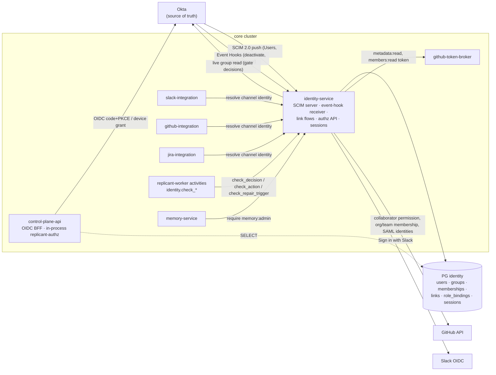
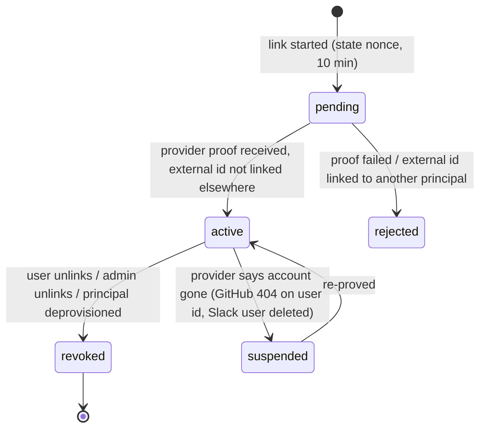
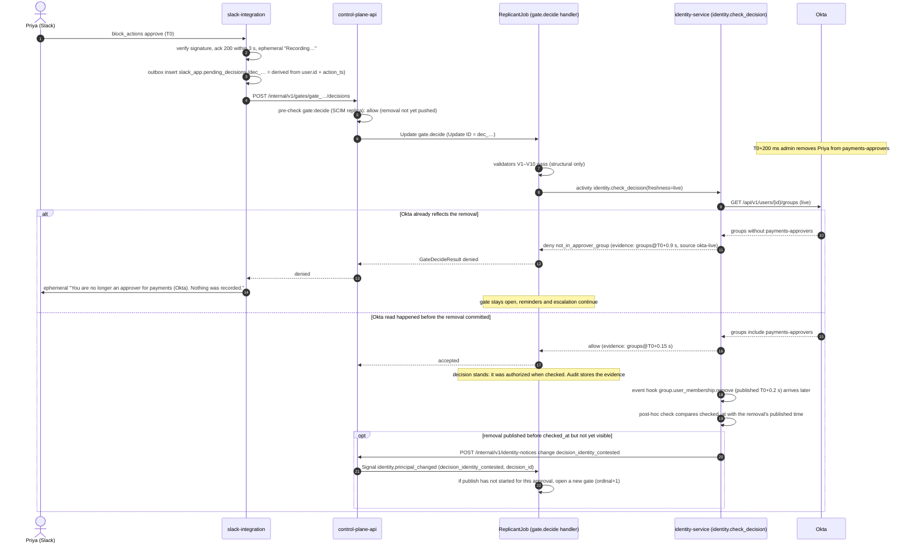

# Identity and authorization

**Owner:** WS-07 (WS-09 reviews) · **Constraints:** D-18, D-25, D-15, D-19, D-26, D-21 ·
**Contracts:** C-PG (`identity`, `tenancy`), C-MSG (`identity.check_decision`,
`identity.principal_changed`, actor rules V8/V9), C-JOBREQ (`requester`), C-IDS (`principal_id`) ·
**DDL:** [data/ddl/identity.sql](data/ddl/identity.sql) · **ADRs:** [ADR-07-002](adr/002-authorization-in-code-evaluator.md),
[ADR-07-003](adr/003-identity-linking.md), [ADR-07-006](adr/006-bff-session-and-device-flow.md)

## Purpose

Define who a person is (Okta), how that person's Slack, GitHub, and Jira identities are tied to
them, what they may do (Okta groups plus a live repository-permission check, D-18), how the
admin-only memory rule (D-25) is enforced server-side, and where each check runs. The goal is no
confused deputy: Replicant never does for a person something that person could not do.

## Decisions summary

| # | Decision | Reference |
|---|---|---|
| I-1 | Okta OIDC for people. Browser: **BFF** pattern: control-plane-api is a confidential OIDC client (authorization code + PKCE S256) and the browser holds only an opaque `__Host-` session cookie; no tokens in the SPA. CLI: OAuth 2.0 **device authorization grant** (Okta native app) | D-18, [ADR-07-006](adr/006-bff-session-and-device-flow.md) |
| I-2 | SCIM 2.0 server in identity-service; Okta provisions users and pushes groups into `identity`. **Okta Event Hooks** for `user.lifecycle.*` and `group.user_membership.remove` invalidate faster than SCIM. Gate decisions additionally do a **live Okta group read** | D-18, D-25 |
| I-3 | Authorization = (role bindings from Okta groups, per tenant) ∧ (live GitHub repository permission for the target repo) ∧ (action-specific rules: self-approval, tenant match, link present). Evaluated **per request**, no cached grants | D-18, D-25 |
| I-4 | One evaluator library `replicant-authz` (Python). control-plane-api evaluates in process against `identity` (SELECT grant); identity-service serves the same evaluator over HTTP to every other caller and to workflow activities | [ADR-07-002](adr/002-authorization-in-code-evaluator.md) |
| I-5 | Linking: GitHub by **GHEC SAML external identity** (automatic) or **GitHub App user OAuth** (one click); Slack by **Sign in with Slack** (OIDC); Jira by Atlassian OAuth 2.0 (3LO). Unlinked identities can neither trigger nor approve | D-18, [ADR-07-003](adr/003-identity-linking.md) |
| I-6 | `memory:admin` is granted only by membership in the Replicant admin group (`replicant-admins`, configurable), never through tenant role bindings. Checked server-side on every memory endpoint in control-plane-api **and** again in memory-service; denials audited | D-25 |
| I-7 | Local stub IdP: **Dex v2.46** (WS-11 ADR-11-003) with static users and groups; `replicant dev seed` drives identity-service's real SCIM endpoints as Okta would. A local-only seed token (`svc_dev-seeder`) exists **only in dev-target images** (build-time exclusion plus WS-09's layered guards) | D-20, OQ-11-04, WS-09 secrets.md §11 |
| I-8 | Gitea identities (local profile) are first-class channel identities (`kind: gitea`, C-JOBREQ 1.1.0 / C-MSG 1.1.0), linked by Gitea OAuth2 or the local-only dev link endpoint; permission checks go through the `replicant-scm` Gitea adapter | CCR-11-01, XD-11-05 |



---

## 1. Principals

| Kind | ID | Source | Notes |
|---|---|---|---|
| Human | `usr_<ulid>` (C-IDS) | Created by identity-service on first SCIM `POST /Users`; `okta_sub` and SCIM `id` stored | Never reused; deprovisioned users tombstoned 7 years (C-STATE) |
| Service | `svc_<name>` | Seed migration (`identity.service_principals`) | Examples: `svc_scheduler`, `svc_config-publisher`, `svc_eval-harness`, `svc_github-integration`. Services never decide gates (C-MSG V8). Jobs started by a service carry `on_behalf_of` a human whose permissions bound the job (C-JOBREQ) |

## 2. Authentication

### 2.1 Browser (BFF)

- Okta app: **Web Application** (confidential), custom authorization server `replicant`
  (`https://acme.okta.com/oauth2/aus8f2k1replicant/`), scopes `openid profile email
  offline_access`, redirect `https://replicant.acme.example.com/auth/callback`. PKCE S256 is used
  even though the client is confidential [verified: https://developer.okta.com/docs/guides/implement-grant-type/authcodepkce/main/, 2026-10-24].
- control-plane-api (`authlib` 1.9.1) performs the code exchange, validates the ID token
  (issuer, audience, nonce, `exp`, signature from `/v1/keys`), maps `sub` → `principal_id` via
  `identity.users.okta_sub`, and asks identity-service to create a session:
  `POST /internal/v1/sessions {principal_id, okta_sid, refresh_token_enc, user_agent_hash, ip}`.
- Cookie: `__Host-replicant_session=<session_id>.<hmac>`; `HttpOnly; Secure; SameSite=Lax;
  Path=/`; idle timeout 12 h, absolute 7 days. Refresh tokens are stored encrypted (KMS data key,
  `alias/replicant/<env>/sessions`) in `identity.sessions`; control-plane-api refreshes against
  Okta every 60 min. A failed refresh (user deactivated, token revoked) ends the session.
- CSRF: `SameSite=Lax` plus a double-submit token header `X-Replicant-CSRF` on every non-GET; SSE is
  GET only.
- Session check per request: control-plane-api verifies the HMAC, then reads the session row
  (cached in process for at most 30 s, keyed by session ID; revocation by identity-service sets
  `revoked_at` and publishes `NOTIFY replicant_session_revoked`, which evicts immediately).
  Sessions are authentication only. **Authorization is evaluated on every request** (§6).

### 2.2 CLI (`replicant login`)

OAuth 2.0 Device Authorization Grant against the same authorization server, Okta app type
**Native** with grant types Device Authorization and Refresh Token
[verified: https://developer.okta.com/docs/guides/device-authorization-grant/main/, 2026-10-24]:

```
$ replicant login
To sign in, open https://acme.okta.com/activate and enter code  QBKD-WXZL  (expires in 10 min)
✓ Signed in as Priya Raman (usr_01knm4…) · tenants: payments (approver), identity (viewer)
```

`POST /oauth2/aus8f2k1replicant/v1/device/authorize` → poll `/v1/token` with
`grant_type=urn:ietf:params:oauth:grant-type:device_code` at the returned `interval` (5 s) until
the 600 s expiry. Tokens are kept in the OS keychain (`keyring`). The CLI calls control-plane-api
with `Authorization: Bearer <access token>` (audience `api://replicant`, 60 min lifetime). The API
validates the JWT locally (JWKS cached 10 min, re-fetched on unknown `kid`), then performs the same
per-request principal status and authorization checks as for browser sessions, so a
deprovisioned user's still-valid JWT is refused as soon as SCIM or the event hook lands.

### 2.3 Service-to-service

- In-cluster callers: Kubernetes projected ServiceAccount tokens (audience per callee, ≤ 1 h),
  verified against the cluster OIDC issuer; mapped to `svc_*` by
  `identity.service_principals.k8s_subject`.
- CI (`svc_config-publisher`, WS-03/WS-06): GitHub Actions OIDC token → `POST /v1/auth/token`
  (token exchange in control-plane-api, `sub` claim pinned to `repo:acme/replicant-config:ref:refs/heads/main`)
  → 15 min Replicant token.
- Schedules: `svc_scheduler` with `on_behalf_of` = the schedule owner. If the owner is
  deprovisioned, the schedule is paused and the tenant admins notified.

## 3. SCIM provisioning (identity-service)

### 3.1 Endpoints

Base `https://identity.replicant.acme.example.com/scim/v2/` (reachable only from Okta's published IP
ranges via WAF, plus the bearer token). Implemented with FastAPI and `scim2-models` 0.12.2 for
schema parsing and serialisation [verified: PyPI, 2026-10-24].

| Method | Path | Okta usage [verified: https://developer.okta.com/docs/api/openapi/okta-scim/guides/scim-20, 2026-10-24] | Replicant behaviour |
|---|---|---|---|
| GET | `/ServiceProviderConfig`, `/ResourceTypes`, `/Schemas` | discovery | static |
| GET | `/Users?filter=userName eq "…"&startIndex&count` | existence check before create; pagination with `count=100` | exact-match filter on `userName` only; stable ordering by `created_at, id` |
| POST | `/Users` | create | mint `usr_…`; store SCIM `id = principal_id`; `active` |
| GET | `/Users/{id}` | read | — |
| PUT | `/Users/{id}` | profile updates (custom integrations use PUT) | replace profile fields |
| PATCH | `/Users/{id}` | `active=false` deactivation (Okta never sends DELETE for users) | §3.3 deprovisioning |
| POST | `/Groups` | push group | create `identity.groups` row (`display_name`, `okta_group_id` from `externalId`) |
| PATCH | `/Groups/{id}` | members add/remove, rename | membership diff applied in one transaction |
| PUT | `/Groups/{id}` | full replace (some integrations) | replace set |
| DELETE | `/Groups/{id}` | only if an admin unlinks with "delete in app" | soft delete; role bindings referencing it become inert and alert |

Authentication: Okta "HTTP Header" bearer token, 256-bit random, stored in Secrets Manager
(`replicant/<env>/scim-bearer`), rotated quarterly with a two-token overlap. Every SCIM write
emits `audit.emit({type: "identity.scim.<op>", actor: "svc_okta-scim", …})`.

### 3.2 What a SCIM change triggers

A transaction applies the change, writes `identity.principal_events` (outbox), and commits. The
identity-service outbox relay then:

1. Publishes `NOTIFY replicant_identity_changed '<principal_id>'` (sessions and the in-process
   evaluator caches in control-plane-api drop that principal; there are no grant caches, only
   the 30 s session cache).
2. For `deprovisioned`, `suspended`, `groups_changed` (when the removed group is referenced by a
   role binding), and `identity_link_removed`: calls control-plane-api
   `POST /internal/v1/identity-notices {principal_id, change}`; control-plane-api finds affected
   running jobs in `jobs_read` (requester = principal, or principal in an open gate's eligible
   principals/groups) and Signals `identity.principal_changed` to each (C-MSG; control-plane-api
   is the only Temporal sender, per the C-MSG open question recommendation).

### 3.3 Okta Event Hooks (faster than SCIM)

Okta Event Hooks deliver at least once, may be out of order, retry once on 5xx, time out after
3 s, have no guaranteed maximum latency, and need a one-time `X-Okta-Verification-Challenge`
response [verified: https://developer.okta.com/docs/concepts/event-hooks/, 2026-10-24]. Hence they
are **hints**: on `user.lifecycle.deactivate`, `user.lifecycle.suspend`,
`group.user_membership.remove`, the receiver (`POST /okta/event-hooks`, authenticated by the
configured `Authorization` secret) dedupes by `eventId`, sets
`identity.users.recheck_required_at = now()`, and enqueues an immediate reconcile of that user
against the Okta Users API (`GET /api/v1/users/{id}`, `GET /api/v1/users/{id}/groups`) using an
Okta API service app (OAuth 2.0 client credentials with `private_key_jwt`, scopes
`okta.users.read okta.groups.read`). While `recheck_required_at` is set and not cleared, the
evaluator treats the user's privileged permissions (gate decisions, steering, release, admin) as
**denied** (fail closed); read access continues.

### 3.4 Deprovisioning effects

| Object | Effect when a user is deactivated/suspended |
|---|---|
| Browser sessions, CLI tokens | Sessions revoked (`revoked_at`), refresh refused; API refuses bearer tokens for `status != active` on the next request |
| Open gates where the user was the only eligible principal | `identity.principal_changed` → workflow re-resolves eligibility (activity) and re-notifies; if no eligible approver remains, the gate escalates per policy (approvals.md §6) |
| Pending decisions by the user (outbox rows) | They still go to Temporal and fail at `identity.check_decision` with `principal_deprovisioned`; outbox marks them `denied` |
| Running jobs requested by the user | Tenant policy `on_requester_deprovisioned` (default `pause_and_notify_tenant_admins`; alternatives `cancel`, `reassign_to_manager` using the Okta `manager` attribute if provisioned) |
| Open PRs from those jobs | Remain; repair triggers from others still work; the PR description notes the reassignment |
| Schedules owned by the user | Paused; tenant admins notified |
| Identity links | Kept (tombstoned with the user), so audit can still map past GitHub/Slack actions to the person |
| Memory entries authored by the user | Unchanged (provenance stays). D-25 analytics can filter by deprovisioned authors |

## 4. Identity linking

Rule: an unlinked channel identity cannot trigger, approve, steer, or cause a repair (D-18,
D-15). Each external identity links to at most one principal (unique index). Linking requires an
authenticated Replicant session (Okta) **and** proof of control of the external account from the
provider itself; email equality alone is never sufficient.

### 4.1 Link methods

| Channel | Method (preference order) | Proof | Facts |
|---|---|---|---|
| GitHub | (a) **GHEC SAML external identity**: identity-service reads `organization.samlIdentityProvider.externalIdentities { samlIdentity { nameId } user { databaseId login } }` with an installation token holding `members:read`, matches `nameId` to `identity.users.user_name` (Okta login), links automatically, nightly and on `membership` events | GitHub's SAML linkage, established when the user authenticated to the org through Okta | Visible to "GitHub App with an installation token with read or write access to members" [verified: https://docs.github.com/en/graphql/reference/orgs, 2026-10-24] |
| GitHub | (b) **GitHub App user OAuth** ("Connect GitHub" in the UI or the link URL from a refusal reply): `https://github.com/login/oauth/authorize?client_id=…&redirect_uri=…/v1/identity/links/github/callback&state=…&code_challenge=…&code_challenge_method=S256`, exchange at `/login/oauth/access_token`, call `GET /user`, store `id` and `login`, then **discard the user token** | The user signs in to GitHub | PKCE S256 supported; user tokens expire after 8 h [verified: https://docs.github.com/en/apps/creating-github-apps/authenticating-with-a-github-app/generating-a-user-access-token-for-a-github-app, 2026-10-24] |
| GitHub | (c) EMU enterprises: SCIM-provisioned accounts (`<handle>_<shortcode>`) map by the provisioned `externalId` | IdP provisioning | `[unverified: EMU SCIM externalId visibility to a GitHub App]`; (b) remains available |
| Slack | **Sign in with Slack** (OIDC): `https://slack.com/openid/connect/authorize?scope=openid%20profile%20email&nonce=…`, token via `openid.connect.token`, claims `https://slack.com/user_id`, `https://slack.com/team_id` | The user signs in to Slack | [verified: https://docs.slack.dev/authentication/sign-in-with-slack, 2026-10-24]. Must be a separate OAuth flow from the bot install |
| Slack | Optional auto-suggest: on first unlinked interaction, `users.lookupByEmail` finds a candidate; the ephemeral reply shows a one-click "Link as Priya Raman" button that still runs Sign in with Slack | Same as above | Never auto-links on email alone |
| Jira | Atlassian OAuth 2.0 (3LO), `GET https://api.atlassian.com/me` → `account_id` | The user signs in to Atlassian | `[unverified: endpoint and claim names at time of writing; WS-07 implementation verifies]` |
| Gitea (local profile only) | Gitea OAuth2 application (`/login/oauth/authorize`, `/login/oauth/access_token`, `GET /api/v1/user` → numeric `id`), or the seeder's local-only `POST /v1/admin/dev/identity-links` | The user signs in to Gitea | `[unverified: Gitea OAuth2 provider endpoint paths in the pinned Gitea version; WS-11 pins it]`. Stored as `kind=gitea`, keyed by `(host, user id)` so local Gitea IDs never collide with GitHub IDs |

Grid/Enterprise Slack: links are stored as `(enterprise_id or team_id, user_id)`.
Interaction payloads carry `user.id`, `team.id`, and `enterprise` for Grid; the resolver uses the
enterprise ID when present `[unverified: exact payload field set for Enterprise org-wide apps]`.

### 4.2 Link lifecycle



Conflicts (external ID already linked to another principal) are never auto-resolved: the second
attempt is rejected and the identity admins (`replicant-identity-admins`) see it in
Admin → Identity links with both principals and timestamps.

### 4.3 Unlinked identities: what they see

| Channel | Behaviour |
|---|---|
| GitHub issue label/command | One reply per user per repo per 24 h with the link URL; no job |
| GitHub PR review comment on a Replicant PR | Ignored for repair (D-15); one reply per user per PR: "I only act on comments from linked org members." |
| Slack slash command / shortcut | Ephemeral: "Link your Slack account to start Replicant jobs" + button |
| Slack approval button | Ephemeral: "Link your Slack account to decide on Replicant gates" + button; the gate message is unchanged. The clicked tuple `(gate_id, revision, decision)` is stored with the link flow (`pending_action`). After linking, the user gets a DM: "Your Approve on Publish · Stale FX rate cache (r3) was not recorded. [Review r3] [Approve r3]". It is never applied automatically, and if the revision changed the DM offers the new revision instead (R2-049) |
| Jira trigger | Comment on the issue with the link URL |

## 5. Roles, permissions, bindings

### 5.1 Permission catalogue

| Permission | Meaning | Also requires (live) |
|---|---|---|
| `job:read` | See a job, its timeline, artifacts index, memory used | repo `read` on every target repo (display cache ≤ 60 s allowed, C-STATE) |
| `job:create` | Start jobs on a repo | repo `write` (tenant may lower to `triage` for `docs` workflow) |
| `job:control:own` | Cancel, pause, resume, steer, take over own jobs | repo `write` |
| `job:control:any` | Same on any job in the tenant | repo `write` |
| `artifact:download` | Presigned GET of artifact bodies | `job:read`; `workspace_archive` only to the principal who passed takeover authorization, audited `job.takeover_archive_presigned` (XD-FIX-R2-026) |
| `gate:decide` | Decide gates for which policy makes you eligible | `GateView.eligible` (groups/principals), repo ≥ `eligible.min_repo_permission`, not the requester unless `requester_may_decide` |
| `gate:delegate` | Delegate your eligibility (out of office) | same as `gate:decide` for the delegate |
| `tenant:policy:edit` | Edit tenant-scoped `risk_rules`/`gate_rules`/`approval_channels` (produces a tenant-derived bundle) | — |
| `tenant:ops:edit` | Edit operational settings: channel targets, quotas within platform caps, repo trigger settings | — |
| `cost:read` | Tenant cost views | — |
| `release:read` | See bundles, versions, evals | — |
| `release:operate` | Ramp, roll back, hold, drain, offer migration, retire | — |
| `release:revoke` | Revoke a bundle | — |
| `release:pin` | Use `requested_release_bundle_id` (C-JOBREQ) | — |
| `release:signoff` | Sign off release pipeline points (WS-06 §10); two-person and author exclusion enforced by the pipeline's handler | live group check at decision time |
| `release:signoff_tenant_layer` | Sign off the tenant-layer point of a derived bundle (XD-FIX-R1-145); held by tenant admins, scoped to their own tenant | `check-release-signoff` compares the derived bundle's `tenant_id` with the binding's tenant |
| `eval:curate` | Human labels, labeling queue, golden-task verify and transition (XD-FIX-R1-142); erase also needs `release:operate` | — |
| `restore:execute` | Post-restore steps of WS-10's runbook (XD-FIX-R1-237) | an open `ops.restore_events` row |
| `security:leak` | Record leaks and start `LeakPurge` (XD-FIX-R1-192); approving the purge needs `replicant-admins` (two distinct, not the initiator) | — |
| `ops:kill-switch` | Engage or release kill switches (architecture.md §2.9); tenant admins hold it for their own tenant and repos | — |
| `memory:flag` | Flag a memory entry seen on a job (R2-028, WS-04 lead); not a management capability, D-25 unaffected | `job:read` on that job |
| `release:transition`, `eval:run` | Promotion transitions and eval runs (service principals `svc_eval-worker`, `svc_release-controller`; `eval:run` also release operators) | — |
| `registry:publish` | Publish definitions (CI service principal only) | — |
| `identity:admin` | Resolve link conflicts, unlink, view link status for all | — |
| `admin:platform` | Tenants, quotas caps, kill switches, migration status, admin operations (D-26) | — |
| `audit:read` | Audit views | — |
| `temporal:ui` | Temporal UI access | — |
| **`memory:admin`** | Every memory management capability (D-25) | membership in the Replicant admin group **at request time** |

### 5.2 Roles

| Role | Permissions | Bound by |
|---|---|---|
| `viewer` | `job:read`, `cost:read` | tenant binding |
| `engineer` | viewer + `job:create`, `job:control:own`, `artifact:download` | tenant binding |
| `approver` | engineer + `gate:decide`, `gate:delegate` | tenant binding (optionally narrowed by repo globs) |
| `tenant_admin` | approver + `job:control:any`, `tenant:policy:edit`, `tenant:ops:edit`, `release:signoff_tenant_layer` (own tenant) | tenant binding |
| `operator` | `release:read`, `temporal:ui`, `ops:kill-switch`, `job:read` (all tenants, without artifact bodies), `cost:read` (all) | platform binding (`replicant-operators`) |
| `release_operator` | operator + `release:operate` (ramp, overrides, rollback with `migrate_running` `none`/`offer`), `release:pin`, `eval:run` | platform binding (`replicant-release-operators`) |
| `release_manager` | `release:read`, `release:signoff`, `release:revoke` (revoke a bundle, and `migrate_running` `required` / `required_by_operator`; WS-06 releases.openapi.yaml, R1V-044, XD-W3-R1V-044) | platform binding (`replicant-release-managers`) |
| `security_signer` | `release:read`, `release:signoff` (second signer for two-person points, WS-06 §10) | platform binding (`replicant-security`) |
| `eval_curator` | `release:read`, `eval:run`, `eval:curate` | platform binding (`replicant-eval-curators`) |
| `identity_admin` | `identity:admin` | platform binding (`replicant-identity-admins`) |
| `platform_admin` | `admin:platform`, `audit:read`, `ops:kill-switch`, `restore:execute` | platform binding (`replicant-platform-admins`) |
| `security_responder` | `security:leak`, `audit:read` | platform binding (`replicant-security`) |
| `replicant_admin` | `memory:admin` (and nothing else implicitly) | **only** the configured admin group (`identity.settings.replicant_admin_group`, default `replicant-admins`) |

`memory:admin` cannot be included in any tenant or platform binding: the
`identity.role_bindings` table has a CHECK constraint excluding `replicant_admin`, and the role is
computed solely from group membership (D-25: "Tenant admins and other roles get none of these
unless they are also in the admin group").

### 5.3 Bindings (example)

```yaml
# PUT /v1/admin/role-bindings  (platform_admin) – stored in identity.role_bindings (versioned)
bindings:
  - {group: payments-engineers, tenant: payments, role: engineer}
  - {group: payments-approvers, tenant: payments, role: approver}
  - {group: ledger-core,        tenant: payments, role: approver, repos: ["acme-payments/ledger-*"]}
  - {group: payments-leads,     tenant: payments, role: tenant_admin}
  - {group: replicant-operators,          scope: platform, role: operator}
  - {group: replicant-release-operators,  scope: platform, role: release_operator}
  - {group: replicant-release-managers,   scope: platform, role: release_manager}
  - {group: replicant-security,           scope: platform, role: security_signer}
  - {group: replicant-security,           scope: platform, role: security_responder}
  - {group: replicant-eval-curators,      scope: platform, role: eval_curator}
  - {group: replicant-identity-admins,    scope: platform, role: identity_admin}
  - {group: replicant-platform-admins,    scope: platform, role: platform_admin}
settings:
  replicant_admin_group: replicant-admins     # D-25 (name configurable)
```

## 6. The evaluator (`replicant-authz`)

```python
# replicant_authz/evaluate.py — one implementation, used in-process by control-plane-api and over
# HTTP by identity-service (POST /internal/v1/authorize, /internal/v1/authorize:batch-repos,
# /internal/v1/check-decision, …; api/identity-service.openapi.yaml)
from dataclasses import dataclass
from enum import StrEnum


class Decision(StrEnum):
    ALLOW = "allow"
    DENY = "deny"


@dataclass(frozen=True)
class Request:
    principal_id: str            # usr_… or svc_…
    action: str                  # permission name, e.g. "gate:decide"
    tenant_id: str | None
    repos: tuple[str, ...] = ()  # repo_ids (immutable GitHub ids)
    job_requester: str | None = None
    gate: dict | None = None     # GateView.eligible + kind, for gate:decide
    on_behalf_of: str | None = None
    freshness: str = "request"   # "request" (SCIM replica) | "live" (Okta + GitHub live, for decisions)


@dataclass(frozen=True)
class Result:
    decision: Decision
    reason: str                  # machine code, e.g. not_in_approver_group, insufficient_repo_permission
    evidence: dict               # groups seen + source + as_of, repo permissions + source + as_of


async def evaluate(req: Request, ctx: "Ctx") -> Result:
    p = await ctx.identity.principal(req.principal_id)            # identity.users / service_principals
    if p is None or p.status != "active":
        return Result(Decision.DENY, "principal_deprovisioned", {"status": getattr(p, "status", None)})
    if p.kind == "service":
        return await _service(req, p, ctx)                       # services: explicit allow-list + on_behalf_of re-evaluation
    if p.recheck_required_at and req.action not in READ_ONLY:
        return Result(Decision.DENY, "identity_recheck_pending", {})
    groups = await (ctx.okta.live_groups(p) if req.freshness == "live" else ctx.identity.groups(p))
    if req.action == "memory:admin":                             # D-25: group membership only
        ok = ctx.settings.replicant_admin_group in groups.names
        return Result(Decision.ALLOW if ok else Decision.DENY,
                      "ok" if ok else "not_in_admin_group", {"groups": groups.evidence()})
    perms = ctx.bindings.permissions(groups.names, req.tenant_id, req.repos)
    if req.action not in perms:
        return Result(Decision.DENY, "not_in_approver_group" if req.action == "gate:decide" else "missing_permission",
                      {"groups": groups.evidence()})
    if req.action == "gate:decide":
        g = req.gate or {}
        if not g.get("requester_may_decide", False) and req.principal_id == req.job_requester:
            return Result(Decision.DENY, "self_approval_forbidden", {})
        if not _eligible(p, groups, g):
            return Result(Decision.DENY, "not_in_approver_group", {"groups": groups.evidence()})
    need = REPO_REQUIREMENT[req.action](req)                     # e.g. "write"; None = no repo check
    if need:
        link = await ctx.identity.link(p, "github")
        if link is None:
            return Result(Decision.DENY, "identity_unlinked", {})
        for repo in req.repos:
            perm = await ctx.github.permission(repo, link.github_user_id, live=True)  # never cached for writes/decisions
            if RANK[perm] < RANK[need]:
                return Result(Decision.DENY, "insufficient_repo_permission", {"repo": repo, "have": perm, "need": need})
    return Result(Decision.ALLOW, "ok", {"groups": groups.evidence()})
```

Repository permission source: `GET /repos/{owner}/{repo}/collaborators/{username}/permission`,
which returns `permission` (`admin|write|read|none`, with maintain→write and triage→read) and
`role_name` (`admin|maintain|write|triage|read`) [verified:
https://docs.github.com/en/rest/collaborators/collaborators#get-repository-permissions-for-a-user,
2026-10-24]; the evaluator ranks `role_name` (admin 5, maintain 4, write 3, triage 2, read 1,
none 0). Token: identity-service mints `metadata:read` for the single repo through the broker
(CCR-09-06, accepted). Org membership (D-15): `GET /orgs/{org}/members/{username}` with `members:read`
[verified: https://docs.github.com/en/rest/authentication/permissions-required-for-github-apps,
2026-10-24]. Live GitHub results are memoised for **display-only** callers for 60 s; `freshness =
"live"` and every write action bypass the memo (C-STATE §1.4).

### 6.0 Permission sources for non-GitHub repositories

| Repository host | Source of the repo permission |
|---|---|
| `github.com` (prod, staging, dev registrations) | Live collaborator permission (above) |
| Local Gitea (`git.replicant.localhost`) | `replicant-scm` Gitea adapter: `GET /api/v1/repos/{o}/{r}/collaborators/{user}/permission` with the broker's Gitea token (XD-11-05) |
| Eval golden repos (`git.eval.<env>.replicant.internal/golden/*`, XD-06-07) | Static grant in `identity.settings.golden_repo_grants`: `read` for members of `replicant-release-operators` and `replicant-eval-curators`, `write` for `svc_eval-worker` and `svc_release-controller` acting on behalf of those members. Eval and shadow jobs (`options.evaluation`) never touch GitHub, so the on-behalf-of human's permission on the golden repo is the D-18 check (R1-161b) |

### 6.1 Repository requirement per action

| Action | Minimum repo permission (default) | Tenant-configurable |
|---|---|---|
| `job:read` | read | no |
| `job:create` (`docs` workflow) | write | may lower to triage |
| `job:create` (others) | write | may raise to maintain |
| `job:control:*` (cancel, pause, resume, steer) | write | no |
| takeover | write | no |
| `gate:decide` | `GateView.eligible.min_repo_permission` (default write; `publish_approval` on protected default branches: maintain) | via `gate_rules` |
| repair trigger (PR comment) | write (D-15) | may raise |

## 7. D-25: admin-only memory management

1. **Permission:** `memory:admin`, granted by membership in `replicant_admin_group` (default
   `replicant-admins`) as known to identity-service **at request time** (SCIM replica, plus the
   event-hook recheck flag that fails closed).
2. **Server-side checks (two layers):**
   - control-plane-api: every route under `/v1/admin/memory/**` is registered with
     `dependencies=[Depends(require("memory:admin"))]`. A startup self-test enumerates the
     FastAPI routes and refuses to start if any route under that prefix lacks the dependency
     (prevents a forgotten check).
   - memory-service (WS-04): its admin API accepts only calls from control-plane-api's service
     identity, carrying `X-Replicant-Principal: usr_…`, and **re-checks** with identity-service
     `POST /internal/v1/authorize {principal_id, action: "memory:admin"}` before every state change
     (defence in depth; a bug in one layer does not grant access). One endpoint and one spelling for every
     caller (R1-098, XD-FIX-R1-098).
3. **Denials are audited in both layers** (XD-W2-04-02, accepted): control-plane-api's first-layer check emits
   `authz.denied`, memory-service's second-layer re-check emits `memory.admin_denied`; both carry
   `details.permission = "memory:admin"` and `details.route`, so WS-11's `replicant dev authz-probe` matches either.
   Example of the second layer: `audit.emit({type: "memory.admin_denied", actor: principal_id, action:
   "memory:admin", resource: "/v1/admin/memory/candidates/mem_…", reason: "not_in_admin_group",
   request_id})`. The 403 body (RFC 9457) carries `audit_id`, which the UI shows (prototype
   [memory-denied.html](design/prototype/memory-denied.html)).
4. **Non-admin read-only view:** `GET /v1/jobs/{job_id}/memory` and the approval packet's memory
   section return the entries in the job's pinned snapshot (`jobs_read.job_memory_usage`) to anyone
   with `job:read` on that job. This endpoint is not under `/v1/admin/memory`, has no mutating
   verbs, and returns entry text, scope, version, and provenance summary only.
5. **Navigation:** `GET /v1/me` returns `capabilities` (e.g. `["memory:admin"]`); the UI hides the
   Replicant admin group without it. Following a direct link to `/admin/memory/**` renders the 403
   page from the API's response, not from the client's guess.
6. **Mid-session removal from the admin group:** Okta removes the user from `replicant-admins`;
   SCIM `PATCH /Groups/{id}` removes the membership (and/or the event hook flags the user). The
   **next** request evaluates without the group and is denied; there is no session-cached grant to
   expire. An admin action already in flight completes or fails according to whether memory-service's
   own re-check ran before or after the membership row changed; both outcomes are audited with the
   evidence the check used.
7. **System writes unaffected:** the Feedback Ingestor/Memory Writer call memory-service as
   `svc_replicant-worker` through internal candidate endpoints (WS-04), which create candidates only;
   lifecycle transitions that WS-04 would automate run only under an admin-configured policy whose
   edits require `memory:admin`.

## 8. Enforcement points (every entry)

| # | Entry point | Who calls | Authentication | Check performed | On deny |
|---|---|---|---|---|---|
| E1 | control-plane-api `/v1/**` (UI) | browser | session cookie + CSRF | `replicant-authz` per route permission (table in [architecture.md](architecture.md) §4), tenant scoping, repo check for job-scoped routes | 403/404 (no existence leak), audit `authz.denied` |
| E2 | control-plane-api `/v1/**` (CLI) | `replicant` CLI | Okta access token (device grant) | same as E1 | same |
| E3 | `POST /v1/jobs` (intake) | UI, CLI, channel adapters (as service principals with `requester` set) | session/JWT or service SA token | adapter may submit only JobRequests whose `source.channel` matches its own channel; requester must be `usr_` linked on that channel; `job:create` + repo permission for the requester; `priority=urgent` needs hotfix permission; `requested_release_bundle_id` needs `release:pin` | 403 with reason; adapter replies on the channel |
| E4 | control-plane-api `/internal/v1/gates/{id}/decisions` | slack-integration, github-integration | SA token (allow-list: these two) | adapter-resolved actor must be linked; pre-check `gate:decide` (fast feedback) | 403 → adapter shows the reason |
| E5 | Temporal Update handlers (`gate.decide`, `job.*`) | workflow | — | **authoritative**: activity `identity.check_decision` / `identity.check_action` → identity-service with `freshness=live` (Okta live groups, live GitHub permission) | `denied` result; gate stays open |
| E6 | `pr.event` repair trigger | workflow | — | activity `identity.check_repair_trigger` (linked, org member, repo write, not bot, not the Replicant app) per actor | event ignored, reply on PR |
| E7 | slack-integration HTTP | Slack | `X-Slack-Signature` v0 HMAC, timestamp within 5 min | then identity resolve (link) | 401 for bad signature; ephemeral link prompt for unlinked |
| E8 | github-integration webhook | GitHub | `X-Hub-Signature-256` HMAC | bot/self filter, link resolve | 401 / ignored / link reply |
| E9 | jira-integration webhook | Jira | Jira webhook secret (JWT for Connect, or shared-secret header for system webhooks) `[unverified: Jira Cloud webhook signing mechanism; WS-07 implementation verifies]` | link resolve | 401 / link comment |
| E10 | identity-service `/scim/v2/**` | Okta | bearer token + IP allow-list | — | 401 |
| E11 | identity-service `/okta/event-hooks` | Okta | configured `Authorization` header secret | dedupe by `eventId` | 401 |
| E12 | identity-service `/internal/v1/**` | core services | SA token, per-endpoint allow-list | — | 403 |
| E13 | memory-service admin API | control-plane-api only | SA token + `X-Replicant-Principal` | re-check via identity-service `POST /internal/v1/authorize {action: "memory:admin"}` (D-25, R1-098) | 403 + audit `memory.admin_denied` |
| E14 | github-token-broker | publisher, github-integration, repo-mirror, identity-service | SA token | caller policy table (github-app.md §9.2) | 403 + audit |
| E15 | Runner API orchestration listener | replicant-worker, eval-worker | SA token (C-RUNNER) | subject allow-list (WS-02) | 403 |
| E16 | Runner sandbox listener, memory MCP, context MCP, AI gateway, repo-mirror | sandboxes | run token (JWT, audiences per C-RUNNER) | run-scoped claims (tenant, job, repo_ids) | 401/403 |
| E17 | Temporal frontend | control-plane-api, workers, notifier, github-integration | mTLS, Authorizer (C-MSG §1) | API allow-list per identity | PermissionDenied |
| E18 | Temporal UI | operators | Okta OIDC (`TEMPORAL_AUTH_ENABLED`, `TEMPORAL_AUTH_PROVIDER_URL`, …) [verified: https://docs.temporal.io/references/web-ui-environment-variables, 2026-10-24] | `replicant-operators` group via the Temporal ClaimMapper | 403 |
| E19 | Codec server | Temporal UI / CLI | the UI's access token forwarded (`TEMPORAL_CODEC_PASS_ACCESS_TOKEN`) | operator group; decode audited | 403 |
| E20 | Presigned artifact URLs | browser | issued only after E1 checks | 15-min expiry, per-object; every presign audited (C-ART §5) | — |
| E21 | Grafana | people | Okta OIDC | Grafana org roles from groups; Postgres data source is read-only role `grafana_ro` (D-26) | — |
| E22 | Local dev seed token (`svc_dev-seeder`) | `replicant dev seed` | static token, dev images only | §9.3 L-1…L-7 | 401 (prod images have no authenticator) |
| E23 | Kill switches: `PUT /v1/admin/kill-switches/…` and the S3 mirror `s3://acme-replicant-<env>-ops/kill-switches/v1/state.json` (break-glass write) | operators; break-glass role `replicant-<env>-killswitch-operator` | session/JWT; AWS IAM | `ops:kill-switch` (tenant admins only for their tenant and repos); IAM write on the SSM path only for control-plane-api's role and the break-glass role (XD-FIX-R2-016) | 403 + audit |
| E24 | `GET /internal/v1/tenants/{t}/gateway-quota` | gateway shim | SA token | caller allow-list `svc_replicant-gateway-shim` | 403 |
| E24a | Internal callers of control-plane-api `/internal/v1/**` (gateway shim, temporal-codec-server, langfuse-retention-sweeper, eval-worker, memory-service) | services | projected ServiceAccount token (audience `control-plane-api`) in every environment except local; locally only, `REPLICANT_INTERNAL_CALLER_TOKENS_FILE` maps static tokens to caller identities (for example the gateway shim as `svc_replicant-gateway-shim`) and is honoured **only when `REPLICANT_ENV=local`**; any other value of `REPLICANT_ENV` makes control-plane-api ignore the file and refuse to start if it is set | per-route caller allow-list (`x-replicant-callers`) (XD-W3-R1V-067) |
| E25 | identity-service `GET /internal/v1/principals/by-okta-sub/{sub}` | audit-indexer (WS-08 CronJob, no DB login), control-plane-api (`replicant audit explain-pr`) | mTLS, caller allow-list | returns `{principal_id, display_name, okta_login}` or 404; WS-08 caches 1 h (XD-FIX-R1-194) |
| E26 | control-plane-api `POST /internal/v1/audit/events` | temporal-codec-server, langfuse-retention-sweeper | mTLS, caller allow-list | event type must be registered and allowed for that caller; no new C-PG login (XD-FIX-R1-287, R1-193) |

## 9. Local identity (D-20)

### 9.1 Stub IdP

Local identity follows WS-11's accepted [ADR-11-003](../11-local-dev/adr/003-dex-stub-idp.md):
**Dex v2.46** at `http://dex.replicant.localhost:5556/dex` with static password users that carry
`groups`, and the device-flow handler for the CLI. Clients: `replicant-web` (code + PKCE),
`replicant-cli` (device flow; `replicant dev login <user>` uses the password grant locally),
`temporal-ui`, `grafana`. Keycloak remains an override (`REPLICANT_IDP=keycloak`) for testing
token exchange; nothing in this design requires it.

Dex does not push SCIM, so `replicant dev seed` step 1 calls identity-service's real
`/scim/v2/Users` and `/scim/v2/Groups` endpoints with the local SCIM bearer token, using Dex's
`userID` as the Okta `sub` equivalent, exactly as Okta would ([stack.md §5](../11-local-dev/stack.md)).
`replicant dev idp set-groups <user> <groups…>` changes Dex and sends the SCIM PATCH in one step,
which is how developers test "group change takes effect on the next request" (D-25) and
deprovisioning. The seeded users and groups are WS-11's (alice, bob, carol, dave, erin;
`replicant-admins`, `replicant-operators`, `payments-engineers`, `payments-approvers`,
`payments-admins`); the user who is in `replicant-admins` exercises memory curation, and the user
with Gitea read-only access exercises the repository-permission denial path.

Okta Event Hooks are simulated with `replicant dev okta-event <type> <user>`, which posts a hook
payload with the configured `Authorization` secret to `/okta/event-hooks`.

### 9.2 Endpoints WS-11 relies on (local-only ones marked)

| Service | Endpoint | Purpose | Local only |
|---|---|---|---|
| identity-service | `POST/PATCH /scim/v2/Users`, `/scim/v2/Groups` | Seeder acting as Okta | no (same endpoint as production) |
| identity-service | `PUT /v1/admin/role-bindings` (also proxied by control-plane-api at the same path) | Role bindings (§5.3) | no |
| identity-service | `POST /v1/admin/dev/identity-links` `{principal_id, kind: gitea|slack|github, external_id, login, workspace}` | Link seeded users without the OAuth dance | **yes** |
| control-plane-api | `POST /v1/admin/tenants`, `PUT /v1/admin/tenants/{t}/settings` | Tenants and approval targets | no |
| control-plane-api | `GET /v1/admin/dev/seed-status`, `PUT /v1/admin/dev/seed-status/{step}` | Seed resume markers | **yes** |
| control-plane-api | `GET /v1/admin/migrations` | Migration status (D-26) | no |
| github-integration | `POST /v1/admin/scm-installations` `{provider: gitea, host, org, tenant_id}` | Register the local Gitea org as an installation | no (production uses App installation webhooks; the endpoint is also how GHES/Gitea installs are registered) |
| control-plane-api | `/v1/admin/memory/**` | Seed step 14 creates active entries as the admin user (D-25 check applies) | no |

### 9.3 Decision on OQ-11-04: the local dev seed token

**Decision: adopt WS-09's position in full** ([secrets.md §11](../09-security/secrets.md)). A
runtime `REPLICANT_ENV=local` flag alone is rejected. The dev seed token (`svc_dev-seeder`,
permission `dev:seed`) is honoured only if every one of these holds:

| # | Control (WS-09 layer) | WS-07 implementation |
|---|---|---|
| L-1 | Build-time exclusion | The authenticator and the `/v1/admin/dev/**` routes live in package `replicant_dev_auth`, installed only in the `dev` Docker build target of control-plane-api and identity-service. The prod target does not contain it; CI asserts `python -c "import replicant_dev_auth"` fails in prod images and the SBOM lacks it. In prod images the routes do not exist (404) |
| L-2 | Image provenance | Dev images are signed with the dev cosign key; staging/prod admission accepts only the prod key (WS-09/WS-10) |
| L-3 | Startup guard | control-plane-api and identity-service refuse readiness and log a P1 security event if `REPLICANT_DEV_SEED_TOKEN_FILE` is set and `REPLICANT_ENV != local`, or if `REPLICANT_ENV=local` while AWS signals are present (`AWS_CONTAINER_CREDENTIALS_FULL_URI`, EKS service-account token files, an RDS endpoint in `REPLICANT_DB_DSN`) |
| L-4 | Identity data | `svc_dev-seeder` is created only by seed data, never by identity migrations; identity-service denies any request whose principal is `svc_dev-seeder` unless `REPLICANT_ENV=local` |
| L-5 | Scope | `dev:seed` grants only: seed-status, tenant create/settings, role bindings, dev identity links, SCM installation registration, registry publish/build for the local bundle, and assignment of the seeded bundle. It never decides gates (V8 rejects `svc_` actors), never manages memory (seed step 14 runs as the admin **user**, not the token), never presigns artifacts, never promotes bundles outside `replicant-eval` |
| L-6 | Deployment config | The Helm charts expose no value for `REPLICANT_DEV_SEED_TOKEN_FILE`; an admission policy denies pods carrying it |
| L-7 | Audit | Every use emits `audit.emit({actor: svc_dev-seeder, …})`; any such event outside `local` pages security |

The `x-replicant-permission: "…|dev:seed"` alternatives in the OpenAPI only take effect when the
`replicant_dev_auth` package is present (it registers the `dev:seed` permission); in prod images
the evaluator has no such permission and those operations require their primary permission.

## 10. Must-answer: a user is removed from the approver group while their approval click is in flight

Setting: Priya clicks **Approve** in Slack at T0. An Okta admin removes her from
`payments-approvers` at T0 + 200 ms.



Outcomes, precisely:

1. The authority is the **handler-time live check** (C-MSG `gate.decide` handler step 3). The
   sender-side pre-check is only for fast feedback.
2. If Okta's live read reflects the removal, the decision is **denied**, the gate stays open,
   Priya sees the reason, and the requester sees nothing change. Nothing is written to the
   gate's decision state; an audit event `gate.decision_denied` and a projection timeline row
   are written.
3. If the live read precedes the removal, the decision is **accepted**: at the moment of the
   authoritative check she was an approver. The audit record stores `evidence.groups.as_of` and
   the source (`okta-live`).
4. **Okta unavailable** during the check: fall back to the SCIM replica if its last successful
   sync for that user is < 5 min old **and** the gate's risk is below `critical`; otherwise deny
   with `identity_unverifiable` (retryable for the user: "Okta is not responding; try again").
5. **Post-hoc reconciliation and the reopen path.** identity-service compares every accepted decision's
   `checked_at` with membership-removal events for that principal (`identity.membership_events`). If a
   removal was **published before** `checked_at` but was not visible to the live read (Okta eventual
   consistency), it records audit event `gate.decision_identity_contested` (distinct from WS-08's
   `gate.decision_contested`, which means "decision after gate closed"; R1-184) and notifies tenant admins
   and the security channel. Then, per tenant setting `on_contested_decision`:
   - `notify` (default): nothing else changes.
   - `reopen_if_unpublished`: identity-service writes a `principal_events` row with change
     `decision_identity_contested` and the `decision_id`; control-plane-api sends Signal
     `identity.principal_changed {change: "decision_identity_contested", decision_id}` (CCR-07-06 adds the
     enum value and field). The workflow (WS-01, XD-FIX-R1-173) checks whether `publisher.publish` (or
     `push_update`) has started for an approval carrying that `decision_id`. If it has not, the workflow
     discards the approval and re-opens the gate as a new gate instance with ordinal+1 (same packet revision,
     banner "Previous approval withdrawn: approver's group membership had already been removed"), and
     every channel is updated. If publishing has started, the workflow records a timeline event and the
     tenant admins decide on the PR (the GitHub required review still stands between the PR and merge).

## Open questions

| Question | Who decides | Options | Recommendation |
|---|---|---|---|
| Live Okta group read on every gate decision | WS-09, identity owners | live read / SCIM replica only | Live read (Okta Users API, ~100s of decisions/day) with the replica fallback rules in §10 |
| Policy engine | WS-09 | in-code evaluator / Cedar (`cedarpy` 4.12.2) / OPA | In-code ([ADR-07-002](adr/002-authorization-in-code-evaluator.md)); revisit if tenants need to author policies |
| GHEC SAML or EMU? | Enterprise GitHub owners | SAML SSO orgs / EMU | Either works; SAML external identities give zero-click linking |
| `on_requester_deprovisioned` default | Product | pause / cancel / reassign | Pause and notify tenant admins |

## Risks

- Okta's SCIM push and event hooks have no latency guarantee; the live read at decision time is
  what bounds the window, so Okta API availability matters for approvals. Mitigated by the
  replica fallback with a freshness bound.
- GitHub permission checks add one API call per check; at 1,000 jobs/day with ~10 checks each this
  is ~10k calls/day, well under installation limits, but bursty approval sessions should batch
  repos per call.
- Users with many Okta groups: the evaluator never relies on token `groups` claims (no 100-group
  truncation concerns) because groups come from SCIM and the Okta API.

## Interfaces

- **Provided:** identity-service APIs (`/scim/v2/*`, `/okta/event-hooks`,
  `/internal/v1/{authorize,authorize:batch-repos,resolve,check-decision,check-action,check-repair-trigger,check-release-signoff,sessions,delegations,links/*,hints/*}` in [api/identity-service.openapi.yaml](api/identity-service.openapi.yaml), ``);
  `replicant-authz` library; `identity` DDL; activities `identity.check_decision`,
  `identity.check_action`, `identity.check_repair_trigger` (implemented as thin activity wrappers
  in `replicant-worker` that call identity-service; WS-01 registers them).
- **Consumed:** Okta (OIDC, SCIM, Event Hooks, Users API), GitHub (via broker tokens), Slack OIDC,
  C-MSG `identity.principal_changed` (sent by control-plane-api), C-PG.
