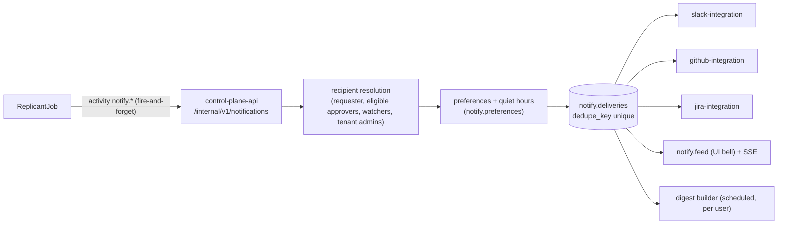

# Notifications

**Owner:** WS-07 · **Constraints:** D-19 (reminders, escalation), D-25, §4 UX · **Contracts:** C-PG
(`notify`), C-MSG (`notify.*` activities are fire-and-forget from the workflow) ·
**Schema:** [schemas/notification-preferences.schema.json](schemas/notification-preferences.schema.json) ·
**DDL:** [data/ddl/notify.sql](data/ddl/notify.sql)

## Purpose

Define who is told what, through which channel, with what content, and how people control it, so
that approvers get context rather than noise (§4) and requesters always know where their job is.

## Decisions summary

| # | Decision |
|---|---|
| N-1 | The workflow emits notification intents through activities (`notify.gate_opened`, `notify.gate_resolved`, `notify.job_event`); the activity calls control-plane-api `POST /internal/v1/notifications`, which resolves recipients and preferences and fans out to channels. Each delivery has a dedupe key, so activity retries never double-post |
| N-2 | Default channels: the **originating channel** (issue comment, Slack thread, Jira comment) for the requester's job status; **Slack DM** for things that need a specific person; the **UI feed** for everything; **digest** for low-value events. No email |
| N-3 | Content is generated from structured data with fixed templates; untrusted text is quoted, never interpolated into sentences (C-MSG §3.4) |
| N-4 | Preferences can lower noise but cannot silence obligations: an approver who is the suggested or only eligible approver always gets the gate request in at least one channel; escalations always deliver |
| N-5 | Digest mode: twice daily at the user's local `09:30` and `15:30` (configurable), weekdays, grouping by job |



## 1. Personas and what they receive

| Persona | Receives | Default channel |
|---|---|---|
| Requester | Job started; routed; gate opened on their job (FYI) and who it waits on; decisions; clarification questions (they decide); PR opened; repair started/finished; failed (with reason and next step); succeeded (merged); expired warnings; budget extension request; bundle migration consent request | originating channel + UI feed; Slack DM for clarification, budget, migration (they must act) |
| Approver (eligible) | Gate requests (packet summary, risk rules, expiry); reminders; changes to a packet they are viewing; decision outcomes on gates they acted on (including superseded) | Slack approval channel; DM if suggested approver or risk ≥ high; UI inbox |
| Delegate | Same as approver for delegated gates, labelled "for Priya Raman" | as approver |
| Tenant admin | Escalations (level ≥ 2); gates with no eligible approver; requester deprovisioned; quota at 80/100%; kill-switch changes; contested decisions; weekly approval-load report | Slack escalation channel + DM |
| Platform operator | Release alerts (via Grafana alerting, WS-08), bundle revoked, pinned-version-without-pollers, projection lag, dead outbox rows | Slack `#replicant-ops` + UI |
| Replicant admin (D-25) | Memory candidate queue thresholds (e.g. > 50 pending or a quarantine trigger), memory conflicts | Slack DM digest; UI feed (only admins see memory notifications) |
| Watchers | Users who watch a repo or tenant: terminal states and PRs opened | digest |

## 2. Event catalogue (event keys used in preferences)

| Event key | Recipients | Template (rendered example) | Default |
|---|---|---|---|
| `job.started` | requester | "Replicant job started · job_01m5p7x7r0 · bugfix · ledger-api" | originating, ui |
| `job.gate_waiting` | requester | "Plan approval needed from ledger-core (suggested: Priya Raman) · expires Oct 31" | originating, ui |
| `gate.requested` | eligible approvers | Block Kit gate message (approvals.md §4.3) | slack_thread (channel), slack_dm (suggested or risk ≥ high), ui |
| `gate.reminder` | each approver with waiting gates | One consolidated DM per approver per reminder slot (R2-024): "12 waiting for you · 3 expire today · oldest 2 d" with the three most urgent linked | slack_dm |
| `gate.escalated` | escalation target (level 1: `escalation_target_1`; level 2: `escalation_target_2` for critical risk, else tenant admins; same rule as approvals.md §6, R2-050) | escalation message | slack_channel (cannot be disabled) |
| `gate.decided` | requester, deciders on that gate | "Approved by Priya Raman in Slack · 10:42" / "Your rejection was not recorded: already approved by …" | originating, ui, slack_dm (for the superseded decider) |
| `gate.expiring` | requester, eligible approvers | "Expires in 24 h" | ui, slack_dm (suggested) |
| `leak_purge.legal_hold_blocked` | the two original `leak_purge` approvers (eligible for the follow-up gate) and Okta group `replicant-legal` (notified, not eligible) | "Purge of leak_… finished except N objects under legal hold; follow-up approval opened (c1). Re-checked daily." (XD-W2-08-04, C-ART 2.0.0 rule 4a) | slack_dm, ui; `replicant-legal` by email digest and Slack DM |
| `job.gate_held` | the principal whose pause holds the gate | "Your pause is holding the plan approval for job …. Its expiry clock is stopped until you resume" (XD-FIX-R2-023) | ui, slack_dm |
| `memory.admin_digest` | `replicant-admins` | Weekly: candidates expiring within 7 days, clusters waiting, flags past SLA, queue-age SLO state (XD-FIX-R2-052) | digest (email/Slack DM), ui |
| `job.clarification` | requester | question text from the planner (model output: quoted) | slack_dm, originating |
| `job.pr_opened` | requester, watchers | "PR #1431 opened: ledger-api · 3 files +41 −12" | originating, ui |
| `job.repair` | requester | "Addressing 2 review comments from Priya Raman (cycle 1 of <repair_limits.max_cycles>, e.g. 1 of 5)" (rendered from the bundle's `repair_limits`, default 5; R1V-158) | originating (PR reply), ui |
| `job.failed` | requester | "Failed in QA: WorkspaceDiskExceeded (40 GiB). The environment profile needs more disk; ask #replicant-platform" | originating, ui, slack_dm |
| `job.succeeded` | requester, watchers | "PR #1431 merged · job done · $9.84" | ui, digest |
| `job.budget_request` | tenant leads (deciders); requester informed | Deciders: "Budget reached on job_01m5k8t0vy ($39.12 of $40). Extend to $60?" Requester (informational, R2-022): "Your job reached its $40 budget. payments-leads have been asked to extend it to $60; nothing is needed from you." (If `amount ≤ requesterSelfApproveMaxUsd`, the requester decides instead.) | slack_dm |
| `job.waiting_capacity` | requester | After 30 min waiting (R2-020): "Your job has waited 30 min for a sandbox (tenant quota 12 of 12 in use). It starts automatically." with links to the running jobs | ui, slack_dm |
| `job.tenant_quota_wait` | requester, tenant admins | "payments reached its monthly model budget; jobs are paused until Nov 1 or until payments-leads raise the budget." Excluded from "needs a human" lists | ui, slack_dm |
| `job.no_progress` | requester, operators | Stall reconciler: "No progress for 30 min on implementer (last event 09:12)." | ui |
| `ops.kill_switch` | everyone with an affected open job | "Publishing paused by operators for payments: <reason>" | ui, banner |
| `job.migration_offer` | requester | "A fix for the node your job is waiting at is available (bundle 2026.10.24-5). Migrate?" | slack_dm, ui |
| `job.paused_identity` | tenant admins | "Requester deprovisioned: job paused" | slack_dm |
| `tenant.quota` | tenant admins | "payments used 80% of the monthly budget ($8,016 of $10,000)" | slack_dm |
| `memory.queue` | Replicant admins only | "62 memory candidates pending; 2 quarantined" | digest |

Quiet hours delay `gate.reminder`, `job.succeeded`, digest-eligible events; they never delay
`gate.escalated` or `gate.expiring` within 2 h of expiry. Channel names are one vocabulary across
preferences and the delivery log: `originating`, `ui`, `slack_dm`, `slack_thread`, `slack_channel`,
`github_comment`, `jira_comment`, `digest`, `none` (`originating` and `none` exist only in preferences;
R1-179).

## 3. Preferences

Stored per principal ([schema](schemas/notification-preferences.schema.json)); edited at
`/settings/notifications` and via `PUT /v1/me/notification-preferences`. Example:

```json
{
  "channels": {
    "job.succeeded": ["digest"],
    "job.pr_opened": ["ui"],
    "gate.reminder": ["slack_dm"],
    "job.repair": ["ui", "digest"]
  },
  "digest": {"enabled": true, "times": ["09:30", "15:30"], "weekdays_only": true},
  "quiet_hours": {"start": "19:00", "end": "08:30", "timezone": "Europe/Berlin"},
  "watch": {"repos": ["acme-payments/ledger-api"]}
}
```

Validation (server): `none` is refused for `gate.requested` when the user is the only eligible
approver of any open gate and for `gate.escalated`; the API returns 422 with the reason.

## 4. Digest

Built per user at digest time from `notify.deliveries` rows in state `queued` with channel
`digest`; grouped by job; one Slack DM (Block Kit, ≤ 50 blocks; overflow links to the UI) and a UI
feed entry. Example DM text: "Replicant digest · 3 jobs finished (2 merged, 1 failed) · 2 PRs
opened · 1 low-risk docs approval waiting for your team (batchable)".

## 5. Failure modes

| Failure | Behaviour |
|---|---|
| Slack API error / rate limit (chat.postMessage ~1/s per channel) | Retries with backoff in slack-integration; deliveries stay `queued`; UI feed already has the item |
| User has no Slack link | Falls back to UI feed; for gate requests to that user, the approval channel post still reaches them if they are in it |
| Notification storm (e.g. 300 maintenance child jobs) | Batch parent (`MaintenanceBatch`) notifications replace per-child ones; per-recipient rate limit 20 DMs/hour. `gate.requested` (risk ≥ high), `gate.expiring` and `gate.escalated` are exempt; other overflow is collapsed into **one summary DM** for that hour, never deferred to the digest (R2-024) |
| Duplicate activity execution | `dedupe_key` uniqueness → second insert is a no-op |

## Open questions

| Question | Who decides | Options | Recommendation |
|---|---|---|---|
| Email as a channel | Product | none / digest email | None in v1 (Slack + UI cover the population) |
| Microsoft Teams | Product | out of scope / adapter | Out of scope; the notify fan-out has a channel interface for later |

## Risks

- Approval DMs are effective but intrusive; the suggested-approver rotation and the 5-recipient cap
  limit fatigue, and weekly load reports tell tenant admins when routing is unfair.

## Interfaces

- **Provided:** `POST /internal/v1/notifications` (from workflow notify activities), preferences API,
  `notify` DDL.
- **Consumed:** WS-01 notify activity call sites; slack/github/jira adapters; identity-service for
  recipient resolution.
