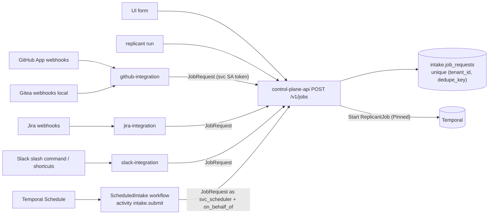

# Triggers and the CLI

**Owner:** WS-07 · **Constraints:** D-18, D-19, D-21, D-24, §4 triggers · **Contracts:** C-JOBREQ
1.4.1 (single normalized trigger), C-IDS 2.0.0 (`request_id`, `dedupe_key`, strict `sch_`), C-ART 2.0.0
(`intake_attachment`), C-STATE 2.0.0 (schedules in Temporal)

## Purpose

Specify how every trigger channel (GitHub, Gitea locally, Jira, Slack, UI, CLI, schedules) becomes
one `JobRequest`, how duplicate triggers are collapsed, and what each channel shows the requester
right away.

## Decisions summary

| # | Decision | Reference |
|---|---|---|
| T-1 | Every channel adapter builds a C-JOBREQ document and submits it to `POST /v1/jobs`; nothing else starts `ReplicantJob` | C-JOBREQ |
| T-2 | Dedupe is two-level: transport dedupe (delivery GUID / Slack `action_ts` / Jira event id) in the adapter's own schema, and semantic dedupe by `dedupe_key` in `intake.job_requests` (`(tenant_id, dedupe_key)` unique) | C-IDS, C-PG |
| T-3 | Adapters resolve the channel identity to a linked `usr_` principal **before** building the JobRequest; unlinked identities get a link prompt and no job | D-18 |
| T-4 | Untrusted text (issue bodies, Slack messages, Jira descriptions) goes only into `intent.text` (≤ 64 KiB, `untrusted: true`) or S3 attachments; never into `dedupe_key`, titles used as keys, or S3 keys | D-21, C-ART §2 rule 1 |
| T-5 | Each channel gets an acknowledgement within 60 s in that channel, edited in place as the job progresses | §4 UX |
| T-6 | Schedules are Temporal Schedules whose action starts the system workflow `ScheduledIntake` (accepted, C-IDS 1.11.0) that submits the JobRequest through control-plane-api as `svc_scheduler` on behalf of the schedule owner | C-STATE, CCR-07-05 |

## 1. Channel mapping

| Channel | Event | `source.event_type` | `source.event_id` | `dedupe_key` | Requester | Tenant resolution |
|---|---|---|---|---|---|---|
| GitHub | label added | `issues.labeled` | `X-GitHub-Delivery` | `github:issue-label:<repo_id>:<issue>:<label>` | sender (linked) | `github_app.repos.tenant_id` |
| GitHub | issue opened (auto mode) | `issues.opened` | GUID | `github:issue-open:<repo_id>:<issue>` | issue author | same |
| GitHub | `/replicant run` on issue | `issue_comment.created` | GUID | `github:issue-cmd:<repo_id>:<issue>:<comment_id>` | commenter | same |
| GitHub | `/replicant fix` on a PR without a live job | `issue_comment.created` | GUID | `github:pr-cmd:<repo_id>:<pr>:<comment_id>` (workflow_type `pr_repair`) | commenter | same |
| Gitea (local) | same events through `/webhooks/gitea` (`X-Gitea-Event`, `X-Gitea-Delivery`, `X-Gitea-Signature`) | `issues.labeled` etc. | Gitea delivery id | `gitea:issue-label:<repo_id>:<issue>:<label>` | `channel_identity.kind = gitea` | `github_app.repos` (provider gitea) |
| Jira | issue created or label `replicant` added in an opted-in project | `jira:issue_created` / `jira:issue_updated` | Jira webhook event identifier `[unverified: header/field carrying a unique delivery id for Jira Cloud webhooks; fallback: sha256 of (webhookEvent, issue.id, timestamp)]` | `jira:issue:<site>:<issue_key>:<trigger>` | Jira `accountId` (linked) | `tenant_settings.jira.projects` |
| Slack | `/replicant run <repo> <title>` | `slack.slash_command` | `trigger_id` | `slack:cmd:<team_id>:<trigger_id>` | user (linked) | the user's tenants; if several, the modal asks |
| Slack | message shortcut "Start Replicant job from message" | `slack.message_action` | `action_ts` | `slack:msg:<team_id>:<channel_id>:<message_ts>` (same message twice → same job) | user | as above |
| UI | New job form | `ui.form` | client ULID (`Idempotency-Key`) | `ui:form:<principal_id>:<client ulid>` | session principal | selected tenant |
| CLI | `replicant run` | `cli.run` | client ULID | `cli:run:<principal_id>:<client ulid>` | token principal | `--tenant` or default |
| Schedule | Temporal Schedule fire | `schedule.fire` | scheduled time | `schedule:<sch_id>:<scheduled_time RFC 3339>` | `svc_scheduler` + `on_behalf_of` owner | schedule's tenant |
| Eval | eval harness (WS-06) | `eval.case` | case id | `eval:<eval_run_id>:<golden_task_id>` | `svc_eval-worker` + owner (`options.evaluation.mode=eval`) | `replicant-eval` |
| Shadow | release controller (WS-06) | `eval.shadow` | shadow id | `eval:shadow:<rpl_id>:<source_job_id>` | `svc_release-controller` + owner (`options.evaluation.mode=shadow`) | source job's tenant, evaluation mode |

Dedupe semantics: a second submission with the same key returns **200** with the existing
`job_id` (C-JOBREQ). The adapter then edits its acknowledgement to point at that job ("Already
running as job_01m5…") instead of posting a second one. Keys are chosen so that a *new human
intent* gets a new key (a new comment, a new form submission) while transport retries and
re-labelling the same issue collapse. Re-labelling after the first job ended: the key is pruned
90 days after terminal (C-IDS); before that, `/replicant run` (new comment ID) is the way to start
again, and the bot says so.

## 2. Slack triggers

- Slash command `/replicant run acme-payments/ledger-api Refund double-counts FX fees`: ack within
  3 s with an ephemeral "Starting…", then `views.open` (the `trigger_id` is valid for 3 s, so the
  modal opens before other I/O) with fields: repository (external select over the user's
  tenant repos), title, description (multiline), workflow type (auto by default), priority,
  "require plan approval" checkbox (adds `require_gates`). Submission → JobRequest.
- Message shortcut: the message and (optionally) its thread are captured with `conversations.replies`
  by slack-integration and stored as an `intake_attachment` of kind `slack_thread` in
  `tenants/<t>/intake/<request_id>/attachments/thread.json` (redaction required, C-ART). The modal
  pre-fills the title from the first line. Scope note: reading threads needs `channels:history` /
  `groups:history`; these scopes are added only if a tenant enables the shortcut
  `[unverified: exact scope names for reading thread replies with conversations.replies under current Slack scopes]`.
- Acknowledgement: a message in the channel where the command was used (or a DM if the channel is
  not allowed for posting): "Replicant job started · job_01m5p7x7r0 · ledger-api · bugfix ·
  Planning" with a "View" button, updated in place via `chat.update` at each phase.

## 3. Jira

jira-integration receives Jira Cloud webhooks (registered by an admin for opted-in projects,
JQL filter `project in (PAY, IDN) AND labels = replicant`). The issue's repository comes from
`tenant_settings.jira.repo_mapping` (component or label → repo) or a custom field
`Replicant repository`. The description (ADF) is rendered to Markdown-like text
(`format: jira_adf_rendered`). Acknowledgement: a Jira comment with the job link, edited in
place (`jira_app.issue_links.comment_id`). Webhook authenticity: the mechanism for Jira Cloud
admin webhooks must be confirmed at implementation (`[unverified: Jira Cloud webhook secret /
signature header]`); fallback: register the webhook URL with a 256-bit path secret and an IP
allowlist of Atlassian ranges, and treat Jira input as a trigger only after a REST read-back of
the issue (`GET /rest/api/3/issue/{key}`) using Replicant's Jira service account, so a forged
webhook cannot inject content that is not actually in Jira.

## 4. UI form

`/jobs/new`: tenant (from `GET /v1/me`), repository (searchable; only repos where the user has
`job:create`, checked live on submit), title, description (Markdown editor, plain textarea with
preview), attachments (uploaded through `POST /v1/intake/uploads` → presigned PUT to the
intake prefix, max 100 MiB each, 20 total), workflow type, priority (urgent only for hotfix with
permission), budget cap (≤ policy cap), extra gates, dry run, draft PR. Submit → `POST /v1/jobs`
with `Idempotency-Key` → redirect to the live job page.

## 5. Schedules

Maintenance jobs (dependency bumps, codemod sweeps) are Temporal Schedules created through
`POST /v1/tenants/{t}/schedules` by tenant admins. Schedule IDs are `sch_<ulid>` (C-IDS; CCR-07-08 registers the
prefix with a ULID body, R1-181), with a separate human `display_name` (for example "deps-weekly"). The
schedule's action starts system workflow **`ScheduledIntake`** (C-IDS 1.11.0, CCR-07-05 accepted; workflow ID
`sys:scheduled-intake:<schedule_id>` with Temporal's schedule time suffix; task queue `replicant-projections` (worker replicant-projector, XD-FIX-R1-021, WS-01 temporal-platform.md; R1V-039), unpinned,
on the current worker version). It runs one activity `intake.submit_scheduled` that calls `POST /v1/jobs` as
`svc_scheduler` with `on_behalf_of = schedule.owner` and
`dedupe_key = schedule:<sch_id>:<scheduled_time>`. Intake starts `MaintenanceBatch` for
`workflow_type=maintenance` with a `target_selector` (XD-01-12). Overlap policy `SKIP` by default; catch-up
window 1 h. If the owner is deprovisioned the schedule is paused (identity.md §3.4).

## 6. The `replicant` CLI

Python 3.12, Typer; generated client from the OpenAPI. Auth: `replicant login` (Okta device grant,
identity.md §2.2). Output: human tables by default, `--json` for scripts. Exit codes: 0 ok, 2
usage, 3 not found, 4 denied, 5 conflict (e.g. superseded), 6 recording (outcome pending).

| Command | Calls | Notes |
|---|---|---|
| `replicant login` / `logout` / `whoami` | device grant; `GET /v1/me` | shows link status for GitHub/Slack |
| `replicant link github\|slack` | opens the link URL | |
| `replicant run <repo> --title … [--body-file f] [--type bugfix] [--priority high] [--require-plan-approval] [--draft] [--dry-run] [--attach file…]` | `POST /v1/jobs` | prints job URL; `--follow` streams progress |
| `replicant status [job] [--follow] [--live]` | `GET /v1/jobs/{id}`, SSE `/v1/stream`; `--live` uses `replicant admin job refresh` semantics (operators) | without a job: my open jobs |
| `replicant logs <job> [--run run_…] [--follow]` | transcript tail SSE | redacted |
| `replicant steer <job> "message" [--next-node\|--live-only]` | `POST /v1/jobs/{id}/steering` | prints `delivered_live` / `queued_next_node` |
| `replicant pause <job> [--at-next-gate]` / `resume` / `cancel [--reason]` | control endpoints | cancel asks for confirmation unless `--yes` |
| `replicant approve <gate> [--comment]` / `reject <gate> --comment` / `request-changes <gate> --comment` | `GET /v1/gates/{id}` (prints packet summary, rules fired, diff stat, digest) then `POST …/decisions` with that digest | exit 5 with the winner on `superseded` |
| `replicant inbox` | `GET /v1/approvals` | |
| `replicant takeover <job> [--include branch,workspace_archive,transcripts,plan,handoff] [--dir ./ledger-api]` | `POST /v1/jobs/{id}:takeover`, then polls the package | Fetches the branch (`git fetch origin replicant/<job_id>`), downloads and verifies (sha256) the workspace archive into `--dir`, writes `HANDOFF.md`, `PLAN.md`, and `transcripts/` beside it (outside the repo working tree), prints next steps |
| `replicant releases bootstrap --env <env> <rb>` | `POST /v1/releases/{env}/assignment:bootstrap` | operators |
| `replicant releases pipelines start --env <env> --candidate <rb> --canary-ramp slot=<0-2>,percent=
,include-tenant=<t>` | `POST /v1/releases/pipelines` | release operators |
| `replicant releases pipelines signoff --env <env> --candidate <rb> --point <signoff point>` | `POST /v1/releases/pipelines/{id}/signoffs` (Update `release.signoff`) | release managers, security |
| `replicant releases assignment set-default --env <env> <rb>` | `PUT /v1/releases/{env}/assignment/default` | release operators |
| `replicant releases rollback --env <env> --to <rb> --migrate-running <mode>` (shows the rollback preview first) | `GET …/assignment:rollback-preview`, `POST …/assignment:rollback` | release operators; `required*` needs `release:revoke` |
| `replicant releases evals run --env <env> --candidate <rb> --suite <golden_set_id> --purpose bootstrap` | `POST /v1/evals/runs {purpose: bootstrap, …}` (XD-W3-R1V-035) | release operators |
| `replicant registry …` | registry endpoints (WS-03, WS-06) | operators, CI |
| `replicant memory candidates list\|approve\|reject …` | `/v1/admin/memory/**` | replicant-admins only (D-25); XD-11-10 |
| `replicant admin …` | admin operations (architecture.md §7) | |
| `replicant dev …` | local only (WS-11) | |

## 7. Failure modes

| Failure | Behaviour | Requester sees |
|---|---|---|
| Adapter cannot reach control-plane-api | GitHub/Jira: the inbound queue retries (github-app.md §3.3); Slack: ephemeral "Replicant is unavailable, try again", no retry (user intent is synchronous) | delay / message |
| Duplicate trigger | 200 with existing job | "Already running as job_…" |
| Tenant kill switch `paused` | 409 `intake_paused` | channel message with the reason set by the operator |
| Quota exceeded | 429 `quota_exceeded` with reset time | channel message |
| Repo not opted in | 403 `repo_not_enabled` | message (only for explicit commands) |
| Requester lacks permission | 403 `insufficient_repo_permission` | message naming the needed permission |
| Body too large | truncated to 64 KiB, full text attached (C-JOBREQ) | none |
| Per-PR repair cap reached (R2-059) | 409 `pr_repair_cap_reached` | PR reply: "This PR has had 3 Replicant repair jobs (limit). A maintainer can take over: <link>." |
| Tenant or platform budget exhausted (R2-055) | 429 `tenant_budget_exhausted` / `platform_budget_exhausted` | channel message with the reset time and who can raise it |
| Kill switch `intake` paused or closed (R2-016) | 409 `intake_paused` / 403 `intake_closed` | channel message with the operator's reason |

## Open questions

| Question | Who decides | Options | Recommendation |
|---|---|---|---|
| Slack thread capture scopes | Tenant security | enable per tenant / disable | Disabled by default; tenants opt in |

## Risks

- Label-based triggers can be abused by anyone who can label (triage permission). Mitigation: the
  requester check uses the labeller's own repository permission (write by default), and the job
  runs on the labeller's behalf.

## Interfaces

- **Provided:** channel adapters, CLI, `ScheduledIntake` (CCR-07-05, accepted), intake upload endpoint.
- **Consumed:** C-JOBREQ 2.0.0, identity-service resolve API, Temporal Schedules.
