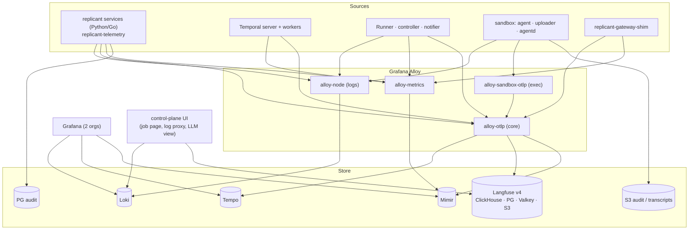

# 08 — Observability (WS-08)

## Purpose

Make every job traceable from trigger to merged PR across Temporal, the Runner, AgentRuns, the CLIs, the gateway
shim and the humans in the loop, using self-hosted Langfuse OSS (v4) and the Grafana OSS stack (Grafana, Loki,
Tempo, Mimir, Alloy), with redaction before every sink and an audit trail that answers "who approved this and
what did they see?".

## Decisions summary

| Decision | Constraint | Where |
|---|---|---|
| One trace per job (T-1) in Tempo and Langfuse; deterministic root and run span IDs (Rule T-5, normative in C-IDS 1.10.0) | D-17 | [telemetry-model.md](telemetry-model.md) §1 |
| Every propagation hop named and checked, including `replicant-agentd` and `replicant-gateway-shim` (C-ARCH 1.2.0) | D-17 | telemetry-model.md §2 |
| Temporal: `OpenTelemetryPlugin`; no long-lived workflow spans | D-01 | [ADR-08-007](adr/007-temporal-otel-plugin.md) |
| Langfuse v4 OSS: **the single Langfuse tenancy model** (R2-009): one org and project per environment, operator-only access, restricted tenants excluded at the core gateway (`LANGFUSE_EXCLUDED_TENANTS_REGEX`); WS-09 aligns. Retention by CronJob `langfuse-retention-sweeper`, 90 days for every tenant, batches of 30 | D-17 | [ADR-08-003](adr/003-single-langfuse-project-per-environment.md), [platform.md](platform.md) §2, [session-capture.md](session-capture.md) §9 |
| Generations from the gateway shim's spans; content observations from the sandbox uploader | D-11, D-21 | [ADR-08-006](adr/006-generations-from-the-gateway.md) |
| Metrics in Mimir (classic architecture); Loki Distributed; Tempo monolithic | D-17 | [ADR-08-001](adr/001-mimir-over-prometheus.md), [ADR-08-005](adr/005-loki-distributed-tempo-monolithic.md) |
| Tenancy by data class (Loki `platform`/`sandbox`/`audit`; Tempo and Mimir `replicant`); tenant users read logs only through control-plane-api's fixed-selector proxy | D-18 | [ADR-08-002](adr/002-observability-tenancy-by-data-class.md) |
| Sandbox telemetry identity from pod labels, never from content | D-21 | [ADR-08-004](adr/004-trusted-attribution-from-kubernetes-metadata.md) |
| Redaction at the source (uploader UID 10003; Python services via code/redact.py, Go via an `slog` handler), again in Alloy on every pipeline including Kubernetes events and Hubble, plus a post-hoc leak-scanner; one versioned ruleset | D-21 | [ADR-08-008](adr/008-redaction-at-source-plus-collector.md), [redaction/](redaction/) |
| Exec account ships telemetry to core over PrivateLink with mTLS (CCR-09-07) | D-21, D-22 | platform.md §1.2 |
| Audit: `audit.emit()` only (idempotent with `idempotency_key`; restore form `audit.emit_restored` for `r_audit_restore` only), no free text; every partition isolated (XD-ORCH-04); one writer `audit-exporter` for the per-minute `audit_event_export`, the monthly `audit_partition_export` (partition dropped only after a matching recorded export) and the split history export (payload-free skeleton in `audit`, never purged; full encrypted export in `artifacts`, purgeable); Okta log streaming | D-18, D-19, D-26 | [audit.md](audit.md), [sql/audit.sql](sql/audit.sql) |
| Leak purge (R2-005, C-ART 2.0.0): `LeakPurge` on `replicant-ops` (deployment `ops-worker`, owned by WS-08; WS-01 supplies the code), gate kind `leak_purge` with two distinct `replicant-admins` approvers other than the requester; deletion ledger written first; scope `artifacts`, `transcripts`, `session`, their DR replicas and the legal bucket, plus Loki, Langfuse, Tempo, read models and memory; a held legal-bucket object records `blocked_by_legal_hold` and escalates through a follow-up `leak_purge` gate; the `audit` bucket (COMPLIANCE mode) is never purged and no role holds `s3:BypassGovernanceRetention` | D-21, D-25 | [session-capture.md](session-capture.md) §8 |
| Sandbox stdout transport proven per RuntimeClass by benchmark B-LOG-01; OTLP log fallback through `alloy-sandbox-otlp` (R2-039) | D-21 | session-capture.md §1, platform.md §3.1 |

## Files

| File | Contents |
|---|---|
| [platform.md](platform.md) | Deployment, topology (two accounts), Langfuse v4, Grafana stack, sizing, **ingest volumes and cost**, retention, backups, local profile |
| [telemetry-model.md](telemetry-model.md) | Propagation through every hop, trace tree, Langfuse mapping, Loki labels and metadata, tenant log proxy, sampling, **metrics catalog** |
| [session-capture.md](session-capture.md) | CLI transcript capture, sink selection, CLI-native OTel settings, redaction pipeline and test plan, Playwright traces, leak-scanner, **leak purge from every sink**, Langfuse retention sweeper |
| [dashboards.md](dashboards.md) | Dashboards with panels and queries, **one-click correlation from a `job_id`**, SLOs, alerts |
| [audit.md](audit.md) | Audit stores, event model, Okta export, **"who approved this and what did they see"** |
| [adr/](adr/) | ADR-08-001 … ADR-08-008 |
| [config/alloy/](config/alloy/) | Seven Alloy configs (six production plus local, validated) and three functional tests |
| [config/loki/](config/loki/), [config/tempo/](config/tempo/), [config/mimir/](config/mimir/) | Backend configs (validated by the real binaries) |
| [config/langfuse/values.yaml](config/langfuse/values.yaml), [config/grafana/](config/grafana/) | Helm values (rendered with `helm template`), Grafana data sources |
| [config/aws/](config/aws/) | CloudFormation KMS request-quota alarms (`SERVICE_QUOTA()`, 30%), `cfn-lint` clean |
| [rules/](rules/) | Mimir and Loki rules (+ unit tests), Alertmanager config |
| [dashboards/](dashboards/) | Generator and built dashboard JSON |
| [redaction/](redaction/) | Ruleset (`redact-2026.10.1`), PII rules, conformance corpus and harness |
| [sql/](sql/) | `audit` schema DDL and its test |
| [code/](code/) | Reference implementations: trace IDs, `replicant-telemetry`, source-side redaction (`redact.py`) |

## Validation performed (2026-10-24, re-run after the wave-2 co-owner changes)

| Artifact | Tool | Result |
|---|---|---|
| Alloy configs (7) | `alloy validate` and `alloy fmt` (v1.21.2; files use 2-space indentation) | pass |
| node-logs pipeline (incl. restricted-tenant routing) | [tests/test_node_logs.py](config/alloy/tests/test_node_logs.py) running Alloy | 18/18 checks |
| Core OTLP gateway (OTTL, routing, Langfuse mapping, restricted-tenant exclusion, forbidden-label marker) | [tests/test_otlp_gateway_core.py](config/alloy/tests/test_otlp_gateway_core.py) | 18/18 checks |
| Sandbox OTLP gateway (identity stripping, redaction, metric filter, OTLP log fallback into Loki format) | [tests/test_otlp_gateway_sandbox.py](config/alloy/tests/test_otlp_gateway_sandbox.py) | 13/13 checks |
| local.alloy | [tests/gen_local.py](config/alloy/tests/gen_local.py) regenerates it from production; `alloy fmt` stable | pass |
| Redaction ruleset | [run_redaction_tests.py](redaction/tests/run_redaction_tests.py): gitleaks 8.30.1, Alloy secretfilter, PII reference | 49/49 |
| Mimir rules | `promtool check rules`, `promtool test rules` (incl. the release-spike and tenant-quota tests), `mimirtool rules check`, `mimirtool rules lint --dry-run` | 99 rules, tests pass |
| WS-06 release rules (loaded unchanged) | `promtool check rules` | 15 rules pass |
| Loki rules | `lokitool rules lint --dry-run` per tenant | 13 rules pass |
| Alertmanager (receivers `replicant-release`, `replicant-admins`) | `mimirtool alertmanager verify` | pass |
| Langfuse and Grafana Helm values | `helm template` (langfuse 2.1.6 with `clickhouse.crdCheck=false` for offline rendering, grafana-community/grafana 14.0.1) | render |
| Dashboards | generator builds `replicant-overview`, `replicant-job`, `replicant-qa`; JSON parse | pass |
| `audit.sql` | [sql/test_audit.py](sql/test_audit.py) on PostgreSQL 16.2 (75 event types; exports and partition drop; idempotency; restore form; partition isolation; exporter scope; canonical auditor scopes; WS-07 types) | 54/54 |
| `audit.sql` on WS-10's framework | `10-data-platform/tools/validate.sh`: owner DDL apply, `check_partitions.py`, `check_grants.py`, `check_rls.py` | OK; partitions OK; 0 grant or RLS problems in `audit` |
| `trace_ids.py`, `replicant_telemetry.py`, `redact.py` | self-tests (C-IDS test vector, root span IDs, sampling, parenting, `phase`, `_replicant-ctx` header, log redaction) | pass |
| Mermaid diagrams (7) | `@mermaid-js/mermaid-cli@11.4.2` | all render |
| YAML, JSON, TOML | parsers | pass |

## Must-answer index

| Question | Answer |
|---|---|
| Given a merged PR, how does an engineer find everything the agent did? | [dashboards.md §2.1](dashboards.md#21-must-answer-given-a-merged-pr-how-does-an-engineer-find-everything-the-agent-did) |
| Loki and ClickHouse ingest volume per day and storage cost? | [platform.md §4](platform.md#4-volumes-storage-and-cost-must-answer): Loki ≈ 5.3 GB/day steady, 9.7 GB/day peak; Langfuse ≈ 1.0 / 3.4 GB/day raw; storage and requests ≈ $147/month (≈ $139 + $8 Tempo gp3); total ≈ $4,900/month, of which compute (12 nodes of 8 vCPU for ≈ 90 vCPU requested) ≈ $4,080 and the Langfuse Aurora cluster ≈ $447 (WS-10 figure) |
| How is a leaked secret found and purged from every sink? | [session-capture.md §8](session-capture.md#8-purging-a-leaked-secret-from-every-sink-must-answer): leak-scanner detects; `LeakPurge` (two `replicant-admins` approvals) rewrites or deletes in `artifacts`/`transcripts`/`session` (incl. `approval_text` and the full history export), Loki, Langfuse, Tempo, read models and memory; the audit bucket keeps only digests and is never purged; §8.4 covers restore after a purge |
| Who approved this change and what did they see? | [audit.md §6](audit.md#6-must-answer-who-approved-this-change-and-what-did-they-see): reference-only approval record → packet by digest and `approval_text` by `text_sha256`; history skeleton proves the decision events after the full export is purged |

## Responses to the WS-09 control review

| Item | Response |
|---|---|
| G-08 (observability tenancy) | Accepted with the two conditions made explicit and enforced: no tenant-user access to Loki, Tempo or the operator Grafana org (Okta org mapping, network policy on query frontends); control-plane-api builds every tenant log query with a fixed `tenant` selector (builder in telemetry-model.md §6, property-tested). Restricted tenants can get their own Loki tenant by one Alloy routing rule. Langfuse tenancy is settled by ADR-08-003 (R2-009, WS-09 aligns); the Loki half stays as recorded in ADR-08-002 / OQ-08-01 |
| G-14 (Playwright traces, videos) | session-capture.md §5.6: capture-time masking (WS-05), post-processing of text parts of the trace zip, traces and videos always Restricted |
| G-17 (Langfuse retention) | session-capture.md §9: CronJob in `langfuse` (one design with WS-10), batches of 30, rate limit, verification sample, metrics, alerts, audit event |
| CCR-09-07 (exec in its own account) | platform.md §1.2: PrivateLink endpoint services, Envoy mTLS ingress with per-CN tenant allowlists, push-only |

## Open questions (top; full lists in each file and in `spec/_coordination/open-questions.md`)

| ID | Question | Recommendation |
|---|---|---|
| OQ-08-01 | Loki tenancy by data class vs per Replicant tenant | Data class with enforced proxy |
| OQ-08-02 | License Langfuse EE? | OSS for v1 |
| OQ-08-04 | Langfuse trace-name resolution with early `unrouted` spans | Verify in load test |
| OQ-08-06 | May the purge workflow hold the leaked value (KMS-sealed)? | Yes, sealed, deleted at close |
| OQ-08-11 | History skeleton retention 2 y or 7 y | 2 y default, 7 y per tenant policy |

## Risks

- Langfuse v4 is new; its OTel ingestion storage pattern and sizing at this shape are unmeasured (cost range in
  platform.md §4.2).
- The Temporal `OpenTelemetryPlugin` is experimental; fallback specified.
- Live Temporal history of an open job cannot be purged; encrypted payloads and retention bound the exposure.
- Redaction cannot catch names and free-form sensitive prose.

## Interfaces

- **Provided:** observability endpoints and pipelines; `replicant-telemetry`; redaction ruleset and harness; metric
  catalog; dashboards and alerts; `audit` schema and `audit.emit()`; `audit-exporter`; `LeakPurge` on `ops-worker`;
  Langfuse retention sweeper CronJob; B-LOG-01 and the OTLP log fallback;
  local Alloy config for WS-11.
- **Consumed:** C-IDS 2.0.0 §5, §7–§12; C-ARCH 2.0.0; C-CRD 3.0.0; C-RUNNER 3.0.0; C-ART 2.0.0; C-PG 2.0.0;
  C-STATE 2.0.0; C-MSG 2.0.0; WS-01, WS-02, WS-03, WS-04, WS-05, WS-06, WS-07, WS-09, WS-10, WS-11 deliverables listed in
  `spec/_coordination/cross-ws-dependencies.md` (XD-08-*).
