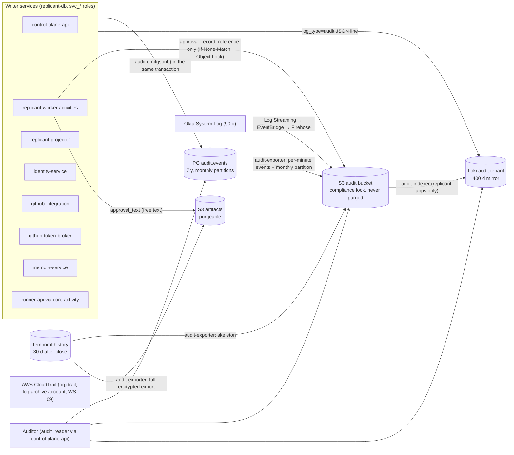

# Audit Trail

**Workstream:** WS-08 (DDL owner of schema `audit`, C-PG §2; WS-09 reviews) · **Constraints:** D-18, D-19,
D-25, D-26 · **Contracts:** C-PG (audit exception, rule 3), C-ART 2.0.0 (`audit` bucket, `approval_record`),
C-MSG 2.0.0 (`gate.decide`), C-STATE 2.0.0

## Purpose

Define what each audit store holds (Temporal history, Postgres `audit`, S3 `audit` bucket, Okta System Log,
CloudTrail), how long, how they link, and how an auditor answers "who approved this change and what did they
see?" without opening a database connection.

## Decisions summary

| Decision | Reference |
|---|---|
| Postgres `audit.events` is the queryable audit record: append-only, monthly partitions, written only through `SECURITY DEFINER audit.emit(jsonb)` in the caller's business transaction; **no free text** | C-PG rule 3; [sql/audit.sql](sql/audit.sql) (executed and tested, §7) |
| Approval evidence is the reference-only `approval_record` in the S3 `audit` bucket (Object Lock COMPLIANCE mode, 730 days, C-ART 2.0.0): IDs, decision, `presented_digest`, `packet_key`, and `text_key` + `text_sha256` pointing at the purgeable `approval_text` in `artifacts`; the audit event carries its digest and URI | C-ART 1.9.0 §2, §4 (R2-004) |
| Temporal history is authoritative for decisions but retained 30 days after close; each closed workflow run's history is exported twice by `audit-exporter`: a payload-free `workflow_history_skeleton` (event metadata plus payload sha256) to the `audit` bucket, never purged, and the full codec-encrypted `workflow_history_export` to `artifacts`, purgeable by `LeakPurge` | §2 (C-ART 1.9.0, R2-005) |
| Two audit exports, both written by the one `audit-exporter` Deployment: `audit_event_export` about every minute (RPO for audit independent of database PITR, CCR-10-06) and `audit_partition_export` monthly (NDJSON + SHA-256 manifest, recorded by `audit.record_partition_export`); a partition is dropped only when its recorded export row count matches; 7-year retention | §5 (R1-194, R1-204) |
| Okta System Log (90-day retention in Okta) is streamed to the `audit` bucket via Okta Log Streaming → Amazon EventBridge → Firehose, and the replicant-app subset indexed into Loki `audit` | §4 |
| Auditors use the control-plane audit views and `replicant audit explain-pr`; never SQL (D-26) | §6 |



---

## 1. What each store holds

| Store | Holds | Authority | Retention | Access |
|---|---|---|---|---|
| Temporal history (`replicant-<env>`) | Every workflow event: `gate.decide` Update requests and results (actor, channel, `presented_digest`, comment), activity inputs and results (`identity.check_decision` allow/deny with reason), Signals, timers | **Authoritative** for workflow decisions (C-STATE §1.1) | Namespace retention 30 d after close (WS-01); export below | Temporal UI (operators), codec server |
| Postgres `audit.events` | One row per audited action: event type, outcome, actor principal, channel, tenant, job/run/gate/decision IDs, digest, evidence URI, trace ID, bounded structured details | Derived copy for gate decisions; **system of record** for non-workflow actions (presigns, token mints, registry publishes, memory admin, identity changes, break-glass) | 7 y (partition drop by migrate maintenance) | `audit_reader` through control-plane-api audit views (RLS by tenant scope); `grafana_ro` aggregate view only |
| S3 `audit` bucket: `approval_record` | Reference-only: gate and decision IDs, decision enum, decider, channel, `decided_at`, `presented_digest`, `packet_key`, `text_key`, `text_sha256`, memory refs. No free text | Evidence of what the approver saw (C-STATE §3 rule 5) | 2 y, Object Lock COMPLIANCE; never purged | presigned to `audit_reader` principals, audited |
| S3 `artifacts`: `approval_text` | The decision comment, answer text and job title as shown | Content of the decision; integrity checked against `text_sha256` | 2 y; purgeable by `LeakPurge` (rule 4a) | UI, auditors |
| S3 `audit` bucket: `workflow_history_skeleton` | Per event: type, event ID, timestamp, activity or child type, Update or Signal ID and name, sha256 of each payload. No payload bodies | Long-term, tamper-evident shape of the authoritative record | 2 y (7 y by tenant retention policy), Object Lock; never purged | auditors |
| S3 `artifacts`: `workflow_history_export` | Full history of each closed workflow run, payloads codec-encrypted | Long-term copy for forensics and replay testing; digests checked against the skeleton | 2 y; purgeable by `LeakPurge` | auditors with codec access (WS-09), WS-01 replay corpus |
| S3 `audit` bucket: `audit_event_export` (CCR-10-06) | NDJSON (zstd) of new `audit.events` rows, about every minute | Audit RPO independent of Postgres PITR; restore reconciliation (WS-10) | 7 y, Object Lock COMPLIANCE | auditors, WS-10 restore |
| S3 `audit` bucket: `audit_partition_export` (CCR-08-04) | Monthly NDJSON (zstd) of `audit.events` partitions with SHA-256 and a manifest root | Tamper evidence, retention beyond Postgres, precondition for partition drop | 7 y, Object Lock COMPLIANCE | auditors |
| S3 `audit` bucket: `okta_system_log_export` (CCR-08-04) | All Okta System Log events (streamed) | Okta is the source; this is the retained copy | 7 y | security, auditors |
| Loki `audit` tenant | Same events as `audit.events` (log mirror) plus Okta events for Replicant apps (Replicant UI, Grafana, Langfuse, Temporal UI) | Search convenience | 400 d | operators, security (Grafana org 1) |
| CloudTrail (WS-09) | AWS API calls incl. S3 data events and KMS | AWS | WS-09 (log-archive account) | security |

## 2. The `audit-exporter` (single writer for audit exports)

One Deployment, `audit-exporter` (Python, namespace `replicant-system`, WS-08), owns every export into the audit
trail (R1-194, R1-204). It replaces the earlier split across a replicant-worker activity, `sys:retention-sweeper`
and a monthly CronJob, so there is exactly one trigger and one writer per artifact type.

| Loop | Trigger | Reads | Writes |
|---|---|---|---|
| Event export | every 60 s | `audit.events` rows with `aud_` ID greater than the last exported one (DB login `svc_audit_exporter`, member of `audit_reader`; reads every tenant only under `replicant.principal_scope = 'system:all-tenants'` (policy `events_exporter_all`, XD-W2-10-03 ruling)) | `audit_event_export` `org/audit-exports/events/<yyyy>/<mm>/<dd>/<hh>/<first_aud_id>.ndjson.zst`, `If-None-Match: *`; the high-water mark is the last key written (S3 listing), so a restart neither skips nor duplicates |
| Partition export | 02:00 UTC on the 2nd of each month | the previous month's partition, primary-key order | `audit_partition_export` (§5), then `audit.record_partition_export(...)` (EXECUTE granted to `svc_audit_exporter`). The exporter's Postgres writes are exactly this function and `audit.emit` (type `approval_record.reconciled`, through `r_audit_emit`); its only other Postgres read besides `audit` is the column-limited `approvals` read for the reconciler, under `system:all-tenants` (C-PG rule 3 as amended in wave 3 for R1V-050) |
| History export | every 5 min | Temporal visibility `ListWorkflowExecutions` with `ExecutionStatus != "Running" AND CloseTime > <watermark>` in namespace `replicant-<env>`, then `GetWorkflowExecutionHistory` per closed run (Temporal read-only credential, `audit-exporter` role, C-MSG §1 via CCR-08-06). Continue-As-New closes a run, so every run of a long job is exported shortly after it closes | `workflow_history_skeleton` to `audit` `tenants/<t>/jobs/<j>/history/<temporal_run_id>.skeleton.json.zst` and `workflow_history_export` to `artifacts` `tenants/<t>/jobs/<j>/history/<temporal_run_id>.json.zst`, both `If-None-Match: *`. The skeleton is written first; the full export records the skeleton's sha256 |
| Approval-record reconciler (XD-FIX-R2-013, XD-W2-01-02) | after each history export | the run's skeleton: every `gate.decide` Update whose result was `accepted`. All fields come from Postgres: the `gate.decided` row in `audit.events` (gate and decision IDs, decision, decider, channel, `decided_at`, `presented_digest`) and the `approvals` read model: `gates` (`packet_key`, `memory_refs` as `mem_…@v`) and `gate_decisions` (`text_key`, `text_sha256`, computed when `approval_text` is written, so it is the original digest even after a leak purge) | a missing `approval_record` at the C-ART key `tenants/<t>/jobs/<j>/gates/<gate_id>/decision-<decision_id>.json` (`If-None-Match: *`, idempotent), then `audit.emit` type `approval_record.reconciled`; counter `replicant_audit_approval_records_reconciled_total`. The exporter reads no tenant content from S3 and holds no codec key or tenant-key Decrypt |

The skeleton is built without decrypting anything: payloads are hashed as stored (codec-encrypted bytes), so
`sha256` in the skeleton equals `sha256` of the corresponding payload in the full export and in Temporal. The
exporter holds no codec key. Self-hosted Temporal archival to S3 exists but is experimental [verified:
https://docs.temporal.io/self-hosted-guide/archival, 2026-10-24], so Replicant does not depend on it.

Health: `replicant_audit_export_lag_seconds{kind}` (age of the oldest unexported item) and
`replicant_audit_export_errors_total{kind}`; alerts `ReplicantAuditExportLagging` (event loop > 10 min, history loop
> 2 h) and `ReplicantAuditPartitionExportMissing` (no record for last month by the 3rd).

## 3. Event model

Columns and constraints: [sql/audit.sql](sql/audit.sql). Rules:

1. **No free text.** Only IDs (regex-checked), enums, digests, S3 URIs and a bounded flat `details` object
   (snake_case keys, scalar or scalar-array values, strings ≤ 256 characters, total ≤ 4 KiB). Human-written text
   (comments, steering, PR bodies) is referenced by ID or digest, so audit never needs a secret purge (session-capture.md §8).
2. **Atomic with the change.** Services call `SELECT audit.emit($1::jsonb)` inside the transaction that performs
   the change (for example the projector's gate apply, control-plane-api's assignment change). For actions with no
   Replicant database write (token mints, presigns), the emit is the transaction.
   **Idempotency (XD-FIX-R1-157).** A caller that may replay passes `idempotency_key` with the source event's
   `occurred_at`; a replay returns the original `audit_event_id` and inserts nothing (unique index on
   `(idempotency_key, occurred_at)`). The projector uses `proj:<job_id>:<seq>` for every **newly inserted** gate
   item of a `ProjectionEvent` batch, in the same transaction, even when the snapshot is stale. The audited gate
   item types are exactly `gate.opened`, `gate.decided`, `gate.decision_denied`, `gate.decision_superseded`,
   `gate.decision_recorded`, `gate.expired`, `gate.reminded`, `gate.escalated` (WS-07 `GATE_AUDIT_TYPES`).
   **Restore form (CCR-10-09, XD-FIX-R1-237).** `audit.emit_restored(jsonb)` (`SECURITY DEFINER`, owner
   `audit_owner`, EXECUTE only to `r_audit_restore`, which `replicant_migrator` alone holds) re-inserts an event from
   `audit_event_export` with its original `audit_event_id` and `occurred_at`, only while an `ops.restore_events`
   row is `pending` or `running`; validation is identical to `emit()`, and a duplicate is ignored. WS-10's
   restore reconcile calls it (recovery.md §4.2). Tested in §7.
3. **Catalog.** `audit.event_types` (73 types, seeded by migration; includes the types WS-07 emits: `authz.denied`, `gate.decision_contested`, `gate.decision_recorded`, `identity.scim.*`; WS-04's 19 `memory.*` names; `temporal.payload_decoded` (temporal-codec-server through control-plane-api, XD-FIX-R1-287); `approval_record.reconciled`; `security.leak_purge_blocked`): intake, job control, gates, PR,
   credentials (`github.token_minted`, `run.token_issued`, `run.credentials_vended`), artifact access
   (`artifact.presigned`, `artifact.takeover_downloaded`), release and registry, memory (`memory.entry_transition`,
   `memory.admin_action`, `memory.admin_denied`), identity, admin, security (`breakglass.*`,
   `security.leak_purge_*`), observability (`observability.langfuse_expired`, `observability.grafana_login`).
4. **IDs.** `aud_<ulid>` generated inside `emit()` (C-IDS); `trace_id` derived from `job_id` (T-1) when absent, so
   every audit row links to the job trace.
5. **Mirror to Loki.** After commit, the service logs the same JSON with `log_type="audit"` (node-logs.alloy routes
   it to Loki tenant `audit`). Loki is a convenience; Postgres and S3 exports are the record.

Python helper (in `replicant-db`):

```python
import json

from sqlalchemy import text
from sqlalchemy.orm import Session


def emit_audit(session: Session, event: dict) -> str:
    """Call inside the business transaction. Raises on invalid events (fail the business change, not just audit)."""
    return session.execute(text("SELECT audit.emit(CAST(:e AS jsonb))"), {"e": json.dumps(event)}).scalar_one()


# Example: the projector applying gate.decided (C-STATE §2 step 2)
emit_audit(session, {
    "occurred_at": decided_at.isoformat(), "event_type": "gate.decided", "outcome": "success",
    "tenant_id": "payments", "actor_principal_id": "usr_01knk8dfr0fvjc7v0b9vhvkzbp", "channel": "slack",
    "channel_ref": {"slack_channel_id": "C07F1QX2A", "slack_message_ts": "1792822345.123456"},
    "source_service": "replicant-projector", "job_id": job_id, "gate_id": gate_id, "decision_id": decision_id,
    "release_bundle_id": bundle_id, "digest": presented_digest,
    "evidence_uri": f"s3://acme-replicant-prod-audit/tenants/payments/jobs/{job_id}/gates/{gate_id}/decision-{decision_id}.json",
    "details": {"gate_kind": "plan_approval", "decision": "approve", "packet_revision": 2},
})
```

## 4. Okta System Log

Okta keeps System Log events for 90 days [verified: Okta data retention policy via
https://support.okta.com/help/s/article/Okta-Data-Retention-Policy (search summary), 2026-10-24]. Okta Log Streaming
supports Amazon EventBridge and Splunk Cloud targets, delivers at least once without filtering or replay, and
deactivates a stream after two failed deliveries [verified:
https://help.okta.com/en-us/content/topics/reports/log-streaming/about-log-streams.htm, 2026-10-24]. Design:

- Okta log stream → EventBridge partner event bus `aws.partner/okta.com/<org>/replicant-<env>` → rule → Kinesis Data
  Firehose → S3 `audit` bucket prefix `org/okta-system-log/YYYY/MM/DD/` (GZIP, buffered 5 min) with Object Lock.
- `audit-indexer` (CronJob, every 5 min) reads new objects, deduplicates by `eventId`, keeps events whose
  `target[].id` is one of the Replicant Okta app IDs (Replicant UI, CLI, Grafana, Langfuse, Temporal UI) or whose actor
  is in a `replicant-*` group change, and pushes them to Loki `audit` with `service="okta"`, `source="audit"`,
  metadata `principal_id` (resolved through identity-service `GET /internal/v1/principals/by-okta-sub/{sub}`,
  XD-FIX-R1-194; audit-indexer has no database login).
- Stream health: alert when no Okta object has arrived for 30 minutes during business hours, and a daily
  reconciliation against the System Log API (`GET /api/v1/logs?since=…`, polling the last 24 h for counts) to
  detect a deactivated stream `[unverified: System Log API rate limits for daily reconciliation at this org size]`.

## 5. Retention and tamper evidence

Both exports exist and are confirmed (R1-204):

- **`audit_event_export`** (about every minute, §2): gives audit an RPO of about one minute independent of Aurora
  PITR. WS-10's restore reconciliation (recovery.md, CCR-10-06) re-inserts rows present in the exports but missing
  after a restore. Object Lock COMPLIANCE mode, 7 years (per-object retain-until).
- **`audit_partition_export`** (monthly, §2): exports the previous month's partition in primary-key order to
  `org/audit-exports/events_YYYY_MM.ndjson.zst`, computes the SHA-256 of the file and a Merkle root over per-row
  hashes (`manifest_root`), writes `…/events_YYYY_MM.manifest.json`, then calls `audit.record_partition_export(...)`.
  Object Lock COMPLIANCE mode, 7 years (per-object retain-until).
- `audit.drop_expired_partitions(7)` (`SECURITY DEFINER`, owned by `audit_owner`, EXECUTE only for the migrate Job's
  maintenance mode) drops a partition only when `audit.partition_exports` holds a row for it whose `row_count`
  equals the partition's current row count; an unexported or changed partition is skipped and reported (tested,
  §7).
- Verification: `replicant audit verify --month 2026-10` recomputes the root from the Postgres partition (while it
  exists) and compares with the locked export; any difference is a tamper or corruption finding for WS-09.
- The audit bucket is in Object Lock **COMPLIANCE** mode (C-ART 2.0.0; default retention 730 days, r7y objects
  7 years). No role holds `s3:BypassGovernanceRetention` (rule 4a, R2-005): the bucket holds no free text and no
  tenant content, so neither a leak purge nor an erasure request needs to touch it. Legal holds are allowed here
  (placed only by `replicant-<env>-legal-hold`) and never block a purge, because nothing here is a purge target.

## 6. Must-answer: "Who approved this change and what did they see?"

Input: a merged PR (`github.com/acme-payments/ledger-api#1431`) or a commit SHA. Tool: `Replicant audit
explain-pr <repo>#<pr>` (control-plane-api `GET /v1/audit/explain?repo=…&pr=…`, `audit_reader` role; full auditors run under
`principal_scope = 'operator:all-tenants'`, limited auditors under `tenant` with their tenants in `replicant.audit_tenants`). It performs, and prints, these steps:

1. **Find the job.** `jobs_read.job_prs (repo_id, pr_number) → job_id` (or the commit trailer `Replicant-Job:`).
2. **List the gates and winning decisions.**

   ```sql
   SELECT g.gate_id, g.kind, g.opened_at, d.decision_id, d.decision, d.principal_id, d.channel, d.decided_at,
          d.presented_digest, g.presented_digest AS gate_digest_at_projection
   FROM approvals.gates g
   JOIN approvals.gate_decisions d ON d.gate_id = g.gate_id AND d.outcome = 'accepted'
   WHERE g.job_id = :job_id
   ORDER BY g.opened_at;
   ```

3. **Confirm against the audit record** (independent of the read model):

   ```sql
   SELECT occurred_at, event_type, outcome, actor_principal_id, channel, channel_ref, decision_id, gate_id,
          digest, evidence_uri, trace_id
   FROM audit.events
   WHERE job_id = :job_id AND event_type IN ('gate.opened', 'gate.decided', 'gate.decision_denied',
                                              'gate.decision_superseded', 'pr.published')
   ORDER BY occurred_at;
   ```

4. **Show what they saw.** Fetch `evidence_uri` (the reference-only `approval_record`, Object Lock), verify
   `sha256(packet at packet_key) == digest == presented_digest` (the `gate.decide` validator V6 guaranteed the
   decider's view matched this digest, C-MSG). Fetch the decision's free text from `approval_text` at `text_key`
   in `artifacts` and check it against `text_sha256`; if a leak purge superseded it, the job's purge record maps
   the original digest to the superseding object, and the tool prints "text redacted by leak purge <leak_id>". The packet lists the plan, diff bundle, QA report and screenshots, risk rationale,
   memory entries and cost by `{bucket_class, key, sha256}`; the tool fetches each, re-hashes, and reports
   "verified" or "missing/altered" per item. The diff in the packet is compared with the diff published
   (`pr.published.digest`) to show the approved diff is the merged diff, or lists the repair cycles after approval
   (each repair cycle re-opens a publish gate when the risk rules say so).
5. **Show who they are.** `principal_id` → identity-service principal lookup (display name, Okta login), the identity link used for
   the channel (Slack user, GitHub login) at decision time (`identity.linked` audit events), group memberships at
   decision time (`identity.scim.group_membership_changed` history), and the authorization result of `identity.check_decision`
   (from the exported Temporal history: the activity result with allow/deny reason and the live repo permission;
   the skeleton proves the event and its payload digest even after the full export is purged).
6. **Show how they authenticated.** Okta System Log export for that `principal_id`'s Okta user around
   `decided_at` (sessions `user.session.start`, `user.authentication.sso` to the Replicant app, or Slack's identity
   link verification), and for Slack decisions the Slack interaction's `channel_ref` (channel, message ts).
7. **Show the rest of the job.** Links to the trace and transcripts (dashboards.md §2.1).

The answer is reproducible for 2 years (approval records) and the who-and-when for 7 years (audit events and
exports, skeletons). Within 30 days of job close the Temporal history itself is also available.

## 7. Verification of the DDL

[sql/test_audit.py](sql/test_audit.py) applies [sql/audit.sql](sql/audit.sql) to a disposable PostgreSQL (16.2,
embedded via `pgserver`; CI uses PostgreSQL 17) and checks: `aud_` IDs match the C-IDS regex and sort by time;
`trace_id` is derived from `job_id` and equals the T-1 test vector; `emit()` rejects unknown keys, nested or
oversized `details`, unknown event types; writer roles cannot `INSERT`/`UPDATE` directly; `audit_reader` sees rows
only for the tenants in `replicant.audit_tenants` (scope `tenant`), all tenants under `operator:all-tenants`, and nothing when the tenant list is only in `principal_scope`; `grafana_ro` cannot read rows but can read the aggregate view; every
catalogued event type (75, including the 19 `memory.*` names of WS-04's XD-FIX-R1-095 and WS-07's `identity.scim.*` names) can be emitted; an
unexported partition is not dropped; `svc_audit_exporter` records an export and a writer role cannot; an exported
partition is dropped; an idempotent replay adds no row; `emit_restored` is refused without an open restore,
denied to writers, keeps the original ID once and validates like `emit`; every audit partition has forced RLS,
no grants and owner `audit_owner`, and a reader cannot query a partition directly (XD-ORCH-04); the exporter reads all
tenants only under `system:all-tenants`. **All 54 checks
pass (2026-10-24).** The DDL also passes WS-10's framework (`validate.sh`: owner DDL OK, `check_partitions.py`
"partitions OK", `check_grants.py` 0 problems in `audit`).

## Open questions

| ID | Question | Who decides | Options | Recommendation |
|---|---|---|---|---|
| OQ-08-11 | Workflow history skeleton retention: 2 y like approval records, or 7 y like audit events? | WS-09 / compliance | 2 y; 7 y; per tenant policy | 2 y default, 7 y for tenants whose retention policy requires it (C-ART allows both); the skeleton is small (no payloads) |
| OQ-08-12 | Should audit events also be streamed to the enterprise SIEM? | WS-09 | none; Loki only; SIEM via Firehose | Firehose from the export bucket if a SIEM exists; not required by the Replicant |

## Risks

- A writer service that forgets `audit.emit()` leaves a gap. Mitigation: code review checklist plus a contract
  test per endpoint and activity that mutates state; the catalog doubles as the checklist.
- Okta log streaming deactivates silently after two failures; mitigated by the freshness alert and daily API
  reconciliation.

## Interfaces

- **Provided:** `audit` schema DDL and `audit.emit()` (to every writer service), event catalog, export formats,
  `explain-pr` procedure (to WS-07 for the UI), Okta export (to WS-09), skeleton and full history export (to WS-01
  replay, WS-09 forensics, WS-10 restore).
- **Consumed:** C-PG rule 3 roles (WS-10 creates `audit_owner`, `audit_reader`), approvals and jobs_read DDL
  (WS-07), identity-service principal lookup API (WS-07, XD-FIX-R1-194), Temporal read-only credential for
  `audit-exporter` (WS-01/WS-09, CCR-08-06), S3 audit bucket and
  Object Lock (WS-10), Okta configuration (WS-09).
