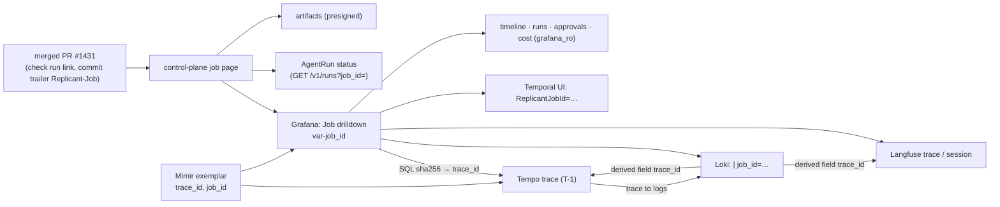

# Dashboards, Correlation, SLOs and Alerts

**Workstream:** WS-08 · **Constraints:** D-17, D-19, D-25 · **Builds on:** WS-06 online-metrics.md §3, §6, §7
(release metrics and dashboard specifications), WS-07 design system

## Purpose

List every Grafana dashboard with its panels and queries, define how one `job_id` leads to every store in one
click, define the SLOs, and specify the alert rules.

## Decisions summary

| Decision | Reference |
|---|---|
| Dashboards are code: provisioned JSON in Git (`editable: false`), generated by [dashboards/build_dashboards.py](dashboards/build_dashboards.py); two are fully built ([replicant-overview.json](dashboards/replicant-overview.json), [replicant-job.json](dashboards/replicant-job.json)), the rest are specified panel by panel below | D-17 |
| Every panel answers a stated question; no vanity tiles; WS-07 design tokens (Grafana theme overrides) | shared context §4 visual bar |
| Correlation hub is the **Job drilldown** dashboard (`/d/replicant-job/job?var-job_id=`) plus the control-plane job page; trace ID computed in SQL from `job_id` (T-1) | §2 |
| Three SLOs with multiwindow multi-burn-rate alerts; rules in the Mimir and Loki rulers, validated with `promtool`, `mimirtool`, `lokitool`, and unit-tested | §4, §5 |
| WS-06 release rules ([replicant-release.rules.yaml](../06-releases-and-evals/config/replicant-release.rules.yaml)) are loaded unchanged next to WS-08's into tenant `replicant` | §5 |

---

## 1. Dashboards

Data source UIDs: `mimir`, `loki` (platform|sandbox), `loki-audit`, `tempo`, `replicant-pg` (grafana_ro),
`alertmanager` (config/grafana/datasources.yaml). Variables used across dashboards: `tenant`, `workflow_type`
(`label_values(replicant_jobs_terminal_total, …)`), `isolation`, `workload_class`.

### 1.1 Replicant overview (`replicant-overview`, built: [replicant-overview.json](dashboards/replicant-overview.json))

| Panel | Question | Query |
|---|---|---|
| First progress within 60 s | Are jobs showing progress fast enough (SLO-1)? | `1 - replicant:first_progress_bad:ratio_rate1h` |
| Trigger → first sandbox p95 | Is sandbox readiness within 90 s (SLO-2)? | `replicant:sandbox_ready_seconds:p95_1h` |
| Control-plane budget remaining | How much 30-day error budget is left (SLO-3)? | `1 - (sum(increase(replicant_http_server_request_duration_seconds_count{service="control-plane-api",status_code=~"5.."}[30d])) / sum(increase(...{service="control-plane-api"}[30d]))) / 0.001` |
| Waiting on humans / stalled | How many jobs are blocked, and on what? | `sum(replicant_jobs_in_status{status="waiting_human"})`, `sum(replicant_jobs_stalled)` |
| Jobs finished per hour by outcome | Throughput and outcome mix | `sum by (outcome) (increase(replicant_jobs_terminal_total{tenant=~"$tenant",workflow_type=~"$workflow_type"}[1h]))` |
| Job failure ratio by workflow type | Which job types are failing? | `sum by (workflow_type)(increase(replicant_jobs_terminal_total{outcome="failed"}[1h])) / clamp_min(sum by (workflow_type)(increase(replicant_jobs_terminal_total[1h])),1)` |
| Run failures by reason | Why are sandboxes failing? | `sort_desc(sum by (reason) (increase(replicant_controller_phase_transitions_total{phase="Failed"}[6h])))` |
| Sandbox startup p95 by segment | Where does startup time go? | `histogram_quantile(0.95, sum by (le, phase, isolation) (rate(replicant_controller_run_startup_seconds_bucket[30m])))` |
| LLM spend per hour by tenant | Who is spending? | `topk(10, replicant:llm_cost_usd:increase1h)` |
| Open gates, oldest age | Is the approval backlog healthy? | `sum by (tenant, gate_kind) (replicant_gates_open)`, `max by (tenant, gate_kind) (replicant_gate_oldest_open_age_seconds)` |
| Temporal backlog age | Are workers keeping up? | `max by (task_queue) (approximate_backlog_age_seconds{task_queue=~"replicant-.+"})` |
| Error logs per service | Which services are erroring? | `topk(10, replicant:log_errors:rate5m)` (Loki recording rule) |
| Recent failed jobs | Which jobs to open? | SQL on `jobs_read.jobs` with computed `trace_id`; `job_id` links to the drilldown |

### 1.2 Per-tenant (`replicant-tenant`; org 2 copy uses Mimir panels only)

| Panel | Query |
|---|---|
| Jobs started / finished | `sum by (workflow_type) (increase(replicant_jobs_started_total{tenant="$tenant"}[1d]))`; terminal by `outcome` |
| Success rate (WS-06 definition) | `sum(increase(replicant_jobs_terminal_total{tenant="$tenant",outcome="succeeded"}[7d])) / sum(increase(replicant_jobs_terminal_total{tenant="$tenant",outcome=~"succeeded|failed|rejected|expired|taken_over"}[7d]))` |
| Time to PR (active) p50/p90 | SQL (WS-06 online-metrics.md §4 windows; per-tenant percentiles come from SQL, not Prometheus) |
| Human wait by gate kind | `histogram_quantile(0.9, sum by (le, gate_kind) (rate(replicant_jobs_human_wait_seconds_bucket[7d])))` (fleet) and SQL per tenant from `approvals.gates`/`gate_decisions` |
| Open gates and oldest | `replicant_gates_open{tenant="$tenant"}`, `replicant_gate_oldest_open_age_seconds{tenant="$tenant"}` |
| Run outcomes by role | `sum by (role, outcome) (increase(replicant_runs_terminal_total{tenant="$tenant"}[1d]))` |
| QA first pass | `sum(increase(replicant_qa_first_pass_total{tenant="$tenant",outcome="pass"}[7d])) / sum(increase(replicant_qa_first_pass_total{tenant="$tenant"}[7d]))` |
| Spend per day | `sum(increase(replicant_gateway_cost_micros_total{tenant="$tenant"}[1d])) / 1e6`; top jobs by cost: SQL `cost.usage_events` grouped by `job_id` |
| Budget denials | `sum by (reason) (increase(replicant_gateway_budget_denials_total{tenant="$tenant"}[1d]))` |
| Log volume (operators only) | `sum by (source) (bytes_over_time({tenant="$tenant"}[1h]))` |

### 1.3 Sandbox fleet (`replicant-sandbox-fleet`)

| Panel | Question | Query |
|---|---|---|
| AgentRuns by phase | How many runs are in each phase now? | `sum by (phase) (replicant_controller_agentruns{terminal="false"})` |
| Pending > 0 duration | Is capacity short? | `sum(replicant_controller_agentruns{phase="Pending"})` |
| Startup p50/p95 by isolation and workload class | Which runtime is slow to start? | `replicant:run_startup_seconds:p95_by_isolation_1h`; segments by `phase` |
| Failures by reason × isolation | Is one runtime unreliable? | `sum by (reason, isolation) (increase(replicant_controller_phase_transitions_total{phase="Failed"}[1d]))` |
| Workspace usage ratio (max per pod) | Who is near the disk limit? | `topk(20, replicant:sandbox_workspace_used:ratio)` |
| Disk-pressure runs | | `sum by (isolation) (replicant_controller_disk_pressure_runs)` |
| CPU utilization vs limit | Are profiles over-provisioned? (D-12 right-sizing input) | `quantile by (namespace) (0.9, replicant:sandbox_cpu_utilization:ratio)` |
| Memory working set vs limit | | `max by (namespace, pod) (container_memory_working_set_bytes{namespace=~"sbx-.+",container="agent"}) / on (namespace, pod) max by (namespace, pod) (container_spec_memory_limit_bytes{namespace=~"sbx-.+",container="agent"})` |
| OOM events | | `sum by (namespace) (increase(container_oom_events_total{namespace=~"sbx-.+"}[1h]))` |
| Node pool utilization | Karpenter headroom | `sum by (label_karpenter_sh_nodepool) (kube_pod_container_resource_requests{resource="cpu",namespace=~"sbx-.+"} * on (node) group_left (label_karpenter_sh_nodepool) kube_node_labels) / sum by (label_karpenter_sh_nodepool) (kube_node_status_allocatable{resource="cpu"} * on (node) group_left (label_karpenter_sh_nodepool) kube_node_labels)`. Requires kube-state-metrics `--metric-labels-allowlist=nodes=[karpenter.sh/nodepool]`, which exposes `label_karpenter_sh_nodepool` on `kube_node_labels` (native KSM label; R1-197) |
| Notification lag and oldest undelivered | Is run-notifier healthy? | `histogram_quantile(0.95, sum by (le) (rate(replicant_controller_notification_lag_seconds_bucket[10m])))`, `replicant_controller_oldest_undelivered_notification_seconds` |
| Run token issuance errors | | `sum by (stage) (increase(replicant_controller_credential_issue_errors_total[1h]))` |
| Sandbox log flood drops | | `sum by (namespace) (rate(loki_process_dropped_lines_total{component_id=~"loki.process.sandbox"}[5m]))` |
| Egress denials (Hubble, Loki tenant platform) | Which sandboxes hit default-deny egress? | `sum by (tenant) (count_over_time({service="hubble", namespace=~"sbx-.+"} [1h]))`, series labelled `attribution=pod` |
| Token-attributed flows (repo-mirror, runner-api behind internal NLBs) | Which runs used in-cluster services whose source pod Hubble cannot see? | `sum by (tenant) (count_over_time({service=~"repo-mirror\|runner-api", tenant=~".+"} \| json \| run_id!="" [1h]))`, labelled `attribution=token`: attribution from the run token's `run_id` claim logged by the server, never from source IP (XD-FIX-R2-037) |

### 1.4 Temporal health (`replicant-temporal`)

| Panel | Query |
|---|---|
| Frontend request rate and errors by operation | `sum by (operation) (rate(service_requests{service_name="frontend"}[5m]))`; `sum by (operation, error_type) (rate(service_error_with_type[5m]))` |
| Frontend latency p99 | `histogram_quantile(0.99, sum by (le, operation) (rate(service_latency_bucket{service_name="frontend"}[5m])))` |
| Persistence latency and errors | `histogram_quantile(0.99, sum by (le, operation) (rate(persistence_latency_bucket[5m])))`; `sum(rate(persistence_errors[5m]))` |
| Task queue backlog count and age | `sum by (task_queue) (approximate_backlog_count{task_queue=~"replicant-.+"})`; `max by (task_queue) (approximate_backlog_age_seconds{…})` |
| No-poller tasks | `sum by (task_queue) (increase(no_poller_tasks[10m]))` |
| Workflow task schedule-to-start p95 (ms) | `histogram_quantile(0.95, sum by (le, task_queue) (rate(temporal_workflow_task_schedule_to_start_latency_bucket[5m])))` |
| Activity schedule-to-start p95 | same with `temporal_activity_schedule_to_start_latency_bucket` by `activity_type` |
| Worker slots available | `sum by (task_queue, worker_type) (temporal_worker_task_slots_available)` |
| Sticky cache hit ratio | `sum(rate(temporal_sticky_cache_hit[5m])) / (sum(rate(temporal_sticky_cache_hit[5m])) + sum(rate(temporal_sticky_cache_miss[5m])))` |
| Continue-As-New and history size | `sum(rate(temporal_workflow_continue_as_new[1h]))`; `histogram_quantile(0.99, sum by (le) (rate(history_size_bucket[1h])))`, `history_count` likewise |
| Pinned versions (visibility) | Table via control-plane API (`TemporalWorkerDeploymentVersion` counts, WS-06 release-health) |
| Projection lag | `histogram_quantile(0.99, sum by (le) (rate(replicant_projection_lag_seq_bucket[10m])))` |
| Unknown run signals | `sum(increase(replicant_workflow_unknown_run_signals_total[1h]))` |

### 1.5 Gateway and cost (`replicant-gateway-cost`)

| Panel | Query |
|---|---|
| Requests by outcome | `sum by (outcome) (rate(replicant_gateway_requests_total[5m]))` |
| Latency and TTFB p95 by role | `histogram_quantile(0.95, sum by (le, role) (rate(replicant_gateway_request_duration_seconds_bucket[5m])))`; `…ttfb_seconds_bucket…` |
| Tokens per hour by type | `sum by (outcome) (increase(replicant_gateway_tokens_total[1h]))` |
| Spend per hour (USD) by tenant and role | `sum by (tenant, role) (increase(replicant_gateway_cost_micros_total[1h])) / 1e6` |
| Spend by model (ledger) | SQL: `SELECT date_trunc('hour', occurred_at) AS time, gateway_model_id, sum(cost_micros)/1e6 FROM cost.usage_events WHERE $__timeFilter(occurred_at) GROUP BY 1,2` |
| Top 20 jobs by cost (24 h) | SQL on `cost.usage_events` grouped by `job_id`, linked to the drilldown |
| Budget denials by reason | `sum by (reason) (increase(replicant_gateway_budget_denials_total[1h]))` |
| Upstream errors | `sum by (reason) (rate(replicant_gateway_upstream_errors_total[5m]))` |
| Ledger reconciliation | SQL on `cost` reconciliation runs (`rec_…`, WS-03) |
| Cost per job p50/p90 by workflow type and bundle | `histogram_quantile(0.5, sum by (le, workflow_type, bundle) (rate(replicant_jobs_cost_usd_bucket[1d])))` |

### 1.6 Release canary comparison (WS-06 `replicant-release-health`, `replicant-online-quality`, `replicant-speed-cost`, `replicant-approvals`)

WS-06 specifies these (online-metrics.md §6); WS-08 builds them on WS-06's recording rules:

| Panel | Query |
|---|---|
| Bundle-attributable run failure, candidate vs control | `replicant:run_bundle_failure:ratio_rate6h{release_cohort=~"candidate|default"}` by `bundle` |
| QA first-pass rate | `replicant:qa_first_pass:ratio_rate1d` by `release_cohort`, `bundle` |
| Job failure rate | `replicant:job_failure:ratio_rate1d` by `release_cohort` |
| Cost per job p50 | `replicant:job_cost_usd:p50_1d` |
| Time to PR (active) p50 | `replicant:time_to_pr_active:p50_1d` |
| Gate override rate | `replicant:gate_override:ratio_rate1d` |
| Scope violations | `replicant:scope_violation:ratio_rate1d` |
| Jobs per cohort per hour | `sum by (release_cohort) (increase(replicant_jobs_started_total[1h]))` |
| Stage annotations | SQL on WS-06 `evals.release_pipelines` stage transitions |
| Intervals on rates | WS-06 window SQL (online-metrics.md §4) as table panels with Wilson intervals |
| Cohort comparison of Temporal and sandbox health | `histogram_quantile(0.95, sum by (le, deployment_version) (rate(temporal_activity_schedule_to_start_latency_bucket[30m])))` and run failures by `bundle` |

### 1.7 Observability pipeline (`replicant-telemetry`)

Probe success and lag per sink; Alloy exporter send failures and queue sizes
(`otelcol_exporter_send_failed_spans_total`, `otelcol_exporter_queue_size`); Loki discarded samples by reason;
Loki ingestion rate per tenant; Tempo `tempo_distributor_spans_received_total`; Mimir ingestion and series per
tenant; Langfuse worker health; redaction findings by rule and sink; second-pass redactions; leak-scanner
findings; retention sweeper progress.

### 1.8 Job drilldown (`replicant-job`, built: [replicant-job.json](dashboards/replicant-job.json))

Variables: `job_id` (textbox), `trace_id` (hidden; computed by Postgres:
`SELECT substr(encode(sha256(convert_to('replicant.job.trace.v1:' || j, 'UTF8')), 'hex'), 1, 32) FROM (SELECT
'$job_id' AS j) s WHERE j ~ '^job_[0-9a-hjkmnp-tv-z]{26}$'`; `sha256()` is a core PostgreSQL function since 11),
`level`. Panels: job row, jump links, timeline, runs, logs (`{env="prod"} | job_id="$job_id"`), transcript events
(`{source="transcript"} | job_id="$job_id"`), Tempo trace (`$trace_id`), cost by run (ledger), approvals (who,
where, presented digest).

### 1.9 QA/QE (`replicant-qa`, built: [replicant-qa.json](dashboards/replicant-qa.json); XD-05-08, R1-201)

| Panel | Question | Query |
|---|---|---|
| QA runs by verdict | What verdicts does QA produce? | `sum by (outcome) (increase(replicant_qa_runs_total{tenant=~"$tenant"}[1h]))` |
| QA first-pass rate | Does the first QA run pass? (single emitter: projector) | `sum by (workflow_type) (increase(replicant_qa_first_pass_total{outcome="pass"}[1d])) / clamp_min(sum by (workflow_type) (increase(replicant_qa_first_pass_total[1d])), 1)` |
| Stage duration p95 | Where does QA time go? | `histogram_quantile(0.95, sum by (le, qa_stage) (rate(replicant_qa_stage_duration_seconds_bucket[1h])))` |
| Tests deleted or newly skipped | Is QA weakened by removed or skipped tests? (R2-006) | `sum by (workflow_type) (increase(replicant_qa_tests_deleted_or_skipped_total[1d]))` |
| Checkpoint stages reused | How much do QA retries save? (R2-033) | `sum by (qa_stage) (increase(replicant_qa_checkpoint_stages_reused_total[1d]))` |
| Failing checks by stage and cause | Which checks fail and why? | `sort_desc(sum by (qa_stage, reason) (increase(replicant_qa_checks_total[1d])))` |
| Environment failures | Is the environment, not the change, failing? | `sum by (reason) (increase(replicant_qa_environment_failures_total[1h]))` |
| Flake reruns, fix iterations | How flaky, how many QA-driven repair loops? | `sum by (outcome) (increase(replicant_qa_flake_reruns_total[1h]))`; `histogram_quantile(0.9, sum by (le) (rate(replicant_qa_fix_iterations_bucket[1d])))` |
| QA wall time by isolation | Which runtime is slow for QA (D-06)? | `histogram_quantile(0.95, sum by (le, isolation) (rate(replicant_qa_run_duration_seconds_bucket[1h])))` |

### 1.10 Audit (`replicant-audit`, operators and `replicant-security`)

Daily event counts by type and outcome (`audit.v_daily_counts`), denials over time (Loki audit), break-glass
sessions, memory admin actions (admin-only data per D-25: the dashboard lives in a folder restricted to the
`replicant-admins` team via Grafana folder permissions, which are available in OSS `[unverified: OSS folder
permission granularity for teams synced without team sync; fallback: memory analytics only in the control-plane
admin UI]`). Export health: `replicant_audit_export_lag_seconds` by `kind` and `replicant_audit_export_errors_total`
(audit.md §2).

---

## 2. Job correlation: one click from a `job_id`

| Target | URL / mechanism | Source of truth |
|---|---|---|
| Control-plane job page | `https://app.<env>.replicant.internal/jobs/<job_id>` | PG read model |
| Temporal history | `https://temporal.<env>.replicant.internal/namespaces/replicant-<env>/workflows?query=ReplicantJobId%3D%22<job_id>%22` (lists the root run chain and internal children; the UI opens the current run) `[unverified: Temporal UI query-string route for the pinned UI version; fallback: /namespaces/<ns>/workflows/<job_id>]` | Temporal |
| AgentRun status | control-plane job page "Runs" tab, backed by `GET /v1/runs?job_id=<job_id>` (C-RUNNER); for operators `kubectl get agentruns -n sbx-<t> --field-selector spec.jobId=<job_id>` (CRD `selectableFields`) | etcd |
| Langfuse trace | `https://langfuse.<env>.replicant.internal/project/replicant-<env>/traces/<T-1(job_id)>` | Langfuse |
| Langfuse session | `…/project/replicant-<env>/sessions/<job_id>` | Langfuse |
| Loki logs | Job drilldown logs panels, or Explore with `{env="<env>"} \| job_id="<job_id>"` | Loki |
| Tempo trace | Job drilldown trace panel, or Explore TraceQL `<T-1(job_id)>`; TraceQL for parts: `{ span.replicant.job_id = "<job_id>" && span.replicant.role = "implementer" }` | Tempo |
| Artifacts | Job page artifacts tab (presigned, audited, C-ART §5) | S3 |
| Memory used | Job page (read-only for non-admins, D-25) | PG memory snapshot |
| Cost | Job page and drilldown cost panel | PG cost |

Grafana linking (datasources.yaml): Loki derived fields `trace_id` → Tempo and → Langfuse, `job_id` → drilldown;
Tempo `tracesToLogsV2` → Loki `{env="prod"} | trace_id="${__trace.traceId}"`; Mimir exemplars `trace_id` → Tempo,
`job_id` → drilldown; Tempo `traceQuery.spanStartTimeShift: -30d` so trace-by-ID searches cover a job's lifetime.
The control-plane UI shows the same links (WS-07), computing the trace ID with `replicant-ids`.

### 2.1 Must-answer: given a merged PR, how does an engineer find everything the agent did?

1. On the PR: Replicant's check run and PR description link to the job (WS-07); every Replicant commit carries
   the trailer `Replicant-Job: job_…` (XD-08-10). Or: `replicant jobs find --pr github.com/acme-payments/ledger-api#1431`,
   which resolves `jobs_read.job_prs (repo_id, pr_number) → job_id`.
2. The job page shows timeline (plan, gates with who approved and the packet digest, runs per node and cycle,
   repairs, merge), artifacts (plan, diffs per cycle, QA reports and screenshots, review reports, handoffs),
   memory entries used, cost.
3. From the job page or the drilldown: full transcripts per run (S3, presigned), transcript events and logs
   (Loki), the LLM view (Langfuse: every model call with usage, every tool call with redacted previews, prompt
   versions), the distributed trace (Tempo: where time went), Temporal history (every activity input/output, with
   the codec), AgentRun objects (up to 45 days) and their conditions.
4. Retention bounds: transcripts 90 days, Langfuse 90 days, Loki 30 days, Tempo 30 days, Temporal history 30 days
   after close (plus the payload-free history skeleton in the audit bucket and the full codec-encrypted history export in `artifacts`, audit.md §2), diffs and approval records
   2 years, audit events 7 years.

---

## 3. Alert routing

[rules/mimir/alertmanager.yaml](rules/mimir/alertmanager.yaml) (verified with `mimirtool alertmanager verify`):
`severity=page` → on-call webhook and `#replicant-alerts`; `owner=ws-09` pages also go to security on-call;
`severity=ticket` → ticket webhook (24 h repeat); inhibitions suppress downstream symptoms (Temporal backlog
inhibits first-progress alerts, not `ReplicantWorkflowsStalled`, whose gauge excludes waiting jobs (XD-FIX-R2-020); capacity pending inhibits the sandbox-ready burn).

## 4. SLOs

| SLO | SLI | Objective | Window | Error budget | Source |
|---|---|---|---|---|---|
| SLO-1 First visible progress | share of jobs whose first non-intake phase is visible ≤ 60 s after the trigger (`replicant_jobs_first_progress_seconds`) | 99% | 30 d | 1% | shared context §2 |
| SLO-2 Sandbox ready | share of jobs whose first AgentRun reaches `AgentRunning` ≤ 90 s after the trigger (`replicant_jobs_first_sandbox_ready_seconds`) | 95% (= p95 < 90 s) | 30 d | 5% | shared context §2 |
| SLO-3 Control-plane availability | share of control-plane-api requests not answered with 5xx | 99.9% | 30 d | 0.1% | shared context §2 |

Burn-rate alerts (Google SRE multiwindow): page at 14.4x over 1 h and 5 m (2% of budget in 1 h), page at 6x over
6 h and 30 m, ticket at 1x over 3 d. SLO-2 uses 6x for the page because its budget (5%) is large.

## 5. Alert rules

Files: [rules/mimir/replicant-rules.yaml](rules/mimir/replicant-rules.yaml) (99 rules; `promtool check rules` and
`mimirtool rules lint` pass; unit tests [replicant-rules.test.yaml](rules/mimir/replicant-rules.test.yaml) pass with
`promtool test rules`), [rules/loki/replicant-loki-rules.yaml](rules/loki/replicant-loki-rules.yaml) (13 rules;
`lokitool rules lint` passes per tenant), and WS-06's
[replicant-release.rules.yaml](../06-releases-and-evals/config/replicant-release.rules.yaml) (15 rules; `promtool check
rules` passes), all synced to tenant `Replicant`.

| Alert | Condition (summary) | Severity | Owner |
|---|---|---|---|
| `ReplicantControlPlaneAvailabilityFastBurn` / `SlowBurn` / `BudgetDrain` | SLO-3 burn 14.4x (1 h & 5 m) / 6x (6 h & 30 m) / > 0.1% over 3 d | page / page / ticket | WS-07 |
| `ReplicantFirstProgressSLOBurn` / `SlowBurn` | SLO-1 burn 14.4x / 6x, ≥ 10 jobs | page / ticket | WS-01 |
| `ReplicantSandboxReadySLOBurn` / `P95Breached` | SLO-2 burn 6x / p95 > 90 s for 30 m | page / ticket | WS-02 |
| `ReplicantJobFailureRateHigh` | > 25% failed per tenant and type in 1 h, ≥ 8 jobs | page | WS-01 |
| `ReplicantCandidateRunFailureElevated`, `ReplicantReleaseGuardrailDataStale` (WS-06 rules) | candidate worse than control; guardrails stale | page | WS-06 |
| `ReplicantWorkflowsStalled` | reconciler reports running jobs without progress 30 min | page | WS-01 |
| `ReplicantProjectionLag` | projection seq mismatch > 5 min (C-STATE §2) | page | WS-07 |
| `ReplicantUnknownRunSignals` | any unknown `run.status_changed` (C-MSG §1.1) | ticket | WS-09 |
| `ReplicantApprovalBacklogAging` / `Large` / `GateRemindersFailing` | gate open > 3 d; > 25 open; reminder failures | ticket | WS-07 |
| `ReplicantTenantLLMCostAnomaly` | tenant hourly spend > 3x its 7-day same-hour average and > $50 | ticket | WS-03 |
| `ReplicantGlobalLLMCostSpike` | > $1,000 in 1 h | page | WS-03 |
| `ReplicantBudgetRejectionsSpike` | > 20 budget denials per tenant in 1 h | ticket | WS-03 |
| `ReplicantRunFailuresByInfraReason` | > 5 infra-reason failures (incl. `DefinitionUnavailable`) per reason and runtime in 30 m | page | WS-02 |
| `ReplicantRunSecurityViolation` | any run ended `SecurityViolation` (C-CRD 2.3.0 §4) | page | WS-09 |
| `ReplicantJobFailureRateByVersion` | > 25% failed per worker `deployment_version` in 1 h, ≥ 8 jobs; annotation `releases_url` = `/releases?focus=failures&deployment_version=…` (XD-07-07) | page | WS-06 |
| `ReplicantRunInputsInvalid` | any `InputsFetchFailed` (WS-03 exit 40) | ticket | WS-01 |
| `ReplicantAuditExportLagging`, `ReplicantAuditPartitionExportMissing` | `replicant_audit_export_lag_seconds{kind}` (events > 10 min, history > 2 h); no recorded partition export by the 3rd | page / ticket | ws-08 |
| `ReplicantReleaseFailureSpike` (group `replicant-release`) | bundle failure rate > 2x the 7-day default baseline, ≥ 10 jobs in 1 h, for 15 m; loaded from WS-07 architecture.md §9 with corrected vector matching (`on (env) group_left ()`) | page (`team: replicant-release`) | WS-07 |
| `ReplicantGatewayUsageUnparsed`, `ReplicantGatewayRunPolicyMissing` | any 503 `usage_unparsed_limit` in 5 m; 503 `run_policy_missing` persisting 10 m (R1V-051) | page / ticket | WS-03 |
| CloudWatch alarms `replicant-<env>-kms-symmetric-quota-30pct`, `replicant-<env>-kms-ecc-sign-quota-30pct` ([config/aws/kms-quota-alarms.yaml](config/aws/kms-quota-alarms.yaml)) and Mimir mirror `ReplicantKmsQuotaUsageHigh` | `AWS/Usage` CallCount / `SERVICE_QUOTA()` ≥ 30% for 5 m, per quota class (T-DOW-07, XD-W3-R1V-169) | page (SNS → replicant-security) | WS-09 |
| `ReplicantKmsThrottled` | any `replicant_kms_throttled_total` increase in 5 m | page | WS-09 |
| `ReplicantGatewayRevocationFeedStale`, `ReplicantGatewayPlatformCeiling` | ≥ 3 failed revocation-feed polls in 1 m; any 402 `platform` in 5 m (XD-W2-03-03) | page | WS-03 |
| `ReplicantContextAssemblySlow`, `ReplicantMemoryAnnRecallLow` | context activity p95 over its budget (2 s / 5 s / 4 s) for 10 m; nightly ANN recall@10 < 0.90. `audience: replicant-admins` (XD-W2-04-03) | ticket | WS-04 |
| `ReplicantMemoryCandidatesExpiring`, `ReplicantMemoryQueueAgeSLO`, `ReplicantMemoryFlagsOverdue` | > 20 candidates expired unreviewed in 7 d; p90 candidate age > 14 d; any flag past SLA. Label `audience: replicant-admins` routes them to `#replicant-admins` only (XD-FIX-R2-052) | ticket | WS-04 |
| `ReplicantKillSwitchMirrorDrift` | kill-switch mirror generation ahead of the table for > 5 m (XD-FIX-R2-016-WS07) | page | WS-07 |
| `ReplicantJobsHeldOnDependency` | `replicant_jobs_held{kind="dependency"}` > 0 for 30 m (XD-FIX-R2-010) | ticket | WS-01 |
| Cited by other sections (R1-195): `ReplicantPinnedVersionNoPollers`, `ReplicantWorkflowTaskFailures`, `ReplicantCodecTenantUnknown`, `ReplicantProjectionBacklog` (WS-01/07); `ReplicantWorkspaceLimitNotEnforced`, `ReplicantWorkspaceHardLimitBypassed`, `ReplicantWorkspaceNRIFailures` (WS-02); `ReplicantGatewayStateUnavailable`, `ReplicantGatewayUpstreamDown`, `ReplicantCostReconciliationDrift`, `ReplicantRegistryPublishFailed` (WS-03); `ReplicantMemoryServiceUnavailable` (WS-04); `ReplicantGithubDeliveryDead`, `ReplicantGithubDeliveryUnrecoverable` (WS-07); `ReplicantDbMigrationFailed`, `ReplicantDbSchemaIncompatible`, `ReplicantDbMigrationRunning30m`, `ReplicantDbConnectionsHigh`, `ReplicantDbPartitionRunwayLow`, `ReplicantDbRoleConnectionLimitHit` (Loki) (WS-10); `ReplicantSandboxDeniedEgress` (Hubble, Loki; WS-02 name) | expressions in the rule files, producer metrics in telemetry-model.md §8 | page / ticket as in the files | the citing WS |
| `ReplicantWorkspaceDiskExceeded` / `ReplicantRunOOMKilled` | ≥ 3 in 6 h per tenant and workload class | ticket | WS-03 (profile) |
| `ReplicantCallbackDeliveryStuck` | oldest undelivered notification > 5 min (C-MSG §5) | page | WS-02 |
| `ReplicantControllerReconcileErrors` | > 0.1/s | page | WS-02 |
| `ReplicantRunnerQuotaSaturation`, `ReplicantSandboxPoolPending` | quota rejections; > 20 pending for 10 m | ticket / page | WS-02 |
| `TemporalWorkflowTaskBacklog`, `TemporalNoPollerTasks`, `TemporalPersistenceErrors`, `TemporalServiceErrors`, `TemporalWorkflowTaskScheduleToStartHigh` | backlog age > 60 s; tasks without pollers; persistence errors; error ratio; schedule-to-start p95 > 2 s | page / page / page / ticket / ticket | WS-01, WS-10 |
| `ReplicantSecretLeakDetected` | leak-scanner finding | page | WS-09 |
| `ReplicantRedactionCanaryLeak` / `Missing`, `ReplicantRedactionErrors`, `ReplicantSecondPassRedactions` | canary leaked; canary not run 2 d; redactor errors; second pass caught something | page / ticket / page / ticket | WS-08 |
| `ReplicantForbiddenMetricLabel` | a `replicant_*` series with `job_id` or `run_id` | ticket | WS-08 |
| `ReplicantLangfuseIngestLag`, `ReplicantTelemetryProbeFailing`, `AlloyExporterFailures`, `LokiDiscardedSamples`, `ReplicantLangfuseRetentionSweepBehind` | pipeline health | ticket | WS-08 |
| Loki: `ReplicantServicePanics`, `ReplicantErrorLogSpike`, `KubernetesSandboxOOMEvents`, `ReplicantSandboxGatewayErrors`, `ReplicantSandboxDeniedEgress`, `ReplicantDbRoleConnectionLimitHit`, `ReplicantAuthorizationDenialSpike`, `ReplicantMemoryAdminDenied`, `ReplicantBreakGlassUsed` | log-derived | ticket (break-glass: page) | WS-08, WS-02, WS-03, WS-09 |

WS-06's alerts (`ReplicantCandidateRunFailureElevated`, `ReplicantReleaseGuardrailDataStale`,
`ReplicantReleaseRollbackBlocked`, `ReplicantIntakeBundleUnresolvable`, `ReplicantSentinelOutOfControl`,
`ReplicantJudgeDrift`, `ReplicantOnlineQualityRegression`, `ReplicantPromptVersionDeleted`) live in WS-06's rule file,
which WS-08 loads unchanged. Alertmanager routes `owner="ws-06"` and `team="replicant-release"` to receiver
`replicant-release` (Slack `#replicant-release`) and then by severity (page to on-call, ticket to tickets) (XD-FIX-R1-140).
WS-07's `ReplicantReleaseFailureSpike` is inhibited while a WS-06 guardrail alert for the same `bundle` fires.

Self-monitoring of Loki, Tempo, Mimir and Alloy uses the upstream mixins (`loki-mixin`, `tempo-mixin`,
`mimir-mixin`, Alloy's) compiled with `mixtool` and loaded as separate rule groups.

---

## Open questions

| ID | Question | Who decides | Options | Recommendation |
|---|---|---|---|---|
| OQ-08-09 | Should tenant users get the per-tenant metrics dashboard (org 2) at all? | WS-07 / WS-09 | Grafana org 2; control-plane UI only | Control-plane UI for engineers; org 2 for tenant leads who ask |
| OQ-08-10 | SLO-1 objective 99% or 95%? | Product (orchestrator) | 99 / 95 | 99%, revisit after 30 days of data |

## Risks

- Dashboards that query Postgres (`grafana_ro`) add read load to the Replicant database; panels use indexed columns
  and a 1-minute refresh minimum; WS-10 may point them at a read replica.
- Temporal UI URL formats change between UI versions; deep links are generated in one place (`replicant-ids`).

## Interfaces

- **Provided:** dashboards, correlation links, SLO definitions, alert rules and routing.
- **Consumed:** WS-06 metrics and rules, WS-07 read models (`jobs_read`, `approvals`), WS-03 `cost` schema,
  WS-02 controller metrics, Temporal metrics.
