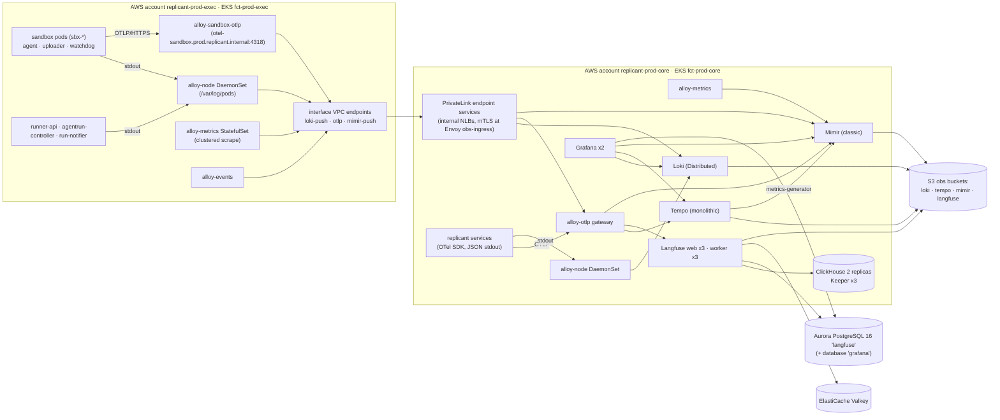

# Observability Platform Deployment

**Workstream:** WS-08 · **Constraints:** D-17, D-21, D-22, D-26 · **Contracts consumed:** C-ARCH 2.0.0 (with
CCR-09-07: exec cluster in its own AWS account), C-IDS §5 and §9–§11, C-PG, C-ART

## Purpose

Specify how Langfuse OSS and the Grafana OSS stack (Grafana, Loki, Tempo, Mimir, Alloy) are deployed, sized,
secured, retained and backed up for each environment, and what they cost at the assumed scale.

## Decisions summary

| Decision | Constraint | Reference |
|---|---|---|
| Langfuse v4 OSS, chart `langfuse/langfuse` 2.1.6: web x3 and worker x3 (HPA), Aurora PostgreSQL 16 cluster `langfuse` (WS-10: writer + reader `db.r8g.large`, databases `langfuse` and `grafana`), ClickHouse 26.4 via the bundled operator (1 shard x 2 replicas, Keeper x3), ElastiCache for Valkey, S3 | D-09, D-17 | §2; [config/langfuse/values.yaml](config/langfuse/values.yaml) |
| One Langfuse organization and project per environment; operator-only access; one trace per job | D-17, D-18 | [ADR-08-003](adr/003-single-langfuse-project-per-environment.md) |
| One tenancy model for Langfuse (R2-009): one org and project per environment; tenant attribution by trace metadata; **restricted tenants are not sent to Langfuse** (core gateway filter on `LANGFUSE_EXCLUDED_TENANTS_REGEX`, ConfigMap `observability-tenant-classes` rendered from tenancy settings); WS-09 aligns | D-17, D-18 | [ADR-08-003](adr/003-single-langfuse-project-per-environment.md) |
| Replicant-run Langfuse retention sweeper (OSS has no retention management): CronJob `langfuse-retention-sweeper` in `langfuse`, public API only, batches of 30, 90 days for every tenant | D-08, D-17 | §2.6; [session-capture.md §9](session-capture.md#9-langfuse-retention-sweeper-ws-09-g-17-r1-193) |
| Metrics: Mimir 3.2 microservices, classic architecture (no Kafka) | D-17 | [ADR-08-001](adr/001-mimir-over-prometheus.md) |
| Logs: Loki 3.7 Distributed; traces: Tempo 3.1 monolithic | D-17 | [ADR-08-005](adr/005-loki-distributed-tempo-monolithic.md) |
| Collector: Grafana Alloy 1.21 everywhere (Promtail is EOL); six production configurations; sandbox stdout transport proven per RuntimeClass by B-LOG-01, OTLP log fallback | D-17 | §3.1; [config/alloy/](config/alloy/) |
| Tenancy by data class: Loki `platform`, `sandbox`, `audit`; Tempo and Mimir `replicant` | D-17, D-18 | [ADR-08-002](adr/002-observability-tenancy-by-data-class.md) |
| Exec account ships telemetry to core through PrivateLink endpoint services with mTLS; nothing in core pulls from exec | D-21, CCR-09-07 | §1.2 |
| Grafana OSS 13.2, chart `grafana-community/grafana` 14.0.1, Okta SSO, two orgs (operations, tenants-metrics-only) | D-17, D-18 | §3.5; [config/grafana/](config/grafana/) |
| Every backend in its own S3 bucket, SSE-KMS with the platform `observability` key | D-21, D-22 | §1.3 |

---

## 1. Topology

### 1.1 Placement (per environment)

| Component | Cluster / namespace | Node pool | Replicas | Notes |
|---|---|---|---|---|
| Grafana | core / `observability` | `platform` (m7i.2xlarge) | 2 | Shared DB `grafana` on the `langfuse` Aurora cluster (C-PG §1 permits it; never on `replicant`) |
| Loki (Distributed) | core / `observability` | `platform` | see §4.5 | S3 bucket `<org>-replicant-<env>-obs-loki` |
| Tempo (monolithic) | core / `observability` | `platform` | 1 (StatefulSet, 100 GiB gp3) | S3 bucket `…-obs-tempo` |
| Mimir (classic) | core / `observability` | `platform` | see §4.5 | S3 buckets `…-obs-mimir-blocks`, `…-obs-mimir-ruler`, `…-obs-mimir-alertmanager` |
| Alloy `alloy-node` | both / `observability` (core), `replicant-observability` (exec) | all nodes incl. sandbox pools (toleration `replicant.example.com/sandbox`) | DaemonSet | [node-logs.alloy](config/alloy/node-logs.alloy) |
| Alloy `alloy-events` | both | system | 1 | [events.alloy](config/alloy/events.alloy) |
| Alloy `alloy-metrics` | both | system | 3, clustering | [cluster-metrics.alloy](config/alloy/cluster-metrics.alloy) |
| Alloy `alloy-otlp` | core / `observability` | `platform` | 3–8 (HPA) | [otlp-gateway-core.alloy](config/alloy/otlp-gateway-core.alloy) |
| Alloy `alloy-sandbox-otlp` | exec / `replicant-observability` | exec-system | 3 (HPA) | [otlp-gateway-sandbox.alloy](config/alloy/otlp-gateway-sandbox.alloy). Service `alloy-sandbox-otlp` port `4318/TCP`, pod label `app.kubernetes.io/name: alloy-sandbox-otlp` (the WS-09 sandbox egress rule selects it); serving certificate (cert-manager, CA in ConfigMap `replicant-ca-bundle` key `ca.crt`) with SANs `otel-sandbox.<env>.replicant.internal` and `alloy-sandbox-otlp.replicant-observability.svc.cluster.local`; WS-02's CoreDNS rewrite maps the first to the second (XD-FIX-R1-041) |
| Langfuse web, worker | core / `langfuse` | `platform` | 3 + 3 (HPA) | [values.yaml](config/langfuse/values.yaml) |
| ClickHouse + Keeper | core / `langfuse` | `platform-memory` (r7i.2xlarge) | 2 + 3 | ClickHouse operator (cluster-wide install, required by the chart) |
| leak-scanner | core / `observability` | `platform` | 2 | [session-capture.md §7](session-capture.md#7-leak-scanner-post-hoc-detection) |
| telemetry-probe | core / `observability` | `platform` | 1 (CronJob every 5 min) | Synthetic end-to-end probe per sink (§5.3) |
| Alloy `alloy-cloudwatch` | core / `observability` | system | 1 | [cloudwatch-metrics.alloy](config/alloy/cloudwatch-metrics.alloy): Aurora and ElastiCache CloudWatch metrics → Mimir (`ReplicantDbConnectionsHigh`) |
| `langfuse-retention-sweeper` | core / `langfuse` | `platform` | CronJob daily 03:00 UTC | [session-capture.md §9](session-capture.md#9-langfuse-retention-sweeper-ws-09-g-17-r1-193) |
| `audit-exporter` | core / `replicant-system` | `platform` | 1 (Deployment, leader lease) | Event, partition and history exports ([audit.md §2](audit.md#2-the-audit-exporter-single-writer-for-audit-exports)); DB login `svc_audit_exporter`, Temporal read-only (CCR-08-06) |
| `ops-worker` | core / `replicant-workers` | `platform` | 2 | Owned by WS-08 (CCR-08-06); image from WS-01's `workers/ops-worker/Dockerfile` (workflow and activity code only, XD-FIX-R1-267); Temporal worker on `replicant-ops` hosting `LeakPurge` ([session-capture.md §8.3](session-capture.md#83-leakpurge-workflow-c-ids-leakpurge-leak_ulid-task-queue-replicant-ops)); Pod Identity role `replicant-leak-purge`; DB login `svc_ops_worker` (CCR-08-06) |

Versions pinned at time of writing: Grafana 13.2.4, Loki 3.7.9, Tempo 3.1.1, Mimir 3.2.3, Alloy 1.21.2, Langfuse
v4.70.0 (chart 2.1.6), ClickHouse 26.4, gitleaks 8.30.1 (library), Prometheus 3.15.1 (local only) [verified:
GitHub releases API for each project, 2026-10-24].

### 1.2 Cross-account transport (CCR-09-07)

The exec cluster lives in account `replicant-<env>-exec`. Exec-side collectors push; nothing in core reaches into
exec.

| Endpoint (exec resolves in a private hosted zone) | Core endpoint service (internal NLB) | Port | Auth | Allowed clients |
|---|---|---|---|---|
| `loki-push.obs.<env>.replicant.internal` | `obs-ingress` Envoy → Loki distributor `/loki/api/v1/push` | 443 | mTLS client cert (cert-manager, CA `obs-ingest`), CN `alloy-node.exec.<env>`, `alloy-events.exec.<env>` | Envoy RBAC: only those CNs; the `X-Scope-OrgID` header must be `sandbox`, `sandbox-<tenant>` (restricted tenants, ADR-08-002) or `platform` (rewritten if absent, rejected if `audit`) |
| `otlp.obs.<env>.replicant.internal` | `alloy-otlp` gRPC 4317 | 4317 | mTLS, CN `alloy-sandbox-otlp.exec.<env>` | exec gateway only |
| `mimir-push.obs.<env>.replicant.internal` | `obs-ingress` Envoy → Mimir distributor `/api/v1/push` | 443 | mTLS, CN `alloy-metrics.exec.<env>` | `X-Scope-OrgID: replicant` enforced |

Envoy `obs-ingress` (2 replicas, core `observability`) terminates mTLS, enforces per-CN path and tenant
allowlists (RBAC filter on `connection.uri_san_peer_certificate` and `:path`, `x-scope-orgid` header matchers),
and forwards to the in-cluster services. The PrivateLink endpoint service allowlists the exec account principal
only. A compromised exec node can therefore write junk to `sandbox`/`platform` Loki tenants and to Mimir, and can
never read anything (no query path crosses the boundary).

### 1.3 Object storage

| Bucket | Contents | Versioning | Lifecycle | Encryption |
|---|---|---|---|---|
| `<org>-replicant-<env>-obs-loki` | chunks, TSDB index, delete requests | on (Loki recommends versioning to recover from retention misconfiguration) | noncurrent versions expire after 7 d (bounds purge residue, §5 of session-capture.md) | SSE-KMS `alias/replicant/<env>/observability` |
| `…-obs-loki-ruler` | Loki rule files | on | none | same |
| `…-obs-tempo` | Tempo blocks | on | noncurrent 7 d; Tempo retention deletes current versions | same |
| `…-obs-mimir-blocks`, `-ruler`, `-alertmanager` | Mimir | on | noncurrent 7 d | same |
| `…-obs-langfuse` | prefix `events/` (Langfuse raw ingestion events), `exports/` (disabled) | on | `events/` expire 30 d; noncurrent 7 d | same |
| `…-obs-clickhouse-backup` | ClickHouse backups (§6) | on | expire 14 d | same |

These are observability backend stores, not artifact data classes. CCR-08-05 asks WS-00 to state that C-ART's
seven-bucket rule covers artifacts only. WS-10 creates the buckets (cross-ws XD-08-07).

---

## 2. Langfuse v4 (self-hosted OSS)

### 2.1 Architecture (verified)

Langfuse v4 runs the same components as v3: web (`langfuse/langfuse`), worker (`langfuse/worker`), PostgreSQL,
ClickHouse, Redis or Valkey, and S3-compatible blob storage [verified: https://langfuse.com/self-hosting and
https://langfuse.com/self-hosting/upgrade/upgrade-guides/upgrade-v3-to-v4, 2026-10-24]. v4 is an
"observations-first" model on a single wide ClickHouse table. Minimums: **ClickHouse 25.12 (26.4 recommended),
PostgreSQL 15 (16 recommended), Redis 7.0 (7.2 recommended)** [verified: same upgrade guide, 2026-10-24].
Postgres migrations run automatically at web startup unless `LANGFUSE_AUTO_POSTGRES_MIGRATION_DISABLED=true`,
and ClickHouse migrations unless `LANGFUSE_AUTO_CLICKHOUSE_MIGRATION_DISABLED=true` [verified:
https://langfuse.com/self-hosting/configuration, 2026-10-24]. This resolves the WS-00 unverified item V00-40:
**Langfuse migrates its own databases at startup**, satisfying D-26 without a Replicant Job.

OTLP ingestion: `POST /api/public/otel/v1/traces`, HTTP only (JSON or protobuf), Basic auth with project keys;
direct (real-time) ingestion needs header `x-langfuse-ingestion-version: 4`, otherwise data can be delayed up to
10 minutes [verified: https://langfuse.com/integrations/native/opentelemetry, 2026-10-24]. Legacy batch endpoints
(`/api/public/traces`, `/spans`, `/generations`) return 404 on v4 defaults; `POST /api/public/ingestion` accepts
only `score-create` [verified: upgrade guide, 2026-10-24]. The Replicant therefore sends traces only via OTLP and
scores (WS-06) via `/api/public/scores` or the ingestion endpoint.

### 2.2 Deployment

Chart `langfuse/langfuse` 2.1.6 from `https://langfuse.github.io/langfuse-k8s`; chart v2 ships Langfuse v4 and a
v4-compatible ClickHouse (v1 cannot) [verified: https://langfuse.com/self-hosting/deployment/kubernetes-helm,
2026-10-24]. The values file [config/langfuse/values.yaml](config/langfuse/values.yaml) renders cleanly with
`helm template` against chart 2.1.6 (2026-10-24); the chart enforces `clickhouse.auth.username: default` when the
operator deploys ClickHouse.

| Setting | Value | Why |
|---|---|---|
| `postgresql.deploy` | false; Aurora PostgreSQL **16** cluster `langfuse-<env>`, writer + reader `db.r8g.large` (staging: writer only); database `langfuse` with roles `langfuse_app` (`DATABASE_URL`) and `langfuse_migrator` (`DIRECT_URL`, Prisma migrations at startup); database `grafana` with role `grafana_app`; passwords rotated by Secrets Manager every 30 days; PITR 14 d plus 6-hourly snapshot copy to us-west-2 (WS-10 XD-FIX-R1-235) | D-09: own instance; WS-10 provisions |
| `redis.deploy` | false; ElastiCache for Valkey provisioned like `gateway-state` (WS-10), 1 primary + 1 replica, TLS, `maxmemory-policy noeviction` | BullMQ queues must not be evicted `[unverified: Langfuse doc statement that noeviction is required; it is a BullMQ requirement]` |
| `clickhouse.deploy` | true (operator), 2 replicas, Keeper x3, 500 GiB gp3 each | v4 ClickHouse via chart v2; 2 replicas across AZs |
| `s3.deploy` | false; S3 bucket `…-obs-langfuse`, `events/` prefix | Pod Identity role `langfuse-s3` (Get/Put/List/Delete on the bucket) |
| `s3.mediaUpload.enabled`, `s3.batchExport.enabled` | false | Media and bulk exports would copy content outside retention and purge control |
| `langfuse.features.telemetryEnabled` | false | D-17 |
| `LANGFUSE_MIGRATION_V4_WRITE_MODE` | `events_only` | New install (no v3 data) |

### 2.3 Okta SSO and access

Env (rendered by the chart from `langfuse.auth.providers.okta`): `AUTH_OKTA_CLIENT_ID`, `AUTH_OKTA_CLIENT_SECRET`,
`AUTH_OKTA_ISSUER`, `AUTH_OKTA_CHECKS=pkce,state`, plus `AUTH_DISABLE_USERNAME_PASSWORD=true` and
`AUTH_DOMAINS_WITH_SSO_ENFORCEMENT` [verified: https://langfuse.com/self-hosting/security/authentication-and-sso,
2026-10-24]. Okta app assignment is the access gate (ADR-08-003): groups `replicant-operators`, `replicant-admins`,
`replicant-prompt-authors`, `replicant-security`. New users land in org `replicant`, project `replicant-<env>` as VIEWER
(`LANGFUSE_DEFAULT_ORG_ROLE`, `LANGFUSE_DEFAULT_PROJECT_ROLE`) [verified:
https://langfuse.com/self-hosting/administration/automated-access-provisioning, 2026-10-24]. OSS has no SCIM
deprovisioning (EE) [verified: https://langfuse.com/docs/administration/scim-and-org-api, 2026-10-24], so a
nightly `langfuse-access-reconciler` (CronJob, part of identity-service, WS-07) compares Langfuse org members
(read through the UI's tRPC API is not public, so this uses the Langfuse Postgres `organization_memberships`
table through a read-only role) with Okta group membership and alerts on drift; removal is a manual admin action.
`[unverified: OSS exposes no public API to remove organization members; fallback: Okta app unassignment blocks
login, which is the effective control]`.

### 2.4 Projects, keys and headless init

Headless initialization creates org `replicant`, project `replicant-<env>`, and its key pair on first start
(`LANGFUSE_INIT_ORG_ID`, `LANGFUSE_INIT_PROJECT_ID`, `LANGFUSE_INIT_PROJECT_PUBLIC_KEY`,
`LANGFUSE_INIT_PROJECT_SECRET_KEY`, `LANGFUSE_INIT_USER_*`) [verified:
https://langfuse.com/self-hosting/administration/headless-initialization, 2026-10-24]. Keys:

| Key | Holder | Use |
|---|---|---|
| Init project key (ingest) | core `alloy-otlp` only (Secret `langfuse-otlp-ingest`) | OTLP traces |
| Read key | control-plane-api (job LLM view proxy), leak-scanner, retention sweeper | Public API reads, deletes |
| Prompt key | replicant-worker (context assembler), control-plane-api registry (bundle builds) | Prompt reads (C-DEF §4.3) |
| Eval key | eval-worker (WS-06) | Datasets, scores |

Langfuse project keys are full-access within the project; separate keys give rotation and attribution, not
least privilege `[unverified: OSS project API key scopes; RBAC page lists "Project API key permissions" as
available on self-hosted, scope semantics not documented]`.

### 2.5 Sizing (assumed scale)

Inputs from §4.2: about 2,300 observations per job; peak 1,000 jobs/day ≈ 2.3 M observations/day, ≈ 27/s mean,
≈ 300/s bursts. Langfuse publishes no sizing table for v4 `[unverified]`; the values below are starting points
with HPA headroom, to be revised after the load test in WS-11's suite (`telemetry-load` scenario: 3x peak for
1 h).

| Component | Requests | Limits | Replicas |
|---|---|---|---|
| web | 1 vCPU, 3 GiB | 4 GiB | 3–6 |
| worker | 2 vCPU, 4 GiB | 6 GiB | 3–8 |
| ClickHouse | 4 vCPU, 32 GiB | 48 GiB | 2 |
| Keeper | 0.5 vCPU, 1 GiB | 2 GiB | 3 |

### 2.6 Retention

Langfuse data retention management is EE-only [verified: https://langfuse.com/docs/administration/data-retention,
2026-10-24]. Replicant enforces 90 days for traces (C-STATE §1.5) with its own sweeper
([session-capture.md §9](session-capture.md#9-langfuse-retention-sweeper-ws-09-g-17)); prompts and datasets are
never swept (WS-06 release-bundle.md §4 requirement). The `events/` prefix in S3 expires after 30 days by lifecycle
rule; the trace delete API is documented to delete "across all data storages" [verified:
https://langfuse.com/docs/administration/data-deletion, 2026-10-24], and the lifecycle rule bounds any residue.

---

## 3. Grafana OSS stack

### 3.1 Alloy (collector)

Promtail reached end of life on 2026-03-02 (WS-00 V00-41); Alloy 1.21 is used everywhere. Six production configurations plus
the local one, all validated with `alloy validate`, three with functional tests that run Alloy 1.21.2 locally
([config/alloy/tests/](config/alloy/tests/)):

| Config | Runs as | Does |
|---|---|---|
| [node-logs.alloy](config/alloy/node-logs.alloy) | DaemonSet, both clusters | `/var/log/pods` → closed label set, fixed structured metadata, `loki.secretfilter`, Loki tenants `sandbox` / `platform` / `audit` |
| [events.alloy](config/alloy/events.alloy) | 1 replica, both | Kubernetes events → Loki `platform`, `source="k8s-events"` |
| [cluster-metrics.alloy](config/alloy/cluster-metrics.alloy) | StatefulSet x3, clustering, both | ServiceMonitors, PodMonitors, kubelet cAdvisor → Mimir |
| [otlp-gateway-core.alloy](config/alloy/otlp-gateway-core.alloy) | Deployment, core | OTLP → Tempo (content stripped) and Langfuse (agent observations, Langfuse attributes) and Mimir |
| [otlp-gateway-sandbox.alloy](config/alloy/otlp-gateway-sandbox.alloy) | Deployment, exec | Sandbox OTLP: strip claimed identity, re-derive from pod labels (ADR-08-004), redact, forward to core; OTLP log fallback (B-LOG-01) into Loki `sandbox` |
| [cloudwatch-metrics.alloy](config/alloy/cloudwatch-metrics.alloy) | 1 replica, core | CloudWatch (Aurora, ElastiCache) → Mimir |
| [local.alloy](config/alloy/local.alloy) | compose `observability` profile | Generated from the two production pipelines (same stages), Docker discovery |

`loki.source.file` on `/var/log/pods` was chosen over `loki.source.kubernetes` because the latter tails through
the API server, which costs kubelet and network load [verified: Alloy loki.source.kubernetes docs, 2026-10-24];
the DaemonSet reads files read-only with `hostPath` mounts. Under Kata and gVisor, container stdout is written by
the runtime shim on the host, so the files should exist on the node; this is not assumed. Benchmark **B-LOG-01**
(session-capture.md §1 item 5, added to WS-02's runtime evaluation by XD-FIX-R2-039) checks delivery, ordering,
long lines, last lines before exit and `FallbackToLogsOnError` for each RuntimeClass. A RuntimeClass that fails
runs with bootstrap `endpoints.log_transport: "otlp"`: the uploader and entrypoint send the same JSON lines as
OTLP logs to `alloy-sandbox-otlp`, which attributes them from the connection and runs the sandbox stages into Loki
`sandbox` (functional test `test_otlp_gateway_sandbox.py`, 13/13).

### 3.2 Loki

[config/loki/loki.yaml](config/loki/loki.yaml) (validated with `loki -verify-config`, Loki 3.7.9) and
[runtime-overrides.yaml](config/loki/runtime-overrides.yaml) (loaded by a running Loki 3.7.9; a deliberately
broken key is rejected). Key settings: schema v13 + TSDB (structured metadata requirement), `auth_enabled: true`,
`discover_service_name: []` and `discover_log_levels: false` (the label set stays closed; defaults would add
`service_name` and `detected_level`) [verified: Loki configuration reference v3.7.9, 2026-10-24],
`max_label_names_per_series: 10`, zstd chunks, compactor retention with `deletion_mode: filter-and-delete` and
`delete_request_cancel_period: 2h` (purges become irreversible after 2 hours), multi-tenant queries enabled for
operator data sources.

### 3.3 Tempo

[config/tempo/tempo.yaml](config/tempo/tempo.yaml), Tempo 3.1.1 monolithic (`target: all`), vParquet5,
dedicated span and resource columns for Replicant attributes (vParquet4+ supports up to 20 string columns per
scope [verified: Tempo 3.1.1 configuration docs, 2026-10-24]), `max_bytes_per_trace: 50 MB` because one trace per
job accumulates for up to 30 days (default 5 MB; exceeding it refuses ingestion and partially drops during
compaction [verified: same]), 30-day block retention, metrics-generator service graphs and span metrics
remote-written to Mimir (service graphs feed WS-04's ecosystem indexer, C-ARCH §1.1). Trace redaction for purge
incidents: `tempo-cli redact` submits a redaction job to the backend scheduler, which rewrites the affected
blocks; Tempo 3.1 accepts a TraceQL selector and `--start/--end` [verified: Tempo v3.0 and v3.1 release notes,
2026-10-24].

### 3.4 Mimir

[config/mimir/mimir.yaml](config/mimir/mimir.yaml) and [runtime.yaml](config/mimir/runtime.yaml) (validated by
running Mimir 3.2.3; runtime overrides visible at `/runtime_config`). Classic architecture
(`ingest_storage.enabled: false`), replication 3 with zone awareness, 400-day retention, exemplars on (200 k per
tenant), ruler and Alertmanager on (rules in [rules/mimir/](rules/mimir/), Alertmanager config
[alertmanager.yaml](rules/mimir/alertmanager.yaml), validated with `mimirtool`).

### 3.5 Grafana

[config/grafana/values.yaml](config/grafana/values.yaml), chart `grafana-community/grafana` 14.0.1 (the legacy
`grafana/grafana` chart stops at Grafana 12.3; checked with `helm search repo`, 2026-10-24), rendered with
`helm template`. Two replicas on a shared Postgres database (HA requires MySQL or Postgres [verified:
https://grafana.com/docs/grafana/latest/setup-grafana/set-up-for-high-availability/, 2026-10-24]). Okta through
`[auth.okta]` with `groups_attribute_path`, `role_attribute_strict`, `org_mapping` [verified: Grafana Okta auth
docs, 2026-10-24]; login form disabled. Data sources ([datasources.yaml](config/grafana/datasources.yaml)): Mimir,
Loki (`platform|sandbox`), Loki audit, Tempo, Replicant read models (`grafana_ro`, D-26), Mimir Alertmanager, all in
org 1; org 2 has only Mimir. Dashboards are provisioned from Git through the sidecar (label `grafana_dashboard`);
the UI cannot save changes (`editable: false`).

### 3.6 Multi-tenancy (decision)

`X-Scope-OrgID` is **per data class, not per Replicant tenant** (ADR-08-002): Loki `platform`, `sandbox`, `audit`;
Tempo `replicant`; Mimir `replicant`. Exception: sandbox streams of `restricted` tenants go to Loki tenant
`sandbox-<tenant>` (ADR-08-002, R1V-052). Per-replicant-tenant scoping is the `tenant` label, enforced for tenant users by
control-plane-api's fixed-selector log proxy; tenant users never reach Loki, Tempo or the operator Grafana org.
This answers WS-09 G-08; the disagreement with tenancy.md §8 is OQ-08-01.

---

## 4. Volumes, storage and cost (must-answer)

Assumptions: steady 300 jobs/day, peak 1,000; 3 AgentRuns per job on average (planner, implementer, QA; reviewer
and repair add more on some jobs); 1,500 repos; 2,000 engineers. Prices: S3 Standard us-east-1 $0.023/GB-month
(first 50 TB), PUT/COPY/POST/LIST $0.005 per 1,000, GET $0.004 per 10,000 [verified: AWS price list API
`AmazonS3/current/us-east-1/index.json`, 2026-10-24]; gp3 $0.08/GB-month [verified:
https://aws.amazon.com/ebs/pricing/ example rate, 2026-10-24]. Compression ratios are engineering estimates
`[unverified: measured ratios; WS-11 load test records them]` and drive storage only, which is small.

### 4.1 Loki ingest per day

| Stream | Unit volume | Steady (300 jobs) | Peak (1,000 jobs) |
|---|---|---|---|
| Sandbox transcript lines (uploader): about 1,400 lines/run × 700 B + 300 B structured metadata | 1.4 MB/run | 1.26 GB | 4.2 GB |
| Sandbox app lines (agent, uploader, watchdog, init lifecycle): 300 lines/run × 430 B | 0.13 MB/run | 0.12 GB | 0.39 GB |
| Platform job-correlated (worker, projector, publisher, runner, controller, notifier, integrations): 3,500 lines/job × 450 B | 1.6 MB/job | 0.47 GB | 1.6 GB |
| Platform base (API access logs, Temporal warn+, infra at warn, CoreDNS, Envoy) | fixed | 3.0 GB | 3.0 GB |
| Kubernetes events | fixed | 0.3 GB | 0.3 GB |
| Audit mirror (200 events/job × 700 B) and Okta events for Replicant apps | 0.14 MB/job | 0.1 GB | 0.2 GB |
| **Total ingested** | | **≈ 5.3 GB/day** | **≈ 9.7 GB/day** |

Not in Loki by design: build logs, QA app logs, Playwright traces (S3 artifacts), full transcripts (S3
transcripts; Loki holds a redacted, truncated event stream), CLI OTel log events (disabled, XD-08-03).

Storage: zstd chunks at about 10x → 0.5–1.0 GB/day stored; 30-day retention (90 days for `level="error"`, 400 days
for `audit`) → about 25–35 GB steady state → **about $0.80/month S3 storage**. Requests: about 2,000–4,000 active
streams flushing at least every 2 h (`max_chunk_age`) with 3 ingester replicas ≈ 100 k PUT/day ≈ **$15/month**.

### 4.2 Langfuse (ClickHouse) ingest per day

| Observation | Per run | Per job | Avg stored size (pre-compression) |
|---|---|---|---|
| Tool observations (redacted, input ≤ 2 KiB, output ≤ 4 KiB previews) | 300 | 900 | 2.5 KiB |
| Assistant-text events (≤ 4 KiB) | 150 | 450 | 1.5 KiB |
| Generations (gateway, no content) | 150 | 450 + 20 worker calls | 0.7 KiB |
| `claude_code.llm_request` spans | 150 | 450 | 0.5 KiB |
| Node, run, CLI-invocation spans | 10 | 30 | 0.5 KiB |
| **Total** | ≈ 760 | **≈ 2,300** | ≈ 1.5 KiB avg → **≈ 3.4 MB/job** |

Per day: **≈ 1.0 GB raw steady, ≈ 3.4 GB raw peak**. ClickHouse compression about 5x → 0.2–0.7 GB/day per replica;
90-day retention at a 500 jobs/day average → about 31 GB per replica, 62 GB for two replicas. Provisioned
2 × 500 GiB gp3 (8x headroom, room for v4 migrations needing about 3x data size [verified: upgrade guide]) =
**$80/month**. Langfuse S3 `events/`: up to 3.4 GB/day × 30 days ≈ 100 GB ≈ **$2.30/month**. S3 request cost depends
on how many objects Langfuse writes per OTLP request `[unverified: v4 direct OTel ingestion's S3 write pattern]`:
with Alloy batches of 512 spans, about 4,500 PUT/day (negligible); worst case one object per observation at peak,
2.3 M PUT/day ≈ $11.50/day (**about $345/month**). The telemetry load test measures it; if per-observation writes
are confirmed, raise `send_batch_size` (already batched) and open a Langfuse issue.

### 4.3 Tempo

Spans per job: worker activities and HTTP/DB client spans about 1,500; per run about 1,400 (entrypoint tool and
CLI spans, Claude Code spans, Runner and controller reconcile spans) → about 5,700 spans/job × 600 B (content
stripped) ≈ 3.4 MB/job, plus about 1 GB/day of sampled non-job traffic → **≈ 2.0 GB/day steady, 4.4 GB/day peak**;
Parquet about 4x → ≤ 1.1 GB/day; 30 days ≤ 33 GB ≈ **$0.76/month**.

### 4.4 Mimir

Active series (estimate): core infrastructure and kube-state 130 k, Temporal server 60 k, Temporal SDK (3 pinned
worker versions) 60 k, Replicant services HTTP 50 k, Replicant business series (WS-06 cohort counters, SLO histograms)
60 k, LGTM and Langfuse self-monitoring 70 k, exec infrastructure 60 k, sandbox pods 150 concurrent × 40 = 6 k
(churn about 150 k new series/day), Tempo span metrics and service graphs 60 k → **≈ 0.6–0.8 M active, 1 M
planning figure**. 1 M series × 2,880 samples/day ≈ 2.9 G samples/day × about 1.5 B ≈ 4.3 GB/day → 400 days ≈
1.7 TB ≈ **$40/month** S3.

### 4.5 Compute (requests) and monthly cost

| Component | vCPU | Memory |
|---|---|---|
| Loki (distributor 3×0.5, ingester 3×2, querier 3×2, frontend 2×0.5, scheduler 2×0.25, index-gw 2×0.5, compactor 1, ruler 2×0.5, gateway 2×0.25) | ≈ 18 | ≈ 60 GiB |
| Tempo monolithic | 4 | 16 GiB |
| Mimir (distributor 3, ingester 3×2, querier 3, frontend 2, store-gateway 3×1, compactor 1, ruler 2, alertmanager 2) | ≈ 24 | ≈ 110 GiB |
| Grafana 2, Alloy core (DaemonSet ≈ 25 nodes × 0.25, gateway 3×1, metrics 3×1), Alloy exec (≈ 25 nodes × 0.25, gateway 3×1, metrics 3×1), Envoy obs-ingress 2×0.5 | ≈ 25 | ≈ 50 GiB |
| Langfuse web 3×1, worker 3×2, ClickHouse 2×4, Keeper 3×0.5 | ≈ 18.5 | ≈ 90 GiB |
| **Total** | **≈ 90 vCPU** | **≈ 330 GiB** |

90 vCPU and 330 GiB of requests need **at least 12 nodes of 8 vCPU** (90 / 8 = 11.3, rounded up; bin-packing
and DaemonSet overhead make 12 the floor, not a comfortable fit): for example 6 `m7i.2xlarge` (8 vCPU, 32 GiB)
and 6 `r7i.2xlarge` (8 vCPU, 64 GiB) = 96 vCPU, 576 GiB. The earlier "about eight nodes" was wrong (R1 §5.1).

| Item | Monthly (us-east-1, on-demand) | Basis |
|---|---|---|
| Compute: 6 × m7i.2xlarge + 6 × r7i.2xlarge | ≈ $4,080 | $0.4032 and $0.5292 per hour × 730 h `[unverified: EC2 on-demand prices]` |
| Langfuse PostgreSQL: Aurora PostgreSQL 16, writer + reader `db.r8g.large` (WS-10) | ≈ $447 | WS-10 capacity-and-cost.md (the single source for this figure) |
| ElastiCache for Valkey, primary + replica | ≈ $200 | `[unverified: ElastiCache price]` |
| Storage and requests, steady (§4.1–4.4): Loki S3 $0.80 + Loki PUT $15 + ClickHouse gp3 $80 + Langfuse S3 events $2.30 + Tempo S3 $0.76 + Mimir S3 $40 | ≈ $139 | computed above |
| Tempo WAL volume, 100 GiB gp3 | ≈ $8 | $0.08/GB-month |
| **Total, steady** | **≈ $4,900** | |
| Langfuse S3 PUT worst case (one object per observation at peak, §4.2) | + up to ≈ $345 | `[unverified]`; measured in the telemetry load test |

Storage and requests come to **about $147/month** in steady state (not "under $100" as earlier drafts said),
up to about $490 with the Langfuse worst case. **Compute dominates
(more than 80%); storage is small at this scale.**

### 4.6 Sensitivity and thresholds

| If | Then |
|---|---|
| Loki ingest exceeds about 20 GB/day | Distributed mode is already in place; scale ingesters and queriers |
| Tempo ingest exceeds about 50 GB/day or traces become SLO-relevant | Tempo microservices with Kafka (ADR-08-005) |
| Mimir active series exceed 5 M | Mimir ingest storage (ADR-08-001) |
| Langfuse observations per job exceed 20 k (long repair loops) | Lower tool output preview to 1 KiB; sample assistant-text events |
| Jobs per day exceed 10,000 | ClickHouse to 2 shards; Loki bloom filters; review per-run transcript line budget |

---

## 5. Retention, availability and probes

### 5.1 Retention summary

| Store | Data | Retention | Mechanism |
|---|---|---|---|
| Loki `platform` | service logs | 30 d (errors 90 d, k8s events 14 d) | `retention_period`, `retention_stream` |
| Loki `sandbox` | sandbox app and transcript events | 30 d | runtime override |
| Loki `audit` | audit mirror | 400 d | runtime override; deletion disabled |
| Tempo | traces | 30 d | `block_retention` |
| Mimir | metrics | 400 d | `compactor_blocks_retention_period` |
| Langfuse | traces, observations, scores (every tenant, including `replicant-eval`) | 90 d | `langfuse-retention-sweeper` CronJob |
| Langfuse | prompts, datasets | forever (never swept) | — |
| Langfuse S3 `events/` | raw ingestion events | 30 d | S3 lifecycle |
| S3 `transcripts` (C-ART) | full redacted transcripts | 90 d | C-ART tags |
| Postgres `audit` | audit events | 7 y | partition drop (audit.md) |

### 5.2 Availability targets

Observability is not in the request path of jobs: an outage of any backend never fails a job. Targets: Loki and
Mimir ingestion 99.9% (HA), query 99.5%; Tempo 99% (single replica); Langfuse 99.5%. Alloy buffers (WAL for
`prometheus.remote_write`, `sending_queue` for OTLP, positions files for logs) cover backend outages of about
30 minutes at peak volume.

### 5.3 Synthetic telemetry probe

CronJob `telemetry-probe` (every 5 min) uses a **standing probe job**: a real `replicant-eval` tenant job created
once per environment at bootstrap through control-plane-api, so its `job_id` and trace ID are valid C-IDS values.
Each round it (1) writes one JSON log line with that `job_id`, `phase="probe"` and a round nonce; (2) sends one
span with scope `replicant.agent`, a fresh span ID and the nonce to the core gateway; (3) queries Loki
(`{tenant="replicant-eval"} | job_id="<probe job>" |= "<nonce>"`), Tempo (TraceQL `{ span.replicant.probe_nonce =
"<nonce>" }`) and Langfuse (`GET /api/public/v2/observations?traceId=…`) until found or 10 minutes pass. Metrics:
`replicant_telemetry_probe_success{sink}`, `replicant_telemetry_probe_lag_seconds{sink}`. The retention sweeper skips
the probe job's trace.

---

## 6. Backups and disaster recovery

| Store | Backup | RPO | RTO | Restore drill |
|---|---|---|---|---|
| Langfuse Postgres (Aurora `langfuse-<env>`, WS-10) | Aurora continuous backup, PITR 14 d, 6-hourly snapshot copy to us-west-2 (WS-10 recovery.md) | 5 min | 1 h | Quarterly |
| ClickHouse | `clickhouse-backup` (Altinity, OSS) CronJob daily full + 6-hourly incremental to `…-obs-clickhouse-backup`, 14 d | 6 h | 4 h | Quarterly `[unverified: clickhouse-backup compatibility with the operator-managed pods; fallback: ClickHouse native BACKUP TO S3]` |
| Grafana DB | Aurora backups of the shared `langfuse` cluster | 5 min | 1 h | Dashboards and data sources are in Git; only user preferences are at risk |
| Loki, Tempo, Mimir | Object storage is the system of record (versioned S3); ingesters have WAL on gp3 | ≤ WAL flush | 1 h (redeploy) | Semi-annual |
| Langfuse prompts | Covered by Postgres backups; WS-06 additionally escrows every promoted prompt version (release-bundle.md) | — | — | — |

Backups hold redacted data only. A purge (session-capture.md §8) cannot rewrite backups; their bounded lifetimes
(7–35 days, Aurora PITR of the `replicant` cluster being the longest) are the purge SLA's tail.

---

## 7. Local profile (D-20, coordinated with WS-11)

After CCR-11-03 (C-ARCH 1.0.1), Langfuse web, worker, ClickHouse, Valkey and postgres-langfuse run in the `core`
compose profile because bundle builds and the context assembler need prompts; Langfuse's blob store locally is the
SeaweedFS `s3` service (CCR-11-02). The `observability` profile keeps Grafana, Loki, Tempo, Prometheus and Alloy.
WS-08 provides [config/alloy/local.alloy](config/alloy/local.alloy), generated from the production pipelines, to
replace WS-11's current Alloy config, which differs from production in ways that break query portability
(XD-08-11): OTLP-promoted labels `replicant_tenant_id`/`service_name` instead of `tenant`/`service`, identity read
from sandbox log content, no second-pass redaction, no `x-langfuse-ingestion-version` header, and no Langfuse
trace-level attribute mapping. Local Loki should set `auth_enabled: true` so the tenant header behaves as in
production.

---

## Open questions

| ID | Question | Who decides | Options | Recommendation |
|---|---|---|---|---|
| OQ-08-01 | Loki tenancy: per data class (ADR-08-002) or per Replicant tenant (WS-09 tenancy.md §8)? | Orchestrator with WS-09 | data class + enforced proxy; `t-<tenant>` org IDs | Data class. Grafana OSS cannot use per-tenant org IDs for access control anyway; the proxy enforces scope |
| OQ-08-02 | License Langfuse EE (project RBAC, SCIM, retention, audit log)? | Budget owner, WS-09 | OSS + Replicant sweeper and proxy; EE | OSS for v1; re-evaluate if engineers need direct Langfuse access |
| OQ-08-03 | Should Tempo run HA (microservices + Kafka) from day one? | WS-08, WS-10 | monolithic; microservices | Monolithic until §4.6 thresholds |

## Risks

- Langfuse v4 is recent (self-hosted GA mid-2026); its OTel ingestion S3 write pattern and resource needs at our
  shape are not documented. Mitigation: load test before production; HPA headroom.
- ClickHouse via the bundled operator couples ClickHouse upgrades to the Langfuse chart.
- Cross-account PrivateLink adds a failure domain to telemetry shipping; Alloy buffers cover about 30 minutes.

## Interfaces

- **Provided:** observability endpoints (`otel-sandbox.<env>`, `loki-push`, `otlp`, `mimir-push`), Grafana and
  Langfuse URLs, bucket list (to WS-10), Langfuse API keys (to WS-06, WS-07, replicant-worker).
- **Consumed:** C-ARCH 2.0.0 and CCR-09-07 (two accounts), C-PG §1 (langfuse instance, grafana database),
  C-STATE §1.5 (retention), WS-10 (buckets, Aurora `langfuse`, ElastiCache, KMS key), WS-09 (Okta groups, PrivateLink policy),
  WS-11 (compose profiles).
