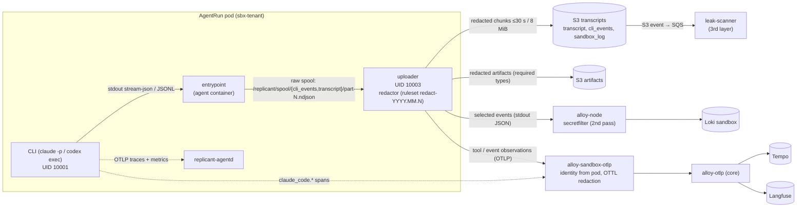
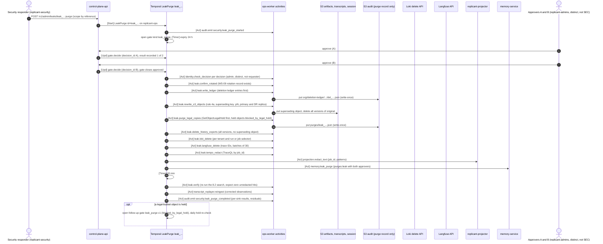

# Coding-Session Capture, Redaction, Leak Purge, and Langfuse Retention

**Workstream:** WS-08 · **Constraints:** D-08, D-10, D-14, D-17, D-21 · **Contracts:** C-ART 2.0.0 (redaction
column, transcript types), C-CRD 3.0.0, C-RUNNER 3.0.0, C-IDS 2.0.0 · **Builds on:** WS-03 cli-invocation.md §2.7,
§3.3, §5 (entrypoint, `replicant-agentd`); WS-02 controller.md §4.2 (pod containers; uploader at UID 10003)

## Purpose

Specify how CLI transcripts and tool calls are captured inside the sandbox, which parts go to which sink, the
redaction pipeline that runs before every sink, how a leaked secret is found and purged from every sink, and the
Langfuse retention sweeper that Langfuse OSS lacks (WS-09 G-17).

## Decisions summary

| Decision | Reference |
|---|---|
| The `agent` container (entrypoint, UID 10001, holds no credential) writes raw CLI output only to the local spool; the `uploader` (UID 10003; the only container that receives the run's S3 session credentials, from `replicant-agentd` over a private socket, WS-02 C-3) is the single exit point: it redacts, then uploads to S3, prints selected events for Loki, and emits OTLP observations | WS-02 §4.2, WS-03 §2.7; [ADR-08-008](adr/008-redaction-at-source-plus-collector.md) |
| One versioned ruleset `redact-YYYY.MM.N` (gitleaks TOML + PII rules + entropy + known values) used by the uploader, Alloy (`loki.secretfilter`), and leak-scanner | §5; [redaction/](redaction/) |
| Redaction fails closed; Alloy second pass; post-hoc leak-scanner | ADR-08-008 |
| CLI-native OTel: Claude Code traces and metrics on, CLI log events off; Codex traces on (`otlp-http`), Codex log events off | §3; telemetry-model.md §2.2 |
| Generations from the gateway shim; tool and assistant-text observations from the uploader | [ADR-08-006](adr/006-generations-from-the-gateway.md) |
| Playwright traces and videos are post-processed (text parts) and classified Restricted (WS-09 G-14) | §5.6 |
| Leak purge is a durable `LeakPurge` workflow (`leak_<ulid>`, task queue `replicant-ops`, deployment `ops-worker`) with two-person approval (gate kind `leak_purge`, `min_approvers = 2`, C-MSG 1.5.0), per-sink steps, and a purge record. It targets `artifacts`, `transcripts`, `session` (incl. `approval_text` and the full `workflow_history_export`), their DR replicas and the legal bucket (held objects: `blocked_by_legal_hold`, escalated; C-ART 2.0.0), writing the deletion ledger first; nothing in the Object-Locked `audit` bucket is ever purged and no role holds `s3:BypassGovernanceRetention` (C-ART 1.9.0 rule 4a, R2-005) | §8 |
| Langfuse retention: CronJob `langfuse-retention-sweeper` (namespace `langfuse`) lists traces through the Langfuse public API, skips traces with observations newer than 90 days, deletes in batches of 30 | §9 |
| Sandbox stdout must reach `/var/log/pods` under every RuntimeClass (benchmark **B-LOG-01**); where it does not, the uploader and entrypoint ship the same JSON lines as OTLP logs (fallback) | §1 item 5 (R2-039) |



---

## 1. Capture architecture

1. **CLI → entrypoint.** Claude Code runs `claude -p --output-format stream-json --verbose` with stream-json input;
   Codex runs `codex exec --json` (WS-03 §2.1, §3.1). The entrypoint appends each stdout line verbatim to
   `/replicant/spool/cli_events/part-<seq:05d>.ndjson` and its normalized form (`replicant.transcript/v1`) to
   `/replicant/spool/transcript/part-<seq:05d>.ndjson`, rotating every 30 s or 8 MiB (WS-03 §2.7). CLI stderr goes
   to `/replicant/spool/sandbox_log/`. **The entrypoint never writes transcript content to its own stdout**; its
   stdout carries lifecycle JSON only (`source="app"`).
2. **Uploader.** Watches the spool (read-only mount), and for each closed chunk: decode, redact (§5), then
   (a) upload as `transcript` / `cli_events` / `sandbox_log` chunk objects with `x-amz-tagging
   replicant-retention=r90d&replicant-type=<type>&replicant-tenant=<t>` (C-ART §5); (b) print the Loki selection (§4.2)
   on its stdout; (c) emit OTLP observations (§4.3) to `https://otel-sandbox.<env>.replicant.internal:4318`.
   The uploader is the only process that can write S3 (the agent container holds no credential; `replicant-agentd`
   hands the run's S3 session credentials only to the uploader over a private socket, WS-02 controller.md C-3) and
   the only one whose stdout may produce `source="transcript"` Loki lines (node-logs.alloy accepts that source only
   from the `uploader` container), so a compromised agent cannot bypass redaction for those sinks. It can still print
   to its own stdout (`source="app"`), which Alloy's second pass covers. Uploader facts (XD-FIX-R1-042, WS-02
   18:40Z): UID `10003`, a regular container, Pod `restartPolicy: Never` (an uploader crash ends the run
   `ArtifactUploadFailed`, retryable), exit codes 0/10/20. It gets credentials from agentd's
   `GET /v1/aws-credentials` on `/run/replicant/uploader-ipc/agentd.sock` (`credential_process` shape) and calls
   `POST /v1/redact-known` there as stage 0 of the redactor, which replaces raw, base64, percent- and JSON-escaped
   forms of every token and STS secret agentd holds with `[REDACTED:known-credential:<fp12>]`.
3. **Finalization.** After `control/agent.exit`, the uploader drains the spool, uploads required artifacts
   (redacting `required` types, C-ART §4), records `redaction.ruleset_version` and `findings_count` in the run
   manifest, and writes the manifest last (C-ART §6).
4. **Session state.** `cli_session_state` (raw `~/.claude/projects/...jsonl`, Codex `CODEX_HOME/sessions`) is
   `raw-restricted` in the `session` bucket and is never parsed into any observability sink (WS-03 §2.8).
5. **Log transport and B-LOG-01 (R2-039).** The design assumes container stdout lands in `/var/log/pods` on the
   host under every RuntimeClass. Benchmark **B-LOG-01** (added to WS-02's runtime evaluation next to B-NET and
   B-DISK, XD-FIX-R2-039) verifies it for `replicant-kata-clh`, `replicant-kata-fc` and `replicant-gvisor`:

   | Check | Pass criterion |
   |---|---|
   | B-LOG-01a | 10,000 JSON lines written by the `agent` and `uploader` containers appear in `/var/log/pods/<ns>_<pod>_<uid>/<container>/0.log` on the node, in order, within 5 s, 50/50 runs |
   | B-LOG-01b | Lines up to 64 KiB arrive unsplit (CRI `F` flag) or are reassembled by Alloy's `stage.cri` (`P` partial lines) |
   | B-LOG-01c | Lines written in the last 2 s before container exit are present (finalization evidence) |
   | B-LOG-01d | `terminationMessagePolicy: FallbackToLogsOnError` returns the last log lines for a container killed with exit 137 (WS-02's controller failure messages depend on the same files) |
   | B-LOG-01e | alloy-node tails the files with `loki.source.file` and the sandbox pipeline emits entries with the closed label set (end-to-end, through config/alloy/tests in-cluster) |

   **Fallback** for any RuntimeClass that fails B-LOG-01a–c: the controller sets bootstrap
   `endpoints.log_transport: "otlp"` (default `"stdout"`) from the RuntimeClass annotation
   `replicant.example.com/log-transport` (XD-FIX-R2-039). The uploader and entrypoint then send each JSON line they
   would have printed as an OTLP log record (body = the line, attribute `replicant.container` = `uploader`, `agent`, `agentd` (mapped to container `replicant-agentd`, XD-W2-03-03) or
   `watchdog`) to `https://otel-sandbox.<env>.replicant.internal:4318/v1/logs`. alloy-sandbox-otlp attributes the
   record from the connection (ADR-08-004), restores the line, and runs the same sandbox stage set into Loki tenant
   `sandbox` (verified by [tests/test_otlp_gateway_sandbox.py](config/alloy/tests/test_otlp_gateway_sandbox.py)). In
   fallback mode the container name is sandbox-declared, so the uploader-only rule for `source="transcript"` is
   weaker (a compromised agent could label lines of its own run as transcript); identity stays pod-derived.

## 2. Parsing CLI events

### 2.1 Claude Code stream-json (`--output-format stream-json --verbose`)

Event types [verified: https://code.claude.com/docs/en/headless, 2026-10-24]: `system` with subtype `init` (model,
tools, MCP servers, plugins, `session_id`), `system/api_retry` (`attempt`, `max_retries`, `retry_delay_ms`,
`error_status`, `error`), `assistant` and `user` messages (content blocks `text`, `tool_use`, `tool_result`;
subagent messages carry `parent_tool_use_id`), `stream_event` with `--include-partial-messages` (not used), and a
final `result` (cost, usage, session metadata). WS-03 normalizes them to
`kind ∈ {session_start, user_message, assistant_text, thinking_summary, tool_use, tool_result, steering,
finalize_prompt, api_retry, result, error}`.

### 2.2 Codex `exec --json` (JSONL)

Event types [verified: codex-rs/exec/src/exec_events.rs at rust-v0.164.0, 2026-10-24]: `thread.started`
(`thread_id`), `turn.started`, `turn.completed` (`usage`: `input_tokens`, `cached_input_tokens`,
`cache_write_input_tokens`, `output_tokens`, `reasoning_output_tokens`), `turn.failed`, `item.started` /
`item.updated` / `item.completed` with item types `agent_message`, `reasoning`, `command_execution` (`command`,
`aggregated_output`, `exit_code`, `status`), `file_change`, `mcp_tool_call`, `collab_tool_call`, `web_search`,
`todo_list`, `error`, and `error`. Mapping: `agent_message` → `assistant_text`; `reasoning` → `thinking_summary`
(length only); `command_execution`/`mcp_tool_call`/`file_change` → `tool_use` at `item.started` and `tool_result`
at `item.completed`; `turn.completed` → `result` (per turn).

### 2.3 Selection per sink

| Normalized kind | S3 `transcript` | S3 `cli_events` | Loki (uploader stdout) | Langfuse (OTLP) | Tempo |
|---|---|---|---|---|---|
| `session_start` | full | raw (redacted) | yes (model, CLI version, MCP status) | attributes on `cli.invocation` | `cli.invocation` |
| `user_message` (task prompt, steering, finalize) | full | yes | kind, length, `message_id`; no text | `event` with first 1 KiB (task prompt is replicant-generated plus quoted untrusted input) | no |
| `assistant_text` | full | yes | first 512 chars | `event`, ≤ 4 KiB | no |
| `thinking_summary` | length only | redacted thinking text is **not** stored (WS-03 §2.7 keeps only length) | length | no | no |
| `tool_use` | full input (≤ 64 KiB per WS-03) | yes | tool name, input preview ≤ 256 chars | `tool` span start: name, input preview ≤ 2 KiB | span `tool <name>` (no content) |
| `tool_result` | full output | yes | exit code / success, output size, first 256 chars on error | `tool` span end: output preview ≤ 4 KiB, `level=ERROR` on failure | end of span |
| `api_retry`, `error` | full | yes | yes (no bodies) | `event` level WARNING | span event |
| `result` | full | yes | turns, duration, usage, cost as reported | attributes on `cli.invocation` | attributes |

Truncation is in characters after redaction, with `…[truncated N bytes]` markers; truncation never splits a
redaction token.

## 3. CLI-native telemetry

Settings are in telemetry-model.md §2.2. Summary of what each CLI exports and why:

| Signal | Claude Code | Codex | Rationale |
|---|---|---|---|
| Traces | on (beta: `claude_code.interaction`, `.llm_request`, `.tool`, `.tool.execution`, `.hook`); nest under `TRACEPARENT` in `-p` mode | on, `trace_exporter = "otlp-http"` (XD-FIX-R1-076) | Timing of model calls and tools inside a run |
| Metrics | on, cumulative, no session ID: `claude_code.cost.usage`, `claude_code.token.usage`, `claude_code.lines_of_code.count`, `claude_code.active_time.total`, renamed `replicant_cli_*` in Alloy | off | Diagnostic only; the gateway's metrics are authoritative |
| Log events | **off** (`OTEL_LOGS_EXPORTER=none`) | off (`[otel] exporter = "none"`) | The uploader's transcript is the single event source; avoids a second unredacted path (WS-03 cli-invocation.md §2.2 sets `OTEL_LOGS_EXPORTER=none`, XD-FIX-R1-076) |
| Content gates | `OTEL_LOG_USER_PROMPTS=0`, `OTEL_LOG_TOOL_DETAILS=0`, `OTEL_LOG_ASSISTANT_RESPONSES=0`, `OTEL_LOG_TOOL_CONTENT=0`, `OTEL_LOG_RAW_API_BODIES` unset | `log_user_prompt = false` | Content leaves the pod only through the uploader's redactor |

Even if a CLI version changes a default, the sandbox OTLP gateway deletes content attributes (`prompt`,
`response`, `tool_input`, `tool_parameters`, `body`, `user.email`, …) and span events named `tool.output`
([otlp-gateway-sandbox.alloy](config/alloy/otlp-gateway-sandbox.alloy)).

## 4. Sink formats

### 4.1 S3 (system of record for transcripts)

Types `transcript`, `cli_events`, `sandbox_log` (C-ART §4, r90d, `redaction: required`), chunked
`<type>/part-<seq:05d>.ndjson.zst`. Each chunk object carries user metadata `x-amz-meta-replicant-ruleset:
redact-2026.10.1` and `x-amz-meta-replicant-findings: <n>`; the manifest records both totals.

### 4.2 Loki line schema (uploader stdout)

```json
{"ts":"2026-10-24T08:09:12.481Z","level":"info","stream":"transcript","event":"tool_result","run_id":"run_gj3h3ep3phjfs9e23v768zrca5","span_id":"b81c0e5a6f2d4c19","node_key":"implementer","cycle":"0","phase":"implementing","seq":119,"turn":17,"tool":"Bash","exit_code":1,"output_bytes":48211,"msg":"--- FAIL: TestProration (0.01s)\n    proration_test.go:41: got 33.33, want 33.34"}
```

`run_id` is in the body (not trusted for identity, used as a deletion scope in §8). Identity labels and metadata
are added by Alloy from pod labels (ADR-08-004).

### 4.3 OTLP observations (uploader → sandbox gateway)

Instrumentation scope `replicant.agent`. Span per tool call (`tool <name>`, `langfuse.observation.type=tool`,
`langfuse.observation.input`/`.output` previews), span event-equivalent observations for assistant text
(`langfuse.observation.type=event`), parents: `cli.invocation` (whose ID the entrypoint publishes in
`control/cli-invocation.json` so the uploader can parent correctly). Start and end times come from the spool
record timestamps (the entrypoint stamps each line on receipt). `replicant.memory_entry_ids` is set on
`cli.invocation` from the inputs manifest's memory injection refs (WS-04).

## 5. Redaction pipeline

### 5.1 Stages (in order, per text value)

| # | Stage | Engine | Replacement |
|---|---|---|---|
| 1 | Known values | Aho-Corasick over the exact credentials the pod holds: per-audience run tokens (`REPLICANT_RUN_TOKEN_DIR/*`, re-read on refresh), vended AWS session credentials, gateway credential, environment-definition env vars marked `secret: true`; each in raw, base64 std/url, URL-percent and JSON-escaped encodings | `[REDACTED:known-credential:<fp12>]` |
| 2 | Secret patterns | gitleaks v8.30.1 library, `[extend] useDefault = true` (222 upstream rules) plus 13 Replicant rules ([gitleaks-replicant.toml](redaction/gitleaks-replicant.toml)) | `[REDACTED:<rule-id>:<fp12>]` |
| 3 | Entropy | tokens `[A-Za-z0-9+/_=-]{24,512}` with Shannon entropy ≥ 4.3 bits/char (base64-like) or ≥ 3.5 (hex) within 40 chars of a key/secret/token/password keyword; Replicant IDs, git SHAs and digests allowlisted ([pii-rules.yaml](redaction/pii-rules.yaml)) | `[REDACTED:high-entropy:<fp12>]` |
| 4 | PII | email (allowlist noreply and example domains), payment card (Luhn), US SSN (validator), E.164 and NANP phones (with context keywords), IBAN (mod-97); public IPv4 detect-only | `[REDACTED:<id>]` (no fingerprint: low-entropy values are brute-forceable) |

`<fp12>` = first 12 hex characters of `sha256(secret)`. It lets responders find every occurrence of a known leaked
secret by fingerprint without writing the secret into tickets or queries (§8). Multi-line values (PEM keys) are
matched across escaped newlines inside one event; a PEM header alone triggers the rule (truncated keys).

Not detectable by pattern (documented limitation): personal names, postal addresses, free-form sensitive prose.
Containment for those relies on retention, access control (ADR-08-002, ADR-08-003) and purge.

### 5.2 Ruleset delivery and versioning

- Source: replicant-config repo `observability/redaction/` (this directory is the reviewed copy), version
  `redact-YYYY.MM.N`, reviewed by WS-09; CI runs the conformance harness (§6) on every change.
- Uploader: embedded in the `replicant/sandbox-uploader` image (WS-02), rolled out by a normal platform deploy; new
  runs pick it up. Redaction is operational configuration (ADR-013): it changes what is stored, never agent
  behavior, so it is not pinned by Release Bundles and takes effect without a bundle.
- Alloy and leak-scanner: ConfigMap `replicant-redaction-ruleset` (keys `gitleaks-replicant.toml`, `pii-rules.yaml`)
  mounted at `/etc/replicant/redaction/`, rolled out by Argo CD.
- An emergency rule (new token format) is a patch version, deployed to Alloy and leak-scanner within an hour and
  to the uploader with the next image; leak-scanner re-scans the last 90 days of S3 transcripts for the new rule.

### 5.3 Failure behavior (fail closed)

| Failure | Behavior | Signal |
|---|---|---|
| Rule engine error or timeout (> 50 ms per 64 KiB) on a value | Replace the whole value with `[REDACTION_FAILED:<len>]` and continue | `replicant_redaction_errors_total{sink}`; alert `ReplicantRedactionErrors` |
| Uploader crash mid-chunk | Pod `restartPolicy: Never` (WS-02 controller.md §9a): the run ends `ArtifactUploadFailed` (retryable). The chunk was never uploaded unredacted; the retry run re-processes the spool from the restored session (idempotent keys) | `replicant_controller_phase_transitions_total{reason="ArtifactUploadFailed"}` |
| Ruleset file missing or unparsable at uploader start | Uploader exits non-zero before uploading anything; run ends `ArtifactUploadFailed` (retryable) | controller transition reason |
| Alloy secretfilter timeout (250 ms) | Line forwarded with partial redaction (Alloy default); post-hoc scanner covers it | `loki_secretfilter_lines_timed_out_total` |

### 5.4 Uploader redactor interface (Go, WS-02 implements against this)

```go
// Package redact is the uploader's redaction engine (WS-08 ruleset, WS-02 implementation).
package redact

import (
	"context"
	"crypto/sha256"
	"encoding/hex"

	"github.com/zricethezav/gitleaks/v8/config"
	"github.com/zricethezav/gitleaks/v8/detect"
)

type Finding struct {
	RuleID      string // gitleaks rule ID, "known-credential", "high-entropy", or a PII rule ID
	Fingerprint string // first 12 hex of sha256(secret); empty for PII
	Start, End  int    // byte offsets in the input
}

type Redactor interface {
	// Redact returns the redacted text and findings. It never returns the original on error: on error the
	// caller replaces the value with "[REDACTION_FAILED:<len>]" (fail closed).
	Redact(ctx context.Context, text string) (string, []Finding, error)
	RulesetVersion() string // e.g. "redact-2026.10.1"
	// SetKnownValues replaces the exact-match set (called at start and on every token/credential refresh).
	SetKnownValues(values []string)
}

func fingerprint(secret string) string {
	sum := sha256.Sum256([]byte(secret))
	return hex.EncodeToString(sum[:])[:12]
}

// newSecretDetector loads gitleaks-replicant.toml (which extends the upstream defaults).
func newSecretDetector(cfg config.Config) *detect.Detector { return detect.NewDetector(cfg) }
```

`detect.NewDetector(cfg)` and `(*Detector).DetectString` exist in gitleaks v8.30.1 [verified:
github.com/gitleaks/gitleaks/blob/v8.30.1/detect/detect.go, 2026-10-24].

### 5.5 Other sinks' redaction

| Sink | Path | Redaction before it |
|---|---|---|
| S3 transcripts/artifacts | uploader | stages 1–4 |
| Loki sandbox | uploader stdout → Alloy | stages 1–4 at uploader; gitleaks second pass in Alloy |
| Loki platform (Python) | service stdout → Alloy | `replicant_telemetry.JsonLogFormatter` redacts `msg` and every string extra with [code/redact.py](code/redact.py) (Replicant gitleaks rules, PII rules, known values; fail closed) before formatting (self-test passes); Alloy `loki.secretfilter` second pass adds the upstream gitleaks rules (R1-198) |
| Loki platform (Go) | service stdout → Alloy | `slog` handler `replicant.example.com/telemetry/redact.Handler` wraps the uploader's `Redactor` (§5.4) and redacts the message and string attributes; same second pass |
| Loki platform: Kubernetes events, Hubble flows | events.alloy, node-logs.alloy | no source-side redaction possible (third-party producers); both pipelines pass through `loki.secretfilter` before `loki.write` (R1-198) |
| Langfuse / Tempo (sandbox) | uploader OTLP → sandbox gateway | stages 1–4 at uploader; OTTL `replace_all_patterns` second pass; Tempo drops content attributes |
| Langfuse (worker LLM calls) | worker → core gateway | worker LLM activities set only input/output previews after stages 2–4 (replicant-telemetry `redact_preview()`); gateway shim spans carry no content |
| Postgres free text (`memory.retrievals.query_text`, `jobs_read` job titles; approval comments are in S3 `approval_text`, R2-004) | owning services | stages 2–4 (WS-04 already applies the ruleset to `query_text`) |

### 5.6 Playwright traces, screenshots and videos (WS-09 G-14; with WS-05)

| Artifact | Capture-time control (WS-05 environment definition `qa.privacy`) | Post-processing (uploader) | Classification |
|---|---|---|---|
| `screenshot` | `page.screenshot({ mask: [...] })` with environment-definition selectors plus defaults `input[type=password]`, `input[type=email]`, `[autocomplete*=cc-]`, `[data-replicant-mask]` (XD-FIX-R1-121; `mask` is a Playwright screenshot option `[unverified: exact option name in the pinned Playwright version; WS-05 owns]`) | none (images are not text-redacted) | `restricted` when EnvironmentDefinition `spec.qa.privacy.realData: true`; otherwise `internal` (classification carried in the packet's `screenshots[].classification`, which WS-07 presigns by) |
| `playwright_trace` (zip) | WS-05 overlay: `use.trace = { mode: 'retain-on-failure', snapshots: { dom: false, aria: true }, screenshots: true, sources: false }` (WS-05 headless-validation.md §4.1). **DOM snapshots:** `spec.qa.privacy.traceDomSnapshots: true` (default false) is accepted by lint L17 only when `realData` is false and the tenant's classification ceiling is Internal or lower (XD-FIX-R1-121); never for `sensitive` or `restricted` tenants | `replicant-qa trace-scrub` (WS-05, inside the sandbox, before `/replicant/out`) drops non-static network bodies and `cookie`/`set-cookie`/`authorization` headers and runs **this ruleset's text redaction** (stages 1–4, through the `replicant-redact` CLI/library shipped in the QA image, XD-05-08) over console messages, aria snapshots and action parameters; fails closed (unparseable trace → not uploaded, `trace_dropped_unscrubbable`). The scrubber runs in the agent's trust domain (UID 10001), so its output is not trusted as redacted: the Restricted classification is the effective control, and leak-scanner scans the text entries of uploaded traces | **Restricted** always: screencast frames can hold data no text rule sees. Presigned only to job viewers with **write** permission on the repo (WS-09 DC-07) |
| `video` | Off by default (WS-05); when enabled, `r30d` | none | Restricted |

Restricted artifacts never go to Loki, Langfuse, Slack or PR comments; the UI shows them only behind the
presign check (WS-07).

## 6. Test plan (acceptance criterion: redaction runs before every sink and has a test plan)

| Level | What | Where | Status |
|---|---|---|---|
| Conformance corpus | 26 cases (15 secret types, 5 false-positive guards, 6 PII) × applicable engines; secrets generated at test time from seeded generators so no realistic credential is committed | [redaction/tests/corpus.yaml](redaction/tests/corpus.yaml), [run_redaction_tests.py](redaction/tests/run_redaction_tests.py) | **Passing: 46/46 checks** against gitleaks 8.30.1 (CLI, same detector as the library) and Alloy 1.21.2 `loki.secretfilter`, plus the PII reference implementation (2026-10-24). The first run showed the upstream defaults miss JWT run tokens, bearer headers and broad-alphabet AWS keys, which motivated Replicant rules |
| Pipeline functional | Alloy pipelines: identity from pod labels, routing, metadata validation, Langfuse mapping, content stripping | [config/alloy/tests/](config/alloy/tests/) | Passing (2026-10-24) |
| Property / fuzz | Go `testing.F` fuzzers: (a) redaction is idempotent; (b) output never contains any known value in any of the five encodings; (c) output length changes only inside matched spans; (d) no panic on arbitrary UTF-8 and invalid UTF-8 | uploader repo (WS-02) | Required in CI |
| Golden transcripts | 20 recorded stream-json and Codex JSONL sessions with planted secrets in tool outputs, file reads, env dumps, git remotes, assistant text; expected redacted outputs checked in | uploader repo | Required |
| Integration per sink (local, WS-11) | A scripted gateway-stub session plants one canary per rule; the test asserts the canary's fingerprint (not its value) appears in S3 transcript, Loki, Langfuse, and that the raw value appears in none of S3, Loki (`|=` search), Langfuse (API), Tempo (TraceQL attribute search) | WS-11 `redaction-e2e` scenario | Required before production |
| Production canary | Daily synthetic `replicant-eval` job whose fake repo contains one generated fake secret per rule; telemetry-probe searches every sink for the raw values (prefix search then exact match in memory, §8.2) | `redaction-canary` CronJob | Metrics `replicant_redaction_canary_leaks_total`, `…_last_success_timestamp_seconds`; alerts `ReplicantRedactionCanaryLeak` (page), `ReplicantRedactionCanaryMissing` |
| Mutation | Removing any single Replicant rule must fail at least one corpus case (checked by the harness in `--mutate` mode, WS-08 follow-up) | harness | Planned |
| Performance | p99 ≤ 2 ms per 64 KiB value; uploader CPU ≤ 0.25 vCPU at 1,400 events/run | uploader benchmark | Required |
| Second-pass monitoring | Any `loki_secretfilter_secrets_redacted_by_category_total` on sandbox origins = first-layer miss → new corpus case | alert `ReplicantSecondPassRedactions` | Live |

## 7. leak-scanner (post-hoc detection)

Go service (core `observability`, 2 replicas), gitleaks library with the same ruleset, read-only credentials:

| Source | Trigger | Method |
|---|---|---|
| S3 `transcripts`, `artifacts` (`required` text types) | S3 Event Notifications (ObjectCreated) → SQS `replicant-<env>-leak-scan` | GET, decompress, scan; a rule hit on content **not** inside a `[REDACTED:` token is a finding |
| Loki | every 15 min | LogQL per rule keyword set over the last 20 min, e.g. `{source=~"app|transcript"} |~ "(ghp_|ghs_|AKIA|ASIA|xox[bp]-|sk-lf-|-----BEGIN)"`, then full gitleaks scan of returned lines in memory |
| Langfuse | every 15 min | ClickHouse read-only user `leak_scanner` (no write grants): observations of the last 20 min whose input or output contains a rule keyword, then full scan in memory `[unverified: Langfuse v4 ClickHouse observation table and column names; fallback: Langfuse public observations API v2 with time window]` |

A finding emits `replicant_leak_scanner_findings_total{source,rule}` (alert `ReplicantSecretLeakDetected`, page to
security) and an audit event `security.leak_purge_started` once a responder opens a purge. Findings store
fingerprint, rule, location (bucket/key or Loki stream and timestamp or trace ID); never the value.

## 8. Purging a leaked secret from every sink (must-answer)

### 8.1 Sinks and their purge mechanism

C-ART 2.0.0 rule 4a fixes the scope: a leak purge touches the `artifacts`, `transcripts` and `session` buckets
(tenant keys, no Object Lock), their `-us-west-2` DR replicas (`artifacts`, `transcripts`; `session` is not
replicated), and litigation copies in the **legal bucket** `<org>-replicant-<env>-legal` (CCR-10-10, CCR-10-11). The
`audit` bucket (COMPLIANCE mode) holds no tenant content and no free text by construction (approval records are
reference-only and point at `approval_text` in `artifacts`; workflow history there is the payload-free
`workflow_history_skeleton`), so nothing there is ever purged and a hold there never blocks a purge. **No role
holds `s3:BypassGovernanceRetention`** (R2-005, R1-191).

**Role.** `LeakPurge` uses role `replicant-<env>-leak-purge` and nothing else (XD-FIX-R1-232): permission set
[spec/10-data-platform/config/iam/leak-purge.json](../10-data-platform/config/iam/leak-purge.json), which WS-09
adopts verbatim: Get/GetVersion/List and `GetObjectLegalHold`; write-once `PutObject` of `<key>.p<n>`, of `audit`
`tenants/<t>/jobs/<j>/purges/<leak_id>.json` and of `org/deletion-ledger/…/<del_id>.json`;
`DeleteObject`/`DeleteObjectVersion` in `artifacts`, `transcripts`, `session`, the replicas and the legal bucket;
explicit Deny on `s3:BypassGovernanceRetention`, `PutObjectLegalHold`, `PutObjectRetention`. KMS through S3 only.

**Ledger first (XD-FIX-R1-233).** Before any delete or supersession, activity `leak.write_ledger` writes one
`deletion_ledger_entry` per affected object set to `audit` `org/deletion-ledger/<yyyy>/<mm>/<dd>/<del_id>.json`
(`If-None-Match: *`, tag `replicant-retention=r7y`, schema spec/10-data-platform/schemas/deletion-ledger-entry.schema.json);
if the ledger write fails, the delete does not happen. Each delete acts on the primary and its DR replica.

**Legal hold (C-ART 2.0.0 rule 4a).** Before deleting a legal-bucket object, the activity reads
`GetObjectLegalHold`. A held object is not deleted (no role can bypass it): the purge records
`blocked_by_legal_hold` for that key in the purge record and the deletion ledger, emits
`security.leak_purge_blocked`, escalates through the `leak_purge` gate (§8.3) to the approvers and the legal-hold
owner, and completes every other step. The secret has been rotated regardless, so the held copy holds a dead
credential. The held object is purged when the hold is released.

| Sink | Holds | Purge mechanism | Time to effect |
|---|---|---|---|
| Credential itself | — | **Rotate or revoke first** (WS-09 runbook, step `leak.confirm_rotated`); purge only reduces exposure | minutes |
| S3 `transcripts`, `artifacts` text types (transcript, cli_events, sandbox_log, run_result, plan, handoff, review/QA reports, build/health logs) | redacted content that missed a pattern | Rule 4a rewrite: read, re-redact with the current ruleset plus the exact leaked value, write the superseding object at **`<original key>.p<n>`** (n = 1, 2, …; `If-None-Match: *`), record old key → new key and both sha256 in `tenants/<t>/jobs/<j>/purges/<leak_id>.json` (`leak_purge_record`, audit bucket, write-once), then delete **all versions** of the original. Role `replicant-<env>-leak-purge` with exactly the permission set of [10-data-platform/config/iam/leak-purge.json](../10-data-platform/config/iam/leak-purge.json) (stated once, in the **Role** paragraph above: write-once `PutObject` under `tenants/*/jobs/*` with `If-None-Match`, `DeleteObject`/`DeleteObjectVersion`, KMS `Decrypt`/`GenerateDataKey` via S3 only, explicit Deny on bypass, hold and retention changes). Readers resolve supersession through the job's `purges/` records | minutes |
| S3 `artifacts` `approval_text` | approval comment, answer text, job title as shown | Same rule 4a rewrite. The reference-only `approval_record` in `audit` keeps `text_sha256` of the **original** text; the purge record maps it to the superseding object's digest, so the integrity chain stays verifiable without the leaked value | minutes |
| S3 `artifacts` `workflow_history_export` (full history, codec-encrypted payloads) | the leaked value inside an encrypted payload (comment, steering text, activity result) | Cannot be re-redacted (encrypted). Delete **all versions** and record "deleted, no superseding object" in the purge record. The `workflow_history_skeleton` in `audit` keeps every event, ID, timestamp and payload sha256, so the audit trail stays complete; only payload bodies of that job are gone. The job is still replayable from Temporal while it is within namespace retention | minutes |
| S3 `artifacts` binary or `scan-block` types (diff bundles, SBOM) | the secret as committed content | Delete all versions; purge record marks the artifact purged; WS-07 handles the PR branch (force-push or close) and WS-09 the repo history | minutes |
| S3 `session` (raw, restricted) | raw CLI session state, workspace archives | Delete all versions of the job's `cli_session_state` and `workspace_archive` (job37d lifecycle bounds them anyway) | minutes |
| DR replicas `artifacts-us-west-2`, `transcripts-us-west-2` | replicated copies | The same supersession or deletion, applied to the replica key (CRR does not replicate deletes of versions) | minutes |
| Legal bucket (litigation copies) | copies of purgeable content | Delete all versions unless under legal hold; a held object records `blocked_by_legal_hold` and escalates (above) | minutes, or at hold release |
| S3 `audit` (approval records, skeletons, audit exports, deletion ledger, purge records, Okta exports) | IDs, enums, digests only | **Never purged** (rule 4a audit-bucket invariant; COMPLIANCE mode) | — |
| Loki (`platform`, `sandbox`) | log lines | `POST /loki/api/v1/delete` per tenant with a selector and a **non-secret** line filter: sandbox `{namespace="sbx-<t>"} |= "<run_id>"` per affected run (removes that run's lines; S3 holds the corrected record), platform `{tenant="<t>"} |= "<job_id>"` for the window; `filter-and-delete` hides matches at once and deletes physically after `delete_request_cancel_period` (2 h) [verified: Loki HTTP API and logs-deletion docs, 2026-10-24] | hidden at once; deleted ≤ 2 h + compaction |
| Langfuse | observations | `DELETE /api/public/traces` with `{"traceIds": [T-1(job)]}` (asynchronous, typically ≤ 15 min, "across all data storages" [verified: https://langfuse.com/docs/administration/data-deletion, 2026-10-24]); then `transcript-replayer` re-emits the job's observations from the corrected S3 transcript | ≤ 15 min |
| Langfuse S3 `events/` | raw ingestion events | Delete the objects of the job's time window if the trace delete leaves them `[unverified]`; the 30-day lifecycle bounds them | minutes / ≤ 30 d |
| Tempo | span attributes (content is stripped before Tempo) | `tempo-cli redact` with TraceQL `{ span.replicant.job_id = "<job_id>" }` and `--start/--end` (Tempo 3.1) [verified: Tempo 3.0/3.1 release notes, 2026-10-24; flags `[unverified]`] | ≤ 1 h |
| Postgres read models (`jobs_read`) | job titles as projected (decision comments are not in Postgres since R2-004: they live in `approval_text`, purged by the S3 row above) | Activity `projection.redact_text(job_id, patterns)` on `replicant-projector` (the only writer, C-PG), invoked by the purge workflow; no SQL by humans (D-26) | seconds |
| Postgres `memory` (WS-04) | candidates or entries extracted from feedback | Activity `memory.leak_purge` (WS-04 XD-FIX-R1-103; hosted by `ops-worker`, not replicant-worker, because `LeakPurge` runs on `replicant-ops`) calls memory-service `POST /internal/v1/purges:leak` with `{leak_id, tenant_id, approved_by: [the two leak_purge approvers], selector: {job_ids[], rule_ids[], window}}` and `Idempotency-Key: ik1:<leak_id>:memory.c0.n1.leak_purge`; memory-service emits `memory.purge_requested` (`details.path = "leak"`) and `memory.purge_completed` (D-25) | seconds |
| Postgres `audit` | IDs, digests, enums (no free text) | nothing to purge | — |
| GitHub / Slack messages posted by the Replicant | replies, status comments | github-integration / slack-integration edit or delete the message (WS-07) | minutes |
| Temporal history (live) | Update payloads, activity results | Cannot be edited. Payloads are codec-encrypted (per-tenant KMS); closed runs age out after namespace retention (30 d). For an open job the responder may cancel it; after close, `DeleteWorkflowExecution` once the full export has been deleted. Documented residual risk | ≤ 30 d after close |
| Backups (Aurora PITR, ClickHouse backups 14 d, S3 noncurrent versions 7 d) | copies | Not rewritten; expire on schedule. The purge record lists them as residual | ≤ 35 d (Aurora PITR) |
| Mimir | numbers only | nothing to purge | — |

The "only role with `DeleteObjectVersion`" claim of the earlier draft is withdrawn: besides `replicant-leak-purge`,
memory-service (C-ART rule 5), the retention sweeper (WS-10, session state) and tenant offboarding hold
version-delete rights in their own scopes.

**Purge SLA:** live, queryable sinks within 4 hours of the purge start; all copies including backups within
35 days (Aurora PITR window, WS-10); Temporal history of open jobs is the documented exception.

### 8.2 Finding every occurrence

1. **Known secret value** (reported by a human or the issuing system): the responder runs
   `replicant admin leak report --stdin` (the value is read from stdin, never from argv, and sent over mTLS to
   leak-scanner `POST /v1/leaks`; the request body is excluded from access logs and traces). leak-scanner computes
   the fingerprint and keeps the value in memory for the purge's duration (encrypted at rest only in the
   workflow's KMS-sealed blob if it must survive a restart; never in Temporal history in clear).
2. Search, using only the fingerprint or a short non-secret prefix in any query that a backend might log:
   - Redacted occurrences: Loki `|= "<fp12>"`; S3 object metadata and manifests (`findings` fingerprints); Langfuse
     ClickHouse `position(output, '<fp12>')`. These show where redaction worked (no purge needed, but they scope
     the incident).
   - Unredacted occurrences: query each backend with the first 6 characters of the value (for example `AKIA4Q`)
     and the time window, then exact-match in leak-scanner's memory; S3 transcript objects of the window are scanned
     directly (90 days of zstd transcripts at the assumed scale is about 50 GB, about 10 minutes with 64 parallel
     readers).
3. The result is a scope: set of `(tenant, job_id, run_id, sink, location)`.

### 8.3 `LeakPurge` workflow (C-IDS: `LeakPurge`, `leak_<ulid>`, task queue `replicant-ops`)

- **Start.** A `replicant-security` member runs `replicant admin leak purge --leak <leak_id>`; control-plane-api
  `POST /v1/admin/leaks/{leak_id}:purge` checks the caller's group server-side, attaches the scope produced by §8.2
  (by reference: an S3 key in `artifacts` under `org/leaks/<leak_id>/scope.json`, never the leaked value), and starts
  workflow `LeakPurge` with ID `leak_<ulid>` on `replicant-ops` (XD-FIX-R1-192 for WS-07).
- **Host.** Deployment `ops-worker`, owned and operated by WS-08 (CCR-08-06, orchestrator ruling); WS-01 supplies
  only the workflow and activity code (image built from `workers/ops-worker/Dockerfile`, healthcheck
  `ops-worker healthcheck`, XD-FIX-R1-267). Python `temporalio`, namespace `replicant-workers`, polls `replicant-ops`
  only, Temporal identity `ops-worker` (XD-FIX-R1-021); service account `leak-purge-worker` with the Pod Identity
  association to role `replicant-<env>-leak-purge` (WS-10 leak-purge.json); DB login `svc_ops_worker` with
  `EXECUTE audit.emit` only.
- **Two-person approval (C-MSG 1.5.0).** The workflow opens a gate of kind **`leak_purge`** with
  `gate_id = derived("gate", leak_id, "leak_purge", "c0", "n1")`, `eligible.min_approvers = 2`, and waits for
  Update `gate.decide` (`decision_id` as Update ID; same validators as job gates). Each approver must be a
  `replicant-admins` member (live check through activity `identity.check_decision`), the two approvers must be
  distinct (V11 `DuplicateApprover`), and neither may be the purge requester (V11 `InitiatorCannotApprove`). A
  single `reject` closes the gate. Each `approve` before the second returns `recorded`; each emits audit event
  `security.leak_purge_approved`. Channels `ui`, `cli`. Expiry 24 h, then the purge is abandoned and audited.
  Rotation (step `leak.confirm_rotated`) does not wait for the gate.
- **Escalation on legal hold.** If any legal-bucket object is held, the workflow opens a follow-up gate of kind
  `leak_purge` (`gate_id = derived("gate", leak_id, "leak_purge", "c1", "n1")`, `min_approvers = 2`; its packet is
  the purge record, whose `blocked_by_legal_hold` entries list the held keys) and notifies both approvers and the
  legal-hold owner (Okta group `replicant-legal`, notified, not eligible; XD-W2-08-04). It re-checks `GetObjectLegalHold` daily; when the hold is released it purges the object and closes
  the gate; `approve` means "re-check now", `reject` closes the purge with the held object listed as residual.
  The rest of the purge is already complete when this gate opens.
- **Steps** (activities on `replicant-ops`, each idempotent, keyed by `leak_id` and object key):



Failure modes: every step retries with backoff and is idempotent (purge records are write-once; deleting absent
versions is a no-op; Loki delete requests are idempotent per query and window). If `leak.verify` still finds hits,
the workflow repeats the failed sink once, then alerts and stays open in state `needs_attention`. A mis-scoped Loki
delete can be cancelled within 2 h. A rejected or expired gate ends the workflow with an audit event and no change.

### 8.4 Recovery after a purge

| Situation | Behavior |
|---|---|
| Restore of `replicant` Postgres to before the purge (WS-10 recovery.md) | The restore replays the deletion ledger (CCR-10-06); the purge workflow writes a `deletion_ledger_entry` for each projection redaction and memory purge **before** it commits, so a restore re-applies them and never resurrects purged text |
| S3 object restored from a noncurrent version by an operator | Not possible after the purge: all versions are deleted. A backup-account copy (WS-10) is the only residual and expires on schedule |
| Replay testing needs a purged job's history (WS-01 versioning.md §8) | Not available from S3; replay uses Temporal history while within retention, else the job is excluded from the replay corpus |
| Audit asks for the purged job | Skeleton (events, digests), approval records, audit events and the purge record remain; the purge record shows what was deleted and when |

## 9. Langfuse retention sweeper (WS-09 G-17, R1-193)

Langfuse OSS has no retention management (platform.md §2.6). One design, shared with WS-10 lifecycle.md §1.1
(XD-FIX-R1-193):

- **Where.** CronJob `langfuse-retention-sweeper` in namespace `langfuse` (core), daily at 03:00 UTC, image
  `replicant/observability-tools` (Python), owned by WS-08. It talks only to the Langfuse public API (the project's
  sweeper key, Secret `langfuse-sweeper`) and needs no Postgres or Temporal access, so no C-PG reader or task queue
  is involved.
- **What.** Traces whose `timestamp` is older than **90 days** (C-STATE Langfuse row, every tenant including
  `replicant-eval`, R1-206), listed with `GET /api/public/traces?toTimestamp=<now-90d>&page=<n>&limit=100`. A trace
  is skipped if it has any observation newer than 90 days (a job longer than its trace start, checked with
  `GET /api/public/v2/observations?traceId=<id>&fromStartTime=<now-90d>&limit=1`), and the telemetry probe's
  standing trace is skipped. Prompts and datasets are never touched.
- **How.** `DELETE /api/public/traces` with `{"traceIds": [...]}` in batches of **30** (Langfuse advises 30–50 per
  request; XD-04-08 requires ≤ 30) [verified: https://langfuse.com/faq/all/api-limits, 2026-10-24], at most 2
  requests per second, at most 5,000 traces per run. Deletion is asynchronous; a 1% sample is checked 30 minutes
  later with `GET /api/public/traces/{id}` (expect 404) by the next run.
- **Audit.** Each run writes one audit event `observability.langfuse_expired` (count and timestamp range) through
  control-plane-api `POST /internal/v1/audit/events` (the CronJob has no DB login; XD-FIX-R1-193 for WS-07).

```python
"""langfuse-retention-sweeper (CronJob, namespace langfuse). Langfuse public API only."""
from __future__ import annotations

import os
import time
from datetime import datetime, timedelta, timezone

import httpx

BATCH, MAX_PER_RUN, RETAIN = 30, 5000, timedelta(days=90)


def sweep(client: httpx.Client, probe_trace_ids: set[str], now: datetime) -> int:
    cutoff = (now - RETAIN).isoformat()
    candidates: list[str] = []
    page = 1
    while len(candidates) < MAX_PER_RUN:
        resp = client.get("/api/public/traces", params={"toTimestamp": cutoff, "page": page, "limit": 100})
        resp.raise_for_status()
        rows = resp.json()["data"]
        if not rows:
            break
        for row in rows:
            if row["id"] in probe_trace_ids:
                continue
            recent = client.get("/api/public/v2/observations",
                                params={"traceId": row["id"], "fromStartTime": cutoff, "limit": 1})
            recent.raise_for_status()
            if not recent.json()["data"]:
                candidates.append(row["id"])
        page += 1
    deleted = 0
    for i in range(0, len(candidates), BATCH):
        batch = candidates[i:i + BATCH]
        client.request("DELETE", "/api/public/traces", json={"traceIds": batch}).raise_for_status()
        deleted += len(batch)
        time.sleep(0.5)  # at most 2 requests per second
    return deleted


if __name__ == "__main__":
    started = datetime.now(timezone.utc)
    with httpx.Client(base_url=os.environ["LANGFUSE_URL"], timeout=30,
                      auth=(os.environ["LANGFUSE_PUBLIC_KEY"], os.environ["LANGFUSE_SECRET_KEY"])) as c:
        n = sweep(c, set(os.environ.get("PROBE_TRACE_IDS", "").split(",")) - {""}, started)
    print({"deleted": n, "cutoff": (started - RETAIN).isoformat()})
```

Metrics (one set of names, shared with WS-10): `replicant_langfuse_traces_deleted_total`,
`replicant_langfuse_retention_errors_total`, `replicant_langfuse_retention_last_success_timestamp_seconds`, and
`replicant_langfuse_oldest_trace_age_seconds` (oldest trace from `GET /api/public/traces?orderBy=timestamp.asc&limit=1`).
A CronJob is short-lived, so it does not expose `/metrics`: it writes the values as OTLP metrics (cumulative, with
`service.name=langfuse-retention-sweeper`) to `alloy-otlp` before exiting; alert
`ReplicantLangfuseRetentionSweepBehind` fires after 3 days without success.

## Open questions

| ID | Question | Who decides | Options | Recommendation |
|---|---|---|---|---|
| OQ-08-06 | May the purge workflow hold the leaked value (encrypted) to re-redact, or must responders re-supply it? | WS-09 | KMS-sealed blob for the purge's lifetime; re-supply per step | KMS-sealed, deleted at workflow close; never in history in clear |
| OQ-08-07 | Delete Temporal history of a closed job after a purge? | WS-09 / WS-01 | keep (encrypted, ages out); delete once the full export is deleted (§8.1) | Keep; delete only for `restricted` tenants on request (the skeleton keeps the audit trail) |
| OQ-08-08 | Should Playwright traces be produced at all for `restricted` tenants? | WS-05 / WS-09 | always; failures only; never | Failures only, Restricted |

## Risks

- A CLI version may add a new output channel (for example a new OTel log event with content). Mitigation: CLI
  upgrades go through bundles and the redaction e2e scenario; the sandbox gateway deletes unknown content keys.
- Entropy detection has false positives on generated code (hashes in lockfiles). Allowlists keep known formats;
  over-redaction is preferred to leakage.
- PII in names and free prose is not detectable.

## Interfaces

- **Provided:** ruleset and harness (to WS-02 uploader, WS-04, WS-09), Loki line schema and OTLP observation
  shape (to WS-02/WS-03), `LeakPurge` workflow on `replicant-ops` and purge record format (to WS-07, WS-09, WS-10), Langfuse sweeper CronJob (shared design with WS-10 lifecycle.md), B-LOG-01 and the OTLP log fallback (to WS-02).
- **Consumed:** C-ART 2.0.0 (types, redaction column, upload semantics, rule 4a incl. legal bucket and holds, split history export), C-MSG gate kind `leak_purge`, C-IDS `LeakPurge`/`replicant-ops`, WS-02 controller.md §4.2, WS-03
  cli-invocation.md §2–§5, WS-04 memory admin purge API, WS-05 QA privacy settings, WS-07 projector and adapters, WS-09
  rotation runbook and bucket policies, WS-10 purge role and S3 Event Notifications.
