# Telemetry Model

**Workstream:** WS-08 · **Constraints:** D-01, D-17, D-21 · **Contracts:** C-IDS 2.0.0 §5 (Rules T-1 to T-5),
§9 (Loki), §10 (Langfuse), §11 (Prometheus); C-RUNNER 3.0.0, C-CRD 3.0.0, C-MSG 2.0.0

## Purpose

Define how one job becomes one connected body of telemetry: the OpenTelemetry context through every hop, the
trace tree in Tempo and the same trace in Langfuse, the Loki label and metadata model, and every metric the
Replicant emits.

## Decisions summary

| Decision | Reference |
|---|---|
| One trace per job (T-1) in both Tempo and Langfuse; Langfuse session = `job_id` | C-IDS §5, §10; [ADR-08-003](adr/003-single-langfuse-project-per-environment.md) |
| Deterministic span IDs for the job root span and each run's `sandbox.run` span (Rule T-5, C-IDS 1.10.0) so late or header-less work attaches to the right parent | CCR-08-01; [code/trace_ids.py](code/trace_ids.py) |
| Every hop's propagation mechanism is named and was checked against current source or docs (§2.1) | D-17 |
| Temporal: `OpenTelemetryPlugin` on every client; workflow code creates no long-lived spans; live skeleton from activity spans | [ADR-08-007](adr/007-temporal-otel-plugin.md) |
| Shared `replicant-telemetry` package stamps C-IDS T-4 attributes on every span and formats JSON logs | [code/replicant_telemetry.py](code/replicant_telemetry.py) (self-test passes) |
| Generations come from the gateway shim's `gateway.request` spans; content observations from the sandbox uploader | [ADR-08-006](adr/006-generations-from-the-gateway.md) |
| Sandbox identity in telemetry comes from pod labels only | [ADR-08-004](adr/004-trusted-attribution-from-kubernetes-metadata.md) |
| Loki labels and metadata exactly as C-IDS §9; tenant users read logs only through a fixed-selector proxy | §5, §6; [ADR-08-002](adr/002-observability-tenancy-by-data-class.md) |
| Metric names aligned with WS-02, WS-03, WS-05, WS-06 specifications; labels within C-IDS §11 plus CCR-06-04 (accepted) and CCR-08-02 | §8 |

```mermaid
flowchart LR
  TRIG["trigger span<br/>(webhook / Slack / UI request)"] -. "span link (T-2)" .-> JOB["span job<br/>trace T-1, span T-5a<br/>(control-plane-api)"]
  JOB -->|"Temporal header _tracer-data"| WF["StartWorkflow / RunWorkflow<br/>ReplicantJob"]
  WF -->|header| ACT["RunActivity:*<br/>(replicant-worker)"]
  ACT -->|"HTTP traceparent + RunSpec.trace_context"| RA["runner.create_run<br/>(runner-api)"]
  RA -->|"spec.traceContext"| CT["agentrun.reconcile<br/>(controller)"]
  CT -->|"env TRACEPARENT"| EP["sandbox.run<br/>span T-5b (entrypoint)"]
  EP -->|"env TRACEPARENT (claude -p reads it)"| CLI["cli.invocation → claude_code.*"]
  CLI -->|"traceparent (CLAUDE_CODE_PROPAGATE_TRACEPARENT=1)"| GW["gateway.request<br/>(replicant-gateway-shim)"]
  CT -->|"RunStatusNotification.traceparent"| RN["run-notifier<br/>SignalWorkflow"]
  RN -->|"Signal header"| WF
  GW --> TEMPO[(Tempo)]
  EP --> TEMPO
  GW -->|"generation"| LF[(Langfuse)]
  EP -->|"tool / event observations"| LF
```



---

## 1. Identifiers in telemetry

| Identifier | Rule | Where |
|---|---|---|
| Trace ID of a job | `sha256("replicant.job.trace.v1:" + job_id)[0:32]` (T-1, normative) | every span of the job; Loki `trace_id`; Langfuse trace ID |
| Root span ID | `sha256("replicant.job.span.v1:" + job_id)[0:16]` (T-5a, CCR-08-01) | span `job` at intake; parent of late work |
| Run span ID | `sha256("replicant.run.span.v1:" + run_id)[0:16]` (T-5b, CCR-08-01) | span `sandbox.run` created by the entrypoint; fallback parent for gateway requests without `traceparent` |

Reference implementation and vectors ([code/trace_ids.py](code/trace_ids.py), executed 2026-10-24):

| Input | Output |
|---|---|
| `job_trace_id("job_01m5p7x7r0bt69j0h0fbxepw90")` | `fc0575170c8597ce9805552723c08d6e` (matches C-IDS §1) |
| `job_root_span_id("job_01m5p7x7r0bt69j0h0fbxepw90")` | `2f9b8c2c87b35ba4` |
| `run_span_id("run_gj3h3ep3phjfs9e23v768zrca5")` | `b776c51d0276da4e` |

Why T-5 (CCR-08-01): a job lives up to 30 days. Work that happens without an inbound `traceparent` (github-integration
receiving a review comment three weeks later, the retention sweeper, the audit exporter, a gateway request from a
CLI that does not forward `traceparent`) would otherwise start a new root inside the job trace, producing orphan
roots in Tempo ("root span not yet received") and duplicate trace-level rows in Langfuse. With T-5 they parent under
a known span. Rule T-5 is normative in C-IDS 1.10.0 §5 (CCR-08-01, accepted).

---

## 2. Propagation through every hop (acceptance criterion)

### 2.1 Hop table

| # | Hop | Mechanism | Verified |
|---|---|---|---|
| 1 | Trigger handler → job root | control-plane-api creates span `job` (T-1/T-5a) with a **link** to `JobRequest.trace_context.traceparent` (T-2); the trigger span gets `replicant.job_id` | Links are core OTel API; implementation exercised in [code/replicant_telemetry.py](code/replicant_telemetry.py) self-test (2026-10-24) |
| 2 | control-plane-api → Temporal (`StartWorkflowExecution`, Updates, Signals, Queries) | `temporalio.contrib.opentelemetry.OpenTelemetryPlugin()` on the client; context in Temporal header `_tracer-data` | [verified: sdk-python 1.34.0 `contrib/opentelemetry/README.md`, `_otel_interceptor.py` header `_tracer-data`, 2026-10-24] |
| 3 | Workflow → activities, child workflows, Continue-As-New | same plugin (headers on every command) | [verified: same; C-IDS T-3 table] |
| 4 | Workflow ↔ `ReplicantContext` | interceptor `replicant_telemetry.temporal.ReplicantContextInterceptor` adds header `_replicant-ctx` (JSON, identifiers only: `tenant_id`, `job_id`, `workflow_type`, `release_bundle_id`, `requester_id`, `memory_snapshot_id`; `ReplicantContext.to_header()`) on every outbound command; every Replicant Temporal client is created by WS-01's `replicant_temporal.connect()` with `OpenTelemetryPlugin`, this interceptor and `header_codec_behavior=NO_CODEC` (XD-FIX-R1-016); activity side sets the contextvar | Replicant code (WS-01 registers); not a third-party claim |
| 5 | Activity → Runner API | `opentelemetry-instrumentation-httpx` injects `traceparent`/`tracestate`; the activity also puts `trace_context.traceparent` (the activity span) in `RunSpec` | C-RUNNER `Traceparent` header parameter and `RunSpec.trace_context` |
| 6 | Runner → AgentRun | runner-api starts `runner.create_run` (child of the inbound header) and writes **its own** span as parent into `spec.traceContext.traceparent` | C-CRD 2.0.0 field `traceContext` (immutable); C-CRD §2 mapping |
| 7 | Controller reconcile | each reconcile is a span whose parent is `spec.traceContext` (WS-02 controller.md §10) | WS-02 spec |
| 8 | Controller → pod | env `TRACEPARENT`, `TRACESTATE`, `OTEL_RESOURCE_ATTRIBUTES`, `OTEL_EXPORTER_OTLP_ENDPOINT=https://otel-sandbox.<env>.replicant.internal:4318` | C-IDS §7 |
| 9 | Entrypoint | creates `sandbox.run` (span ID T-5b, parent from `TRACEPARENT`) and per CLI invocation `cli.invocation`; sets the child's `TRACEPARENT` to `cli.invocation` | Replicant code (WS-03) |
| 10 | Entrypoint → Claude Code (`claude -p`) | Claude Code reads inbound `TRACEPARENT`/`TRACESTATE` in `-p` and Agent SDK sessions; its spans nest under the caller (beta tracing: `CLAUDE_CODE_ENHANCED_TELEMETRY_BETA=1`, `OTEL_TRACES_EXPORTER=otlp`) | [verified: https://code.claude.com/docs/en/monitoring-usage, 2026-10-24] |
| 11 | Claude Code → `replicant-agentd` (sandbox sidecar, C-ARCH 1.2.0) | `ANTHROPIC_BASE_URL` points at agentd's local listener; Claude Code sends `traceparent` to a custom base URL only with `CLAUDE_CODE_PROPAGATE_TRACEPARENT=1` (WS-03 sets it) | [verified: https://code.claude.com/docs/en/monitoring-usage, 2026-10-24]; agentd per WS-03 cli-invocation.md §5 |
| 12 | Entrypoint → Codex (`codex exec`) → agentd | Codex has no documented `TRACEPARENT` intake or forwarding `[unverified]`; the model provider block sets `env_http_headers = { "traceparent" = "REPLICANT_CLI_TRACEPARENT" }` (static per invocation = `cli.invocation`), so agentd always receives a parent | `env_http_headers` [verified: https://learn.chatgpt.com/docs/config-file/config-advanced, 2026-10-24] |
| 12a | agentd → `replicant-gateway-shim` | agentd starts span `agentd.proxy` (child of the inbound `traceparent`, or of `sandbox.run` T-5b when absent), injects the run token for audience `ai-gateway`, `traceparent` of `agentd.proxy`, `X-Replicant-Tenant-Id/Job-Id/Run-Id/Role` and, on retries, `X-Replicant-Retry-Attempt` (C-IDS 1.3.0 §7); each retry attempt is its own child span with `replicant.retry_attempt` | C-IDS §7 (CCR-03-04); WS-03 spec |
| 13 | Shim | span `gateway.request` (kind SERVER), child of the inbound `traceparent`, attributes `replicant.tenant_id`, `replicant.job_id`, `replicant.run_id`, `replicant.role`, `gen_ai.request.model`, `gen_ai.usage.*`, `replicant.cost_micros`, `replicant.request_id` (`gwu_<ulid>`, also returned as `X-Replicant-Request-Id`); child span `gateway.upstream` with a fresh `traceparent` forwarded upstream; the shim's JSON log line carries `job_id`, `run_id`, `trace_id`, `span_id` metadata and `request_id` in the body. The shim exports OTLP to the core Alloy gateway (it runs in core, WS-03) | WS-03 gateway.md §7, §10 |
| 13a | Shim → agentd responses | `X-Replicant-Request-Id`, budget headers (`X-Replicant-Budget-*`), `X-Replicant-Limit`; agentd records them as span attributes `replicant.request_id`, `replicant.budget_exceeded`, `replicant.limit` and as transcript events (`api_retry`, budget) | C-IDS 1.3.0 §7 |
| 14 | Controller → run-notifier → Temporal Signal | `RunStatusNotification.traceparent`; notifier (Go, Temporal Go SDK) uses `contrib/opentelemetry.NewTracingInterceptor` with default header key `_tracer-data`, matching Python | [verified: sdk-go v1.50.0 `contrib/opentelemetry/tracing_interceptor.go` (`TracerOptions.HeaderKey`), `interceptor/tracing_interceptor.go` (`defaultHeaderKey = "_tracer-data"`), 2026-10-24] |
| 15 | github-integration → `pr.event` Signal; slack-integration and UI → control-plane-api → `gate.decide` Update | inbound request span; for job-scoped actions the outgoing Temporal call is made inside `job_context(job_id)` (T-5a parent) with a link to the request span | Replicant code |
| 16 | projector, memory-service, context-mcp, memory-mcp | inbound `traceparent` (HTTP/MCP over HTTP); MCP servers run `opentelemetry-instrumentation-starlette`/`fastapi` | Replicant code |
| 17 | Sandbox → memory-mcp / context-mcp / repo-mirror / runner-sandbox | `replicant-agentd` (WS-03) proxies every call with the per-audience run token (C-RUNNER 2.1.0) and `traceparent` of its `agentd.proxy` span (parent: the calling tool span if propagated, else `sandbox.run`) | WS-03 spec |
| 18 | publisher-worker → GitHub | outbound span only; **no** `traceparent` to external services (egress hygiene) | Replicant policy |

Rule: **no hop may drop context**. CI contract test (WS-11 `trace-continuity` scenario): run one local job and
assert that every span with `replicant.job_id=J` has trace ID T-1(J) and that the trace has exactly one root
(`job`).

### 2.2 Sandbox telemetry environment (set by the entrypoint for the CLI child; WS-03 owns the full list)

```bash
# Claude Code (WS-03 cli-invocation.md §2.2 sets most of these; WS-08 requires the values below)
CLAUDE_CODE_ENABLE_TELEMETRY=1
CLAUDE_CODE_ENHANCED_TELEMETRY_BETA=1        # traces: claude_code.interaction / llm_request / tool
OTEL_TRACES_EXPORTER=otlp
OTEL_METRICS_EXPORTER=otlp
OTEL_LOGS_EXPORTER=none                      # XD-08-03: WS-03 currently sets otlp; transcript events come from the uploader
OTEL_EXPORTER_OTLP_PROTOCOL=http/protobuf
OTEL_EXPORTER_OTLP_METRICS_TEMPORALITY_PREFERENCE=cumulative   # per-pod cumulative series; no delta merging
OTEL_METRICS_INCLUDE_SESSION_ID=false        # session.id is per-run cardinality
OTEL_METRICS_INCLUDE_ACCOUNT_UUID=false
OTEL_LOG_USER_PROMPTS=0
OTEL_LOG_TOOL_DETAILS=0
OTEL_LOG_ASSISTANT_RESPONSES=0
OTEL_LOG_TOOL_CONTENT=0
CLAUDE_CODE_PROPAGATE_TRACEPARENT=1
TRACEPARENT=00-<T-1 trace id>-<cli.invocation span id>-01
```

Variable names and defaults (`OTEL_METRICS_INCLUDE_SESSION_ID` default true, temporality default delta, content
gates default off) [verified: https://code.claude.com/docs/en/monitoring-usage, 2026-10-24].

Codex (`$CODEX_HOME/config.toml`, WS-03 §3.2):

```toml
[otel]
environment = "replicant-prod"
exporter = "none"            # Codex log events (codex.tool_result carries an output snippet) are not exported
trace_exporter = "otlp-http" # spans to OTEL_EXPORTER_OTLP_ENDPOINT (alloy-sandbox-otlp), content stripped there
log_user_prompt = false

[model_providers.replicant-gateway]
env_http_headers = { "traceparent" = "REPLICANT_CLI_TRACEPARENT" }
```

`[otel] exporter = "none"` exports no log events; `log_user_prompt` defaults to false [verified:
https://learn.chatgpt.com/docs/config-file/config-advanced, 2026-10-24]. Codex traces are exported with
`trace_exporter = "otlp-http"`, the key WS-03 documents (XD-FIX-R1-076, cli-invocation.md §2.2); the sandbox gateway
deletes content attributes as for Claude Code. Codex's own `traceparent` injection is source-verified only and not
relied on: the provider's `env_http_headers` carries `REPLICANT_CLI_TRACEPARENT` (the `cli.invocation` span) to agentd
on every request. This settles OQ-08-05.

Span names (XD-FIX-R1-076, normative for WS-03): `sandbox.run` (entrypoint, whole run, T-5b ID),
`cli.invocation` (per CLI or harness process), `agentd.proxy` (per proxied request), `gateway.request` (shim,
scope `replicant.gateway`, attributes include `replicant.request_id`, `replicant.purpose`, `gen_ai.response.model`). The
entrypoint's control record `/replicant/spool/control/cli-invocation.json` is uploaded as artifact type `sandbox_log`
with name `control/cli-invocation.json`. Langfuse experiment attributes of eval runs come from the run plan's
`effective.experiment` (XD-06-05).

### 2.3 The `replicant-telemetry` package

Every Python service imports it (WS-01, WS-03, WS-04, WS-06, WS-07 services). The reference implementation
[code/replicant_telemetry.py](code/replicant_telemetry.py) passes its self-test (OpenTelemetry Python SDK, 2026-10-24):

- `ReplicantContext` contextvar, set by FastAPI middleware (from the authorized job), by the Temporal
  `ReplicantContextInterceptor` (from header `_replicant-ctx`), and by github/slack adapters after job lookup.
- `ReplicantContextSpanProcessor.on_start` sets `replicant.env`, `deployment.environment.name`, and every non-null
  `replicant.*` attribute (C-IDS T-4) on every span.
- `ParentBased(root=ReplicantRootSampler(0.05))`: job work, `POST /v1/jobs`, gate decisions, webhooks and Slack
  callbacks are always sampled; other root traces at 5%. Children follow parents, so job traces are complete.
- `start_job_root_span()` emits `job` with the T-1 trace ID and T-5a span ID through a dedicated provider whose ID
  generator reads a contextvar (safe under concurrent requests), linked to the trigger.
- `job_context(job_id)` returns a parent context at the job root span for late, header-less work.
- `JsonLogFormatter` writes the JSON line node-logs.alloy expects (UTC `ts`, `level`, `msg`, `tenant_id`,
  `workflow_type`, `role`, `log_type`, and the C-IDS §9 metadata keys).
- Exporter: OTLP gRPC to `alloy-otlp.observability.svc:4317` (core); batch span processor 512 / 5 s.
- Eval jobs (`related.eval_case`, WS-06 XD-06-05): `ReplicantContext` carries the Langfuse experiment attributes
  (`langfuse.experiment.id`, `.name`, `.dataset.id`, `.item.id`, `.item.root_observation_id`, `.item.version`).
  They are **not** carried in `_replicant-ctx` (identifiers only, XD-FIX-R1-016): workers set them from the run
  plan's `effective.experiment` (XD-FIX-R1-076); the span processor stamps them on every core-side span of the job, and
  control-plane-api sets them on the root `job` span. Sandbox spans of eval jobs do not carry them (the sandbox
  gateway accepts only pod-derived identity); they belong to the same trace, which Langfuse links to the dataset
  item through the root observation.
- Go services (runner-api, controller, run-notifier, repo-mirror, gateway shim, entrypoint, uploader) use a Go
  twin module `replicant.example.com/telemetry` with the same ID functions and test vectors.

---

## 3. Trace tree for one job (bugfix, one repair cycle)

```text
job                                             control-plane-api   trace 5ba8ff0c…  span 0a2a404e… (T-5a)  ↔ link: webhook span
├─ StartWorkflow:ReplicantJob                      control-plane-api
│  └─ RunWorkflow:ReplicantJob (run 1)             replicant-worker (visible when the run continues-as-new)
│     ├─ RunActivity:router.classify             replicant-worker      replicant.node_key=router
│     │  └─ gateway.request                      gateway-shim        generation (worker LLM call)
│     ├─ RunActivity:memory.create_snapshot      replicant-worker      → POST memory-service /internal/v1/snapshots
│     ├─ RunActivity:context.assemble            replicant-worker
│     ├─ RunActivity:runner.start_run            replicant-worker      replicant.node_key=planner c0 n1
│     │  └─ POST /v1/runs                        runner-api: runner.create_run
│     │     └─ agentrun.reconcile (xN)           agentrun-controller  phase transitions as span events
│     │        └─ sandbox.run                    entrypoint          span 59eba004… (T-5b) for run_gj3h…
│     │           ├─ sandbox.prepare             prepare init-container timings (from control/prep.json)
│     │           └─ cli.invocation              entrypoint          replicant.cli=claude-code
│     │              └─ claude_code.interaction  Claude Code
│     │                 ├─ claude_code.llm_request
│     │                 │  └─ agentd.proxy       replicant-agentd      run token audience ai-gateway; retries as children
│     │                 │     └─ gateway.request replicant-gateway-shim Langfuse generation (usage, cost, gwu_ id)
│     │                 │        └─ gateway.upstream
│     │                 ├─ claude_code.tool      (Tempo only)
│     │                 └─ tool Bash             uploader-emitted observation (Langfuse tool, redacted previews)
│     ├─ RunActivity:runner.get_run (xN)         replicant-worker
│     ├─ RunActivity:projection.apply (xN)       replicant-projector   replicant.phase, timeline event type
│     ├─ RunActivity:gates.build_packet / notify.gate_opened
│     └─ … implementer, qa, reviewer, verifier, publisher.publish …
├─ SignalWorkflow:run.status_changed             run-notifier (Go), header _tracer-data from RunStatusNotification.traceparent
├─ UpdateWorkflow:gate.decide                    control-plane-api (parent: job_context, link: Slack interaction span)
├─ SignalWorkflow:pr.event                       github-integration (3 weeks later; parent: job root T-5a)
└─ RunWorkflow:ReplicantJob (run 2, after CAN)     repair cycle 1 …
```

Tempo shows this as one trace whose spans arrive over up to 30 days; trace-by-ID lookup searches all blocks in
the 30-day retention, so a job older than 30 days is only partially visible in Tempo (the Postgres timeline and
Langfuse, 90 days, hold the rest). `max_bytes_per_trace` is raised to 50 MB (platform.md §3.3).

### 3.1 Langfuse view of the same job

| Langfuse field | Value | Set by |
|---|---|---|
| Trace ID | T-1 | span trace ID |
| Session | `job_id` | `langfuse.session.id` on every span (core gateway OTTL) |
| Trace name | `replicant-job:<workflow_type>` | `langfuse.trace.name` (spans before routing carry `replicant-job:unrouted`; see OQ-08-04) |
| User | requester `principal_id` | `langfuse.user.id` from `replicant.requester_id` (worker spans: `ReplicantContext`; sandbox spans: pod label `replicant.example.com/acting-for`, CCR-08-03) |
| Release | `release_bundle_id` short form (12 chars) | `langfuse.release` |
| Environment | `replicant-<env>` | `deployment.environment.name` |
| Tags | `tenant:<id>`, `workflow:<type>`, `bundle:<short>` | `langfuse.trace.tags` |
| Trace metadata | `replicant.job_id`, `replicant.tenant_id`, `replicant.workflow_id`, `replicant.release_bundle_id`, `replicant.memory_snapshot_id` | `langfuse.trace.metadata.*` |
| Observation metadata | `replicant.run_id`, `replicant.node_key`, `replicant.cycle`, `replicant.role`, `replicant.memory_entry_ids` (comma-joined `mem_…@v`) | `langfuse.observation.metadata.*` |
| Prompt link | prompt name and version from the bundle | `langfuse.observation.prompt.name` / `.version`, set by the entrypoint on `cli.invocation` and by worker LLM activities |

All mappings are implemented in [otlp-gateway-core.alloy](config/alloy/otlp-gateway-core.alloy) (`langfuse_map`)
and checked by its functional test. Langfuse requires these attributes on every span to filter reliably and maps
the `langfuse.*` and `gen_ai.*` keys used here [verified: https://langfuse.com/integrations/native/opentelemetry,
2026-10-24].

Observation types per source:

| Observation | `langfuse.observation.type` | Source | Content |
|---|---|---|---|
| Job root, workflow node activities (`RunActivity:*` with scope `replicant.agent`) | `span` / `agent` | worker | none |
| `sandbox.run`, `cli.invocation` | `agent` | entrypoint | none; prompt link on `cli.invocation` |
| Tool calls | `tool` | uploader (from transcript) | input preview ≤ 2 KiB, output preview ≤ 4 KiB, redacted |
| Assistant text | `event` | uploader | ≤ 4 KiB, redacted |
| Model calls | `generation` | gateway shim | model, usage, cost; **no** prompt/completion |
| `claude_code.llm_request` | `span` | Claude Code | timing, TTFT, token counts |
| `agentd.proxy`, `gateway.upstream` | Tempo only (filtered out of Langfuse) | agentd, shim | none |
| Scores | — | eval-worker, WS-06 online metrics | numeric/categorical |

### 3.2 How Langfuse and Tempo traces relate

They share the trace ID (T-1) and span IDs: the same OTLP span is exported once to the core Alloy gateway, which
fans out to Tempo (content attributes deleted) and, for the selected agent spans, to Langfuse (content kept,
Langfuse attributes added). From Tempo, the Grafana Loki data source's derived field and the job dashboard link to
`https://langfuse.<env>.replicant.internal/project/replicant-<env>/traces/<trace_id>`; from Langfuse, trace metadata
`replicant.job_id` leads to the job drilldown dashboard. Langfuse ingests OTLP over HTTP only; Alloy's
`otelcol.exporter.otlphttp` sends to `/api/public/otel/v1/traces` with `x-langfuse-ingestion-version: 4`
[verified: Langfuse OTel and v4 upgrade docs, 2026-10-24].

---

## 4. Logs: sources

| Source | Format | Path to Loki |
|---|---|---|
| Python services | `JsonLogFormatter` JSON on stdout | node-logs.alloy platform pipeline |
| Go services | `slog` JSON handler with identical keys | same |
| Sandbox `uploader` | one JSON line per selected transcript event (`"stream":"transcript"`), redacted and truncated | node-logs.alloy sandbox pipeline (`source="transcript"` only from this container) |
| Sandbox `agent`, `watchdog`, init containers, QA sidecars | entrypoint JSON lifecycle lines; QA services' raw output only on failure tails (WS-05) | sandbox pipeline, `source="app"` |
| Kubernetes events | events.alloy | `source="k8s-events"` |
| Audit | services call `audit.emit()` (Postgres) and log the same event with `log_type="audit"` | `source="audit"`, Loki tenant `audit` |
| Okta System Log (Replicant apps) | audit-indexer (audit.md §4) | Loki `audit` |

## 5. Loki labels and structured metadata (fixed; C-IDS §9)

| Label | Platform pipeline value | Sandbox pipeline value |
|---|---|---|
| `env` | `REPLICANT_ENV` | same |
| `cluster` | `core` / `exec` / `local` | `exec` |
| `namespace` | pod namespace | `sbx-<tenant>` |
| `service` | `app.kubernetes.io/name` label, else container name | `replicant-sandbox` (agent), `replicant-sandbox-uploader`, `replicant-sandbox-watchdog`, `replicant-sandbox-init`, `replicant-sandbox-svc` |
| `tenant` | JSON `tenant_id` if valid, else `replicant-system` | pod label `replicant.example.com/tenant` |
| `workflow_type` | JSON `workflow_type` if in the C-IDS §4.1 set, else `none` | pod label (CCR-08-03), else `none` |
| `role` | JSON `role` if a run role, else `none` | pod label `replicant.example.com/role` |
| `level` | normalized `debug|info|warn|error` | same |
| `source` | `app` or `audit` (`log_type="audit"`) | `app`, or `transcript` from the uploader only |

Structured metadata (fixed spelling, C-IDS §9): `job_id`, `workflow_id`, `workflow_run_id`, `run_id`, `agentrun`,
`trace_id`, `span_id`, `node_key`, `cycle`, `activity_id`, `gate_id`, `decision_id`, `release_bundle_id`, `phase`,
`principal_id`, `pod`, `memory_snapshot_id`. Each value is validated against its C-IDS §12 regex in Alloy and
dropped if invalid; `trace_id` is derived from `job_id` (T-1) when absent. No other keys are written (Loki's
`discover_log_levels` is disabled so `detected_level` is not added). Verified by
[config/alloy/tests/test_node_logs.py](config/alloy/tests/test_node_logs.py).

Example queries:

```logql
# Everything for one job, both data classes (operator data source X-Scope-OrgID: platform|sandbox)
{env="prod"} | job_id="job_01m5p7x7r0bt69j0h0fbxepw90"

# Transcript of one run, tool results only
{source="transcript", tenant="payments"} | run_id="run_gj3h3ep3phjfs9e23v768zrca5" | json | kind="tool_result"

# Errors from the controller for one tenant's runs in the last hour
{service="agentrun-controller", level="error"} | json | __error__="" | line_format "{{.msg}}"

# Gate decisions in the audit mirror (data source Loki (audit))
{source="audit"} | json | event_type="gate.decided" | gate_id="gate_r1a2avb51zgbsjy0x4ghyktt2e"

# Metric: transcript lines per tenant (keep only the tenant label so metadata does not explode series)
sum by (tenant) (count_over_time({source="transcript"} | keep tenant [5m]))
```

## 6. Tenant-facing log access (WS-09 G-08 enforcement)

Tenant users never query Loki directly. control-plane-api `GET /v1/jobs/{job_id}/logs?source=app|transcript&level=…&since=…`
(WS-07 implements; WS-08 owns the query builder in `replicant-telemetry`):

```python
import re

JOB = re.compile(r"^job_[0-9a-hjkmnp-tv-z]{26}$")
TENANT = re.compile(r"^[a-z][a-z0-9]*(-[a-z0-9]+)*$")
LEVELS = {"debug", "info", "warn", "error"}
SOURCES = {"app", "transcript"}


def build_job_log_query(job_tenant: str, job_id: str, sources: set[str], levels: set[str],
                        restricted: bool = False) -> tuple[str, dict]:
    """Returns (LogQL, headers). Inputs come from the authorized job row, never from the request text.
    The tenant selector is always present and equals the job's tenant (contract-tested)."""
    if not (TENANT.match(job_tenant) and JOB.match(job_id)):
        raise ValueError("invalid identifiers")
    if not sources or not sources <= SOURCES or not levels <= LEVELS:
        raise ValueError("invalid filter")
    src = "|".join(sorted(sources))
    lvl = "|".join(sorted(levels or LEVELS))
    query = f'{{tenant="{job_tenant}", source=~"{src}", level=~"{lvl}"}} | job_id="{job_id}"'
    # Restricted tenants' sandbox streams live in their own Loki tenant (node-logs.alloy, R1V-052). `restricted`
    # comes from the tenant's isolation class (tenancy settings), never from the request.
    return query, {"X-Scope-OrgID": f"platform|sandbox-{job_tenant}" if restricted else "platform|sandbox"}
```

The handler first authorizes the caller for the job (Okta group plus live repo read permission, D-18), reads the
job's `tenant_id` from `jobs_read.jobs`, calls the builder, and forwards to the Loki query frontend with a service
credential (mTLS). Property tests: for any request parameters, the emitted query matches
`^\{tenant="<job tenant>", source=~"[a-z|]+", level=~"[a-z|]+"\} \| job_id="<job_id>"$`. Live tail uses Loki's
`/loki/api/v1/tail` with the same query and is closed when the job is terminal.

## 7. Sampling and volume control

- Traces: job traces 100% (ParentBased + ReplicantRootSampler); non-job roots 5%; Alloy drops
  `claude_code.tool.blocked_on_user` (always zero-length headless). No tail sampling (a job trace spans weeks).
- Logs: Alloy `stage.limit` 300 lines/s per sandbox pod (burst 3,000, drop beyond); Loki tenant rate limits
  (sandbox 10 MB/s); transcript events truncated per field by the uploader (§4.3 of session-capture.md).
- Metrics: identifiers never become labels (C-IDS §11). Alloy deletes `job_id`, `run_id`, `workflow_id`,
  `gate_id`, `decision_id`, `principal_id`, `session.id` and `user.*` from OTLP datapoints and drops those labels
  from scraped series; alert `ReplicantForbiddenMetricLabel` catches any that slip through.

---

## 8. Metrics catalog (C-IDS §11 says WS-08 owns the list)

This catalog is normative for every `replicant_*` series (R1-196). A producer that emits a series not listed here,
or with labels other than those listed, is out of contract; XD-FIX-R1-196 tells each producer the exact names and
labels to adopt. Labels are the C-IDS 1.10.0 §11 set, including `release_cohort`, `bundle` (CCR-06-04),
`qa_stage` (CCR-05-03), `model`, `cli`, `node_key`, `rule`, `sink`, `route`, `method`, `status_code`, `kind`,
`stage`, `source`, `type` (CCR-08-02), with `pod` allowed only on `replicant_sandbox_*` and `replicant_cli_*`, plus
the four labels requested by CCR-08-07: `status` (C-IDS §6 job status enum, 11 values), `terminal` (`true`,
`false`), `revision` (Alembic revision ID of a live deployment, at most about 10 values), and the diagnostic
`forbidden_label` (name of a dropped identifier key). Native labels of third-party and SDK families (Temporal,
controller-runtime, cAdvisor, kube-state-metrics, Loki, Alloy, CloudWatch) are kept as emitted, except the
forbidden identifiers. The job family uses the prefix `replicant_jobs_` (C-IDS §11, R1-207).

### 8.1 Jobs, gates, releases (emitter: **replicant-projector only**, exactly once per transition; WS-06 online-metrics.md §3)

| Metric | Type | Labels |
|---|---|---|
| `replicant_jobs_created_total` | counter | `tenant`, `channel` |
| `replicant_jobs_started_total` | counter | `tenant`, `workflow_type`, `release_cohort`, `bundle` |
| `replicant_jobs_terminal_total` | counter | `tenant`, `workflow_type`, `outcome`, `release_cohort`, `bundle`, `deployment_version` (worker build of the pinned bundle; at most about 4 live values; XD-07-07) |
| `replicant_runs_terminal_total` | counter | `tenant`, `role`, `workload_class`, `outcome`, `reason`, `release_cohort`, `bundle` |
| `replicant_qa_first_pass_total` | counter | `tenant`, `workflow_type`, `outcome`, `release_cohort`, `bundle`. **Single emitter: the projector** (from the first QA `RunView` of cycle 0). WS-05 does not emit it (R1-201, XD-FIX-R1-201) |
| `replicant_gate_decisions_total` | counter | `tenant`, `gate_kind`, `outcome`, `channel`, `release_cohort`, `bundle` |
| `replicant_gate_decision_seconds` | histogram (opened → decided; 60 … 604800) | `gate_kind`, `channel` (WS-07 approvals.md; `risk` is not a label, risk breakdowns come from SQL) |
| `replicant_gate_fast_approvals_total` | counter | `tenant`, `gate_kind` (decided within the WS-07 "too fast to have read" threshold) |
| `replicant_jobs_cost_usd` | histogram (0.25 … 128) | `workflow_type`, `release_cohort`, `bundle` (renamed from `replicant_job_cost_usd`) |
| `replicant_jobs_time_to_pr_active_seconds` | histogram | `workflow_type`, `release_cohort`, `bundle` |
| `replicant_jobs_human_wait_seconds` | histogram | `gate_kind`, `release_cohort`, `bundle` |
| `replicant_jobs_scope_violations_total` | counter | `tenant`, `workflow_type`, `release_cohort`, `bundle` |
| `replicant_pr_outcomes_total` | counter | `tenant`, `workflow_type`, `outcome`, `release_cohort`, `bundle` |
| `replicant_pr_review_rounds` | histogram | `workflow_type`, `release_cohort`, `bundle` |
| `replicant_jobs_first_progress_seconds` | histogram (5, 10, 20, 30, 45, 60, 90, 120, 300) | `channel` |
| `replicant_jobs_first_sandbox_ready_seconds` | histogram (15, 30, 45, 60, 75, 90, 120, 180, 300, 600) | `workload_class` |
| `replicant_projection_lag_seq` | histogram (C-STATE §2) | — |
| `replicant_projection_apply_total` | counter | `outcome` (`applied`, `stale`, `duplicate`, `error`) |

`replicant_jobs_first_progress_seconds` = intake `received_at` → first projected `phase.entered` other than
`intake` (SLO-1). `replicant_jobs_first_sandbox_ready_seconds` = intake `received_at` → first `RunView` with
`started_at` (SLO-2). Both are computed by the projector from the snapshot and observed once per job.

### 8.2 Reconciler gauges (emitter: `sys:projection-reconciler`'s activity on replicant-projector, every 2 min) and workflow-side counters (`ReplaySafeMeterProvider`)

| Metric | Type | Labels | Emitter |
|---|---|---|---|
| `replicant_jobs_in_status` | gauge | `tenant`, `workflow_type`, `status` | reconciler (visibility counts) |
| `replicant_jobs_stalled` | gauge | `tenant` (status running, `JobSnapshot.waiting` absent, `jobs_read.jobs.last_progress_at` older than 30 min, no active run; XD-FIX-R2-020) | reconciler |
| `replicant_jobs_held` | gauge | `tenant`, `kind` (`dependency`: status `paused` with the latest timeline event `job.blocked_on_dependency`, XD-FIX-R2-010) | reconciler |
| `replicant_gates_open` | gauge | `tenant`, `gate_kind` | reconciler (from `approvals.gates`) |
| `replicant_gate_oldest_open_age_seconds` | gauge | `tenant`, `gate_kind` | reconciler |
| `replicant_worker_pinned_open_workflows` | gauge | `deployment_version` | replicant-worker, per pod, from visibility `CountWorkflowExecutions` for its own deployment version (WS-01 temporal-platform.md, XD-W2-01-01, CCR-01-12); alert ReplicantPinnedVersionNoPollers takes `max by (deployment_version)` |
| `replicant_gate_reminders_total` | counter | `tenant`, `gate_kind`, `outcome` | workflow (`notify.gate_reminder` activity result) |
| `replicant_workflow_unknown_run_signals_total` | counter (C-MSG §1.1) | — | workflow |
| `replicant_codec_unknown_tenant_total` | counter | `service` | payload codec (WS-01 temporal-platform.md) |
| `replicant_repair_cycles_total` | counter | `tenant`, `workflow_type` | workflow |
| `replicant_steering_messages_total` | counter | `tenant`, `outcome` | workflow |

Temporal workers set the SDK runtime's global tag `deployment_version=<deployment_name>:<build_id>` so SDK series
(`temporal_num_pollers`, …) carry it (XD-FIX-R1-195) `[unverified: Python SDK TelemetryConfig global_tags name]`.

### 8.3 Execution (WS-02 controller.md §10, runner-service.md, workspace-storage.md)

| Metric | Type | Labels |
|---|---|---|
| `replicant_controller_phase_transitions_total` | counter | `phase`, `reason`, `isolation`, `workload_class`, `tenant` |
| `replicant_controller_run_startup_seconds` | histogram | `isolation`, `workload_class`, `phase` (segment) |
| `replicant_controller_run_duration_seconds` | histogram | `isolation`, `workload_class`, `outcome` |
| `replicant_controller_notifications_total` | counter | `outcome` |
| `replicant_controller_notification_lag_seconds` | histogram | — |
| `replicant_controller_oldest_undelivered_notification_seconds` | gauge | — |
| `replicant_controller_artifact_verify_failures_total` | counter | `kind` |
| `replicant_controller_orphans_deleted_total` | counter | `kind` |
| `replicant_controller_agentruns` | gauge | `phase`, `terminal` |
| `replicant_controller_disk_pressure_runs` | gauge | `isolation` |
| `replicant_controller_credential_issue_errors_total` | counter | `stage` |
| `replicant_controller_workspace_guard_failures_total` | counter | `isolation` (workspace-guard exit 84) |
| `replicant_controller_workspace_evictions_total` | counter | `isolation` (kubelet emptyDir eviction mapped to `WorkspaceDiskExceeded`) |
| `replicant_workspace_nri_errors_total` | counter | `isolation` (node NRI plugin) |
| `replicant_capacity_reserve_available` | gauge | `workload_class`, `isolation` (WS-02 fast-path.md) |
| `replicant_runner_runs_created_total` | counter | `tenant`, `workload_class`, `isolation`, `outcome` (`created`, `replayed`, `key_reuse`, `expired`, `quota_exceeded`, `admission_denied`, `grant_invalid`, `unavailable`; XD-FIX-R1-055) |
| `replicant_runner_create_duration_seconds` | histogram | `outcome` (as above) |
| `replicant_runner_admission_denied_total` | counter | `tenant`, `reason` (admission rule IDs `A-1` … `A-15`) |
| `replicant_runner_sandbox_requests_total` | counter | `outcome` (`refreshed`, `refused`, `credentials`, `heartbeat`, `messages`, `ack`) |
| `replicant_runner_tokens_minted_total` | counter | `outcome` (`minted`, `refused`) |
| `replicant_runner_kms_sign_duration_seconds` | histogram | — |
| `replicant_runner_sts_assume_duration_seconds` | histogram | `outcome` (`ok`, `throttled`, `error`) |
| `replicant_runner_inbox_messages_total` | counter | `outcome` (`queued`, `delivered`, `rejected`, `expired`) |
| `replicant_runner_revocations_total` | counter | `reason` (terminal reason or `lease_expired`) |
| `replicant_notifier_signals_total` | counter | `outcome` (`delivered`, `workflow_closed`, `error`) |
| `replicant_notifier_signal_duration_seconds` | histogram | `outcome` (as above). Runner rows match WS-02 runner-service.md §9 exactly (R1V-103) |
| `replicant_sandbox_workspace_used_bytes`, `replicant_sandbox_workspace_peak_bytes`, `replicant_sandbox_workspace_limit_bytes` | gauge, OTLP from the **watchdog** (WS-02) through alloy-sandbox-otlp, per pod | `tenant`, `role`, `workload_class`, `isolation`, `pod` (added by the gateway from pod labels) |
| `replicant_bench_wall_seconds` | histogram (benchmark harness only, never in production tenants) | `isolation`, `kind` (workload) |
| controller-runtime defaults | `controller_runtime_reconcile_total`, `controller_runtime_reconcile_errors_total`, `controller_runtime_reconcile_time_seconds`, `workqueue_depth` | native |

Sandbox memory comes from cAdvisor (`container_memory_working_set_bytes{namespace=~"sbx-.+"}`); there is no
`replicant_sandbox_memory_used_bytes`.

### 8.4 Gateway and cost (WS-03 gateway.md §10; usage-ingestor)

| Metric | Type | Labels |
|---|---|---|
| `replicant_gateway_requests_total` | counter | `tenant`, `role`, `outcome`, `reason` (includes the 503 reasons `usage_unparsed_limit` and `run_policy_missing`, which alerts `ReplicantGatewayUsageUnparsed` and `ReplicantGatewayRunPolicyMissing` read; R1V-051) |
| `replicant_gateway_request_duration_seconds`, `replicant_gateway_ttfb_seconds` | histogram | `tenant`, `role` |
| `replicant_gateway_tokens_total` | counter | `tenant`, `role`, `outcome` (input, output, cache_read, cache_write) |
| `replicant_gateway_cost_micros_total` | counter | `tenant`, `role` |
| `replicant_gateway_budget_denials_total` | counter | `tenant`, `reason` (incl. `account`, `platform`, `tenant_quota_unset`, `account_unset`; XD-W2-03-03) |
| `replicant_gateway_upstream_errors_total` | counter | `reason` |
| `replicant_gateway_state_errors_total` | counter | `reason` (`state_store`, `revocation_feed`: a failed poll of `/grants/revoked` or `GET /v1/revocations`; XD-W2-03-03) |
| `replicant_gateway_inflight`, `replicant_gateway_usage_queue_depth` | gauge | `tenant` / — |
| `replicant_cost_reconciliation_drift_ratio` | gauge | — (usage-ingestor nightly `rec_` run; alert at 2%) |
| `replicant_cli_cost_usd_total`, `replicant_cli_tokens_total` | counter (Claude Code OTLP, per pod; diagnostic only) | `cli`, `model`, `type`, `tenant`, `role`, `pod` |
| `replicant_usage_events_ingested_total`, `replicant_usage_ingest_lag_seconds` | counter, gauge | `outcome` / — |
| `replicant_registry_publish_requests_total` | counter | `outcome` (control-plane-api registry publish) |
| `replicant_gateway_stub_unknown_route_total`, `replicant_gateway_stub_usage_backlog` | counter, gauge | local only (WS-11) |

`model` is an allowed label (CCR-08-02); gateway series may add it where the shim knows the model. Per-model
cost also comes from the ledger (`cost.usage_events.gateway_model_id`).

### 8.5 QA (WS-05 failure-feedback.md §7) and memory, context (WS-04)

| Metric | Type | Labels |
|---|---|---|
| `replicant_qa_runs_total` | counter | `tenant`, `workflow_type`, `isolation`, `outcome` |
| `replicant_qa_run_duration_seconds` | histogram | `tenant`, `isolation`, `outcome` |
| `replicant_qa_stage_duration_seconds` | histogram | `tenant`, `isolation`, `qa_stage` |
| `replicant_qa_checks_total` | counter | `tenant`, `qa_stage`, `reason` |
| `replicant_qa_environment_failures_total` | counter | `tenant`, `reason` |
| `replicant_qa_fix_iterations` | histogram | `tenant`, `workflow_type` |
| `replicant_qa_flake_reruns_total` | counter | `tenant`, `outcome` |
| `replicant_memory_safety_blocks_total` | counter | `tenant`, `reason` |
| `replicant_memory_anomaly_alerts_total` | counter | `tenant`, `kind` |
| `replicant_memory_extraction_invalid_total` | counter | `tenant`, `reason` |
| `replicant_memory_session_restore_failures_total` | counter | `cli`, `reason` |
| `replicant_memory_partition_horizon_days` | gauge | `kind` (table) |
| `replicant_context_injected_tokens` | histogram | `role`, `kind` (budget section) |
| `replicant_ecosystem_source_staleness_seconds` | gauge | `source` |

### 8.6 Control plane, integrations, data platform, releases

| Metric | Type | Labels |
|---|---|---|
| `replicant_http_server_request_duration_seconds` | histogram (OTel `http.server.request.duration`, renamed in Alloy) | `service`, `route`, `method`, `status_code` |
| `replicant_http_client_request_duration_seconds` | histogram | `service`, `method`, `status_code` |
| `replicant_github_deliveries_total` | counter | `outcome` (`processed`, `duplicate`, `retrying`, `dead`, `unrecoverable`, `recovered`) |
| `replicant_github_delivery_gap_seconds` | gauge | — |
| `replicant_github_inbound_pending` | gauge | — |
| `replicant_github_webhook_invalid_signature_total` | counter | — |
| `replicant_github_tokens_minted_total`, `replicant_github_token_mint_errors_total` | counter | `service` (caller), `outcome` |
| `replicant_db_schema_compat` | gauge (1 when the check fails) | `service`, `outcome` (`ok`, `ahead`, `behind`, `unknown`) |
| `replicant_db_schema_revision_info` | gauge (1) | `service`, `kind` (`built`, `current`), `revision` |
| `replicant_db_schema_check_timestamp_seconds` | gauge | `service` |
| `replicant_db_migration_failures_total`, `replicant_db_migration_last_success_timestamp_seconds` | counter, gauge | — |
| `replicant_db_partition_runway_months` | gauge | `kind` (table name of a registered partitioned table) |
| `replicant_db_bloat_ratio` | gauge | `kind` (relation) |
| `replicant_storage_noncompliant_objects` | gauge | `kind` (bucket class), `reason` |
| `replicant_release_guardrail_last_evaluation_timestamp_seconds` | gauge | — |
| `replicant_release_window_value` | gauge | `kind` (metric), `release_cohort`, `bundle` |
| `replicant_release_rollback_duration_seconds`, `replicant_release_rollback_effective_seconds` | histogram | — |
| `replicant_eval_sentinel_resolved_rate`, `replicant_eval_sentinel_control_lower`, `replicant_eval_sentinel_control_upper` | gauge | — (only the external `env`; eval-worker; alert `ReplicantSentinelOutOfControl`; XD-W2-06-05) |
| `replicant_eval_judges_suspect` | gauge | — (eval-worker; alert `ReplicantJudgeDrift`; XD-W2-06-05) |
| `replicant_release_online_regression` | gauge (0/1) | — (eval-worker; alert `ReplicantOnlineQualityRegression`; XD-W2-06-05) |
| `replicant_release_prompt_version_deleted_total` | counter | `env` (control-plane-api, XD-FIX-R1-140) |
| `replicant_release_rollback_failures_total` | counter | `env`, `reason` (control-plane-api, XD-FIX-R1-140) |
| `replicant_intake_bundle_unresolvable_total` | counter | `env`, `tenant`, `reason` (control-plane-api, XD-FIX-R1-140) |
| `replicant_memory_candidates_expired_unreviewed_total` | counter | `tenant` (memory-service, WS-04 curation-ui.md §6) |
| `replicant_memory_ann_recall` | gauge | `tenant` (nightly recall@10, HNSW vs exact; XD-W2-04-03) |
| `replicant_memory_ann_underfill_total` | counter | `tenant` (XD-W2-04-03) |
| `replicant_memory_flags_total` | counter | `tenant`, `reason` (flag kind; XD-W2-04-03) |
| `replicant_context_activity_seconds` | histogram | `reason` (activity name: `memory.create_snapshot`, `context.build_briefing`, `context.stage_inputs`; XD-W2-04-03) |
| `replicant_jobs_post_merge_reverted_total` | counter | `tenant`, `release_cohort`, `bundle` (the job's base bundle; XD-W2-06-04) (memory-service outcome reports; WS-04 names it `replicant_job_post_merge_reverted_total`, renamed to the C-IDS §11 `replicant_jobs_` prefix as in XD-FIX-R1-207) |
| `replicant_qa_tests_deleted_or_skipped_total` | counter | `tenant`, `workflow_type` (QA runs whose test inventory shows removed tests or new skips, R2-006; XD-W2-05-02) |
| `replicant_qa_checkpoint_stages_reused_total` | counter | `tenant`, `qa_stage` (stages skipped on a retry by checkpoint reuse, R2-033; XD-W2-05-02) |
| `replicant_memory_candidate_age_p90_seconds`, `replicant_memory_flags_overdue` | gauge | `tenant` (memory-service, from `memory.v_analytics_curation_queue` and `memory.v_analytics_flags`; XD-W2-08-01) |
| `replicant_tenants` | gauge | `kind` (tenant status from `tenancy.tenants`; WS-07 names it `status`, which C-IDS §11 reserves for the job status enum; XD-W3-R1V-054) (control-plane-api) |
| `replicant_kill_switches_engaged` | gauge | `kind` (switch scope: `global`, `tenant`, `repo`, `bundle`), `type` (mode) (control-plane-api; WS-07's `scope`, `mode` map to these, XD-W3-R1V-054) |
| `replicant_platform_cap_usd` | gauge | `kind` (cap name from `tenancy.platform_caps`; WS-07's `cap`, XD-W3-R1V-054) (control-plane-api) |
| `replicant_kill_switch_mirror_generation`, `replicant_kill_switch_recorded_generation` | gauge | — (control-plane-api reconciler: S3 mirror `generation` and the highest `tenancy.kill_switches.mirror_generation`; XD-W2-08-01) |
| `replicant_audit_approval_records_reconciled_total` | counter | — (`audit-exporter`, XD-FIX-R2-013) |
| Temporal SDK | `temporal_workflow_task_schedule_to_start_latency`, `temporal_activity_schedule_to_start_latency`, `temporal_worker_task_slots_available`, `temporal_worker_task_slots_used`, `temporal_sticky_cache_*`, `temporal_workflow_completed/failed/canceled/continue_as_new`, `temporal_request_failure`, `temporal_long_request*`, `temporal_num_pollers`, `temporal_activity_execution_failed`, `temporal_workflow_endtoend_latency` [verified: https://docs.temporal.io/references/sdk-metrics, 2026-10-24], `temporal_workflow_task_execution_failed` `[unverified: listed in Core SDK sources, not on the docs page]`. Python histograms are in milliseconds by default | `namespace`, `task_queue`, `workflow_type` (Temporal type, for example `ReplicantJob`), `activity_type`, `deployment_version` (global tag) |
| Temporal server | `service_requests`, `service_latency`, `service_error_with_type`, `persistence_requests`, `persistence_errors`, `persistence_latency`, `task_latency_schedule`, `asyncmatch_latency`, `no_poller_tasks`, `approximate_backlog_count`, `approximate_backlog_age_seconds`, `history_size`, `history_count`, `workflow_success`/`workflow_failed` [verified: docs.temporal.io/references/cluster-metrics and temporal v1.32.1 `common/metrics/metric_defs.go`, 2026-10-24] | native |
| CloudWatch (AWS) | `aws_rds_database_connections_average`, `aws_rds_aurora_replica_lag_maximum`, `aws_elasticache_*` via [cloudwatch-metrics.alloy](config/alloy/cloudwatch-metrics.alloy) | native YACE dimensions |

Note: the Temporal SDK label `workflow_type` holds the Temporal workflow type (`ReplicantJob`), not Replicant
workflow type (`bugfix`). Dashboards never join the two.

### 8.7 Observability pipeline and safety

| Metric | Emitter | Labels |
|---|---|---|
| `replicant_redaction_findings_total` | uploader, leak-scanner, `replicant-telemetry` logging adapter | `rule`, `sink`, `tenant` |
| `replicant_redaction_errors_total` | uploader, logging adapter | `sink` |
| `replicant_redaction_canary_leaks_total`, `replicant_redaction_canary_last_success_timestamp_seconds` | redaction canary job | `sink` |
| `replicant_leak_scanner_findings_total` | leak-scanner | `source`, `rule` |
| `replicant_telemetry_probe_success`, `replicant_telemetry_probe_lag_seconds` | telemetry-probe | `sink` |
| `replicant_langfuse_traces_deleted_total`, `replicant_langfuse_retention_last_success_timestamp_seconds`, `replicant_langfuse_retention_errors_total`, `replicant_langfuse_oldest_trace_age_seconds` | Langfuse retention sweeper (one set of names, shared with WS-10 lifecycle.md, R1-193) | — |
| `replicant_kms_throttled_total` | counter | `service`, `type` (KMS operation: `Sign`, `GenerateDataKey`, `Decrypt`, `Encrypt`; WS-09 names this label `operation`, which is not in C-IDS §11, XD-W3-R1V-169). Emitted by every Replicant KMS client (runner-api, github-token-broker, payload codec, control-plane-api grants) on `ThrottlingException` |
| `aws_usage_call_count_sum` | gauge (CloudWatch AWS/Usage, alloy-cloudwatch) | native YACE dimension labels; `dimension_Resource` ∈ `Sign`, `GenerateDataKey` for `dimension_Service="KMS"` (alert `ReplicantKmsQuotaUsageHigh`, WS-09 T-DOW-07, R1V-169) `[unverified: exact series name]` |
| `replicant_audit_export_lag_seconds`, `replicant_audit_export_errors_total`, `replicant_audit_partition_export_last_month_recorded` | `audit-exporter` (audit.md §2) | `kind` (export loop, C-IDS §11 bounded enum; R1V-053: `events`, `partition`, `history`) |
| `loki_secretfilter_secrets_redacted_by_category_total` | Alloy (native) | `name`, `origin` (= `service` on every filter) |

The forbidden-label check: Alloy marks a series `forbidden_label=<key>` when it drops an identifier label, and
`ReplicantForbiddenMetricLabel` alerts on `count({forbidden_label!=""}) > 0`.

### 8.8 Exemplars

Histograms recorded inside a job context carry exemplars with `trace_id` (32 chars) and `job_id` (30 chars):
label names plus values total 8+32+6+30 = 76 characters, under the OpenMetrics limit of 128 [verified:
https://github.com/prometheus/OpenMetrics/blob/main/specification/OpenMetrics.md, 2026-10-24]. In Python, record
with a `job_id` attribute and configure a `View` whose `attribute_keys` exclude it, so it lands in the exemplar's
filtered attributes rather than the series `[unverified: OTLP-to-Prometheus conversion in Alloy carries exemplar
filtered attributes as exemplar labels; fallback: exemplars carry trace_id only, and the trace's root span holds
replicant.job_id]`. Mimir stores up to 200 k exemplars for tenant `Replicant`; Grafana links exemplar `trace_id` to
Tempo and `job_id` to the job dashboard (datasources.yaml).

---

## Open questions

| ID | Question | Who decides | Options | Recommendation |
|---|---|---|---|---|
| OQ-08-04 | Which trace name does Langfuse keep when early spans say `replicant-job:unrouted` and later ones `replicant-job:bugfix`? | WS-08 (verify on v4) | last write wins / first wins | Test in the load test; if first wins, the router emits the trace name on a span re-parented under the root after routing |
| OQ-08-05 | Should Codex trace export be enabled once documented? | WS-03 | off / on | **Closed** (XD-FIX-R1-076): on, `trace_exporter = "otlp-http"` |

## Risks

- `OpenTelemetryPlugin` is experimental (ADR-08-007); fallback is `TracingInterceptor` with the same header.
- Claude Code tracing is beta; span names may change between CLI versions. Upgrades go through bundles
  (WS-06 upgrades.md C7) and the telemetry contract test catches renames.
- A 30-day trace exceeds Tempo's retention window at its start; the Postgres timeline remains the durable record.

## Interfaces

- **Provided:** propagation rules (§2), `replicant-telemetry` package, Langfuse mapping (§3.1), Loki model (§5),
  log proxy builder (§6), metrics catalog (§8).
- **Consumed:** C-IDS §5, §7–§12; C-CRD 3.0.0 (`traceContext`, `runGrant.acting_for`); C-RUNNER; C-MSG; WS-01
  (worker registration), WS-02 (controller, uploader), WS-03 (entrypoint, gateway shim), WS-05, WS-06 metric
  definitions, WS-07 (log proxy endpoint).
