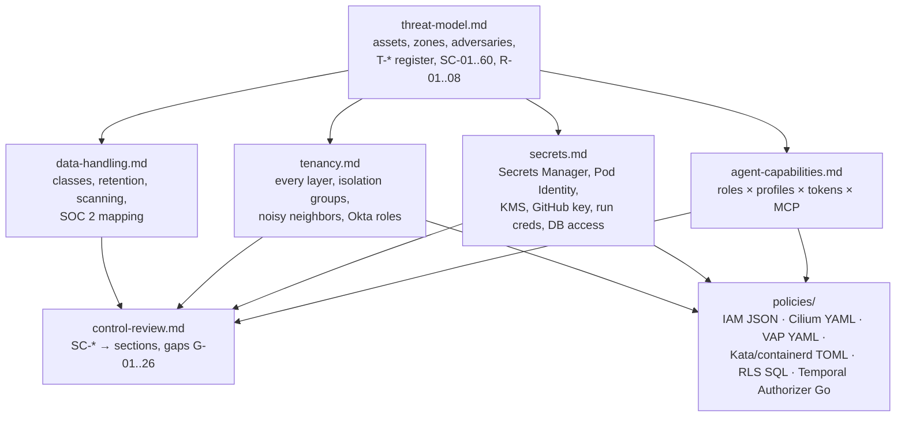

# 09 — Security, Tenancy, and Threat Model (WS-09)

## Purpose

The threat model that decides which security controls Replicant needs, the capability model that
makes a fully prompt-injected agent harmless, the secrets, key, and credential design, tenant
isolation at every layer, data classification and compliance mapping, and a review of the other
Phase 2 sections against all of it.

## Decisions summary

| # | Decision | Constraints | Where |
|---|---|---|---|
| 1 | Design for a fully prompt-injected agent with a shell: capabilities are structural (absent credentials, routes, permissions) | D-21 | [threat-model.md](threat-model.md), [agent-capabilities.md](agent-capabilities.md) |
| 2 | **Confirm ADR-007**, strengthened: exec cluster in a **separate AWS account**, sandbox subnets with **no internet route** | D-21, D-22 | [adr/001](adr/001-confirm-adr-007-exec-cluster-separate-account.md), CCR-09-07 |
| 3 | AWS Secrets Manager, not Vault | D-21, D-22 | [adr/002](adr/002-secrets-manager-over-vault.md) |
| 4 | EKS Pod Identity, not IRSA; sandboxes have no association | D-22 | [adr/003](adr/003-eks-pod-identity-over-irsa.md) |
| 5 | GitHub App key imported into KMS; only the broker signs; no `workflows` permission | D-24 | [adr/004](adr/004-github-app-key-in-kms.md) |
| 6 | Core-signed run grants bound exec-side token minting | D-21 | [adr/005](adr/005-run-grants-bound-exec-side-minting.md), CCR-09-02 |
| 7 | One run token per audience | D-21 | [adr/006](adr/006-per-audience-run-tokens.md), CCR-09-01 |
| 8 | Approval binds to the diff digest the Publisher pushes | D-19 | [threat-model.md](threat-model.md) SC-28, [control-review.md](control-review.md) G-03 |
| 9 | One Temporal namespace; tenant separation by authorization plus per-tenant payload keys | D-01 | [tenancy.md](tenancy.md) §4 |
| 10 | Observability tenancy aligned with WS-08: functional Loki tenants with a server-built `tenant` selector, Grafana and Langfuse operators-only, restricted tenants in their own Loki tenant | D-17 | [tenancy.md](tenancy.md) §8 |
| 11 | No role holds `s3:BypassGovernanceRetention`; the audit bucket holds no free text, so it never needs purging (compliance mode, C-ART 2.0.0); leak purges act on `artifacts`, `transcripts`, `session` only | D-08 | [data-handling.md](data-handling.md) |
| 12 | **Target CI is part of the threat model** (R2-001): `ci_executed_paths` is a non-removable `critical` class on every publish, repair push and takeover push; tests raise to `medium`; takeover pushes are gated and go to `replicant-takeover/**` | D-19, D-21 | [threat-model.md](threat-model.md) T-PI-13, [agent-capabilities.md](agent-capabilities.md) §6, §8 |
| 13 | Go module path allowlist and first-seen blocking **for all tenants**; resolver proxy per ecosystem, with the 72 h quarantine risk accepted for Maven and crates | D-21 | [agent-capabilities.md](agent-capabilities.md) §7 |
| 14 | One catalogue of eight network profiles; one namespace label schema; one ResourceQuota per tenant namespace with no `count/agentruns` | D-21 | [agent-capabilities.md](agent-capabilities.md) §3, [tenant-namespace.yaml](policies/kubernetes/tenant-namespace.yaml) |
| 15 | Tenant isolation groups ship in v1 (controller selector from the namespace label, VAP match, per-group NodePool); sandbox node lifetime ≤ 81 h | D-06 | [tenancy.md](tenancy.md) §3.2 |
| 16 | WS-09 owns the payload-codec `KeyProvider` implementations and data-key cache (Python for core, encrypt-only Go for run-notifier) and a `replicant-system` tenant key | D-21 | [secrets.md](secrets.md) §6.2, [policies/temporal/](policies/temporal/) |
| 17 | Kill-switch mirror: one compare-and-swap S3 object in the `ops` bucket (CCR-09-10), written by control-plane-api or the break-glass `replicant-<env>-killswitch-operator` (CCR-09-12), readable with Postgres down, plus a worker-local ConfigMap copy; the same bucket carries runner-api's exec revocation feed (`exec-revocations/<env>/`, 90 days) | R2-016, CCR-02-09 | [secrets.md](secrets.md) §12 |
| 18 | WS-09 owns every exec-account key (`run-token`, `exec-ebs`) and all key policies (R1-240) | D-21 | [secrets.md](secrets.md) §6.1 |
| 19 | Legal holds only on `audit` and the governance-mode legal bucket, placed only by `replicant-<env>-legal-hold`; leak purge adopts WS-10's `leak-purge.json` verbatim and may delete in the legal bucket only versions with no active hold (CCR-ORCH-01) | D-08 | [data-handling.md](data-handling.md) §3.4 |
| 20 | Temporal Authorizer knows every client identity in C-MSG 2.0.0 plus `replicant-db-migrate` (CCR-10-12: `CountWorkflowExecutions` only, Replicant namespace), rate-limits Signals per identity (run-notifier 50/s burst 200, others 200/s burst 400), and allows reset only to break-glass operators | D-01 | [policies/temporal/authorizer.go](policies/temporal/authorizer.go) |
| 21 | Runtime fallbacks that re-open virtio-fs (WS-02 rules 3–5; residual 12 signed off by the orchestrator) and runtime overrides are pre-approved security exceptions with stated residuals, conditions and time boxes | D-06 | [threat-model.md](threat-model.md) §4.1 |

CCR-09-01..07 were applied by the orchestrator (C-RUNNER 2.1.0, C-CRD 2.1.0, C-ARCH 1.2.0); the run-grant revocation list is keyed by `job_id`/`run_id`, which WS-09 accepts (ADR-09-005).

No `Challenge: D-xx` ADR was needed: every decided constraint was implementable as written. The
strengthening of ADR-007 (separate account) is a contract change request, not a challenge.

## Contents

| File | What it holds |
|---|---|
| [threat-model.md](threat-model.md) | Assets, trust zones, adversaries, threat register (T-SBX, T-PI, T-CRED, T-SC, T-MEM, T-APR, T-EXF, T-INS, T-DOW, T-ID), attack trees, residual risks with owners, the three must-answer questions, control catalog SC-01..SC-60 |
| [agent-capabilities.md](agent-capabilities.md) | Per-role capability matrix, token set and verifier obligations, network profiles, MCP scopes, CLI hardening requirements, sensitive path classes, package-mirror curation |
| [secrets.md](secrets.md) | Accounts and workload identities, secret inventory, GitHub App key ceremony and broker contract, webhook secrets, KMS inventory, Temporal payload codec, per-run credential issuance, database access and break-glass, rotation schedule |
| [tenancy.md](tenancy.md) | Isolation matrix across every layer, tenant classes, exec-cluster namespaces, quotas, priority, isolation groups, fair admission, runtime detection, Temporal, observability, Okta roles, onboarding/offboarding |
| [data-handling.md](data-handling.md) | Classification levels, data categories DC-01..DC-16, retention and deletion, erasure, secret scanning points, audit design, SOC 2 mapping, two-person rules |
| [control-review.md](control-review.md) | Control matrix against Phase 2 sections, gaps G-01..G-26, assumptions for unwritten sections, R2 red-team items, test mapping |
| [policies/iam/](policies/iam/) | IAM trust and permission policies for all four exec roles (`sandbox-artifacts`, `runner-api`, `agentrun-controller`, `run-notifier`) and core roles (token broker, run-grant signer, codec server, leak purge, break-glass), session policy example, S3 bucket policies (artifacts, ops kill-switch mirror), VPC endpoint policy, KMS key policies (tenant, GitHub App, run token, ops), SCP |
| [policies/network/](policies/network/) | CiliumClusterwideNetworkPolicy baseline and per-run CiliumNetworkPolicy profiles; exec-system policies |
| [policies/kubernetes/](policies/kubernetes/) | ValidatingAdmissionPolicies (pod shape incl. isolation groups, AgentRun binding, child writers), Kyverno ImageValidatingPolicy, tenant namespace bundle (labels, quota, RBAC), Kata and containerd hardening |
| [policies/postgres/](policies/postgres/) | Login roles, IAM auth, pgaudit for break-glass, RLS pattern |
| [policies/temporal/](policies/temporal/) | Custom Authorizer (Go), `KmsKeyProvider` (Python) and `EncryptOnlyKeyProvider` (Go) for the payload codec |

Validation (fix round wave 3): `STRICT=1 10-data-platform/tools/validate.sh` passes (grants OK, 0 tenant tables without RLS or FORCE, partitions OK, S3 configs OK); all 37 policy files parse and none allows a governance bypass or wildcard action; §6 `risk_rules` validates against WS-07's `policy-risk-rules.schema.json`; Go `kmskeyprovider` passes `go vet` and its tests (cross-account alias ARN, R1V-004); 11 Mermaid diagrams render with mermaid-cli 11.4.2. Wave 3 closed R1V-001..004 (runner-api S3, egress, cluster reads, codec key ARN) and the WS-09 majors and minors in R1-verification.md. Wave 2: WS-10's `validate.sh` (owners' DDL OK, partitions OK; the remaining grant and RLS findings belong to the registry, cost and audit owners, none to WS-09), `check_grants.py`, `check_partitions.py`; the token-broker grant is column-limited (8 columns, no table grant). Earlier, wave 1: every JSON and YAML file under `policies/` parses; the Python key provider passes a unit test with a fake KMS (including a cross-tenant relabel test); SQL parses with pglast; Mermaid renders with mermaid-cli 11.4.2. Earlier: (PyYAML 6.0.3, Python `json`), TOML
parses (`tomllib`), the Go file passes `gofmt -e`. The CEL in the admission policies is parsed as
YAML but **has not been executed against an API server** here; WS-11's envtest suite must run it
([control-review.md](control-review.md) §6). IAM policies were structurally checked (Effect,
Action/NotAction, Resource/NotResource, Principal where required); they have not been run through
IAM Access Analyzer `validate-policy` here.

## Open questions (top; full lists in each file)

| Question | Who decides | Recommendation |
|---|---|---|
| Accept CCR-09-07 (exec account separation)? | Orchestrator | Accept |
| Accept CCR-09-01/02/03 (per-audience tokens, run grants, `acting_for`)? | Orchestrator, WS-02 | Accept |
| Which tenants are `restricted` (dedicated isolation groups)? | Security leadership, tenant owners | Payments core, identity, security tooling |
| Two-person rule for tenant-scope memory activation and for all prod prompt/policy promotions | WS-04, WS-06, orchestrator | Yes |
| Aurora PostgreSQL for `replicant` (DAS for break-glass audit)? | WS-10 | Aurora if cost acceptable |

## Risks

- Isolation runtimes had several escape-class advisories in 2026; the design depends on fast
  patching and on what an escaped attacker finds (R-01).
- Three High gaps in other sections (G-01, G-03, G-12) must close before implementation.
- About half of Phase 2 was not yet written at review time; R2 must re-run the control matrix.

## Interfaces consumed / provided

- **Consumed:** C-ARCH (§6), C-STATE, C-IDS, C-RUNNER, C-CRD, C-MSG (§1), C-JOBREQ, C-DEF, C-ART,
  C-PG; ADR-002, ADR-007, ADR-010, ADR-011, ADR-013, ADR-014.
- **Provided:** threat and control catalog (all workstreams), capability model and network profiles
  (WS-02, WS-03, WS-04), IAM/KMS/S3/network/admission policies (WS-02, WS-10), secrets and key
  design (WS-01, WS-02, WS-07, WS-10), tenancy model (all), data classification and retention
  (WS-08, WS-10), control review (orchestrator, R2).

## Must-answer changes in the fix round

- **Prompt-injected QA agent** (threat-model §7.1): item 6 now says the agent uses Replicant services
  only through `replicant-agentd`'s proxy and never holds or refreshes a token or STS credential; the
  QA profile is the reconciled `qa-with-mirror`.
- **Secret in a tenant repo** (§7.2): the scanner is now specified (`replicant-secretscan`,
  data-handling.md §4); leaks are purged by the `leak_purge` two-person workflow without any
  Object Lock bypass.
- **Compromised Runner API** (§7.3): unchanged; the blast-radius table adds the
  `agentrun-controller` role's run-prefix reads (C-ARCH 1.4.0) and the encrypt-only `run-notifier`.

Contract versions cited (final, FROZEN.md): C-ARCH 2.0.0, C-STATE 2.0.0, C-IDS 2.0.0, C-RUNNER 3.0.0, C-CRD 3.0.0,
C-MSG 2.0.0, C-JOBREQ 2.0.0, C-DEF 3.0.0, C-ART 2.0.0, C-PG 2.0.0.
