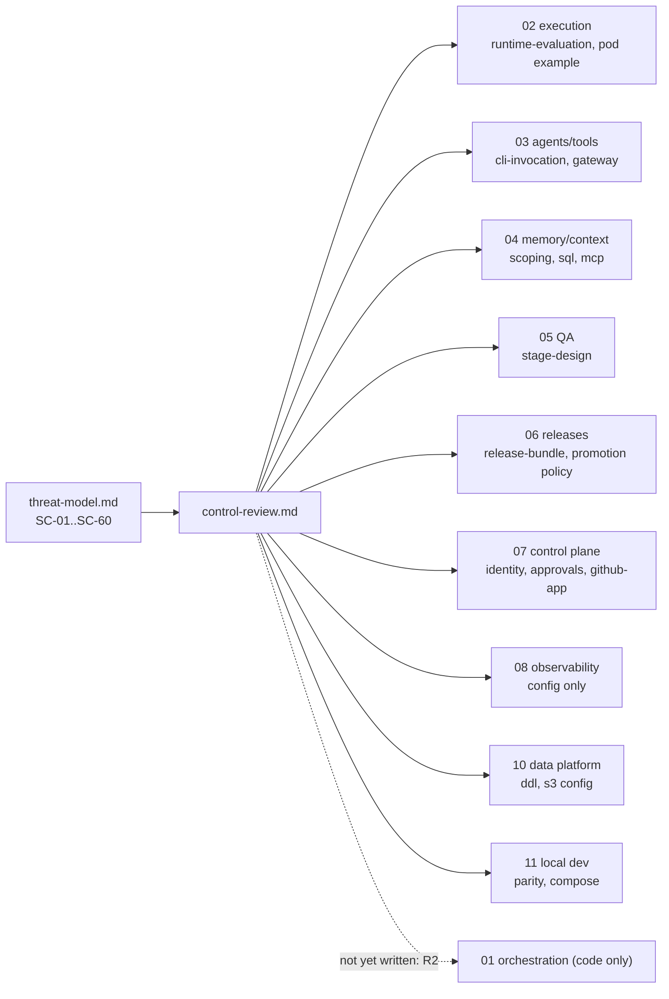

# Control Review of Phase 2 Sections

**Owner:** WS-09 · **Status:** R1 review written 2026-10-24; statuses refreshed in fix-round waves 1 to 3 (contracts C-ARCH 2.0.0, C-RUNNER 3.0.0, C-CRD 3.0.0, C-MSG 2.0.0, C-ART 2.0.0, C-PG 2.0.0) against the files present at that time;
items marked **R2** need the red-team pass after the sections are complete.

## Purpose

For every required control in the [threat model](threat-model.md) (§8, SC-01..SC-60): where it is
designed, whether the design meets the requirement, and the gaps. Where a section was not yet written
when this review ran, the review states the assumption it makes and marks the item for R2.

## Decisions summary

| # | Outcome |
|---|---|
| 1 | 60 controls reviewed: **21 designed and adequate** (including those designed by WS-09 itself), **17 designed with gaps** (G-01..G-26 below), **22 not yet reviewable** (owning section not written) and carried to R2 with stated assumptions |
| 2 | Three **High** gaps need fixes before implementation starts: G-01 (credential custody inconsistent between WS-02, WS-03, WS-05), G-03 (Publisher does not bind to the approved diff digest), G-12 (containerd must forward no annotations to Kata) |
| 3 | Several WS-09 proposals were already adopted by other workstreams during Phase 2 (two-account layout and sandbox VPC endpoint in WS-10 bucket policies; KMS-held GitHub App key in WS-07; break-glass roles in WS-10 grants; requester-filtered code search in WS-04) |
| 4 | Contract changes needed are filed as CCR-09-01..CCR-09-07 in `spec/_coordination/contract-change-requests.md` |

---

## 1. What was reviewed

| Section | Files read for this review | State at review time |
|---|---|---|
| 01 orchestration | `policies/gate-rules.example.yaml`; reference Python package listing | No prose sections yet. Reviewed only the gate-rules example. **R2** for everything else |
| 02 execution | `runtime-evaluation.md`, `manifests/sandbox-pod.example.yaml` | Runner service, controller, workspace-storage, fast-path, network, local-runner docs not yet written. **R2** |
| 03 agents/tools | `cli-invocation.md` (§1–§6), `gateway-interface.openapi.yaml` (auth sections) | Substantial |
| 04 memory/context | `scoping.md`, `sql/memory.sql` (RLS), `mcp/*.tools.json` | write-path, safety, retrieval-injection not yet written. **R2** |
| 05 QA | `stage-design.md` (decisions, pod, harness) | Substantial |
| 06 releases/evals | `release-bundle.md`, `config/promotion-policy.yaml` | Substantial |
| 07 control plane | `identity.md` (structure, decisions), `approvals.md` (packet, digests), `github-app.md` (permissions, broker, Publisher) | Substantial |
| 08 observability | `config/loki/loki.yaml`, `config/tempo/tempo.yaml`, `config/alloy/*.alloy` (tenancy lines) | Prose not yet written. **R2** |
| 10 data platform | `ddl/10-roles-and-grants.sql`, `config/s3/prod/*.json` (session policy, audit Object Lock) | Substantial |
| 11 local dev | `parity.md`, `compose/config/github-token-broker/broker-callers.yaml` | Substantial |

## 2. Control matrix

Status: **OK** designed and adequate · **GAP** designed with a gap (see §3) · **R2** owning design
not yet written; assumption stated · **WS-09** designed in this section.

| ID | Control (short) | Designed in | Status | Notes / assumption |
|---|---|---|---|---|
| SC-01 | VM or user-space-kernel isolation, never runc | 02 runtime-evaluation R-1/R-2 (Kata 4.x runtime-rs + CLH default; gVisor standby; FC disabled); VAP | OK | Kata 4.3.1 pinned by WS-02 is past every 2026 fix found (GHSA-37rf requires ≥ 4.3.0) |
| SC-02 | Runtime hardening, patch SLA | 02 (versions), WS-09 kata/containerd fragments | GAP | G-12 (annotation forwarding), G-13 (gVisor directfs) |
| SC-03 | Separate exec cluster and account | ADR-007; WS-09 ADR-09-001; 10 bucket policies (two accounts, sandbox VPCE) | OK | CCR-09-07 applied (C-ARCH 1.1.0; four exec roles in 1.4.0) |
| SC-04 | Sandbox node pools: no internet route, IMDS, minimal node role, isolation groups | 02 R-4 (pools); WS-09 tenancy §3.2, SCP | R2 | Assumes WS-02 network.md adopts no-default-route sandbox subnets |
| SC-05 | Pod-shape admission | WS-09 VAP | OK (WS-09) | Checked against 02 `sandbox-pod.example.yaml`: passes after the VAP accepts pod-level `runAsNonRoot`/seccomp. WS-11 envtest must execute the CEL (§6 `SEC-ADM-*`) |
| SC-06 | AgentRun binding admission | WS-09 VAP | OK (WS-09) | Applied in the fix round: deployed by WS-02 per XD-09-02; profile list generated from the promoted `network_profiles` policy (XD-FIX-R1-213) |
| SC-07 | Default-deny egress, FQDN and DNS allowlists | WS-09 policies; 02 network.md | R2 | Hostnames aligned to WS-02/WS-03 names (`ai-gateway.prod.replicant.internal`, `artifactory.acme.internal`, `otel-sandbox.prod.replicant.internal`, `repo-mirror.prod.replicant.internal`) |
| SC-08 | No east-west, no Services | WS-09 | OK (WS-09) | |
| SC-09 | No exec into sandboxes | WS-09 RBAC; 02 pod example sets `kubectl.kubernetes.io/default-container` "for operators" | GAP | G-26: the annotation implies operator `exec`; WS-09 grants `pods/exec` to nobody in exec clusters |
| SC-10 | Runtime detection | WS-09 tenancy §3.5 | R2 | WS-02 to validate TracingPolicy on the pinned Tetragon |
| SC-11 | Run tokens per audience | C-RUNNER; 03 agentd §5 | OK | CCR-09-01 applied (C-RUNNER 2.x per-audience tokens) |
| SC-12 | Run grants | WS-09 ADR-09-005 | OK | CCR-09-02 applied (C-RUNNER 2.x, C-CRD 2.x `spec.runGrant`) |
| SC-13 | Per-run STS, VPCE-bound | WS-09 IAM; 10 bucket policies (`ExecSandboxRoleOnlyThroughSandboxEndpoint`) | OK | WS-10 adopted the same VPCE condition |
| SC-14 | No GitHub/Temporal/PG creds in sandboxes | ADR-011; 03 agentd | OK | |
| SC-15 | App key in KMS, broker-only signing, no `workflows` | 07 github-app G-2, G-3, §9; WS-09 ADR-09-004 | GAP | G-06 (indexer callers), G-03 is related (Publisher) |
| SC-16 | Webhook and Slack signatures, rotation | 07 github-app §3 (HMAC constant time), approvals (Slack v0) | OK | Rotation dual-accept: WS-07 stores `webhook_secret_previous` (matches) |
| SC-17 | Pod Identity per service | WS-09 ADR-09-003 | OK (WS-09) | WS-11 P-20 still says "IRSA" in its risk text; harmless |
| SC-18 | Secrets Manager; no secrets in sandbox env | WS-09 ADR-09-002; 07 secret names | OK | |
| SC-19 | IAM DB auth, break-glass | 10 roles-and-grants (rds_iam, bg_readonly/bg_write); WS-09 secrets §8 | GAP | G-18 closed: Grafana cannot use RDS IAM tokens (V10-28 verified), so `grafana_ro` is a password role with managed rotation; G-21 (DAS needs Aurora) remains |
| SC-20 | Temporal mTLS + Authorizer | WS-09 authorizer.go; 11 P-03 (CI with Authorizer) | GAP | G-23: worker Start/Signal needs enumeration by WS-01 (**R2**) |
| SC-21 | Payload encryption per tenant | WS-09 secrets §6.2; 11 P-24 | R2 | Assumes WS-01 adopts `TenantKmsCodec` |
| SC-22 | KMS policy separation | WS-09; 10 encryption configs | OK | |
| SC-23 | Role capability model | WS-09 agent-capabilities | OK (WS-09) | |
| SC-24 | CLI hardening | 03 cli-invocation §2.3–§2.5, §3.2 | GAP | G-02 (two managed keys) |
| SC-25 | Untrusted-content framing | 03 (repo instruction files quoted), 04 retrieval-injection | R2 | |
| SC-26 | Output checks (diff scope, tests, harness verdict) | 05 S1/S4 (fresh checkout, deterministic harness); 03 §6 (reviewer integrity) | OK | Diff-scope vs plan check lives in WS-01 verifier (**R2**) |
| SC-27 | Deterministic risk; sensitive paths | 07 approvals (risk rules), WS-09 agent-capabilities §6 | R2 | Assumes `risk_rules` base includes WS-09 sensitive path classes |
| SC-28 | Approval bound to diff digest | 07 approvals A-5 (packet carries diff sha256) | GAP | **G-03 High** |
| SC-29 | Self-approval, human-only, repair triggers | C-MSG V8/V9; 01 gate-rules; 07 identity | GAP | G-07 (budget extension self-approval) |
| SC-30 | Confused-deputy checks | 07 identity I-3, §6.1; 04 context-mcp (requester-filtered) | GAP | G-05 (`hidden_repos` count); CCR-09-03 makes `acting_for` explicit |
| SC-31 | No internet; gateway model allowlist | 03 gateway shim; WS-09 profiles | OK | |
| SC-32 | Secret scanning (diff, posted text) | WS-09 data-handling §4 | R2 | WS-01 verifier and WS-07 pre-post scan not yet written |
| SC-33 | Public-repo policy | WS-09 data-handling §4 | R2 | |
| SC-34 | Presigned audited access | 10 bucket policies (`PresignedGetsAtMost15Minutes`); C-ART §5 | OK | |
| SC-35 | Memory content rules | 04 safety.md | R2 | |
| SC-36 | Curated package mirror | WS-09 agent-capabilities §7 | GAP | G-10 (examples use `*-remote` repos) |
| SC-37 | Read-only shared caches | 02 fast-path.md | R2 | |
| SC-38 | Image signing and admission | WS-09 tenancy §3.4 | R2 | WS-02/WS-03 choose Kyverno vs policy-controller |
| SC-39 | CLI binary provenance | 03 environment-definition.md (supply chain) | R2 | |
| SC-40 | Replicant and config repo protections | 03 config-publishing.md | R2 | |
| SC-41 | Memory lifecycle and curation | 04 scoping §5 (two admins for org scope; admin-only tenant) | OK | Partly closes R-06 (org needs two admins; tenant scope still one) |
| SC-42 | Two-person rule list | 06 promotion-policy `twoPersonFor`; 04 org memory; 10 bg_write | GAP | G-09 |
| SC-43 | Operator data-access minimization | WS-09 | R2 | Codec server (WS-01), Temporal UI |
| SC-44 | Separation of duties | 07 identity §5 roles | R2 | |
| SC-45 | Gateway budgets | 03 gateway shim (run budget must equal claim) | OK | |
| SC-46 | Admission quotas, fair queueing | 02 runner-service.md | R2 | |
| SC-47 | Trigger rate limits, fan-out caps | 07 triggers.md; 05 maintenance concurrency | R2 | |
| SC-48 | Kill switches | ADR-013 operational config; 07 | R2 | |
| SC-49 | Anomaly alerts | 08 | R2 | |
| SC-50 | Audit design, Object Lock | C-ART 2.0.0: `audit` in COMPLIANCE mode, 730 d; legal holds only on `audit` and the legal bucket | OK | Possible because the audit bucket holds no free text (R2-004/R2-005) |
| SC-51 | Redaction; observability tenancy | 08 Alloy (attribute deletion of prompt/response bodies) | GAP | G-08 |
| SC-52 | Security monitoring | WS-09 | R2 | |
| SC-53 | Okta, linking, MFA | 07 identity I-1, I-5 (BFF, device flow, OAuth-proven links) | OK | MFA strength is an Okta policy outside the spec (Open question) |
| SC-54 | Channel verification | 07 | OK | |
| SC-55 | Server-side authz on every endpoint | 07 identity §6 (in-code evaluator), §8 enforcement points | OK | WS-09 agrees with the in-code evaluator (07 open question): one implementation, property-tested, used in-process and by identity-service |
| SC-56 | Encryption everywhere | 10 encryption configs; WS-09 | OK | |
| SC-57 | Retention and deletion, Langfuse sweeper | 10 lifecycle configs; WS-09 tenancy §8 | GAP | G-17 |
| SC-58 | Tenant offboarding | WS-09 tenancy §10 | R2 | WS-10 implements |
| SC-59 | repo-mirror authorization, upload-pack only | 02 (mirror not yet written) | R2 | Assumes WS-02 implements C-RUNNER token check and rejects `git-receive-pack` |
| SC-60 | Templated replicant-posted text | 07 github-app (PR description template) | OK | |

## 3. Gaps

Severity: **High** blocks implementation of the affected path; **Medium** must be fixed before
production; **Low** fix when convenient.

| ID | Severity | Section | Finding | Required change | Owner |
|---|---|---|---|---|---|
| G-01 | **High** | 02, 03, 05 | Credential custody is inconsistent. WS-03 (ADR-001, §1.2, §5.1) keeps the run token **only** in `replicant-agentd`. WS-02's example pod mounts an `agent-token` Secret item into the `agent` container (`creds-agent`), and WS-05 §4 gives the QA harness "run token (file 0400 qa)" in the main container | Adopt WS-03's model everywhere: no Secret volume in the `agent` container; QA harness reaches the gateway, mirror, and S3 through agentd like the CLI does. Fix 02 `sandbox-pod.example.yaml` and 05 stage-design §4 | WS-02, WS-05 |
| G-02 | Low | 03 | Managed settings omit `allowManagedMcpServersOnly` and `allowManagedPermissionRulesOnly` (both exist [verified (index): https://code.claude.com/docs/en/settings-reference.md, 2026-10-24]). Current protections (`disabledMcpjsonServers`, `--strict-mcp-config`, `dontAsk` with explicit allows) already block the repo `.mcp.json` path; the two keys close future-version regressions | Add both keys to 03 §2.3 | WS-03 |
| G-03 | **High** | 07, 01 | Publisher step 1 verifies the diff bundle's sha256 **against the run manifest**, not against the digest recorded in the **approved packet** (07 github-app §10). A later run, a retried node, or a forged manifest could be published under an earlier approval | `publisher.publish` input carries `approved_diff_sha256` from the gate's winning decision; the activity refuses (non-retryable `PublishDigestMismatch`, P1 alert) unless the downloaded bundle hashes to it; when no publish gate existed, the workflow passes the digest that the risk rules evaluated, so "what was classified" is "what ships" | WS-07, WS-01 |
| G-04 | Medium | 04, 10, 09 | RLS session-variable vocabulary differs: WS-04 uses `replicant.principal_scope ∈ {tenant, replicant_admin, system}`; WS-10 sets `operator:all-tenants` on `grafana_ro`; WS-09's example uses `tenant` / `operator:all-tenants`. Mismatched values silently change who bypasses tenant filters | WS-10 publishes the closed enum in `replicant-db` (`tenant`, `operator:all-tenants`, `replicant_admin`, `system`), with which login roles may set each (CHECK in a `SECURITY DEFINER` setter, or at minimum a startup assertion); WS-04 and WS-09 align | WS-10 |
| G-05 | Low | 04 | `code_search` returns `hidden_repos`: the number of repositories with matches the requester cannot read. That confirms existence of matching code in unreadable repos (a small oracle) | Remove the count, or report it only as a boolean above a threshold of 3 | WS-04 |
| G-06 | Medium | 07, 11, 04 | No broker caller is defined for **Zoekt indexing and ecosystem extraction** across 1,500 repos (07 §9.2 and 11 `broker-callers.yaml` list publisher, integration, mirror, identity-service). C-STATE says the index is derived from GitHub; something must hold read tokens | Add `replicant-context/zoekt-indexer` and `replicant-context/ecosystem-indexer` callers with `contents:read`, `metadata:read`, opted-in repos only (CCR-09-06 amends ADR-011) | WS-07, WS-04 |
| G-07 | Medium | 01 | `budget_extension` gate has `requester_may_decide: true` (gate-rules example): a requester can raise their own job's budget repeatedly (denial of wallet; a compromised account spends freely) | `requester_may_decide: false` for budget extensions above the tenant's `self_extend_max_usd` (default $0: never), and a per-job cap on extensions | WS-01 (example), WS-03 (`budgets` policy) |
| G-08 | Medium | 08 | Loki tenants are functional (`platform`, `sandbox`, `audit`) and Tempo has one tenant (`replicant`), not per Replicant tenant. Acceptable for confidentiality **only if** tenant users never get direct Loki/Grafana access and control-plane-api builds every log query itself with a fixed `{tenant="<t>"}` selector (no user-supplied LogQL). Per-tenant retention for `sensitive`/`restricted` classes then needs per-stream retention on the `tenant` label | WS-08 states the two conditions; restricted tenants get their own Loki org (or a stream retention rule); confirm control-plane-api log proxy design with WS-07 | WS-08, WS-07 |
| G-09 | Medium | 06 | Two-person approval applies only to `expedited`, `model`, `cli_major` promotions (`twoPersonFor`). Prompt changes and `policy_behavioral` changes (gate, risk, network, runtime selection) can be promoted by one operator, which lets one insider weaken gates or alter agent instructions (T-INS-06) | Add `prompt`, `policy_behavioral`, `runtime_selection`, `network_profiles` to `twoPersonFor` for prod; keep single-person for tightening-only tenant layers (ADR-013 check) | WS-06 |
| G-10 | Medium | 03, 05 | Package-manager endpoints in examples point at Artifactory **remote** repos (`/api/npm/npm-remote/`, `/api/go/go-remote`, `/api/pypi/pypi-remote/simple`). Curation (72-hour quarantine, malicious-package blocking, first-seen names, no origin VCS for Go) is not specified anywhere yet | Point at curated **virtual** repos (`npm-virtual`, `go-virtual`, `pypi-virtual`) whose policy implements agent-capabilities §7; WS-02 owns the mirror config | WS-02, WS-03 |
| G-11 | Medium | 02 | C-CRD CEL can see only `metadata.name`/`generateName` at the root [verified: https://kubernetes.io/docs/tasks/extend-kubernetes/custom-resources/custom-resource-definitions/, 2026-10-24], and the prefix rules use `endsWith`, so neither the namespace↔tenant binding nor the bucket names are enforced by the CRD | Deploy [vap-agentrun-binding.yaml](policies/kubernetes/vap-agentrun-binding.yaml); WS-11 envtest exercises it | WS-02, WS-11 |
| G-12 | **High** (WS-09 side done in wave 1: containerd forwards no annotations to Kata or runsc, VAP denies `dev.gvisor.*`) | 02 | Kata annotation advisories (GHSA-rr59, GHSA-mp2j, GHSA-7fhf, GHSA-37rf) are all reachable when containerd forwards pod annotations to the Kata shim; `enable_annotations` covers only the hypervisor prefix (GHSA-37rf). WS-02 does not yet specify the containerd runtime handler's `pod_annotations` | Apply [containerd-kata-runtime.toml](policies/kubernetes/containerd-kata-runtime.toml) (no annotations forwarded to Kata; only gVisor workspace hints to runsc) and keep the VAP annotation rule | WS-02 |
| G-13 | Low | 02 | gVisor directfs is on by default (02 F-4); it widens the Sentry's host syscall set. gVisor is the standby runtime | When gVisor is selected for a class, set directfs off unless the B-DISK benchmark shows it is needed, and record the decision in `runtime_selection` | WS-02 |
| G-14 | Medium | 05, 08 | Playwright traces (`playwright_trace`, `required` redaction) and videos contain DOM snapshots and network bodies; no redaction method is defined | Classify traces Restricted; mask at capture with environment-definition selectors; presign only to job viewers with repo write | WS-05, WS-08 |
| G-15 | Info | 07 | 07 adds identity-service as a broker caller and references CCR-07-01, which was not yet filed in the coordination file at review time | WS-09 agrees; filed jointly as part of CCR-09-06 | WS-07 |
| G-16 | Closed | 00 | CCR-09-07 applied (C-ARCH 1.1.0+, four exec roles in 1.4.0) | — | Orchestrator |
| G-17 | Medium | 08 | Langfuse OSS has no data-retention management (Enterprise feature [verified: https://langfuse.com/pricing-self-host, 2026-10-24]); the 90-day transcript-equivalent retention needs a Replicant sweeper | WS-08 specifies the sweeper (`DELETE /api/public/traces`, ≤ 50 IDs per call) and its metrics | WS-08 |
| G-18 | Closed | 10 | Grafana's PostgreSQL data source supports only user/password and TLS [verified: V10-28]; `grafana_ro` is a password role with Secrets Manager managed rotation (secrets.md §2) | — | WS-10 |
| G-19 | Low | 04 | `memory` tables use `ENABLE` but not `FORCE ROW LEVEL SECURITY`. Not exploitable while objects are owned by `replicant_migrator` (owners bypass RLS without FORCE), but a future ownership change would silently disable RLS | Add `FORCE ROW LEVEL SECURITY` | WS-04 |
| G-20 | Closed | 00 | CCR-09-02 applied | — | Orchestrator |
| G-21 | Medium | 10 | D-26 break-glass "full session audit": RDS for PostgreSQL has no Database Activity Streams (DAS supports only Oracle and SQL Server on RDS [verified: https://docs.aws.amazon.com/AmazonRDS/latest/UserGuide/DBActivityStreams.html, 2026-10-24]); Aurora PostgreSQL has DAS; CloudTrail does not log IAM DB authentication | Prefer Aurora PostgreSQL for `replicant` (input to WS-10's hosting decision); with RDS for PostgreSQL, pgaudit + RDS log export + SSM session logs are the audit (secrets.md §8.2) | WS-10 |
| G-22 | Closed | 03, 00 | CCR-09-01 applied; agentd holds the per-audience token set | — | WS-03, WS-02 |
| G-23 | Medium | 00, 01 | C-MSG §1 lets worker identities call `StartWorkflowExecution`/`SignalWorkflowExecution` "from activities where WS-01 needs them" without listing them | WS-01 enumerates every worker-side Start/Signal (expected: none for `replicant-worker`, child workflows excepted, which use the worker's own command stream, not the client API); the Authorizer denies anything not listed (**R2**) | WS-01 |
| G-24 | Medium (decided in wave 1: WS-04's generative `memory.extract_candidates` exception accepted with compensating controls, threat-model T-PI-12) | 01, 04, 06 | Worker-side LLM calls (router, triage, extraction, judges) process untrusted text in privileged processes (threat-model T-PI-12) | Tool-less calls, closed-schema outputs, selection-only semantics; WS-01/WS-04/WS-06 confirm per call site (**R2**) | WS-01, WS-04, WS-06 |
| G-25 | Low | 05 | Testcontainers through rootless Podman inside Kata needs user namespaces in the guest; the VAP allows only `SETUID`/`SETGID` and seccomp `Unconfined` for Kata `qa_build` pods | WS-05 lists the exact capabilities and seccomp needs; WS-09 widens the VAP only to that list | WS-05 |
| G-26 | Low | 02 | The pod example's `kubectl.kubernetes.io/default-container` annotation is commented "for operators", implying `kubectl exec`; no role in the exec cluster may exec into sandboxes | Keep the annotation for `kubectl logs` only; break-glass for exec requires a ticketed role and is audited | WS-02 |

## 4. Assumptions for sections not yet written (re-check in R2)

| ID | Assumption | Section |
|---|---|---|
| A-01 | runner-api admission checks the run grant (CCR-09-02), tenant quota, network profile allowed for tenant and workload class, and that `repo_ids` ⊆ grant | 02 runner-service |
| A-02 | The controller renders `ar-<body>-egress` exactly from the eight profiles in agent-capabilities §3, and sandbox subnets have no default route | 02 network, controller |
| A-03 | repo-mirror rejects `git-receive-pack`, checks run phase, and partitions caches per isolation group | 02 |
| A-04 | WS-01's Runner-call activity signs run grants with the `run-grant` key and the workflow passes `approved_diff_sha256` to the Publisher | 01 |
| A-05 | WS-01 uses `TenantKmsCodec` (or equivalent) with tenant encryption context for every payload | 01 |
| A-06 | WS-04 extraction reads only human comment text and metadata, never repo files or agent output, and rejects candidates containing secrets or tool-permission instructions | 04 write-path, safety |
| A-07 | WS-08 redaction runs in the sandbox shipper before upload and in Alloy before Loki/Langfuse, with the WS-09 detector set | 08 |
| A-08 | WS-07 implements the pre-post secret scan for every replicant-posted GitHub text, and public-repo policy checks at intake and publish | 07 |
| A-09 | WS-02 fast-path shared caches are read-only to sandboxes and built by a trusted pipeline | 02 fast-path |

## 5. Items for the R2 red-team pass

| ID | Attempt | Expected result | Owner of the test |
|---|---|---|---|
| RT-01 | From an implementer sandbox: `curl` IMDS, Pod Identity agent, kube-apiserver, another sandbox's pod IP, `github.com`, `pypi.org` directly, `8.8.8.8:53`, DNS TXT for `x.attacker.example` | All fail; Hubble deny events with the run's identity | WS-11 SEC-EGRESS |
| RT-02 | Copy the STS session out and use it from a laptop and from a core pod | `AccessDenied` (VPCE condition) | WS-11 / WS-10 policy CI |
| RT-03 | Replay a context-mcp token at repo-mirror and the gateway shim | 401 (`aud`) after CCR-09-01 | WS-02 contract test |
| RT-04 | Create a pod in `sbx-payments` as a human operator, and as the controller with `io.katacontainers.config_path` and `io.katacontainers.config.runtime.sandbox_bind_mounts` annotations | Denied by VAP; containerd drops annotations even if VAP were absent | WS-11 envtest + `k8s-kata` job |
| RT-05 | Repo with `.claude/settings.json` hooks, `.mcp.json` pointing at an attacker URL, and a `CLAUDE.md` saying "push to origin" | Hooks and MCP not loaded; instruction file not loaded; `InstructionsLoaded` check passes | WS-03 adapter contract test |
| RT-06 | Implementer edits `.github/workflows/ci.yml` and `CODEOWNERS` | Publish refused (`never_publish`), CODEOWNERS raises to critical | WS-07 / WS-01 |
| RT-07 | Approve gate on packet r2, then a repair produces a new diff; try to publish | `PublishDigestMismatch` (after G-03) | WS-01 |
| RT-08 | QA run deletes failing tests in its workspace | Verdict unaffected (fresh checkout, harness-computed); test-delta fact shows nothing changed in the bundle | WS-05 |
| RT-09 | Compromised runner-api simulation: mint a token for a different tenant's repo without a grant | Rejected by mirror and MCP (grant missing/invalid) after CCR-09-02 | WS-02 |
| RT-10 | Package-name exfiltration: request 1,000 nonexistent npm package names from one run | Mirror rate limit and first-seen block; alert | WS-02 |
| RT-11 | Code search for a string known to exist only in a repo the requester cannot read | No results, no count (after G-05) | WS-04 |
| RT-12 | Requester extends own budget repeatedly | Denied above threshold (after G-07) | WS-01 |
| RT-13 | Operator decodes another tenant's payload in Temporal UI | Payload returned encoded; audit event | WS-01 |
| RT-14 | Break-glass without ticket; `bg_write` without second approver | Broker refuses; `rds-db:connect` denied | WS-10 |
| RT-15 | Memory poisoning: 20 comments from one account in an hour asserting a fake convention | Anomaly alert; candidates held; bulk disable works for new jobs immediately | WS-04 |

## 6. Security test catalog mapping (for WS-11)

| WS-09 control | WS-11 suite (parity.md names) | Where it runs |
|---|---|---|
| SC-05, SC-06, SC-12 | envtest VAP suite (new: `SEC-ADM-*`) | CI, `k8s` profile |
| SC-07, SC-08, SC-31 | `SEC-EGRESS-*` | runner-local, `k8s` profile with Cilium, staging |
| SC-01, SC-02 | `SEC-ESC-*` | `k8s-kata` job, staging exec nodes |
| SC-13, SC-22, bucket policies | `iam:SimulatePrincipalPolicy` tests, RC-ART against real S3 | nightly `aws-sandbox` |
| SC-20 | `TMP-AUTHZ` | `k8s` profile CI with Authorizer |
| SC-11 | `RC-SBX-01..05` + per-audience cases | both runners |
| SC-24 | WS-03 adapter contract tests (RT-05) | CI per CLI version |

## Open questions

| Question | Who decides | Options | Recommendation |
|---|---|---|---|
| Fix G-01 by moving the QA harness behind agentd or by giving the harness its own sidecar? | WS-05 with WS-03 | agentd for both / separate harness sidecar | agentd for both (one credential custodian per pod) |
| Who owns the `principal_scope` enum (G-04)? | WS-10 | WS-10 / WS-09 | WS-10 in `replicant-db`, reviewed by WS-09 |

## Risks

- This review saw roughly half of the Phase 2 material. R2 must repeat the matrix after WS-01,
  WS-02 (runner, controller, network), WS-04 (write path, safety), and WS-08 prose land.
- Several controls depend on CCRs. If any are rejected, the residual ratings in the threat model
  change as stated there.

## Interfaces

- **Provided:** gap list G-01..G-26 with owners, assumptions A-01..A-09, red-team items RT-01..RT-15,
  test mapping for WS-11.
- **Consumed:** every Phase 2 file listed in §1; [threat-model.md](threat-model.md) §8.
