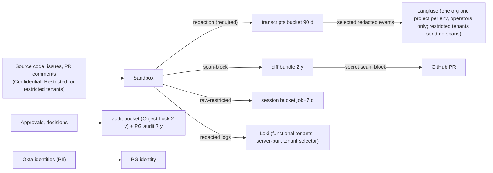

# Data Classification, Handling, and Compliance

**Owner:** WS-09 · **Status:** fix round wave 3 · **Date:** 2026-10-24 · **Contracts:** C-ART 2.0.0, C-MSG 2.0.0, C-STATE 2.0.0, C-PG 2.0.0
**Contracts consumed:** C-ART §4 (artifact types, redaction column, retention classes), C-STATE
(owners and retention), C-PG (`audit`), C-IDS §9–§11 (what may appear in labels and metadata).

## Purpose

The classes of data Replicant handles, the handling rules for each, retention and deletion, how
secrets found in code are handled, and the controls mapped to SOC 2 Trust Services Criteria at a
level an auditor can test.

## Decisions summary

| # | Decision | Reference |
|---|---|---|
| 1 | Four classification levels (Public, Internal, Confidential, Restricted) applied to **data categories** (DC-01..DC-16), not to stores. A store inherits the highest level it holds | §1 |
| 2 | Secrets found in code are **Restricted**. They are never shown in the UI or posted anywhere; findings carry only a fingerprint, rule ID, file, and line | §4 |
| 3 | Raw (unredacted) CLI data exists only as `cli_session_state` and `workspace_archive` in the `session` bucket (OQ-00-10: no raw transcripts) | C-ART §1 |
| 4 | Retention defaults follow D-08 and C-ART; deletion is by lifecycle, by workflow (job + 7 days for session state), by sweeper (Langfuse), or by crypto-shred (tenant offboarding) | §3 |
| 5 | **No role anywhere holds `s3:BypassGovernanceRetention`** (C-ART 1.9.0 rule 4a, R2-005, R1-217). The `audit` bucket holds no tenant content and no free text (approval records are reference-only, the workflow history skeleton has digests only), so nothing in it ever needs erasure or purging; C-ART 2.0.0 sets it to compliance mode, 730 days default retention. Leak purges and erasure act only on `artifacts`, `transcripts` and `session` through `replicant-leak-purge` and the deletion paths in §3.2 | §3 |
| 6 | SOC 2 mapping in §6, with the evidence each control produces | §6 |



---

## 1. Classification levels

| Level | Definition | Examples | Baseline handling |
|---|---|---|---|
| **Public** | Approved for anyone | Public repo contents, published docs | Integrity controls only |
| **Internal** | Any employee may see | Job metadata (IDs, status, repo names), metrics | Okta-authenticated access |
| **Confidential** | Need-to-know by repo or tenant | Private source code, diffs, plans, transcripts (redacted), QA logs, memory, briefings | Tenant key encryption; access requires repo read permission or tenant binding; audited presigns |
| **Restricted** | Narrowest audience; breach is a reportable incident | Secrets found in code, raw session state, workspace archives, PII beyond names/emails, approval evidence, break-glass logs, GitHub App key, run grants and tokens | Never displayed by default; separate bucket or key; access only through named flows; every access audited and alerted |

## 2. Data categories and handling rules

| ID | Category | Level | Stores | Redaction | Who may read | Retention (default) | Deletion |
|---|---|---|---|---|---|---|---|
| DC-01 | Source code of target repos | Confidential (Restricted for `restricted` tenants) | GitHub (SoR); repo-mirror cache; workspaces; Zoekt index | none (code) | Repo readers; sandboxes of jobs whose requester can read | Cache: LRU, rebuildable; workspaces: pod lifetime | Cache eviction on repo opt-out within 24 h |
| DC-02 | Diff bundles | Confidential | S3 `artifacts` | `scan-block` | Job viewers (repo read) | 2 years (`r2y`) | Lifecycle; offboarding crypto-shred |
| DC-03 | Issue text, PR comments, steering text, JobRequest free text | Confidential | Temporal (encrypted), S3 `artifacts` (`pr_event_payload`, `run_inputs`), PG `intake` (JobRequest JSON) | `required` for S3 copies | Job viewers | Temporal ≥ 30 d after close; S3 90 d; PG 2 y | Lifecycle; intake pruning job |
| DC-04 | Coding-session transcripts, CLI events, sandbox logs | Confidential | S3 `transcripts` | `required` | Job viewers | 90 d (30 d for `sensitive`/`restricted`) | Lifecycle |
| DC-05 | Raw CLI session state, workspace archives | **Restricted** | S3 `session` | `raw-restricted` | Same job's later runs (staged copy); requester for takeover archive; break-glass | job end + 7 d (backstop 37 d); takeover archive 30 d | Workflow delete + lifecycle |
| DC-06 | Plans, handoffs, review reports, run results (model prose) | Confidential | S3 `artifacts` | `required` | Job viewers | 2 y | Lifecycle |
| DC-07 | QA artifacts: build/health logs, JUnit, screenshots, Playwright traces, videos | Confidential | S3 `artifacts` | `required` (text); screenshot masking; traces: see G-14 | Job viewers | per C-ART §4 | Lifecycle |
| DC-08 | Secrets found in code or output | **Restricted** | Only as findings: `secret_scan_report` (fingerprint = HMAC-SHA256 of the secret with a per-environment key, rule ID, path, line) | the secret itself is never stored by the Replicant | Repo security contacts and tenant admins (finding metadata only) | 2 y (finding metadata) | Lifecycle |
| DC-09 | PII of Replicant users (names, emails, Okta/Slack/GitHub IDs) | Confidential | PG `identity`; Okta (SoR) | never in Loki labels or metadata (C-IDS §9), Langfuse user id is `principal_id` | identity-service; operators via admin views | Active + 7 y tombstone (audit linkage) | Erasure: §3.3 |
| DC-10 | PII inside tenant data (customer data in fixtures, logs, screenshots) | Restricted where present | Same as DC-04/DC-07 | Detectors for emails, phone numbers, card numbers (Luhn), national IDs (configurable per tenant) | As container | As container | As container |
| DC-11 | Memory entries (rules, episodes, playbooks) with provenance | Confidential | PG `memory`, S3 `memory` exports | Content rules (no secrets, no PII beyond author `principal_id`) | Admins (D-25); read-only to job viewers for entries used | WS-04 lifecycle; snapshots 2 y | Hard delete with tombstone (WS-04) |
| DC-12 | Approval packets, approval text, approval records, workflow histories | Confidential (packet, `approval_text`, full `workflow_history_export`) / Restricted (reference-only `approval_record`, `workflow_history_skeleton`) | S3 `artifacts` (packet, `approval_text`, `workflow_history_export`), S3 `audit` (record and skeleton, Object Lock) | `approval_text` required; others n/a | Approvers, auditors | 2 y (history r7y by tenant policy) | Artifacts: lifecycle, rule 4a leak purge, offboarding shred. Audit: Object Lock expiry, then lifecycle; never purged (no content) |
| DC-13 | Audit events | Restricted | PG `audit` (7 y, partitioned), S3 `audit` exports, CloudTrail (log-archive account) | n/a | `audit_reader`, security | 7 y | Partition drop by migrate maintenance mode only |
| DC-14 | Credentials (tokens, keys, certs) | Restricted | KMS, Secrets Manager, process memory | never logged (logging filters by key name and by token prefixes `ghs_`, `ghu_`, `eyJ`) | the owning workload | per [secrets.md](secrets.md) §10 | Expiry/rotation |
| DC-15 | Observability data (Loki logs, Tempo spans, Langfuse traces, metrics) | Confidential | Loki, Tempo, Langfuse, Mimir | redacted before ingest | Operators; tenant users via control-plane-api (logs) | Loki 30 d app logs, 90 d transcript-derived; Tempo 30 d (WS-08 platform.md §5.1, R1V-170); Langfuse 90 d (sweeper) | Retention + sweeper |
| DC-16 | Registry definitions, bundles, prompts, eval results, golden tasks | Internal (golden task snapshots: Confidential, they are repo copies) | PG `registry`, S3 `registry`, Langfuse prompts, S3 `eval` | n/a; golden snapshots `scan-block` | Operators, eval | permanent / 1 y | Never for promoted bundles |

**Rules that apply everywhere**

1. Never put content in identifiers, labels, metric labels, S3 keys, or search attributes (C-IDS,
   C-ART §2 rule 1).
2. Confidential and Restricted data in transit: TLS 1.2+ everywhere; mTLS for Temporal clients.
3. Model input/output passes only through the AI gateway to contracted providers (D-11).
4. Slack and email notifications carry links and IDs, never artifact bodies, diffs, or transcripts.
5. Downloads are presigned (15 min), per-object, after authorization, and audited (C-ART §5).

## 3. Retention and deletion

### 3.1 Retention table (authoritative defaults; WS-10 implements lifecycle JSON)

| Data | Store | Default | Mechanism |
|---|---|---|---|
| Diffs, plans, handoffs, review reports, run results, manifests, packets | S3 `artifacts` | 2 y | Tag `replicant-retention=r2y` lifecycle |
| Transcripts, CLI events, sandbox logs | S3 `transcripts` | 90 d (`sensitive`/`restricted`: 30 d) | Tag `r90d`/`r30d`; the uploader picks by tenant class (passed in the run spec's inputs) |
| Session state | S3 `session` | job end + 7 d, backstop 37 d | Workflow activity `artifacts.expire_session_state`; lifecycle `job37d` |
| Workspace archives | S3 `session` | 30 d | `r30d` |
| Approval records, history skeletons (reference-only) | S3 `audit` | 2 y (skeleton r7y by tenant policy), Object Lock compliance mode (C-ART 2.0.0) | lifecycle after lock expiry |
| Approval text, full workflow history export | S3 `artifacts` | 2 y | lifecycle; rule 4a purge; offboarding shred |
| Audit events | PG `audit` | 7 y | Monthly partitions dropped by migrate maintenance |
| Temporal closed workflows | Temporal | 30 d | Namespace retention (WS-01/WS-10) |
| AgentRun objects | etcd (exec) | 45 d after terminal | Controller GC (C-CRD §5.5) |
| Langfuse traces | Langfuse | 90 d for every tenant (restricted tenants send none) | WS-08 CronJob `langfuse-retention-sweeper` (daily, batches of 30, audit event `observability.langfuse_expired`, XD-FIX-R1-193) |
| Loki | Loki | 30 d (app), 90 d (transcript-derived) | Compactor retention per tenant |
| Identity tombstones | PG `identity` | 7 y | Scheduled data migration |

### 3.2 Deletion paths

| Trigger | What happens | Proof |
|---|---|---|
| Normal expiry | S3 lifecycle (versions expired by noncurrent-version rules), Loki/Tempo compactors, Langfuse sweeper, partition drops | Lifecycle config in IaC; sweeper metrics `replicant_langfuse_traces_deleted_total` |
| Repo opt-out | repo-mirror cache purge; Zoekt index removal; ecosystem rows deleted; existing job artifacts follow normal retention | `audit.emit` on opt-out |
| Tenant offboarding | [tenancy.md](tenancy.md) §10; KMS key deletion crypto-shreds S3 data, versions, and any copies encrypted under it | KMS `ScheduleKeyDeletion` CloudTrail event, completion after 30 d |
| Secret accidentally stored (redaction miss) | `LeakPurge` workflow (WS-08, `ops-worker`, C-ART 1.9.0 rule 4a, XD-FIX-R2-005): two-person gate kind `leak_purge` (`min_approvers: 2`, `replicant-admins`, requester excluded, C-MSG V11). Role `replicant-leak-purge` first writes a deletion-ledger entry to `audit` (ledger first, XD-FIX-R1-233), then deletes all versions of affected full `workflow_history_export` objects (no superseding object: encrypted payloads cannot be re-redacted), rewrites `approval_text` and text artifacts at `<original key>.p<n>` and deletes the originals' versions, in primary and us-west-2 replica buckets; records `leak_purge_record` in `audit`; nothing in `audit` is purged; an object under legal hold is not deleted (`blocked_by_legal_hold`, a new `leak_purge` gate). Then Langfuse trace deletion and a Loki deletion request; the tenant rotates | Ledger entry, purge record |
| Erasure request for a person (DC-09) | §3.3 | |

### 3.3 Personal data erasure

1. identity-service deprovisions (SCIM) and tombstones the user: `principal_id` kept, name, email,
   and channel identities replaced by `erased:<hash>`.
2. Memory entries authored by the person: provenance author replaced by the tombstone; entries
   themselves are curated by admins (D-25) to decide whether content must go.
3. Langfuse `user id` is the `principal_id` (C-IDS §10), which is pseudonymous once the identity row
   is tombstoned.
4. Audit rows and Object-Locked approval records keep only `principal_id` (reference-only by
   C-ART 1.9.0, no display names or free text), and the mapping to the person is gone, so nothing in
   the `audit` bucket needs to change. Free text the person wrote at a gate lives in `approval_text`
   in `artifacts`; if legal requires erasure, it is removed with the leak-purge mechanism (rule 4a),
   and the locked record keeps only the digest. No governance bypass exists or is needed.
5. Transcripts or artifacts that quote the person in free text: located by `principal_id` on the
   job, deleted or left to expire per legal advice (90 days for transcripts).

### 3.4 Legal holds (orchestrator ruling, fix-round wave 2)

Legal holds are placed only on objects in `audit` and in the separate governance-mode legal bucket
`<org>-replicant-<env>-legal`, and only by role `replicant-<env>-legal-hold` (assumed only by members of Okta
group `replicant-legal` through IAM Identity Center; the group is notified of `LeakPurge` legal-hold
escalations, XD-W2-08-04)
([legal-hold.permissions.json](policies/iam/legal-hold.permissions.json)), which places and removes every hold
and copies preserved evidence there under counsel's instruction. The one other writer is
`replicant-leak-purge` (CCR-ORCH-01, accepted): it may Put the superseding object and DeleteObjectVersion
in the legal bucket, but only for objects with no active legal hold. S3 enforces that: a version
under legal hold cannot be deleted by anyone, and no bypass permission lifts a legal hold. WS-09's
`leak-purge.permissions.json` stays a verbatim copy of WS-10's `leak-purge.json`, which WS-10 is
narrowing to match. No role bypasses governance retention.

## 4. Secret scanning (SC-32)

| Point | Input | Engine | On finding |
|---|---|---|---|
| Uploader redaction (sandbox sidecar, before upload) | transcripts, CLI events, logs, model prose artifacts (`required` types) | gitleaks rule set (pinned version in the image) + entropy detector + token-prefix rules (`ghs_`, `ghp_`, `github_pat_`, `xox[abp]-`, `AKIA`, `ASIA`, `-----BEGIN`) | Replace with `[REDACTED:<rule>:<fingerprint8>]`; count in manifest `redaction.findings_count` |
| Verifier (activity, core) | diff bundle (`scan-block`) | Same rules on added lines only, plus verification of high-confidence detectors where the tenant allows live verification `[unverified: tooling choice between gitleaks and trufflehog for verification; WS-01/WS-09 pick]` | Publish blocked; gate opened with masked finding (rule, file, line); `secret_scan_report` artifact |
| github-integration pre-post | Every PR body, comment, check-run text Replicant posts | Same | Post blocked; text replaced by a link to the job |
| Memory writer | candidate content | Same | Candidate rejected (WS-04 content rule) |
| Briefing/ecosystem indexer | Extracted contracts, catalog text | Same | Field dropped |

**Artifact type** `secret_scan_report` (C-ART 1.1.0+, CCR-09-05): application/json, artifacts
bucket, r2y, n/a redaction (holds no secret values).

**Shared scanner library (R1-225, XD-07-11).** One implementation used at every point above
except the in-sandbox uploader (which is Go and embeds the same rule file):

- Package `replicant-secretscan` (Python, in the Replicant monorepo `libs/replicant-secretscan`), backed by
  the gitleaks rule set compiled to Python regexes at build time; rule file
  `rules/replicant-secretscan-<version>.toml` is versioned with the package and the Go uploader embeds
  the same file. Ruleset version format `fss-<YYYY.MM.N>`, recorded in every report and manifest.
- API:

```python
from dataclasses import dataclass
from typing import Literal


@dataclass(frozen=True)
class Finding:
    rule_id: str
    path: str | None          # None for free text (PR body, comment)
    line: int | None
    fingerprint: str          # hex HMAC-SHA256(secret, key) truncated to 32 hex chars
    confidence: Literal["high", "medium"]


@dataclass(frozen=True)
class ScanReport:
    schema: Literal["replicant.secret-scan-report/v1"]
    ruleset_version: str
    target_kind: Literal["diff_bundle", "posted_text", "memory_candidate", "briefing_field"]
    findings: tuple[Finding, ...]
    blocked: bool


def scan_diff_added_lines(patch: bytes, *, tenant_id: str) -> ScanReport: ...
def scan_text(text: str, *, tenant_id: str, target_kind: str) -> ScanReport: ...
```

- Fingerprint key: KMS-backed HMAC key `alias/replicant/<env>/secretscan-fingerprint` (HMAC_256,
  core account); the library calls `kms:GenerateMac` per finding, so no process holds the key and
  fingerprints are stable across services (the same secret found twice has the same fingerprint).
- Callers: the verifier step (`steps/<step_id>/secret_scan_report/`), github-integration pre-post
  (`events/scans/`), the memory writer, and the ecosystem indexer. Any `high` finding sets
  `blocked: true`.
- Ruleset review: WS-09 reviews and signs off each ruleset version quarterly and on every gitleaks
  upgrade (§8 item 1).

**Public repositories (SC-33):** for a repo whose GitHub visibility is `public`, the publish gate is
mandatory regardless of risk, `additional_repos` must also be public, and context-mcp returns results
only from public repos. Visibility is checked at intake and again at publish (a private repo can be
made public in between).

## 5. Audit trail design (SC-50)

| Source | What | Where | Integrity |
|---|---|---|---|
| `audit.emit()` | Every authorization decision that grants or denies a human action, gate decisions, presigns, admin operations (memory, registry, releases, tenants), break-glass, broker token mints, codec decodes, policy changes | PG `audit` (7 y) | No UPDATE/DELETE grants; exporter writes daily NDJSON to S3 `audit` with Object Lock and a SHA-256 chain (each file includes the previous file's digest) |
| Approval records | Packet copy + decision | S3 `audit` (Object Lock) | Write-once (`If-None-Match`) |
| CloudTrail (org trail) | Management events; data events for S3 `session`, `audit`, `registry`; KMS `Sign`, `Decrypt` on github-app, run-grant, tenant keys (temporal-payload context) | `security-log-archive` account | Log file validation on; bucket in another account |
| Kubernetes audit | API server audit (EKS control-plane logging) both clusters | CloudWatch → log-archive | Separate account |
| pgaudit, SSM sessions | Break-glass | CloudWatch → log-archive | Separate account |
| Verifier logs | Run token use (`jti`, `grant_jti`, decision) | Loki `source=audit`, 1 y retention | — |

## 6. SOC 2 control mapping (Trust Services Criteria 2017, revised points of focus 2022)

Mapped at the level an auditor can test: control, evidence, frequency. Criteria references use the
AICPA TSC numbering `[unverified: criteria text not re-fetched this session; numbering CC1–CC9, A1,
C1, PI1, P1–P8 is stable since 2017]`.

| TSC | Control (Replicant) | SC IDs | Evidence | Test frequency |
|---|---|---|---|---|
| CC6.1 Logical access: restrict to authorized | Okta SSO with MFA; group + live repo permission; per-service IAM roles; RLS | SC-17, SC-53, SC-55, SC-19 | Okta group exports; identity-service policy tests; IAM role inventory from IaC; RLS tests in CI | Quarterly access review; CI per change |
| CC6.2 Provisioning and deprovisioning | SCIM provisioning; deprovision effects on jobs and gates; next-request effect (D-25) | SC-53 | SCIM event log; test of deprovisioned approver denial | Quarterly |
| CC6.3 Role-based access, least privilege, SoD | Role model §9 of tenancy.md; two-person rules | SC-42, SC-44 | Role bindings report; promotion audit showing two principals | Quarterly |
| CC6.6 Boundary protection | Exec account separation, no internet route, Cilium default deny, PrivateLink only | SC-03, SC-04, SC-07 | Route tables, SCP, policy YAML in Git; Hubble deny metrics | Continuous + annual pen test |
| CC6.7 Data in transit and transfer restrictions | TLS everywhere; mTLS Temporal; egress allowlists; presigned downloads | SC-31, SC-34, SC-56 | Config; presign audit | Continuous |
| CC6.8 Prevent unauthorized software | Signed images, admission verification, curated package mirror, digest-pinned bundles | SC-36, SC-38, SC-39 | Admission deny logs; mirror block logs | Continuous |
| CC7.1 Detect configuration changes and vulnerabilities | IaC with PR review; Config rules; image scanning; runtime patch SLA | SC-02, SC-40 | Patch SLA dashboard; scanner reports | Monthly |
| CC7.2 Monitor for anomalies | GuardDuty, Tetragon, Hubble, spend anomalies, token-misuse counters | SC-10, SC-49, SC-52 | Alert history | Continuous |
| CC7.3 Evaluate security events | Incident triage runbooks (escape, token misuse, key compromise) | — | Incident tickets | Per event |
| CC7.4 / CC7.5 Respond and recover | Kill switches, node quarantine, key rotation, STS revocation drill | SC-48 | Game-day reports | Quarterly |
| CC8.1 Change management | Bundles evaluated and promoted with two-person approval; config repo CODEOWNERS; contract change process | SC-40, SC-42 | Promotion records; PR approvals | Per change |
| CC9.2 Vendor risk | Model providers via the gateway, GitHub, Slack, Okta, Artifactory | — | Vendor reviews (outside Replicant) | Annual |
| C1.1 Confidential information identified and protected | Classification §1–§2; tenant keys; redaction | SC-22, SC-51, SC-56 | This document; KMS policies; redaction metrics | Annual review |
| C1.2 Disposal | Retention §3; crypto-shred; Langfuse sweeper | SC-57, SC-58 | Lifecycle configs; deletion logs | Quarterly sample |
| PI1.x Processing integrity (if in scope) | Approval bound to digest; deterministic risk; idempotent runs | SC-27, SC-28 | `publish_digest_mismatch` = 0; tests | Continuous |
| A1.2 Availability (if in scope) | 99.9% control plane; backups (WS-10) | — | SLO reports | Monthly |
| P-series (if privacy in scope) | Erasure procedure §3.3; PII minimization (C-IDS §9) | — | Erasure tickets | Per request |

## 7. Two-person rule (SC-42): actions and mechanism

Every action below needs two **distinct** principals, checked by principal ID; one person never fills both roles.

| Action | First person | Second person | Mechanism owner |
|---|---|---|---|
| Promote a bundle to `promoted` in prod | `replicant-operators` | `replicant-release-approvers` (≠ first) | WS-06 / WS-07 |
| Publish a policy version that relaxes gates or budgets in a base bundle | author | `replicant-release-approvers` | WS-07 (config repo CODEOWNERS + promotion) |
| Activate an org-scope memory entry (tenant scope remains one admin, R-06) | `replicant-admins` | another `replicant-admins` | WS-04 / WS-07 |
| Break-glass `bg_write` | on-call | `replicant-dba-approvers` | WS-10 |
| KMS key deletion; tenant offboarding | `replicant-operators` | `replicant-security` | WS-09 / WS-10 |
| Leak purge (gate kind `leak_purge`, C-MSG 1.5.0, V11) | `replicant-admins` member | a second, distinct `replicant-admins` member; the job's requester is excluded (`eligible.min_approvers: 2`, XD-FIX-R2-005) | WS-08 (workflow), WS-09 (rule) |

## 8. Items WS-09 provides to WS-08 (XD-08-15, R1-226)

| # | Item | Specification |
|---|---|---|
| 1 | Ruleset review | WS-09 reviews every redaction ruleset (`redact-<YYYY.MM.N>`, WS-08) and scanner ruleset (`fss-<YYYY.MM.N>`, §4) before it ships: quarterly, on every gitleaks upgrade, and after any leak incident. Review checks: no detector removed without a replacement, false-negative test corpus (Replicant's synthetic secrets set, one per provider prefix) at 100% recall, entropy threshold unchanged or tightened. Sign-off is recorded as a PR approval by `replicant-security` on the ruleset file |
| 2 | Rotation runbook for `leak.confirm_rotated` | The `LeakPurge` workflow waits on `leak.confirm_rotated` before closing. Required evidence by secret class: (a) cloud credentials: provider-side deactivation event ID (CloudTrail `UpdateAccessKey`/`DeleteAccessKey`, GCP key delete); (b) GitHub tokens: revocation via GitHub's credential revocation API or owner confirmation with the new token's last 4 characters; (c) database or application passwords: change ticket ID plus the owning service's deployment version that uses the new secret; (d) third-party API keys: vendor dashboard confirmation recorded by the tenant security contact. The confirmer must be the tenant's security contact or a `replicant-security` member, distinct from the purge's first approver |
| 3 | Okta app assignments | Langfuse Okta app: group `replicant-operators` only. Grafana Okta app: `replicant-operators` (operator org, Editor), `replicant-security` (operator org, Viewer); no tenant groups. Temporal UI: `replicant-operators`. Assignments are managed in Okta by the identity team through Terraform; the nightly access reconciler (WS-07/WS-08) alerts on any other assignment |
| 4 | Okta Log Streaming | Okta Log Streaming to the AWS EventBridge partner event source in the `security-log-archive` account; an EventBridge rule forwards all events to Kinesis Data Firehose, which writes `okta_system_log_export` objects to the `audit` bucket (C-ART 1.9.0) and to the security SIEM. `[unverified: Okta Log Streaming EventBridge integration availability on the enterprise's Okta plan; fallback: Okta System Log API poller (CronJob, every minute, `since` cursor in SSM Parameter Store)]` |
| 5 | PrivateLink endpoint-service policies (loki-push, otlp, mimir-push) | Each endpoint service in the core account: `AcceptanceRequired: true`; `AllowedPrincipals` = the exec account root `arn:aws:iam::<exec>:root` only; the consumer endpoint in exec lives in the observability subnet with a security group admitting only Alloy and `otel-sandbox` pods' node subnets; push requests are additionally authenticated (WS-08 mTLS or bearer per ADR-08-004). Sandbox subnets never get these endpoints directly: sandboxes send to `otel-sandbox`, which redacts and forwards |
| 6 | QA data classification per tenant | From the tenant isolation class (tenancy.md §2): `standard` — screenshots and traces Confidential, default masks (password, email inputs); `sensitive` — traces Restricted (presign only to job viewers with repo write), screenshots masked by environment-definition selectors plus defaults, videos off, transcripts 30 days; `restricted` — as sensitive, plus Playwright traces not uploaded unless the environment definition opts in per suite, and QA artifacts never sent to Langfuse |

## Open questions

| Question | Who decides | Options | Recommendation |
|---|---|---|---|
| How are Playwright traces redacted? | WS-05 / WS-08 | not at all (treat as Restricted) / mask at capture / post-process | Mask at capture via environment-definition selectors; classify traces Restricted (presign only to job viewers with repo write) |
| Live verification of found secrets (calling the provider to check validity) | Security leadership | never / opt-in per tenant | Opt-in per tenant; verification calls originate from a dedicated core service, never from sandboxes |
| Which SOC 2 categories are in scope (A, PI, P)? | Compliance owner | Security only / + C / + PI | Security + Confidentiality |

## Risks

- Redaction is probabilistic; DC-04/DC-15 may contain secrets the detectors miss (mitigated by
  retention and access control, not eliminated).
- 2-year diff retention keeps Confidential code copies outside GitHub; the tenant key and access
  model must stay correct for that long.

## Interfaces

- **Provided:** classification levels, data categories DC-01..DC-16 and their rules, retention
  defaults, deletion paths, secret-scanning points, audit design, SOC 2 mapping, two-person rule
  list.
- **Consumed:** C-ART §4, C-STATE retention columns, C-PG `audit`, C-IDS §9–§11.
