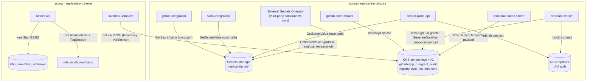
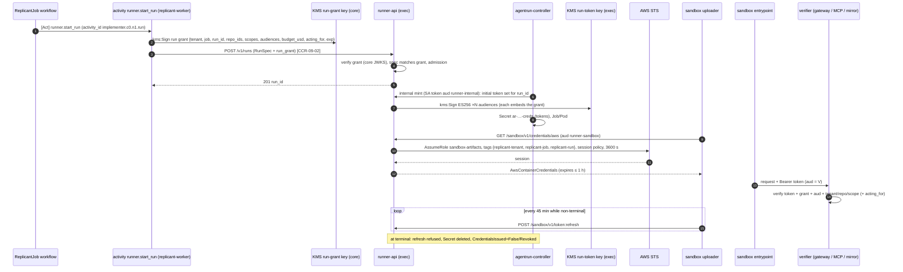
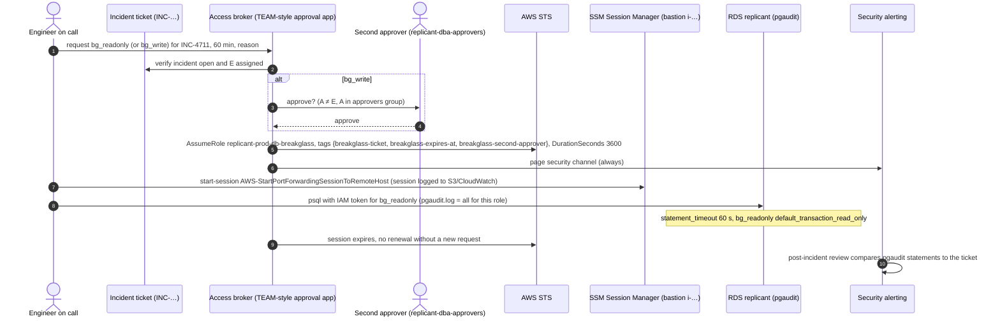

# Secrets, Credentials, and Keys

**Owner:** WS-09 · **Status:** fix round wave 3 · **Date:** 2026-10-24 · **Contracts:** C-ARCH 2.0.0, C-RUNNER 3.0.0, C-CRD 3.0.0, C-MSG 2.0.0, C-ART 2.0.0, C-STATE 2.0.0
**Contracts consumed:** C-ARCH §6 (credential holders), C-MSG §1 (Temporal credential holders),
ADR-002, ADR-007, ADR-011, C-RUNNER (run tokens, sandbox listener), C-ART §5 (SSE-KMS), C-PG rule 6.

## Purpose

Where every secret lives, which workload identity reads it, how per-run credentials are issued,
scoped, and revoked, how the GitHub App keys are held and rotated, which KMS keys protect Temporal
payloads, S3, and Postgres, and how humans reach a database without standing access (D-26).

## Decisions summary

| # | Decision | Constraint | ADR |
|---|---|---|---|
| 1 | **AWS Secrets Manager** is the secret store. Vault is not used (license change to BSL; operating an HA secrets cluster is a cost Replicant does not need; every consumer is in AWS). OpenBao stays the documented alternative | D-21, D-22 | [adr/002](adr/002-secrets-manager-over-vault.md) |
| 2 | **EKS Pod Identity** for every Replicant workload; one IAM role per service. IRSA only where Pod Identity is unavailable (none in the target design) | D-22 | [adr/003](adr/003-eks-pod-identity-over-irsa.md) |
| 3 | The **GitHub App private key is imported into KMS** as a non-exportable RSA_2048 signing key. Only `github-token-broker` can call `kms:Sign`. No PEM exists anywhere after the import ceremony | D-24 | [adr/004](adr/004-github-app-key-in-kms.md) |
| 4 | High-value runtime secrets (webhook secret, Slack signing secret, Okta client secrets) are read **directly from Secrets Manager by the owning service** through its Pod Identity, never synced into Kubernetes Secrets. External Secrets Operator is used only for third-party components that need files or env (Grafana, Langfuse, Temporal UI) | D-21 | §3 |
| 5 | Per-run credentials: one run token **per audience**, each embedding a core-signed **run grant**; STS sessions with ABAC tags, ≤ 1 h, usable only through the sandbox VPC endpoint | D-11, D-21 | [adr/005](adr/005-run-grants-bound-exec-side-minting.md), [adr/006](adr/006-per-audience-run-tokens.md) |
| 6 | KMS: per-(environment, tenant) keys for S3 run data **and** Temporal payloads (encryption context `replicant:purpose`, `replicant:tenant`); platform keys for audit, registry, eval, etcd, RDS, run tokens, run grants | D-21, D-22 | §6 |
| 7 | Postgres services authenticate with **RDS IAM database authentication** via Pod Identity (no passwords). Humans have no standing access; break-glass is a time-boxed role with ticket tags, a second approver for writes, an audited SSM port forward, and pgaudit session logs | D-26 | §7 |



---

## 1. AWS account and workload identity layout

| Account | Contents | Who administers |
|---|---|---|
| `replicant-<env>-core` | `fct-<env>-core` EKS, RDS (Replicant, temporal, langfuse), S3 (seven buckets), KMS tenant and platform keys, Secrets Manager | Platform pipeline role only (`replicant-<env>-platform-deployer`); humans through IAM Identity Center permission sets, read-only by default |
| `replicant-<env>-exec` | `fct-<env>-exec` EKS, run-token KMS key, `sandbox-artifacts` role, sandbox VPC and endpoints | Same pipeline pattern; SCP [scp.replicant-exec-account.json](policies/iam/scp.replicant-exec-account.json) |
| `security-log-archive` (org-wide) | Organization CloudTrail, Config, GuardDuty delegated admin, S3 access logs | Security team |

Cross-account paths: PrivateLink endpoint services (core NLBs exposed to the exec VPC for
memory-mcp, context-mcp, token-broker (mirror only), temporal-frontend (notifier only), and the
exec runner NLB exposed to the core VPC for replicant-worker); cross-account bucket policies and KMS
key policies for the sandbox role. Rationale and CCR: [adr/001](adr/001-confirm-adr-007-exec-cluster-separate-account.md), CCR-09-07.

### 1.1 Workload identities (EKS Pod Identity associations)

Every association is `(cluster, namespace, serviceAccount) → role`. Trust policies require the
Pod Identity session tags `kubernetes-namespace` and `kubernetes-service-account` (example:
[runner-api.trust.json](policies/iam/runner-api.trust.json)). Pod Identity sets these tags and
supports up to 5,000 associations per cluster [verified:
https://docs.aws.amazon.com/eks/latest/userguide/pod-identities.html, 2026-10-24].

| Service (namespace/SA) | Role | Permissions (summary; deny-by-default for everything else) |
|---|---|---|
| control-plane-api (`replicant-control/control-plane-api`) | `replicant-<env>-control-plane-api` | `rds-db:connect` as `svc_control_plane_api` (its operator module is a member of `r_cross_tenant_read`, WS-10); S3 presign-only GetObject on `artifacts`, `transcripts`, `audit` (tenant keys via S3); `registry` bucket Put (If-None-Match); `kms:Sign` on `run-grant` key **no** (grants are signed by replicant-worker); Secrets Manager `replicant/<env>/control-plane-api/*`; KMS `GenerateDataKey`/`Decrypt` with `replicant:purpose=temporal-payload` (start inputs and Update payloads) |
| identity-service | `replicant-<env>-identity-service` | `rds-db:connect` as `svc_identity_service`; Secrets Manager `replicant/<env>/identity-service/*` (Okta SCIM bearer token, OAuth client secrets for GitHub/Slack link flows) |
| github-integration | `replicant-<env>-github-integration` | `rds-db:connect`; Secrets Manager `replicant/<env>/github-integration/webhook-secret*`; S3 Put on `artifacts` `tenants/*/jobs/*/events/*` and `tenants/*/intake/*` |
| github-token-broker | `replicant-<env>-github-token-broker` | [github-token-broker.permissions.json](policies/iam/github-token-broker.permissions.json): `kms:Sign` on `github-app` keys only; `rds-db:connect` as `svc_github_token_broker`, whose only database privilege is the column-limited `SELECT (provider, host, repo_id, installation_id, tenant_id, archived, removed_at, indexing_enabled)` on `github_app.repos` (CCR-07-11, granted in WS-07 github_app.sql), so the opt-in check needs no call to control-plane-api |
| slack-integration | `replicant-<env>-slack-integration` | `rds-db:connect`; Secrets Manager `replicant/<env>/slack/*` |
| jira-integration | `replicant-<env>-jira-integration` | `rds-db:connect`; Secrets Manager `replicant/<env>/jira/*` |
| replicant-worker (per build) | `replicant-<env>-replicant-worker` | `rds-db:connect` (read roles); S3 Put/Get on `artifacts` and `audit` job prefixes, server-side `CopyObject` into run `inputs/`; `kms:Sign` on `run-grant` key ([run-grant-signer.permissions.json](policies/iam/run-grant-signer.permissions.json)); KMS tenant keys via S3 and with `temporal-payload` context; Secrets Manager `replicant/<env>/gateway/worker-credential`; `s3:GetObject` on `eval` bucket `runs/*/case/*` only (never `golden/*`) and `kms:Decrypt` on the platform `eval` key (XD-FIX-R1-143) |
| publisher-worker | `replicant-<env>-publisher-worker` | S3 Get on `artifacts` diff bundles; KMS tenant keys via S3; no DB |
| replicant-projector | `replicant-<env>-replicant-projector` | `rds-db:connect` as `svc_replicant_projector`; tenant keys with `temporal-payload` context (it is a Temporal worker, C-MSG §1) |
| publisher-worker, github-integration, eval-worker (Temporal clients/workers) | their own roles | in addition to the rows above: tenant keys with `temporal-payload` context (encode and decode), R1-214 |
| leak-purge-worker (`replicant-workers/leak-purge-worker`, the service account of WS-08 Deployment `ops-worker`) | `replicant-<env>-leak-purge` | [leak-purge.permissions.json](policies/iam/leak-purge.permissions.json), adopted verbatim from WS-10 `config/iam/leak-purge.json` (XD-FIX-R1-232): read and delete all versions under `tenants/*/jobs/*` in `artifacts`, `transcripts`, `session` and their us-west-2 replicas; write-once superseding objects; check legal-hold status and delete only unheld versions in the legal bucket; write-once `purges/` records and deletion-ledger entries in `audit` (ledger first, XD-FIX-R1-233); explicit Deny on `s3:BypassGovernanceRetention`, `PutObjectLegalHold`, `PutObjectRetention` |
| legal-hold operator (access broker) | `replicant-<env>-legal-hold` | [legal-hold.permissions.json](policies/iam/legal-hold.permissions.json): the only role that places or releases legal holds (on `audit` and on the governance-mode legal bucket `<org>-replicant-<env>-legal`) and the only reader and writer of the legal bucket's content; never deletes, never bypasses retention (orchestrator ruling, fix round wave 2) |
| eval-worker | `replicant-<env>-eval-worker` | in addition to Temporal-payload key use: `s3:PutObject` on `artifacts` `tenants/replicant-eval/jobs/*/runs/*/inputs/*` and `s3:GetObject` on `tenants/replicant-eval/jobs/*`, with the `replicant-eval` tenant key via S3; **no** `kms:Sign` on the run-grant key (replicant-worker signs eval grants) (XD-FIX-R1-134) |
| audit-exporter (`replicant-system/audit-exporter`) | `replicant-<env>-audit-exporter` | write-once `s3:PutObject` on `audit` `org/audit-exports/*` and `tenants/*/jobs/*/history/*.skeleton.json.zst`, on `artifacts` `tenants/*/jobs/*/history/*.json.zst`; `s3:ListBucket` on `audit` prefix `org/audit-exports/events/`; tenant keys `GenerateDataKey` via S3 (XD-FIX-R1-194; WS-10 writes the JSON) |
| s3-replication (S3 service role) | `replicant-<env>-s3-replication` | Decrypt via the source bucket, Encrypt/GenerateDataKey on the us-west-2 replica keys (XD-10-09) |
| memory-service | `replicant-<env>-memory-service` | `rds-db:connect`; S3 `memory` bucket; `kms:GetPublicKey` on run-token and run-grant keys |
| context-mcp | `replicant-<env>-context-mcp` | `rds-db:connect` read; `kms:GetPublicKey` |
| temporal-codec-server | `replicant-<env>-temporal-codec-server` | [temporal-codec-server.permissions.json](policies/iam/temporal-codec-server.permissions.json) |
| migrate Job | `replicant-<env>-migrate` | `rds-db:connect` as `replicant_migrator` only |
| runner-api (exec) | `replicant-<env>-runner-api` | [runner-api.permissions.json](policies/iam/runner-api.permissions.json) |
| agentrun-controller (exec) | `replicant-<env>-agentrun-controller` | [agentrun-controller.permissions.json](policies/iam/agentrun-controller.permissions.json), exactly C-ARCH 1.4.0: `s3:GetObject` on run prefixes in `artifacts`, `transcripts`, `session` (manifest reads, and HeadObject with ChecksumMode, which S3 authorizes as `s3:GetObject`); `s3:GetObject` on `registry` `blobs/sha256/*` and `bundles/*`; `s3:PutObject` with required `If-None-Match` on `…/agentrun_record/*`; tenant and registry keys via S3 |
| run-notifier (exec) | `replicant-<env>-run-notifier` (fourth exec role, C-ARCH 1.4.0) | [run-notifier.permissions.json](policies/iam/run-notifier.permissions.json): tenant-key `kms:GenerateDataKey` with context `replicant:purpose=temporal-payload` only; **no** `kms:Decrypt`, no S3. Encodes Signal payloads with the Go `EncryptOnlyKeyProvider`; plus its Temporal mTLS certificate |
| repo-mirror (exec) | `replicant-<env>-repo-mirror` | none in AWS; calls the broker over PrivateLink with a projected SA token (audience `token-broker`), which the broker verifies against the exec cluster OIDC JWKS |
| Sandboxes | none | No Pod Identity association exists in `sbx-*`; IMDS and the agent address are blocked; per-run STS comes from the Runner |

## 2. Secret inventory and storage

| Secret | Store / name | Consumer (only) | Rotation | Notes |
|---|---|---|---|---|
| GitHub App private key (prod) | **KMS** asymmetric key, alias `alias/replicant/prod/github-app/2026q4` (imported material) | github-token-broker (`kms:Sign`) | 90 days (new GitHub key, new KMS key, overlap ≤ 24 h) | §4 |
| GitHub App webhook secret | Secrets Manager `replicant/prod/github-integration/webhook-secret` (JSON `{current, previous, rotated_at}`) | github-integration | 90 days, dual-accept window 24 h | §5 |
| GitHub App client secret (user OAuth for identity linking) | `replicant/prod/identity-service/github-oauth` | identity-service | 180 days | |
| Slack signing secret, bot token | `replicant/prod/slack/signing-secret`, `replicant/prod/slack/bot-token` | slack-integration | Signing secret on Slack's regenerate (manual, 180 days); bot token per Slack app rotation (WS-07) `[unverified: Slack token rotation availability for this app type]` | |
| Jira webhook secret / API token | `replicant/prod/jira/*` | jira-integration | 90 days | |
| Okta OIDC client secret (control-plane-api; Temporal UI; Grafana; Langfuse) | `replicant/prod/<component>/okta-oidc` | that component (ESO for Grafana, Langfuse, Temporal UI) | 180 days | Prefer `private_key_jwt` client auth where the component supports it |
| Okta SCIM bearer token | `replicant/prod/identity-service/scim-token` | identity-service | 90 days | |
| AI gateway service credential for worker-side LLM calls | `replicant/prod/gateway/worker-credential` | replicant-worker | per gateway capability (OQ-00-09); ≤ 30 days | Never in sandboxes |
| Grafana `grafana_ro` Postgres password | `replicant/prod/grafana/pg-readonly` (Secrets Manager managed rotation for RDS) | Grafana via ESO | 30 days, managed rotation | Grafana's PostgreSQL data source supports only user/password and TLS, no RDS IAM tokens [verified: V10-28, https://grafana.com/docs/grafana/latest/datasources/postgres/configure/]. `grafana_ro` is therefore a password role with managed rotation |
| Langfuse secrets (NEXTAUTH, SALT, ENCRYPTION_KEY, ClickHouse, Valkey, S3) | `replicant/prod/langfuse/*` | Langfuse via ESO | 180 days except `ENCRYPTION_KEY` (rotation requires re-encryption; WS-08) | |
| Temporal persistence DB credentials | `replicant/prod/temporal/db` (managed rotation), injected per connection through Temporal ≥ 1.31 `passwordCommand` [verified: V10-12, temporal v1.32.1 source]; there is no native RDS IAM auth plugin | Temporal server | 30 days | |
| Temporal-client mTLS intermediate CA | AWS Private CA subordinate (`replicant-prod-temporal-clients`) via cert-manager `aws-privateca-issuer` | cert-manager | CA: 2 years; leaf: 24 h | §6.4 |
| Run-token signing key | KMS `alias/replicant/prod/run-token` (exec account, ECC_NIST_P256) | runner-api | New key every 30 days; JWKS publishes current + previous (2 token lifetimes overlap, C-RUNNER) | |
| Run-grant signing key | KMS `alias/replicant/prod/run-grant` (core, ECC_NIST_P256) | replicant-worker | 30 days, JWKS overlap 48 h (grants live ≤ run deadline + finalize) | |

Every secret is tagged `replicant-owner=<service>` and `replicant-env=<env>`; each service role's policy
allows `secretsmanager:GetSecretValue` only on `arn:aws:secretsmanager:<region>:<core>:secret:replicant/<env>/<service>/*`.
Secrets Manager costs $0.40 per secret per month and $0.05 per 10,000 API calls [verified:
https://aws.amazon.com/secrets-manager/pricing/, 2026-10-24]; at about 40 secrets per environment
this is negligible. Services cache values in process for 5 minutes (aws-secretsmanager-caching for
Python) and re-read on signature verification failure, which is how rotation with dual-accept works
without restarts.

### 2.1 ESO configuration (third-party components only)

```yaml
apiVersion: external-secrets.io/v1
kind: SecretStore
metadata:
  name: aws-sm-grafana
  namespace: observability
spec:
  provider:
    aws:
      service: SecretsManager
      region: us-east-1
      # No auth block: ESO's controller SA authenticates with EKS Pod Identity, then assumes a
      # per-namespace reader role so one namespace's store cannot read another's secrets.
      role: arn:aws:iam::111111111111:role/replicant-prod-eso-reader-observability
---
apiVersion: external-secrets.io/v1
kind: ExternalSecret
metadata:
  name: grafana-pg-readonly
  namespace: observability
spec:
  refreshInterval: 1h
  secretStoreRef:
    kind: SecretStore
    name: aws-sm-grafana
  target:
    name: grafana-pg-readonly
    creationPolicy: Owner
  data:
    - secretKey: password
      remoteRef:
        key: replicant/prod/grafana/pg-readonly
        property: password
```

`[unverified: ESO API group version external-secrets.io/v1 vs v1beta1 in the version WS-10 pins; the
EKS workshop example uses v1beta1 and no auth block with Pod Identity — https://eksworkshop.com/docs/security/secrets-management/secrets-manager/external-secrets]`.
Kubernetes Secrets in both clusters are envelope-encrypted with a customer-managed KMS key (EKS
`encryptionConfig` for `secrets`).

## 3. Why services read Secrets Manager directly

A Kubernetes Secret is readable by anyone with `get secrets` in the namespace and by the kubelet of
the node running the pod. A direct SDK read is readable only by the role. The three secrets whose
theft gives forgery power over Replicant inputs (GitHub webhook secret, Slack signing secret, Jira
webhook secret) are therefore never Kubernetes Secrets. They are fetched at startup and on
verification failure, held in process memory, and never logged (the logging library's redaction
filter matches their key names).

## 4. GitHub App keys (prod and dev)

### 4.1 Storage: KMS-held, sign-only

GitHub recommends storing the key in a key vault and making it sign-only: "Once the private key is
uploaded to the key vault, it can never be read from there" [verified:
https://docs.github.com/en/apps/creating-github-apps/authenticating-with-a-github-app/managing-private-keys-for-github-apps,
2026-10-24]. AWS KMS supports importing asymmetric key material, including RSA [verified:
https://docs.aws.amazon.com/kms/latest/developerguide/importing-keys.html, 2026-10-24]; RSA private
key material must be wrapped with `RSA_AES_KEY_WRAP_SHA_256` [verified:
https://docs.aws.amazon.com/kms/latest/developerguide/importing-keys-get-public-key-and-token.html,
2026-10-24]. GitHub App JWTs are RS256, which maps to KMS `RSASSA_PKCS1_V1_5_SHA_256`.

**Import ceremony** (two people, recorded in the change ticket; role `replicant-prod-key-ceremony`
requires `approved-change=true` and MFA; key policy
[kms-key-policy.github-app.json](policies/iam/kms-key-policy.github-app.json)):

1. Create the KMS key: `aws kms create-key --key-spec RSA_2048 --key-usage SIGN_VERIFY --origin EXTERNAL --tags TagKey=replicant-key-class,TagValue=github-app TagKey=github-app-registration,TagValue=prod`.
2. `aws kms get-parameters-for-import --key-id <id> --wrapping-algorithm RSA_AES_KEY_WRAP_SHA_256 --wrapping-key-spec RSA_4096`.
3. On an ephemeral, network-isolated workstation (AWS CloudShell in the core account is not used: it
   has persistent home storage): generate a new private key in the GitHub App settings, download the
   PEM, convert to PKCS#8 DER (`openssl pkcs8 -topk8 -inform PEM -outform DER -nocrypt`), wrap with
   a fresh AES-256 key per the KMS procedure, and `aws kms import-key-material --expiration-model KEY_MATERIAL_DOES_NOT_EXPIRE`.
4. Verify: sign a test JWT through KMS and call `GET /app` with it.
5. Shred the PEM, DER, and AES key (`shred -u`); destroy the workstation. The PEM existed for minutes,
   on one machine, under two-person observation.
6. Update the broker's key list (Secrets Manager `replicant/prod/github-token-broker/keys`:
   `{"active": "<kms key arn>", "next": null}`).

**Rotation** (every 90 days; GitHub allows 25 keys per App [verified: same GitHub page]):
run the ceremony for the new key, set it as `next`, the broker signs with `active` and verifies
`next` with a canary, then promote `next` → `active`, wait 15 minutes (JWTs live ≤ 10 minutes),
delete the old key in GitHub, then `ScheduleKeyDeletion` (30 days) on the old KMS key.
**Compromise response:** delete the key in GitHub first (immediate), then rotate.

Broker JWT signing (Python, boto3):

```python
import base64
import json
import time

import boto3

_kms = boto3.client("kms", region_name="us-east-1")


def _b64url(data: bytes) -> str:
    return base64.urlsafe_b64encode(data).rstrip(b"=").decode("ascii")


def app_jwt(app_id: int, kms_key_arn: str) -> str:
    """GitHub App JWT (RS256) signed in KMS; the private key never leaves KMS."""
    now = int(time.time())
    header = {"alg": "RS256", "typ": "JWT"}
    # iat backdated 60 s for clock skew; exp at most 10 minutes after iat (GitHub limit).
    payload = {"iat": now - 60, "exp": now + 540, "iss": str(app_id)}
    signing_input = (
        _b64url(json.dumps(header, separators=(",", ":")).encode())
        + "."
        + _b64url(json.dumps(payload, separators=(",", ":")).encode())
    )
    sig = _kms.sign(
        KeyId=kms_key_arn,
        Message=signing_input.encode("ascii"),
        MessageType="RAW",
        SigningAlgorithm="RSASSA_PKCS1_V1_5_SHA_256",
    )["Signature"]
    return signing_input + "." + _b64url(sig)
```

`[unverified: GitHub's exact maximum JWT lifetime of 10 minutes and its clock-skew guidance were
not re-fetched this session; they are standard in GitHub's "Generating a JWT for a GitHub App"
page]`. The broker caches one App JWT for up to 8 minutes, so KMS `Sign` demand is a few calls per
minute against a default RSA quota of 1,000 requests per second [verified:
https://docs.aws.amazon.com/kms/latest/developerguide/requests-per-second.html, 2026-10-24].

### 4.2 Broker contract (internal; WS-07 implements)

`POST /internal/v1/installation-tokens` (mTLS-free; authenticated by projected ServiceAccount token
audience `token-broker`, verified against the issuing cluster's OIDC JWKS):

```json
{
  "installation_id": 51834221,
  "repository_ids": [712345678],
  "permissions": {"contents": "write", "pull_requests": "write"},
  "purpose": "publisher.publish",
  "job_id": "job_01m5p7x7r0bt69j0h0fbxepw90",
  "idempotency_key": "ik1:job_01m5p7x7r0bt69j0h0fbxepw90:publisher.c0.n1.publish"
}
```

The broker calls `POST /app/installations/{installation_id}/access_tokens` with `repository_ids`
and `permissions` (downscoping; up to 500 repositories; tokens expire after one hour; a JWT is
required) [verified: https://docs.github.com/en/rest/apps/apps#create-an-installation-access-token-for-an-app,
2026-10-24], returns the token and `expires_at`, and emits `audit.emit` with caller, purpose, repos,
permissions, and the token's last 4 characters. It never logs the token.

**Caller allowlist** (anything not listed is 403; ADR-011 as extended by CCR-09-06). For indexer callers the broker refuses repositories that are not opted in, reading `github_app.repos` directly through its column-limited grant (CCR-07-11):

| Caller (cluster/ns/SA) | Permissions it may request | Repo constraint |
|---|---|---|
| core/replicant-workers/publisher-worker | `contents: write`, `pull_requests: write` | exactly 1 repo; must equal the job's target repo in `intake.job_requests` (broker reads it through control-plane-api `GET /internal/v1/jobs/{job_id}/targets`) |
| core/replicant-integrations/github-integration | `issues: write`, `pull_requests: write`, `checks: write` | exactly 1 repo |
| exec/replicant-mirror/repo-mirror | `contents: read`, `metadata: read` | ≤ 100 repos per request, all in installations opted in (`github_app.repos`) |
| core/replicant-control/identity-service | `metadata: read`, `members: read` (org) | 1 repo, for collaborator permission checks |
| core/replicant-context/ecosystem-indexer, zoekt-indexer | `contents: read`, `metadata: read` | opted-in repos |

**Never requested by anyone:** `workflows`, `administration`, `secrets`, `actions`, `environments`,
`organization_administration`. The App registration itself does not hold them, so even a broker
compromise cannot mint them. Without `workflows`, GitHub rejects pushes that modify
`.github/workflows` `[unverified: exact rejection behavior for App tokens lacking workflows
permission; standard GitHub behavior, WS-07 to confirm in github-app.md]`.

### 4.3 Dev app registrations (D-24)

- Each developer's dev app is created through the manifest flow and is **private** ("can only be
  installed on the account that owns the app" [verified:
  https://docs.github.com/en/apps/creating-github-apps/registering-a-github-app/making-a-github-app-public-or-private,
  2026-10-24]). It is installable only on the developer's personal org.
- Its PEM lives in the developer's local secret store (macOS Keychain or `pass`/1Password CLI via
  `replicant dev secrets`, WS-11), never in the repo, never in shared Secrets Manager.
- **What a leaked dev-app key reaches:** tokens for that dev app's installations, which means the
  developer's personal org and its test repos. It reaches no enterprise repo (the app cannot be
  installed there), no Replicant data (the local stack has none of production's), and no production
  webhook (the dev app's webhook URL is a forwarder to the laptop). Response: delete the key in the
  dev app settings.
- The shared `dev` environment (cloud) uses a separate dev registration whose key goes through the
  same KMS ceremony as prod, because it runs real infrastructure.

## 5. Webhook and signing secrets

| Channel | Verification | Rotation without downtime |
|---|---|---|
| GitHub | HMAC-SHA256 of the raw body, `X-Hub-Signature-256`, constant-time compare, before parsing JSON | GitHub App settings hold one secret. Rotation: store `{current, previous}`; set the new secret in GitHub; the service accepts either for 24 h; then drop `previous`. Deliveries failing both are 401 and replayed later via the deliveries API |
| Slack | v0 signature over `v0:{timestamp}:{body}`, reject if timestamp skew > 5 min | Slack supports regenerating the signing secret; same dual-accept window |
| Jira | Webhook secret (HMAC) or Atlassian Connect JWT (WS-07 decides) | Dual-accept |

## 6. Encryption keys (KMS)

### 6.1 Inventory

Ownership (R1-240, orchestrator ruling): WS-09 owns every exec-account key (`run-token`, `exec-ebs`)
and all key policies in this table; WS-10 provisions the core data-plane keys from these policies.
WS-02 owns the sandbox subnets and the Network Firewall.


| Alias (prod) | Account | Spec | Encrypts / signs | Key users | Rotation |
|---|---|---|---|---|---|
| `alias/replicant/prod/tenant/<tenant_id>` ×40 | core | SYMMETRIC_DEFAULT, **multi-Region** (`mrk-…`, replica in us-west-2 for DR, XD-10-09) | S3 `artifacts`, `transcripts`, `session`, tenant `memory` exports (SSE-KMS, Bucket Keys); Temporal payload data keys for that tenant | core services via S3, exec sandbox role and runner via S3, codec | automatic yearly |
| `alias/replicant/prod/tenant/replicant-system` | core | SYMMETRIC_DEFAULT, multi-Region | Temporal payloads of `sys:*` workflows (WS-01 `SYSTEM_TENANT`) | Temporal clients and workers, codec server | automatic yearly |
| `alias/replicant/prod/image-signing` | core | ECC_NIST_P256 SIGN_VERIFY | cosign signatures on Replicant and mirror images ([ivp-replicant-images.yaml](policies/kubernetes/ivp-replicant-images.yaml)) | image CI role only | yearly by replacement (both public keys in the policy for 7 days) |
| `alias/replicant/prod/secretscan-fingerprint` | core | HMAC_256 GENERATE_VERIFY_MAC | Secret-scan finding fingerprints (data-handling.md §4), via `kms:GenerateMac` | verifier (replicant-worker), github-integration, memory-service, ecosystem-indexer | yearly by replacement (fingerprints restart; reports record the key version) |
| `alias/replicant/prod/ops` | core | SYMMETRIC_DEFAULT | kill-switch mirror and exec revocation feed (§12) | control-plane-api and killswitch-operator (kill switches), runner-api (revocation feed, write and read-back), readers in §12 | yearly |
| `alias/replicant/prod/audit` | core | SYMMETRIC_DEFAULT | `audit` bucket | replicant-worker, audit exporter | yearly |
| `alias/replicant/prod/legal` | core | SYMMETRIC_DEFAULT | legal bucket (WS-10 `legal.encryption.json`; [kms-key-policy.legal.json](policies/iam/kms-key-policy.legal.json)) | legal-hold; leak-purge (unheld objects only, CCR-ORCH-01); denied to every other principal | yearly |
| `alias/replicant/prod/registry` | core | SYMMETRIC_DEFAULT | `registry` bucket | control-plane-api (write), runner/controller (read) | yearly |
| `alias/replicant/prod/eval` | core | SYMMETRIC_DEFAULT | `eval` bucket | eval-worker | yearly |
| `alias/replicant/prod/platform-memory` | core | SYMMETRIC_DEFAULT | org-wide memory exports | memory-service | yearly |
| `alias/replicant/prod/rds` | core | SYMMETRIC_DEFAULT | RDS storage for Replicant, temporal, langfuse instances, snapshots, Performance Insights | RDS | yearly |
| `alias/replicant/prod/etcd-core`, `alias/replicant/prod/etcd-exec` | core / exec | SYMMETRIC_DEFAULT | EKS secrets envelope encryption | EKS | yearly |
| `alias/replicant/prod/ebs` | core and exec | SYMMETRIC_DEFAULT | Node and generic-ephemeral volumes (EBS default encryption) | EC2/EBS | yearly |
| `alias/replicant/prod/github-app/<yyyyq>` | core | RSA_2048 SIGN_VERIFY, imported | GitHub App JWTs | github-token-broker | 90 days by replacement |
| `alias/replicant/prod/run-token` | exec | ECC_NIST_P256 SIGN_VERIFY | run tokens | runner-api | 30 days by replacement |
| `alias/replicant/prod/exec-ebs` | exec | SYMMETRIC_DEFAULT | EBS volumes of exec nodes and generic ephemeral workspace volumes | EC2 via Karpenter, EBS CSI driver, exec node role; denied to sandbox, runner and notifier roles ([kms-key-policy.exec-ebs.json](policies/iam/kms-key-policy.exec-ebs.json)) | automatic yearly |
| `alias/replicant/prod/run-grant` | core | ECC_NIST_P256 SIGN_VERIFY | run grants | replicant-worker | 30 days by replacement |

Policy pattern: administration and use are separated; no key policy grants `kms:*` to the account
root (root gets read-only metadata), so IAM policies alone cannot grant use; use is restricted with
`kms:ViaService` or an encryption-context condition. Examples:
[kms-key-policy.tenant.json](policies/iam/kms-key-policy.tenant.json),
[kms-key-policy.run-token.json](policies/iam/kms-key-policy.run-token.json),
[kms-key-policy.github-app.json](policies/iam/kms-key-policy.github-app.json).
With S3 Bucket Keys the encryption context is the bucket ARN, so key policies can scope to buckets but
not prefixes (C-ART §5.4); prefixes are scoped in IAM.

### 6.2 Temporal payload encryption (codec)

All payloads (workflow inputs, activity inputs and results, Signal and Update payloads, memos,
failure messages when `encode_common_attributes=True`) are encrypted with the **job's tenant key**
under encryption context `{"replicant:purpose": "temporal-payload", "replicant:tenant": "<tenant_id>"}`.
`sys:*` workflows use tenant `replicant-system`, which has its own key (§6.1).

**Ownership (R1-214, XD-01-08).** WS-01's `replicant_orchestration/codec.py` owns payload framing and
tenant routing and defines the `KeyProvider` protocol
(`encrypt(tenant, plaintext, aad) -> (key_blob, ciphertext)`, `decrypt(tenant, key_blob, ciphertext, aad)`).
**WS-09 owns the implementations and the data-key cache:**

- Python: [policies/temporal/kms_key_provider.py](policies/temporal/kms_key_provider.py)
  (`KmsKeyProvider`, `DataKeyCache`), used by every core Temporal client and worker:
  control-plane-api, github-integration, replicant-worker, publisher-worker, replicant-projector,
  eval-worker, and the codec server (`decrypt_only=True`). All of them are named in the tenant key
  policy's `TemporalClientsAndWorkersUseTenantContext` statement.
- Go: [policies/temporal/kmskeyprovider/kms_key_provider.go](policies/temporal/kmskeyprovider/kms_key_provider.go)
  (`EncryptOnlyKeyProvider`) for run-notifier, whose role may call only `kms:GenerateDataKey`
  (C-ARCH 1.4.0). Its `Decrypt` always fails.
- Cache rules: one encryption data key per tenant, at most 300 s and 10,000 payloads; unwrapped
  decryption keys cached 300 s keyed by sha256(tenant, wrapped blob), so a cached key can never
  satisfy a payload relabelled with another tenant (a unit test with a fake KMS proves this).

**Codec server** (`temporal-codec-server`, behind Okta): `POST /decode` per the Temporal codec server
protocol [verified: V00-16, https://docs.temporal.io/codec-server]. It requires an Okta access
token, reads each payload's tenant metadata, asks identity-service whether the caller is authorized
for that tenant (operators: `replicant-operators` **and** the tenant in their operator scope; tenant
admins: own tenant), returns undecoded payloads for unauthorized tenants, and emits one
`audit.emit` per request with the workflow ID and tenant. It serves no `/encode`.

### 6.3 S3 and Postgres

- S3: SSE-KMS per C-ART §5 with tenant keys; bucket policy denies non-KMS and foreign keys
  ([s3-bucket-policy.artifacts.json](policies/iam/s3-bucket-policy.artifacts.json)); TLS only.
- RDS: storage encryption with `alias/replicant/prod/rds`; `rds.force_ssl=1`; clients use
  `sslmode=verify-full` with the RDS CA bundle.
- Postgres column-level encryption is not used: there are no secrets in Postgres (C-STATE rule 4
  analog); identity-link OAuth refresh tokens, if WS-07 stores any, are encrypted with
  `alias/replicant/prod/identity` via the AWS Encryption SDK before insert.

### 6.4 Temporal mTLS

cert-manager with the `aws-privateca-issuer` issues 24-hour client certificates (CN
`<service>.<namespace>.<cluster>.<env>`) from a subordinate CA dedicated to Temporal clients; the
Temporal frontend requires client certs (`requireClientAuth: true`) from that CA only; the
ClaimMapper maps CN to the identity in [authorizer.go](policies/temporal/authorizer.go). Private keys
are generated in-pod by the cert-manager CSI driver and never stored as Secrets.

## 7. Per-run credentials (issuance, scope, TTL, revocation)



| Credential | Issuer | Scope | TTL | Revocation |
|---|---|---|---|---|
| Run grant | replicant-worker (KMS `run-grant`) | One run: tenant, job, run_id, repo_ids, scopes, audiences, budget, `acting_for` | run deadline + finalize + 300 s | Expires; not refreshable. Revocation is by **`job_id` or `run_id`** on the core list `/grants/revoked` served with the grant JWKS (C-RUNNER 2.1.0; polled every 60 s by verifiers). A grant is 1:1 with its run (`spec_digest` binds it to one RunSpec, and a re-run gets a new `run_id`), so `run_id` revokes exactly one grant and `job_id` revokes all of a cancelled job's grants |
| Run token (per audience) | runner-api (KMS `run-token`) | One audience, one run, scopes ⊆ grant | 60 min, refreshed at < 15 min remaining | Refresh refused after terminal; verifiers also reject tokens whose grant's `job_id` or `run_id` is on the revocation list |
| STS session | AWS STS via runner-api | Own run prefixes (ABAC tags), tenant key via S3, only through the sandbox VPCE | ≤ 3,600 s (role chaining) | Cannot be revoked individually before expiry; a session stays valid up to 1 h after the run ends (residual R-09). Emergency: attach a deny-all inline policy conditioned on `aws:TokenIssueTime` to `sandbox-artifacts` (AWS "revoke active sessions" pattern) `[unverified: re-check current AWS docs for the revoke-sessions condition key]`. **Fallback (R2-042):** add a `Deny s3:*` on `sandbox-artifacts` in the artifacts, transcripts and session bucket policies for the affected `aws:PrincipalTag/replicant-run` values (bucket policy changes take effect in seconds and do not depend on the condition key), and in the worst case detach the role's permissions policy, which stops every sandbox upload until restored |
| AI gateway budget | gateway | `budget_usd` from the grant | run | Gateway stops at budget; job budget enforced across runs |

## 8. Database access (D-26)

### 8.1 Services

Each writer and reader service connects as its own login role (C-PG rule 1) using an RDS IAM
authentication token (15-minute validity, generated per new connection) [verified:
https://docs.aws.amazon.com/AmazonRDS/latest/UserGuide/UsingWithRDS.IAMDBAuth.html, 2026-10-24].
Roles are members of `rds_iam`, so a password cannot be used for them
([roles-and-rls.sql](policies/postgres/roles-and-rls.sql)). The `replicant-db` package injects the
token in SQLAlchemy's `do_connect` event:

```python
import boto3
from sqlalchemy import event
from sqlalchemy.engine import Engine
from sqlalchemy.ext.asyncio import create_async_engine

_rds = boto3.client("rds", region_name="us-east-1")


def make_engine(host: str, port: int, db_user: str) -> Engine:
    engine = create_async_engine(
        f"postgresql+psycopg://{db_user}@{host}:{port}/replicant",
        pool_size=10,
        pool_recycle=600,  # recycle well within the 15-minute token validity window for new connections
        connect_args={"sslmode": "verify-full", "sslrootcert": "/etc/ssl/rds/global-bundle.pem"},
    )

    @event.listens_for(engine.sync_engine, "do_connect")
    def _iam_token(dialect, conn_rec, cargs, cparams):  # noqa: ANN001, ANN202
        cparams["password"] = _rds.generate_db_auth_token(
            DBHostname=host, Port=port, DBUsername=db_user, Region="us-east-1"
        )

    return engine.sync_engine
```

IAM DB auth needs 300–1,000 MiB extra memory on the instance, and IAM DB authentication events are
**not** logged by CloudTrail [verified: same page]. Connection pools keep connection churn low.
If WS-10 selects CloudNativePG instead of RDS/Aurora, IAM auth is unavailable; the fallback is
client-certificate authentication (`cert` in `pg_hba`) with cert-manager-issued 24-hour certificates
per service.

### 8.2 Break-glass



- Role permissions: [db-breakglass.role-permissions.json](policies/iam/db-breakglass.role-permissions.json).
- Session audit: pgaudit to CloudWatch Logs (RDS log export), SSM session logs, the broker's own
  audit, and the ticket. On **Aurora PostgreSQL**, Database Activity Streams add a tamper-resistant
  stream DBAs cannot disable; DAS on RDS (non-Aurora) supports only Oracle and SQL Server [verified:
  https://docs.aws.amazon.com/AmazonRDS/latest/UserGuide/DBActivityStreams.html, 2026-10-24]. This is
  an input to WS-10's RDS vs Aurora decision (control-review G-21).
- `bg_readonly` cannot read the `memory` or `identity` schemas; reading them needs `bg_write`
  (two-person) or the admin API.

## 9. Human access to clusters and AWS

| Access | Mechanism | Standing? |
|---|---|---|
| Core cluster read (`view` on Replicant namespaces, no Secrets) | EKS access entries + IAM Identity Center permission set `ReplicantOperatorRead` | yes, for `replicant-operators` |
| Core cluster write | Argo CD only (GitOps); humans: break-glass `ReplicantClusterAdmin` (ticket, 1 h) | no |
| Exec cluster any access | Break-glass only, ticketed; `pods/exec` into sandboxes not granted to any role | no |
| AWS console, core and exec accounts | Identity Center read-only permission sets; write via pipeline | read yes, write no |
| Temporal UI | Okta, `replicant-operators`; terminate/cancel/reset need the operator claim; decode through the codec server's tenant check | yes |

## 10. Rotation and expiry summary

| Item | Interval | Mechanism | Alert if overdue |
|---|---|---|---|
| GitHub App key | 90 days | KMS ceremony | 100 days |
| Webhook / signing secrets | 90–180 days | dual-accept | +10 days |
| Run-token and run-grant keys | 30 days | new KMS key, JWKS overlap | 35 days |
| Temporal client certs | 24 h | cert-manager | renewal failure |
| Symmetric KMS keys | yearly | KMS automatic rotation | — |
| Okta client secrets / SCIM token | 90–180 days | Secrets Manager + Okta | +10 days |
| `grafana_ro`, Temporal DB passwords | 30 days | Secrets Manager managed rotation | rotation failure |

## 11. Local-only credentials (OQ-11-04: `svc_dev-seeder`)

WS-11 proposes a dev seed token (principal `svc_dev-seeder`) that control-plane-api honors only when
`REPLICANT_ENV=local`. A runtime flag alone is **not acceptable**: one misconfigured environment
variable (or a copied Helm values file) would turn a static, never-expiring, high-privilege bearer
token into a production credential. WS-09's position: allow the token for local use only if all of
the following hold, so that honoring it in a non-local environment requires several independent
failures.

| # | Layer | Control |
|---|---|---|
| L-1 | **Build-time exclusion (primary)** | The dev-seed authenticator lives in a separate package (`replicant_dev_auth`) installed only in the image's `dev` build target. The `prod` target does not contain it; CI asserts `python -c "import replicant_dev_auth"` fails in every prod image and that the prod SBOM lacks the package. Production code has no code path that can validate the token |
| L-2 | Image provenance | Dev-target images are signed with a dev-only cosign key; staging/prod admission ([tenancy.md](tenancy.md) §3.4) accepts only the prod signing key, so a dev image cannot run in a shared environment |
| L-3 | Startup guard | control-plane-api refuses to start (fails readiness, logs a P1 security event) if `REPLICANT_DEV_SEED_TOKEN_FILE` is set and `REPLICANT_ENV != local`, or if `REPLICANT_ENV=local` while it detects AWS (Pod Identity env `AWS_CONTAINER_CREDENTIALS_FULL_URI`, EKS service-account files, or an RDS endpoint) |
| L-4 | Identity data | `svc_dev-seeder` is created only by local seed data, never by the identity-schema migrations applied to dev/staging/prod; identity-service denies any request whose principal is `svc_dev-seeder` when `REPLICANT_ENV != local` (independent of control-plane-api) |
| L-5 | Scope | The token authorizes only the seed endpoints (`/v1/admin/dev/seed/*`, tenant/user/repo fixture creation); it can never decide gates (V8 already rejects `svc_` actors), manage memory, promote bundles, or presign artifacts |
| L-6 | Deployment config | The Helm chart has no value that sets `REPLICANT_DEV_SEED_TOKEN_FILE`; a cluster admission rule (Kyverno/VAP in core) denies any pod with that env var |
| L-7 | Audit | Every use emits `audit.emit` with `principal_id=svc_dev-seeder`; any such event from a non-local environment pages security |

With L-1 and L-2 in place, the runtime flag (L-3) is defense in depth, not the control. Local
object storage is SeaweedFS (WS-11); nothing in this section depends on the local store.

## 12. Kill-switch mirror (out-of-band store, R2-016, C-MSG 1.5.0 `ops.kill_switch`)

C-MSG 1.5.0 delivers kill switches to running workflows by Signal (Temporal only) and has workflows
that start later read an out-of-band mirror with activity `ops.read_kill_switches`. The mirror must
stay readable when the Replicant Postgres is down. **Store (agreed for WS-07; XD-FIX-R2-016):** one
versioned S3 object in a dedicated ops bucket in the core account:

- Bucket `acme-replicant-<env>-ops` (versioning on, Object Lock off, SSE-KMS `alias/replicant/<env>/ops`,
  Bucket Keys on, no lifecycle deletion of current versions; noncurrent versions kept 400 days as the
  change history). Outside the seven artifact classes; registered by CCR-09-10 (C-ART 1.10.1).
- Key `kill-switches/v1/state.json`, the complete current state (never a delta):

```json
{
  "schema": "replicant.kill-switches/v1",
  "generation": 42,
  "updated_at": "2026-10-24T14:02:11Z",
  "switches": [
    {"scope": "tenant", "scope_value": "payments", "mode": "publishing", "engaged": true,
     "notice_id": "ntc_01m5q2a4b6c8d0e2f4g6h8jkmn", "issued_at": "2026-10-24T14:02:10Z",
     "issued_by": "usr_01knk8dfr0fvjc7v0b9vhvkzbp", "reason_code": "incident"},
    {"scope": "global", "scope_value": "*", "mode": "starts", "engaged": false,
     "notice_id": "ntc_01m5q1z9y8x7w6v5t4s3r2q1pn", "issued_at": "2026-10-24T11:40:00Z",
     "issued_by": "usr_01knk8dfr0fvjc7v0b9vhvkzbp", "reason_code": "drill"}
  ]
}
```

  `scope ∈ {global, tenant, repo, bundle}` (`scope_value` = `*`, `tenant_id`, `<host>/<owner>/<name>`,
  or `release_bundle_id`); `mode ∈ {starts, runs, publishing, intake}` as in C-MSG; `reason_code`
  is an enum (`incident`, `security`, `cost`, `drill`, `maintenance`) so the object holds no free
  text. Latest `issued_at` per (scope, scope_value, mode) wins, matching the Signal semantics.
- **Writers:** control-plane-api, plus the break-glass role `replicant-<env>-killswitch-operator` (CCR-09-12, accepted: WS-07's CLI path when control-plane-api is down; [killswitch-operator.permissions.json](policies/iam/killswitch-operator.permissions.json), usable only with a `breakglass-ticket` and `breakglass-expires-at` session tag). C-ART's `ops` writer list is therefore control-plane-api and killswitch-operator for `kill-switches/`, and runner-api for `exec-revocations/`. Every operator write is recorded by CloudTrail S3 data events and emits audit `ops.kill_switch_breakglass_write`, and a mirror-drift alert fires until Postgres matches. Both writers use compare-and-swap (`If-Match: <etag>` on update,
  `If-None-Match: *` on first write); the bucket policy denies a PutObject that carries neither
  header and any write by another principal ([s3-bucket-policy.ops-kill-switch.json](policies/iam/s3-bucket-policy.ops-kill-switch.json)).
  Order of operations on engage: write the mirror, then send the batch Signal, then update
  Postgres (`tenancy` kill-switch rows). If Postgres is down, the first two still succeed.
- **Readers:** replicant-worker (`ops.read_kill_switches` at workflow start, and before each
  `runner.start_run`), publisher-worker (before every push), eval-worker, control-plane-api (intake),
  the channel integrations (intake acknowledgements), and **runner-api** cross-account (it refuses
  `POST /v1/runs` for engaged `global`/`bundle`/`repo` `starts` switches; the tenant scope is also on
  the namespace label `replicant.example.com/exec-kill-switch`). Readers cache the object for at most
  30 s and **fail closed for `starts` and `publishing`** when the object cannot be read and their
  cached copy is older than 5 minutes.
- **Worker-local fallback** (triage R2-016): a ConfigMap `replicant-kill-switches` in
  `replicant-workers`, written by control-plane-api in the same engage operation, mounted read-only
  into worker pods. It is a second copy for the case where S3 is also unreachable; readers take the
  higher `generation`.
- KMS key policy: [kms-key-policy.ops.json](policies/iam/kms-key-policy.ops.json).
- **Exec revocation feed** (orchestrator ruling, fix-round wave 2; key per C-ART 2.0.0, XD-W2-02-03):
  the same bucket holds `exec-revocations/<env>/<yyyymmddhh>.ndjson` (hourly NDJSON, one
  `{run_id, job_id, at, reason}` line per revocation). Only **runner-api** writes it (prefix-scoped
  `s3:PutObject`, `kms:GenerateDataKey` on the ops key via S3), on the controller's `:revoke` (security
  cancel, lease expiry R2-030). It is the durable copy behind runner-api's `GET /v1/revocations`. Token
  verifiers (replicant-gateway-shim, memory-service, context-mcp, repo-mirror per C-RUNNER 3.0.0, plus control-plane-api, which WS-02's allowlist admits for this path, R1V-049) call that endpoint
  (C-RUNNER 3.0.0 verifier obligation 5) and never read S3, which closes the gap until the job or run
  appears on `/grants/revoked`. Lifecycle: 90-day expiry on that prefix (WS-10). It is the only
  exec-account writer in the ops bucket; the `audit` bucket has no exec-account writer at all.

## Open questions

| Question | Who decides | Options | Recommendation |
|---|---|---|---|
| OQ-11-04 dev seed token | WS-07 with WS-09 | runtime flag only / build-time exclusion + layered guards / interactive admin login only | Build-time exclusion plus L-2..L-7 (§11); reject a runtime-flag-only design |
| Does the internal AI gateway accept per-audience Replicant run tokens (or exchange them)? | WS-03, platform owner (OQ-00-09) | native / thin Replicant gateway / token exchange | Thin Replicant gateway if needed; it is then the `ai-gateway` audience verifier |
| Aurora PostgreSQL (DAS available) vs RDS for PostgreSQL (pgaudit only) for `replicant` | WS-10 | Aurora / RDS | Aurora for `replicant` if cost acceptable; DAS gives tamper-resistant break-glass audit |
| STS session revocation drill frequency | WS-09 | quarterly / semiannual | Quarterly game day |

## Risks

- KMS import ceremony is manual and rare; a runbook drill each rotation is required.
- IAM DB auth is not visible in CloudTrail; detection depends on pgaudit and RDS logs.
- Secrets Manager outage blocks service startup (cached values keep running services alive);
  multi-AZ by design, but a regional outage stops new pods.

## Interfaces

- **Provided:** secret names and paths, role inventory, KMS key inventory and policies, codec
  design, run grant and token issuance sequence, break-glass procedure, broker caller allowlist.
- **Consumed:** C-ARCH §6, C-MSG §1, C-RUNNER sandbox listener, C-ART §5, C-PG rules 1, 3, 4, 6;
  ADR-002, ADR-007, ADR-011.
