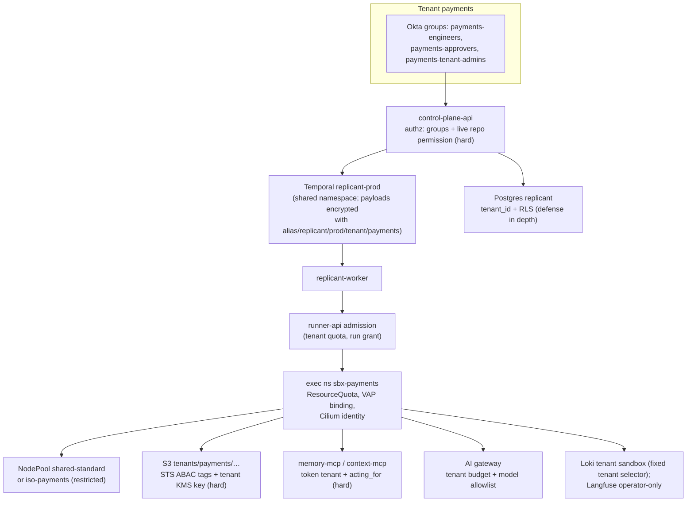

# Tenancy and Tenant Isolation

**Owner:** WS-09 · **Status:** fix round wave 3 · **Date:** 2026-10-24 · **Contracts:** C-ARCH 2.0.0, C-IDS 2.0.0, C-CRD 3.0.0, C-MSG 2.0.0, C-ART 2.0.0, C-PG 2.0.0
**Contracts consumed:** C-IDS (tenant_id, namespaces, labels, Loki/Prometheus keys), C-PG rule 4 (RLS),
C-ART (tenant-first layout, per-tenant KMS), C-CRD, ADR-013 (operational vs behavioral config),
OQ-00-08 (one Temporal namespace per environment).

## Purpose

How one tenant (a team or org with its own policy, quotas, and memory scope; 40 at the target
scale) is isolated from another at every layer, which layers are hard boundaries and which are
defense in depth, and how noisy neighbors are contained.

## Decisions summary

| # | Decision | Constraint | Reference |
|---|---|---|---|
| 1 | **Hard tenant boundaries** are: IAM/STS session scope and per-tenant KMS keys (S3, Temporal payloads), run-token verification at every service, Kubernetes namespace plus Cilium identity in the exec cluster, and authorization in control-plane-api. RLS, search-attribute filters, and label conventions are **defense in depth** | D-21 | §1 |
| 2 | **One Temporal namespace per environment** (confirming OQ-00-08). Tenant separation in Temporal is authorization in control-plane-api plus per-tenant payload encryption. Per-tenant namespaces are not needed for security because no tenant principal talks to Temporal directly | D-01 | §4 |
| 3 | **Tenant isolation classes** decide node pools: `standard` tenants share sandbox pools; `restricted` tenants get a dedicated **isolation group** (own Karpenter NodePool, taint, cache partition) | D-06, D-21 | §3.2 |
| 4 | Observability (aligned with WS-08, ADR-08-002/003, R2-009, queued tenancy item): Loki uses functional tenants (`platform`, `sandbox`, `audit`), Tempo one tenant; tenant users never get direct Loki, Tempo or Grafana access (Grafana OSS has no data-source permissions [verified: https://grafana.com/docs/grafana/latest/administration/data-source-management/, 2026-10-24]); control-plane-api builds every tenant log query server-side with a fixed `tenant` selector; restricted tenants get their own Loki tenant by an Alloy routing rule. Langfuse: one organization and project per environment, operator-only access; restricted tenants send no spans at all | D-17 | §8 |
| 5 | Tenant slugs are **not secret** but appear in many low-privilege places (labels, metric labels, S3 keys). Tenants whose name itself is sensitive get an opaque slug (`t-<6 chars>`) at creation | C-IDS risk | §2 |
| 6 | Noisy-neighbor controls: Runner admission with weighted fair queueing, namespace ResourceQuota, priority classes, gateway budgets, trigger rate limits, Loki/Tempo per-tenant limits | — | §11 |



---

## 1. Isolation matrix (every layer)

| Layer | Mechanism | Hard or defense in depth | Designed in | Failure if absent |
|---|---|---|---|---|
| Identity and authorization | Okta groups mapped to tenant roles (identity-service role bindings); every request checks the resource's tenant against the principal's bindings; repo actions additionally check live GitHub permission (D-18) | **Hard** | WS-07, this doc §9 | Cross-tenant reads and actions |
| Temporal | Single namespace; only Replicant services hold Temporal credentials (C-MSG §1); control-plane-api filters list/visibility queries by `ReplicantTenantId` from the caller's authorized tenants; payloads encrypted per tenant | Hard for payload confidentiality (keys); authorization is in control-plane-api | §4, [secrets.md](secrets.md) §6.2 | Operator or service bug exposes payloads |
| Exec cluster: Kubernetes | `sbx-<tenant>` namespaces; VAP binds AgentRun namespace to `spec.tenantId`; pods labelled with tenant, checked against namespace; ResourceQuota and LimitRange per namespace | **Hard** (admission) | [vap-agentrun-binding.yaml](policies/kubernetes/vap-agentrun-binding.yaml), [tenant-namespace.yaml](policies/kubernetes/tenant-namespace.yaml) | Run in the wrong tenant namespace |
| Exec cluster: compute | Isolation runtime per pod (VM boundary); isolation groups (dedicated NodePools) for restricted tenants | Hard (runtime); dedicated pools turn R-01 into a same-tenant risk | §3 | Escape reaches other tenants (R-01) |
| Network | Cilium identity per run; `sbx-no-east-west`; per-run egress allowlist | **Hard** | [ccnp-sandbox-baseline.yaml](policies/network/ccnp-sandbox-baseline.yaml) | Lateral movement |
| Object storage | Tenant-first keys; STS session with tags → resource ARNs; per-tenant KMS key with `aws:ResourceTag/replicant-tenant` match; presigned reads only after control-plane-api authorization | **Hard** | [sandbox-artifacts.permissions.json](policies/iam/sandbox-artifacts.permissions.json), [kms-key-policy.tenant.json](policies/iam/kms-key-policy.tenant.json) | Cross-tenant artifact access |
| Postgres | `tenant_id NOT NULL` + RLS keyed on `replicant.tenant_id` (transaction-local), `FORCE ROW LEVEL SECURITY`, fail-closed when unset; no login role has BYPASSRLS; cross-tenant reads go through policies targeting the marker role `r_cross_tenant_read` (WS-10) | Defense in depth (a compromised service can set the variable) | [roles-and-rls.sql](policies/postgres/roles-and-rls.sql) | App bug leaks rows |
| Memory | Scope hierarchy rooted at tenant (WS-04); memory MCP derives tenant from the token; org-scope entries only by admin promotion | Hard at MCP, plus RLS | WS-04 | Cross-tenant conventions or episodes leak |
| Context / code search | Repos filtered by tenant ∩ `acting_for` read permission | Hard at MCP (CCR-09-03) | [agent-capabilities.md](agent-capabilities.md) §4 | Code from other tenants or unreadable repos |
| repo-mirror | Token `repo_ids` ⊆ grant; cache partitioned per tenant isolation group directory | Hard | WS-02 | Cross-tenant code fetch |
| Registry and bundles | Tenant-scoped definitions (`metadata.scope.level=tenant`) usable only in that tenant's derived bundles (C-DEF); tenant admins edit only their layer | Hard (registry validation) | WS-03, WS-06 | One tenant's policy affects another |
| AI gateway | Per-tenant daily and monthly budgets; per-tenant model allowlist; attribution headers (`X-Replicant-Tenant-Id` informational, token authoritative) | Hard for budgets (gateway) | WS-03 | Denial of wallet across tenants |
| Observability | Functional Loki tenants with a server-built `tenant` selector for tenant users; Grafana and Langfuse operators-only; restricted tenants in their own Loki tenant; redaction first | Hard for tenant users (no direct access); operators see all | §8 | Log-based cross-tenant leakage |
| Notifications | Slack channel targets per tenant (operational config); messages contain links, not bodies | Defense in depth | WS-07 | Leaks into the wrong channel |
| GitHub | Installations and repo opt-in per tenant (`github_app.repos.tenant_id`); one repo belongs to exactly one tenant | Hard (intake check) | WS-07 | Job for a repo attributed to the wrong tenant |

## 2. Tenant identifiers and classes

`tenant_id` follows C-IDS. Tenants have an **isolation class** in `tenancy.tenants` (operational
config, ADR-013):

| Class | Who | Controls added beyond `standard` |
|---|---|---|
| `standard` | Most teams | — |
| `sensitive` | Teams whose code handles PII or money | First-seen package blocking (SC-36); publish gate mandatory for `high` and above; screenshots masked by default; transcripts retained 30 days (not 90) |
| `restricted` | Security tooling, identity, payments core, regulated scope | Dedicated isolation group (own NodePool, cache partition); opaque tenant slug if requested; publish gate mandatory for every job; no `additional_repos` from other tenants; no Langfuse ingestion at all (no spans: the core gateway drops them by `LANGFUSE_EXCLUDED_TENANTS_REGEX`, XD-FIX-R2-009) |

## 3. Exec cluster tenancy

### 3.1 Namespaces, quotas, priority

Per tenant: [tenant-namespace.yaml](policies/kubernetes/tenant-namespace.yaml) (namespace labels,
`sbx-runner` ServiceAccount without token, ResourceQuota, LimitRange, RoleBindings for the Runner and
controller). Priority classes (cluster-wide):

```yaml
apiVersion: scheduling.k8s.io/v1
kind: PriorityClass
metadata:
  name: replicant-run-urgent
value: 100000
preemptionPolicy: PreemptLowerPriority
description: "Hotfix runs. Capped at 4 pods per tenant by ResourceQuota scope."
---
apiVersion: scheduling.k8s.io/v1
kind: PriorityClass
metadata:
  name: replicant-run-high
value: 50000
preemptionPolicy: Never
description: "Interactive runs a human is waiting on (repair after review). Never preempts."
---
apiVersion: scheduling.k8s.io/v1
kind: PriorityClass
metadata:
  name: replicant-run-normal
value: 10000
preemptionPolicy: Never
---
apiVersion: scheduling.k8s.io/v1
kind: PriorityClass
metadata:
  name: replicant-run-low
value: 1000
preemptionPolicy: Never
description: "Maintenance sweeps and evals. Preemptible by urgent only."
```

Only `urgent` preempts, and the per-tenant urgent quota (4 pods) stops one tenant from using hotfix
priority to evict others at scale. Preempted runs fail with `Preempted` (retryable).

### 3.2 Isolation groups (node pools) — in v1 (R1-220)

**Decision: isolation groups ship in v1**, because they are the mitigation that SC-04, T-SBX-05 and
R-01 cite. Implementation (XD-FIX-R1-220 states what WS-02 adopts):

1. **Namespace label** `replicant.example.com/isolation-group` (`shared-standard` or `iso-<tenant>`)
   is set by onboarding ([tenant-namespace.yaml](policies/kubernetes/tenant-namespace.yaml)). It is
   never read from the RunSpec, so a caller cannot choose a group.
2. **Controller rule.** RuntimeClass scheduling stays the only source of runtime placement
   (`pool-runtime`). For namespaces whose label is not `shared-standard`, the controller adds exactly
   one `nodeSelector` entry `replicant.example.com/isolation-group: <group>` and one toleration
   `{key: replicant.example.com/isolation-group, operator: Equal, value: <group>, effect: NoSchedule}`.
   Shared namespaces get neither. The kubelet merges the RuntimeClass selector and the pod selector,
   so the pod must land on a node that is both Kata and in the group.
3. **Admission rule.** `replicant-sandbox-pod-shape` enforces the match both ways (isolated pods must
   select and tolerate exactly their group; shared pods may not select or tolerate any group)
   ([vap-sandbox-pods.yaml](policies/kubernetes/vap-sandbox-pods.yaml)).
4. **One NodePool per group and runtime** (R1V-058): `sbx-kata-iso-<tenant>` from WS-02's `sbx-kata`
   template and `sbx-gvisor-iso-<tenant>` from its `sbx-gvisor` template, each with the group label
   and taint added, so a gVisor run of an isolated tenant (runtime-selection, or an XD-FIX-R2-045
   runtime override) also finds a node in its group instead of staying Pending. A runtime with no
   pool for the group fails with C-CRD reason `RuntimeClassUnavailable`, never placed
   on a shared node. Both pools exist from onboarding; Karpenter scales each from zero, so an empty
   pool costs nothing. For the Kata pool, everything else (EC2NodeClass `sbx-kata`, startup taints, `pool-runtime` and `sandbox`
   labels, which the NRI plugin and the guestBlockDevice path need) is unchanged:

```yaml
apiVersion: karpenter.sh/v1
kind: NodePool
metadata:
  name: sbx-kata-iso-payments
spec:
  template:
    metadata:
      labels:
        replicant.example.com/pool-runtime: kata
        replicant.example.com/sandbox: "true"
        replicant.example.com/isolation-group: iso-payments
    spec:
      nodeClassRef: {group: karpenter.k8s.aws, kind: EC2NodeClass, name: sbx-kata}
      taints:
        - {key: replicant.example.com/sandbox, value: "true", effect: NoSchedule}
        - {key: replicant.example.com/isolation-group, value: iso-payments, effect: NoSchedule}
      startupTaints:
        - {key: node.cilium.io/agent-not-ready, value: "true", effect: NoExecute}
        - {key: replicant.example.com/workspace-nri-not-ready, value: "true", effect: NoSchedule}
        - {key: replicant.example.com/images-not-warm, value: "true", effect: NoSchedule}
      requirements:
        - {key: karpenter.k8s.aws/instance-family, operator: In, values: [m8id, c8id, r8id]}
        - {key: karpenter.k8s.aws/instance-size, operator: In, values: [16xlarge, 24xlarge]}
        - {key: karpenter.sh/capacity-type, operator: In, values: [on-demand]}
        - {key: kubernetes.io/arch, operator: In, values: [amd64]}
      expireAfter: 72h
      terminationGracePeriod: 9h
  disruption:
    consolidationPolicy: WhenEmpty
    consolidateAfter: 10m
  limits:
    cpu: "384"
```

**Node lifetime (R1-221).** All sandbox NodePools, shared and isolated, use `expireAfter: 72h` and
`terminationGracePeriod: 9h`, and the controller annotates sandbox pods
`karpenter.sh/do-not-disrupt: "true"`, so expiry waits for in-flight runs (maximum 8 h active plus
finalize) instead of evicting them. A node therefore lives at most about 81 h, which is the bound
SC-02 and T-SBX-11 rely on. WS-02's current 336 h is replaced (XD-FIX-R1-221). Drift from a patched
AMI replaces nodes regardless of expiry. `[unverified: Karpenter v1 handling of do-not-disrupt pods
during expiration with terminationGracePeriod; WS-02 confirms in its benchmark environment.
Fallback: expireAfter 24h with runs that exceed the remaining node lifetime scheduled elsewhere by a
node-age label the controller avoids]`.

### 3.3 Fair admission (noisy neighbor, SC-46)

runner-api admission (WS-02 implements) enforces, per tenant: maximum concurrent active runs
(`tenancy.tenants.quota.max_active_runs`, default 12), maximum queued runs (default 50), and
weighted fair queueing across tenants when the cluster is at capacity: a tenant's next run is
admitted when `active_runs(tenant) / weight(tenant)` is the minimum among tenants with queued
runs. Over-quota requests return `429 tenant_quota_exceeded` with `Retry-After` (C-RUNNER), and
the workflow shows `waiting_capacity`. ResourceQuota is the backstop if admission is bypassed.

### 3.4 Image admission

Both clusters run the Kyverno `ImageValidatingPolicy`
[ivp-replicant-images.yaml](policies/kubernetes/ivp-replicant-images.yaml) (policies.kyverno.io/v1,
stable as of Kyverno 1.19 [verified: https://kyverno.io/docs/policy-types/image-validating-policy/,
2026-10-24]); the deprecated `verifyImages` rule form is not used (XD-03-17). Every Replicant and
mirror image must carry a cosign signature from KMS key `alias/replicant/<env>/image-signing`
(ECC_NIST_P256, §6.1 of secrets.md). The policy holds the **public key as inline PEM**, rendered by
IaC, rather than a `kms://` reference, because AWS KMS URI support in the pinned Kyverno is
`[unverified]` (R2-042 fallback adopted as the primary). Rotation lists the old and new public keys
for 7 days. The VAP in [vap-sandbox-pods.yaml](policies/kubernetes/vap-sandbox-pods.yaml)
additionally requires the ECR `replicant/` or `mirror/` prefix and a digest. System namespaces
(`replicant-runner`, `replicant-mirror`, `replicant-egress`, `replicant-observability`) carry `replicant.example.com/zone: system` so the
IVP selects them.

### 3.5 Runtime detection on sandbox hosts

Tetragon (Cilium project) on sandbox nodes, alerting on the host-side processes that an escape uses:

```yaml
apiVersion: cilium.io/v1alpha1
kind: TracingPolicy
metadata:
  name: replicant-sandbox-host-escape-signals
spec:
  kprobes:
    - call: "security_bprm_check"
      syscall: false
      args:
        - index: 0
          type: "linux_binprm"
      selectors:
        - matchBinaries:
            - operator: "In"
              values:
                - "/opt/kata/bin/containerd-shim-kata-v2"
                - "/opt/kata/bin/cloud-hypervisor"
                - "/opt/kata/bin/firecracker"
                - "/opt/kata/libexec/virtiofsd"
                - "/usr/local/bin/runsc"
          matchActions:
            - action: Post
    - call: "security_file_permission"
      syscall: false
      args:
        - index: 0
          type: "file"
        - index: 1
          type: "int"
      selectors:
        - matchBinaries:
            - operator: "In"
              values:
                - "/opt/kata/libexec/virtiofsd"
          matchArgs:
            - index: 0
              operator: "NotPrefix"
              values:
                - "/run/kata-containers/shared/"
            - index: 1
              operator: "Equal"
              values:
                - "2"
          matchActions:
            - action: Post
```

Any exec of a new binary by a VMM/shim/virtiofsd process, and any virtiofsd write outside the
shared directory, is a P1 security event: the node is cordoned, and its runs are cancelled through runner-api with
`CancelRequest.reason: security` and `requested_by: svc_security-automation` (the issuer is the
security response automation, triggered by the Tetragon alert). The automation runs in the exec cluster as
ServiceAccount `replicant-security/security-automation` (R1V-059). runner-api accepts it on its
orchestration listener by ClusterIP, through the exec-issuer verifier, for
`POST /v1/runs/{run_id}:cancel` with `reason: security` and `GET /v1/runs/{run_id}` only
(02-execution/runner-service.md §1.1). Its RBAC is ClusterRole `replicant-security-automation`
(pods get/list/watch, nodes get/list/watch/patch), and the VAP
`replicant-security-automation-quarantine-only` limits node patches to cordoning and adding taints
([tenant-namespace.yaml](policies/kubernetes/tenant-namespace.yaml),
[vap-sandbox-pods.yaml](policies/kubernetes/vap-sandbox-pods.yaml),
[cnp-exec-system.yaml](policies/network/cnp-exec-system.yaml)). It has no cloud credentials. C-CRD maps that to
`Failed/SecurityViolation`, which is non-retryable, refuses token refresh at once, and puts the job
and run on the grant revocation list. Every terminal path under `cancelReason=security`, including a
node that is lost while cancelling, must derive `SecurityViolation`, never `NodeLost` (XD-FIX-R1-223,
with a CCR for the C-CRD diagram). The node is then replaced and kept for forensics (EBS
snapshot). `[unverified: TracingPolicy argument types and selector operators against the Tetragon
version WS-02 pins; WS-02 validates in kind]`. GuardDuty EKS Runtime Monitoring runs in both
clusters as a second signal `[unverified: GuardDuty runtime agent coverage on Kata hosts]`. Hubble
exports policy-deny flows from sandbox identities to Loki (`tenant` = the run's tenant).

## 4. Temporal

- One namespace per environment (OQ-00-08 accepted here). A per-tenant namespace would add 40×
  Worker Deployments and pollers and would not add a boundary: tenants never hold Temporal
  credentials; Replicant's own services act for every tenant either way.
- Tenant separation:
  1. control-plane-api is the only path from tenant users to Temporal; it authorizes per job
     (tenant binding plus repo permission) before Start, Update, Signal, Query, or visibility list,
     and adds `ReplicantTenantId IN (...)` to every visibility query it runs for a user.
  2. Payloads are encrypted per tenant ([secrets.md](secrets.md) §6.2). The Temporal UI, which is
     operators-only, can decode only tenants the operator is authorized for.
  3. The Authorizer ([authorizer.go](policies/temporal/authorizer.go)) restricts every Replicant
     identity to its APIs.
- Search attributes contain IDs and enums, never content (C-IDS §4.1), so visibility leaks nothing
  beyond job metadata to operators.
- Revisit per-tenant namespaces if a tenant requires a separate Temporal persistence store
  (regulatory) or separate retention.

## 5. Network

Covered by [agent-capabilities.md](agent-capabilities.md) §3 and the policies in
[policies/network/](policies/network/). Tenancy-specific points: Cilium identities include the
namespace, so `sbx-no-east-west` blocks cross-tenant and same-tenant run-to-run traffic alike;
repo-mirror authorizes per token, not per source IP.

## 6. Object storage

Covered by C-ART and [sandbox-artifacts.permissions.json](policies/iam/sandbox-artifacts.permissions.json).
Additional rule for core services: the shared `replicant-storage` package refuses to build a key
whose `tenants/<t>/` segment differs from the authorization context's tenant (a programmatic check
WS-10 implements), and every presign carries the tenant in its audit event.

## 7. Postgres

Pattern and session protocol in [roles-and-rls.sql](policies/postgres/roles-and-rls.sql). Every
schema owner applies `ENABLE`/`FORCE ROW LEVEL SECURITY` and the `tenant_isolation`
policy to every table with `tenant_id`. Exceptions (no RLS): `ops`, `registry` global definitions
(read by all), `identity.users` (principals are global; tenant role bindings carry `tenant_id` and
are RLS-protected). Cross-tenant operator views use WS-10's role-gated policies (`TO r_cross_tenant_read`, scope `operator:all-tenants`), so a GUC alone never widens visibility; every such query is audited.

## 8. Observability tenancy

Aligned with WS-08 (ADR-08-002, ADR-08-003, OQ-08-01; R2-009 decided by WS-08). WS-09 drops its
earlier per-tenant Loki org IDs and per-tenant Langfuse organizations, and accepts WS-08's model on
two conditions that WS-08 has made explicit and enforced:

| System | Tenancy | Who can read | Condition WS-09 requires |
|---|---|---|---|
| Loki | `auth_enabled: true` with functional tenants `platform`, `sandbox`, `audit`; the `tenant` label on every stream; sandbox streams of `restricted` tenants routed to Loki tenant `sandbox-<tenant_id>` by WS-08's node-logs.alloy rule (`LOKI_RESTRICTED_TENANTS_REGEX` from ConfigMap `observability-tenant-classes`, tested in `config/alloy/tests/test_node_logs.py`; ADR-08-002, R1V-052); their platform-service lines stay in `platform`; per-class retention by `retention_stream` on the `tenant` label [verified: multi-tenancy via `X-Scope-OrgID`, https://grafana.com/docs/loki/latest/operations/multi-tenancy/, 2026-10-24] | Operators through the operator Grafana org; tenant users only through control-plane-api `/v1/jobs/{id}/logs` | (1) No tenant user can reach Loki, Tempo or the operator Grafana org (Okta org mapping plus network policy on the query frontends). (2) control-plane-api builds every tenant log query itself with a fixed `{tenant="<t>"}` selector; no user-supplied LogQL; property-tested (WS-08 telemetry-model §6) |
| Tempo, Mimir | Single tenant `replicant` | Operators | As (1) |
| Grafana OSS | Operator org only; data-source permissions are Enterprise-only, so no tenant-scoped Grafana | `replicant-operators` | As (1) |
| Langfuse OSS | One organization `replicant` and one project `replicant-<env>` per environment; tenant attribution by `replicant.tenant_id` metadata and `tenant:<id>` tags; operator-only access; a nightly access reconciler removes non-operators | Operators | Restricted tenants send **no spans** to Langfuse (ConfigMap `observability-tenant-classes` key `langfuse_excluded_tenants_regex`, rendered from tenant classes); their LLM view renders from the S3 transcript (XD-FIX-R2-009) |
| Prometheus labels | `tenant` label (C-IDS §11) | Operators | — |

Langfuse OSS lacks Enterprise data-retention management and audit logs [verified:
https://langfuse.com/pricing-self-host, 2026-10-24]; WS-08 runs the retention sweeper (CronJob `langfuse-retention-sweeper`, daily, 90 days for every
tenant, `DELETE /api/public/traces` in batches of 30, ≤ 2 req/s, XD-FIX-R1-193; the API allows at most 50 IDs per call [verified:
https://langfuse.com/docs/administration/data-deletion and https://langfuse.com/faq/all/api-limits,
2026-10-24]).

## 9. Roles, Okta groups, separation of duties

| Okta group (pattern) | Replicant role | Can | Cannot |
|---|---|---|---|
| `<tenant>-engineers` | requester | trigger, steer, cancel own jobs, take over own jobs, view tenant jobs (repo permission applies) | approve own high-risk jobs (V9), anything in other tenants |
| `<tenant>-approvers` | approver | decide gates on tenant jobs (with repo write permission) | approve where they are the requester when policy forbids |
| `<tenant>-tenant-admins` | tenant admin | edit the tenant layer (policies), quotas within platform caps, Slack targets | memory management (D-25), other tenants, platform settings |
| `replicant-admins` | Replicant admin | memory management (D-25) | release promotion, break-glass approvals (separation of duties) |
| `replicant-operators` | platform operator | releases, ramps, cross-tenant views (audited), Temporal UI | memory management unless also admin; approving tenant gates |
| `replicant-release-approvers` | second person for promotion | approve prod bundle promotions and gate-relaxing policy changes | promote their own change |
| `replicant-dba-approvers` | break-glass second approver | approve `bg_write` | use break-glass on their own approval |
| `replicant-legal` | legal (counsel) | owns role `replicant-<env>-legal-hold` (places and releases legal holds on `audit` and the legal bucket); is notified of legal-hold escalations from `LeakPurge` (XD-W2-08-04, `security.leak_purge_blocked` follow-up gate) | approve the follow-up `leak_purge` gate (notified, not eligible); read tenant data outside the legal bucket |
| `replicant-security` | security | read all audit, Hubble, Tetragon; quarantine nodes; kill switches | modify memory, approve gates |

Separation of duties (SC-44): identity-service rejects role bindings that put one person in both
`replicant-operators` and `replicant-release-approvers` for the same promotion (the approver must differ
from the promoter), and in both `replicant-admins` and `replicant-release-approvers` `[policy, not a
technical impossibility: Okta admins can still create overlaps; a nightly check alerts]`.

## 10. Onboarding and offboarding

**Onboarding** (control-plane-api admin operation `POST /v1/admin/tenants`, audited): create
`tenancy.tenants` row → create KMS key `alias/replicant/<env>/tenant/<t>` with the tenant policy
template (multi-Region primary in us-east-1 plus replica in us-west-2, XD-10-09) → create `sbx-<t>` namespace bundle (labels per tenant-namespace.yaml) → Loki retention and routing rules → gateway budget
→ Okta group mapping → GitHub installation and repo opt-in (each repo bound to exactly one tenant).

**Offboarding** (two-person, SC-42): disable intake (kill switch) → cancel open jobs → export
(tenant-requested, through the admin API, to a tenant-owned bucket) → delete memory entries
(WS-04 tombstones) → set `tenant-ready=false` then delete `sbx-<t>` namespace (the namespace controller
may delete sandbox children, R1-219) → Loki deletion request on `{tenant="<t>"}` → Langfuse trace
deletion for the tenant's job IDs → `ScheduleKeyDeletion` (30 days) on the **us-west-2 replica key
first**, then on the us-east-1 primary. Only when both are gone are all S3 objects encrypted under
the key unreadable, including versions and DR replicas; deleting only the primary leaves the replica
able to decrypt replicated data (R1-218) → tombstone the
tenant row (never reuse the slug). Postgres rows: deleted by each owner's data migration keyed on
`tenant_id`, except `audit` (retained 7 years under its own key, `audit` platform key).

## 11. Noisy-neighbor controls (summary)

| Resource | Control | Limit (default; operational config) |
|---|---|---|
| Sandbox concurrency | Runner admission + ResourceQuota | 12 active runs per tenant, 24 pods hard cap |
| Sandbox CPU/memory/disk | ResourceQuota, LimitRange, hard workspace limit (ADR-014) | per profile |
| Preemption | Only `urgent` preempts; 4 urgent pods per tenant | — |
| Model spend | Gateway budgets per run, job, tenant per day | tenant daily budget from `budgets` policy |
| Triggers | Rate limits per principal (20 jobs/h), per repo (30 jobs/h), per tenant (200 jobs/h) | — |
| Repair loops | `repair_limits` policy | 5 cycles per job |
| Logs/traces | Loki per-tenant ingestion rate and streams; Tempo per-tenant ingestion | 10 MB/s per tenant (Loki `ingestion_rate_mb`) |
| Temporal | Frontend namespace RPS; per-identity rate limits in the Authorizer path | WS-01 |
| Package mirror | Per-run miss rate limit | 50/min |

## Open questions

| Question | Who decides | Options | Recommendation |
|---|---|---|---|
| Which tenants are `restricted` at launch? | Security leadership + tenant owners | — | Payments core, identity, security tooling |
| Do engineers get direct Langfuse access? | WS-08 (decided) | none / per-tenant org viewer | Operators only (ADR-08-003); WS-09 agrees |
| Per-tenant Loki retention for transcripts-derived logs | WS-08 | uniform 90 d / per class | Per class via `retention_stream` on the `tenant` label (30 d for `sensitive` and `restricted`) |

## Risks

- RLS is only as good as the session-variable discipline in `replicant-db`; a code path that runs
  queries outside the transaction helper fails closed (no rows), which surfaces as a bug, not a leak.
- Dedicated isolation groups cost idle capacity; Karpenter scale-to-zero (`WhenEmpty`) keeps it
  small, at the price of cold starts against the 90-second p95 sandbox-ready target for restricted
  tenants (WS-02 measures).

## Interfaces

- **Provided:** isolation classes, isolation groups, namespace bundle, priority classes, fair
  admission rule, observability tenancy scheme, Okta group model, onboarding/offboarding procedure.
- **Consumed:** C-IDS (tenant_id, namespaces, labels), C-PG rule 4, C-ART, C-CRD, ADR-013, OQ-00-08.
