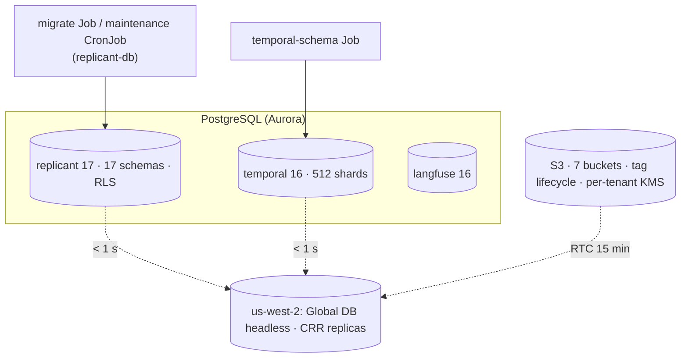

# 10 · Data Platform (WS-10)

**Stores:** Replicant Postgres, Temporal persistence, Langfuse Postgres, object storage, backup/DR, data lifecycle
**Constraints:** D-08, D-09, D-22, D-26, D-01 · **Contracts implemented:** C-PG 2.0.0, C-ART 2.0.0, C-STATE 2.0.0, C-MSG 2.0.0, C-IDS 2.0.0, C-ARCH 2.0.0, contract ADR-003

## Purpose

This section designs and validates every store that holds durable Replicant state, and how each one is
created, changed, secured, backed up, restored, and expired without anyone opening a database connection
(D-26).

## Decisions summary

| Decision | Reference |
|---|---|
| Aurora PostgreSQL for all three instances: `replicant` 17.11 (pgvector 0.8.2), `temporal` 16.15 (I/O-Optimized), `langfuse` 16 provisioned (2 × `db.r8g.large`, DBs `langfuse` + `grafana`; R1-235). CloudNativePG and RDS were rejected, with evidence | [adr/001](adr/001-replicant-postgres-hosting-aurora.md) |
| Temporal: self-hosted 1.32.1, PostgreSQL persistence plus SQL visibility (finalizes contract ADR-003) | [adr/002](adr/002-temporal-self-hosted-final.md) |
| **512 history shards** | [adr/003](adr/003-temporal-history-shards.md) |
| No connection pooler in v1. RDS Proxy pins on `set_config`. Direct IAM-authenticated, budgeted connections | [adr/004](adr/004-connection-pooling-direct-iam.md) |
| One linear Alembic history | [adr/005](adr/005-single-linear-alembic-history.md) |
| Migrations run as an Argo CD PreSync Job | [adr/006](adr/006-migrations-argocd-presync.md) |
| **Challenge: D-08**: MinIO community edition is archived. Resolved by the orchestrator's amendment (SeaweedFS, CCR-11-02) | [adr/007](adr/007-challenge-d08-minio-community-archived.md) |
| DR is warm data, pilot-light compute (Global Database headless secondaries, CRR + RTC) | [adr/008](adr/008-disaster-recovery-strategy.md) |
| Audit bucket Object Lock **COMPLIANCE, 730 days** (after a 30-day staging trial at 1 day). No role holds `s3:BypassGovernanceRetention` anywhere. Legal holds only by `replicant-<env>-legal-hold`; purgeable content is preserved in a separate legal bucket, never in `audit` (CCR-10-10). Revised in wave 1 (R2-005) | [adr/009](adr/009-audit-object-lock-governance.md) |
| **Leak purge** (R1-232): role `replicant-leak-purge` deletes versions only in `artifacts`, `transcripts`, `session` (and their DR replicas and the legal bucket), writes the superseding `<key>.p<n>` object write-once first, records a deletion-ledger entry, and never touches `audit`. A legal hold blocks it, and the block escalates to a `leak_purge` gate | [lifecycle.md §6](lifecycle.md), [object-storage.md §4](object-storage.md), [config/iam/leak-purge.json](config/iam/leak-purge.json) |
| **Grant model v2** (R1-160, XD-ORCH-03): owners' DDL is the only source of table privileges, so their narrowing survives. WS-10 creates roles, logins, `USAGE`, markers; no default privileges outside `ops`. `check_grants.py` proves it with narrowing probes | [postgres.md §3](postgres.md#3-roles-and-least-privilege) |
| **Partition isolation** (XD-ORCH-04): maintenance runs `ops.secure_partition` on every new partition and sweeps all leaf partitions (RLS enabled and forced, canonical tenant policy, every non-owner privilege revoked), so a partition can never be read directly across tenants. `check_partitions.py` proves it, with a negative control | [postgres.md §6](postgres.md#6-partitioning) |
| **eval-worker cross-tenant reads** (CCR-06-15 ruling): five audited `SECURITY DEFINER` functions `ops.eval_*`, IDs/status/metrics/digests only, `system:all-tenants` pinned per call, one `audit.emit` event per call; no direct schema access | [postgres.md §3.2a](postgres.md), [ddl/40-eval-metrics-reader.sql](ddl/40-eval-metrics-reader.sql) |
| **`ops` and legal buckets** generated: `ops` with three writers (control-plane-api and `replicant-<env>-killswitch-operator` on the kill-switch mirror, runner-api on `exec-revocations/<env>/` with 90-day expiry); legal bucket with holds, write-once, leak-purge deletes of unheld versions only. KMS keys WS-10 creates are listed in `config/kms/keys.json` | [object-storage.md §9a](object-storage.md) |
| No job fails because of a restore: retry exhaustion goes to WS-01's `blocked_on_dependency` pause (R2-010). Lost audit events are replayed through `audit.emit` (restore form) | [recovery.md §4.2](recovery.md) |
| Observability stores (R1-235): eight `obs-*` buckets, Langfuse on Aurora PG 16 | [object-storage.md §10](object-storage.md) |

## Documents

| File | Contents |
|---|---|
| [postgres.md](postgres.md) | Instances, roles and grants matrix, RLS, connection budget, partitioning, pgvector maintenance, sizing, operating without connections |
| [schema-management.md](schema-management.md) | `replicant-db` package, Alembic, CI gates, migrate Job, compatibility check, contract gate, worked expand → migrate → contract example, admin CLI, break-glass runbook, Temporal and Langfuse schema upgrades, **canonical RLS vocabulary (G-04)** |
| [temporal-persistence.md](temporal-persistence.md) | Hosting, persistence and visibility, IAM via `passwordCommand`, shards, sizing, upgrades, staging soak |
| [object-storage.md](object-storage.md) | Buckets, KMS (quarantine key), lifecycle rules, bucket and identity policies, multipart-safe conditions, presign, storage audit, replication, SeaweedFS parity |
| [recovery.md](recovery.md) | RPO/RTO per store, backups, restore and reconcile machinery, runbooks (Replicant DB, memory, Temporal, region, registry), drills |
| [lifecycle.md](lifecycle.md) | Retention across all stores, Policy `retention`, offboarding, secret purge, deletion ledger, propagation to derived data |
| [capacity-and-cost.md](capacity-and-cost.md) | Volume model and monthly cost per store |
| [ddl/INDEX.md](ddl/INDEX.md) | **Consolidated DDL index** for all 17 schemas, apply order, cross-workstream findings |
| `ddl/` | `00-bootstrap.sql`, `10-roles-and-grants.sql`, `20-ops.sql`, `30-temporal-langfuse-bootstrap.sql` |
| `code/replicant_db/` | `naming.py`, `session.py`, `revision.py`, `cli.py`, `maintenance.py`, `models/ops.py`, `migrations/env.py`, `script.py.mako`, `versions/202610240001_ops.py`; `code/.squawk.toml` |
| `config/` | `s3/{prod,local}/*.json` (generated), `iam/*.json`, `kms/*.json`, `rds/*.json`, `k8s/*.yaml`, `temporal/*.yaml`, `compose/postgres-init/` |
| `schemas/`, `examples/` | Policy `retention` kind schema, deletion ledger schema, examples |
| `tools/` | `validate.sh`, `apply_owner_ddl.sh`, `check_grants.py`, `check_rls.py`, `check_partitions.py`, `lint_migrations.py`, `spec_ddl_equivalence.py`, `gen_s3_config.py`, `validate_s3_config.py`, `gen_retention_schema.py`, `cost_model.py` |

## Other stores WS-10 provisions (answers XD-03-15, XD-06-14, XD-04-11)

| Store | Decision | Recovery |
|---|---|---|
| Valkey `gateway-state` (WS-03's gateway shim; C-STATE 1.2.0) | Amazon ElastiCache for Valkey, node-based, cluster mode disabled, 1 primary + 1 replica across AZs, Multi-AZ automatic failover, `cache.r7g.large`, in-transit and at-rest encryption, AUTH through IAM, in the core VPC, reachable only from the `replicant-gateway` namespace's security group. **No snapshots**: the state is ephemeral and rebuilt from `cost` (C-STATE) `[unverified: current ElastiCache Valkey major version and IAM-auth support; WS-10 confirms at provisioning; fallback: self-managed Valkey StatefulSet]` | recovery.md §1 (shim reseeds from usage-ingestor, fails closed meanwhile) |
| ECR repositories `replicant/*`, `replicant/cli-*`, `replicant/env-*`, `replicant/base-*`, pull-through cache `mirror/*` | tag immutability on, scan on push, KMS encryption (`alias/replicant/<env>/ecr`), replication to us-west-2 (DR), lifecycle [config/ecr/lifecycle-policy.json](config/ecr/lifecycle-policy.json) (request shape validated with botocore): `bundle-ref*`-tagged images are never expired, untagged after 14 days, everything else after 180 days. Tags are applied by the registry/`svc_release-controller` (`bundle-ref-<…>`) and removed by `sys:retention-sweeper` with tag-only `BatchDeleteImage` ([config/iam/retention-sweeper.ecr.json](config/iam/retention-sweeper.ecr.json)); the rule matches the `bundle-ref-` prefix, so it holds for either tag body (orchestrator ruling on XD-W2-10-05: `bundle-ref-<first 20 chars of the rb_ body>`, one tag per referencing bundle; an image shared by several bundles carries several tags, and any one `bundle-ref-` tag keeps it). A higher-priority rule shields matching images from lower-priority expiry ("An image that matches the tagging requirements of a rule cannot be expired or archived by a rule with a lower priority"; `tagPrefixList` matches if any of the image's tags has the prefix) [verified: https://docs.aws.amazon.com/AmazonECR/latest/userguide/LifecyclePolicies.html, 2026-10-24]. Rule 1 expires only beyond 9,999 tagged images per repository, which no repository approaches | images are rebuildable from git; bundle-referenced digests are replicated |
| PostgreSQL TOAST compression (WS-04 asks for lz4) | `ALTER TABLE … ALTER COLUMN … SET COMPRESSION lz4` in WS-04 revisions on large `jsonb`/`text` columns. Aurora PostgreSQL 17 lz4 availability `[unverified]`. CI applies the revision on the prod-matching image, and the fallback is the default `pglz` (drop the clause) | — |

## Must-answers

| Question | Answer |
|---|---|
| After restoring the Replicant DB to 15 minutes ago, what is inconsistent and how is it repaired? | Temporal, S3, etcd, and external systems are untouched. In-flight jobs keep running. Jobs do not fail: an activity that outlasts its retries pauses in WS-01's `blocked_on_dependency` hold until the database is back. Every schema's last 15 minutes is lost, and each has a named authoritative source and an owner-executed, idempotent repair, run in a fixed order behind a write freeze (ConfigMap `replicant-maintenance`): revocation list first, then schema, audit (from the 1-min S3 export, replayed **through `audit.emit`** with original IDs under `r_audit_restore`), identity (Okta resync), tenancy (audited tightening changes), intake (from Temporal start inputs, **before** reopening, so dedupe holds), registry (from S3 version index and blobs), memory (from snapshot exports), cost (automatic cursor replay), projections (rebuild), evals, integrations, and finally deletion-ledger replay. Each step is a named endpoint (recovery.md §4.3 table; WS-07 shapes in XD-FIX-R1-237). [recovery.md §4.2](recovery.md#42-must-answer-after-restoring-the-replicant-db-to-15-minutes-ago-what-is-inconsistent-and-how-is-it-repaired) |
| How many Temporal history shards, and why? | **512.** The count is immutable. Temporal calls 512 the small-production default and says large clusters rarely exceed 4,096. At 10× today's peak each shard sees about 10 events/s and fewer than 1,000 retained executions, so database capacity, not shards, binds for at least 50× growth. Three history pods hold about 170 shards each. [adr/003](adr/003-temporal-history-shards.md) |
| Monthly storage cost per store at the assumed scale? | S3 + KMS ≈ **$736/month** at steady state (audit now holds about 168 GB: history skeletons and r7y exports, priced at the 7-year class; artifacts about 8.8 TB including the full history exports). Postgres storage + I/O + backups ≈ **$0.69k/month**, or ≈ **$3.75k/month** including instances (Langfuse Aurora PG 16, 2 × `db.r8g.large`) and DR. Sensitivity: 300 jobs/day → $598 / $3,608; 4,000 → $5,676 / $8,955. [capacity-and-cost.md](capacity-and-cost.md) |

## Validation performed (2026-10-24, final integration gate, `STRICT=1`)

`tools/validate.sh` passes end to end on PostgreSQL 17 + pgvector **0.8.2** (`pgvector/pgvector:0.8.2-pg17-bookworm`,
the prod version, XD-FIX-R1-260). Each run uses its own container, port, and temp dir, so workstreams can run it
concurrently. `KEEP=1` keeps the container. Results against every owner's wave-2 DDL:

- bootstrap under real privileges, fresh migrate, noop rerun, downgrade to base and re-upgrade, `alembic check`,
  offline render plus squawk, compatibility self-test, migration lint, spec DDL ≡ migrations (182 facts);
- **all 17 owner DDL files apply**;
- partitions (`check_partitions.py`): the negative control finds 7 direct cross-tenant reads; after maintenance,
  all 39 leaf partitions are isolated;
- eval-worker reads (`test_eval_reader.sh`, 11 checks): both tenants through the functions, no free text, direct
  reads denied, window cap, scope restored, other logins denied, one audit event per call;
- audit-exporter reads (`test_audit_exporter_reads.sh`, 6 checks): `packet_key`, `memory_refs`, `text_key`,
  `text_sha256` for both tenants under `system:all-tenants`, nothing under other scopes, no writes;
- **`check_grants.py`: grants OK** (memberships, C-PG legality, narrowing probes, `eval_metrics_reader` column
  allowlist, `audit.emit` executable through `r_audit_emit`, marker roles with no table or column privileges,
  audit-exporter column probe);
- **`check_rls.py`: 0** tenant tables without RLS, **0** without FORCE;
- generated S3 configs, 84 prod and 25 local files, validate against botocore's model.

Separately: parliament on 36 IAM, bucket, and endpoint policies. Its only notices are for `kms:ResourceAliases`,
which exists (verified) but is missing from parliament's database. Also: KMS `CreateKey` inputs validated
with botocore (5 keys), kubeconform strict on Kubernetes 1.34 (7 of 7 valid), YAML/JSON parse of 136 files, and
mermaid-cli 11.4.2 on all 12 diagrams (12 render).

## Open questions (top)

See each document. Coordination entries are tagged WS-10 in `spec/_coordination/`.

## Risks (top)

1. Temporal on Aurora is outside Temporal's tested matrix. A staging soak gates it, with an RDS fallback.
2. The restore reconcile depends on admin endpoints in WS-03/04/06/07/08 (XD-10-*, XD-FIX-R1-237).
4. Grant model v2 moves table grants entirely into owners' DDL. Until the XD-FIX-R1-160 owner items land (wave 2), `check_grants.py` reports their grants as violations (ddl/INDEX.md §5).
3. WS-09's current bucket and sandbox policies would break multipart and tagged uploads (XD-10-08,
   CCR-10-02/03).

## Interfaces

- **Provided:** replicant-db (session protocol, compatibility check, migrate/maintenance CLI), database
  roles and RLS, S3 configuration, restore and reconcile procedures, the `retention` Policy kind,
  deletion ledger.
- **Consumed:** C-PG, C-ART, C-STATE, C-IDS, C-DEF, C-RUNNER, and every owner's DDL.
