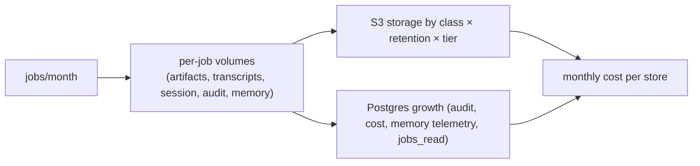

# Capacity and Cost

**Section:** WS-10 · **Answers:** "What is the monthly storage cost estimate per store at the assumed scale?"

## Purpose

This document estimates the stored volume and monthly cost of every store WS-10 operates, at the shared
context scale (300 jobs/day steady, 1,000 at peak, 2-year diff and 90-day transcript retention). It shows
where cost moves with scale. All numbers come from [tools/cost_model.py](tools/cost_model.py), where every
assumption is a named constant to be replaced by measured baselines after the first month of staging load.

## Decisions summary

| Decision | Reference |
|---|---|
| Model at **400 jobs/day average** (steady 300 plus peak days) = 12,000 jobs/month | shared context §2 |
| Prices: us-east-1 on-demand from the AWS Price List API (S3 file published 2026-10-15, RDS 2026-10-20, KMS 2026-09-11) [verified 2026-10-24] | verification-log WS-10 |
| Lifecycle tiering (IA at 30 d, Glacier IR at 120 d for r2y) and DR replicas in Standard-IA are included | object-storage.md §3, §7 |

## 1. Volume assumptions (per job; replace with measured baselines)

| Item | Assumption | Basis |
|---|---|---|
| Runs per job | 5 (planner, implementer, QA, reviewer, ~1 repair) | C-ARCH §5 |
| QA runs per job | 1.5 | repair cycles |
| Artifacts r2y | ≈ 6.8 MB (diffs 2 × 1 MB, plan/handoff/results 1 MB, QA report and SBOM) | C-ART §4 |
| Artifacts r1y | ≈ 19.5 MB (JUnit, 40 screenshots × 300 KB per QA run) | |
| Artifacts r90d | ≈ 86 MB (build/health logs, Playwright traces, inputs/briefings) | |
| Transcripts (zstd) | ≈ 125 MB (25 MB per run) | |
| Session state | 90 MB alive about 10 days; takeovers 1% × 3 GB, 30 days | |
| Objects written | ≈ 800 per job (30-s transcript chunks dominate) | C-ART §5 |
| Eval outputs | 30 suites/month × 150 cases × 60 MB (r1y); goldens 300 × 500 MB | WS-06 to confirm |
| Workflow history | full export ≈ 4 MB/job in `artifacts` (r2y); payload-free skeleton ≈ 0.25 MB/job in `audit` (r2y; r7y by tenant policy) | C-ART 1.9.0 (R2-005), WS-08 exporter |
| Org-level audit exports (r7y) | event export 0.25 GB/month, partition export 0.5, Okta System Log 0.3, ledger and purge records 0.01 | ≈ 80k audit events/day; 2,000 users |

## 2. Estimate at 12,000 jobs/month

### Object storage

| Store | Stored GB (steady state) | USD / month | Notes |
|---|---:|---:|---|
| S3 artifacts | 8,811 | 131 | incl. workflow_history_export (~4 MB/job); r2y→IA@30d→GIR@120d; r1y→IA@30d; r90d Standard |
| S3 transcripts | 4,395 | 70 | r90d, IA@30d |
| S3 session | 703 | 16 | job end+7 d (sweeper), takeover r30d |
| S3 audit (Object Lock, compliance) | 168 | 1 | approval records + history skeletons (r2y); event/partition/Okta exports, ledger (r7y); GIR@90d |
| S3 memory | 56 | 1 |  |
| S3 eval | 3,390 | 45 | WS-06 volumes assumed |
| S3 registry | 5 | 0 | perm, tiny |
| S3 requests + transitions | 0 | 57 | PUT/GET/lifecycle transitions |
| S3 DR replicas (us-west-2, IA) | 16,824 | 319 | CRR+RTC of all classes except session |
| KMS (tenant + platform keys, DR replicas) | 0 | 95 | Bucket Keys keep requests low |

**S3 + KMS total: $736/month**

Not in the table because they are negligible: the `ops` bucket (kill-switch mirror of a few KiB plus the
hourly revocation feed, under 1 GB at 90-day expiry) and the `legal` bucket (empty until a litigation hold; each
hold copies named job prefixes, sized per matter). The `obs-*` buckets are costed by WS-08 (platform.md §4).

### PostgreSQL

| Store | Stored GB (steady state) | USD / month | Notes |
|---|---:|---:|---|
| Aurora Replicant (PG 17, 2 × r8g.2xlarge, Standard) | 400 | 1,811 | instances included |
|   of which storage + I/O + backup | 400 | 199 |  |
| Aurora Replicant Global DB headless secondary (us-west-2) | 400 | 118 | storage + replicated writes, no instances |
| Aurora temporal (PG 16, 2 × r8g.xlarge, I/O-Optimized) | 150 | 1,083 | I/O-heavy: see temporal-persistence.md §5 |
|   of which storage + backup | 150 | 35 |  |
| Aurora temporal Global DB headless secondary | 150 | 294 |  |
| Aurora langfuse (PG 16, 2 × r8g.large; databases langfuse + grafana) | 30 | 447 | R1-235: settled with WS-08 (PG 16) |

**PostgreSQL total (instances + storage + DR): $3,753/month**

**Answer (corrected in wave 1, R1-239).** Storage-related spend is about **$0.74k/month for S3 + KMS** (≈ 34 TB
stored including DR replicas). Per store:

| Store | Stored | USD/month | What it holds |
|---|---:|---:|---|
| artifacts | 8.8 TB | ≈ 131 | includes `workflow_history_export` (≈ 4 MB/job, about 1.1 TB at steady state; C-ART 1.9.0 moved it here from `audit`) and `approval_text` |
| transcripts | 4.4 TB | ≈ 70 | r90d |
| eval | 3.4 TB | ≈ 45 | WS-06 volumes assumed |
| session | 0.7 TB | ≈ 16 | job end + 7 d |
| audit (compliance) | 168 GB | ≈ 1 | approval records (reference-only) and `workflow_history_skeleton` (r2y, about 58 GB), plus 84 months of r7y exports: `audit_event_export`, `audit_partition_export`, `okta_system_log_export`, ledger and purge records (≈ 1.06 GB/month written, ≈ 89 GB at steady state). Twice the earlier figure, and mostly in Glacier IR after 90 days |
| memory, registry | 61 GB | ≈ 1 | |
| requests + transitions | — | ≈ 57 | |
| DR replicas (us-west-2) | 16.8 TB | ≈ 319 | all classes except `session` |
| KMS | — | ≈ 95 | |

The earlier "order of magnitude" gap was the full history export. The audit bucket now holds only the
payload-free skeleton, and the full export is counted under `artifacts`.

**PostgreSQL storage + I/O + backups ≈ $0.69k/month**: Replicant ≈ $199, Replicant DR headless ≈ $118, temporal ≈
$35, temporal DR headless ≈ $294, langfuse ≈ $47 (storage, I/O, backup). That is **≈ $3.75k/month** including
instances. The langfuse instance is now Aurora PostgreSQL 16, 2 × `db.r8g.large` (R1-235, settled with WS-08:
PG 16, also hosting database `grafana`), so the earlier "≈ $10" vs "$42" inconsistency is gone. Every figure
here is generated by `tools/cost_model.py`.

Not included (owned elsewhere): Langfuse ClickHouse volumes (WS-08), the observability buckets'
contents (WS-08: Loki/Tempo/Mimir 30-day retention, ≈ 2–4 TB), and EKS control planes (2 × $0.10/h ≈ $146/month
[verified: https://aws.amazon.com/eks/pricing/, 2026-10-24]).

## 3. Sensitivity

| Jobs/day (average) | S3 + KMS / month | PostgreSQL (all, incl. instances and DR) / month | What changes the design |
|---|---:|---:|---|
| 300 | $598 | $3,608 | — |
| 400 (baseline) | $736 | $3,753 | — |
| 1,000 (peak as average) | $1,559 | $4,620 | none |
| 4,000 (10× steady) | $5,676 | $8,955 | Replicant writer to `db.r8g.4xlarge`; PgBouncer threshold (ADR-WS10-004) approaches; consider Intelligent-Tiering for transcripts |

The biggest lever is transcript and trace volume per run. A 2× change in CLI transcript size moves S3 cost
by about 25%. The biggest Postgres lever is instance size, not storage.

### 3.1 Repository scale (R1V-006)

Repository count drives a different set of WS-10 stores than job count. Assumptions, not measurements:
about 2,000 `ecosystem` rows per repository (services, edges, call sites, contract elements) at about
300 bytes each including indexes, and one maintenance fan-out child job per repository per campaign, sized
like an ordinary job (§1: about 240 MB written, most of it r90d logs and transcripts). Maintenance
children are usually smaller, so this is an upper bound.

| Repositories | `ecosystem` + `github_app` rows | PostgreSQL storage | Written per maintenance campaign (S3, ≈ 240 MB per child job, §1) | What changes the design |
|---:|---:|---:|---:|---|
| 1,500 (the former C-JOBREQ `max_repos`) | ≈ 3 M | ≈ 0.9 GB | ≈ 360 GB | none |
| 4,000 | ≈ 8 M | ≈ 2.4 GB | ≈ 960 GB | above 2,000 repositories the batch fans out through `MaintenanceShard` children of ≤ 2,000 repositories each (XD-W3-R1V-006); the repo list lives in S3 (`children_index_uri`), not in history; no WS-10 change |
| 15,000 (10×; C-JOBREQ 2.0.0 `max_repos` maximum) | ≈ 30 M | ≈ 9 GB | ≈ 3.6 TB | still inside the `replicant` writer's headroom. `ecosystem.edges` and `call_sites` become candidates for partitioning by `repo_id` hash (WS-04 decides). A 15,000-repository campaign is about 1.25 months of today's job volume in S3, so campaigns are rate-limited by the Runner quota, not by storage |

C-JOBREQ 2.0.0 raises `max_repos` to 15,000 and C-ARCH 2.0.0 §4.1 records each frozen limit's 10× value and
change path (XD-W3-R1V-006). `ref_list` stays at 500 (refs scale with definitions). The repo-mirror and Zoekt
shard counts are WS-02's and WS-04's. WS-10's stores scale linearly and need no redesign up to 10×; the
`children_index_uri` repo list per batch is an `artifacts` object of ≈ 1–2 MB at 15,000 repositories.

## Open questions

| Question | Who decides | Options | Recommendation |
|---|---|---|---|
| Real per-run transcript and trace sizes | WS-03 / WS-05 measurements | — | Replace the constants after two weeks of staging traffic |
| Reserved instances / Savings Plans for Aurora | FinOps | on-demand / 1-year RI | 1-year RIs for `replicant` and `temporal` writers and readers after 3 months of stable sizing (≈ 30–40% savings `[unverified: current Aurora RI discount]`) |

## Risks

- Eval output volume is the most uncertain line (WS-06). It is 12% of S3 cost at the assumed size.
- Temporal I/O is estimated, not measured. The I/O-Optimized choice is re-checked after the soak
  (temporal-persistence.md §5).

## Interfaces

- **Consumed:** C-ART retention classes, WS-06 eval volumes, WS-08 observability volumes.
- **Provided:** a cost baseline for the implementation plan.
