# Consolidated DDL Index: database `replicant`

**Section:** WS-10 · **Implements:** brief §1a "Consolidated DDL index" · **Contract:** C-PG 2.0.0 (17 schemas)

## Purpose

This is the single reviewed reference for the Replicant database schema: where each schema's target DDL
lives, who owns it, the order it applies in, what it contains, and the result of applying **all** of it on
the WS-10 framework (bootstrap plus roles plus `ops`) with the migrator's real privileges. Conflicts are
reported to their owners in `spec/_coordination/cross-ws-dependencies.md` (entries XD-10-*).

## Decisions summary

| Decision | Reference |
|---|---|
| Each owner's `.sql` file is the reviewed target. Alembic revisions and models must reproduce it exactly, as proven by `tools/spec_ddl_equivalence.py` (catalog snapshot) in CI | D-26, schema-management.md §5 |
| Apply order is fixed (§2). The owner files are applied as `replicant_migrator`. `audit.sql` is applied as `audit_owner` | C-PG rules 1, 3 |
| Grants (**grant model v2**, R1-160 / XD-ORCH-03): each owner's DDL is authoritative for its table privileges, including narrowing (column-level secrets, append-only history). WS-10 provides roles, logins, `USAGE`, and markers, and grants no table privileges or default privileges outside `ops`. `tools/check_grants.py` checks every owner grant against C-PG and probes that the narrowing holds | postgres.md §3 |
| RLS: every table with `tenant_id` has RLS enabled (error) and forced (warning) (`tools/check_rls.py`) | C-PG rule 4 |

```mermaid
flowchart LR
  B[00-bootstrap.sql<br/>WS-10, superuser] --> R[10-roles-and-grants.sql<br/>WS-10] --> O[20-ops.sql<br/>WS-10]
  O --> AU[audit.sql WS-08<br/>as audit_owner]
  AU --> TE[tenancy WS-07] --> ID[identity WS-07] --> RD[registry definitions WS-03] --> RR[registry releases WS-06]
  RR --> IN[intake WS-07] --> JR[jobs_read WS-07] --> AP[approvals WS-07] --> NO[notify WS-07]
  NO --> GA[github_app / slack_app / jira_app WS-07]
  GA --> ME[memory WS-04] --> EC[ecosystem WS-04] --> CO[cost WS-03] --> EV[evals WS-06] --> QA[qa WS-05]
```

## 1. Files and status (collected 2026-10-24)

| Schema | DDL owner | File | Writer (C-PG) | Objects (tables / views; P = partitioned) | Status on the WS-10 framework |
|---|---|---|---|---|---|
| (bootstrap) | WS-10 | [00-bootstrap.sql](00-bootstrap.sql) | — | `replicant_migrator`, extensions in `public`, DB defaults, `bg_*` roles | applied (superuser) |
| (roles) | WS-10 | [10-roles-and-grants.sql](10-roles-and-grants.sql) | — | 17 schemas, capability roles (grant targets), 17 logins incl. `svc_audit_exporter`, `svc_cpa_*` + `svc_cpa_read`, `memory_analytics_owner`, `qa_analytics_owner`, `r_audit_restore` | applied (migrator) |
| `ops` | WS-10 | [20-ops.sql](20-ops.sql) | migrate Job | alembic_version, migration_runs, migration_log, maintenance_runs, partitioned_tables, restore_events; views schema_status, top_statements, connection_summary | applied; equivalence with migrations proven |
| (eval reads) | WS-10 | [40-eval-metrics-reader.sql](40-eval-metrics-reader.sql) | — | `eval_metrics_reader` column grants; functions `ops.eval_jobs`, `eval_job_prs`, `eval_job_requests`, `eval_gates`, `eval_job_costs` (CCR-06-15) | applied after all owners' DDL (it names their columns); re-runnable; `tools/test_eval_reader.sh` passes |
| `audit` | WS-08 | [08-observability/sql/audit.sql](../../08-observability/sql/audit.sql) | `audit.emit()` | event_types, events (P, `occurred_at`), partition_exports; view v_daily_counts | OK as `audit_owner` (`apply_owner_ddl.sh` drops its `CREATE SCHEMA` line, XD-10-17); needs `svc_audit_exporter`, which WS-10 now creates |
| `tenancy` | WS-07 | [07-…/data/ddl/tenancy.sql](../../07-control-plane-and-ux/data/ddl/tenancy.sql) | control-plane-api (`svc_cpa_tenancy`) | tenants, tenant_settings, schedule_index, platform_caps, kill_switches | OK; grants `grafana_ro` on 3 tables outside C-PG rule 6 (XD-FIX-R1-160) |
| `identity` | WS-07 | [identity.sql](../../07-control-plane-and-ux/data/ddl/identity.sql) | identity-service | users, groups, memberships, membership_events, links, link_flows, role_bindings, role_binding_versions, service_principals, sessions, delegations, principal_events, okta_event_dedupe | OK |
| `registry` (definitions) | WS-03 | [03-…/ddl/registry-definitions.sql](../../03-agents-and-tools/ddl/registry-definitions.sql) | control-plane-api (`svc_cpa_registry`) | definition_versions, definition_state_events, definition_heads, publish_requests, image_verifications | OK; 10 DML grants to the `svc_control_plane_api` login instead of `svc_cpa_registry` / `r_registry_write` (XD-FIX-R1-160) |
| `registry` (bundles) | WS-06 | [06-…/sql/registry-releases.sql](../../06-releases-and-evals/sql/registry-releases.sql) | control-plane-api (`svc_cpa_registry`) | release_bundles, bundle_refs, bundle_promotion_events, bundle_assignments, …_tenant_overrides, …_ramps, …_history, tenant_layers, derived_bundles, prompt_escrow, promotion_policies | OK |
| `intake` | WS-07 | [intake.sql](../../07-control-plane-and-ux/data/ddl/intake.sql) | `svc_cpa_intake` | job_requests, pending_actions, dev_seed_status | OK |
| `jobs_read` | WS-07 | [jobs_read.sql](../../07-control-plane-and-ux/data/ddl/jobs_read.sql) | replicant-projector | jobs, job_timeline, job_runs, job_artifacts, job_memory_usage, job_steering, job_prs, batches | OK (`job_timeline` RANGE-partitioned on `job_id`, `COLLATE "C"`, named CHECKs, `session_purge_due_at`: WS-07 adopted XD-10-04; R1V-178) |
| `approvals` | WS-07 | [approvals.sql](../../07-control-plane-and-ux/data/ddl/approvals.sql) | replicant-projector | gates, gate_decisions, gate_eligibility, gate_reminders | OK |
| `notify` | WS-07 | [notify.sql](../../07-control-plane-and-ux/data/ddl/notify.sql) | `svc_cpa_notify` | preferences, deliveries, feed | OK |
| `github_app` | WS-07 | [github_app.sql](../../07-control-plane-and-ux/data/ddl/github_app.sql) | github-integration | installations, repos, repo_settings, inbound_deliveries, pending_decisions, comment_refs, reconciler_checkpoints, unlinked_replies | OK |
| `slack_app` | WS-07 | [slack_app.sql](../../07-control-plane-and-ux/data/ddl/slack_app.sql) | slack-integration | message_refs, interaction_dedupe, pending_decisions | OK |
| `jira_app` | WS-07 | [jira_app.sql](../../07-control-plane-and-ux/data/ddl/jira_app.sql) | jira-integration | issue_links, webhook_dedupe | OK |
| `memory` | WS-04 | [04-…/sql/memory.sql](../../04-memory-and-context/sql/memory.sql) | memory-service | 26 tables incl. entries, entry_versions, entry_embeddings (HNSW), snapshots, snapshot_items, injections, retrievals (P, `at`), usage_events (P, `at`), purges; 6 `v_analytics_*` views | OK (WS-04 reordered; the migrator now also inherits the view owners, so either order works) |
| `ecosystem` | WS-04 | [ecosystem.sql](../../04-memory-and-context/sql/ecosystem.sql) | ecosystem-indexer | sources, source_runs, graph_versions, repos, services, service_repos, owner_rules, contracts, contract_versions, contract_elements, edges, call_sites, incidents | OK; `grafana_ro` now reads only two aggregate views (`v_graph_stats`, `v_source_freshness`), so XD-10-19 is closed |
| `cost` | WS-03 | [03-…/ddl/cost.sql](../../03-agents-and-tools/ddl/cost.sql) | usage-ingestor | price_book, usage_events (P, `occurred_at`), run_costs, job_costs, tenant_daily_costs, run_resource_usage, reconciliation_runs, rightsizing_proposals | OK |
| `evals` | WS-06 | [06-…/sql/evals.sql](../../06-releases-and-evals/sql/evals.sql) | eval-worker | 20 tables (golden_tasks … memory_entry_outcomes), view v_failure_clusters | OK |
| `qa` | WS-05 | [05-qa/sql/qa-schema.sql](../../05-qa/sql/qa-schema.sql) | replicant-projector | test_results (P, `observed_at`), indexed_runs, test_stats_daily; views test_stats_30d, flake_summary_daily | OK (C-PG 1.1.0). It used to fail at line 153 (`GRANT … TO grafana_ro` after `ALTER VIEW … OWNER TO qa_analytics_owner`); WS-10 fixed this on its side by letting the migrator inherit `qa_analytics_owner` |

Applying everything takes one command: `tools/apply_owner_ddl.sh` (part of `tools/validate.sh`). Result of
the wave-1 run (2026-10-24, PG 17 + pgvector): **17 of 17 files apply cleanly.** The audit file needs the
schema adjustment above, which `apply_owner_ddl.sh` performs.

## 2. Apply order (and why)

`00-bootstrap` → `10-roles-and-grants` → `20-ops` → `audit` (every writer's `audit.emit` dependency) →
`tenancy` → `identity` → `registry` (WS-03, then WS-06: bundle tables reference definition digests by
value only) → `intake` → `jobs_read` → `approvals` → `notify` → `github_app`, `slack_app`, `jira_app` →
`memory` → `ecosystem` → `cost` → `evals` → `qa` → `40-eval-metrics-reader` (WS-10). There are no cross-schema foreign keys (C-PG rule 2), so
the order matters only for grants on objects that must already exist.

## 3. WS-10 proposals to owners (shape implied by C-PG / C-STATE)

| Table | Proposal | Why |
|---|---|---|
| `jobs_read.job_timeline` | **adopted by WS-07**: RANGE-partition on `job_id` (ULID), monthly, `COLLATE "C"` (`ops.ulid_floor`) | about 6 M rows/year; retention by partition drop with no timestamp in the PK (postgres.md §6). `ops.partitioned_tables` already registers it, and maintenance skips it until it is partitioned |
| all ID columns | `COLLATE "C"` | byte-order btrees; ULID time order |
| all CHECK constraints | named (`CONSTRAINT <col>_format CHECK …`) so the naming convention yields `ck_<table>_<name>` | unnamed CHECKs get auto-names (`embedding_spaces_check1`) that differ between a model-built and a migration-built database (schema-management.md §1.1) |
| `jobs_read.jobs` | `session_purge_due_at timestamptz` | session-state sweeper visibility (object-storage.md §3.3) |

## 4. Findings from applying all DDL together (2026-10-24)

### 4.1 RLS (C-PG rule 4: "Every table holding tenant data has tenant_id NOT NULL and RLS")

`check_rls.py` (wave 1): **11 tables with `tenant_id` and RLS not enabled** (down from 38), and 5 with RLS
enabled but not forced (down from 28).

| Owner | Tables without RLS | Not forced |
|---|---|---|
| WS-03 | registry: definition_heads, definition_state_events, definition_versions; cost: reconciliation_runs | cost: job_costs, run_costs, run_resource_usage, tenant_daily_costs, usage_events |
| WS-07 | tenancy.tenants, tenancy.kill_switches, identity.role_bindings, intake.pending_actions, github_app.installations, github_app.repos, jira_app.issue_links | — |
| WS-06 | — (all fixed) | — |

Recommended fix, one line per table: `SELECT ops.apply_tenant_rls('<schema>.<table>')`, which enables and
forces RLS. For platform-only rows (`replicant-system`, `replicant-eval`), the `eval:platform` or
`system:all-tenants` scopes apply (schema-management.md §4.2). Tables that are global by design
(`tenancy.tenants` is the tenant list itself; `tenancy.kill_switches` has platform-scope rows; registry
*global* definitions use `tenant_id = ''`) either drop or rename the column, or add a policy that makes
global rows visible to all (`USING (tenant_id IN ('', ops.current_tenant()))`). XD-10-20 (still open for
WS-03 and WS-07; wave 2).

### 4.2 Grants

**True breakdown of the first run (R1-245).** The first report said "38 C-PG violations" and listed
36 + 6 = 42. The validator output (reproduced by R1) was 38 problems: 32 `registry` DML grants to the
`svc_control_plane_api` login plus 6 `ecosystem` `SELECT` grants to `grafana_ro`. The "36" in the text was
a counting error in the write-up, not in the tool.

**Wave 1 (grant model v2, 2026-10-24): 13 grant problems after all owners' DDL, 0 on the framework alone,
and every narrowing probe passes.**

| Count | Grant | Owner | Fix (XD-FIX-R1-160, wave 2) |
|---|---|---|---|
| 10 | `INSERT`, `UPDATE` on `registry.{definition_heads, definition_state_events, definition_versions, image_verifications, publish_requests}` to the login `svc_control_plane_api` | WS-03 | grant to `r_registry_write` (inherited by `svc_cpa_registry`), never to the login |
| 3 | `SELECT` on `tenancy.{kill_switches, platform_caps, tenants}` to `grafana_ro` | WS-07 | C-PG rule 6 does not list `tenancy` for Grafana: replace with an aggregate view in `tenancy` owned by a NOLOGIN view owner, or file a CCR to add `tenancy` to rule 6 |

WS-06's registry grants and WS-04's `ecosystem` `grafana_ro` grants (XD-10-19, XD-10-21) are fixed.

`grafana_ro` read report (XD-ORCH-03, "grafana_ro grants across ecosystems"): approvals 4 tables, audit 1
view, cost 11 (incl. view `job_rollups`), ecosystem 2 views, evals 6 tables, jobs_read 9 tables, memory 8
views, qa 1 view, registry 17 tables, tenancy 3 tables (the 3 violations above). No base table in
`memory`, `audit`, `qa`, or `ecosystem` is readable by `grafana_ro`.

### 4.2a Partition isolation (XD-ORCH-04)

`check_partitions.py` (wave 1): 38 leaf partitions, all with `tenant_id`. Before maintenance, owners' DDL
leaves them with RLS off and direct grants (for example `cost.usage_events_2026_10` to `grafana_ro`,
`svc_control_plane_api`, `svc_usage_ingestor`; `memory.*` partitions to `svc_memory_service`). The negative
control (schema-wide `qa` grant plus two tenants' rows) shows 7 role/partition direct cross-tenant reads.
After one `replicant-db maintenance` run (`partition_secure`): **partitions OK**: every partition is
isolated and no service role holds a privilege on any partition. Owners keep granting on parents only
(XD-FIX-ORCH-04, wave 2).

### 4.2b Wave 2 integration gate (2026-10-24, owners' wave-2 DDL, PG 17 + pgvector 0.8.2)

All 17 owner files apply. `check_rls.py`: **0** tenant tables without RLS, **0** without FORCE (down from 11 and
5). `check_partitions.py`: 39 leaf partitions, all isolated. `check_grants.py`: **grants OK**. WS-08 added the missing
`GRANT EXECUTE ON FUNCTION audit.emit(jsonb) TO r_audit_emit` during wave 2 (caught by the new check 3c,
XD-W2-10-02). The 13 wave-1 grant problems are gone (WS-03 registry grants, WS-07 tenancy grafana grants).
`40-eval-metrics-reader.sql` applies after all owners and `tools/test_eval_reader.sh` passes (11 checks).

### 4.2c Final integration gate (2026-10-24, `STRICT=1 tools/validate.sh`, every owner's final wave-2 DDL)

Exit 0. All 17 owner files apply. Spec DDL ≡ migrations (182 facts). Partitions: 39 of 39 isolated, and the
negative control detects 7 leaks. Eval reader: 11 of 11. audit-exporter reads: 6 of 6. **grants OK**: this
covers marker roles holding no table or column privilege and owning nothing, the audit-exporter column probe,
the eval allowlist, `audit.emit` executable, and the narrowing probes. RLS: 0 tenant tables without RLS, 0
without FORCE.

### 4.3 Session-variable vocabulary

| Owner | Uses | Canonical (schema-management.md §4.2) |
|---|---|---|
| WS-04 memory | `operator:all-tenants` (adopted), `replicant_admin`, `system` | `admin:memory`, `system:all-tenants` |
| WS-04 ecosystem | `system`; plus `replicant.visible_repo_ids` | `system:all-tenants`; the extra variable is accepted |
| WS-06 | `platform`, `eval`, `replicant_admin` | `eval:platform`, `system:all-tenants`, `admin:memory` |
| WS-08 audit | `replicant.principal_scope` = comma-separated tenant list or `*` | keep `principal_scope` canonical; use a separate `replicant.audit_tenants` (list) for the auditor view |
| WS-09 baseline | `operator:all-tenants` for any role, plus a BYPASSRLS `svc_operator_views` | role-gated policy (no BYPASSRLS needed) |

Recorded as XD-10-07 (WS-04, WS-06, WS-08) and XD-10-06 (WS-09).

### 4.4 Other

| Item | Owner | Finding |
|---|---|---|
| `audit.events_default` partition | WS-08 | accepted (it catches clock skew). Maintenance's `CREATE TABLE … PARTITION OF` scans the default partition, which is cheap while it is empty, and WS-08 alerts when it is not |
| `audit.ensure_partitions` / `drop_expired_partitions` | WS-08 | redundant with WS-10 maintenance (same naming, same key). WS-10 maintenance is the single executor (C-PG rule 3), and its drop gate reads `audit.partition_exports` |
| Extensions in `public` | WS-04 assumed `public` | WS-10 moved the extensions from `ext` to a locked-down `public` to match (postgres.md §2) |
| Module role names | WS-07 | adopted WS-07's `svc_cpa_tenancy/intake/notify/read` (+ `svc_cpa_registry`) as NOLOGIN roles under one `svc_control_plane_api` login (ADR-WS10-004 connection budget). WS-07 assumed four logins; grants work either way |

## Open questions

| Question | Who decides | Options | Recommendation |
|---|---|---|---|
| Global-by-design tables with a `tenant_id` column | owners + WS-09 | drop the column / policy with global rows | Policy with global rows (`tenant_id = ''` or `replicant-system`), so the RLS check stays universal |

## Risks

- Owners editing their `.sql` without regenerating the revisions. Mitigated by the equivalence check in
  CI, which fails until both match.

## Interfaces

- **Provided:** apply order, validation scripts, findings per owner.
- **Consumed:** each owner's DDL (WS-03, WS-04, WS-05, WS-06, WS-07, WS-08), C-PG 2.0.0.
