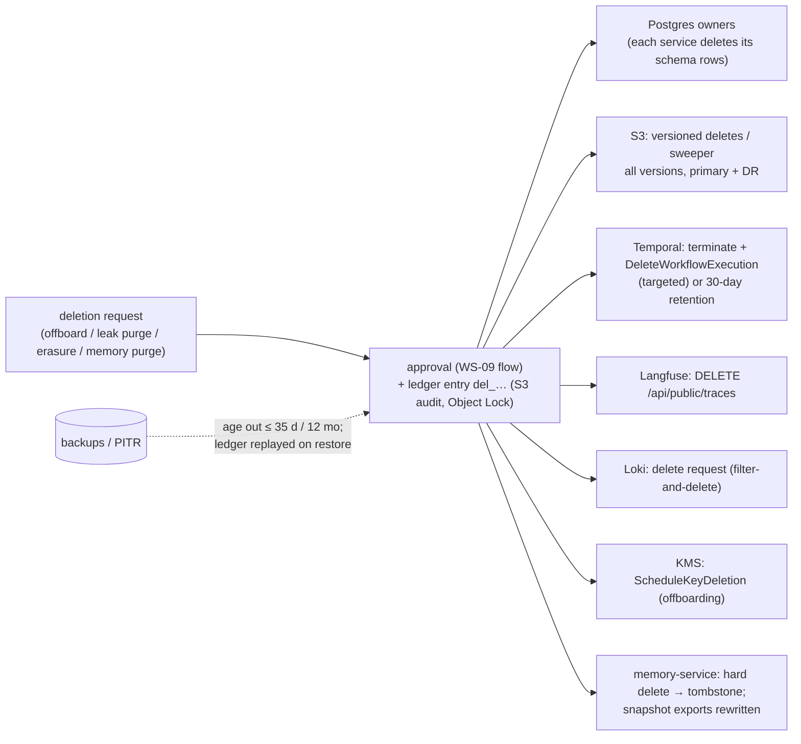
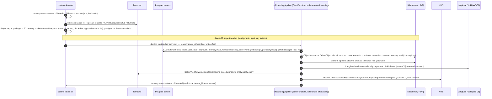

# Data Lifecycle: Retention and Deletion

**Section:** WS-10 · **Implements:** the WS-10 brief §5; D-08, D-09, D-14 (deletable memory), D-21 (redaction), D-25 · **Contracts:** C-ART 2.0.0, C-STATE 2.0.0

## Purpose

This document gives one retention table for every datum across every store, plus the mechanisms that
enforce it. It defines how deletion requests are executed (tenant offboarding, secret purge, subject
erasure, memory hard delete) and how a deletion propagates to derived copies: memory snapshots, Langfuse,
Loki, Tempo, Temporal history, DR replicas, and backups. A restore must never bring deleted data back.

## Decisions summary

| Decision | Reference |
|---|---|
| Retention is enforced by the store that owns the datum (S3 lifecycle tags, Postgres partition drops or owner sweeps, Temporal namespace retention, Loki/Tempo compactors). Nothing relies on a person remembering | §1 |
| Tenants may only **shorten** artifact retention, through Policy `retention` (owner WS-10, schema [schemas/policy-retention.schema.json](schemas/policy-retention.schema.json)) carried in the tenant-derived bundle (ADR-013) | §2 |
| Every deletion writes a **deletion ledger** entry to the Object-Locked audit bucket *before* the delete commits. Restores and DR failbacks replay it | §5, [schemas/deletion-ledger-entry.schema.json](schemas/deletion-ledger-entry.schema.json), CCR-10-06 |
| Tenant offboarding ends in **crypto-shred** of the tenant's KMS keys (primary and DR replica), after a 30-day export window. Audit records survive: since C-ART 1.9.0 they hold IDs, digests and enums only (approval free text is `approval_text` in `artifacts`; the full history export is in `artifacts`), under the platform `audit` key | §4 |
| A secret found in stored data is **rotated first**, then superseded and purged by the WS-08 `LeakPurge` workflow through role `replicant-<env>-leak-purge` (C-ART rule 4a). Nothing is purged from `audit`, which is compliance-locked and content-free, so no role holds a governance bypass (R2-005) | §6, [ADR-WS10-009](adr/009-audit-object-lock-governance.md) |
| Exactly four deletion paths run before lifecycle expiry: leak purge (rule 4a), admin memory purge (rule 5), the session-state sweep, and tenant offboarding. The last two were added by CCR-10-11 (accepted, C-ART 1.10.3 rule 5) so the "only" list is complete (R1-252) | §3 |



---

## 1. Retention by data type and store

| Data | Owning store | Retention | Enforced by | Derived copies and their retention |
|---|---|---|---|---|
| Workflow histories (closed) | Temporal | 30 days after close (WS-01 namespace retention) | Temporal retention | projection (2 y); `workflow_history_skeleton` in `audit` (r2y by default, r7y by tenant policy, compliance-locked); full `workflow_history_export` in `artifacts` (r2y, purgeable by rule 4a, shredded at offboarding) (R1-250, C-ART 1.9.0) |
| Open workflows | Temporal | job lifetime (≤ 30-day waits + PR review) | — | — |
| Temporal visibility rows | Temporal | as histories | Temporal | — |
| `intake.job_requests` | PG | 2 years. The dedupe key is pruned 90 days after terminal (`dedupe_key` set NULL) | control-plane-api sweep (`DataOperation intake.prune_dedupe`, daily) | — |
| `jobs_read.*`, `approvals.*` | PG (derived) | 2 years after terminal; `job_timeline` by partition drop (26 months) | projector sweep + maintenance | — |
| `audit.events` | PG | 7 years (84 monthly partitions) | maintenance drop after `audit.partition_exports` confirms the S3 export | S3 audit exports: 7 years (Object Lock r7y); Loki audit stream: 400 days (WS-08) |
| `cost.usage_events` | PG | 25 months (partition drop); rollups 7 years | maintenance | Valkey `gateway-state` (ephemeral) |
| `memory.*` entries, versions, provenance | PG | lifecycle per WS-04 (candidate → active → deprecated); hard delete leaves a tombstone | memory-service (D-25 admin) | snapshot items (refs), `memory_snapshot_export` (S3, 2 y), Langfuse metadata (refs) |
| `memory.retrievals`, `memory.usage_events` | PG | 13 months (WS-04) | maintenance partition drop | aggregates in `entry_outcome_stats` persist |
| `qa.test_results` (+ `indexed_runs`, `test_stats_daily`) | PG (derived from `qa_report` artifacts, C-PG 1.1.0) | 120 days (whole monthly partitions, dropped after 4 months) | maintenance partition drop | `qa_report` in S3 (r2y) |
| `identity.*` | PG | deprovisioned users tombstoned 7 years (C-STATE) | identity-service | — |
| `evals.*` | PG | permanent for promoted bundles; 1 year otherwise (C-STATE) | eval-worker sweep | S3 eval outputs r1y |
| `github_app` / `slack_app` / `jira_app` / `notify` | PG | dedupe 30 d; message refs 90 d after gate close; log 90 d (C-STATE) | owner sweeps | — |
| Registry definitions, bundles, prompt escrow | PG + S3 registry | permanent | bucket policy denies delete | — |
| Artifacts | S3 artifacts | per type: r7d…r2y (C-ART §4), tenant may shorten (§2) | lifecycle + backstop (object-storage.md §3) | DR replica: same lifecycle |
| Transcripts, CLI events, sandbox logs | S3 transcripts | 90 days | lifecycle | Langfuse selected events (90 d, §1.1); Loki (30 d, WS-08) |
| CLI session state | S3 session | job **terminal** + `sessionStateGraceDays` (tenant policy, 0–7, default 7) via the sweeper; lifecycle backstop 37 d after creation | sweeper + lifecycle (object-storage.md §3.3) | not replicated |
| Workspace archives (takeover) | S3 session | 30 days (C-ART `r30d`; not tenant-shortenable, R2-026) | lifecycle | — |
| Approval records (reference-only) | S3 audit | 2 years (Object Lock **compliance**) | lifecycle after lock | DR replica (locked) |
| Approval free text (`approval_text`) | S3 artifacts | 2 years (r2y), purgeable by rule 4a | lifecycle | DR replica |
| Langfuse traces, observations, scores | Langfuse (ClickHouse + S3 events + PG) | 90 days | replicant-run sweeper (§1.1) | — |
| Logs | Loki | 30 days (audit stream 400 d) | Loki compactor | — |
| Traces | Tempo | 30 days | Tempo compactor `block_retention: 720h` (WS-08) | — |
| Metrics | Mimir | WS-08 (13 months) | Mimir compactor | — |
| AgentRuns, run grants | etcd (exec) | 45 days after terminal (C-CRD) | controller GC | — |
| Database backups | AWS Backup | replicant: PITR 35 d, copies 35 d, backup account 12 months; temporal: 35 d / 90 d; langfuse 14 d / 7 d | AWS Backup plans | — |

### 1.1 Langfuse retention (open-source edition)

Langfuse's project-level data retention is an **Enterprise Edition** feature for self-hosted
installations. Without it, "data is stored indefinitely by default" [verified:
https://langfuse.com/docs/administration/data-retention, 2026-10-24]. The Replicant therefore runs its own
sweeper: CronJob `langfuse-retention-sweeper` in namespace `langfuse`, daily at 03:00 UTC, owned by WS-08
(XD-FIX-R1-193; 08 session-capture.md §9). It lists traces older than 90 days for every tenant through the
public API, skips traces with an observation newer than 90 days, and deletes them in **batches of 30**
(≤ 2 requests/s, ≤ 5,000 traces per run) with `DELETE /api/public/traces` (`{"traceIds": [...]}`), the
limit XD-04-08 sets (R1V-065). Deletion removes "related
entities like scores and observations across all data storages", typically within 15 minutes [verified:
https://langfuse.com/docs/administration/data-deletion, 2026-10-24]. Langfuse's S3 **event upload bucket**
(mandatory in v3/v4 [verified: https://langfuse.com/self-hosting/deployment/infrastructure/blobstorage,
2026-10-24]) is the observability bucket `<org>-replicant-<env>-obs-langfuse` (C-ART 1.7.0, CCR-08-05; R1-235).
Its `events/` prefix expires after 30 days, as Langfuse recommends ("30 days on Langfuse Cloud"), and
noncurrent versions after 7 days ([config/s3/prod/obs-langfuse.lifecycle.json](config/s3/prod/obs-langfuse.lifecycle.json)).
Langfuse batch exports stay disabled (WS-08 values).

## 2. Tenant-controlled retention (policyType `retention`)

WS-10 owns the `retention` Policy kind (C-DEF §2). It is behavioral configuration (it changes what
producers write), so it travels in the tenant-derived bundle. It may only **tighten**. The single exception is
the one C-ART allows: `workflow_history_skeleton` may be raised from r2y to r7y.

The schema is **generated** from the C-ART type table by `tools/gen_retention_schema.py` (R1-238). For each
type, the allowed values are its C-ART class or a shorter class **that the type's bucket accepts**, so a
schema-valid policy can never produce an upload the bucket policy rejects. The `transcripts` bucket therefore
accepts `r7d`, `r30d`, and `r90d`. Platform-controlled types cannot be set by a tenant:
- idempotency and replay records (`agentrun_record`, manifests, `run_result`, the job index);
- audit evidence referenced by digest (`approval_packet`, `approval_text`);
- `secret_scan_report`;
- every memory type (D-25);
- `workflow_history_export`.

`sessionStateGraceDays` (0–7) is implemented by the retention sweeper, which reads it from the job's pinned
bundle. The former `takeoverArchiveDays` knob was **removed**: workspace archives keep the C-ART `r30d`
(R2-026).

```yaml
apiVersion: replicant.example.com/v1
kind: Policy
metadata:
  name: retention-payments
  scope: {level: tenant, tenant_id: payments}
  owners: [payments-tenant-admins]
  description: Payments keeps Playwright traces and build logs for 30 days instead of 90 (PCI data-minimization).
spec:
  policyType: retention
  artifactRetention:
    playwright_trace: r30d
    build_log: r30d
    video: r7d
    transcript: r30d
    workflow_history_skeleton: r7y
  sessionStateGraceDays: 3
  screenshotsRequireMasking: true
```

Validated on 2026-10-24: the document passes the C-DEF envelope schema, and its `spec` passes the generated
schema. `{"transcript": "r1y"}` (longer than C-ART) and `{"agentrun_record": "r7d"}` (platform-controlled) are
both rejected. Producers resolve the tag through `replicant-storage.retention_class(type, bundle)`.

## 3. Deletion mechanisms per store

| Store | Mechanism | Executor (only principal allowed) | Notes |
|---|---|---|---|
| S3 (tenant prefixes) | `ListObjectVersions` under `tenants/<t>/` then `DeleteObjects` (≤ 1,000 versions per request, each with its `VersionId`) for every version, primary **and** DR bucket, by the offboarding pipeline itself. S3 Batch Operations has no native delete operation [verified: https://docs.aws.amazon.com/AmazonS3/latest/userguide/batch-ops-operations.html, 2026-10-24], so no Batch role or Lambda is involved (R1V-063). The offboarding lifecycle rule is added afterwards as a backstop by the platform pipeline (`platform-deployer`), the only principal allowed to change bucket lifecycle | `replicant-<env>-tenant-offboarding` | delete-marker replication is off, so DR must be handled explicitly |
| S3 (leak purge, C-ART rule 4a) | write the redacted superseding object `<key>.p<n>` (write-once), then `DeleteObjectVersion` for every version of the original, primary and DR, and in the legal bucket for unheld copies; record in `audit` `tenants/<t>/jobs/<j>/purges/<leak_id>.json` | `replicant-<env>-leak-purge` ([config/iam/leak-purge.json](config/iam/leak-purge.json)), driven by WS-08's `LeakPurge` workflow after a `leak_purge` gate (two-person, C-MSG 1.4.0) | only `artifacts`, `transcripts`, `session` (which include `approval_text` and `workflow_history_export`). Nothing in `audit` is ever purged, so no bypass exists (R2-005) |
| S3 (admin memory purge, C-ART rule 5) | `DeleteObjectVersion` for all versions of `memory_snapshot_export` (`memory` bucket) and `memory_injection` (`artifacts` `…/inputs/memory-injection.json`); replacement export at the write-once `….purged-<purge_id>.json` | `replicant-<env>-memory-service` ([config/iam/memory-service.s3.json](config/iam/memory-service.s3.json); bucket policies narrow it to exactly those two key patterns, R1-234) | D-25 admin purge `mprg_…` |
| S3 (session-state sweep) | `DeleteObjectVersion` for all versions under the job's run prefixes in `session`, **except** `workspace_archive/`, which keeps its 30-day lifecycle retention (ruling on R1V-066) | `replicant-<env>-retention-sweeper` | runs job terminal + grace (object-storage.md §3.3) |
| Postgres | owner admin API `DELETE …` per schema, executed by the owning service under `system:all-tenants` or tenant scope. Never ad hoc SQL (D-26) | owners | each emits `audit.emit` |
| Temporal | open: `job.cancel`, then `DeleteWorkflowExecution` ("If the Execution is Running, the Service terminates it before deletion") [verified: https://docs.temporal.io/cli/command-reference/workflow#delete, 2026-10-24]; closed: deletion API or 30-day retention | control-plane-api (operator action) | the history includes inline untrusted text (steering ≤ 16 KiB, gate comments). Payloads are encrypted by the codec (WS-09) |
| Langfuse | `DELETE /api/public/traces` (batch) | WS-08 Langfuse admin key in the sweeper | asynchronous, ~15 min |
| Loki | delete request `POST /loki/api/v1/delete` with a LogQL selector (`deletion_mode: filter-and-delete`; cancellable for 2 h) [WS-08 config/loki] | WS-08 | the audit stream has `deletion_mode: disabled` (WS-08: audit lines carry no free text) |
| Tempo | no targeted deletion; 30-day block retention bounds exposure | — | spans carry IDs, not content (C-IDS §5) |
| KMS | `ScheduleKeyDeletion` (30 days, mandated by WS-09's key policy condition `kms:ScheduleKeyDeletionPendingWindowInDays ≥ 30`) | `replicant-<env>-tenant-offboarding` with an approved-change tag | a multi-Region primary can be deleted only after its replicas [verified: https://docs.aws.amazon.com/kms/latest/developerguide/deleting-keys.html, 2026-10-24] |

## 4. Tenant offboarding

Trigger: a tenant admin plus a Replicant admin request it in the control plane (`POST /v1/admin/tenants/{t}:offboard`,
two approvals, WS-07/WS-09). Timeline:



What remains, by design:

| Remains | Why | Content |
|---|---|---|
| `audit.events` rows (7 years) | audit obligation | IDs, enums, digests only (WS-08: no free text) |
| S3 audit approval records (2 years, compliance lock), history skeletons | evidence of decisions and of what ran | references, decisions, payload digests only (C-ART 1.9.0). `approval_text` and the full history export are in `artifacts` and are deleted with the tenant prefix |
| `tenancy.tenants` tombstone, `identity` tombstones | IDs are never reused (C-IDS) | slug, timestamps |
| Eval golden tasks derived from the tenant (`evals.golden_tasks.source_tenant_id`) | WS-06 lifecycle state `erased` | WS-06 erases content on offboarding (XD-10-16) |
| Backups | immutable copies | Replicant PITR ≤ 35 days; backup-account copies ≤ 12 months. **Unreadable after crypto-shred**: tenant S3 data is under the deleted key; Postgres backups still contain rows, so any restore replays the ledger (§5), deleting them again before reopening |

Crypto-shred is the guarantee for S3 copies we cannot reach: DR replicas missed by a failed batch job,
Langfuse S3 events if they are ever KMS-wrapped, and stray versions. All tenant S3 data is encrypted with
the tenant key, so once both key regions are deleted the data is unrecoverable.

## 5. Deletion ledger

Every deleting executor writes a `replicant.deletion-ledger/v1` entry: the tenant-offboarding pipeline, the
retention sweeper, `replicant-leak-purge` (the `LeakPurge` workflow), and memory-service (admin purge). Each of
their IAM policies grants exactly `s3:PutObject` + `s3:PutObjectTagging` on `audit/org/deletion-ledger/*`,
plus `kms:GenerateDataKey` on the audit key through S3, and an identity-level write-once deny (R1-233;
config/iam/*.json). WS-07's control-plane delete operations go through these executors, never around them
(XD-FIX-R1-233). The entry is written
([schemas/deletion-ledger-entry.schema.json](schemas/deletion-ledger-entry.schema.json); example
[examples/deletion-ledger-entry.json](examples/deletion-ledger-entry.json), validated) to the audit bucket at
`org/deletion-ledger/<yyyy>/<mm>/<dd>/<del_id>.json` with `If-None-Match: *`, **before** it commits the
deletion. If the write fails, the deletion does not happen. Entries hold identifiers, selectors, and
digests, never content.

Replay: every restore (Replicant, temporal, memory side restore, region failback) runs
`replicant admin restore replay-deletions --since <restore_point>` (recovery.md §3.3). This re-executes each
entry through the owner's idempotent delete API. The ledger outlives every backup: Object Lock 7 years
versus backups ≤ 12 months.

The key layout, the artifact types and the `del_` prefix are in C-ART 1.6.0 and C-IDS (CCR-10-06, accepted).

## 6. Leak purge (a credential reached stored data)

The redaction pipeline (WS-08) should prevent this, and leak-scanner detects it after the fact. When it
fails, WS-08's `LeakPurge` workflow (`leak_<ulid>`, session-capture.md §8) runs, and WS-10 supplies the
storage mechanics:

1. **Rotate the secret first** (WS-09 runbook). A purge never replaces rotation, because copies may already
   have been exfiltrated (D-21: "assumed exfiltratable").
2. Locate the affected objects. Sources: leak-scanner findings, which hold only fingerprint, rule, and
   bucket/key (never the value), plus `secret_scan_report` artifacts (HMAC fingerprints only), Loki, and
   Langfuse by job.
3. A `leak_purge` gate (C-MSG 1.4.0) collects two distinct approvers.
4. Ledger entry first (`reason: secret_purge`, `executor: svc_leak-purge`).
5. **S3 supersession** (C-ART rule 4a), through `replicant-<env>-leak-purge`:
   - read the original;
   - write the redacted object `<key>.p<n>` with `If-None-Match: *`;
   - delete **all versions** of the original in the primary and the DR bucket;
   - write `audit` `tenants/<t>/jobs/<j>/purges/<leak_id>.json` (old key → new key, sha256 each).

   This applies to `artifacts`, `transcripts`, `session`, their DR replicas, and the **legal bucket**
   (C-ART 2.0.0 rule 4a; R1V-176). Since C-ART 1.9.0 that includes `approval_text` and
   `workflow_history_export`. **`audit` is never touched.** The history skeleton there
   holds payload digests, not payloads, so the purged copy's integrity is still provable against the locked
   digests. Legal holds exist only on `audit` (never purged) and the legal bucket. In the legal bucket, S3 refuses
   `DeleteObjectVersion` on a held version, so the purge records `blocked_by_legal_hold` for that object and
   escalates through the `leak_purge` gate; unheld legal-bucket copies are purged like any other (ADR-WS10-009).
6. Other stores: Langfuse traces of the affected jobs (WS-08); a Loki delete request for the jobs' streams;
   Postgres rows that copied the text (memory candidates through memory-service, projection titles through a
   `jobs_read` rebuild from a redacted snapshot); Temporal (a closed workflow is deleted with
   `DeleteWorkflowExecution`; an open job is cancelled and restarted as a new job, recovery.md §7.2).
   Payloads are codec-encrypted at rest, which limits exposure in the meantime.
7. Backups are not edited. Exposure is bounded (≤ 35 days PITR, ≤ 12 months for backup-account copies),
   and the secret is already rotated. Any restore replays the ledger.

The `retention-sweeper` no longer has a secret-purge path (R1-232). Its only job is the session-state sweep.

## 7. Propagation to derived data (summary)

| Derived copy | On source deletion | Mechanism |
|---|---|---|
| Memory snapshots (`memory.snapshots`, `snapshot_items`) | entry hard-deleted → items keep the ref; the ref resolves to a **tombstone** (WS-04) | memory-service |
| `memory_snapshot_export` (S3) | C-ART rule 5: memory-service deletes **all versions** of the original and writes the replacement, with tombstones, at the **new** write-once key `….purged-<purge_id>.json`. Never an overwrite. Snapshot IDs stay valid, and reproducibility reports "entry erased" | memory-service (R1-234) |
| `memory_injection` artifacts (`…/runs/<r>/inputs/memory-injection.json`, r2y) | carry entry content. memory-service deletes all versions for the affected jobs (targets from `memory.injections`) | memory-service (R1-234) |
| Langfuse | metadata holds `mem_…@v` refs only, plus prompt-rendered text in generations. Traces of affected jobs are deleted when content erasure is required | Langfuse API |
| Loki | transcripts and sandbox logs (redacted) are 30 days; a delete request when required | WS-08 |
| Projection (`jobs_read`) | rebuildable. A rebuild after deletion uses current Temporal state | projector |
| DR replicas | explicit deletion (deletes do not replicate) | offboarding, leak purge, memory purge, sweeper |
| Backups | age out, plus ledger replay on restore | §5 |

## 8. Takeover data availability (R2-026, data side)

| Job state | What a takeover can hand over | Until |
|---|---|---|
| running, paused, waiting | live workspace archive (takeover run) + session state + transcripts + diff | live |
| `failed`, `expired`, `cancelled` (terminal) | session state (resume) and the last workspace archive if one exists, plus diff bundle, plan, handoff, transcripts | session: terminal + `sessionStateGraceDays` (≤ 7 d). Diff, plan, handoff: r2y. Transcripts: r90d |
| any, after the session grace | a takeover **reconstructed** from base SHA + diff bundle + handoff (no CLI session) | diff retention (2 y, or the tenant's shorter class) |

Workspace archives are presigned by control-plane-api to the **taking-over principal**, whoever passed WS-07's
takeover authorization, not only the requester. The bucket policy constrains *which* objects can be presigned
(`workspace_archive` only) and *for how long* (15 min). It does not constrain *to whom*: that is WS-07's
authorization plus `audit.emit` (XD-FIX-R2-026). Retention shown in the takeover dialog comes from the job's
bundle (`sessionStateGraceDays`) and C-ART (`r30d` archive), never a hard-coded number.

## Open questions

| Question | Who decides | Options | Recommendation |
|---|---|---|---|
| Offboarding export window | Product / legal | 30 / 90 days | 30 days, extendable per tenant |
| Should `cost` rows of an offboarded tenant be kept pseudonymously (finance) | Finance / WS-03 | delete / keep rollups | Keep daily rollups (no content, tenant slug kept), delete events |
| Langfuse Enterprise retention instead of the sweeper | WS-08 / procurement | EE license / OSS sweeper | OSS sweeper (works, auditable) |

## Risks

- **Deletion is only as complete as the ledger's target list.** Mitigated by ID-first storage (C-ART
  tenant-first keys, job-scoped prefixes) and crypto-shred for tenants.
- **Temporal histories may contain untrusted inline text** for up to 30 days after close. Mitigated by the
  codec encryption and targeted deletion.
- **Backups retain deleted rows for up to 12 months.** Disclosed in the data-processing terms. Ledger
  replay prevents resurrection on restore.

## Interfaces

- **Provided:** the Policy `retention` kind schema, the deletion ledger schema and process, the retention
  table, and offboarding orchestration.
- **Consumed:** C-ART 2.0.0 (retention classes, rules 4a and 5, split history export, `approval_text`),
  C-STATE 2.0.0, C-MSG 2.0.0 (`leak_purge` gate), WS-04 (tombstones, purge), WS-06 (golden task erasure),
  WS-08 (`LeakPurge` workflow, Loki/Langfuse deletion, audit exports), WS-09 (approvals, key policies,
  secret rotation), WS-07 (offboarding API, takeover authorization, admin endpoints).
