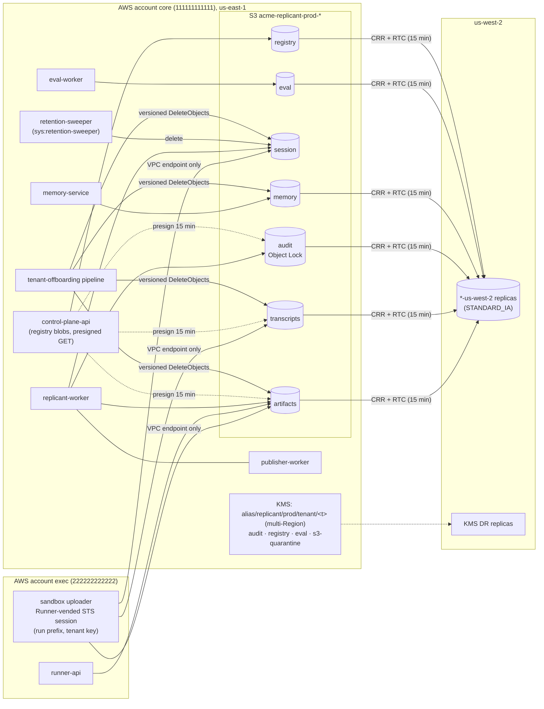

# Object Storage

**Section:** WS-10 · **Implements:** C-ART 2.0.0 (buckets, IAM, lifecycle JSON, KMS, local parity), D-08, D-21, D-22

## Purpose

This section turns the C-ART contract into deployable S3 configuration: buckets, encryption, tag-driven
lifecycle, bucket and identity policies, presigned downloads, replication for DR, and the local
S3-compatible store. It also fixes three places where the contract text, taken literally, would break
multipart uploads or tagged writes. Those were filed as CCR-10-02 and CCR-10-03, both accepted.

## Decisions summary

| Decision | Reference |
|---|---|
| Seven buckets per environment, `<org>-replicant-<env>-<class>`, in the **core account** (the exec cluster lives in its own account; CCR-09-07 accepted). Versioning is on everywhere. Object Ownership is `BucketOwnerEnforced`. Block Public Access is on | C-ART §1 |
| Every bucket's configuration is **generated** from one table by [tools/gen_s3_config.py](tools/gen_s3_config.py) and validated against botocore's S3 request model by [tools/validate_s3_config.py](tools/validate_s3_config.py) (35 prod files, 22 local, all valid, 2026-10-24) | §1 |
| Lifecycle: one tag-filtered expiration rule per retention class, size-filtered transitions, an untagged **housekeeping** rule (aborted multipart uploads, expired delete markers), and a **backstop** rule set to the bucket's *longest* class | §3 |
| SSE-KMS with per-(env, tenant) **multi-Region** keys and Bucket Keys. Default bucket encryption points at a **quarantine key** that services can encrypt with but not decrypt, so a missing header fails loudly | §2 |
| Bucket-policy conditions on headers use **`…IfExists`** operators only. Header-must-exist denies (`Null`) would also match `UploadPart`/`CompleteMultipartUpload`, which are authorized as `s3:PutObject` and carry no SSE or tag headers | §4, CCR-10-02 |
| Every tagged writer also needs `s3:PutObjectTagging` | §4, CCR-10-03 |
| UI downloads are presigned GETs capped at 15 minutes server-side with `s3:signatureAge`. `session` objects can be presigned only for `workspace_archive` | §5 |
| DR: CRR with Replication Time Control to us-west-2 for every class except `session`. Delete-marker replication is off | §7, [ADR-WS10-008](adr/008-disaster-recovery-strategy.md) |
| Local store: **SeaweedFS** (D-08 as amended by CCR-11-02; WS-10 challenge [ADR-WS10-007](adr/007-challenge-d08-minio-community-archived.md)) | §8 |
| Audit bucket: Object Lock **compliance**, 730 days; nobody holds `s3:BypassGovernanceRetention`; legal holds only by `replicant-<env>-legal-hold` (R2-005) | [ADR-WS10-009](adr/009-audit-object-lock-governance.md) |
| Leak purge (C-ART rule 4a) runs as `replicant-<env>-leak-purge` in `artifacts`/`transcripts`/`session` only (R1-232); memory purge as memory-service on exactly two key patterns (R1-234); every deleting role writes the deletion ledger first (R1-233) | §4 |
| Observability buckets `<org>-replicant-<env>-obs-*` are created here (C-ART 1.7.0) | §10 |



---

## 1. Buckets

| Class | Prod name | Versioning | Object Lock | Default encryption | Replicated | CloudTrail data events |
|---|---|---|---|---|---|---|
| artifacts | `acme-replicant-prod-artifacts` | on | — | SSE-KMS quarantine key + Bucket Key | yes | writes |
| transcripts | `acme-replicant-prod-transcripts` | on | — | same | yes | writes |
| session | `acme-replicant-prod-session` | on | — | same | **no** (raw-restricted, short-lived) | reads + writes |
| audit | `acme-replicant-prod-audit` | on | **COMPLIANCE 730 d** (staging trial with 1 d first; ADR-WS10-009) | same (writers always send the platform `audit` key) | yes (destination also has Object Lock) | reads + writes |
| memory | `acme-replicant-prod-memory` | on | — | same | yes | writes |
| eval | `acme-replicant-prod-eval` | on | — | same | yes | writes |
| registry | `acme-replicant-prod-registry` | on | — (bucket policy denies deletes) | same | yes | writes |

Per-bucket files (all literal API request bodies):

| File | API |
|---|---|
| `config/s3/<env>/<class>.lifecycle.json` | `PutBucketLifecycleConfiguration` `LifecycleConfiguration` |
| `config/s3/<env>/<class>.encryption.json` | `PutBucketEncryption` |
| `config/s3/<env>/<class>.versioning.json` | `PutBucketVersioning` |
| `config/s3/<env>/audit.object-lock.json` | `PutObjectLockConfiguration` |
| `config/s3/<env>/<class>.replication.json` | `PutBucketReplication` |
| `config/s3/<env>/<class>.policy.json` | `PutBucketPolicy` (also linted with parliament 1.6.4: no findings) |

Also set on every bucket (IaC, not generated JSON): `PutPublicAccessBlock` (all four true),
`PutBucketOwnershipControls` `BucketOwnerEnforced`, `PutBucketLifecycleConfiguration` header
`x-amz-transition-default-minimum-object-size: all_storage_classes_128K` (explicit, matching the post-2024
default [verified: https://docs.aws.amazon.com/AmazonS3/latest/userguide/lifecycle-transition-general-considerations.html,
2026-10-24]), and S3 Metadata **live inventory tables** for the storage audit (§6).

## 2. Encryption keys

| Alias | Kind | Used for | Policy owner |
|---|---|---|---|
| `alias/replicant/<env>/tenant/<tenant_id>` | symmetric, **multi-Region** primary in us-east-1, replica in us-west-2 | all tenant data in artifacts, transcripts, session, memory (tenant exports) | WS-09 (spec/09-security/policies/iam/kms-key-policy.tenant.json) |
| `alias/replicant/<env>/audit`, `/registry`, `/eval`, `/memory-org` | symmetric, multi-Region | platform classes | WS-09 |
| `alias/replicant/<env>/quarantine` | symmetric, single-Region | bucket default encryption only | WS-10 ([config/kms/quarantine-key-policy.json](config/kms/quarantine-key-policy.json)) |
| `alias/replicant/<env>/dr/<class>` | DR-region keys for replicas of platform classes | replication destination | WS-10 / WS-09 |
| `alias/replicant/<env>/tenant/replicant-system` | symmetric, multi-Region (a tenant key like any other) | Temporal payload codec for `sys:*` workflows and `replicant-system` platform prefixes (XD-FIX-R1-214, CCR-09-08) | WS-10 creates it with the tenant-key template; WS-09 key policy |
| `alias/replicant/<env>/image-signing` | asymmetric `ECC_NIST_P256`, `SIGN_VERIFY`, single-Region | cosign signatures of `replicant/*` and `mirror/*` images (XD-FIX-R1-224) | WS-10 creates it; WS-09 key policy (sign: image CI only; verify: public key rendered into Kyverno by IaC) |
| `alias/replicant/<env>/ops` | symmetric, single-Region | `ops` bucket (kill-switch mirror, exec revocation feed; CCR-09-10) | WS-10 creates (tag `replicant-key-class=ops`); WS-09 key policy kms-key-policy.ops.json |
| `alias/replicant/<env>/legal` | symmetric, single-Region | legal bucket (CCR-10-10) | WS-10 creates (tag `replicant-key-class=legal`, XD-W2-09-03); WS-09 key policy kms-key-policy.legal.json |

The keys WS-10 creates, with their `CreateKey` parameters, tags, and key-policy source, are listed in
[config/kms/keys.json](config/kms/keys.json) (validated against botocore's `CreateKey` model, 2026-10-24).

Exec-account keys `run-token` and `exec-ebs` are WS-09's (orchestrator ruling on R1-240), as are the sandbox
subnets and Network Firewall (WS-02). The `oidc.eks.us-east-1.amazonaws.com` firewall allowlist entry asked of
WS-10 in XD-FIX-R1-211 therefore belongs to WS-02.

Facts relied on:

- S3 Bucket Keys work with CRR and SRR. The encryption context becomes the bucket ARN
  [verified: https://docs.aws.amazon.com/AmazonS3/latest/userguide/bucket-key.html, 2026-10-24].
- SSE-KMS objects replicate only with `SseKmsEncryptedObjects` enabled and a `ReplicaKmsKeyID` "created in
  the same AWS Region as the destination bucket". S3 "treats multi-Region keys as though they were
  single-Region keys", so the replica key is named explicitly [verified:
  https://docs.aws.amazon.com/AmazonS3/latest/userguide/replication-config-for-kms-objects.html, 2026-10-24].
- KMS key deletion has a 7–30 day waiting period, 30 by default. A multi-Region primary cannot be deleted
  until its replicas are [verified: https://docs.aws.amazon.com/kms/latest/developerguide/deleting-keys.html,
  2026-10-24].

**Quarantine key.** Default bucket encryption applies whenever a PUT or CreateMultipartUpload omits
SSE headers. It uses `quarantine`. Any org principal may `GenerateDataKey` through S3, so the write
succeeds, but only `replicant-<env>-storage-security` may `Decrypt`. A producer bug that forgets the
tenant key therefore produces an object no service can read. That fails at first read with
`AccessDenied (kms:Decrypt)`, and the storage audit (§6) flags it within 24 h. Remediation is a
re-encrypting copy by the security role. This replaces the contract's "bucket policy denies a KMS key
outside the environment's key set" for the header-absent case, which a bucket policy cannot enforce
safely (§4.2).

**Dependency on WS-09 (XD-10-09):** the tenant key policy must also allow
`replicant-<env>-s3-replication` to `kms:Decrypt` through S3 (source), and the DR replica must allow it to
`kms:Encrypt`/`GenerateDataKey` through `s3.us-west-2`. It must also allow the third exec-account role,
`replicant-<env>-agentrun-controller`, `kms:GenerateDataKey`/`kms:Decrypt` through S3 for the artifacts
bucket (it writes `agentrun_record` and reads manifests).

## 3. Lifecycle

### 3.1 Rules

| Retention class (`replicant-retention` tag) | Days | Buckets | Transitions (objects > 128 KiB only) |
|---|---|---|---|
| `r7d` | 7 | artifacts | — |
| `r30d` | 30 | artifacts, session | — |
| `r90d` | 90 | artifacts, transcripts | transcripts: STANDARD_IA at 30 d |
| `r1y` | 365 | artifacts, memory, eval | STANDARD_IA at 30 d |
| `r2y` | 730 | artifacts, audit, memory | STANDARD_IA at 30 d, GLACIER_IR at 120 d (artifacts); GLACIER_IR at 90 d (audit) |
| `r7y` | 2,557 | audit (exports of `audit.events`) | GLACIER_IR at 90 d |
| `job37d` | 37 (backstop) | session | — (normally deleted by the sweeper at job end + 7 d, §3.3) |
| `perm` | never | eval (golden), registry | eval golden: STANDARD_IA at 90 d |

How S3 evaluates these rules, and how the design relies on it:

1. **Overlaps resolve to the shorter expiration.** "if two expiration policies overlap, the shorter
   expiration policy is honored", and "Permanent deletion takes precedence over transition"
   [verified: https://docs.aws.amazon.com/AmazonS3/latest/userguide/lifecycle-conflicts.html, 2026-10-24].
   The whole-bucket **backstop** therefore uses the bucket's *longest* class (artifacts: 730 d). It never
   cuts a correctly tagged object short. It only bounds untagged or mistagged ones, which the contract's
   "default untagged rule" intended. A filter cannot select "objects without a tag", so a rule at the
   bucket default class would wrongly expire longer-class objects.
2. **Tag filters cannot carry two actions.** "You can't specify this lifecycle action in a rule that has a
   filter that uses object tags" applies to `AbortIncompleteMultipartUpload` and
   `ExpiredObjectDeleteMarker` [verified: https://docs.aws.amazon.com/AmazonS3/latest/userguide/intro-lifecycle-rules.html,
   2026-10-24]. Both live in the empty-filter `housekeeping` rule (MPU abort after 2 days).
3. **Versioned buckets.** Expiration adds a delete marker, and the data becomes a noncurrent version.
   `NoncurrentVersionExpiration` of 7 days removes it. Effective retention is therefore the class plus
   7 days, which serves as the accidental-delete recovery window. The `housekeeping` rule removes
   expired delete markers.
4. **Object Lock.** Lifecycle "cannot delete" a locked version before retain-until
   [verified: https://docs.aws.amazon.com/AmazonS3/latest/userguide/object-lock-managing.html, 2026-10-24].
   Audit objects outlive their expiration rule until their lock ends, then age out as noncurrent.
5. **Rewritten keys.** The only key Replicant rewrites is `inbox/_head.json` (`steering_control`, a
   compare-and-swap counter written by runner-api). Each swap leaves a noncurrent version of a few bytes,
   which `NoncurrentVersionExpiration` removes after 7 days. Its class is r90d like the rest of the inbox.
   `agentrun_record` is r2y (C-ART 1.5.0).
6. **Minimum durations and sizes.** Standard-IA bills 30 days and 128 KB minimum; Glacier IR bills 90 days
   and 128 KB [verified: https://docs.aws.amazon.com/AmazonS3/latest/userguide/storage-class-intro.html,
   2026-10-24]. Transitions run only for classes that live at least 3× the target class's minimum, and only
   for objects larger than 128 KiB (`ObjectSizeGreaterThan: 131072`).
7. **Limits.** At most 1,000 rules per configuration. The largest generated configuration has 10 rules,
   and offboarding adds at most 1 per tenant (§3.4).

### 3.2 Artifacts bucket lifecycle (generated, prod)

The full file is [config/s3/prod/artifacts.lifecycle.json](config/s3/prod/artifacts.lifecycle.json). This is
its exact content for the four longest-lived rules, plus housekeeping and the backstop:

```json
{
  "Rules": [
    {"ID": "expire-r1y", "Status": "Enabled",
     "Filter": {"Tag": {"Key": "replicant-retention", "Value": "r1y"}},
     "Expiration": {"Days": 365}, "NoncurrentVersionExpiration": {"NoncurrentDays": 7}},
    {"ID": "tier-r1y-0-standard_ia", "Status": "Enabled",
     "Filter": {"And": {"Tags": [{"Key": "replicant-retention", "Value": "r1y"}], "ObjectSizeGreaterThan": 131072}},
     "Transitions": [{"Days": 30, "StorageClass": "STANDARD_IA"}]},
    {"ID": "expire-r2y", "Status": "Enabled",
     "Filter": {"Tag": {"Key": "replicant-retention", "Value": "r2y"}},
     "Expiration": {"Days": 730}, "NoncurrentVersionExpiration": {"NoncurrentDays": 7}},
    {"ID": "tier-r2y-1-glacier_ir", "Status": "Enabled",
     "Filter": {"And": {"Tags": [{"Key": "replicant-retention", "Value": "r2y"}], "ObjectSizeGreaterThan": 131072}},
     "Transitions": [{"Days": 120, "StorageClass": "GLACIER_IR"}]},
    {"ID": "housekeeping", "Status": "Enabled", "Filter": {},
     "AbortIncompleteMultipartUpload": {"DaysAfterInitiation": 2},
     "Expiration": {"ExpiredObjectDeleteMarker": true}},
    {"ID": "backstop-untagged", "Status": "Enabled", "Filter": {"Prefix": ""},
     "Expiration": {"Days": 730}, "NoncurrentVersionExpiration": {"NoncurrentDays": 7}}
  ]
}
```

### 3.3 Session state: workflow-relative expiry

C-ART defines `job37d` as "deleted by the workflow 7 days after the job reaches a terminal state, with a
lifecycle backstop at 37 days after creation". Lifecycle counts from object *creation*. Re-tagging at job
end to a shorter class would delete old objects immediately, so lifecycle cannot express "terminal + 7 d".
Design:

- The workflow's `artifacts.expire_session_state` activity (C-ARCH §5) deletes nothing. It records
  `session_purge_due_at = terminal_at + sessionStateGraceDays` in the job's projection (WS-07 column,
  XD-10-05), so the UI can show it. This keeps delete rights off replicant-worker.
- `sys:retention-sweeper` (workflow type `RetentionSweeper`, C-IDS §4) is a Temporal Schedule that runs
  hourly. Its activity `retention.purge_session_state` finds due jobs **through Temporal visibility**, so
  it needs no new database grant. Every Continue-As-New run closes with status `ContinuedAsNew`, so a filter
  on "not Running" would purge jobs still in a multi-week `pr_review` (R1-238). The query therefore selects
  only **terminal** jobs:
  `ExecutionStatus IN ('Completed','Failed','Terminated','Canceled','TimedOut') AND ReplicantStatus IN
  ('succeeded','failed','cancelled','rejected','expired','taken_over') AND CloseTime < now AND
  CloseTime >= <watermark − 7d>`, reading `ReplicantTenantId` and `ReplicantReleaseBundleId`. For each candidate, it
  also calls `DescribeWorkflowExecution(job_id)` with no run ID and skips the job unless the latest run is
  closed. The grace is the job bundle's `sessionStateGraceDays` (0–7, default 7). The query window reaches back
  7 days (the maximum grace) before the watermark, and each candidate is purged only when
  `CloseTime + grace ≤ now`, so a 3-day grace purges on day 3, not day 7. Purges are idempotent, so
  re-seeing a job is harmless. Closed-workflow retention (30 days)
  exceeds the grace. For each job it lists `tenants/<t>/jobs/<j>/runs/` in `session` and deletes **all versions**
  (`DeleteObjectVersion`), so no noncurrent copy lingers, but it **skips every key under `workspace_archive/`**
  (orchestrator ruling on R1V-066). Workspace archives keep their 30-day retention by lifecycle (`r30d`; untagged or
  `job37d` archives are bounded by the 37-day backstop). That keeps the takeover dialog's 30-day promise
  (XD-FIX-R2-026) and capacity-and-cost's session row. The sweeper's IAM also denies deletes on `workspace_archive/*`. The activity runs on task queue
  `replicant-retention`, a new queue named under the C-IDS `replicant-<purpose>` rule (XD-10-05). It is served
  by a small `retention-sweeper` Deployment (image `services/retention-sweeper/Dockerfile`; it also hosts
  `DataOperation`, XD-FIX-R1-021/R1-267) whose Pod Identity role is `replicant-<env>-retention-sweeper`
  ([config/iam/retention-sweeper.s3.json](config/iam/retention-sweeper.s3.json)), one of the four
  principals that may delete before expiry (with offboarding, `replicant-leak-purge`, and memory-service;
  CCR-10-11). The watermark is the Schedule's last-completion result. Each purge
  emits an audit event through `audit.emit` (the sweeper's own DB login, `EXECUTE` only).
- The 37-day lifecycle backstop remains for jobs whose purge failed.

### 3.4 Tenant offboarding rule

Offboarding (lifecycle.md §4) adds one rule per bucket, applied by the platform deployer (the only
principal allowed `PutLifecycleConfiguration`):

```json
{"ID": "offboard-payments", "Status": "Enabled", "Filter": {"Prefix": "tenants/payments/"},
 "Expiration": {"Days": 1}, "NoncurrentVersionExpiration": {"NoncurrentDays": 1}}
```

This is a backstop to the offboarding pipeline's versioned `DeleteObjects` (S3 Batch Operations has no native delete, R1V-063). Crypto-shred (key deletion) is the guarantee.

## 4. Access policies

### 4.1 Bucket policy statements (generated; [config/s3/prod/artifacts.policy.json](config/s3/prod/artifacts.policy.json))

| Sid | Effect | Why |
|---|---|---|
| `DenyNonTls` | Deny `aws:SecureTransport=false` | D-21 |
| `DenyOutsideOrganization` | Deny outside `aws:PrincipalOrgID`, unless the principal is an AWS service | blocks cross-org access |
| `DenyNonKmsEncryption` | Deny `StringNotEqualsIfExists s3:x-amz-server-side-encryption = aws:kms` | rejects SSE-S3/SSE-C when a header is sent. Absent headers get the quarantine default (§2) |
| `DenyKeysOutsideEnvironmentKeySet` | Deny `ArnNotLikeIfExists s3:x-amz-server-side-encryption-aws-kms-key-id = arn:aws:kms:us-east-1:<core>:key/*` | no foreign keys (C-ART §5.3) |
| `DenyUnknownRetentionClass` | Deny `StringNotEqualsIfExists s3:RequestObjectTag/replicant-retention ∉ bucket classes` on PutObject and PutObjectTagging | a typo or a forbidden class (for example `perm` in artifacts) fails at write time |
| `DeletesOnlyByNamedRoles` / `NoDeletes` (audit, registry) | Deny delete except: artifacts → sweeper, offboarding, `leak-purge`, memory-service; transcripts → offboarding, `leak-purge`; session → sweeper, offboarding, `leak-purge`; memory → offboarding, memory-service; eval → offboarding; audit and registry → nobody | C-ART rules 4a, 5 |
| `LeakPurgeOnlyTenantJobKeys` | Deny `leak-purge` deletes and writes outside `tenants/*/jobs/*` | rule 4a scope |
| `MemoryServiceDeletesOnlyMemoryInjections` (artifacts), `MemoryServiceDeletesOnlySnapshotExports` (memory), `PurgedSnapshotReplacementsWriteOnce` | memory-service deletes only `…/inputs/memory-injection.json` and `tenants/*/snapshots/*`; replacements are write-once | rule 5 (R1-234) |
| `NobodyBypassesRetention` (all) | Deny `s3:BypassGovernanceRetention` to everyone | R2-005 |
| `LegalHoldsOnlyByLegalRole` (audit), `AuditObjectsWriteOnce` (audit) | only `legal-hold` places or removes legal holds; every audit object is write-once (`If-None-Match`) | ADR-WS10-009 |
| `NoBucketConfigChangesExceptPlatformPipeline` | Deny bucket-configuration APIs for all but `platform-deployer` | WS-09 |
| `PresignedGetsAtMost15Minutes` | Deny `GetObject` by control-plane-api when `s3:signatureAge > 900000` ms | C-ART §5.5 |
| `ControlPlaneReadsOnlyWorkspaceArchives` (session) | Deny control-plane-api `GetObject` on `NotResource …/workspace_archive/*` | raw-restricted |
| `ExecSandboxRoleOnlyThroughSandboxEndpoint` | Deny the sandbox role outside `aws:SourceVpce` | stolen credentials are useless outside |
| `AllowExecSandboxRoleRunPrefixes` | Allow cross-account (exec) `PutObject`, **`PutObjectTagging`**, `AbortMultipartUpload`, `GetObject` on `tenants/*/jobs/*/runs/*/*` | the per-run session policy narrows this to one run |
| `SandboxNeverWritesStagedOrControlKeys` (artifacts, transcripts, session) | Deny the sandbox role writes to `inputs/` in all three run buckets, plus `inbox/` and `agentrun_record/` in artifacts | defense in depth behind WS-09's session policy (C-ART 1.5.0, R1-236) |
| `AllowExecRunnerInboxControl`, `AllowExecRunnerReadInputsManifestAndRecords` (artifacts) | runner-api: write and read `inbox/*` (`steering_message`, and `steering_control` including the `_head.json` compare-and-swap counter written with `If-Match`); **read only** `inputs/manifest.json` (workflow-staged; no exec principal may rewrite core-staged inputs, R1-236) and `agentrun_record/` (the `410 run_expired` tombstone) | C-ART 1.9.0 §1, CCR-02-01, CCR-02-04 |
| `AllowExecControllerReadManifests`, `AllowExecControllerWriteAgentRunRecords`, `AgentRunRecordsWriteOnce`, `ControllerWritesNothingElse` (artifacts) | agentrun-controller (third exec-account role): `GetObject` (which also authorizes `HeadObject`) on run `manifest.json` and records; `PutObject` only on `agentrun_record/`, and only with `If-None-Match` (AWS's documented `s3:if-none-match` + `s3:ObjectCreationOperation` pattern); denied everything else | CCR-02-04 |
| `RegistryBlobsAreForever`, `RegistryObjectsWriteOnce`, `AllowExecReadBlobsAndBundlePointers` (registry) | Deny delete; require `If-None-Match` on `blobs/`, `bundles/` (bundle pointer `bundles/<release_bundle_id>.json`, CCR-02-02), and `index/` (CCR-10-05); exec roles read blobs and pointers | C-ART §1, 1.5.0 |

### 4.2 Why no header-must-exist denies (CCR-10-02)

`CreateMultipartUpload`, `UploadPart`, and `CompleteMultipartUpload` are all authorized as `s3:PutObject`
[verified: https://docs.aws.amazon.com/AmazonS3/latest/userguide/using-with-s3-policy-actions.html,
2026-10-24]. Tags and SSE headers are sent only on `CreateMultipartUpload`
[verified: https://docs.aws.amazon.com/AmazonS3/latest/userguide/specifying-kms-encryption.html, 2026-10-24].
AWS documents this exact failure for conditional-write headers: "For multipart uploads you must specify the
s3:ObjectCreationOperation condition key to exempt the CreateMultipartUpload, UploadPart, and UploadPartCopy
operations, as these APIs don't accept conditional headers"
[verified: https://docs.aws.amazon.com/AmazonS3/latest/userguide/conditional-writes-enforce.html, 2026-10-24].
By the same mechanism, a `Null: {"s3:RequestObjectTag/replicant-retention": "true"}` Deny, or a
`StringNotEquals s3:x-amz-server-side-encryption` Deny, matches every `UploadPart` and breaks multipart
uploads `[unverified: no AWS page states this for tag/SSE keys specifically; inferred from the documented
authorization model and AWS's conditional-header guidance]`. The design does not depend on the inference:
`…IfExists` is safe whether or not it is true. The staging conformance test (§9) uploads a 300 MiB object
under the production policy to settle it.

The C-ART §5.3 sentence "The bucket policy denies `PutObject` without the `replicant-retention` tag or with a
KMS key outside the environment's key set" is therefore implemented as: deny an *invalid* tag value or
foreign key when present (`IfExists`), apply the quarantine key by default, run the backstop lifecycle, and
detect missing tags with the storage audit (§6). WS-09's current
`spec/09-security/policies/iam/s3-bucket-policy.artifacts.json` (`DenyUntaggedPuts` with `Null`,
`DenyPutWithoutKmsFromEnvironmentKeySet` with `StringNotEquals`) and the identity policy
`sandbox-artifacts.permissions.json` (`StringEquals s3:RequestObjectTag/replicant-tenant` on an Allow) have the
multipart problem. Recorded as XD-10-08.

### 4.3 Tagged writes need `s3:PutObjectTagging` (CCR-10-03)

"s3:PutObjectTagging Required if you want to put object tagging when you make a PutObject request", and the
same holds for `CreateMultipartUpload` and for `CopyObject` with tags
[verified: https://docs.aws.amazon.com/AmazonS3/latest/userguide/using-with-s3-policy-actions.html, 2026-10-24].
C-ART §5.3 requires every PUT to carry `x-amz-tagging`. C-RUNNER's `/sandbox/v1/credentials/aws` description
lists only `s3:PutObject`/`s3:AbortMultipartUpload`, and WS-09's sandbox session policy lists the same. As
written, **every sandbox upload would be denied**. CCR-10-03 adds `s3:PutObjectTagging` to the per-run
session policy, scoped to the same prefixes.

### 4.4 Identity policies (core account)

| Role | File | Grants |
|---|---|---|
| `replicant-prod-replicant-worker` | [config/iam/replicant-worker.s3.json](config/iam/replicant-worker.s3.json) | artifacts: job-level `steps/`, `gates/`, `index/`, `takeover/`, run `inputs/` (write and read); read run outputs, events, intake; session: read `cli_session_state/` and write run `inputs/` (server-side `CopyObject` with `x-amz-tagging-directive: REPLACE`, so raw session state never leaves the restricted `session` bucket; C-ART lists only the sandbox as a `session` writer, hence CCR-10-08, R1-236); audit: write-once `decision-*` approval records (default compliance retention); KMS via S3, tagged tenant/audit keys |
| `replicant-prod-control-plane-api` | [config/iam/control-plane-api.s3.json](config/iam/control-plane-api.s3.json) | registry blobs (write requires `If-None-Match`, enforced with the documented `s3:if-none-match` + `s3:ObjectCreationOperation` pattern); presign reads |
| `replicant-prod-retention-sweeper` | [config/iam/retention-sweeper.s3.json](config/iam/retention-sweeper.s3.json) | list and delete all versions in `session` (session-state sweep only); write-once deletion-ledger entries |
| `replicant-prod-tenant-offboarding` | [config/iam/tenant-offboarding.json](config/iam/tenant-offboarding.json) | list and `DeleteObjectVersion` under `tenants/*` in `artifacts`, `transcripts`, `session`, `memory`, `eval` and the four replicated DR buckets (approved-change tag required); schedule deletion of tenant KMS keys (primary and replica); write-once ledger entries. No Batch Operations role (R1V-063) |
| `replicant-prod-leak-purge` | [config/iam/leak-purge.json](config/iam/leak-purge.json) | read originals and legal-hold status; write redacted `<key>.p<n>` (identity-level write-once); delete all versions of originals in `artifacts`, `transcripts`, `session` (primary and DR) and in the legal bucket when not held; write `purges/` records and ledger entries in `audit`; explicit deny of governance bypass, legal-hold and retention changes |
| `replicant-prod-memory-service` | [config/iam/memory-service.s3.json](config/iam/memory-service.s3.json) | memory exports and snapshot exports; purge `DeleteObjectVersion` on exactly the rule-5 key patterns, in the primary **and** the `-us-west-2` replica of `memory` and `artifacts` (C-ART rule 5; R1V-064); write-once `.purged-*` replacements; ledger entries |
| `replicant-prod-eval-worker` | [config/iam/eval-worker.s3.json](config/iam/eval-worker.s3.json) | `eval` read and write; artifacts `tenants/replicant-eval/jobs/*/runs/*/inputs/*` write and `tenants/replicant-eval/jobs/*` read (XD-FIX-R1-134); kill-switch mirror read; `eval` key and the `replicant-eval` tenant key (`kms:ResourceAliases`) via S3; no deletes, no `kms:Sign` |
| `replicant-prod-audit-exporter` | [config/iam/audit-exporter.s3.json](config/iam/audit-exporter.s3.json) | write-once `audit` `org/audit-exports/*` and history skeletons, `artifacts` full history exports; list and read its own event exports (XD-FIX-R1-194); write-once and read approval records `tenants/*/jobs/*/gates/*/decision-*.json` (approval-record reconciler, XD-W2-08-03) |
| `replicant-prod-retention-sweeper` (ECR) | [config/iam/retention-sweeper.ecr.json](config/iam/retention-sweeper.ecr.json) | `ecr:BatchDeleteImage` (tag removal), `BatchGetImage`, `DescribeImages` on `replicant/cli-*`, `replicant/env-*` only (XD-FIX-R1-147). IAM cannot limit `BatchDeleteImage` to tag references, so the sweeper code passes `imageTag` only, never `imageDigest`, and a unit test asserts it |
| exec-system S3 gateway endpoint | [config/iam/vpce-s3-exec-system.policy.json](config/iam/vpce-s3-exec-system.policy.json) | exec-account principals to run prefixes and registry blobs; runner-api reads the kill-switch mirror and reads, lists, and writes `ops/exec-revocations/<env>/*` (XD-FIX-R2-016, XD-W2-09-02) |
| `replicant-prod-s3-replication` | [config/iam/s3-replication.json](config/iam/s3-replication.json) | standard CRR role, including Object Lock retention reads |
| `replicant-prod-db-migrate`, `svc_*` DB roles | [config/iam/migrate-db-connect.json](config/iam/migrate-db-connect.json), [config/iam/svc-db-connect.control-plane-api.json](config/iam/svc-db-connect.control-plane-api.json) | `rds-db:connect` for exactly one DB user per role, on the primary and DR cluster resource IDs |

All files parse and pass parliament (2026-10-24, re-run in wave 2). Its only findings are two "unknown condition" notices for `kms:ResourceAliases` in eval-worker.s3.json. That key exists and applies to KMS key resource operations [verified: https://docs.aws.amazon.com/kms/latest/developerguide/conditions-kms.html, 2026-10-24]; parliament's action database predates it. github-integration, memory-service, and
eval-worker follow the same pattern for their C-ART writer prefixes and are generated from the same template
by IaC. github-integration writes `events/pr/`, `events/scans/` (`secret_scan_report`, r2y, C-ART 1.1.0), and
`intake/`. memory-service writes `memory`, eval-worker writes `eval`, and control-plane-api's registry
module writes definition, bundle, and **prompt escrow** blobs (C-ART 1.2.0) under `blobs/sha256/` plus the
version index (CCR-10-05).

## 5. Write and read semantics

- **Write-once keys** use `If-None-Match: *`. A 412 means read the existing object and compare `sha256`
  (C-ART §2 rule 3). The registry bucket enforces it in IAM (§4.4).
- **Staging inputs** (session restore, prior diff) is a server-side `CopyObject` into the target run's
  `inputs/` prefix with `x-amz-tagging-directive: REPLACE` and `replicant-retention=r90d` (or `job37d` in
  `session`). The copy needs `s3:GetObject` (and, conservatively, `s3:GetObjectTagging`) on the source
  and `s3:PutObject` + `s3:PutObjectTagging` on the destination [verified:
  https://docs.aws.amazon.com/AmazonS3/latest/API/API_CopyObject.html, 2026-10-24; source-tagging permission
  `[unverified]`, granted anyway].
- **Presigned GETs** are issued by control-plane-api after authorization, with 15-minute expiry. Each is
  audited (`audit.emit` kind `artifact.presigned`). "If you created a presigned URL using a temporary
  credential, the URL expires when the credential expires" [verified:
  https://docs.aws.amazon.com/AmazonS3/latest/userguide/using-presigned-url.html, 2026-10-24]. The signer
  therefore checks that its credentials have more than 16 minutes left before presigning, and forces a
  credential refresh otherwise `[unverified: exact advisory-refresh window of botocore's container
  credential provider; the explicit check makes it non-load-bearing]`. The UI retries a 403 once with a
  fresh presign.

## 6. Storage audit (compliance of tags and keys)

S3 Inventory does **not** include object tags. S3 Metadata journal and live inventory tables do
(`object_tags` map) [verified: https://docs.aws.amazon.com/AmazonS3/latest/userguide/storage-inventory.html and
…/metadata-tables-schema.html, 2026-10-24]. A daily job, `replicant-storage-audit` (CronJob, read-only role),
queries the live inventory tables through Athena:

```sql
-- Objects written in the last 2 days with no retention tag, a class not allowed in the bucket,
-- or the quarantine key (= producer forgot the tenant key header).
SELECT bucket, key, last_modified_date, object_tags, kms_key_arn
FROM "s3tablescatalog/aws-s3"."b_acme_replicant_prod_artifacts"."inventory"
WHERE last_modified_date > current_timestamp - INTERVAL '2' DAY
  AND (element_at(object_tags, 'replicant-retention') IS NULL
       OR element_at(object_tags, 'replicant-retention') NOT IN ('r7d','r30d','r90d','r1y','r2y')
       OR kms_key_arn = 'arn:aws:kms:us-east-1:111111111111:key/<s3-quarantine-key-id>');
```

`[unverified: exact S3 Metadata inventory column names kms_key_arn/last_modified_date and the catalog path;
WS-10 confirms when the tables are enabled in staging]`. Findings increment
`replicant_storage_noncompliant_objects{bucket,reason}`. Alert when it is > 0.

## 7. Replication (DR)

[config/s3/prod/artifacts.replication.json](config/s3/prod/artifacts.replication.json) (one rule per bucket):
empty filter (all objects), `DeleteMarkerReplication: Disabled`, `SseKmsEncryptedObjects: Enabled`,
destination class `STANDARD_IA`, an explicit DR `ReplicaKmsKeyID`, and RTC 15 minutes with metrics. RTC
replicates "99.9 percent of those objects within 15 minutes" (SLA basis 99.9%) [verified:
https://docs.aws.amazon.com/AmazonS3/latest/userguide/replication-time-control.html, 2026-10-24]. Tags and
Object Lock retention replicate. Lifecycle actions do not, so each DR bucket carries the **same** generated
lifecycle configuration and expires on its own. Deletes by the sweeper or offboarding are not replicated
(delete-marker replication is off, and version deletes never replicate), so offboarding and secret purge run
against both regions explicitly (lifecycle.md §4–5).

**DR replica bucket policies** (wave 1, CCR-10-07, XD-FIX-R2-005): every replicated class has its own
generated policy, `config/s3/prod/<class>-us-west-2.policy.json`, identical to the primary's except for the
bucket name and the DR-region key set. The deleters are the same, so tenant offboarding and
`replicant-leak-purge` can delete all versions in the replica (leak purge in `artifacts-us-west-2` and
`transcripts-us-west-2`; `session` is not replicated), and `audit-us-west-2` and `registry-us-west-2` deny
every delete. `DeleteMarkerReplication` is disabled, so a purge must act on both buckets explicitly, which is
why [config/iam/leak-purge.json](config/iam/leak-purge.json) lists both.

## 8. Local parity: SeaweedFS

D-08 is amended (CCR-11-02, C-ARCH 1.0.1). The local store is SeaweedFS (compose service `s3`, WS-11 pins
`chrislusf/seaweedfs:4.48`; MinIO built from source is profile `s3-minio`). WS-10 artifacts for it:

- `config/s3/local/*.json` (generated with `gen_s3_config.py --env local`, validated) uses **the local values
  stated once in WS-11 parity P-05** (R1-241):
  - SSE-S3 (`AES256`) default encryption, with no per-tenant KMS;
  - compressed lifecycle: r7d → 1 d, r30d and job37d → 3 d, r90d → 7 d, r1y → 14 d, r2y and r7y → 30 d,
    noncurrent → 1 d, and no tiering;
  - audit Object Lock **GOVERNANCE 1 day**, so laptops can be reset.

  Bucket names are `local-replicant-local-<class>` (C-ART §1). Bucket policies, replication, and notifications
  are not applied locally. Their semantics are tested only in the staging and `aws-sandbox` CI accounts.
- The bucket-init step (WS-11 `replicant dev up`) uses plain S3 API calls (`aws s3api create-bucket
  --object-lock-enabled-for-bucket` for audit, `put-bucket-versioning`, `put-bucket-lifecycle-configuration
  --lifecycle-configuration file://…`). There are no `mc` or `weed` commands, so the store stays swappable.

| Capability Replicant uses | SeaweedFS 4.48/4.49 | Notes |
|---|---|---|
| Lifecycle with tag filters | yes, `Filter.Tag`/`And.Tags` evaluated (`weed/s3api/s3lifecycle/rule.go`, `evaluate.go`) [verified source, 2026-10-24] | Expiry timing is not identical to AWS's daily batch; tests must not assert exact hours |
| `TransitionDefaultMinimumObjectSize` | header accepted [verified source] | storage classes are not real tiers locally |
| Versioning, Object Lock (governance, bypass header) | yes [verified source] | create `audit` with Object Lock at creation for portability |
| `If-None-Match: *` on PUT | yes [verified source] | multipart-complete conditional `[unverified]` |
| SSE-KMS with multiple keys | yes, via providers (local, AWS, Azure, GCP, OpenBao). The local provider is "NOT suitable for production use" [verified source] | one dev key per seeded tenant |
| STS with inline session policy | **partial**: `AssumeRoleWithWebIdentity`, `AssumeRoleWithCredentials`, and `AssumeRoleForPrincipal` accept `Policy` and embed it in the session token (`weed/iam/sts/sts_service.go`, `session_policy.go`). No plain `AssumeRole` was found, and the intersection with role policies was not visible in that file [verified source: https://raw.githubusercontent.com/seaweedfs/seaweedfs/master/weed/iam/sts/sts_service.go, 2026-10-24] | WS-11's XD-11-03 fallback (per-run SeaweedFS IAM identities deleted at terminal) is the safe default. Enforcement of prefix scoping must be proven by the conformance suite |
| Bucket policies with `s3:RequestObjectTag` / SSE condition keys | `[unverified]` | policy tests run only against real S3 in staging |
| Presigned URL expiry enforced | `[unverified]` | conformance test |

Security note: CVE-2026-77298 (direct S3 bearer-token path skipped role trust-policy checks) is fixed in
4.40, so WS-11's 4.48 pin is past it [verified: https://app.opencve.io/cve/CVE-2026-77298, 2026-10-24].

## 9. Validation and tests

| Test | Where | What |
|---|---|---|
| botocore request-shape validation, tag-filter action check, ≤ 1,000 rules, policy ≤ 20 KB | CI (`tools/validate_s3_config.py`) | every generated file |
| parliament | CI | bucket and identity policies |
| `s3-conformance` (WS-11, pytest + boto3) | CI against SeaweedFS **and** a staging S3 bucket | conditional writes; tag lifecycle (staging: day-granular); 300 MiB multipart under the production bucket policy (settles §4.2); untagged PUT gets the quarantine key; foreign key denied; presign older than 15 min denied; sandbox session policy cannot read another run |
| Lifecycle canary | staging, daily | objects with each class tag written daily. A canary Lambda asserts expiry within class + 2 days |

## 9a. Operations and legal buckets (wave 2)

**`<org>-replicant-<env>-ops`** (C-ART 1.10, CCR-09-10, CCR-02-09; [config/s3/prod/ops.policy.json](config/s3/prod/ops.policy.json)):
versioned, no Object Lock, default key `alias/replicant/<env>/ops`. Exactly three writers: control-plane-api and
break-glass `replicant-<env>-killswitch-operator` on `kill-switches/v1/state.json` only, compare-and-swap
(`If-Match` or `If-None-Match` required); runner-api on `exec-revocations/<env>/*` only: the hourly NDJSON
`exec-revocations/<env>/<yyyymmddhh>.ndjson` (C-ART 2.0.0), which runner-api alone reads, lists, and rewrites
(verifiers call `GET /v1/revocations`, never S3). This is WS-09's policy adopted (XD-FIX-R2-016, XD-W2-09-02 as
superseded) plus the organization boundary, the reader restriction on the feed, and no bypass. Lifecycle:
`exec-revocations/<env>/` expires after **90 days**; kill-switch noncurrent versions after 400 days. No deletes
ever. Local: versioning, SSE-S3, and the same lifecycle (XD-W2-11-05).

**`<org>-replicant-<env>-legal`** (CCR-10-10, accepted; holds allowed on `audit` and here): Object Lock
enabled with no default retention, key `alias/replicant/<env>/legal`. Only `replicant-<env>-legal-hold` and
`replicant-<env>-leak-purge` touch objects. Every write is write-once. Leak purge may read, write the
superseding object, and `DeleteObjectVersion`. It cannot place holds or plain-delete. S3 refuses deleting a
held version, so only unheld objects are purged; a refusal becomes `blocked_by_legal_hold`. There is no local
legal bucket (WS-11 parity P-42).

**agentrun-controller and sandbox (XD-FIX-ORCH-03-iam, XD-FIX-R1-048).** The controller may `GetObject`
(which covers `HeadObject`) on `tenants/*/jobs/*/runs/*/*` in `artifacts`, `transcripts`, and `session`. It may
write `agentrun_record/*` and `inbox/_control.json` in `artifacts` only, write-once, and nothing else. The
sandbox role also gets `s3:ListMultipartUploadParts`. memory-service purges with `DeleteObjectVersion` only
(XD-FIX-R1-105) on injections, snapshot exports, and memory exports (CCR-04-06).

## 10. Observability stores (R1-235; C-ART 1.7.0 CCR-08-05; XD-08-07)

WS-10 provisions these stores, WS-08 owns their contents and backends, and both teams cite this table:

| Store | Decision | Config |
|---|---|---|
| Buckets `<org>-replicant-<env>-obs-{loki,loki-ruler,tempo,mimir-blocks,mimir-ruler,mimir-alertmanager,langfuse,clickhouse-backup}` | versioning on. Lifecycle: backends delete current versions; S3 removes noncurrent after 7 d, aborted MPUs after 2 d; `obs-langfuse` `events/` expires at 30 d; `obs-clickhouse-backup` expires at 14 d. TLS-only, org-only, config changes only by the platform deployer | `config/s3/prod/obs-*.{lifecycle,versioning,encryption,policy}.json` (generated, validated) |
| KMS `alias/replicant/<env>/observability` | platform key; default encryption of every `obs-*` bucket; WS-09 writes the key policy | `obs-*.encryption.json` |
| SQS `replicant-<env>-leak-scan` | S3 Event Notifications `s3:ObjectCreated:*` (prefix `tenants/`) from `artifacts` and `transcripts`; queue SSE with the observability key; consumer is WS-08's leak-scanner (read-only role) | `config/s3/prod/{artifacts,transcripts}.notification.json` |
| Langfuse PostgreSQL | **Aurora PostgreSQL 16** (Langfuse v4 minimum 15, recommended 16), provisioned `db.r8g.large` writer + reader, databases `langfuse` and **`grafana`** (Grafana HA state). This settles the earlier conflict: PG 16 as WS-08 asked, on Aurora for the uniform backup and DR tooling of ADR-WS10-001 | postgres.md §1 |
| Langfuse Valkey | ElastiCache for Valkey, 1 primary + 1 replica, TLS, `maxmemory-policy noeviction` (BullMQ), separate from `gateway-state` | README "Other stores" |
| Roles `audit_owner`, `audit_reader`, `svc_audit_exporter` | created by ddl/10-roles-and-grants.sql | postgres.md §3 |

## Open questions

| Question | Who decides | Options | Recommendation |
|---|---|---|---|
| Should transcripts move to Intelligent-Tiering instead of fixed IA at 30 days? | WS-10 / WS-08 | IA@30 / Intelligent-Tiering | IA@30. Access after 30 days is rare and predictable, and IT monitoring adds $0.0025 per 1,000 objects/month over millions of chunk objects |
| Replicate `session` for DR? | WS-10 / WS-04 | no / yes | No. Raw-restricted data stays in one region, and failover uses handoff summaries |
| Compliance-mode Object Lock for `audit` | WS-10 (decided) | governance / compliance | **Compliance** after a 30-day staging trial (ADR-WS10-009, R2-005) |

## Risks

- **Producers that forget tags or keys.** Mitigated by the quarantine key, the backstop rule, and the daily
  storage audit. The contract-level deny is impossible without breaking multipart uploads.
- **S3 Metadata column names are unverified.** The storage audit query is adjusted in staging. The
  quarantine key gives fail-loud behavior regardless.
- **Lifecycle granularity.** Expiration runs daily and asynchronously. Retention is "at least N days", never
  exactly N.

## Interfaces

- **Provided:** bucket configuration and policies (C-ART implementation), key aliases, the retention-sweeper
  mechanism, presign rules, and local bucket configs for WS-11.
- **Consumed:** C-ART, C-RUNNER (`/sandbox/v1/credentials/aws`), WS-09 key policies and the sandbox session
  policy, WS-02 (credential vending), WS-07 (`session_purge_due_at` projection column), WS-11 (local store,
  conformance suite).
