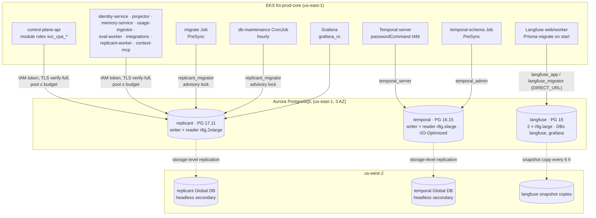
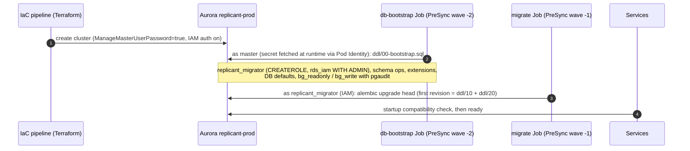

# Postgres Topology and Operation

**Section:** WS-10 · **Implements:** C-PG 2.0.0 (topology, roles, RLS protocol, partitioning, maintenance), D-09, D-22, D-26

## Purpose

This document defines the three PostgreSQL instances Replicant runs and how they are hosted,
sized, secured, and kept healthy. For the Replicant database it also covers roles, grants,
row-level security, connection budgets, partitioning, and pgvector maintenance. All of it is
created and maintained by automation. Nobody opens a database connection for routine work (D-26).

## Decisions summary

| Decision | Reference |
|---|---|
| All three instances run on **Amazon Aurora PostgreSQL**: `replicant` on 17 (pgvector 0.8.2), `temporal` on 16, `langfuse` on 16 provisioned (2 × `db.r8g.large`, databases `langfuse` and `grafana`; R1-235, settled with WS-08). CloudNativePG is rejected: it has no IAM DB auth for break-glass, and its operational load is higher | [ADR-WS10-001](adr/001-replicant-postgres-hosting-aurora.md), D-09, D-22 |
| **No connection pooler** in v1. Connections are direct, IAM-authenticated, and budgeted per role. RDS Proxy pins every connection on `set_config`, which the RLS protocol issues per transaction | [ADR-WS10-004](adr/004-connection-pooling-direct-iam.md) |
| **Grant model v2** (R1-160, XD-ORCH-03): owners' DDL is the only source of table privileges in their schemas, so their narrowing grants (column-level secrets, append-only history) survive. WS-10 creates roles, logins, schema `USAGE`, and markers, and issues no table grants or default privileges outside `ops`. Capability roles `r_<schema>_read/_write` are grant **targets** for owners. control-plane-api writes through **module roles** (`svc_cpa_intake`, …) activated per transaction | §3, C-PG rule 1 and Risks |
| RLS uses transaction-local GUCs. Cross-tenant scopes are **role-gated** (the policy targets a marker role), so setting a GUC alone never widens visibility | §4, C-PG rule 4 |
| High-volume tables use monthly RANGE partitions created and dropped by the `migrate` image's maintenance mode. ULID-keyed tables are partitioned on the ULID itself | §6, C-PG rule 3 |
| pgvector: HNSW indexes, `halfvec` where WS-04 allows, iterative scans for filtered retrieval, `REINDEX CONCURRENTLY` before `VACUUM` | §7 |
| Region DR: an Aurora Global Database headless secondary for `replicant` and `temporal` | [ADR-WS10-008](adr/008-disaster-recovery-strategy.md), [recovery.md](recovery.md) |



---

## 1. Instances

| | `replicant` | `temporal` | `langfuse` |
|---|---|---|---|
| Engine | Aurora PostgreSQL **17.11** (pgvector 0.8.2, pgaudit 17.1, pg_partman 5.4.3 available) [verified: https://docs.aws.amazon.com/AmazonRDS/latest/AuroraPostgreSQLReleaseNotes/AuroraPostgreSQL.Extensions.html, 2026-10-24] | Aurora PostgreSQL **16.15** (Temporal tests 13–16) [verified: https://docs.temporal.io/temporal-service/persistence, 2026-10-24] | Aurora PostgreSQL **16.x** (Langfuse v4: "PostgreSQL 15 minimum, 16 recommended"; WS-08 runs 16, R1-235) [verified: https://langfuse.com/self-hosting/upgrade/upgrade-guides/upgrade-v3-to-v4, 2026-10-24] |
| Cluster ID | `replicant-prod` | `temporal-prod` | `langfuse-prod` |
| Databases | `replicant` | `temporal`, `temporal_visibility` | `langfuse`, `grafana` (Grafana's own state, WS-08) |
| Instances (prod) | writer `db.r8g.2xlarge` (8 vCPU, 64 GiB) + reader `db.r8g.2xlarge` in another AZ, promotion tier 0 | writer `db.r8g.xlarge` (4 vCPU, 32 GiB) + reader `db.r8g.xlarge` | writer `db.r8g.large` + reader `db.r8g.large` |
| Staging | writer + reader `db.r8g.large` | writer + reader `db.r8g.large` | writer `db.r8g.large` only |
| Dev | writer `db.r8g.large` | writer `db.r8g.large` | writer `db.t4g.medium` only |
| Storage config | Aurora Standard | **Aurora I/O-Optimized** (I/O projected > 25% of spend; temporal-persistence.md §5) | Standard |
| Parameter group | [config/rds/replicant-cluster-parameters.json](config/rds/replicant-cluster-parameters.json) | [config/rds/temporal-cluster-parameters.json](config/rds/temporal-cluster-parameters.json) | [config/rds/langfuse-cluster-parameters.json](config/rds/langfuse-cluster-parameters.json) |
| Encryption at rest | KMS `alias/replicant/prod/rds-replicant` (platform key) | `alias/replicant/prod/rds-temporal` | `alias/replicant/prod/rds-langfuse` |
| TLS | `rds.force_ssl=1`. Clients use `sslmode=verify-full` with the RDS global CA bundle | same | same |
| Auth | IAM (`rds_iam`) for every role except the RDS-managed master and `grafana_ro` (Grafana's PostgreSQL data source supports only passwords; G-18) | IAM (`temporal_admin`, `temporal_server`) | passwords (Langfuse needs static URLs), rotated by Secrets Manager every 30 days |
| Backups | automated, **35-day PITR**; AWS Backup daily snapshot copied to us-west-2 and to the backup account vault (Vault Lock governance, 12 months) | same; vault 90 days | automated 14 days; snapshot copy to us-west-2 every 6 h, kept 7 days |
| DR | Global Database headless secondary in us-west-2 | Global Database headless secondary | snapshot copies |
| Deletion protection | on | on | on |
| Maintenance window | Sun 06:00–07:00 UTC (low traffic; human waits are unaffected) | Sun 07:00–08:00 UTC | Sun 08:00–09:00 UTC |
| Performance Insights / Enhanced Monitoring | on (7 days free tier); metrics into Mimir via Alloy's CloudWatch exporter | on | on |
| Database Activity Streams | **on**, async mode, for break-glass audit (§9) | off | off |

Why the instances cannot be consolidated (C-PG §1): Temporal requires PostgreSQL ≤ 16 while the
Replicant runs 17. Their failure domains differ: Temporal is the source of truth for workflow state,
Replicant for domain data. D-09 forbids sharing anyway.

**Parameter group note.** `ModifyDBClusterParameterGroup` accepts at most 20 parameters per call,
and the Replicant group has 21. The IaC module applies them in batches `[unverified: the 20-parameter
per-request limit was not re-checked; Terraform batches regardless]`.

## 2. Replicant database layout

Schemas, writers, readers and DDL owners are exactly those in C-PG §2. WS-10 adds the following,
all inside the contract:

| Object | Purpose |
|---|---|
| schema `public` | Extension objects only (`vector`, `pg_trgm`, `pgcrypto`, `pgstattuple`, `pg_stat_statements`). Owner `replicant_migrator`; `CREATE` revoked from everyone, `USAGE` granted to all. WS-04 DDL resolves `vector` and `gin_trgm_ops` through it |
| `ops.*` | [ddl/20-ops.sql](ddl/20-ops.sql): `alembic_version`, `migration_runs`, `migration_log`, `maintenance_runs`, `partitioned_tables`, `restore_events`, view `schema_status`, RLS helpers `ops.current_tenant()`, `ops.principal_scope()`, `ops.apply_tenant_rls()`, ULID helper `ops.ulid_floor()` |
| database defaults | `search_path = pg_catalog, public`; `statement_timeout = 30s`; `lock_timeout = 5s`; `idle_in_transaction_session_timeout = 60s`; `timezone = UTC`; `replicant.tenant_id = ''`; `replicant.principal_scope = ''`; `replicant.audit_tenants = ''` ([ddl/00-bootstrap.sql](ddl/00-bootstrap.sql)) |

All Replicant SQL is schema-qualified. `search_path` contains no Replicant schema, so an unqualified
name can never resolve to the wrong one.

Bootstrap sequence (once per environment, all automated):



The bootstrap Job never mounts the master secret as a Kubernetes Secret. Its Pod Identity role has
`secretsmanager:GetSecretValue` on the single master secret ARN, and the Job runs only when the
SHA-256 of `00-bootstrap.sql` changes (an Argo CD annotation on the Job's ConfigMap).

## 3. Roles and least privilege

Source of truth for roles, memberships, and schema `USAGE`: [ddl/10-roles-and-grants.sql](ddl/10-roles-and-grants.sql),
applied by revision `202610240001_ops` and re-applied by any revision that adds a reader edge. Source of
truth for **table** privileges: each owner's DDL (C-PG rule 1).

Grant model v2 (wave-1 fix of R1-160 / XD-ORCH-03). The first version gave capability roles `SELECT`/DML on
every table through `ALTER DEFAULT PRIVILEGES`. That silently voided the owners' narrowing: WS-07 grants
`identity.sessions` column by column so `refresh_token_enc` stays unreadable, and WS-03, WS-04, and WS-06
revoke `UPDATE`/`DELETE` on their history tables. Now:

- WS-10 issues **no** table grants and **no** `ALTER DEFAULT PRIVILEGES … GRANT` in an owner schema. The only
  default-privilege entries there are the `REVOKE EXECUTE ON FUNCTIONS FROM PUBLIC` ones. Default privileges
  remain only in WS-10's own `ops`.
- Owners grant reads to `r_<schema>_read` (or column lists to the login when they narrow) and DML to
  `r_<schema>_write`. control-plane-api's reads go to `svc_cpa_read` or `r_<schema>_read`, and its DML to
  `svc_cpa_<module>`, never to the login (XD-FIX-R1-160).
- One documented exception: `bg_readonly` gets table-level `SELECT` on `jobs_read`, `approvals`, `intake`,
  `registry`, and `cost` (WS-09 break-glass), none of which holds a narrowed column.

CI (`tools/check_grants.py`, run against the database after the owners' DDL) checks four things and fails
on any difference: (1) `pg_default_acl` in owner schemas holds nothing but owner-only entries; (2)
`pg_auth_members` equals the matrix; (3) every table privilege held by a Replicant role is C-PG-legal (DML
only to the schema's writer or module role, `SELECT` only to listed readers, `grafana_ro` only on views or
rule-6 schemas); (4) **narrowing probes** prove the owners' restrictions hold at runtime: no role but
`svc_identity_service` can read `identity.sessions.refresh_token_enc` or `identity.link_flows.pkce_verifier_enc`,
and nobody can `UPDATE` or `DELETE` `registry.bundle_promotion_events`, `registry.bundle_assignment_history`,
`memory.state_transitions`, or `memory.curator_actions`. It also prints the `grafana_ro` read report per
schema, which is how `grafana_ro`'s grants are checked across every owner's DDL.

### 3.1 Taxonomy

| Role | Kind | Holds |
|---|---|---|
| `replicant_migrator` | LOGIN (IAM), used only by the migrate image | Owner of every object except audit tables. CREATEROLE (PostgreSQL 16+ semantics: administers only roles it created). `createrole_self_grant = 'set'` |
| `audit_owner` | NOLOGIN | Owns `audit.*` tables and `audit.emit()` (C-PG rule 3) |
| `r_<schema>_read` / `r_<schema>_write` | NOLOGIN capability (grant target) | `USAGE` on the schema from WS-10. Table privileges only from the owner's DDL (grant model v2); WS-10 grants them to the logins the matrix allows |
| `r_audit_emit` | NOLOGIN capability | `EXECUTE audit.emit(jsonb)`, granted by `audit_owner` |
| `r_audit_restore` | NOLOGIN marker, held only by `replicant_migrator` | `EXECUTE` on the restore form of `audit.emit` (original `aud_` ID and `occurred_at`, only while an `ops.restore_events` row is open; CCR-10-09, recovery.md §4.2) |
| `svc_cpa_read` | NOLOGIN | Inherited by every `svc_cpa_*` module role; holds the `r_*_read` set of control-plane-api; owners grant control-plane-api's reads to it |
| `memory_analytics_owner`, `qa_analytics_owner` | NOLOGIN view owners | Own WS-04's `memory.v_analytics_*` and WS-05's `qa.flake_summary_daily` (§7.4) |
| `audit_reader` | NOLOGIN (WS-08 grants it `SELECT` on `audit.*`) | Held by `svc_audit_exporter` (CCR-08-06) |
| `r_cross_tenant_read` / `r_cross_tenant_write` | NOLOGIN marker | RLS policies target them (§4). Membership requires WS-09 approval |
| `svc_cpa_tenancy`, `svc_cpa_intake`, `svc_cpa_registry`, `svc_cpa_notify` | NOLOGIN module roles | The only write path of control-plane-api. Granted `WITH INHERIT FALSE, SET TRUE` and activated per transaction |
| `svc_<service>` | LOGIN (IAM), `NOINHERIT` | Inherits only the capability roles granted `INHERIT TRUE` per the matrix, and through them whatever the owners granted those roles |
| `grafana_ro` | LOGIN (**password**, Secrets Manager alternating-users rotation every 30 days, delivered by External Secrets) | Read schemas per C-PG rule 6. Role defaults: `default_transaction_read_only=on`, `replicant.principal_scope='operator:all-tenants'`. Grafana's PostgreSQL data source has no RDS IAM support (only user/password or `.pgpass`, plus TLS) [verified: https://grafana.com/docs/grafana/latest/datasources/postgres/configure/, 2026-10-24] |
| `bg_readonly`, `bg_write` | LOGIN (IAM), created by bootstrap | Break-glass (§9). Role names, connection limits, and schema scope follow WS-09 (spec/09-security/policies/postgres/roles-and-rls.sql) |

### 3.1a Marker roles (scope markers, never privilege holders)

A marker role says *which policy or function may apply to its members*. It never holds a table or column
privilege of its own and owns no relation; `check_grants.py` check 3d fails the gate if one does. Members
get data access only from their own grants (or their capability roles), and the marker only decides which
RLS policy can admit those reads or writes under a given `replicant.principal_scope`.

| Marker | What it unlocks | Members |
|---|---|---|
| `r_cross_tenant_read` | canonical `rls_*_xt_read` policies (`FOR SELECT`), honoured only under `operator:all-tenants`, for human operators and the read paths that serve them | `svc_control_plane_api`, `svc_identity_service`, `grafana_ro`, `bg_readonly`, `memory_analytics_owner`, `qa_analytics_owner`, `replicant_migrator` |
| `r_cross_tenant_write` | canonical `rls_*_xt_write` policies (`FOR ALL`), honoured only under `system:all-tenants`, for service principals acting on their own behalf. For a member with only `SELECT` grants it is a pure **read** scope marker: the policy admits the row but no privilege allows a write | `svc_audit_exporter` (reads only), `eval_metrics_reader` (column `SELECT` only), `replicant_migrator` (data revisions, maintenance) |
| `r_audit_emit` | `EXECUTE` on `audit.emit(jsonb)` (a function privilege granted by WS-08; no table privilege) | every writer service, the `svc_cpa_*` module roles, `svc_audit_exporter`, `eval_metrics_reader` |
| `r_audit_restore` | `EXECUTE` on `audit.emit_restored(jsonb)`, only while an `ops.restore_events` row is open (CCR-10-09) | `replicant_migrator` only |

### 3.2 Writer/reader matrix (C-PG §2, as implemented)

| Login | Writes | Reads | `audit.emit` | Cross-tenant | Connection limit |
|---|---|---|---|---|---|
| `svc_control_plane_api` | tenancy, intake, registry, notify (through `svc_cpa_*` only) | ops, tenancy, identity, intake, registry, jobs_read, approvals, cost, evals, audit, notify, github_app, slack_app, jira_app, qa (+ `svc_cpa_read`, WS-07's column-level grants) | yes | read | 120 |
| `svc_identity_service` | identity | ops, tenancy | yes | read | 40 |
| `svc_replicant_projector` | jobs_read, approvals, **qa** (C-PG 1.1.0) | ops, tenancy, intake | yes | — | 40 |
| `svc_memory_service` | memory | ops, tenancy, identity, registry, jobs_read, ecosystem | yes | — | 60 |
| `svc_ecosystem_indexer` | ecosystem | ops, tenancy | yes | — | 20 |
| `svc_usage_ingestor` | cost | ops, tenancy, jobs_read | yes | — | 40 |
| `svc_eval_worker` | evals | ops, tenancy, registry; **cross-tenant reads of `jobs_read`, `intake.job_requests`, `approvals.gates`, `cost.job_costs` only through the audited `ops.eval_*` functions** (CCR-06-15, §3.4) | yes | — | 30 |
| `svc_github_integration` | github_app | ops, tenancy, identity, intake, jobs_read, approvals | yes | — | 50 |
| `svc_slack_integration` | slack_app | ops, tenancy, identity, jobs_read, approvals, notify | yes | — | 40 |
| `svc_jira_integration` | jira_app | ops, tenancy, identity | yes | — | 20 |
| `svc_github_token_broker` | — | ops; `github_app.repos` eight columns only (CCR-07-11; WS-07 grants the columns, WS-10 gives schema `USAGE` and no capability role) | yes | — | 10 |
| `svc_retention_sweeper` | — (S3 deletes only) | ops | yes | — | 5 |
| `svc_audit_exporter` (WS-08) | — (S3 audit exports and reconciled approval records) | ops, audit (through `audit_reader`), approvals: **column-limited** `gates` and `gate_decisions` reads granted by WS-07 to the login (XD-W2-08-03, XD-W2-10-08; no `r_approvals_read`); role default scope `system:all-tenants` (ruling on XD-W2-10-03) | yes | write marker (`system:all-tenants`; no write privileges) | 4 |
| `svc_replicant_worker` | — | ops, tenancy, registry, ecosystem, cost, qa | — | — | 160 |
| `svc_publisher_worker` | — | ops, tenancy, registry | — | — | 20 |
| `svc_context_mcp` | — | ops, tenancy, ecosystem | — | — | 40 |
| `grafana_ro` | — | `USAGE` on ops, intake, registry, jobs_read, approvals, cost, evals, memory, audit, qa, ecosystem. Table `SELECT` comes from each owner's DDL: whole tables in the rule-6 schemas, and only the approved aggregate views in memory (`v_analytics_*`), audit (`v_daily_counts`), qa (`flake_summary_daily`), and ecosystem (`v_source_freshness`, `v_graph_stats`; CCR-04-07, XD-FIX-R1-107). Holds **no** capability role | — | read | 10 |

`memory` has no reader grants besides its writer. C-PG's open question (direct snapshot reads by
replicant-worker) is resolved in favor of the memory-service API. Grafana sees memory analytics only
through **plain views** owned by `memory_analytics_owner` (not `replicant_migrator`, and not materialized
unless they become slow), which exclude entry content (§7.4, R1-244). This satisfies D-25 ("only through views exposing aggregate
analytics").

### 3.2a eval-worker's audited cross-tenant reads (CCR-06-15)

The ruling allows eval-worker to read `jobs_read`, `intake`, `approvals`, and `cost` across tenants only under
`system:all-tenants`, only IDs, status, metrics, and digests, with every read audited. Views cannot audit a
read, so WS-10 implements the "views" as nine set-returning functions in `ops`
([ddl/40-eval-metrics-reader.sql](ddl/40-eval-metrics-reader.sql)): `ops.eval_jobs`, `ops.eval_job_prs`,
`ops.eval_job_requests`, `ops.eval_gates`, `ops.eval_job_costs`, and (wave 2, XD-W2-06-01) `ops.eval_job_runs`
(with `qa_verdict`), `ops.eval_job_memory_usage`, `ops.eval_job_outcomes`, and (wave 3, XD-W3-R1V-036)
`ops.eval_job_served_models` (served model per job from `cost.usage_events`), each `(p_from, p_to)` with a window of at most
46 days and 200,000 rows.

- They are `SECURITY DEFINER`, owned by the NOLOGIN role `eval_metrics_reader`. That role holds column-level
  `SELECT` on the allowlisted columns only (no `title`, `request`, `snapshot`, `url`, `repo`, `requester`,
  packet, or decision text) and the `r_cross_tenant_write` marker. Each function pins
  `replicant.principal_scope = 'system:all-tenants'` in its `SET` clause, which is restored on return.
  All nine pin `system:all-tenants` (orchestrator ruling). `ops.eval_job_outcomes` reads WS-04's
  `security_invoker` view `memory.v_job_outcomes`, so the base-table policies are evaluated for
  `eval_metrics_reader` under that scope (XD-W2-10-07; WS-04 grants the base columns).
- Each call writes one `audit.emit` event `data.cross_tenant_read` (function, window, row count). If the emit
  fails, the call fails.
- `EXECUTE` is granted to `svc_eval_worker` only. That login holds no `USAGE` on the four schemas, so a direct
  read is denied.
- This is WS-10's second documented table-privilege exception (after `bg_readonly`). `check_grants.py` fails
  if `eval_metrics_reader` holds any table-level grant or a column outside the allowlist.
- The file runs after the owners' DDL (it names their columns) and is re-runnable. `tools/test_eval_reader.sh`
  proves: both tenants visible through the function, no free text reachable, direct reads denied, windows
  over 46 days refused, the caller's scope unchanged afterwards, other logins denied, and exactly one audit
  event per call.
- `ops.eval_job_prs` returns `opened_at`, `merged_at`, `closed_at` (WS-07 added them, XD-W2-06-03) and is windowed
  on `opened_at`, so WS-06's merge-rate query (online-metrics.md §4) runs on the function outputs instead of
  direct joins (XD-W2-10-04 asks WS-06 to rewrite it that way).

### 3.3 control-plane-api module roles (blast-radius mitigation from C-PG "Risks")

```sql
-- One login, four write identities. Inside the intake transaction:
BEGIN;
SELECT set_config('role', 'svc_cpa_intake', true),
       set_config('replicant.tenant_id', 'payments', true),
       set_config('replicant.principal_scope', 'tenant', true);
INSERT INTO intake.job_requests (tenant_id, request_id, dedupe_key, job_id, release_bundle_id, request, received_at)
VALUES ('payments', 'jrq_01m6a7q3k8x2v9n4p6r1t5w0yz', 'github:delivery:6f1b4a40-5f1e-11ef-8a4b-1c9d6e0b2a11',
        'job_01m6a7q3m2b4c6d8e0f1g2h3j4', 'rb_ds5p3wmcj4dag2e9a8ncp4py6k', $1::jsonb, now())
ON CONFLICT (tenant_id, dedupe_key) DO NOTHING
RETURNING job_id;
-- request JSON bound as $1; column list per WS-07 intake.sql
SELECT audit.emit(jsonb_build_object(
  'event_type', 'job.requested', 'outcome', 'success', 'tenant_id', 'payments',
  'actor_principal_id', 'usr_01knk8dfr0fvjc7v0b9vhvkzbp', 'channel', 'github',
  'source_service', 'control-plane-api', 'job_id', 'job_01m6a7q3m2b4c6d8e0f1g2h3j4'));
COMMIT;   -- role and GUCs revert
```

Validated (PostgreSQL 17.11, 2026-10-24): the login alone gets `permission denied for table`, while
`svc_cpa_intake` can insert into intake and gets `permission denied for schema intake` when it tries to
write registry. The `replicant-db` `tx(module=...)` helper is the only code path that sets the role,
and import-linter forbids raw `session.begin()` in control-plane-api modules.

## 4. Row-level security

### 4.1 Policy shape

Every table with `tenant_id text NOT NULL` gets the standard policies through
`SELECT ops.apply_tenant_rls('<schema>.<table>')` in its creating revision:

```sql
ALTER TABLE t ENABLE ROW LEVEL SECURITY;
ALTER TABLE t FORCE ROW LEVEL SECURITY;          -- the owner (migrator) is subject too
CREATE POLICY rls_t_tenant   ON t AS PERMISSIVE FOR ALL    TO PUBLIC
  USING (tenant_id = ops.current_tenant()) WITH CHECK (tenant_id = ops.current_tenant());
CREATE POLICY rls_t_xt_read  ON t AS PERMISSIVE FOR SELECT TO r_cross_tenant_read
  USING (ops.principal_scope() = 'operator:all-tenants');
CREATE POLICY rls_t_xt_write ON t AS PERMISSIVE FOR ALL    TO r_cross_tenant_write
  USING (ops.principal_scope() = 'system:all-tenants') WITH CHECK (ops.principal_scope() = 'system:all-tenants');
```

Properties, all validated on PostgreSQL 17.11 (2026-10-24, test script in tools/validate.sh):

| Case | Result |
|---|---|
| projector, tenant `payments` | sees only payments rows (1,000 of 2,000) |
| any role, no tenant set | 0 rows; INSERT raises `new row violates row-level security policy` |
| projector sets `operator:all-tenants` (not a member) | 0 rows: setting the GUC does not widen visibility |
| control-plane-api (member of `r_cross_tenant_read`) with `operator:all-tenants` | 2,000 rows |
| grafana_ro (role default scope) | 2,000 rows; UPDATE denied |
| plan for non-members | `Index Cond: (tenant_id = NULLIF(current_setting('replicant.tenant_id', true), ''))`, with no OR branch because role-targeted policies are omitted for non-members |

This is stronger than the WS-09 baseline pattern (`… OR current_setting('replicant.principal_scope') =
'operator:all-tenants'` for any role), and it needs no `BYPASSRLS` login (`svc_operator_views`). The
conflict is filed in cross-ws-dependencies (XD-10-06). As WS-09 states, RLS remains defense in depth
against application bugs. It is not a boundary against a compromised service, which could still
target another tenant's ID.

### 4.2 Scope vocabulary (canonical; `replicant_db.session.Scope`)

| Value | Honored by | Who sets it |
|---|---|---|
| `tenant` (default when empty) | standard policy | every request |
| `operator:all-tenants` | `rls_*_xt_read` (members of `r_cross_tenant_read`) | control-plane-api operator module after identity-service confirms `replicant-operators` for this request (WS-09); emits `audit.emit` |
| `system:all-tenants` | `rls_*_xt_write` (members of `r_cross_tenant_write`: `replicant_migrator` today) | migrate data revisions, maintenance, restore reconcile |
| `admin:memory` | memory schema policies (WS-04) | memory-service after the D-25 admin check |
| `eval:platform` | evals/registry platform-row policies (WS-06) | eval-worker |

WS-04 currently spells these `replicant_admin` and `system`, and WS-06 spells them `platform` and
`eval`. The rename request is XD-10-07.

### 4.3 Tables without tenant data

`identity.users`, `identity.groups`, and global registry definitions carry no `tenant_id`. They need
no RLS. Tables that *do* carry `tenant_id` must have RLS, including platform rows that use
`replicant-system` or `replicant-eval`. CI check `tools/check_rls.py` lists every relation with a
`tenant_id` column and `relrowsecurity = false`. Applying WS-06's DDL today surfaces 26 such tables
(ddl/INDEX.md §4).

## 5. Connections

No pooler ([ADR-WS10-004](adr/004-connection-pooling-direct-iam.md)). Every pod runs a SQLAlchemy
pool against the cluster endpoint, or the reader endpoint for read-only modules. Each new physical
connection gets a fresh IAM token ([code/replicant_db/session.py](code/replicant_db/session.py)).

| Login | Max pods (HPA) | Pool + overflow | Max connections | Role limit |
|---|---|---|---|---|
| control-plane-api | 6 | 5 + 5, plus 1 LISTEN | 66 | 120 |
| identity-service | 3 | 5 + 5 | 30 | 40 |
| replicant-projector | 4 | 5 + 5 | 40 | 40 |
| memory-service | 6 | 5 + 5 | 60 | 60 |
| ecosystem-indexer | 2 | 5 + 5 | 20 | 20 |
| usage-ingestor | 3 | 5 + 5 | 30 | 40 |
| eval-worker | 4 | 3 + 2 | 20 | 30 |
| github-integration | 4 | 5 + 5 | 40 | 50 |
| slack-integration | 3 | 5 + 5 | 30 | 40 |
| jira-integration | 2 | 3 + 2 | 10 | 20 |
| github-token-broker | 2 | 1 + 1 | 4 | 10 |
| replicant-worker (all live versions) | 6 per version × ≤ 6 versions | 2 + 2 | 144 | 160 |
| publisher-worker | 3 | 2 + 2 | 12 | 20 |
| context-mcp | 3 | 5 + 5 | 30 | 40 |
| grafana_ro, migrate, maintenance, bg_* | — | — | ≤ 20 | 10 / 5 / 2 |
| **Total** | | | **≈ 560 expected max** | **≈ 710 limit sum** |

`max_connections = 1000` (parameter group). Alerts:
`ReplicantDbConnectionsHigh`
(`aws_rds_database_connections_average{cluster="replicant-prod"} > 750 for 10m`) and
`ReplicantDbRoleConnectionLimitHit`, from a log-based metric on `too many connections for role`.

Failover behavior: Aurora promotes the reader in under 60 s. Pools detect dead connections with
`pool_pre_ping`, re-resolve the cluster endpoint, and mint new tokens. In-flight transactions fail
with `08006`/`57P01`, which are retryable SQLSTATEs in replicant-db. FastAPI returns 503 with
`Retry-After: 5`, and Temporal activities retry. The LISTEN connection reconnects, re-LISTENs, and
pushes a "resync" event to SSE clients, because NOTIFY is not durable across a failover.

## 6. Partitioning

| Table | Owner | Key | Interval / premake | Retention (drop) | Notes |
|---|---|---|---|---|---|
| `audit.events` | WS-08 | `occurred_at` (RANGE) | month / 3 | 84 months | Drop only after the S3 export of that month is verified (`export_before_drop`) |
| `cost.usage_events` | WS-03 | `occurred_at` | month / 3 | 25 months | Rollup tables are not partitioned |
| `memory.retrievals` | WS-04 | `at` | month / 3 | 13 months (WS-04 data-model.md) | WS-04 DDL pre-creates 2026_10–12; maintenance creates the rest |
| `memory.usage_events` | WS-04 | `at` | month / 3 | 13 months | as above |
| `jobs_read.job_timeline` | WS-07 (not partitioned yet) | **`job_id` (RANGE on the ULID)** | month / 3 | 26 months | Proposal to WS-07, XD-10-04. Maintenance skips it until it is partitioned |
| `qa.test_results` | WS-05 | `observed_at` | month / 3 | 4 months (C-PG 1.1.0: 120 days; whole-month partitions) | |

Partition names are `<table>_YYYY_MM`, the convention WS-04 already uses. The registry of partitioned
tables is `ops.partitioned_tables` (reference data shipped by migrations). The hourly
`replicant-db-maintenance` CronJob ([config/k8s/db-maintenance-cronjob.yaml](config/k8s/db-maintenance-cronjob.yaml))
runs [code/replicant_db/maintenance.py](code/replicant_db/maintenance.py):

- `partition_create`: the current month plus `premake` months ahead. Idempotent.
- `partition_secure` (XD-ORCH-04): PostgreSQL applies a parent's RLS and privileges only to queries
  through the parent. A partition queried **directly** uses its own, and WS-05 showed on PostgreSQL 17
  that a schema-wide grant (as WS-10's old default privileges gave) lets any reader see every tenant's rows
  that way. Every partition `partition_create` makes, and on every run every leaf partition in Replicant
  schemas that is not yet isolated (including those created by owners' DDL or by functions such as
  `memory.ensure_tenant_partitions`), goes through `ops.secure_partition`: `ops.apply_tenant_rls`
  (ENABLE + FORCE + canonical policies) when it has `tenant_id`, otherwise ENABLE + FORCE with no policy
  (deny), and `REVOKE ALL` from everyone but the owner. Services reach the rows only through the parent.
  The sweep touches only partitions that need it, because the `ALTER` takes an ACCESS EXCLUSIVE lock.
  Default privileges cannot be scoped to partitions, so none may exist in owner schemas (§3,
  `check_grants.py`). Owners that create partitions in their own functions call `ops.secure_partition`
  themselves (XD-FIX-ORCH-04), which closes the up-to-1-hour window before the sweep.
- `partition_detach` / `partition_drop`: partitions whose upper bound is more than `retain_months` old.
  For tables with `export_before_drop = true`, the S3 export manifest for that month must exist and
  its row count must equal the partition's count.
- Alert `ReplicantDbPartitionRunwayLow`: fewer than 2 future partitions on any registered table, which
  would mean inserts start failing at month rollover. There is no DEFAULT partition on purpose: a
  default partition makes later `ATTACH` scan it, and it hides missing maintenance.

**ULID-range partitioning.** Replicant ULIDs encode the millisecond timestamp in the first 10 body
characters, and the Crockford alphabet is in ASCII order. Under `COLLATE "C"` they therefore sort
by creation time. `ops.ulid_floor('job_', '2026-11-01')` returns `job_01m6a6ft000000000000000000`,
which equals the C-IDS reference implementation's output. Tables keyed by `(job_id, seq)` can thus
be partitioned by job creation month without adding a timestamp to the primary key. Validated:
a November-2026 `job_id` routes to `job_timeline_2026_11`. Every ID column uses `COLLATE "C"`
(replicant_db.naming.IdText).

## 7. Vacuum, statistics, and index maintenance

### 7.1 Global settings

Autovacuum is tuned in the parameter group: `autovacuum_vacuum_scale_factor 0.05`,
`autovacuum_analyze_scale_factor 0.02`, `autovacuum_vacuum_cost_limit 2000`, and
`autovacuum_max_workers 6`. Hot tables get per-table settings in their creating revision:

```sql
ALTER TABLE jobs_read.jobs SET (autovacuum_vacuum_scale_factor = 0.01, autovacuum_vacuum_insert_scale_factor = 0.02,
                                fillfactor = 80);   -- HOT updates: the projector rewrites each row ~40×/job
ALTER TABLE intake.pending_actions SET (autovacuum_vacuum_scale_factor = 0.01);
```

### 7.2 Bloat scan and reindex

Maintenance task `bloat_scan` runs daily, using `pgstattuple_approx(regclass)` for tables and
`pgstatindex()` for btree indexes. It records results in `ops.maintenance_runs.details` and exports
`replicant_db_bloat_ratio{schema,relation}`. Task `reindex_concurrently` rebuilds at most one index
per run whose estimated bloat exceeds 40% and whose size exceeds 1 GiB. It uses
`REINDEX INDEX CONCURRENTLY` inside an autocommit block, between 01:00 and 05:00 UTC. A failed
concurrent reindex leaves an `INVALID` index. The next run detects `pg_index.indisvalid = false`
with the `_ccnew` suffix, drops it, and retries.

### 7.3 pgvector (memory schema; DDL owner WS-04)

| Topic | Rule | Source |
|---|---|---|
| Version | pgvector 0.8.2 in prod (Aurora 17.10+); local image pinned to 0.8.2 to match | [verified: Aurora extension table, 2026-10-24] |
| Index type | HNSW (`vector_cosine_ops` or `halfvec_cosine_ops`). Limits: `vector` indexes up to 2,000 dimensions, `halfvec` up to 4,000 | [verified: https://github.com/pgvector/pgvector README, 2026-10-24] |
| Storage | Prefer `halfvec(n)` when WS-04's recall evaluation allows it. It halves index memory. At 1 M entries × 1,024 dimensions, `vector` is about 4 GiB of vectors plus graph, and `halfvec` about 2 GiB. Either fits the 64 GiB writer with room | sizing §8 |
| Filtered retrieval | Every retrieval filters by tenant and scope (RLS plus predicates), so HNSW alone can return too few rows. memory-service sets `SET LOCAL hnsw.iterative_scan = relaxed_order` and `SET LOCAL hnsw.max_scan_tuples = 20000` per query. (Transaction-local `SET` is fine: there is no proxy) | [verified: pgvector 0.8.0 "iterative index scans", README, 2026-10-24] |
| Build | Index builds and rebuilds run only in migrations or maintenance mode, as `CREATE INDEX CONCURRENTLY` inside `autocommit_block()`, with `SET maintenance_work_mem = '8GB'` and `SET max_parallel_maintenance_workers = 7` for that session. "Indexes build significantly faster when the graph fits into maintenance_work_mem"; do not exhaust server memory | [verified: pgvector README, 2026-10-24] |
| Vacuum | HNSW vacuum is slow. pgvector says to speed it up "by reindexing first": maintenance runs `REINDEX INDEX CONCURRENTLY <hnsw>` and then `VACUUM memory.entry_embeddings` when dead tuples exceed 10% (monthly at most), rather than letting autovacuum crawl the graph. Autovacuum on that table: `autovacuum_vacuum_scale_factor = 0.2` (rare), `autovacuum_vacuum_insert_scale_factor = 0.05` | [verified: pgvector README "Vacuuming", 2026-10-24] |
| Embedding model change | A new embedding space is a new column/table plus index built concurrently (WS-04 `embedding_spaces`). Switch reads, then drop the old index in a contract revision. Never `ALTER TYPE` a vector column in place | schema-management.md §8 |

### 7.4 Materialized views for Grafana

Aggregate-only views for memory analytics (D-25), audit volume, and QA flakes are plain views owned by a
dedicated NOLOGIN owner. For memory this is `memory_analytics_owner` (WS-10 creates it as a member of
`r_cross_tenant_read`; WS-04 grants it SELECT on the exact base tables, XD-04-12). For audit it is
`audit_owner`. Views run with their owner's privileges, so RLS evaluates as the owner, and `grafana_ro`'s
role-default scope `operator:all-tenants` lets the aggregates span tenants. `grafana_ro` holds `SELECT` on
the views and **no grant on any base table**. Validated: `grafana_ro` reads `memory.v_analytics_entry_counts`
and gets `permission denied for table entries`. If a view becomes too slow, its owner converts it to a
materialized view with a unique index, and maintenance task `matview_refresh` runs `REFRESH MATERIALIZED
VIEW CONCURRENTLY` every 15 minutes.

## 8. Sizing (Replicant database)

| Data | Rows/year (estimate) | Size/year incl. indexes | Retention | Source of estimate |
|---|---|---|---|---|
| `audit.events` | ≈ 30 M (≈ 80k/day: job transitions, approvals, presigns, token mints) | ≈ 30 GB | 7 years (≈ 210 GB at steady state) | C-STATE §1.4 |
| `cost.usage_events` | ≈ 220 M (≈ 600k model calls/day at 3,000 runs/day) | ≈ 70 GB | 2 years | XD-00-10 |
| `memory.*` | entries ≤ 1 M; usage_events ≈ 70 M; retrievals ≈ 20 M | ≈ 40 GB | 13 months (telemetry) | WS-04 data-model.md |
| `jobs_read.*` | jobs ≈ 150k; timeline ≈ 6 M | ≈ 15 GB | 2 years | C-STATE §2 |
| everything else | small | ≈ 10 GB | | |
| **Year 1 total** | | **≈ 250–400 GB** | | |

The working set is the hot partitions, `jobs_read`, `approvals`, and the HNSW indexes, about 25 GB.
That fits in 64 GiB with buffer cache to spare. CPU is dominated by projection writes (≈ 40k
transactions/day) and retrieval queries, both modest. The `db.r8g.2xlarge` choice is driven by the
HNSW memory plus headroom for 10× growth. Scale-up threshold: writer CPU p95 > 60% or buffer cache
hit ratio < 99% for a week. Scale to `db.r8g.4xlarge`; a reader takes analytics reads first.

## 9. Operating without connecting (D-26)

| Need | Mechanism |
|---|---|
| Schema status, migration history | control-plane-api admin area reads `ops.schema_status` and `ops.migration_runs`. Metrics: `replicant_db_schema_compat{service,outcome}`, `replicant_db_migration_last_success_timestamp_seconds`, `replicant_db_migration_failures_total` |
| Slow queries, locks, bloat | Performance Insights (top SQL, waits) → Grafana CloudWatch data source. `pg_stat_statements` through `grafana_ro`-readable view `ops.top_statements` (normalized query text only, no parameters). `replicant_db_bloat_ratio` |
| Partition runway, maintenance results | `ops.maintenance_runs`, `replicant_db_partition_runway_months` |
| Connections per role | CloudWatch `DatabaseConnections` plus `pg_stat_activity` aggregates in the `ops.connection_summary` view (counts by `usename`, `application_name`, `state`; no query text) |
| Data fixes | Reviewed data revisions or admin API operations (schema-management.md §9) |
| Investigation | `replicant` CLI commands (schema-management.md §9), then break-glass (§9.1) |

### 9.1 Break-glass (summary; runbook in schema-management.md §10)

IAM auth for `bg_readonly` or `bg_write` comes only through the WS-09 break-glass role
(spec/09-security/policies/iam/breakglass-db.role-permissions.json). That role requires a principal
tag with an incident ticket and a time limit, and a second approver for `bg_write`. Access goes
through the SSM port-forward host. Session audit has three independent records: pgaudit
(`pgaudit.log = 'all'`, `log_parameter = on` on both roles, into CloudWatch Logs and then Loki with
`source="audit"`), Database Activity Streams (Kinesis to the security account), and the SSM session
log.

## 10. Local parity

| Production | Local (WS-11 compose profile `core`, `spec/11-local-dev/compose/compose.yaml`; WS-10 provides `config/compose/postgres-init/`) |
|---|---|
| Aurora PG 17.11 + pgvector 0.8.2 | `replicant/postgres:17-pgvector0.8.2` (pgvector built at the prod version, plus pgaudit), digest-pinned |
| Aurora PG 16 for Temporal | `postgres:16` digest-pinned |
| Aurora PG 16 for Langfuse (DBs `langfuse`, `grafana`) | `postgres:16` digest-pinned |
| `rds_iam` | an inert NOLOGIN role from `postgres-init/00-fake-rds-roles.sql`; services use passwords from the compose `.env` |
| Bootstrap Job | the same `00-bootstrap.sql` through `/docker-entrypoint-initdb.d` |
| migrate Job | the `migrate` one-shot service, `depends_on: {postgres-replicant: {condition: service_healthy}}`. Every service declares `depends_on: {migrate: {condition: service_completed_successfully}}` |

Parity gaps (for WS-11 `parity.md`): no IAM tokens, no Database Activity Streams, no Global
Database, and a single instance without failover. The application code paths are identical.

## Open questions

| Question | Who decides | Options | Recommendation |
|---|---|---|---|
| Is `svc_operator_views` (BYPASSRLS) still needed, given role-gated cross-tenant policies? | WS-09 | keep the BYPASSRLS login / adopt `r_cross_tenant_read` | Adopt the marker role and drop the BYPASSRLS login. It needs no extra login or pool, and the plan stays index-friendly (§4.1) |
| Should `replicant` move to PostgreSQL 18 once Aurora 18 supports Database Activity Streams? | WS-10 / WS-09 | stay on 17 / move | Stay on 17 until DAS supports 18, then use a blue/green major upgrade |
| `halfvec` vs `vector` for memory embeddings | WS-04 | — | `halfvec` unless WS-04's recall evaluation shows a measurable loss |

## Risks

- **Temporal on Aurora is untested by Temporal.** Mitigated by the staging soak, with the RDS
  for PostgreSQL 16 fallback (ADR-WS10-001).
- **Connection fan-out from pinned worker versions.** Bounded by role limits; the threshold for
  PgBouncer is in ADR-WS10-004.
- **Partition maintenance stalls**, so inserts fail at month rollover. Mitigated by 3 months of
  premake and the runway alert at fewer than 2.
- **RLS is defense in depth only.** A compromised service can set another tenant ID. Tenant
  isolation against compromise is the authorization layer's job (WS-09).

## Interfaces

- **Provided:** replicant-db roles, grants, and the RLS protocol (consumed by every Python service and
  by WS-04/06/07/08 DDL); the `ops` schema; maintenance mode; instance endpoints.
- **Consumed:** C-PG, C-STATE, C-IDS (ID formats, collation), WS-09 break-glass IAM and role names,
  WS-04/06/07/08/03 schema DDL.
