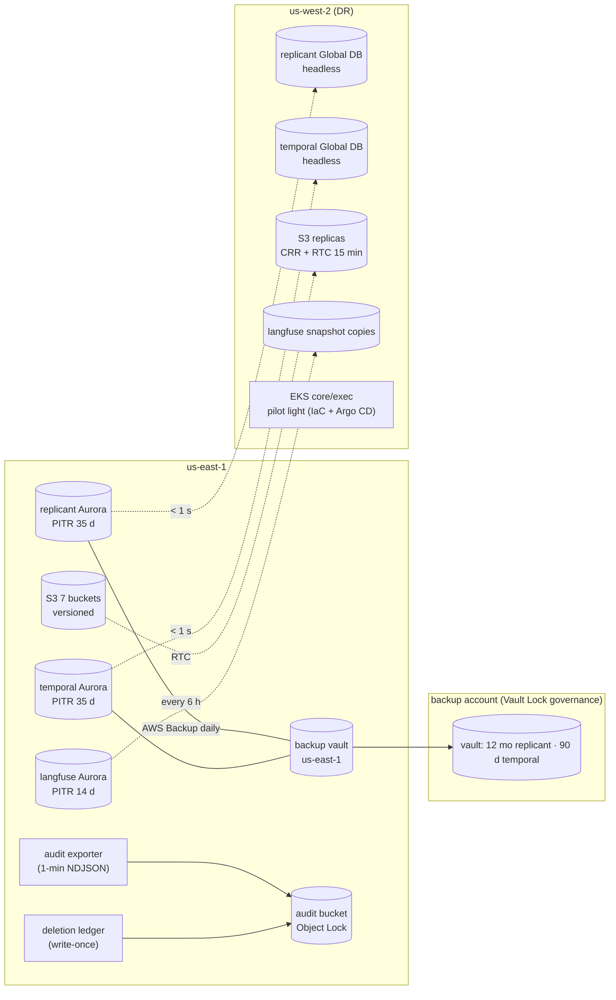
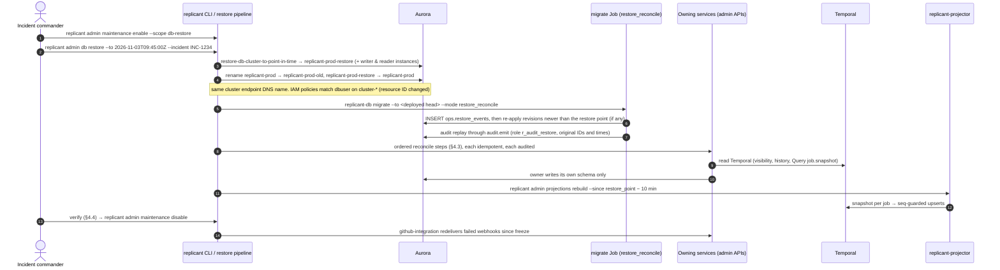

# Backup, Recovery, and Disaster Recovery

**Section:** WS-10 · **Implements:** the WS-10 brief §4; D-08, D-09, D-22 · **Depends on:** C-STATE (single owner per datum; derived copies rebuildable)

## Purpose

This document defines the RPO and RTO of every store, how each is backed up, and the runbooks for losing
or restoring the Replicant database, Temporal persistence, a whole region, memory entries, and a registry
publish. For each case it states what happens to in-flight jobs and how the stores are reconciled after
a restore.

The principle comes from C-STATE: **every datum has one owner**. Recovery restores the owner and then
*re-derives* the copies. When two owners disagree after a restore, the reconcile step decides which one is
authoritative for each fact. The table in §4.2 is the core of this document.

## Decisions summary

| Decision | Reference |
|---|---|
| Aurora PITR (35 days) plus AWS Backup copies to us-west-2 and a Vault-Locked backup account. Global Database headless secondaries for `replicant` and `temporal` | §2, [ADR-WS10-008](adr/008-disaster-recovery-strategy.md) |
| A restore is never "done" when the database is back. It is done when `replicant admin restore reconcile` finishes, an ordered, idempotent, audited sequence of **owner-executed** repair steps. The steps never write another service's schema (C-PG one-writer rule) | §3, §4 |
| An S3-side **audit event export** (every minute) and a **deletion ledger** (written at deletion time) live outside the database. A restore can re-import lost audit events and re-apply deletions, so restoring a backup never resurrects erased or leak-purged data. Lost audit events are replayed through `audit.emit` (restore form, `r_audit_restore`), never inserted directly | §3.3, §4.2, CCR-10-06 (accepted), CCR-10-09 |
| Registry versions get write-once **version index objects** in S3 before the row is inserted. A post-restore publish can then never reuse a version number for different content, and lost rows are rebuilt from S3 | §8, CCR-10-05 |
| Temporal restore: workflows replay from restored history. Every side effect is idempotent by logical activity ID (ADR-008). Projections that are *ahead* of Temporal are reset, not merged | §6 |
| No job fails because of a restore. Activities that exhaust retries during an outage put the job in WS-01's `blocked_on_dependency` pause (status `paused`, automatic re-probe, operator `job.resume`), failing only after `max_hours` (R2-010) | §4.2, §6 |
| Recovery is rehearsed: monthly automated restore tests, quarterly game days in staging, semi-annual region failover in staging | §9 |

---

## 1. RPO and RTO per store

| Store | Failure covered | RPO | RTO | Mechanism |
|---|---|---|---|---|
| **Replicant** Postgres | instance or AZ loss | 0 | ≤ 2 min | Aurora multi-AZ storage; reader promoted "typically … less than 60 seconds" [verified: https://docs.aws.amazon.com/AmazonRDS/latest/AuroraUserGuide/Concepts.AuroraHighAvailability.html, 2026-10-24] |
| | logical corruption, bad data fix, operator error | ≤ 5 min (to the chosen point) | ≤ 2 h (restore ≈ 30–60 min + reconcile ≈ 30 min) | PITR to the second within 35 days; LatestRestorableTime "typically within 5 minutes" [verified: https://docs.aws.amazon.com/AmazonRDS/latest/AuroraUserGuide/Aurora.Managing.Backups.html, 2026-10-24] `[unverified: Aurora PITR duration for ~400 GB; measured in the monthly restore test]` |
| | region loss | ≤ 1 min | ≤ 4 h (whole Replicant) | Global Database "typically under a second" lag; failover "within a few minutes" [verified: https://docs.aws.amazon.com/AmazonRDS/latest/AuroraUserGuide/aurora-global-database-disaster-recovery.html, 2026-10-24] |
| | ransomware or account compromise | ≤ 24 h | ≤ 8 h | AWS Backup copy in the backup account, Vault Lock |
| **temporal** Postgres | instance or AZ | 0 | ≤ 2 min | as above |
| | logical corruption | ≤ 5 min | ≤ 2 h | PITR + §6 reconcile |
| | region | ≤ 1 min | ≤ 4 h | Global Database |
| **langfuse** Postgres (WS-08 owns Langfuse) | any | ≤ 6 h | ≤ 4 h | PITR 14 d; snapshot copy every 6 h. Prompt versions pinned by bundles are escrowed as registry blobs in S3 (C-ART 1.2.0, CCR-06-02), so Langfuse loss never makes a bundle unrunnable |
| Langfuse ClickHouse, Loki, Tempo, Mimir (WS-08) | any | ≤ 24 h (traces/logs are evidence, not state) | ≤ 8 h | WS-08 backups; transcripts of record are in S3 |
| **S3** (all classes) | object deletion or overwrite | 0 within 7 days (noncurrent versions) | minutes | versioning; delete denied to all but two roles; registry and audit cannot be deleted |
| | region loss | ≤ 15 min (99.9% of objects, RTC) | ≤ 4 h | CRR; `session` is not replicated (raw state; jobs fall back to handoffs) |
| **etcd** (exec cluster: AgentRuns; WS-02 owns) | exec cluster loss | in-flight runs lost | ≤ 2 h (IaC) | AgentRuns are rebuildable from S3 manifests (XD-10-11). Workflows re-run nodes |
| Valkey `gateway-state` (gateway shim budgets, rate windows, revoked sets; C-STATE 1.2.0; WS-03 owns) | node or cluster loss | ephemeral by design | ≤ 5 min | shim reseeds budget counters from PG[cost] through usage-ingestor and the revoked sets from control-plane-api `/grants/revoked`. While reseeding it **fails closed** for new spend (WS-03 gateway.md). No backup is needed |
| Run grants (AgentRun `spec.runGrant`, etcd) | exec cluster loss | n/a | with the exec cluster | re-signed by replicant-worker when the node re-runs (new ordinal, new grant) |
| KMS keys | accidental schedule-deletion | 0 | minutes | 30-day pending window, `CancelKeyDeletion`; multi-Region replicas |
| Secrets Manager | region | 0 | minutes | replica secrets in us-west-2 |
| Zoekt index, repo-mirror cache, ecosystem graph | any | n/a (derived) | hours (rebuild) | re-index from GitHub and sources |

## 2. Backups

| Store | Continuous | Snapshots | Copies | Immutability |
|---|---|---|---|---|
| Replicant | Aurora PITR 35 d | AWS Backup daily 03:00 UTC, kept 35 d | us-west-2 vault (35 d); backup account vault (monthly, 12 months) | backup account vault: Vault Lock **governance** ("can have the lock removed by users with sufficient IAM permissions") with `ChangeableForDays` 3; compliance mode is reserved for a later decision by WS-09 [verified: https://docs.aws.amazon.com/aws-backup/latest/devguide/vault-lock.html, 2026-10-24] |
| temporal | PITR 35 d | daily, 35 d | us-west-2 and backup account (90 d) | as above |
| langfuse | PITR 14 d | every 6 h | us-west-2 (7 d) | — |
| S3 | versioning (7 d noncurrent) | — | CRR + RTC to us-west-2 (except `session`) | audit: Object Lock governance 2 y |

AWS Backup copies of Aurora are snapshots, not PITR: "AWS Backup creates a snapshot and copies it"
[verified: https://docs.aws.amazon.com/aws-backup/latest/devguide/point-in-time-recovery.html, 2026-10-24].
Cross-region point-in-time recovery comes from the Global Database, not from backups.

Exports outside the database that recovery depends on:

| Export | Writer | Location (audit bucket, Object Lock) | Cadence |
|---|---|---|---|
| `audit.events` NDJSON | audit exporter (WS-08; Deployment with `audit_reader` + S3 write) | `org/audit-exports/events/<yyyy>/<mm>/<dd>/<hh>/<first_aud_id>.ndjson.zst` | every minute; RPO of audit ≈ 1 min independent of database PITR |
| deletion ledger | every principal that hard-deletes or purges before natural expiry: memory-service, tenant offboarding, retention sweeper, `replicant-leak-purge` (XD-FIX-R1-233) | `org/deletion-ledger/<yyyy>/<mm>/<dd>/<del_id>.json` (write-once, C-ART 1.9.0; `del_` per C-IDS) | at deletion, **before** the delete commits |
| registry version index | control-plane-api registry | registry bucket `index/<kind>/<scope>/<name>/<version>.json` (write-once) | at publish, after the blob and before the row |

These three key layouts are in C-ART since 1.6.0 (CCR-10-05 and CCR-10-06 accepted); the ledger key uses the `del_` ID since C-ART 1.9.0.

## 3. Common restore machinery

### 3.1 Maintenance mode (write freeze)

`replicant admin maintenance enable --reason INC-1234 --scope db-restore` sets ConfigMap
`replicant-maintenance` (`{mode: db_restore, since, incident}`). The flag deliberately lives **outside** the
database being restored. Every service watches it (projected volume, about 60 s propagation).

| Component | Behavior in `db_restore` |
|---|---|
| control-plane-api | read endpoints serve the read model with a banner. Mutations, intake, and release operations return 503 with `Retry-After` and code `maintenance` |
| github-integration | webhooks return 503. GitHub does not retry automatically. After reopening, github-integration lists failed deliveries since `since` and redelivers them (`POST /app/hook/deliveries/{id}/attempts`) [verified by WS-00: V00-44] |
| slack-integration | interactions get an ephemeral "Replicant is in maintenance; your action was not recorded; retry after <time>" |
| workers | keep running. Activities that need the database fail and retry. `projection.apply` queues for up to 24 h (schedule-to-close) |
| migrate / maintenance | migrate runs only in `restore_reconcile` mode. Maintenance skips |

### 3.2 Restore bookkeeping

`ops.restore_events` (ddl/20-ops.sql) holds `restore_point`, `source`, `incident_ref`, and per-step state.
It is written by the reconcile run in the **restored** database, so the database itself records what was
repaired.

### 3.3 Deletion ledger replay

Any restore re-applies every ledger entry with `deleted_at > restore_point`, by calling the owning service's
idempotent delete. A GDPR erasure, memory purge, or leak purge (lifecycle.md §6) performed after the restore
point therefore cannot be undone by the restore. Ledger entries are `org/deletion-ledger/<yyyy>/<mm>/<dd>/<del_id>.json`;
the replay lists the day prefixes from the restore point's date forward. The same applies to restores from the 12-month backup-account copies (lifecycle.md §5).

## 4. Runbook: Replicant database loss or restore

### 4.1 Procedure

Renaming keeps the cluster endpoint DNS name, so services and IAM token signing need no endpoint change
`[unverified: Aurora cluster endpoint DNS follows the renamed identifier, as it does for RDS instances;
rehearsed in the monthly restore test (§9). Fallback: an Argo CD values change of REPLICANT_DB_HOST, about
10 min]`. Deleting the old cluster (`replicant-prod-old`) is a separate, approved step after 7 days.

### 4.2 Must-answer: after restoring the Replicant DB to 15 minutes ago, what is inconsistent and how is it repaired?

Temporal, S3, etcd, GitHub, Slack, Okta, and the AI gateway all kept running. The restored database lacks
everything its writers committed in the last 15 minutes. Per schema:

| Schema (owner) | What is lost or now wrong | Authoritative source after the restore | Repair (owner-executed, idempotent) |
|---|---|---|---|
| `ops` (migrate) | migration runs and revisions applied in the window; the schema may be **behind** deployed images | the release's migrate image | step 1: `replicant-db migrate` re-applies. Services stay unready (BEHIND) until then, by design |
| `audit` (all, through `audit.emit`) | audit events of the window | S3 audit export (1-min cadence) | step 2: migrate in `restore_reconcile` mode replays the NDJSON **through `audit.emit`** (C-PG rule 3: no direct INSERT, not even by `audit_owner`), connected as `replicant_migrator`, which holds the marker role `r_audit_restore`. The restore form of `audit.emit`, `audit.emit_restored(jsonb)` (WS-08 owns it; XD-FIX-R1-237, CCR-10-09), accepts the original `audit_event_id` and `occurred_at` only when the caller holds `r_audit_restore` **and** an `ops.restore_events` row is open, and is `ON CONFLICT (audit_event_id) DO NOTHING`, so replay is idempotent and re-runnable. Gap ≤ 1 min, reported in `ops.restore_events.steps` |
| `identity` (identity-service) | SCIM changes, **including deprovisioning and group removals**; identity links made in the window | Okta (upstream) | step 3: `POST /v1/admin/identity/resync` (WS-07, XD-FIX-R1-237; body `{"since": <ts>, "mode": "full"}`, 202 + `restore_step` ID) → full Okta user and group sync. Run **before reopening**, because a lost deprovision would otherwise re-enable a removed user. Lost links: users re-link (the UI prompts) |
| `tenancy` (svc_cpa_tenancy) | tenant settings, quotas, **kill switches** changed in the window | audit export (records every change) | step 4: `replicant admin restore review-changes --since` (wraps `GET /v1/admin/restore/review-changes?since=`, WS-07, XD-FIX-R1-237) lists audited tenancy and registry-operation changes. Tightening changes (kill switch on, quota down, tenant suspended) are re-applied automatically through the API. Loosening changes need a human |
| `intake` (svc_cpa_intake) | `job_requests` rows of jobs started in the window, so **dedupe keys** are missing; `pending_actions` outbox entries | Temporal: the workflow start input *is* the JobRequest (C-JOBREQ), plus search attributes | step 5: `POST /internal/v1/admin/restore/intake-resync?since=…` lists workflows with `StartTime ≥ restore_point − 5 min`, reads the first history event's input, and upserts `job_requests` (`start_status=started`, bundle from `ReplicantReleaseBundleId`). Must finish **before reopening intake**, otherwise a redelivered webhook would mint a second `job_id` for the same trigger. Outbox: actions submitted in the window and not yet accepted are lost, and the gate still shows open, so users re-click. Actions already accepted live in Temporal and are reflected by step 9 |
| `registry` (svc_cpa_registry) | definition versions, **registry heads** (`registry.definition_heads`, CCR-03-02), and bundles published in the window; promotion and assignment changes | S3 registry blobs + version index (CCR-10-05); audit export for promotion and assignment | step 6: `replicant admin registry rebuild-from-s3 --since` re-inserts version rows from `index/…` objects and bundle rows from bundle blobs (content-addressed, so the IDs are identical), then recomputes heads (the highest `active` version per name, which is how heads are defined). Promotion and assignment changes are re-applied by an operator from `review-changes` (they are decisions) |
| `memory` (memory-service) | candidates, curation actions, **snapshots** created in the window | S3 `memory_snapshot_export` (written at creation, XD-10-12); repair/feedback runs' `memory_candidates` artifacts; audit export | step 7: `POST /v1/admin/memory/restore-resync?since=<restore point>&dry_run=true`, then `dry_run=false` re-imports snapshots from S3 (same `msnap_` IDs, since they are content-addressed) and re-submits candidates from artifacts (idempotent on `(job_id, logical activity id)`). Curator actions in the window are listed for admins to redo (D-25) |
| `cost` (usage-ingestor) | usage events of the window, so the ledger undercounts | AI gateway usage stream (≥ 72 h retention, XD-10-13) | step 8: none needed. The ingestion cursor lives in `cost`, so it was rewound to the restore point. The ingestor re-reads from there, idempotent by gateway event ID |
| `jobs_read`, `approvals` (projector) | rows and timeline of the window; `seq` behind Temporal. **Security-relevant:** the run-grant revocation list is derived from `jobs_read` (C-STATE 1.2.0), so jobs cancelled, failed, or taken over in the window **drop off `/grants/revoked`** | Temporal | step 0 (immediately after the restore, before anything else): control-plane-api enters `revocation_degraded` while `ops.restore_events` has an open row. It serves the union of the restored list, the last list it cached before the restore (verifiers also keep theirs), and the job IDs from a Temporal visibility query `ReplicantStatus IN ('cancelled','failed','taken_over') AND CloseTime >= restore_point − 1h`. Step 9: `replicant admin projections rebuild --since restore_point − 10 min --reset-seq` (C-PG rule 5; WS-07 endpoint per XD-FIX-R1-237). The reconciler also catches `ReplicantProjectionSeq > jobs.seq` within 2 min on its own (C-STATE §2) |
| `evals` (eval-worker) | eval runs and results of the window | Temporal (`EvalSuite`/`EvalCase` results) + S3 `eval` outputs | step 10: `POST /v1/admin/evals/resync?since=` re-persists closed eval workflows' results (WS-06) |
| `qa` (replicant-projector, C-PG 1.1.0) | test results indexed in the window | S3 `qa_report` artifacts | step 9b: `qa.index_results` re-runs for QA runs whose `run_id` is missing from `qa.indexed_runs` (idempotent by `run_id`) |
| `github_app` | delivery dedupe rows, comment refs, installations | GitHub API | step 11: installation resync. Dedupe is protected by step 5 (intake dedupe) plus `pr.event` dedupe by `delivery_id` inside workflows. A lost comment ref means a later "update comment" posts a new comment instead (cosmetic) |
| `slack_app`, `jira_app`, `notify` | message refs, outbox, delivery log | Slack/Jira | none. A lost message ref means `notify.gate_resolved` posts a new message instead of editing (cosmetic). Outbox entries are lost; users re-click (same as intake) |
| `ecosystem` | index updates of the window | sources (Backstage, CI, Tempo) | step 12: next scheduled indexer run, or `replicant admin ecosystem reindex` |

Integer sequences: Replicant uses ULIDs and content addresses almost everywhere, so a restore cannot
cause ID reuse, with two exceptions that the design closes. **Registry version numbers** are protected by
the version index's `If-None-Match` (CCR-10-05). **Memory entry versions** (`mem_…@3`) are protected
because step 7 re-imports the snapshots, which carry the entry versions, *before* memory-service accepts
writes.

What does **not** need repair: Temporal (untouched; the source of truth for every job), S3 artifacts,
AgentRuns, GitHub state, and workflow progress. Jobs keep running throughout. During the freeze, users can
watch (stale UI), cannot act, and lose any action not yet accepted by Temporal. **In-flight jobs do not fail
because of the restore** (R2-010). Activities that read the database (registry by digest, budget checks)
retry under their own retry policy. If the restore outlasts it, WS-01's dependency handling takes over: the
workflow enters a `blocked_on_dependency` hold (status `paused`, event `job.blocked_on_dependency`) and
re-probes with backoff (60 s doubling to 15 min, jitter up to 2 min, WS-01 `DEPENDENCY_BLOCK_DEFAULTS`).
It resumes on its own when the activity succeeds, or at once when an operator sends `job.resume`. Only a
hold longer than `max_hours` (72 h default) fails the node, through the normal `_finish` compensation.
A one-to-two-hour restore therefore shows as `paused` jobs, never as failed ones.

### 4.3 Reconcile step order (why this order)

0. revocation-degraded mode (security first) → 1. schema (`migrate`) → 2. audit import → 3. identity resync → 4. tenancy tightening → 5. intake resync →
6. registry rebuild → 7. memory resync → 8. cost (automatic) → 9. projections rebuild → 10. evals →
11. integrations → 12. ecosystem. Then the deletion ledger replay (§3.3) and verification.

Authorization depends on identity (3) and tenancy (4). Intake dedupe (5) must precede reopening.
Projections (9) come after the domain data they join. Each step is a `POST` to the owner's admin API
(`svc_restore-reconciler` service principal, `restore:execute` permission, D-25 admin for memory). Each
records `{step, state, counts}` in `ops.restore_events.steps` through the migrate image, and each can be
rerun.

Endpoints the reconciler calls. WS-10 needs exactly these shapes. The WS-07 ones are recorded as
XD-FIX-R1-237 in `cross-ws-dependencies.md` and are WS-07's to adopt in wave 2. Every endpoint is
idempotent, takes `since` as RFC 3339, returns `202 {"restore_step_id", "state"}` (polled with `GET` on the
same path plus `/{restore_step_id}`), refuses with `409 restore_not_open` unless an `ops.restore_events` row
is open, and needs `restore:execute`.

| Step | Owner | Call |
|---|---|---|
| 0 | WS-07 | control-plane-api enters `revocation_degraded` on its own when it sees the open `ops.restore_events` row (polled every 10 s); no call |
| 1, 2 | WS-10 | `replicant-db migrate --to <head> --mode restore_reconcile` (migrate Job). Progress is visible at `GET /v1/admin/migrations` (WS-07 admin page, read from `ops`) |
| 3 | WS-07 | `POST /v1/admin/identity/resync` body `{"since", "mode": "full"}` |
| 4 | WS-07 | `GET /v1/admin/restore/review-changes?since=` → `[{aud_id, action, target, direction: tightening\|loosening, auto_reapplied}]`, then `POST /v1/admin/restore/review-changes/reapply` body `{"aud_ids": [...]}` for the tightening set |
| 5 | WS-07 | `POST /internal/v1/admin/restore/intake-resync?since=` |
| 6 | WS-03/06 | `replicant admin registry rebuild-from-s3 --since` |
| 7 | WS-04 | `POST /v1/admin/memory/restore-resync?since=<restore point>&dry_run=true` first, then the same call with `dry_run=false`; no body (WS-04 memory-service.openapi.yaml `restoreResync`; XD-W3-R1V-029). It re-applies `memory_hard_delete` ledger entries since the restore point and reports export/row drift. Then `POST /v1/admin/memory/imports {export_key, mode: "missing_only", dry_run}` (dry run first) for the snapshots it reports missing |
| 9 | WS-07 | `POST /v1/admin/projections/rebuild` body `{"since", "reset_seq": true}` (CLI `replicant admin projections rebuild --since --reset-seq`) |
| 10 | WS-06 | `POST /v1/admin/evals/resync?since=` |
| exit | WS-07 | `replicant admin maintenance disable` clears ConfigMap `replicant-maintenance` and closes the `ops.restore_events` row; refused until steps 0–9 are green |

### 4.4 Verification before reopening

- `replicant admin db status`: compatible everywhere. `check_grants`, `check_rls`, and `--verify-drift` are
  green.
- `replicant_projection_lag_seq` p99 = 0 for open jobs.
- Intake: every Temporal workflow started in the last 24 h has a `job_requests` row (resync report shows 0
  missing).
- Identity: Okta user and group counts equal identity-service counts.
- Sample 20 jobs: the UI job page equals `job.snapshot` Query.

## 5. Runbook: accidental memory deletion

Cases, from least to most destructive:

| Case | Recovery |
|---|---|
| Entries wrongly disabled, deprecated, or quarantined (state change) | Admin UI → Memory → History → "Revert curator action" (WS-04 `curator_actions` log; D-25). No database restore |
| Wrong bulk hard-delete (content gone, tombstones remain) | **Side restore, not a full restore.** `replicant admin memory recover --before <ts> --entries-from-action <curator_action_id>`: (1) Aurora PITR **clone** of `replicant` to a side cluster at `ts − 1 min` (restore to new cluster; production untouched); (2) a one-off Job running the memory-service image against the side cluster (read-only, `svc_memory_service`) exports the listed entries with all versions, provenance, and embeddings as a `memory_export` into the memory bucket; (3) memory-service `POST /v1/admin/memory/imports {export_key, mode: "missing_only"}` (D-25 admin, dry run first; XD-FIX-R1-102) re-inserts them with the **same `mem_` IDs and versions**, skipping any entry that appears in the deletion ledger (legitimate erasure is never undone); (4) the side cluster is deleted. Snapshots that referenced the entries were never broken: `snapshot_items` keeps the refs, and the `memory_snapshot_export` copies keep the content |
| Memory schema corrupted (bad migration) | Full Replicant restore (§4), or the side-restore path for the whole schema when other schemas are healthy |

In-flight jobs: unaffected. Each job pinned its snapshot at start (D-14). Deleted entries only stop
appearing in **new** snapshots.

## 6. Runbook: loss or restore of Temporal persistence

AZ or instance loss is absorbed by Aurora (§1). This section covers **logical** loss: corruption, or a bad
Temporal upgrade that damaged data, which requires PITR to a time before the damage.

Procedure: stop the Temporal services (scale frontend, history, matching, and worker to 0; Replicant's
Temporal clients then queue or fail). PITR `temporal-prod` to T, rename it in like §4.1, start Temporal
with the **same `numHistoryShards`**, and run `replicant admin restore temporal-reconcile --restore-point T`.

What is inconsistent after restoring Temporal to 15 minutes ago, and the repair:

| Effect | Why | Repair |
|---|---|---|
| Workflows **started** in the window do not exist | start lost | intake retrier: rows with `start_status=started` whose workflow is NotFound → reset to `pending` → restarted with the same `job_id` (`USE_EXISTING`; no prior execution exists, so reuse policy is not triggered) |
| Activities that completed in the window run **again** on replay | history rolled back | Idempotent by design: Runner `POST /v1/runs` with the same `Idempotency-Key` returns the existing AgentRun (200, even if terminal) (ADR-008); publisher finds the existing branch/PR by `replicant/<job_id>` and treats it as done; GitHub replies dedupe on idempotency keys in `github_app`; memory candidates dedupe on `(job_id, activity id)`. Slack notifications may repeat (accepted) |
| AgentRuns that **finished while Temporal was down or rolled back** | the run-notifier Signal failed (`CallbackDelivered=False`) or was lost | the controller keeps retrying notifications (no limit). Workflows also poll `runner.get_run`, so they resume within one poll interval |
| Human Updates (`gate.decide`, `job.steer`, cancel…) accepted in the window are lost | history rolled back | sender outboxes keep completed actions 30 days (C-STATE). `replicant admin restore temporal-reconcile` re-sends every outbox action with `completed_at > T` using the **same Update ID**. The workflow has no record (its dedupe set also rolled back), so it re-applies the decision, and channels are updated again |
| `pr.event` Signals of the window lost | history rolled back | github-integration re-signals every delivery in `github_app.deliveries` with `received_at > T − 1 min` (dedupe by `delivery_id` in the workflow) |
| **Projections are ahead of Temporal**: `jobs_read.jobs.seq` > the workflow's `projection_seq` after replay | the projector applied events that Temporal no longer remembers | The seq guard would make the projector *ignore* the replayed (lower-seq) events, so the UI would freeze at the rolled-back state. Repair: `replicant admin projections rebuild --since T − 10 min --reset-seq` deletes timeline rows with `seq > current ReplicantProjectionSeq` for affected jobs and overwrites the snapshot from `job.snapshot` (XD-10-14 to WS-07: the reconciler must also handle "PG ahead of Temporal" when an `ops.restore_events` row is active) |
| Search attributes and visibility | same database, rolled back consistently | none |
| Timers | re-fire from restored state | none (reminders may repeat once) |

In-flight jobs: they make no progress while Temporal is stopped (no workflow task can run), and they do not
fail. After the restore, activities whose dependencies are still recovering follow the same path as §4.2:
retry policy, then a `blocked_on_dependency` pause (status `paused`) with automatic re-probe and operator
`job.resume`, and failure through `_finish` only after `max_hours` (R2-010). Gates keep their expiry.
Expiry timers that should have fired during the outage fire on recovery.

## 7. Larger events

### 7.1 Langfuse loss (WS-08 owns the service)

Restore the Langfuse Aurora PostgreSQL 16 cluster (`db.r8g.large` × 2, databases `langfuse` and `grafana`; PITR or ≤ 6 h snapshot copy) and ClickHouse per WS-08. Replicant impact: traces of the gap are
missing. Prompt fetches by `(name, version)` return 404 until restore, so the context assembler reads the
**prompt escrow blob** from the registry bucket (C-ART 1.2.0: "read only when Langfuse returns 404 for the
pinned version"), verified by digest. Jobs continue.

### 7.2 Rebuilding Temporal (unrecoverable persistence, or re-sharding)

Stand up a new Temporal cluster with an empty database (same or new shard count). control-plane-api points
**new** jobs at it immediately. Open jobs on a dead cluster cannot be resumed. They are recreated from
`intake.job_requests` plus the last projection snapshot as **new jobs** linked by `related.previous_job_id`
(C-JOBREQ), with the user notified ("Job restarted after platform recovery; plan approval carried over" only
if the gate decision is in `audit`). This is the last resort; RTO is about 8 h.

### 7.3 Region loss (us-east-1)

Declared by the incident commander when the region's core services have been unavailable for more than
30 min with no AWS ETA. Steps (runbook automation `replicant-dr failover --to us-west-2`):

| # | Step | Duration |
|---|---|---|
| 1 | Freeze: nothing to freeze, since the region is gone. Set Route 53 failover records for UI, API, and webhooks to us-west-2 maintenance pages | 5 min |
| 2 | Aurora Global Database **failover** (`failover-global-cluster --allow-data-loss`) for `replicant` and `temporal`. Add writer and reader instances to the headless secondaries first: a headless cluster needs an instance before switchover or failover [verified: https://docs.aws.amazon.com/AmazonRDS/latest/AuroraUserGuide/aurora-global-database-attach.console.headless.html, 2026-10-24] | 20–40 min |
| 3 | Scale up the us-west-2 EKS `core` and `exec` node pools (Karpenter), sync Argo CD with the `dr-us-west-2` values: DB endpoints, bucket names `*-us-west-2` (the DR replica of each of the seven buckets, `<org>-replicant-<env>-<class>-us-west-2`; services accept it only under the `dr-us-west-2` values, as CCR-10-07 adds to C-ART §3, R1-249), KMS replica aliases, Temporal (same shard count, same namespace) | 30–60 min |
| 4 | S3: services switch bucket names through `replicant-storage` env config. The logical `{bucket_class, key}` references in Postgres and Temporal are unchanged (C-ART §3: "DR can re-point buckets without rewriting rows"). Physical `s3://` URIs inside **in-flight** Temporal payloads point at the dead region: activities map any `s3://acme-replicant-prod-<class>/` URI to the active region's bucket through `replicant-storage.resolve()` | config |
| 5 | Run the reconcile machinery in the DR region: §4 steps 5 and 9 (writes in the last second before loss), and §6 rows 2–4 (Temporal lost ≤ 1 min) | 30 min |
| 6 | GitHub App webhook URL → DR endpoint (prod App registration update via the token broker's admin path, WS-07); Slack request URLs likewise | 10 min |
| 7 | Reopen | |

In-flight jobs: Temporal resumes them. Runs that were executing in the lost exec cluster never report.
Workflows hit `OrchestratorDeadlineExceeded` (or `runner.get_run` → `run_not_found` on the new exec
cluster) and re-run the node with ordinal+1 (C-CRD §4). Session resume is unavailable (`session` not
replicated), so WS-04's handoff summaries are used. Artifacts younger than about 15 min may be missing in
the replica. A run whose manifest did not replicate is treated as lost and re-run. RPO ≤ 1 min (databases),
≤ 15 min (artifacts). RTO ≤ 4 h.

Failback: when us-east-1 returns, re-create the Global Database with us-east-1 as a headless secondary,
let it catch up, then do a **switchover** (RPO 0) in a maintenance window. Re-enable CRR in the reverse
direction for objects written during DR.

## 8. Runbook: corrupted registry publish

| Corruption | Detection | Repair | Running jobs |
|---|---|---|---|
| Semantically bad version (bad prompt, broken environment) published and promoted | evals, canary, user reports | mark the version `revoked` (`POST /v1/registry/{kind}/{name}/versions/{v}:revoke`, C-DEF §4.1 rule 4). That triggers `release.notice(bundle_revoked)` for every promoted bundle containing it, and assignment falls back to the previous default | pause at the next safe point; operators offer migration (contract C-MSG) |
| Row does not match blob (digest mismatch) | readers verify `sha256(body) == digest` and fail closed (`DefinitionDigestMismatch`); nightly `replicant admin registry verify` | the blob is authoritative (content-addressed). Re-derive the row from the blob and the version index (`registry rebuild-from-s3 --digest`) | affected activities retry and succeed after repair |
| Blob object altered or deleted | `registry verify`; S3 deletes are denied by bucket policy | restore the prior object version (versioning) | as above |
| Version number reused for different content after a database restore | prevented: the version index `If-None-Match` returns 412 (CCR-10-05) | — | — |
| Assignment set to a wrong bundle | release UI and audit | re-assign; takes effect for new jobs immediately (ADR-005) | pinned; offer migration if needed |

## 9. Tested recovery (procedure outlines and cadence)

| Test | Store | Cadence | Automation | Pass criteria |
|---|---|---|---|---|
| Restore test: latest Replicant snapshot → scratch cluster → `replicant-db migrate --verify-drift` → row-count and checksum queries against prod read replica aggregates | Replicant | monthly | AWS Backup restore testing + Step Function | restore < 60 min, drift-free, counts within the window |
| PITR + full reconcile game day | Replicant (staging) | quarterly | `replicant admin db restore` + reconcile in staging under synthetic load | all steps green; projection lag 0; no duplicate jobs from webhook redelivery |
| Temporal PITR + temporal-reconcile | temporal (staging) | quarterly | as above | every pre-restore open workflow resumes; zero duplicate AgentRuns or PRs |
| Memory side restore | Replicant (staging) | quarterly | `replicant admin memory recover` | entries restored with the same IDs; ledgered erasures stay erased |
| Region failover and failback | all (staging) | semi-annually | `replicant-dr failover` | RTO ≤ 4 h, measured RPO ≤ 1 min (databases) |
| S3 object restore from versions | S3 | monthly canary | script restores a deleted canary object | success |
| Backup-account restore (ransomware drill) | Replicant | annually | restore from the vault copy into an isolated account | success |

## Open questions

| Question | Who decides | Options | Recommendation |
|---|---|---|---|
| Vault Lock governance or compliance for the backup account | WS-09 | governance / compliance | Governance now. Compliance blocks erasure of PII inside backups for the full lock period, which conflicts with GDPR timelines |
| Is a 4 h regional RTO acceptable to the business? | Product | 4 h / 1 h (warm compute, about +$5k/month) | 4 h, given the 99.9% target |
| Keep `session` single-region | WS-10 / WS-04 | yes / replicate | Yes |

## Risks

- **Reconcile steps depend on owners implementing admin endpoints** (XD-10-12 … XD-10-15, and the exact shapes in XD-FIX-R1-237). Until they
  exist, the Replicant DB RTO is "restore + manual repair", not 2 h.
- **Pre-reopen ordering mistakes** (intake reopened before the intake resync) would create duplicate jobs.
  The CLI enforces the order and refuses `maintenance disable` until steps 0–9 are green.
- **Global Database failover with data loss** discards ≤ 1 s of writes. The §6-style reconcile covers the
  Temporal side. A few lost audit events are recovered from the 1-minute export, which is replicated
  separately.

## Interfaces

- **Provided:** RPO/RTO per store, restore and reconcile CLI contracts, maintenance mode semantics.
- **Consumed (dependencies):** WS-07 admin endpoints (§4.3 table: identity resync, intake resync, projections
  rebuild `reset_seq`, review-changes, `GET /v1/admin/migrations`, ConfigMap `replicant-maintenance`), WS-08
  (restore form of `audit.emit`, XD-FIX-R1-237), WS-04 (snapshot exports written at creation, memory resync and imports),
  WS-03 (gateway usage replay ≥ 72 h), WS-06 (evals resync, prompt escrow), WS-08 (audit exporter),
  WS-02 (AgentRun rebuild from manifests), WS-01 (namespace retention, Update dedupe semantics,
  `blocked_on_dependency` pause for R2-010).
