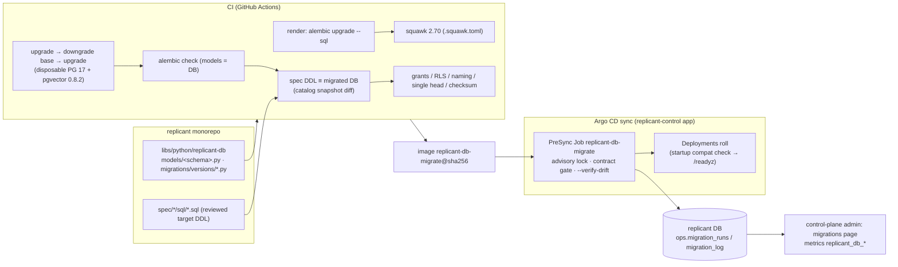

# Schema Management and Migrations

**Section:** WS-10 · **Implements:** D-26 in full; C-PG rules 1, 3, 4, 7, 8

## Purpose

This section covers how every schema change, seed, data fix, and admin operation on Replicant
database happens without a person opening a database connection. It defines the shared `replicant-db`
package, the single Alembic history, the CI gates, the migrate Job and its safety rules, the startup
compatibility check, the expand → migrate → contract procedure (with an executed worked example), the
admin surface and `replicant` CLI, the break-glass runbook, and automated schema upgrades for Temporal and
Langfuse.

Everything marked *validated* was executed on 2026-10-24 against PostgreSQL 17 + pgvector 0.8.2 (the prod version; `pgvector/pgvector:0.8.2-pg17-bookworm`, R1V-183)
(podman), with SQLAlchemy 2.1.6, Alembic 1.20.1, psycopg 3.3.6, pgvector-python 0.5.1, and squawk 2.70.0.
The versions were installed from PyPI that day.

## Decisions summary

| Decision | Reference |
|---|---|
| One shared package `replicant-db` holds per-schema SQLAlchemy 2.x `Mapped[]` models, one `MetaData` per schema with a fixed `naming_convention`, the session/RLS protocol, the compatibility check, the migrate CLI, and maintenance mode | D-26, C-PG rule 7 |
| **One linear Alembic history** for database `replicant`. Revision ID `<yyyymmddhhmm>_<schema>`. Each revision declares `replicant_schema`, `replicant_compat`, and for contract revisions `replicant_requires_reader_revision` | [ADR-WS10-005](adr/005-single-linear-alembic-history.md) |
| CI: render SQL (`alembic upgrade --sql`), squawk, upgrade → downgrade → upgrade on a disposable PostgreSQL, `alembic check` drift, spec-DDL equivalence, grants/RLS catalog checks, single head, checksum immutability | §5 |
| Migrations run as an **Argo CD PreSync** Job holding a session advisory lock. Exit codes map to `podFailurePolicy` | [ADR-WS10-006](adr/006-migrations-argocd-presync.md), §7 |
| Service startup check is **compatibility**, not equality. The DB may be ahead by expand/data revisions. A contract revision blocks images built before its `requires_reader_revision`. The migrate Job refuses a contract revision while any live workload is older (**contract gate**) | §7.3–7.4, **CCR-10-01** |
| **One canonical RLS session-variable vocabulary** (WS-09 G-04) | §4.2 |
| Data fixes are reviewed, idempotent data revisions or admin API operations. There is no ad hoc SQL | §9 |



---

## 1. The `replicant-db` package

```
libs/python/replicant-db/                      # WS-11 repo-layout.md path
├── pyproject.toml                           # sqlalchemy[asyncio]>=2.1,<2.2 · alembic>=1.20,<1.21 · psycopg[binary]>=3.3
│                                            # pgvector>=0.5 · boto3 · prometheus-client
├── Dockerfile.migrate                       # the migrate/maintenance image (python:3.12-slim, non-root 10001)
├── .squawk.toml                             # code/.squawk.toml in this spec
├── .importlinter                            # contracts below
└── src/replicant_db/
    ├── naming.py                            # NAMING_CONVENTION, METADATA[schema], IdText (COLLATE "C"), id/tenant/digest checks
    ├── session.py                           # make_engine (IAM token per connect), tx(tenant, scope, module), settings_from_env
    ├── revision.py                          # BUILT_REVISION, check_schema_compat (compatible|strict)
    ├── cli.py                               # `replicant-db migrate|maintenance`
    ├── maintenance.py                       # partitions, matviews, bloat, reindex
    ├── _build.py                            # generated by CI: BUILT_REVISION = "<head>"
    ├── sql/                                 # package data: 10-roles-and-grants.sql, 20-ops.sql (spec ddl/)
    ├── models/<schema>.py                   # WRITE models; imported only by that schema's writer
    ├── readonly/<schema>.py                 # read-only Table objects for readers (no ORM write paths)
    └── migrations/{env.py, script.py.mako, versions/}
```

The spec copies are under [code/replicant_db/](code/replicant_db/): `naming.py`, `session.py`, `revision.py`,
`cli.py`, `maintenance.py`, `models/ops.py`, `migrations/env.py`, `migrations/script.py.mako`, and
`migrations/versions/202610240001_ops.py`. All of them were executed end to end (§12).

### 1.1 Model conventions

- 2.x typed style: `class Entry(MemoryBase): __tablename__ = "entries"; entry_id: Mapped[str] = mapped_column(IdText, primary_key=True)`.
  Core `Table` objects are allowed for append-only and partitioned tables (as in `models/ops.py`).
- `METADATA[schema] = MetaData(schema=schema, naming_convention=NAMING_CONVENTION)`, with these
  conventions:
  `ix_%(table_name)s_%(column_0_N_name)s`, `uq_%(table_name)s_%(column_0_N_name)s`,
  `ck_%(table_name)s_%(constraint_name)s`, `fk_%(table_name)s_%(column_0_name)s_%(referred_table_name)s`,
  `pk_%(table_name)s` [verified: SQLAlchemy `MetaData.naming_convention` tokens,
  https://docs.sqlalchemy.org/en/21/core/constraints.html, 2026-10-24]. **Every** CHECK constraint is named
  (`CheckConstraint(..., name="tenant_id_format")` → `ck_<table>_tenant_id_format`). PostgreSQL's
  auto-generated names (`embedding_spaces_check1`) differ between a model-built and a migration-built
  database, so they would appear as permanent drift. Names longer than 63 bytes fail CI (squawk
  `identifier-too-long`).
- IDs are `text COLLATE "C"` with the C-IDS regex CHECK (`naming.id_check`). There are no `uuid` columns
  and no PostgreSQL enums. Closed vocabularies are `text` plus CHECK, so adding a value is an expand-only
  CHECK swap.
- `tenant_id text COLLATE "C" NOT NULL` plus `ops.apply_tenant_rls()` on every tenant-data table.
- `timestamptz` everywhere (squawk `prefer-timestamptz`), `bigint` identities (`prefer-identity`,
  `prefer-bigint-over-int`).
- Vector columns: `pgvector.sqlalchemy.HALFVEC(n)` or `VECTOR(n)` [verified: pgvector-python 0.5.1 exports
  `Vector, VECTOR, HALFVEC, BIT, SPARSEVEC`, 2026-10-24].

### 1.2 Ownership enforcement (C-PG rule 7)

`.importlinter` (import-linter 2.15, contract types `forbidden`, `independence`, `layers`, `protected`,
`acyclic_siblings` [verified: https://github.com/seddonym/import-linter, 2026-10-24]):

```ini
[importlinter]
root_packages = replicant_db, control_plane_api, identity_service, replicant_projector, memory_service, usage_ingestor, eval_worker, github_integration, slack_integration, jira_integration, ecosystem_indexer

[importlinter:contract:memory-writer-only]
name = Only memory-service imports write models of schema memory
type = protected
protected_modules = replicant_db.models.memory
allowed_importers = memory_service, replicant_db.migrations

[importlinter:contract:jobs-read-writer-only]
name = Only replicant-projector imports write models of jobs_read and approvals
type = protected
protected_modules =
    replicant_db.models.jobs_read
    replicant_db.models.approvals
allowed_importers = replicant_projector, replicant_db.migrations

[importlinter:contract:no-raw-transactions]
name = Services open transactions only through replicant_db.session.tx
type = forbidden
source_modules = control_plane_api, identity_service, replicant_projector, memory_service, usage_ingestor, eval_worker
forbidden_modules = sqlalchemy.orm.session
```

One `protected` contract exists per schema, mirroring C-PG §2. The database grants (postgres.md §3) are
the enforcement. The lint gives fast feedback.

### 1.3 Session patterns

| Context | Pattern |
|---|---|
| FastAPI (control-plane-api, identity-service, memory-service, integrations) | One `AsyncEngine` per process, created in the lifespan handler. A dependency yields `tx(sessions, tenant_id=…, scope=…, module=…)` per request **after** authorization, with one transaction per request. Long work goes to a Temporal workflow, never a long DB transaction |
| Temporal activities (replicant-projector, eval-worker) | One engine per worker process. One `tx()` per activity attempt, with the tenant taken from the activity input. Idempotency comes from natural keys or `ON CONFLICT` (the projection `seq` guard). Retryable SQLSTATEs (`40001`, `40P01`, `55P03`, `57P0x`, `08xxx`) raise and Temporal retries. A CHECK violation raises `ApplicationError(non_retryable=True)` |
| Read-only readers | `tx(..., read_only=True)` against the **reader** endpoint (`REPLICANT_DB_RO_HOST`) where replica lag of < 100 ms is acceptable (dashboards, analytics). The projector, intake, and gate paths always use the writer |
| LISTEN (control-plane-api SSE) | One dedicated psycopg `AsyncConnection` per pod outside the pool. On reconnect it re-LISTENs and forces clients to re-fetch |

Validated: `tx()` sets `replicant.tenant_id` and the module role (`current_user = svc_cpa_intake`), and
`check_schema_compat()` returns `OK`, over a real psycopg async connection.

## 2. Alembic setup

[code/replicant_db/migrations/env.py](code/replicant_db/migrations/env.py):

- `version_table_schema="ops"`, `include_schemas=True`, and `include_name` limited to the 16 C-PG schemas,
  so `public` (extensions) is never diffed.
- `include_object` ignores partitions (`_YYYY_MM` suffix) and Alembic's own version table.
- `compare_type=True`, `compare_server_default=True`.
- `transaction_per_migration=True`: each revision commits on its own. This is required for
  `autocommit_block()`, whose docs warn that "the database transaction preceding the block is
  unconditionally committed" [verified: alembic/runtime/migration.py, 1.20.1, 2026-10-24].
- Online mode receives the CLI's open connection, which holds the advisory lock, and sets
  `lock_timeout = '5s'`, `statement_timeout = '15min'`, `search_path = pg_catalog, public`, and
  `SET ROLE replicant_migrator`. Offline mode (`--sql`) emits the same `SET`s, so the reviewed SQL matches
  what runs.
- `on_version_apply` writes `ops.migration_log` (revision, compat, required reader revision, script
  SHA-256, duration) **in the revision's own transaction**.

Revision template: [code/replicant_db/migrations/script.py.mako](code/replicant_db/migrations/script.py.mako).

## 3. What autogenerate does not do, and the hand-written operations that replace it

Alembic's documented limits: it cannot detect table or column renames (they appear as add/drop pairs) or
anonymously named constraints. PRIMARY KEY and EXCLUDE changes and sequences are not fully supported.
CHECK-constraint detection is opt-in and name-based only (1.19+) [verified: alembic docs/build/autogenerate.rst,
2026-10-24]. The Replicant therefore hand-writes, and reviewers expect hand-written, the following:

| Change | How it is written |
|---|---|
| Rename (column, table) | Never a rename in one step. Use expand → migrate → contract (§8) |
| CHECK constraint changes | `op.drop_constraint` / `op.create_check_constraint(..., postgresql_not_valid=True)` then `op.execute("ALTER TABLE … VALIDATE CONSTRAINT …")` in a later revision (squawk `constraint-missing-not-valid`) |
| Index on an existing table | `with op.get_context().autocommit_block(): op.create_index(..., postgresql_concurrently=True, if_not_exists=True)` (squawk `require-concurrent-index-creation`; `tools/lint_migrations.py` requires `IF NOT EXISTS` inside autocommit blocks) |
| pgvector HNSW index | as above, plus `op.execute("SET maintenance_work_mem = '8GB'")` and `SET max_parallel_maintenance_workers = 7` inside the autocommit block, with `postgresql_using="hnsw"`, `postgresql_with={"m": 16, "ef_construction": 64}`, `postgresql_ops={"embedding": "halfvec_cosine_ops"}` |
| RLS policies | `op.execute("SELECT ops.apply_tenant_rls('<schema>.<table>')")`. Custom policies (memory, ecosystem) are `op.execute` with literal SQL copied from the owner's reviewed DDL. Policies are compared by the catalog snapshot (§5.5), not by autogenerate. alembic_utils 0.8.8 (`PGPolicy`, `PGFunction`, `PGGrantTable`) was considered and not adopted: its last release was 2025-04-10 and it would add a second diff engine |
| Functions, triggers, views, matviews | `op.execute` with `CREATE OR REPLACE`; drop in downgrade. The catalog snapshot covers drift |
| Partitioned parent tables | `op.execute("CREATE TABLE … PARTITION BY RANGE (…)")`. Partitions come from maintenance mode, never from revisions, and the first ones are created by the same revision calling `replicant_db.maintenance.partition_create` |
| Grants | Grant model v2 (XD-FIX-R1-160; postgres.md §3): owners grant on **parent** tables in their own DDL and revisions; WS-10 issues no `ALTER DEFAULT PRIVILEGES … GRANT` in owner schemas (`check_grants.py` check 1 fails any). A new *reader edge* edits the matrix in `ddl/10-roles-and-grants.sql` (memberships and schema `USAGE`) and adds a `grants` revision that re-applies it; the owner adds the table grant to `r_<schema>_read` (R1V-177) |
| `NOT NULL` on a big table | `ADD CONSTRAINT … CHECK (col IS NOT NULL) NOT VALID` → `VALIDATE CONSTRAINT` → `SET NOT NULL` (PostgreSQL uses the validated CHECK to skip the scan) → drop the CHECK (squawk `adding-not-nullable-field`) |
| Column type change | New column plus backfill plus switch (never `ALTER TYPE` on a populated hot table; squawk `changing-column-type`) |
| Foreign keys (same owner only, C-PG rule 2) | `ADD CONSTRAINT … NOT VALID` then `VALIDATE` in a separate revision (squawk `adding-foreign-key-constraint`) |
| Enum-like vocabularies | CHECK swap: add the new CHECK `NOT VALID`, validate, drop the old one |

## 4. RLS session-variable protocol (canonical; WS-09 G-04)

### 4.1 Variables

| Variable | Type | Set by | Lifetime |
|---|---|---|---|
| `replicant.tenant_id` | tenant slug (C-IDS) or `''` | `replicant_db.session.tx()` → `set_config('replicant.tenant_id', $1, true)` | transaction (`is_local => true`) |
| `replicant.principal_scope` | one of §4.2, or `''` (= `tenant`) | same, `set_config('replicant.principal_scope', $2, true)` | transaction |
| `role` (control-plane-api only) | `svc_cpa_tenancy` / `svc_cpa_intake` / `svc_cpa_registry` / `svc_cpa_notify` | `set_config('role', $3, true)` | transaction |
| `replicant.visible_repo_ids` (ecosystem only, WS-04) | comma-separated repo node IDs | context-mcp / replicant-worker | transaction |
| `replicant.audit_tenants` (audit only, WS-08) | comma-separated `tenant_id`s (C-IDS slugs), or `''` (none) | control-plane-api's audit view for a **limited auditor**, who runs under `principal_scope = 'tenant'` (C-PG 2.0.0 rule 4). Never carried in `principal_scope`. WS-08's `audit.events` policy reads it; an empty or unset value sees nothing extra | transaction (`set_config('replicant.audit_tenants', $4, true)`) |

The database default for `replicant.audit_tenants` is `''` (00-bootstrap.sql), like the other two Replicant settings.

Rules:

1. Values are set **only** with `set_config(…, true)` as the first statements of the transaction. Plain
   `SET` (session-level) is forbidden: a grep-based lint in CI and squawk in migrations. Revisions that
   need a scope use `set_config(…, true)` or `false` inside an autocommit block and reset it.
2. Policies read variables only through `ops.current_tenant()` (`NULLIF(…, '')`) and `ops.principal_scope()`
   (`COALESCE(NULLIF(…, ''), 'tenant')`). After a transaction ends, a custom GUC reads `''`, not `NULL`
   (validated), and the helpers normalize both.
3. A missing tenant fails closed: 0 rows, and inserts are rejected.

### 4.2 Scope values

| Value | Meaning | Gated by | Allowed setters |
|---|---|---|---|
| `tenant` | Only the transaction's tenant | — | everyone (default) |
| `operator:all-tenants` | Cross-tenant **read** | policy `TO r_cross_tenant_read` (members: control-plane-api, identity-service, grafana_ro, bg_readonly) | control-plane-api operator module after a per-request `replicant-operators` check (WS-09), always with `audit.emit` |
| `system:all-tenants` | Cross-tenant **read and write** for platform batch work | policy `TO r_cross_tenant_write` (members: replicant_migrator, bg_write via SET) | migrate data revisions, maintenance mode, restore reconcile |
| `admin:memory` | D-25 curation across tenants inside the memory schema | memory schema policies (WS-04); memory-service is the schema's only writer | memory-service after identity-service confirms admin-group membership for this request |
| `eval:platform` | Eval platform rows (`tenant_id = 'replicant-eval'`) and release pipeline rows (`replicant-system`) | evals and registry platform-row policies (WS-06) | eval-worker; control-plane-api `svc_cpa_registry` |

`replicant_db.session.Scope` is exactly this `Literal`. WS-04 (`replicant_admin`, `system`) and WS-06
(`platform`, `eval`, `replicant_admin`) are asked to conform (XD-10-07). The tokens map one to one, so the
rename is mechanical. **Disagreement recorded with WS-09:** WS-09's pattern honors
`operator:all-tenants` for any role and adds a `BYPASSRLS` login (`svc_operator_views`). WS-10 recommends
the role-gated policy instead (postgres.md §4.1, validated). It needs no extra login, a GUC alone cannot
widen visibility, and plans stay index-friendly. WS-09 decides. Both designs use the same variable names
and values.

## 5. CI pipeline (every PR touching `libs/python/replicant-db/**` or `spec/**/sql/**`)

| # | Step | Command | Fails on |
|---|---|---|---|
| 1 | Single head | `alembic heads \| wc -l` = 1 | concurrent revisions on one parent (ADR-WS10-005) |
| 2 | Revision lint | `python tools/lint_migrations.py` | missing `replicant_schema`/`replicant_compat`; contract without `requires_reader_revision`; DDL touching another schema; non-`IF NOT EXISTS` statements inside `autocommit_block`; session-level `SET` of Replicant GUCs; edits to an already-merged revision (checksum vs `main`) |
| 3 | Render | `alembic upgrade <base_of_PR>:head --sql > rendered.sql` | Python errors in offline mode (data revisions must handle `as_sql`, §8) |
| 4 | Lint | `squawk --config .squawk.toml --reporter gcc rendered.sql` (or `sbdchd/squawk-action@v2`) | any violation not suppressed by an in-SQL `-- squawk-ignore <rule>` comment carrying a review justification |
| 5 | Round trip | disposable `replicant/postgres:17-pgvector0.8.2` container: `00-bootstrap.sql`, then `replicant-db migrate --to head`, `alembic downgrade base`, `replicant-db migrate --to head --verify-drift` | any SQL error; downgrade not restoring a migratable state |
| 6 | Drift: models vs DB | `alembic check` (in step 5 through `--verify-drift`) [verified: "Check if revision command with autogenerate has pending upgrade ops", alembic 1.9+, 2026-10-24] | any pending operation |
| 7 | Spec DDL ≡ DB | `tools/spec_ddl_equivalence.py`: build DB-A from migrations and DB-B from bootstrap + `ddl/10`, `ddl/20` + each owner's `spec/*/sql/<schema>.sql` (topologically ordered); compare **catalog snapshots** (JSON of tables, columns, types, defaults, constraints by name and definition, indexes by definition, policies, triggers, functions by `pg_get_functiondef`, grants, partition bounds of parents) | any difference. Owners must update the spec DDL and the revision together |
| 8 | Grants and RLS | `tools/check_grants.py` after the owners' DDL is applied (grant model v2, postgres.md §3): no default privileges in owner schemas, memberships equal the matrix, every table privilege C-PG-legal, **narrowing probes** (column-level secrets and append-only history survive), `grafana_ro` read report. `tools/check_rls.py`: every relation with `tenant_id` has RLS enabled (error) and forced (warning; `audit.events` exempt) | default ACL in an owner schema, membership drift, illegal grant, voided narrowing, tenant table without RLS |
| 8b | Partition isolation (XD-ORCH-04) | `tools/check_partitions.py` after maintenance: every leaf partition has RLS enabled and forced, no privilege held by anyone but its owner, the canonical tenant policy where it has `tenant_id`; then each service role queries every tenant partition **directly** with a probe tenant and must get permission denied or zero other-tenant rows. `validate.sh` first runs a negative control (schema-wide grant, RLS off on the `qa` partitions, two tenants' rows) and requires the check to detect the leak | any unisolated partition, any direct cross-tenant read |
| 9 | Import contracts | `lint-imports` | a non-writer importing write models |
| 10 | Compat unit tests | `python -m replicant_db.revision` and `pytest libs/python/replicant-db` | — |

`migra` is not used. It is "officially deprecated … there will be no further releases"
[verified: https://github.com/djrobstep/migra README, 2026-10-24]. The catalog snapshot is ~200 lines of
SQL over `pg_catalog` that Replicant owns. `stripe/pg-schema-diff` 1.0.9 is a candidate replacement if
the snapshot proves costly to maintain.

Squawk configuration [code/.squawk.toml](code/.squawk.toml): `pg_version = "17.0"`,
`assume_in_transaction = false` (Alembic emits its own `BEGIN`/`COMMIT`), `excluded_rules =
["prefer-robust-stmts"]` (each revision is one transaction, so `IF [NOT] EXISTS` adds nothing; step 2
covers autocommit blocks), `included_rules = ["require-table-schema"]` [verified: squawk rules list and
config keys, https://squawkhq.com/docs/rules and /docs/cli, 2026-10-24]. Validated: the bootstrap
revision and the §8 example render squawk-clean, except the two intentional, justified ignores in the
contract revision.

## 6. Migration safety rules (normative)

1. `lock_timeout = 5s` per statement, `statement_timeout = 15min`. A DDL statement that cannot get its lock
   in 5 s fails, and its revision rolls back, instead of queueing every reader behind it.
2. One revision = one transaction, except explicit `autocommit_block()` sections. Those are idempotent
   (`IF NOT EXISTS`, `CONCURRENTLY`) and retried by rerunning the Job.
3. No table rewrite on a table larger than 1 GB or hotter than 10 writes/s. Volatile defaults, type
   changes, and non-`NOT VALID` constraints are banned by squawk.
4. Index builds on existing tables are `CONCURRENTLY` only.
5. Inline data changes are limited to 10,000 rows per revision. Larger changes are batched data revisions
   (§8 step 2) or admin operations.
6. Every revision is backward compatible with the previous release's code, except contract revisions,
   which the gate (§7.4) controls.
7. Applied revisions are immutable. Their SHA-256 is recorded in `ops.migration_log`, and the Job refuses
   to run (exit 20) if a file changed after apply.

## 7. Runtime

### 7.1 The migrate Job

[config/k8s/migrate-job.yaml](config/k8s/migrate-job.yaml) (validated with kubeconform against the
Kubernetes 1.36 schemas):

| Field | Value | Why |
|---|---|---|
| Hook | `argocd.argoproj.io/hook: PreSync`, `hook-delete-policy: BeforeHookCreation`, `sync-wave: "-1"` | runs before any Deployment changes; a failure fails the sync |
| Image | `replicant-db-migrate@sha256:…` (same package version as the services in the release) | |
| Command | `replicant-db migrate --to head --advisory-lock --verify-drift --lock-timeout 600` | the same flags as compose (XD-11-12), minus `--ensure-roles` (local/CI only) |
| Identity | ServiceAccount `replicant-db-migrate` → Pod Identity role `replicant-<env>-db-migrate` → `rds-db:connect` as `replicant_migrator` only ([config/iam/migrate-db-connect.json](config/iam/migrate-db-connect.json)) | no password exists |
| Endpoint | Aurora **writer** cluster endpoint, never a reader or proxy | session advisory lock, DDL |
| `backoffLimit: 3` + `podFailurePolicy` | exit 10 (lock timeout) → `Count` (retry); 20/21/30/40 → `FailJob`; `DisruptionTarget` → `Ignore` | retry only what is safe to retry |
| `activeDeadlineSeconds: 1800` | | long work belongs in batched data revisions |
| No `ttlSecondsAfterFinished` | Argo CD reads the Job to learn the hook phase | |

### 7.2 Advisory lock and run bookkeeping

`pg_try_advisory_lock(k)` in a 2 s loop up to `--lock-timeout`, where
`k = int64(sha256("replicant.migrate")[0:8])`. Session-level: if the pod dies, the session ends and the lock
is released. Maintenance mode uses the same key and **skips** when busy. Every run writes
`ops.migration_runs` (mode, from/target/to revision, outcome, image digest, git SHA, Job name, Argo app,
lock wait, error class and summary). Every applied revision writes `ops.migration_log`. Validated: a
first run records `succeeded`, a rerun records `noop`, and a run under a held lock exits 10.

### 7.3 Startup compatibility check (C-PG rule 8; **CCR-10-01**)

Each image embeds `BUILT_REVISION`. At startup, before `/readyz` can turn true,
`check_schema_compat()` ([code/replicant_db/revision.py](code/replicant_db/revision.py)) evaluates:

| DB state relative to `BUILT_REVISION` | Result |
|---|---|
| equal | OK |
| ahead, and every revision after `built` is expand/data/reference/grants, or a contract whose `requires_reader_revision` ≤ `built` | OK |
| ahead, with a contract revision that requires readers newer than `built` | **TOO_NEW**: refuse readiness |
| behind (`built` not in the applied chain) | **BEHIND**: refuse readiness |

`REPLICANT_SCHEMA_REVISION_CHECK` = `compatible` (default; **required** in dev, staging, and prod) or
`strict` (equality; allowed only when `REPLICANT_ENV` is `local` or `ci`). There is no `off`. WS-11's
parity table currently lists `strict` for production too (XD-10-10).

Why not equality, as the C-PG rule 8 wording says: under expand → contract the database is legitimately
ahead of running pods for an entire rollout. Pinned `replicant-worker` versions also live up to 37 days
(ADR-006, CC-4) while the schema advances. Equality would make every such pod fail on its next restart
from node rotation or OOM. CCR-10-01 (**accepted**; C-PG 1.2.0 rule 8 and D-26 amended) changed rule 8 to "the database revision must be compatible
with the revision the service was built against (replicant_db.revision), else the service refuses to
start". Validated with the §8 example: an image built before the expand stays OK through expand and
data, becomes TOO_NEW at the contract, and an image built after the expand stays OK.

On failure the pod logs
`{"event":"db.schema_incompatible","built":…,"current":…,"blocking_revision":…}`, sets
`replicant_db_schema_compat{service,outcome}`, retries every 30 s for 5 minutes, then exits non-zero so
Kubernetes backoff makes it visible. Alert: `ReplicantDbSchemaIncompatible` for 5 minutes.

### 7.4 Contract gate

Before applying any revision with `replicant_compat = "contract"`, the migrate Job lists Deployments with
replicas > 0 in Replicant namespaces (read-only RBAC in migrate-job.yaml). It reads each one's
annotation `replicant.example.com/schema-revision` (rendered by every chart from the image's
`BUILT_REVISION`) and refuses (exit 21, outcome `refused_contract_gate`) if any is older than
`requires_reader_revision`. The list includes every pinned `replicant-worker` Deployment version, so a
contract waits until old pinned versions drain (WS-01 drains them). The Job output names the blocking
workloads, and the release UI shows "contract pending: waiting on replicant-worker b20261024-… (14 pinned
workflows)".

Deployments alone do not prove that no old code still runs: a pinned workflow can sit on a drained build
until its worker returns. The gate therefore also requires (XD-FIX-R1-028, WS-01 versioning.md §5.2):

```
CountWorkflowExecutions("TemporalWorkerDeploymentVersion IN (<every replicant-worker version built before the
expand revision>) AND ExecutionStatus = 'Running'") = 0
```

The migrate Job runs it with the read-only Temporal identity `replicant-db-migrate` (`CountWorkflowExecutions`
only). The longest wait is `job_max_age_days` (60) plus about 7 days of drain. The Job refuses with exit 21 and
names the count while it is above zero.

### 7.5 How deployments wait

1. Argo CD PreSync: no Deployment in `replicant-control` is applied until the Job succeeds.
2. Other Applications that touch the DB sync after `replicant-control` (ApplicationSet progressive sync).
3. Belt and braces: every pod's readiness depends on §7.3, so a pod that starts early, for example after a
   node failure during a sync, simply stays unready until the schema is compatible.
4. Locally: compose `depends_on: {migrate: {condition: service_completed_successfully}}` (WS-11).

### 7.6 Failure handling and alerting

| Failure | Effect | Response |
|---|---|---|
| SQL error in revision N (exit 30) | revision N rolled back; revisions before N committed; the sync fails; old pods keep running (compatible with the N−1 schema) | page `ReplicantDbMigrationFailed`; fix forward with a new revision, or revert the release commit (old images are compatible with the N−1 schema) |
| Lock timeout (exit 10) | another run in progress | Job retries (up to 3); alert if the sync still fails |
| Checksum changed (exit 20) | nothing applied | an applied revision was edited after merge; restore the file, never "fix" by editing |
| Contract gate (exit 21) | nothing applied | expected while old versions drain; the sync is retried automatically every 30 min by an ApplicationSet retry policy (`retry.limit: 48`) |
| Drift after upgrade (exit 40) | upgrade committed, but models ≠ DB | page; usually a break-glass manual change or a bad revision; fix with a revision |
| autocommit block interrupted (e.g. concurrent index) | `INVALID` index left behind | next run: `DROP INDEX CONCURRENTLY IF EXISTS` of invalid `_ccnew`/target indexes is the first statement of every concurrent-index revision |

Alert rules (Prometheus/Mimir, WS-08 dashboards):

```yaml
groups:
  - name: replicant-db-migrations
    rules:
      - alert: ReplicantDbMigrationFailed
        expr: increase(kube_job_status_failed{namespace="replicant-control", job_name="replicant-db-migrate"}[15m]) > 0
        labels: {severity: page, service: replicant-db-migrate}
        annotations:
          summary: "replicant DB migration failed in {{ $labels.cluster }}"
          runbook: "spec/10-data-platform/schema-management.md#76-failure-handling-and-alerting"
      - alert: ReplicantDbSchemaIncompatible
        expr: max by (service) (replicant_db_schema_compat{outcome!="ok"}) > 0
        for: 5m
        labels: {severity: page}
      - alert: ReplicantDbMigrationRunning30m
        expr: (time() - kube_job_status_start_time{job_name="replicant-db-migrate"}) > 1800 and kube_job_status_active{job_name="replicant-db-migrate"} > 0
        labels: {severity: ticket}
```

## 8. Expand → migrate → contract: worked example (rename a column on a hot table)

Goal: rename `jobs_read.jobs.current_node` to `current_node_key`. `jobs_read.jobs` is rewritten on every
projection, about 40 times per job, and read by every UI page. The DDL owner is WS-07; the table here is an
illustrative stand-in until WS-07's DDL lands. All three revisions were executed (validated) against
12,000 rows, including a full downgrade to base and re-upgrade.

| Release | Revision | Compat | Code change |
|---|---|---|---|
| N | `202611010900_jobs_read` | expand | Projector N writes `current_node_key`; readers still read `current_node` |
| N | `202611010901_jobs_read` | data | — |
| N+1 | none | — | Readers (control-plane-api, integrations, memory-service) switch to `current_node_key` |
| N+2 (≥ the drain of every version built before N) | `202611220900_jobs_read` | contract, `requires_reader_revision = 202611010900_jobs_read` | Models drop `current_node` |

**Step 1, expand (release N).** Add a nullable column (catalog-only change, millisecond lock) and a trigger
that mirrors whichever column a writer touched. Old projector pods still writing `current_node` and new
ones writing `current_node_key` then both leave the row consistent:

```python
revision = "202611010900_jobs_read"
down_revision = "202610300900_jobs_read"
replicant_schema = "jobs_read"
replicant_compat = "expand"

def upgrade() -> None:
    op.execute("ALTER TABLE jobs_read.jobs ADD COLUMN current_node_key text")
    op.execute("""
        CREATE FUNCTION jobs_read.tg_jobs_sync_current_node() RETURNS trigger
        LANGUAGE plpgsql SET search_path = pg_catalog AS $$
        BEGIN
          IF TG_OP = 'INSERT' OR NEW.current_node IS DISTINCT FROM OLD.current_node THEN
            NEW.current_node_key := NEW.current_node;
          ELSIF NEW.current_node_key IS DISTINCT FROM OLD.current_node_key THEN
            NEW.current_node := NEW.current_node_key;
          END IF;
          RETURN NEW;
        END $$""")
    op.execute("""CREATE TRIGGER tg_jobs_sync_current_node BEFORE INSERT OR UPDATE ON jobs_read.jobs
                  FOR EACH ROW EXECUTE FUNCTION jobs_read.tg_jobs_sync_current_node()""")

def downgrade() -> None:
    op.execute("DROP TRIGGER tg_jobs_sync_current_node ON jobs_read.jobs")
    op.execute("DROP FUNCTION jobs_read.tg_jobs_sync_current_node()")
    op.execute("ALTER TABLE jobs_read.jobs DROP COLUMN current_node_key")
```

Validated: an old-style `UPDATE … SET current_node='qa'` reads back `qa|qa`, and a new-style
`UPDATE … SET current_node_key='reviewer'` reads back `reviewer|reviewer`.

**Step 2, migrate (release N, data revision).** Batched backfill: 5,000 rows per transaction,
`FOR UPDATE SKIP LOCKED` so it never waits on the projector, idempotent (`WHERE current_node_key IS NULL`),
and offline-render aware:

```python
revision = "202611010901_jobs_read"
down_revision = "202611010900_jobs_read"
replicant_schema = "jobs_read"
replicant_compat = "data"
BATCH = 5000
UPDATE_SQL = """
    UPDATE jobs_read.jobs j SET current_node_key = j.current_node
    WHERE j.job_id IN (SELECT job_id FROM jobs_read.jobs
                       WHERE current_node_key IS NULL AND current_node IS NOT NULL
                       ORDER BY job_id LIMIT {batch} FOR UPDATE SKIP LOCKED)"""

def upgrade() -> None:
    if op.get_context().as_sql:          # CI render: show one batch
        op.execute("-- batched backfill: repeated online until it updates 0 rows, one COMMIT per batch")
        op.execute(UPDATE_SQL.format(batch=BATCH))
        return
    conn = op.get_bind()
    with op.get_context().autocommit_block():
        conn.execute(text("SELECT set_config('replicant.principal_scope', 'system:all-tenants', false)"))
        while conn.execute(text(UPDATE_SQL.format(batch=BATCH))).rowcount:
            pass
        conn.execute(text("SELECT set_config('replicant.principal_scope', '', false)"))

def downgrade() -> None:
    pass   # forward-only; the expand downgrade drops the column
```

Validated: 12,000 of 12,000 rows backfilled. If the table were too large for the 30-minute Job deadline,
the same loop would run as an admin operation (`replicant admin data-migrations run jobs_read.backfill_current_node_key`,
§9), and the contract revision would check completeness first:
`SELECT count(*) … WHERE current_node_key IS NULL AND current_node IS NOT NULL` must equal 0, else
`RAISE`.

**Step 3 (release N+1).** A code-only change: readers use `current_node_key`. The projector keeps writing
it.

**Step 4, contract (release N+2).** The gate (§7.4) waits until no Deployment built before
`202611010900_jobs_read` has replicas:

```python
revision = "202611220900_jobs_read"
down_revision = "202611010901_jobs_read"
replicant_schema = "jobs_read"
replicant_compat = "contract"
replicant_requires_reader_revision = "202611010900_jobs_read"

def upgrade() -> None:
    op.execute("DROP TRIGGER tg_jobs_sync_current_node ON jobs_read.jobs")
    op.execute("-- squawk-ignore ban-drop-function\nDROP FUNCTION jobs_read.tg_jobs_sync_current_node()")
    op.execute("-- squawk-ignore ban-drop-column\nALTER TABLE jobs_read.jobs DROP COLUMN current_node")

def downgrade() -> None:   # re-expand: column, data, trigger exactly as after step 2
    op.execute("ALTER TABLE jobs_read.jobs ADD COLUMN current_node text")
    op.execute("SELECT set_config('replicant.principal_scope', 'system:all-tenants', true)")
    op.execute("UPDATE jobs_read.jobs SET current_node = current_node_key")
    op.execute(SYNC_FUNCTION_SQL)   # same text as step 1
    op.execute(SYNC_TRIGGER_SQL)
```

`DROP COLUMN` is a catalog-only change in PostgreSQL (space is reclaimed by later rewrites/VACUUM FULL,
never needed here). Compatibility, validated: an image built at `202610300900` is OK against the expand+data
DB and **TOO_NEW** against the contract DB; an image built at `202611010900` is OK against both.

Failure modes of the procedure:

| Failure | Handling |
|---|---|
| Backfill revision exceeds 30 min | Job deadline: the committed batches stay (idempotent); rerun continues. Prefer the admin operation for > 5 M rows |
| A forgotten reader still reads `current_node` at N+2 | Its Deployment's annotation is older than the expand revision, so the contract gate refuses; if the reader's annotation is wrong (stale chart), the reader fails `TOO_NEW` at restart: visible, not silent data loss |
| Rollback needed after contract | `downgrade` re-expands; rows keep their values via `current_node_key` |

## 9. Admin surface (no `psql` for routine work)

### 9.1 Migration status

- control-plane-api `GET /v1/admin/migrations` (operator role; XD-11-12): `{current_revision, head_known_to_api,
  compat_by_service[], last_runs[ops.migration_runs × 20], pending_contracts[{revision, blocking_workloads}]}`.
  UI: Admin → Database (WS-07).
- Metrics: `replicant_db_schema_compat{service,outcome}` (`ok`, `ahead`, `behind`, `unknown`; WS-08 catalog, R1V-179) and `replicant_db_schema_revision_info{service,kind,revision}` (every service),
  `replicant_db_migration_last_success_timestamp_seconds`, `replicant_db_migration_failures_total` and
  `replicant_db_partition_runway_months{table}` (exported by control-plane-api from `ops.*` on scrape).

### 9.2 Data migrations

Two kinds: (1) **data revisions** (`replicant_compat = "data"`) for changes that must happen in lockstep with a
schema release and fit the Job deadline; (2) **admin data operations**: Python functions registered in the
owning service (`@data_operation(name="jobs_read.backfill_current_node_key", schema="jobs_read", idempotent=True)`),
reviewed in a PR like code, executed through control-plane-api `POST /v1/admin/data-operations/{name}:run`
(admin group, dry-run first, audited), running as a Temporal workflow `DataOperation` with batches as
activities (resumable, rate-limited). Registering the new workflow type is
part of CCR-10-04 (**accepted**; C-IDS lists `DataOperation` and task queue `replicant-retention`). Placement
(XD-FIX-R1-021, XD-FIX-R1-267): `DataOperation` and `RetentionSweeper` both run on task queue `replicant-retention`,
served by the `retention-sweeper` Deployment (image `services/retention-sweeper/Dockerfile`, DB login
`svc_retention_sweeper`, Temporal identity `retention-sweeper`, CCR-01-08). Its batch activities call the
owning service's admin API, so the one-writer rule holds.

### 9.3 `replicant` CLI commands that replace `psql`

| Task someone would otherwise do in `psql` | Command | Backed by |
|---|---|---|
| What revision is the DB at? pending? who is blocking a contract? | `replicant admin db status [--env prod]` | `GET /v1/admin/migrations` |
| Migration history | `replicant admin db history --limit 50` | same |
| Is a service compatible? | `replicant admin db compat --service replicant-worker` | metrics + Deployments |
| Top queries, locks, connections | `replicant admin db top [--by total_time]`, `replicant admin db connections` | `ops.top_statements`, `ops.connection_summary` (via control-plane-api) |
| Table/partition sizes, runway, bloat | `replicant admin db partitions`, `replicant admin db bloat` | `ops.maintenance_runs`, catalog views |
| Run a data operation | `replicant admin data-ops run <name> --dry-run` then `--execute` | §9.2 |
| Rebuild projections | `replicant admin projections rebuild --since <ts> [--job <id>]` | C-PG rule 5 (WS-07) |
| Look up a job/tenant/gate/memory entry | `replicant jobs get`, `replicant memory entries get` (admin), `replicant tenants get` | domain APIs |
| Seed dev data | `replicant dev seed` (local only; API calls, not SQL; D-26) | WS-11 |
| Re-run maintenance now | `replicant admin db maintenance run --task partition_create` | creates the CronJob's Job from template |
| Post-restore reconcile | `replicant admin restore reconcile --restore-point <ts> --incident <id>` | recovery.md §4 |

## 10. Break-glass runbook (the only documented direct-access procedure)

Preconditions: a declared incident (`INC-*`), and the routine tools in §9 are insufficient.

1. **Request.** The incident commander opens a break-glass request in the WS-09 flow, stating the
   incident, the intended role (`bg_readonly`, or `bg_write`, which needs a second approver), and the
   duration (≤ 60 min).
2. **Grant.** On approval, the responder assumes `replicant-<env>-db-breakglass` with session tags
   `breakglass-ticket=INC-…`, `breakglass-expires-at=<ISO time>`, and `breakglass-second-approver=usr_…`
   for write (WS-09's `breakglass-db.role-permissions.json`; `rds-db:connect` for `bg_readonly`/`bg_write`
   only while the tags are valid).
3. **Connect.** `aws ssm start-session --document-name AWS-StartPortForwardingSessionToRemoteHost` to the
   writer (or the reader, for read-only) through the bastion instance, then
   `psql "host=localhost port=15432 dbname=replicant user=bg_readonly sslmode=verify-full sslrootcert=rds-global-bundle.pem"`
   with `PGPASSWORD=$(aws rds generate-db-auth-token …)`. Tokens are valid 15 minutes, for connecting only.
4. **Operate.** `bg_readonly` is read-only (`default_transaction_read_only`), limited to operational
   schemas (no memory, identity, or integrations), and has a 60 s statement timeout. `bg_write` must
   `SELECT set_config('role', 'r_<schema>_write', true)` per transaction, which is deliberate friction,
   and can never write `audit`.
5. **Audit (automatic).** pgaudit `log = all` with parameters for both roles → CloudWatch Logs → Loki
   (`source="audit"`). Database Activity Streams (Aurora) → Kinesis in the security account. The SSM
   session log → S3. `audit.emit` is not used for these sessions: the session itself is the audited
   object. The security on-call is notified at session start by an EventBridge rule on `AssumeRole` of the
   break-glass role.
6. **Close.** The session ends at tag expiry (IAM condition) or `idle_session_timeout = 15 min`. Within
   24 h the responder files the follow-up: any data change becomes a reviewed data revision or admin
   operation (so the next environment gets it too), and the drift check (§5 step 6) must be green.

## 11. Temporal and Langfuse schema upgrades (same deploy flow)

| Store | Tool | Automation | Rules |
|---|---|---|---|
| Temporal (`temporal`, `temporal_visibility`) | `temporal-sql-tool` from `temporalio/admin-tools` (same version as the server): `create-database`, `setup-schema -v 0.0`, `update-schema --schema-dir /etc/temporal/schema/postgresql/v12/{temporal,visibility}/versioned` [verified: temporal v1.32.1 tools/sql/main.go and https://docs.temporal.io/self-hosted-guide/visibility/postgresql, 2026-10-24] | Argo CD PreSync Job in the `temporal` Application ([config/temporal/temporal-schema-job.yaml](config/temporal/temporal-schema-job.yaml)); the chart's own `manageSchema`/`createDatabase` are disabled because they use passwords; an IAM token comes from an init container | Server upgrades one minor at a time, highest patch first; schema before server [verified: https://docs.temporal.io/self-hosted-guide/upgrade-server, 2026-10-24]. A Renovate rule allows only `1.32.x → 1.33.x`-style bumps, and CI fails a values change that skips a minor. Current schema versions: temporal 1.19, visibility 1.14 (server 1.32.1) |
| Langfuse (`langfuse`) | Prisma `migrate deploy` in the web container entrypoint (`LANGFUSE_AUTO_POSTGRES_MIGRATION_DISABLED` unset); ClickHouse migrations likewise [verified: https://raw.githubusercontent.com/langfuse/langfuse/main/web/entrypoint.sh, 2026-10-24] | Automatic at web-pod start, using `DIRECT_URL` with role `langfuse_migrator` while `DATABASE_URL` uses `langfuse_app` [verified: https://langfuse.com/self-hosting/configuration, 2026-10-24]. One web replica is upgraded first (`maxSurge: 1, maxUnavailable: 0`), and the others follow once it is Ready | Langfuse documents no separate Postgres migration step, so startup migration is the supported path. Before v4→v5-class upgrades, WS-08 follows Langfuse's upgrade guide (v3→v4 required finishing background migrations and has no automatic downgrade). Pre-upgrade Aurora snapshot (automated in the pipeline). Fallback `[unverified: Langfuse runtime never needs DDL as langfuse_app]`: if it does, `DATABASE_URL` also uses `langfuse_migrator` |

## 12. Validation record (2026-10-24)

| Check | Result |
|---|---|
| `00-bootstrap.sql` as superuser, then `ddl/10`, `ddl/20` as `replicant_migrator` (CREATEROLE, no superuser) | clean |
| RLS matrix (§4, postgres.md §4.1) | 1000 / 0 / RLS error / 0 / 2000 / 2000, as designed |
| `replicant-db migrate --to head --advisory-lock --verify-drift --ensure-roles` (WS-11 flags) on a fresh DB; rerun | `succeeded`, then `noop`; `svc_control_plane_api` logs in with the file password |
| Advisory lock contention | exit 10 |
| `alembic check` positive and negative (stray column added → detected) | as expected |
| Offline render + squawk | clean (justified in-SQL ignores only) |
| Worked example up → down to base → up | clean |
| Maintenance on WS-04's partitioned tables; ULID partitioning on a timeline stand-in | partitions created and dropped per retention; ULID routing correct |
| WS-04 `memory.sql`, `ecosystem.sql`, WS-06 `evals.sql`, `registry-releases.sql` applied on top of the WS-10 bootstrap | clean (after WS-10 moved extensions to schema `public`); conflicts in ddl/INDEX.md §4 |
| Wave 1 (2026-10-24, PG 17 + pgvector): framework alone, then every owner's DDL through `tools/apply_owner_ddl.sh` | framework: grants OK, narrowing probes pass. With owners' DDL: the remaining grant and RLS findings are owners' items, listed in ddl/INDEX.md §5 and assigned through XD-FIX-R1-160 |

The commands are in [tools/validate.sh](tools/validate.sh).

## Open questions

CCR-10-01 (compatibility check) and CCR-10-04 (`DataOperation`) were accepted, so they are no longer open (R1-246).

| Question | Who decides | Options | Recommendation |
|---|---|---|---|
| Role-gated cross-tenant RLS vs WS-09's GUC-only + BYPASSRLS login | WS-09 | — | Role-gated (§4.2) |

## Risks

- **Linear-history merge friction** (ADR-WS10-005). Mitigated by CI bot instructions.
- **Contract revisions waiting on long-lived pinned workers** (up to 37 days). This is the price of
  correctness, and the release UI makes the wait visible.
- **Catalog-snapshot drift tool is replicant-owned code.** Mitigated by tests against intentional drifts in CI.

## Interfaces

- **Provided:** `replicant-db` (models base, session protocol, `tx()`, `Scope`, compat check, CLI), the migrate
  and maintenance images, `GET /v1/admin/migrations` data (via WS-07), CI gates for all DDL owners.
- **Consumed:** C-PG, owners' DDL (WS-03, WS-04, WS-06, WS-07, WS-08), WS-09 break-glass IAM, WS-11
  compose `migrate` service and repo layout, WS-01 worker-version draining (contract gate).
