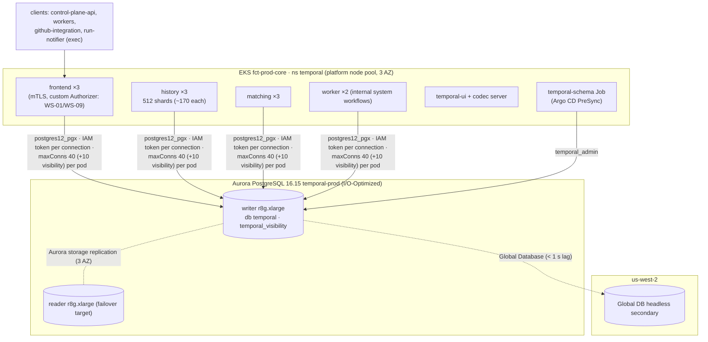

# Temporal Persistence and Hosting

**Section:** WS-10 · **Implements:** contract ADR-003 (finalized), D-01, D-22 · **With:** WS-01 (namespace, workers, dynamic config)

## Purpose

This document fixes how the Temporal service, Replicant's source of truth for workflow state, is
hosted and persisted. It covers self-hosted versus Cloud, PostgreSQL persistence and SQL visibility, the
history shard count, sizing, connection budget, schema upgrades, multi-AZ behavior, backups, and the
staging soak that de-risks running Temporal on Aurora.

## Decisions summary

| Decision | Reference |
|---|---|
| Self-hosted Temporal **1.32.1** on EKS (`fct-<env>-core`, namespace `temporal`), Helm chart `temporalio/temporal` 1.7.0 | [ADR-WS10-002](adr/002-temporal-self-hosted-final.md) finalizes contract ADR-003 |
| Persistence and visibility on **Aurora PostgreSQL 16.15** (`temporal-prod`), databases `temporal` and `temporal_visibility`, plugin `postgres12_pgx` | ADR-WS10-001, ADR-WS10-002 |
| **512 history shards**, fixed forever | [ADR-WS10-003](adr/003-temporal-history-shards.md) |
| IAM database auth via `passwordCommand` (server ≥ 1.31) and a replicant-built `rds-iam-token` helper; TLS `verify-full` | §3 |
| Schema upgrades: a `temporal-sql-tool` PreSync Job, one server minor at a time | §6 |
| No archival, no XDC (both experimental). Region DR uses an Aurora Global Database headless secondary | §7, ADR-WS10-008 |

---

## 1. Hosting (summary of ADR-WS10-002)

Self-hosted wins on authorization: run-notifier's Signal-only credential (contract ADR-002) needs a custom
Authorizer, and Temporal Cloud offers only namespace-level Read, Write, and Namespace Admin
[verified: https://docs.temporal.io/cloud/manage-access/roles-and-permissions, 2026-10-24]. It also keeps
payloads and the codec in the account and follows the open-source preference. Cloud stays the documented
fallback if Temporal operational capacity drops below two engineers.

Cloud cost at this scale, for the record: 15–30 M actions/month (contract ADR-003; WS-01 refines) priced
at $50/M for the first 5 M, $45 for the next 5 M, $40 for the next 10 M, and $35 for the next 30 M comes to
about **$790–$1,240/month** for actions. Add active storage (≈ 4 GB open-workflow state × $0.042/GBh ×
744 h ≈ $125/month) and retained storage (≈ 100 GB × $0.00105/GBh × 744 ≈ $78/month), against the
Business minimum of $500 [verified: https://docs.temporal.io/cloud/pricing, 2026-10-24]. Self-hosted
persistence plus compute costs about $1.1k (Aurora, capacity-and-cost.md) plus about $600 of EKS nodes.
Cost is a wash. Authorization decides.

## 2. Persistence engine and visibility store

| Choice | Decision | Evidence |
|---|---|---|
| Engine | PostgreSQL (Aurora 16.15) | Temporal tests "PostgreSQL 13.18, 14.15, 15.10 and 16.6" [verified: https://docs.temporal.io/temporal-service/persistence, 2026-10-24]. Load is < 1% of what one writer sustains (§5) |
| Plugin | `postgres12_pgx` (pgx driver). `postgres12` is the lib/pq alternative | [verified: temporal v1.32.1 `common/persistence/sql/sqlplugin/postgresql/plugin.go`, 2026-10-24] |
| Visibility | SQL advanced visibility in database `temporal_visibility` on the same cluster | PostgreSQL v12+ and server v1.20+. Limits Bool 3, Datetime 3, Double 3, Int 3, Keyword 10, KeywordList 3, Text 3; Replicant uses 8 Keyword, 2 KeywordList, 2 Int, 1 Datetime, 1 Bool (C-IDS §4.1) [verified: https://docs.temporal.io/search-attribute, 2026-10-24] |
| OpenSearch | Not now. Thresholds in ADR-WS10-002: > 10 Keyword attributes, visibility p99 > 1 s, or > 5 M visibility rows | Temporal recommends ES/OpenSearch for high-volume production. Retained rows here are about 40k |

**Temporal on Aurora** is not in Temporal's tested matrix, and Temporal's docs neither claim nor disclaim
it `[unverified]`. That is load-bearing, so §8 defines the soak that must pass before production, with
the RDS for PostgreSQL 16 fallback (ADR-WS10-001).

## 3. Connectivity and authentication

- **Roles** (ddl/30-temporal-langfuse-bootstrap.sql, validated on PostgreSQL 16.15): `temporal_admin`
  (owner, used only by the schema Job), `temporal_server` (DML only, via default privileges), and
  `temporal_grafana_ro` (read-only, dashboards). All have `rds_iam` and none has a password.
- **Server auth:** `passwordCommand` runs `/usr/local/bin/rds-iam-token --host … --user temporal_server`
  for every new physical connection. Its stdout is the 15-minute token. "If the command returns an expiring
  token (e.g. cloud IAM), set MaxConnLifetime to ensure connections are recycled before the token
  expires" [verified source: https://raw.githubusercontent.com/temporalio/temporal/v1.32.1/common/config/config.go,
  2026-10-24]. Because RDS checks the token only at connect, `maxConnLifetime: 30m` is safe. It only bounds
  how long connections stay pinned to a failed-over host. The helper is a ~40-line static Go binary using
  `aws-sdk-go-v2/feature/rds/auth.BuildAuthToken` with the pod's Pod Identity credentials, baked into
  `replicant/temporal-server-rdsiam:1.32.1-rdsiam.1` (`FROM temporalio/server:1.32.1`, digest-pinned).
- **Fallback** if `passwordCommand` misbehaves (it is undocumented on docs.temporal.io): drop `rds_iam`
  from `temporal_server` and use a Secrets Manager password with alternating-users rotation delivered by
  ESO (`existingSecret` in chart values). This is a values change with no schema impact.
- **TLS:** `sql.tls.enabled`, `caFile` = RDS global bundle, `enableHostVerification: true` →
  `sslmode=verify-full` [verified: temporal v1.32.1 `postgresql/session/session.go`, 2026-10-24].
- Config: [config/temporal/values-prod.yaml](config/temporal/values-prod.yaml) (YAML-parsed; keys checked
  against chart 1.7.0 values).

## 4. History shards

**512** ([ADR-WS10-003](adr/003-temporal-history-shards.md)). The short version: the count is immutable,
Temporal calls 512 the small-production default and says large clusters rarely exceed 4,096, and at 10×
today's peak each shard sees about 10 events/s and fewer than 1,000 retained executions. Database
capacity, not shard count, is the binding constraint for at least 50× growth. Three history pods hold
about 170 shards each, against the 500-per-process starting ratio.

## 5. Sizing

### 5.1 Load model

| Quantity | Value | Basis |
|---|---|---|
| Jobs/day | 300 steady, 1,000 peak | shared context §2 |
| History events per job | 2,000–4,000 (all Continue-As-New runs), ≈ 40 per Runner run (ADR-002), 4 per projection transition (ADR-004) | contract ADR-003, events-and-signals.md |
| Events/day | 0.6–4 M (avg 25–50/s at peak days, bursts ≈ 500/s) | |
| Persistence writes per event | ≈ 2–3 (history node + mutable state + task rows), batched per workflow task | Temporal architecture (`[unverified: exact write amplification; measured in soak]`) |
| Open workflows | ≤ 4,000 (30-day gates and PR reviews) | |
| Retained closed executions | 30 days × ≤ 1,000/day ≈ 30k (+ children, system) ≈ 40k | WS-01 retention |
| History size | ≈ 4 MB/job including payloads (projection snapshots ≤ 16 KiB × 40, Runner results by reference) | C-STATE §3 |

### 5.2 Database

| Item | Value |
|---|---|
| Storage | ≈ 40k executions × 4 MB ≈ 160 GB peak plus visibility and indexes; **≈ 150–250 GB** steady |
| Write IOPS | average ≈ 200–400, bursts ≈ 3,000 |
| Instance | writer `db.r8g.xlarge` (4 vCPU, 32 GiB) + reader `db.r8g.xlarge` (failover). Scale-up trigger: writer CPU p95 > 60% or commit latency p99 > 20 ms for a week |
| Storage config | **I/O-Optimized**. At ≈ 1,000 IOPS average including reads and checkpoints, Standard I/O would be ≈ $520/month against ≈ $810 of instances, which is over 25% of spend, and AWS recommends I/O-Optimized at "25% or more" [verified: https://docs.aws.amazon.com/AmazonRDS/latest/AuroraUserGuide/Aurora.Overview.StorageReliability.html, 2026-10-24]. Measured in the soak; switching to Standard is allowed at any time, and to I/O-Optimized once per 30 days |
| Parameters | [config/rds/temporal-cluster-parameters.json](config/rds/temporal-cluster-parameters.json): `autovacuum_vacuum_scale_factor=0.05` (Temporal's visibility guidance), `max_connections=1000`, pgaudit on DDL only |

### 5.3 Connection budget (per Temporal pod: `maxConns` default store + visibility store)

| Service | Pods | default | visibility | Total |
|---|---|---|---|---|
| history | 3 (max 6) | 40 | 10 | 150 (300 at 6) |
| matching | 3 | 40 | 10 | 150 |
| frontend | 3 | 40 | 10 | 150 |
| worker | 2 | 40 | 10 | 100 |
| **Total** | | | | **550 (700 at max history)** |

`temporal_server CONNECTION LIMIT 600` covers the normal case. The limit is raised with history scaling
through the bootstrap SQL. Per-host persistence QPS caps of 3,000 / 1,500 / 1,000 (history / matching /
frontend, down from the defaults of 9,000 / 3,000 / 2,000 [verified: temporal v1.32.1
`common/dynamicconfig/constants.go`, 2026-10-24]) stop a runaway namespace from saturating the writer. WS-10 sizes
these caps, and WS-01 sets them in its dynamic-config file, the only source of dynamic config (R1-242,
XD-FIX-R1-242). WS-10's chart values carry no `dynamicConfig` key.

## 6. Schema and server upgrades

[config/temporal/temporal-schema-job.yaml](config/temporal/temporal-schema-job.yaml) (kubeconform-valid):
Argo CD PreSync in the `temporal` Application. An init container writes an IAM token for `temporal_admin`,
then `temporal-sql-tool --plugin postgres12_pgx … create-database` (idempotent) runs, then `setup-schema -v 0.0`,
then `update-schema --schema-dir /etc/temporal/schema/postgresql/v12/{temporal,visibility}/versioned`.
These are the documented commands [verified: https://docs.temporal.io/self-hosted-guide/visibility/postgresql
and temporal v1.32.1 `tools/sql/main.go`, 2026-10-24]. Server 1.32.1 ships schema **temporal 1.19** and
**visibility 1.14** [verified: `schema/postgresql/v12/version.go`, 2026-10-24]. The chart's own schema hooks
are disabled (`manageSchema: false`, `createDatabase: false`) because they use password auth.

Upgrade procedure (Renovate opens the PR; humans approve):

1. Upgrade to the highest patch of the current minor.
2. Bump `admin-tools` and the schema Job image to the target minor. Argo CD PreSync applies the schema,
   "Before initiating the Temporal Server upgrade … update your database schema".
3. Bump the server image. Rolling update with `maxUnavailable: 1` per service. History shards rebalance
   automatically.
4. Wait about 10 minutes and watch `persistence_errors`, `service_errors_resource_exhausted`, and shard
   movement before the next minor ("allow approximately 10 minutes on each version") [verified:
   https://docs.temporal.io/self-hosted-guide/upgrade-server, 2026-10-24].
5. CI rejects a values diff that changes the server minor by more than 1, or that changes
   `numHistoryShards`.

Rollback: Temporal supports "running older binaries with a newer schema", not the reverse [verified:
temporalio/helm-charts README, 2026-10-24]. Roll the server image back. Never roll the schema back.

## 7. Availability, backups, retention

| Concern | Design |
|---|---|
| AZ failure | Aurora storage spans 3 AZs. The reader is promoted in under 60 s, often under 30 s. Temporal pods reconnect (new tokens via `passwordCommand`). Workflows see only activity and task latency. Timers fire late, never lost |
| Pod failure | 3 replicas per service across AZs (topology spread). History shard ownership moves in seconds |
| Backups | Aurora PITR 35 days. AWS Backup daily snapshot copied to us-west-2 and the backup account (90 days, Vault Lock governance) |
| Region DR | Global Database headless secondary, RPO ≈ seconds (recovery.md §7.3) |
| Namespace retention (closed workflows) | 30 days (WS-01; contract C-STATE open question). The projection and audit are the long-term record |
| Archival | Off. Archival is "an experimental feature and not subject to normal versioning and support policy" [verified: https://docs.temporal.io/self-hosted-guide/archival, 2026-10-24] |
| Visibility bloat | Maintenance (WS-10 db-maintenance image with the Temporal DSN, `temporal_admin`) runs `REINDEX TABLE CONCURRENTLY executions_visibility` weekly in the Sunday window, as Temporal recommends for high-volume deployments [verified: https://docs.temporal.io/self-hosted-guide/visibility/postgresql, 2026-10-24] |

## 8. Staging soak (gate before production)

| Test | Pass criteria |
|---|---|
| Temporal persistence test suite (`go test ./common/persistence/tests/...` at the deployed tag, against staging Aurora 16 with `postgres12_pgx`) | 100% pass |
| 72 h replay of 3× peak load (3,000 jobs/day shape from WS-11's load generator, including 30-day timers compressed via test clock where possible) | no `persistence_errors`; history p99 latency < 200 ms; writer CPU p95 < 50% |
| Forced failover (`aws rds failover-db-cluster`) during load ×3 | no workflow-task failures beyond retries; recovery < 2 min; zero lost Signals and Updates (counted by the load generator) |
| `passwordCommand` token path for 72 h (token expiry crossings) | no auth errors |
| PITR restore of the Temporal cluster into a clone, then start a throwaway Temporal against it | workflows resume (recovery.md §6 rehearsal) |

Failure of the persistence suite or the failover test triggers the fallback: RDS for PostgreSQL 16 Multi-AZ
DB instance (ADR-WS10-001).

## Open questions

| Question | Who decides | Options | Recommendation |
|---|---|---|---|
| Namespace retention 30 vs 90 days | WS-01 / WS-10 | 30 / 90 | 30. The projection plus audit hold the 2-year record, and 90 days triples visibility and history storage |
| Separate Aurora clusters for persistence and visibility | WS-10 | shared / split | Shared until visibility exceeds 1 M rows or causes writer contention |

## Risks

- **Aurora compatibility** (above). Mitigated by the soak and the fallback.
- **`passwordCommand` is undocumented.** Mitigated by the password fallback.
- **Fixed shard count.** Re-sharding means a new cluster (recovery.md §7.2).

## Interfaces

- **Provided:** Temporal frontend `temporal-frontend.temporal.svc:7233` (internal NLB for exec), namespace
  `replicant-<env>`, persistence SLOs, upgrade cadence.
- **Consumed:** WS-01 (namespace config, dynamic config, retention, worker versioning), WS-09 (Authorizer,
  mTLS, codec keys), contract ADR-002/003, C-IDS §4.
