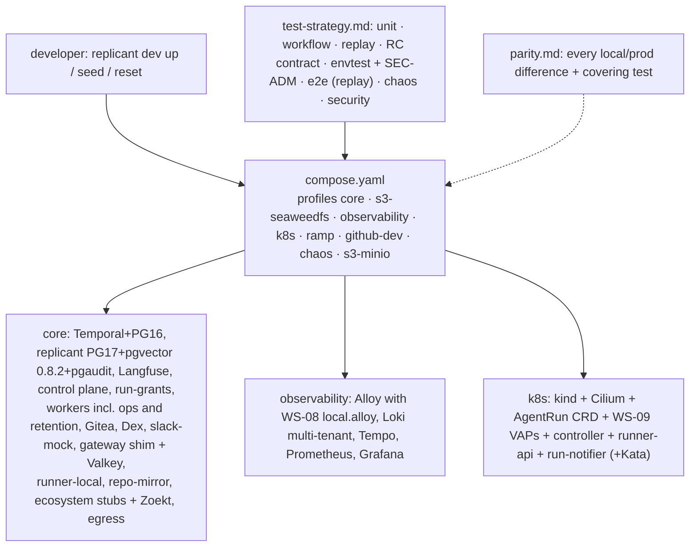

# 11 — Local Development and Test Strategy (WS-11)

## Purpose

Make the whole Replicant runnable and testable on a laptop before any cloud spend, exercising the same
code paths as production (D-20), and define the test strategy from unit tests to full end-to-end jobs,
including the Runner API contract suite that both runner implementations must pass (C-ARCH §3,
C-RUNNER).

## Decisions summary

Targets C-ARCH 2.0.0, C-STATE 2.0.0, C-IDS 2.0.0, C-RUNNER 3.0.0, C-CRD 3.0.0, C-MSG 2.0.0, C-JOBREQ 2.0.0, C-DEF 3.0.0,
C-ART 2.0.0, C-PG 2.0.0 (fix round, wave 3).

| Decision | Constraint | ADR |
|---|---|---|
| Full Temporal 1.32.1 on PostgreSQL 16 locally (same persistence plugin and SQL visibility limits as prod) | D-01, D-02, D-20 | [ADR-11-001](adr/001-temporal-full-server-locally.md) |
| Gitea 28.1 as the local Git server behind a provider adapter; real GitHub through the dev App | D-15, D-24 | [ADR-11-002](adr/002-gitea-local-git-server.md) |
| Dex v2.46.0 as the Okta stand-in; SCIM emulated through identity-service's SCIM API | D-18, D-25 | [ADR-11-003](adr/003-dex-stub-idp.md) |
| **Challenge: D-08 (accepted)**: SeaweedFS is the local S3 (profile `s3-seaweedfs`); MinIO from source is the swap-in profile `s3-minio` | D-08 | [ADR-11-004](adr/004-challenge-d08-minio-locally.md) |
| Langfuse runs in `core` because prompt management is part of every bundle (accepted) | D-03, D-17 | [ADR-11-005](adr/005-langfuse-in-core-profile.md) |
| Dev App webhooks via a Cloudflare quick tunnel with automatic `PATCH /app/hook/config` (WS-07's decision); smee only as an opt-in last resort | D-24 | [ADR-07-004](../07-control-plane-and-ux/adr/004-dev-webhook-forwarding.md), supersedes [ADR-11-006](adr/006-dev-app-webhook-forwarding.md) |
| Run grants locally as in prod: file signer (issuer `replicant-local-core`) in replicant-worker and eval-worker, `run-grants` serves JWKS and `/grants/revoked`, every verifier checks them | C-RUNNER 3.0.0, C-ARCH 2.0.0 §6 | — |
| The AI gateway is WS-03's `replicant-gateway-shim` with local backends (`passthrough`, `record`, `replay`, `script`); CLI → agentd loopback → shim | D-11, C-ARCH 1.5.2 §1.1 | [gateway-stub.md](gateway-stub.md) |
| Sandboxes on an internal Docker network reaching only sbx-edge, sbx-dns, egress proxy, mirrors | D-21 | [ADR-11-007](adr/007-sandbox-network-local.md) |
| The `ops` bucket exists locally (kill-switch mirror `kill-switches/v1/state.json`, exec revocation feed `exec-revocations/local/`); the legal bucket is omitted locally (parity P-42); `ops-worker` runs `LeakPurge`, `retention-sweeper` runs `RetentionSweeper`/`DataOperation` | C-ART 2.0.0, C-RUNNER 3.0.0 | — |
| Workflow tests use WS-01's harness (dev server, versioned workers, catalog-driven `FakeWorld`); long waits use a scaled policy clock | D-02, D-19 | — |
| One-shot `migrate` gates all Replicant services; seed only via APIs; reset rebuilds from migrations | D-26 | — |
| `k8s` profile on kind with Cilium (`socketLB.hostNamespaceOnly`), the unmodified CRD, WS-09's VAPs, and Kata runtime-rs + CLH when `/dev/kvm` exists; labelled "isolation-degraded" runc classes otherwise | D-05, D-06, D-20 | — |
| One Runner API contract suite (RC-*, including run grants and per-audience tokens) run unchanged against runner-local and runner-api + controller | D-04, C-RUNNER 3.0.0 | — |

## Files

| File | Contents |
|---|---|
| [stack.md](stack.md) | Profiles, service inventory, URLs, startup order, secrets, `replicant dev` CLI, seed data, reset, laptop requirements (macOS vs Linux) |
| [compose/compose.yaml](compose/compose.yaml), [compose/compose.chaos.yaml](compose/compose.chaos.yaml) | The complete compose file, and the chaos override that routes chosen clients through toxiproxy |
| [compose/config/](compose/config/) | Every bind-mounted local config: Temporal, Postgres migrator password, Dex, S3 identities and init (applies WS-10's bucket configs), Gitea bootstrap, sbx-edge template, sbx-dns, Squid, Verdaccio, Loki, Tempo, Prometheus, Grafana, gateway shim, runner-local, broker callers, webhook ingress, slack-mock, Zoekt. WS-08's `local.alloy` and WS-10's SQL and bucket configs are mounted from their owners' files |
| [compose/kind/](compose/kind/) | kind cluster config, bootstrap script, RuntimeClasses (Kata runtime-rs, gVisor, degraded fallback) |
| [compose/Makefile](compose/Makefile), [compose/env.example](compose/env.example) | `make up` and the generated `.env` shape |
| [walkthroughs.md](walkthroughs.md) | The 11 required walkthroughs with exact commands and expected output; §11 is the D-24 path from a clean laptop |
| [parity.md](parity.md) | Stub vs production inventory (P-01..P-44) and the must-answer on non-reproducible behaviors |
| [gateway-stub.md](gateway-stub.md) | Local operation of the WS-03 shim: backends, cassette layout and selection, contract-probe scripts, GW suite |
| [test-strategy.md](test-strategy.md) | All test layers; Runner contract suite RC-* (grants, per-audience tokens, every failure reason); storage RC-ART; WF, E2E, CH, SEC (EGRESS, ADM, ESC, MEM) cases |
| [repo-layout.md](repo-layout.md) | Monorepo layout, build tooling, CI pipeline |
| [adr/](adr/) | ADR-11-001 … ADR-11-007 |

## Must-answer

| Question | Answer |
|---|---|
| Minimum laptop for `core` + `observability` | 32 GB RAM (24 GB to the container VM / cgroup budget), 8 performance cores (VM 8 vCPU), 150 GB free SSD, macOS 15+ on Apple Silicon or Linux with cgroup v2. The budget includes the gateway shim and Valkey, run-grants, ops and retention workers, agentd and sidecars per run, and WS-08's local.alloy. Estimates until `replicant dev measure` runs on reference machines. [stack.md §6.2](stack.md#62-minimum-laptop-for-core--observability-must-answer) |
| Production behaviors not reproducible locally, and coverage | Kata isolation on most laptops, enforcing disk quotas, two-cluster networking and PrivateLink, Temporal mTLS + Authorizer, KMS (run-token signer, **run-grant signer**, encrypt-only `run-notifier` role), S3 policies and compliance Object Lock, **agentd custody under a guest kernel**, the **shim in front of the enterprise gateway**, the **QA builder seccomp exception** (relaxed under runc locally), **dev-target images**, real Okta/Slack/Jira/GitHub semantics, scale, wall-clock 30-day waits, node loss, model drift. Each has a named CI job or staging test. [parity.md §3](parity.md#3-production-behaviors-that-cannot-be-reproduced-locally-must-answer) |

## Open questions (top)

| ID | Question | Who decides | Recommendation |
|---|---|---|---|
| OQ-11-05 | Source of KVM CI runners for `k8s-kata` | WS-10 | EC2 nested-virt runners via ARC |
| — | `stub` selector in the shim's run policy (XD-FIX-R1-264) | WS-03 | Policy field, rejected by production shims |
| — | Should `replicant dev up` default to `replay` when no dev keys exist? | WS-11 | Yes |

Closed in the fix round: OQ-11-01 (Challenge D-08 accepted), OQ-11-02 (Langfuse in core accepted), OQ-11-03
(CCR-11-01 applied), OQ-11-04 (WS-07/WS-09: dev build target plus L-1..L-7).

## Risks

- Footprint numbers are estimates, not measurements.
- The Gitea adapter is a different code path from GitHub (parity P-10, High); covered by recorded GitHub
  fixtures and walkthrough 11 on the release checklist.
- Several third-party behaviors the stack relies on are `[unverified]` with fallbacks: SeaweedFS STS
  session policies (per-run identities fallback), Kata inside kind nodes (degraded classes), the exact
  kata-deploy Helm value names, cloudflared's quick-tunnel hostname on the metrics port, `*.localhost` in Safari.
- The QA builder relaxation runs under runc locally (parity P-33, High).

## Interfaces

- **Consumed:** C-ARCH 2.0.0 §1.1, §3, §6; C-STATE 2.0.0; C-IDS 2.0.0 (test vectors, names, task queues);
  C-RUNNER 3.0.0; C-CRD 3.0.0; C-MSG 2.0.0; C-JOBREQ 2.0.0; C-DEF 3.0.0; C-ART 2.0.0; C-PG 2.0.0. Owner files mounted
  unmodified: WS-08 `local.alloy` and Loki overrides, WS-10 bootstrap SQL and local bucket configs, WS-09 VAPs.
- **Provided:** local stack and `replicant dev` CLI; parity inventory; local shim operation (cassette layout and
  run-policy `stub` selector); Runner API contract suite and the other cross-cutting suites; repo layout and CI
  pipeline; XD-FIX resolutions for the seams WS-11 leads.
