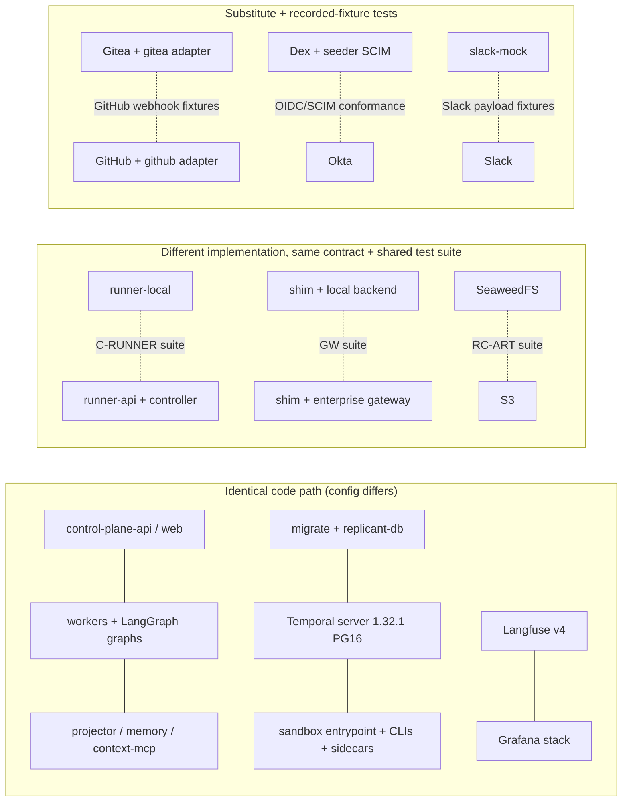

# Stub vs Production-Identical Inventory

**Workstream:** WS-11

## Purpose

List every component of the local stack, what runs locally, what runs in production, whether the code
path is identical, and every known behavioral difference with its risk and the test that covers the
gap. A difference that is not in this table is a bug in this table.

## Decisions summary

| Decision | Constraint |
|---|---|
| Replicant services run their production images and code locally. Differences are configuration only, and every configuration difference is a row below | D-20 |
| Where a local substitute is a different implementation (runner-local, Gitea adapter, Dex, Slack mock, the shim's local upstream backends), a **shared contract test suite** runs against both the substitute and the production implementation or a recorded production fixture | D-20, C-RUNNER |
| Risk ratings: **High**: a bug can pass every local test and break production; **Medium**: a class of bug is caught only in staging; **Low**: cosmetic or operational | — |

## 1. Inventory

| ID | Component | Local | Production | Identical code path? | Known differences | Risk | Covered by |
|---|---|---|---|---|---|---|---|
| P-01 | Replicant Postgres | `replicant/postgres:17-pgvector0.8.2` (pgvector 0.8.2 + pgaudit, WS-10 `00-fake-rds-roles.sql` + `00-bootstrap.sql`), one container, no TLS | Aurora PG 17.11 + pgvector 0.8.2 + pgaudit, Multi-AZ, TLS, IAM auth (WS-10) | Yes (same `replicant-db`, bootstrap SQL, migrations, roles and RLS) | No IAM tokens (passwords), no Database Activity Streams, no failover, no RDS Proxy; `rds_iam`/`rds_superuser` are inert NOLOGIN roles (WS-10 postgres.md §10) | Medium | CI migration job against the Aurora engine version in staging; CH-PG-02 locally; staging failover drill (WS-10) |
| P-02 | Temporal server | `temporalio/server:1.32.1`, all services one process, 4 shards, PG 16 SQL visibility | Helm, separate frontend/history/matching/worker, WS-10 shard count, PG 16 | Yes (same server version and persistence plugin) | Shard count; `system.forceSearchAttributesCacheRefreshOnRead=true` locally; no archival; single process means no frontend/history network hops | Low | Release checklist pins the same server version across envs |
| P-03 | Temporal security | No mTLS, no ClaimMapper/Authorizer; every client may call every API | mTLS per client; Authorizer limits run-notifier to `SignalWorkflowExecution` and control-plane-api to its list (C-MSG §1) | No | A component calling an API it is not authorized for works locally and fails in prod | **High** | Contract test `TMP-AUTHZ` runs in the `k8s` profile CI job with the Authorizer plugin and mTLS enabled (`deploy/helm/temporal/values-ci.yaml`); each client's API calls are asserted against the C-MSG §1 table by an SDK interceptor in tests (`replicant_testing.temporal.assert_allowed_apis`) |
| P-04 | Run-token signing | ES256 key in a file (`run_token_signing_key`) | ES256 key in exec-account KMS (`Sign`) | No (signer backend differs; per-audience tokens, claims, JWKS identical) | KMS latency and throttling; key rotation via aliases | Medium | Signer interface tested with a KMS fake; staging smoke; RC-SBX-01/02 on both runners |
| P-05 | Object storage | SeaweedFS 4.48 (or MinIO from source), path-style, SSE-S3, compressed lifecycle (r2y → 30 d), audit Object Lock GOVERNANCE 1 day (WS-10 local config) | S3, SSE-KMS per tenant with Bucket Keys, tag-based lifecycle, Object Lock COMPLIANCE 730 days on `audit` (C-ART 2.0.0), bucket policies that deny untagged writes | Partly (same `replicant-storage` client; `REPLICANT_S3_SSE_MODE=sse-s3` locally changes headers) | No KMS key per tenant, no bucket-policy deny for untagged writes, STS session-policy semantics `[unverified]` on SeaweedFS, lifecycle filter support `[unverified]` | **High** for KMS/IAM, Medium for lifecycle | RC-ART-01..08 against SeaweedFS **and** real S3 in the nightly `aws-sandbox` CI job (a dedicated AWS account); IAM/KMS policy tests in WS-10's policy CI with `iam:SimulatePrincipalPolicy` |
| P-06 | Sandbox isolation runtime | runner-local: `runc` (macOS always; Linux default), optional `runsc`/`kata` on Linux. kind: Kata 4.3.1 runtime-rs + CLH (`kata-clh-runtime-rs`) when `/dev/kvm` exists, else degraded runc classes; `replicant-kata-fc` and `replicant-gvisor` always degraded unless `REPLICANT_GVISOR=on` | Kata runtime-rs + CLH for every class, gVisor standby, Firecracker disabled (WS-02 R-1..R-3) | No | Kernel isolation absent with runc; guest-kernel behaviors (virtio-fs, block-device workspace) seen only on `k8s-kata` | **High** for security, Medium for compatibility | `k8s-kata` CI job; WS-02 benchmark; SEC-ESC-01..06 (test-strategy.md §8.6) on Kata only, expected-skip on runc |
| P-07 | Worker Deployment registration | Worker sets itself current on start (`REPLICANT_WORKER_SET_CURRENT_ON_START=true`) | CI/Argo registers the version; control-plane release operations set current/ramping (ADR-006) | No (orchestration of the call differs) | A deploy-ordering bug (bundle promoted before pollers exist) cannot happen locally | Medium | Staging deploy pipeline test; `replicant-worker-next` slot in walkthrough 8 exercises the non-current path |
| P-08 | Container control | runner-local mounts the Docker/Podman socket | No container socket anywhere; controller uses the Kubernetes API | No | runner-local holds host-root-equivalent access; a compromise of runner-local is a laptop compromise | Medium (local security) | runner-local is not on `replicant-sbx`; sbx-edge exposes only `/sandbox/v1/*` and JWKS; SEC-EGRESS-03 proves sandboxes cannot reach runner-local's orchestration port |
| P-09 | Workspace hard limit | `watchdog` only (Docker volume, no hard quota) by default; `loopback` on Linux with `runner-local-diskd` | `guestBlockDevice` (Kata) or enforcing `xfsProjectQuota` (gVisor/runc) per ADR-014 | No | ENOSPC behavior differs: locally the watchdog kills the agent at 100%, in prod the filesystem returns ENOSPC first | Medium | RC-RUN-14 (`WorkspaceDiskExceeded`) on both runners; the `k8s-kata` CI job checks ENOSPC-driven failure path |
| P-10 | Git provider | Gitea 28.1 + `gitea` adapter in `replicant-scm` | GitHub + `github` adapter | No (adapter differs; everything after normalization is identical) | Event names and payloads differ (ADR-11-002); no check runs (Gitea has commit statuses only); no GitHub App installation model; review comment threading differs | **High** | `tests/contract/scm/`: recorded GitHub webhook payloads (redacted, from the dev App) replayed into github-integration in CI on every change; walkthrough 11 on the release checklist; the normalized event model has one schema both adapters are tested against |
| P-11 | GitHub App and webhooks | Gitea org webhook (HMAC `X-Hub-Signature-256`); dev App via a Cloudflare quick tunnel (ADR-07-004) for walkthrough 11 | GitHub App webhooks direct to the ingress | Yes for the GitHub path (same route `/github/webhook`) | quick-tunnel hostname changes per start (re-patched by `forward`); redelivery API exercised only on the dev App | Low | Walkthrough 11 |
| P-12 | Installation tokens | Broker mints Gitea access tokens for replicant-bot with mapped scopes and deletes them after 1 h | Broker mints GitHub installation tokens limited to one repository and named permissions, 1 h expiry | No (backend differs) | Gitea tokens are not per-repository and do not expire on their own; a leaked local token can read every repo replicant-bot can see until the broker deletes it | Medium | Broker unit tests for the GitHub backend with recorded API responses; the GitHub backend is exercised end to end in walkthrough 11 |
| P-13 | Identity provider | Dex static users with groups; SCIM pushed by the seeder | Okta OIDC + SCIM push | Yes for identity-service and control-plane-api (they see OIDC tokens and SCIM requests); No for the IdP | Okta claim shapes (`groups` claim filter, custom claims), SCIM PATCH variants Okta actually sends, token lifetimes | Medium | SCIM conformance tests with recorded Okta SCIM requests (`tests/contract/scim/okta-*.json`); staging uses a real Okta dev org |
| P-14 | Slack | slack-mock (Web API subset, signed interaction posts) | Slack | Yes for slack-integration (Bolt with `SLACK_API_URL` override) | Rate limits, Block Kit rendering, retries (`X-Slack-Retry-Num`), Enterprise Grid | Medium | Payload fixtures recorded from a Slack dev workspace; Block Kit JSON validated against Slack's Block Kit schema in unit tests |
| P-15 | Jira | Not run locally | jira-integration + Jira Cloud | — | Jira trigger path never exercised locally | Medium | jira-integration contract tests with recorded Jira webhooks; staging |
| P-16 | AI gateway | WS-03 `replicant-gateway-shim` (production binary) with `--upstream-backend passthrough\|record\|replay\|script`, single-node Valkey | Same shim (3+ replicas, Valkey with Sentinel) in front of the enterprise AI gateway | **Yes** for auth, grant verification, run policy, budgets, usage events; **No** for the upstream leg (dev key or cassettes instead of the enterprise gateway and its credential) | Enterprise gateway behaviors (its own rate limits, routing, retries, metadata header handling); Valkey failover | Medium | GW-01..12 against the local shim and the staging shim; WS-03 adapter tests against the enterprise gateway in staging |
| P-17 | Egress control | internal Docker network + Squid + sbx-dns + mirrors | Cilium FQDN policy and/or Envoy/Squid egress proxy (WS-02) + Artifactory/Nexus | No | FQDN policy enforcement semantics (Cilium DNS proxy), IP-based bypass attempts | Medium | SEC-EGRESS-* run on runner-local **and** the `k8s` profile with Cilium |
| P-18 | Package mirrors | Verdaccio, Athens, proxpi (open upstreams) | Artifactory/Nexus with curated remotes and malware scanning | No | No package policy (blocked packages, license checks) locally | Low | Package-policy tests live with WS-09 |
| P-19 | repo-mirror | Same Go image; upstream Gitea (and GitHub for walkthrough 11) | Same image; upstream GitHub | Yes | Cache warmth, volume type | Low | RC-RUN-08 |
| P-20 | Exec cluster topology | Single Docker host (core) or a single kind cluster (k8s profile) | Separate `core` and `exec` EKS clusters with NLBs and security groups (ADR-007) | No | Cross-cluster latency, NLB idle timeouts, SG misconfiguration, IRSA | **High** for network config | Staging has the two-cluster topology; network reachability tests (`tests/infra/reachability/`) run there |
| P-21 | ecosystem-indexer scheduling | In-process scheduler every 10 min | Kubernetes CronJobs | No (trigger differs; indexing code identical) | Concurrency of overlapping runs | Low | Unit tests for idempotent index runs |
| P-22 | Langfuse | v4.50.0 compose, single ClickHouse | v4 on EKS (WS-08), ClickHouse cluster | Yes (client side) | ClickHouse cluster mode, S3 media upload from browsers | Low | WS-08 staging |
| P-23 | Grafana stack | Single-binary Loki/Tempo, Prometheus, Alloy on Docker logs | Distributed Loki/Tempo, Mimir or Prometheus, Alloy DaemonSets in two clusters | Partly (same Alloy pipeline stages and label rules) | Label cardinality limits at scale; multi-tenant headers | Low | WS-08 dashboards tested in staging; label-set unit test on the Alloy config |
| P-24 | Codec server | Static AES key file | KMS-wrapped key | No (key source) | KMS outages block UI decoding | Low | — |
| P-25 | Secrets | Files under `$REPLICANT_DEV_HOME/secrets` | AWS Secrets Manager or Vault via External Secrets (WS-09) | No | Rotation, propagation delay | Low | Staging |
| P-26 | Runner auth (orchestration listener) | Static dev keys mapped to subjects | Projected ServiceAccount JWT verified against the core cluster's OIDC JWKS | No | JWT audience/issuer validation path not exercised by runner-local | Medium | The `k8s` profile runs runner-api with `auth: static-dev-keys` too; the projected-token path is tested in CI with envtest-issued tokens (RC-AUTH-03) and in staging |
| P-27 | AgentRun lifecycle | runner-local emulates phases, conditions, and notifications from container events; no etcd | Controller reconciles AgentRun → Job/Pod; status in etcd | No (runner-local) / Yes (`k8s` profile) | Controller restart recovery, finalizers, orphan GC, pod eviction semantics | **High** for runner-local alone | C-RUNNER contract suite on both; envtest controller suite; `k8s` profile e2e |
| P-28 | Notifier | In-process component of runner-local (Signal only, payload encoded with the local codec key) | Separate `run-notifier` Deployment, mTLS Signal-only cert, exec role `run-notifier` with tenant-key `kms:GenerateDataKey` only | No | Notifier outage independent of runner; encrypt-only KMS rights (P-35) | Low | RC-RUN-02..04 on both runners; CH-NOT-01 (`k8s` profile) |
| P-29 | Clocks and gate timers | Gate reminders 2 min, escalation 5 min, expiry 30 min (local policy versions) | 4 h / 24 h / 7 d (gate_rules policy) | Yes (policy values only; bundles differ) | None in code; long waits are covered by the dev-server harness with a scaled policy clock | Low | test-strategy.md §3 (30-day waits as seconds-scale policy versions on `start_local()`, XD-W2-11-02) |
| P-30 | Scale | 1–2 concurrent runs, 1 replica per service | 150 concurrent runs, HPA, many replicas | — | Contention, leader election, HPA, per-tenant quotas at scale | Medium | Load tests in staging (WS-08/WS-02) |
| P-31 | Admission policies in kind | WS-09 VAPs applied with the image rule rendered for `localhost/replicant/...:<tag>` (no registry digest locally) | VAPs unmodified (ECR + digest) | Yes for every other CEL rule | Digest pinning of sandbox images is not enforced in kind | Low | SEC-ADM-* in envtest with the unmodified VAPs (test-strategy.md §8.5) |
| P-32 | Dev build target | control-plane-api and identity-service built with `target: dev`, which adds `replicant_dev_auth` (seed authenticator, `/v1/admin/dev/**`) | `prod` target; package absent, routes 404, dev-key-signed images rejected by admission | No (one extra package) | A prod image accidentally built from the dev target would carry the seed authenticator | Medium (security) | WS-07 L-1..L-7: CI asserts `import replicant_dev_auth` fails in prod images and the SBOM lacks it; startup guard; admission rejects dev-signed images |
| P-33 | QA builder seccomp exception | runner-local relaxes the `builder` container (Unconfined seccomp and AppArmor, SETUID/SETGID) under **runc** for qa_build runs (`RUNNER_ALLOW_BUILDER_RELAXATION_ON_RUNC`) | Allowed only in Kata qa_build pods, where the guest kernel is the boundary (WS-09 VAP, WS-05 stage-design.md §7) | No | Locally a build step from an untrusted repo gets more host-kernel surface than in prod | **High** (local security) | SEC-ADM-16 (VAP denies the relaxation outside Kata); SEC-ESC-06 on `k8s-kata`; opt-out switch documented in stack.md risks |
| P-34 | Token custody (agentd) | Same: per-audience tokens mounted only into `replicant-agentd` (uid 10000) and the uploader (`runner-sandbox` only) in the pod group; the agent container has none; CLI uses agentd's loopback 127.0.0.1:7800-7803 | Same, under Kata | Yes (same images and mounts) | Under runc the containers share the host kernel, so token theft from agentd needs only a container escape (prod: guest root plus another container's mounts) | Medium | RC-ENV-01, RC-SBX-01, RC-AUD-01 on both runners; SEC-ESC-01 on Kata |
| P-35 | run-notifier codec rights | Notifier encodes Signal payloads with the single local symmetric codec key, which can also decrypt | Fourth exec role `run-notifier`: tenant-key `kms:GenerateDataKey` only, no `kms:Decrypt` (C-ARCH 2.0.0) | No (key source) | "Encrypt-only" is a KMS permission; locally it is a code path, not an enforced right | Low | WS-09 IAM policy tests (`iam:SimulatePrincipalPolicy`) in `aws-sandbox` |
| P-36 | Run-grant signer and JWKS | replicant-worker/eval-worker sign with `run_grant_signing_key` (file, kid `rg-local-1`); `run-grants` serves a file JWKS | Core KMS key class `run-grant` (`Sign`, `GetPublicKey`), JWKS on `grants.<env>.replicant.internal` through PrivateLink | Yes for claims, verification, revocation polling; No for the signer backend | KMS key rotation, PrivateLink reachability of the grants host from exec | Medium | RC-GRANT-01..07 on both runners; staging rotation drill (WS-09) |
| P-37 | History export (split) | `audit.export_history` writes the `workflow_history_skeleton` to `local-replicant-local-audit` (Object Lock GOVERNANCE 1 day locally; COMPLIANCE 730 days in prod, C-ART 2.0.0) and the full `workflow_history_export` to `local-replicant-local-artifacts` | Skeleton in the Object-Lock audit bucket (WS-10 decides governance or compliance), full history in tenant-keyed `artifacts`, purgeable by `LeakPurge` (C-ART 2.0.0) | Yes (same exporter, keys and types) | Lock duration and mode; no tenant KMS key on the full export | Low | REPLAY-SKEL-01; WS-08 audit tests in staging |
| P-38 | Kill-switch mirror | `ops` bucket key `kill-switches/v1/state.json` in the local S3 store, written by control-plane-api with `If-Match`/`If-None-Match` | Same key in the prod `ops` bucket (SSE-KMS `alias/replicant/<env>/ops`) **plus** a ConfigMap copy, order mirror → Signal → Postgres; break-glass writer role `replicant-killswitch-operator` (XD-FIX-R2-016-WS07) | Yes for the S3 key and readers (`ops.read_kill_switches`); No for the ConfigMap copy and the break-glass role | ConfigMap fallback and the IAM break-glass path are not exercised | Low | WS-07 kill-switch tests in staging; locally `replicant admin kill-switch set` with Postgres paused (CH-PG-01 variant) |
| P-39 | Dev GitHub App secrets | Keyring through `replicant secret-agent` (PEM to the broker, webhook secret to github-integration) | KMS key `alias/replicant/<env>/github-app`, Secrets Manager | No | — | Low | walkthrough 11 |
| P-40 | Webhook ingress for the dev App | Cloudflare quick tunnel → `webhook-ingress` (only `POST /github/webhook`) → github-integration; hostname changes per start, patched into the App by `forward` | ALB + WAF → github-integration | Yes from github-integration inward | Tunnel limits (200 in-flight, no uptime guarantee) | Low | walkthrough 11 (ADR-07-004) |
| P-41 | S3 identities | One `replicant-services` S3 identity for all Replicant services (shared-credentials file), plus `runner-local` and `gateway-shim` identities | One IAM role per service (Pod Identity), prefix-scoped bucket policies (WS-10/WS-09) | No (credentials source) | A service writing outside its prefix succeeds locally | Medium | WS-10 policy CI (`iam:SimulatePrincipalPolicy`), RC-ART-06 against real S3 |
| P-42 | Legal bucket | **Not created locally** | `<org>-replicant-<env>-legal`, governance Object Lock with legal holds only, written and read only by `replicant-<env>-legal-hold` (C-ART 2.0.0, CCR-10-10) | — | A leak purge never meets a legal hold locally (`blocked_by_legal_hold` and its escalation are untested on laptops) | Low | WS-08/WS-10 LeakPurge tests in staging with a held legal-bucket object |
| P-43 | Exec revocation feed | runner-local serves `GET /v1/revocations` and writes `exec-revocations/local/*.ndjson` to the local `ops` bucket; verifiers poll it (and the kind runner-api's) every 10 s with static dev tokens | runner-api feed behind PrivateLink; verifiers authenticate with ServiceAccount tokens; durable copy in the prod `ops` bucket (C-RUNNER 3.0.0) | Yes for feed semantics; No for auth | — | Low | RC-REV-01..03 on both runners |
| P-44 | Run lease | runner-local keeps heartbeat timestamps in `$RUNNER_STATE_DIR/leases/`; lease expiry with the container still running → `NodeLost` | runner-api renews a Kubernetes Lease `ar-<body>-lease`; controller fails the run on expiry while the Node is Ready (XD-FIX-R2-030) | No (store) | — | Low | RC-LEASE-01 on both runners |

## 2. Configuration knobs that differ (complete list)

| Knob | Local value | Production value | Read by |
|---|---|---|---|
| `REPLICANT_ENV` | `local` | `prod` / `staging` / `dev` | all |
| `REPLICANT_TEMPORAL_TLS` | `false` | `true` (+ cert paths) | all Temporal clients |
| `REPLICANT_S3_SSE_MODE` | `sse-s3` | `sse-kms` | replicant-storage |
| `REPLICANT_S3_ENDPOINT`, `REPLICANT_S3_FORCE_PATH_STYLE` | `http://s3.replicant.localhost:8333`, `true` | unset (AWS default), `false` | replicant-storage |
| `REPLICANT_SCHEMA_REVISION_CHECK` | `strict` | `compatible` (C-PG 2.0.0 rule 8 allows `strict` only in local/ci; WS-10 `revision.py` refuses it elsewhere, XD-10-10) | replicant-db |
| `REPLICANT_WORKER_SET_CURRENT_ON_START` | `true` | `false` | workers |
| `REPLICANT_RUNNER_URL` | `http://runner-local:8480` or kind node | `https://runner.prod.replicant.internal` | replicant-worker, eval-worker |
| `REPLICANT_RUNNER_TOKEN_FILE` | static dev key | projected SA token path | same |
| `REPLICANT_DEV_SEED_TOKEN_FILE` | set | unset (and refused if set) | control-plane-api |
| `REPLICANT_GITEA_*` | set | unset | replicant-scm |
| `REPLICANT_RUN_GRANT_SIGNER` / `_KEY_FILE` / `_KID` / `_ISSUER` | `file`, `run_grant_signing_key`, `rg-local-1`, `replicant-local-core` | `kms`, key alias of class `run-grant`, KMS key id, `replicant-<env>-core` | replicant-worker, eval-worker (Runner-call activity) |
| `REPLICANT_RUN_GRANT_JWKS_URL` / `_REVOCATION_URL` | `http://grants.replicant.localhost:8403/...` | `https://grants.<env>.replicant.internal/...` | runner, shim, memory-mcp, context-mcp, repo-mirror |
| `REPLICANT_RUN_GRANT_JWKS_SOURCE` | `file` | `kms` | run-grants (control-plane-api grants app) |
| `REPLICANT_KILL_SWITCH_MIRROR` | `s3://local-replicant-local-ops/kill-switches/v1/state.json` | `s3://<org>-replicant-<env>-ops/kill-switches/v1/state.json` plus the ConfigMap copy (P-38, XD-FIX-R2-016-WS07) | intake, Publisher, `runner.start_run` |
| shim `--upstream-backend` | `passthrough`/`record`/`replay`/`script` | enterprise | replicant-gateway-shim |
| Docker build target of control-plane-api, identity-service | `dev` | `prod` | — |
| `RUNNER_SIGNING_KEY_FILE` vs `RUNNER_SIGNING_KMS_KEY_ID` | file | KMS | runner |
| Policy versions (`gate_rules`, `runner_polling`, `budgets`) | local versions in `dev/config-local/` | `config/` | via bundle |

## 3. Production behaviors that cannot be reproduced locally (must-answer)

| Behavior | Why not locally | How it is covered instead |
|---|---|---|
| Kata/gVisor isolation strength and escape resistance (macOS always; Linux without KVM) | No KVM in the macOS container VM except M3+ nested virtualization; gVisor needs a Linux host | `k8s-kata` CI job on a KVM-capable Linux runner (bare metal or nested-virt instance); WS-02 runtime benchmark; SEC-ESC suite on staging exec nodes |
| Enforcing workspace quotas (Kata guest block device, XFS project quota `bhard`) | Needs node-level storage setup | `k8s-kata` CI job; staging; RC-RUN-14 asserts the observable failure reason on all runners |
| Two-cluster network boundary, NLBs, security groups, VPC endpoint policy, IRSA / Pod Identity | One Docker host | Staging (same topology); `tests/infra/reachability` matrix (every allowed and every denied path) |
| Temporal mTLS and the custom Authorizer (run-notifier Signal-only) | Not configured locally | CI `TMP-AUTHZ` job with Authorizer plugin and cert-manager-issued certs in kind |
| KMS per-tenant keys, S3 bucket policies, Bucket Keys, Object Lock compliance windows | No KMS; S3-compatible server semantics differ | Nightly `aws-sandbox` job runs RC-ART against real S3 with WS-10's bucket policies; `iam:SimulatePrincipalPolicy` tests |
| Okta behaviors (SCIM push timing, group claim filters, MFA), Slack and Jira at their real APIs | Third-party SaaS | Recorded-fixture contract tests; staging integrations with dev tenants of each SaaS |
| GitHub check runs, branch protection rulesets, App installation scopes, secondary rate limits | Gitea has no check runs or App model | Walkthrough 11 (dev App on a personal org) on the release checklist; recorded GitHub fixtures |
| Scale: 150 concurrent runs, Temporal shard behavior, etcd load from 135k AgentRuns, HPA | Laptop | Staging load test (WS-02/WS-08), etcd object-count soak test |
| 30-day human waits in wall-clock time, CAN across real worker redeploys over weeks | Time | Dev-server harness (`start_local()`, versioned workers) with a scaled policy clock that runs every timer, reminder, expiry, Continue-As-New and Update path in seconds (test-strategy.md §3, XD-W2-11-02); WS-01's measured history-size model for a true 30-day job (history-budget.md); replay tests against every live deployment version (§4) |
| Spot interruption / real node loss | No nodes in core | `k8s` profile node kill (`docker stop replicant-local-worker`) gives `NodeLost`; staging chaos |
| Production model behavior drift | Replay fixtures are frozen | Eval harness (WS-06) on every bundle; weekly re-record of cassettes in the `cassette-refresh` CI job |
| Run grants signed by KMS and fetched over PrivateLink; KMS key rotation | No KMS locally | P-36: RC-GRANT-* exercise the full verification logic with a file signer; the KMS signer and rotation are tested in staging (WS-09 drill) |
| agentd token custody under a guest kernel | runc on laptops | P-34: custody is verified structurally (RC-ENV-01, RC-SBX-01) everywhere; the escape resistance only on `k8s-kata` (SEC-ESC-01) |
| The shim in front of the **enterprise** gateway | The enterprise gateway is not reachable from laptops | P-16: everything up to the upstream call is the production shim; the upstream leg is tested in staging with WS-03's adapter tests |
| QA rootless builds inside Kata (relaxed seccomp contained by the guest) | No Kata on most laptops | P-33: SEC-ADM-16 proves prod admission only allows it under Kata; SEC-ESC-06 on `k8s-kata` |
| Prod-target images without `replicant_dev_auth` | Local control-plane-api and identity-service run the dev target | P-32: CI image tests and admission (WS-07 L-1, L-2) |
| `run-notifier` encrypt-only KMS rights (fourth exec role) | No KMS; runner-local's notifier is in-process | P-35: IAM simulation in `aws-sandbox`; the notifier's encode-only code path runs locally |
| Legal holds and the legal bucket | Not created locally | P-42: staging LeakPurge tests against a held legal-bucket object |
| Per-service S3 IAM roles | One local S3 identity for Replicant services | P-41: policy simulation and RC-ART against real S3 |
| Audit bucket COMPLIANCE-mode Object Lock (730 days) and the leak-purge path on real S3 | 1-day GOVERNANCE lock locally (compliance mode would make local objects undeletable for 2 years) | P-37: REPLAY-SKEL-01 locally; LeakPurge two-person flow (gate kind `leak_purge`, `min_approvers: 2`) runs end to end on ops-worker against the `artifacts` full export; lock semantics in staging |

## Open questions

| Question | Who decides | Options | Recommendation |
|---|---|---|---|
| Does staging need a separate dev Okta org and Slack workspace for P-13/P-14? | WS-07, WS-09 | yes / reuse prod with test groups | Yes; never test against the production IdP |
| Nightly `aws-sandbox` account for RC-ART against real S3 | WS-10 | dedicated account / staging account | Dedicated account with WS-10's real bucket policies |

## Risks

- The High rows (P-03, P-05 KMS/IAM, P-06, P-10, P-20, P-27, P-33) are the places where "it works on my
  laptop" is least informative. Each has a CI job that runs outside the laptop stack; those jobs gate
  release, not merge, which leaves a window.

## Interfaces

- **Consumed:** C-ARCH (§1, §3, §6), C-MSG §1, C-RUNNER, C-CRD, C-ART, C-PG.
- **Provided:** the authoritative local/production difference list referenced by C-ARCH §3.
