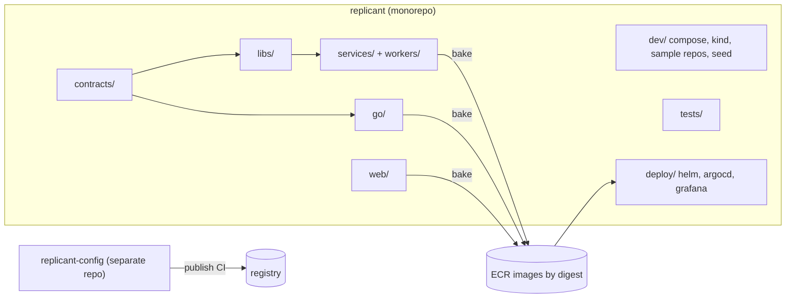
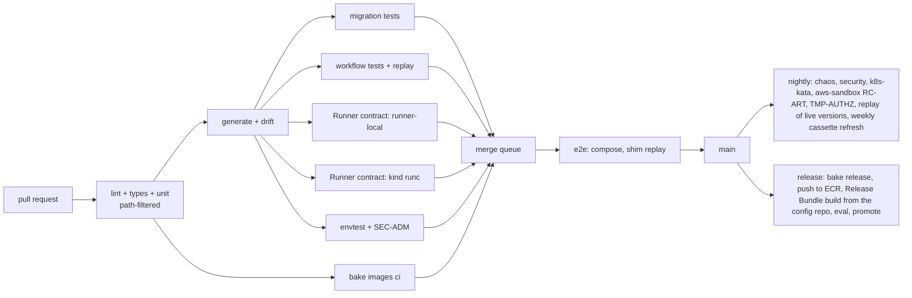

# Repository Layout, Build Tooling, and CI

**Workstream:** WS-11

## Purpose

Define Replicant's own monorepo: where every service, worker, controller, UI, shared library,
contract, definition, compose file, Helm chart, and test suite lives; how it is built; and the CI
pipeline that runs the test strategy.

## Decisions summary

| Decision | Constraint |
|---|---|
| One monorepo `replicant` for all code, contracts, Helm charts, the local stack, and tests. The **config repo** `replicant-config` (definitions, policies, bundle requests, prompts) is a separate repository, published to the registry by its own CI (C-DEF §4.2); the monorepo holds only local-dev overlays (`dev/config-local/`) and test fixtures | D-03, D-12 |
| Python: uv workspace (one lockfile `uv.lock`), Python 3.12. Go: one Go workspace (`go.work`), Go 1.26. TypeScript: pnpm workspace, Node 22 LTS | D-23 |
| Images: `docker buildx bake` (`docker-bake.hcl`), multi-arch `linux/amd64,linux/arm64`, reproducible tags `b<YYYYMMDD>-<git sha 12>` that double as Worker Deployment build IDs | C-IDS §2 (build ID format) |
| Contract files are vendored verbatim from `spec/00-contracts/` into `contracts/`; generated code (pydantic models, Go types, OpenAPI clients) is produced in CI and checked for drift | CC-4 |
| GitHub Actions with path filters, a merge queue, and self-hosted KVM runners for the Kata jobs | — |
| Renovate pins and bumps every image tag, action SHA, and tool version | — |



## 1. Layout

```text
replicant/
├── contracts/                         # verbatim copies of spec/00-contracts machine files (CI checks byte-equality)
│   ├── runner-api.openapi.yaml
│   ├── agentrun-crd.yaml
│   ├── job-request.schema.json
│   └── schemas/{definition-envelope,release-bundle,run-manifest,run-result,workflow-messages}.schema.json
├── libs/
│   ├── python/
│   │   ├── replicant-ids/               # C-IDS reference implementation (+ test vectors)
│   │   ├── replicant-db/                # SQLAlchemy 2.0 models per schema, Alembic env, `replicant-db migrate` CLI,
│   │   │   ├── replicant_db/models/<schema>/      #   import-linter contracts (C-PG rule 7)
│   │   │   ├── migrations/versions/
│   │   │   └── Dockerfile.migrate
│   │   ├── replicant-storage/           # logical↔physical S3 refs, uploads with tags/checksums, presign
│   │   ├── replicant-telemetry/         # OTel setup, span processor that sets C-IDS attributes, JSON log format
│   │   ├── replicant-temporal/          # client factory, codec, interceptors, search attribute helpers
│   │   ├── replicant-contracts/         # pydantic v2 models generated from contracts/ (datamodel-code-generator)
│   │   ├── replicant-scm/               # ScmProvider interface; github and gitea adapters; normalized event model
│   │   ├── replicant-authz/             # client for identity-service decisions; D-25 admin guard decorator
│   │   └── replicant-testing/           # FakeActivities (built from WS-01's CATALOG), ScriptedShim, run-grant test signer, Temporal test helpers, fixtures loaders
│   └── go/
│       ├── ids/  storage/  contracts/ # generated from contracts/ with oapi-codegen; ids mirrors replicant-ids
├── services/                          # Python FastAPI services (one Dockerfile each)
│   ├── control-plane-api/  identity-service/  github-integration/  github-token-broker/
│   ├── slack-integration/  jira-integration/  memory-service/  context-mcp/
│   ├── ecosystem-indexer/  usage-ingestor/  temporal-codec-server/  retention-sweeper/ (WS-10)
│   │   # control-plane-api and identity-service Dockerfiles have `prod` and `dev` targets; `dev` adds only
│   │   # package replicant_dev_auth (WS-07 identity.md §9.3); control-plane-api also ships the grants app
│   │   # (`control-plane-api serve-grants`)
├── workers/                           # Temporal workers (Python)
│   ├── replicant-worker/                # ReplicantJob, MaintenanceBatch, system workflows; LangGraph graphs; node activities
│   │   ├── replicant_worker/{workflows,graphs,nodes,activities,adapters/langgraph}/
│   │   └── nodecatalog/               # generated NodeCatalog document (published by CI per build ID)
│   ├── publisher-worker/  replicant-projector/  eval-worker/  ops-worker/ (replicant-ops, LeakPurge)
├── go/                                # Go module set (go.work)
│   ├── cmd/runner-api/  cmd/runner-local/  cmd/run-notifier/  cmd/agentrun-controller/
│   ├── cmd/repo-mirror/  cmd/sandbox-sidecars/  cmd/runner-local-diskd/
│   ├── cmd/replicant-entrypoint/  cmd/replicant-agentd/   # WS-03; shipped inside the CLI images, not as an image
│   ├── cmd/replicant-gateway-shim/                        # WS-03 shim (local backends passthrough/record/replay/script)
│   ├── internal/runner/  internal/controller/  internal/notifier/  internal/mirror/
│   └── controller/config/             # kubebuilder RBAC, webhook config (CRD itself comes from contracts/)
├── images/                            # sandbox and CLI images
│   ├── env-{go-service,nextjs-app,python-service,node-service,docs-site,web-frontend}/   # environment images (WS-03)
│   ├── cli-claude-code/  cli-codex/        # carry /opt/replicant/bin/{replicant-entrypoint,replicant-agentd} (WS-03 decision 2)
│   ├── qa-svc-postgres/  qa-svc-s3mock/  qa-builder/   # QA service and builder images (WS-05)
│   └── contract-probe/                     # CLI image variant with `replicant-agentd debug tokens` (test only)
├── web/
│   └── control-plane-web/             # TypeScript SPA (WS-07), Vitest, Playwright
├── cli/                               # `replicant` CLI (Python, Typer): user commands + `replicant dev` (local only)
├── tools/
│   ├── slack-mock/  ecosystem-stubs/           # the gateway is WS-03's go/cmd/replicant-gateway-shim, not a tool
├── deploy/
│   ├── helm/replicant-core/  helm/replicant-exec/  helm/temporal/  helm/langfuse/  helm/observability/
│   ├── argocd/                        # ApplicationSets per environment; migrate PreSync hook (WS-10 decides)
│   ├── grafana/dashboards/            # dashboards as JSON (mounted by the local Grafana)
│   ├── observability/{alloy/local.alloy,loki/runtime-overrides.yaml,redaction/}   # from WS-08, mounted locally
│   ├── security/kubernetes/           # WS-09 VAPs, applied in envtest (unmodified) and kind (image rule rendered)
│   └── s3/{prod,local}/               # WS-10 generated bucket configs; local ones applied by s3-init
├── dev/
│   ├── compose/                       # = spec/11-local-dev/compose (compose.yaml, compose.chaos.yaml, config/, kind/)
│   ├── postgres-replicant/Dockerfile    # FROM pgvector/pgvector:0.8.2-pg17-bookworm + postgresql-17-pgaudit
│   ├── k8s-tools/Dockerfile           # kind, kubectl, helm, cilium-cli pinned
│   ├── minio-src/Dockerfile           # s3-minio profile (ADR-11-004)
│   ├── sample-repos/{ledger-api,checkout-web,payments-contracts}.bundle + ISSUES/
│   ├── ecosystem/                     # Backstage-shaped catalog + contract artifacts for ecosystem-stubs
│   ├── config-local/                  # local overlays: policies with short timers, bundle request local.yaml
│   └── seed/                          # seed fixtures (users, groups, tenants, role bindings, memory entries)
├── evals/smoke-local/                 # WS-06 smoke-local@1: repos/*.bundle, environments/, bindings.yaml, cassettes/
├── tests/
│   ├── contract/{runner,scm,scim,slack,gateway,storage}/
│   ├── e2e/  chaos/  security/  replay/histories/  infra/reachability/
│   └── fixtures/{cassettes,gateway-scripts,injection,memory}/   # cassettes: <set>/<key>.ndjson (gateway-stub.md §3)
├── docker-bake.hcl
├── pyproject.toml  uv.lock  go.work  pnpm-workspace.yaml
├── renovate.json
└── .github/workflows/
```

Ownership: `CODEOWNERS` maps each top-level directory to the owning workstream's team (for example
`go/internal/controller/ @replicant/execution`, `libs/python/replicant-db/ @replicant/data-platform`,
`contracts/ @replicant/architecture` with required review).

## 2. Build tooling

| Tool | Version (at time of writing) | Use |
|---|---|---|
| uv | current stable | Python workspace, lockfile, `uv run` for every Python command |
| ruff, mypy (strict for libs) | current | lint, format, types |
| import-linter | current | C-PG rule 7 (writer models imported only by their writer service) |
| Go | 1.26.x `[unverified: exact current Go minor]` | runner, controller, entrypoint |
| golangci-lint, controller-gen, setup-envtest | current | Go lint, CRD RBAC generation, envtest binaries |
| pnpm + Node 22 LTS | `node:22.23.3` | UI |
| docker buildx bake | Docker Compose v5.6.1 era tooling | images |
| oapi-codegen, datamodel-code-generator | current | generated contract types |
| squawk | current | migration SQL lint (D-26) |
| Schemathesis | 4.32.4 | Runner API schema checks |
| kind / helm / kubectl | v0.33.0 / v4.3.1 / 1.36 | `k8s` profile and CI |

`docker-bake.hcl` defines one target per image and groups `local` (all images for compose, host arch
only, `--load`), `ci` (multi-arch, push to the CI registry), and `release` (push to ECR, SBOM and
provenance attestations). The `replicant-worker` target passes `REPLICANT_BUILD_ID`, which is baked into
the image as `org.opencontainers.image.version` and read by the worker at startup.

## 3. Generated code and drift checks

| Source | Generated | Check |
|---|---|---|
| `contracts/*.schema.json` | `replicant-contracts` pydantic models; Go types | `make generate && git diff --exit-code` |
| `contracts/runner-api.openapi.yaml` | Python client (activities), Go server interfaces | same |
| `contracts/agentrun-crd.yaml` | Go types (`go/internal/controller/api/v1alpha1`) checked against the CRD schema by a round-trip test | envtest applies the vendored CRD |
| SQLAlchemy models | Alembic migration diff | `alembic check` + schema dump diff (test-strategy.md §9) |
| Worker graph nodes | `NodeCatalog` | CI publishes per build ID |

## 4. CI pipeline (GitHub Actions)



| Job | Runner | Steps |
|---|---|---|
| `lint-unit` (matrix per package) | ubuntu-24.04 | uv sync → ruff → mypy → pytest; go vet/golangci-lint → go test; pnpm lint → vitest |
| `generate-drift` | ubuntu | regenerate; `git diff --exit-code`; contracts byte-equal to `spec/00-contracts` |
| `migrations` | ubuntu + service Postgres 17 | squawk on `alembic upgrade head --sql`; up/down/up; drift |
| `workflows` | ubuntu | dev-server workflow suite (scaled policy clock); replay of this build's corpus |
| `contract-runner-local` | ubuntu-24.04 8-core | `replicant dev up --lean --gateway script` (pre-built CI images) → `replicant dev test contract-runner --runner local` |
| `contract-runner-kind` | ubuntu-24.04 8-core | same + `--with-k8s` (`REPLICANT_KATA=off`) → `--runner k8s` |
| `envtest` | ubuntu | `setup-envtest use 1.34.x` (and 1.36.x) → `go test ./internal/controller/...`; `pytest tests/security/admission` (SEC-ADM-*, WS-09 VAPs unmodified) |
| `e2e` (merge queue) | ubuntu 16-core | full stack, `--gateway replay`, E2E-01..12; export histories as artifacts |
| `k8s-kata` (nightly) | self-hosted Linux with `/dev/kvm` (EC2 nested-virt or metal via Actions Runner Controller) | `--with-k8s REPLICANT_KATA=on`; contract suite incl. RC-ISO; E2E-01; SEC-* |
| `chaos` (nightly) | ubuntu 16-core | CH-* |
| `security` (nightly + on sandbox/egress changes) | ubuntu 16-core and `k8s-kata` | SEC-* |
| `aws-sandbox` (nightly) | ubuntu, OIDC → `replicant-ci-sandbox` account | RC-ART against real S3 with WS-10 policies; IAM simulation |
| `temporal-authz` (nightly) | ubuntu | kind with Temporal Helm chart, mTLS via cert-manager, custom Authorizer; TMP-AUTHZ |
| `replay-live` (nightly) | ubuntu | for each live build ID: pull its image by digest, replay the staging corpus |
| `cassette-refresh` (weekly) | ubuntu, provider keys from OIDC-federated secrets | re-record cassettes; open a PR with outcome diffs for human review |
| `local-stack` (weekly + Renovate PRs) | macos-15 arm64 (Colima) and ubuntu | `replicant dev up` from scratch, walkthroughs 1–9 in replay, `replicant dev measure` → publishes the footprint table |

## 5. Dependency pinning

Renovate config groups: `local-stack-images` (every `image:` in `dev/compose/compose.yaml`, minimum
release age 14 days), `temporal` (server, admin-tools, UI, SDKs together), `langfuse` (web + worker
together), `cli-images` (bumping a CLI image digest changes an AgentDefinition in `replicant-config`,
not this repo). GitHub Actions are pinned by commit SHA.

## Open questions

| Question | Who decides | Options | Recommendation |
|---|---|---|---|
| Monorepo build orchestration beyond path filters (Bazel/Pants) | WS-11 with all | path filters + uv/go/pnpm / Pants / Bazel | Path filters now; revisit when CI median exceeds 20 min |
| KVM CI runners | WS-10 | ARC on EC2 nested-virt (`m8id`) / bare metal | ARC on nested-virt instances, re-using WS-02's evaluation |

## Risks

- A monorepo with three ecosystems needs disciplined path filters; a mis-filtered change skips a suite.
  Mitigation: the merge-queue `e2e` job always runs.

## Interfaces

- **Consumed:** all contracts (vendored), WS-10 migration machinery, WS-07 CLI, WS-02 Helm chart
  `replicant-exec`, WS-08 dashboards.
- **Provided:** directory conventions, build IDs, CI job definitions.
