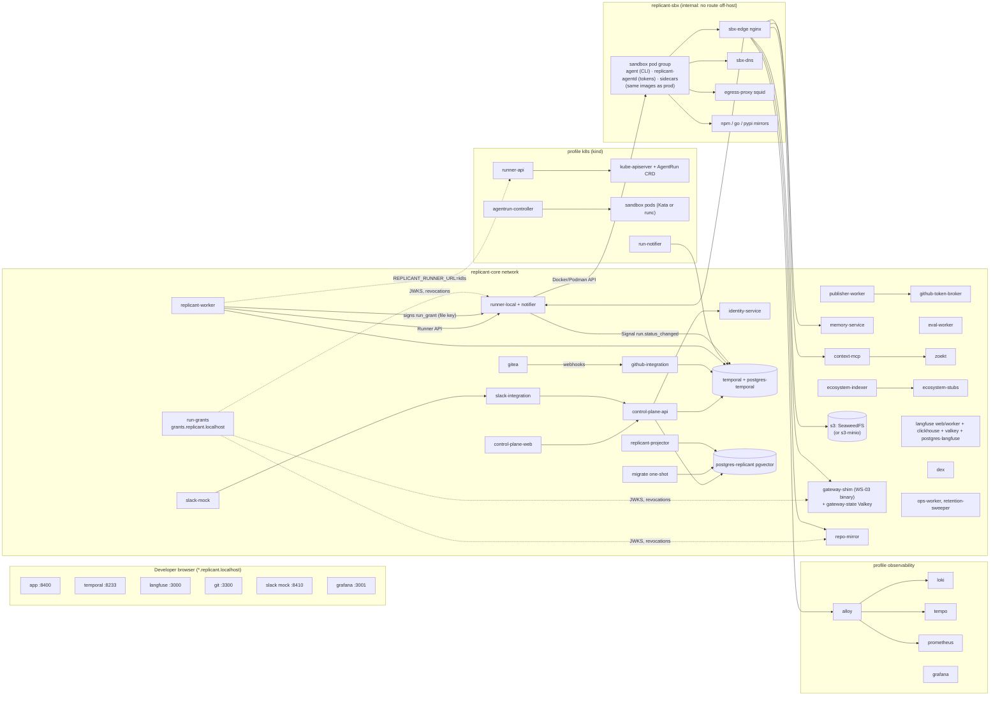
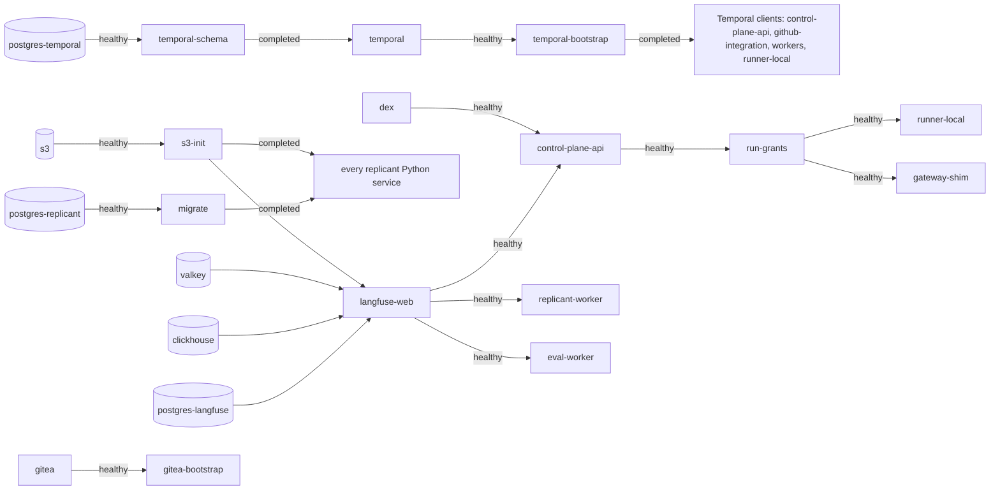

# Local Stack

**Workstream:** WS-11 · **Section:** `spec/11-local-dev/` · **Compose file:** [compose/compose.yaml](compose/compose.yaml) ·
**Contracts:** C-ARCH 2.0.0, C-STATE 2.0.0, C-IDS 2.0.0, C-RUNNER 3.0.0, C-CRD 3.0.0, C-MSG 2.0.0, C-JOBREQ 2.0.0,
C-DEF 3.0.0, C-ART 2.0.0, C-PG 2.0.0

## Purpose

Run the whole Replicant on one laptop with Docker or Podman, before any cloud spend, through the same
service images, the same migrations, the same Temporal persistence plugin, the same Runner API, the same
registry and bundle flow, and the same S3 key layout as production (D-20). This document specifies the
compose stack, the `replicant dev` CLI that drives it, seed data, reset, and the laptop it needs.

## Decisions summary

| Decision | Constraint | ADR |
|---|---|---|
| Full Temporal server 1.32.1 on PostgreSQL 16 with SQL visibility, not the CLI dev server | D-01, D-02, D-20 | [ADR-11-001](adr/001-temporal-full-server-locally.md) |
| Gitea 28.1 is the local Git server behind a provider adapter; real GitHub through the dev App | D-15, D-20, D-24 | [ADR-11-002](adr/002-gitea-local-git-server.md) |
| Dex v2.46.0 for OIDC (static users with groups); SCIM emulated by the seeder | D-18, D-25 | [ADR-11-003](adr/003-dex-stub-idp.md) |
| **Challenge D-08 (accepted, CCR-11-02):** SeaweedFS is the local S3 (profile `s3-seaweedfs`, always on); MinIO from source is the alternative profile `s3-minio`, which takes over the `s3.replicant.localhost` name | D-08 | [ADR-11-004](adr/004-challenge-d08-minio-locally.md) |
| Langfuse is in `core`, because prompt management feeds every bundle (accepted, CCR-11-03) | D-03, D-17 | [ADR-11-005](adr/005-langfuse-in-core-profile.md) |
| Dev App webhooks via a **Cloudflare quick tunnel** with automatic `PATCH /app/hook/config`; smee only as an opt-in last resort | D-24 | [ADR-07-004](../07-control-plane-and-ux/adr/004-dev-webhook-forwarding.md) (supersedes [ADR-11-006](adr/006-dev-app-webhook-forwarding.md)) |
| Run grants work locally exactly as in production: replicant-worker and eval-worker sign `RunSpec.run_grant` with a local file key (issuer `replicant-local-core`); `run-grants` serves the JWKS and `/grants/revoked`; runner-local, the kind runner-api, the shim, memory-mcp, context-mcp and repo-mirror verify | C-RUNNER 3.0.0, C-ARCH 2.0.0 §6 | — |
| The AI gateway is WS-03's `replicant-gateway-shim` binary with local backends; the CLI reaches it only through `replicant-agentd` | D-11, C-ARCH 2.0.0 §1.1 | [gateway-stub.md](gateway-stub.md) |
| control-plane-api and identity-service run their `dev` build target (adds only `replicant_dev_auth`); every other image is the production target | XD-09-14 | — |
| Sandboxes on an internal network that reaches only sbx-edge, sbx-dns, the egress proxy, and mirrors | D-21 | [ADR-11-007](adr/007-sandbox-network-local.md) |
| One-shot `migrate` service gates every Replicant service (`service_completed_successfully`) | D-26 | — |
| Seed data only through APIs (`replicant dev seed`); `replicant dev reset` rebuilds from migrations | D-26 | — |
| `k8s` profile: kind v0.33.0, Kubernetes 1.36, Cilium, real CRD/controller/runner-api/run-notifier, Kata when `/dev/kvm` exists | D-05, D-06, D-20 | — |

---

## 1. Profiles

| Profile | Contents | Started by |
|---|---|---|
| `core` | 48 services: stores (Replicant Postgres, Temporal and Langfuse Postgres), Temporal, migrate, Dex, control plane, `run-grants`, integrations, workers (Replicant, publisher, projector, eval, ops, retention-sweeper), memory and context, Gitea, runner-local, repo-mirror, gateway shim + `gateway-state`, sandbox edge, egress proxy and mirrors, Langfuse | `replicant dev up` |
| `s3-seaweedfs` | `s3` (SeaweedFS 4.48). `replicant dev up` always adds it unless `--s3 minio` | `replicant dev up` |
| `observability` | Alloy, Loki, Tempo, Prometheus, Grafana | `replicant dev up --with-observability` |
| `k8s` | `k8s-provisioner` one-shot that creates the kind cluster `replicant-local` and installs Cilium, (Kata), the contract CRD and WS-02's `replicant-exec` chart | `replicant dev up --with-k8s` |
| `ramp` | `replicant-worker-next`, a second Worker Deployment Version of `replicant-worker` | `replicant dev worker deploy --slot next` |
| `github-dev` | `webhook-ingress` (nginx, only `POST /github/webhook`) and `webhook-forwarder` (`cloudflare/cloudflared:2026.10.3` quick tunnel) | `replicant dev github-app forward` |
| `chaos` | toxiproxy; used with the override [compose.chaos.yaml](compose/compose.chaos.yaml), which points chosen clients at it | `replicant dev test chaos` |
| `s3-minio` | MinIO built from `RELEASE.2025-10-15T17-29-55Z` source, aliased `s3.replicant.localhost` and replacing `s3-seaweedfs` | `replicant dev up --s3 minio` |

Validated on 2026-10-24 (fix round) with Docker Compose v5.6.1 (`docker-compose config -q` for
`core+s3-seaweedfs`, `core+s3-minio`, `observability`, all profiles together, and `-f compose.yaml -f
compose.chaos.yaml` with `chaos`) and with `podman compose` → podman-compose 1.6.0 (`config` exit 0).
`podman compose` prefers the `docker-compose` binary when installed and honors
`PODMAN_COMPOSE_PROVIDER` [verified: https://docs.podman.io/en/latest/markdown/podman-compose.1.html,
2026-10-24]; the supported provider is `docker-compose` v2.24 or later (for `depends_on.required`,
`service_completed_successfully`, profiles). podman-compose is best effort
`[unverified: podman-compose 1.6.0 honors service_completed_successfully at `up` time]`.

## 2. Service inventory

Every Replicant service image is the production image (same Dockerfile, same entrypoint, production build
target); only environment differs. The one exception is control-plane-api and identity-service, built with
`target: dev`, which adds package `replicant_dev_auth` (the seed authenticator and `/v1/admin/dev/**` routes) and
nothing else (WS-07 identity.md §9.3 L-1; parity.md P-32). "Prod" is the counterpart in C-ARCH §1. Ports are bound to `127.0.0.1`.

| Service | Image (pinned) | Host port | Health | Waits for | Prod counterpart |
|---|---|---|---|---|---|
| postgres-replicant | `localhost/replicant/postgres:17-pgvector0.8.2` built from `dev/postgres-replicant/Dockerfile` (`FROM pgvector/pgvector:0.8.2-pg17-bookworm`, plus `postgresql-17-pgaudit`), init with WS-10's `00-fake-rds-roles.sql` and `00-bootstrap.sql` | — | `pg_isready` | — | Aurora PG 17.11 + pgvector 0.8.2 + pgaudit (WS-10 postgres.md §10) |
| postgres-temporal | `postgres:16.14` | — | `pg_isready` | — | RDS PG 16 `temporal` |
| postgres-langfuse | `postgres:17.6` | — | `pg_isready` | — | RDS PG `langfuse` |
| s3 (profile `s3-seaweedfs`) or s3-minio / s3-init | `chrislusf/seaweedfs:4.48` / `amazon/aws-cli:2.37.8` applying WS-10's `config/s3/local/*.json`, plus the `ops` bucket | 8333 | TCP | — | S3: 7 bucket classes + `ops` + `legal` per env (the legal bucket is not created locally, parity.md P-42) |
| temporal-schema | `temporalio/admin-tools:1.32.1` | — | exit 0 | postgres-temporal | `temporal-sql-tool` pre-upgrade Job |
| temporal | `temporalio/server:1.32.1` | 7233 | TCP 7233 | temporal-schema | Helm `temporalio/temporal` |
| temporal-bootstrap | `temporalio/admin-tools:1.32.1` | — | exit 0 | temporal | namespace + search attribute Job (WS-10) |
| temporal-ui | `temporalio/ui:2.55.0` | 8233 | — | temporal-bootstrap, dex | Temporal UI behind Okta |
| temporal-codec-server | Replicant | 8402 | — | — | `temporal-codec-server` (KMS key) |
| migrate | Replicant `migrate` | — | exit 0 | postgres-replicant | `migrate` Job (Argo CD PreSync / Helm pre-upgrade, WS-10) |
| dex | `dexidp/dex:v2.46.0` | 5556 | `/healthz/ready` :5558 | — | Okta OIDC |
| control-plane-api | Replicant (`target: dev`) | 8401 | `/readyz` | migrate, s3-init, temporal-bootstrap, dex, langfuse-web | same (prod target) |
| run-grants | Replicant control-plane-api image, `control-plane-api serve-grants` | 8403 | JWKS GET | control-plane-api | grants app on `grants.<env>.replicant.internal` (WS-07 architecture.md §2.7) |
| control-plane-web | Replicant (nginx) | 8400 | `/healthz` | control-plane-api | same |
| identity-service | Replicant (`target: dev`) | — | `/readyz` | migrate, s3-init, broker | same (prod target) |
| github-integration | Replicant | — | `/readyz` | migrate, s3-init, temporal-bootstrap, broker | same |
| github-token-broker | Replicant (login `svc_github_token_broker`) | — | `/readyz` | migrate | same (Gitea backend added; dev App key via `replicant secret-agent`) |
| slack-integration | Replicant | — | `/readyz` | migrate, control-plane-api | same |
| slack-mock | Replicant `tools/slack-mock` | 8410 | `/healthz` | — | Slack |
| usage-ingestor | Replicant | — | `/readyz` | migrate | same |
| replicant-worker | Replicant | — | `replicant-worker healthcheck` | migrate, temporal-bootstrap, memory-service, langfuse-web | Worker Deployment `replicant-worker` |
| replicant-worker-next (`ramp`) | Replicant, other build ID | — | same | replicant-worker | second deployment version |
| publisher-worker, replicant-projector, eval-worker, ops-worker | Replicant | — | `<worker> healthcheck` | migrate, temporal-bootstrap | same (queues `replicant-publisher`, `replicant-projections` incl. `ScheduledIntake`, `replicant-eval`, `replicant-ops` with `LeakPurge`) |
| retention-sweeper | Replicant (login `svc_retention_sweeper`) | — | — | migrate, temporal-bootstrap | WS-10 `retention-sweeper` Deployment (queue `replicant-retention`: `RetentionSweeper`, `DataOperation`) |
| memory-service | Replicant | — | `/readyz` | migrate, identity-service | same |
| context-mcp | Replicant | — | `/readyz` | migrate, zoekt-webserver | same |
| ecosystem-indexer | Replicant | — | `/readyz` | migrate, ecosystem-stubs | CronJobs + Deployment |
| ecosystem-stubs | Replicant `tools/ecosystem-stubs` | — | `/healthz` | — | Backstage, CI contract artifacts |
| zoekt-indexserver / zoekt-webserver | `ghcr.io/sourcegraph/zoekt:0.0.0-20260812144518-c6cd01494dc0` | 6070 | — | gitea | Zoekt StatefulSet |
| gitea / gitea-bootstrap | `gitea/gitea:28.1.0-rootless` | 3300 | `/api/healthz` | — | GitHub |
| runner-local | Replicant `go/cmd/runner-local` | 8480 | `/readyz` | s3-init, temporal-bootstrap | runner-api + agentrun-controller + run-notifier |
| repo-mirror | Replicant | — | — | broker, gitea | repo-mirror |
| gateway-shim / gateway-state | Replicant `go/cmd/replicant-gateway-shim` (WS-03) / `valkey/valkey:8.1.10-alpine` | 8420 | `/readyz` | run-grants | `replicant-gateway-shim` (core, `replicant-gateway`) and its Valkey |
| sbx-edge | `nginx:1.30.5` (envsubst template) | — | `nginx -t` | gateway-shim, runner-local | PrivateLink/NLB endpoints + S3 VPC endpoint |
| sbx-dns | `coredns/coredns:1.14.7` | — | — | — | cluster DNS + Cilium DNS policy |
| egress-proxy | `ubuntu/squid:6.6-24.04_edge` | — | `squid -k check` | — | egress control (WS-02) |
| pkg-npm / pkg-go / pkg-pypi | `verdaccio/verdaccio:6.10.5` / `gomods/athens:v0.19.2` / `epicwink/proxpi:1.3.0` | — | — | — | Artifactory/Nexus |
| clickhouse, valkey | `clickhouse/clickhouse-server:25.12.11.4-alpine`, `valkey/valkey:8.1.10-alpine` | — | ping | — | Langfuse deps |
| langfuse-web / langfuse-worker | `langfuse/langfuse:4.50.0` / `langfuse/langfuse-worker:4.50.0` | 3000 | `/api/public/health` | postgres-langfuse, clickhouse, valkey, s3-init | Langfuse v4 |
| alloy, loki, tempo, prometheus, grafana | `grafana/alloy:v1.21.2` running WS-08's `local.alloy`, `grafana/loki:3.7.8` (`auth_enabled: true`, WS-08 runtime overrides), `grafana/tempo:2.10.8`, `prom/prometheus:v3.13.4`, `grafana/grafana:13.0.10` | 12345, 3100, 3200, 9090, 3001 | — | — | WS-08 platform |
| k8s-provisioner | Replicant `dev/k8s-tools` (kind v0.33.0, Helm v4.3.1, kubectl 1.36, perl) | 8481 (runner-api NodePort) | exit 0 | runner-local, run-grants | exec EKS cluster |
| webhook-ingress / webhook-forwarder (`github-dev`) | `nginx:1.30.5` / `cloudflare/cloudflared:2026.10.3` | 20241 (tunnel metrics) | — | github-integration | GitHub App webhook ingress (ALB) |

Image tags were taken from the Docker Hub / GHCR / Quay tag APIs [verified: https://hub.docker.com/v2/repositories/<repo>/tags, https://ghcr.io/v2/<repo>/tags/list, https://quay.io/api/v1/repository/keycloak/keycloak/tag/, 2026-10-24], choosing releases at
least two weeks old where a newer one existed (Langfuse 4.70.0 and Gitea 28.2.0 exist but are days old). Exceptions, aligned with the owning workstream's
pin: `grafana/alloy:v1.21.2` (WS-08 target; 2026-10-22) and `cloudflare/cloudflared:2026.10.3` (WS-07,
2026-10-21).
Renovate (repo-layout.md §5) bumps them.

### 2.1 Naming and URLs

Every browser-facing service listens inside its container on the same port it publishes and has the
network alias `<name>.replicant.localhost`. Browsers resolve `*.localhost` to loopback (Chrome and
Firefox do so natively `[unverified: Safari behavior]`; `replicant dev doctor` checks and, if needed,
prints the one `/etc/hosts` line to add). Inside the stack the alias resolves to the container. So the
same URL works everywhere:

| URL | What |
|---|---|
| `http://app.replicant.localhost:8400` | control-plane UI |
| `http://api.replicant.localhost:8401` | control-plane API (`/v1/...`, `/internal/v1/...`) |
| `http://temporal.replicant.localhost:8233` | Temporal UI (namespace `replicant-local`) |
| `http://dex.replicant.localhost:5556/dex` | OIDC issuer (same value inside and outside containers) |
| `http://git.replicant.localhost:3300` | Gitea (clone URLs, webhooks, browser) |
| `http://slack.replicant.localhost:8410` | Slack mock (channels, Block Kit buttons) |
| `http://s3.replicant.localhost:8333` | S3 endpoint; presigned URLs signed for this host work in the browser |
| `http://langfuse.replicant.localhost:3000` | Langfuse |
| `http://grafana.replicant.localhost:3001` | Grafana (observability profile) |
| `http://gateway.replicant.localhost:8420` | gateway shim (`/v1/budget`, `/internal/v1/runs/{id}/policy` for tests; backend shown by `replicant dev status`) |
| `http://grants.replicant.localhost:8403` | core run-grant JWKS and `/grants/revoked` |

Sandboxes see a different, smaller namespace (`*.sbx.local`, ADR-11-007).

### 2.2 Startup order

`migrate` failing (lock timeout, drift, failed revision) leaves every Replicant service in `Created`
state; `replicant dev up` prints the migrate logs and exits non-zero. Services additionally refuse
readiness when `ops.alembic_version` differs from their built-in revision (C-PG rule 8;
`REPLICANT_SCHEMA_REVISION_CHECK=strict`).

## 3. Secrets and generated configuration

On first run `replicant dev up` creates `$REPLICANT_DEV_HOME` (default `dev/compose/.replicant-dev/`,
git-ignored) with mode 0700:

| Path | Contents | Generated as |
|---|---|---|
| `secrets/db_<role>` (16 files) | Passwords for `replicant_migrator`, each `svc_<service>` that WS-10 defines a login for (including `svc_github_token_broker`, `svc_retention_sweeper`, `svc_context_mcp`), `grafana_ro` | 32 random bytes, base64url |
| `secrets/pg_replicant_superuser` | Bootstrap superuser (only the init scripts use it) | random |
| `secrets/run_token_signing_key` | ES256 P-256 private key (PEM) the Runner signs run tokens with (prod: exec KMS) | `cryptography` EC keygen |
| `secrets/run_grant_signing_key` | ES256 P-256 private key (PEM), kid `rg-local-1`, that replicant-worker and eval-worker sign `RunSpec.run_grant` with (prod: core KMS key class `run-grant`) | `cryptography` EC keygen |
| `generated/run-grant-jwks.json` | Public JWK of `run_grant_signing_key`, served by `run-grants` | derived from the key |
| `secrets/temporal_codec_key` | AES-256-GCM key for the payload codec | 32 random bytes |
| `secrets/runner_worker_tokens`, `runner_worker_token`, `runner_eval_token` | Static dev keys for the Runner orchestration listener, mapped to subjects `system:serviceaccount:replicant-workers:replicant-worker` and `…:replicant-eval:eval-worker` | random |
| `secrets/gitea_*`, `slack_*`, `scim_token`, `dev_seed_token`, `usage_ingest_token`, `gateway_service_token(s)`, `broker_mirror_token` | Integration secrets | random |
| `~/.config/replicant/dev-keys.env` (outside the repo) | `ANTHROPIC_API_KEY`, `OPENAI_API_KEY`, `VOYAGE_API_KEY` (embeddings, R2-057) for the shim's passthrough/record backends (WS-03); optional (`env_file required: false`); replay and script backends need none | written by the developer or `replicant dev keys set` |
| OS keyring (`replicant-dev/github-app`), served by `replicant secret-agent` on `$REPLICANT_DEV_HOME/secret-agent/agent.sock` | Dev GitHub App PEM, webhook secret, client secret (WS-07 github-app.md §5.3). Only github-token-broker (PEM) and github-integration (webhook secret) mount the socket | GitHub manifest conversion (walkthrough 11) |
| `github-app.env` | Non-secret dev App id, slug, client id | same |
| `generated/s3.json`, `generated/iam.json` | Rendered from `config/s3/*.tmpl` | — |
| `generated/zoekt-gitea-read-token` | `read:repository` token for replicant-bot | `replicant dev seed` |
| `../.env` | Values for third-party images that cannot read `*_FILE` (Temporal, Langfuse, ClickHouse, Valkey, Dex client secret, Grafana RO password, Alloy's Langfuse basic auth). Same values as the corresponding secret files | random |
| S3 `local-replicant-local-ops` | The `ops` bucket (C-ART 2.0.0, CCR-09-10): `kill-switches/v1/state.json` (out-of-band kill-switch mirror; control-plane-api is the only writer, intake, the Publisher and `runner.start_run` read it when Postgres is down) and `exec-revocations/local/<yyyymmddhh>.ndjson` (runner-local's revocation feed, 90-day expiry). Same keys as prod; prod additionally mirrors the kill-switch state to a ConfigMap | s3-init creates it |
| `secrets/s3_services_credentials`, `s3_gateway_shim_credentials` | AWS shared-credentials INI files for the `replicant-services` and `gateway-shim` S3 identities | rendered with the S3 identities |
| `secrets/control_plane_shim_token`, `control_plane_internal_callers` | The shim's static token for control-plane-api `GET /internal/v1/tenants/{tenant_id}/gateway-quota`, and control-plane-api's local allowlist mapping it to caller `svc_replicant-gateway-shim` (prod: projected ServiceAccount token, WS-07 identity.md E24; XD-W3-R1V-067) | random |
| `secrets/runner_revocations_readers`, `runner_revocations_token` | Static dev tokens that the four revocation-feed readers (shim, memory-service, context-mcp, repo-mirror) present to `GET /v1/revocations`, and runner-local's allowlist of them | random |

`replicant dev secrets rotate [--name <secret>]` regenerates and restarts dependents. Nothing in
`$REPLICANT_DEV_HOME` is ever committed; a pre-commit hook (`detect-secrets` baseline) blocks it.

## 4. The `replicant dev` CLI

`replicant` is Replicant's own CLI (Python 3.12, Typer; `cli/` in the monorepo, repo-layout.md). The
`dev` command group is local-only and refuses to run when `REPLICANT_ENV` is not `local`. It shells out to
`docker compose` (or `podman compose`) with `-f dev/compose/compose.yaml --project-name replicant` and
talks to services only through their HTTP APIs.

| Command | Effect |
|---|---|
| `replicant dev up [--with-observability] [--with-k8s] [--with-github] [--s3 seaweedfs\|minio] [--runner local\|k8s] [--gateway passthrough\|record\|replay\|script] [--no-build]` | Preflight (§6.4) → generate secrets, the run-grant JWKS and `.env` if absent → `docker compose build` for Replicant images (skipped with `--no-build` or when `REPLICANT_IMAGE_TAG` points at CI-built images) → `docker compose --profile core --profile s3-seaweedfs (or s3-minio) [--profile observability] up -d --wait` → wait for all healthchecks (timeout 10 min) → run `seed` if the stack has never been seeded (marker: `GET /v1/admin/dev/seed-status`) → print the URL table |
| `replicant dev down [--volumes]` | `docker compose down`; `--volumes` also deletes all state |
| `replicant dev status` | Service health, migration revision (`GET /v1/admin/migrations`), Temporal namespace and worker deployment versions, current gateway mode, runner selection, seeded bundle |
| `replicant dev doctor` | Preflight checks plus: `*.localhost` resolution, Dex users vs identity-service SCIM users, Gitea webhook delivery test, run-token JWKS reachable from sbx-edge, a canary sandbox that proves egress denial (`curl https://example.com` must fail) |
| `replicant dev seed [--only <step>] [--force]` | §5. Idempotent; every step is insert-or-get through an API |
| `replicant dev reset [--yes] [--keep-gitea] [--temporal]` | §7 |
| `replicant dev logs [service…] [--follow] [--job <job_id>]` | `docker compose logs`; with `--job`, queries Loki (observability) for `{env="local"} \| job_id="<job_id>"` |
| `replicant dev build [service…]` | `docker buildx bake -f docker-bake.hcl local` with `REPLICANT_WORKER_BUILD_ID=b<YYYYMMDD>-<git sha 12>` (dirty trees get the first 12 hex of `sha256(git diff HEAD)`) |
| `replicant dev worker deploy --slot next` | Builds the current tree as a new `replicant-worker` build ID, tags it `next`, starts profile `ramp`, publishes its `NodeCatalog` (`POST /v1/registry/publish`) |
| `replicant dev idp set-groups <user> <group…>` | Updates Dex static user groups (restart dex) and sends the SCIM `PATCH /scim/v2/Groups/{id}` |
| `replicant dev gateway mode passthrough\|record\|replay\|script [--cassette-set <set>]` / `gateway cassettes ls\|show\|rm` | Recreates `gateway-shim` with `--upstream-backend=<mode>` and, with `--cassette-set`, replicant-worker with `REPLICANT_GATEWAY_CASSETTE_SET` (gateway-stub.md §3) |
| `replicant dev github-app create --org <org>` / `forward [--forwarder cloudflared\|named\|ngrok\|smee]` / `doctor` / `status` / `teardown` | WS-07 github-app.md §5 (walkthrough 11). `forward` starts profile `github-dev` (cloudflared by default) and has the broker `PATCH /app/hook/config` with `<tunnel>/github/webhook` |
| `replicant secret-agent start\|stop` | Keyring-backed Unix-socket secret server for the dev App secrets (WS-07 github-app.md §5.3); started by `replicant dev up` |
| `replicant dev authz-probe --permission 
 --as <user>` | Calls every operation in `control-plane-api.openapi.yaml` whose `x-replicant-permission` is `
` and prints the status per operation (walkthrough 7, E2E-12) |
| `replicant dev k8s up\|down\|status` | k8s profile lifecycle (`kind delete cluster --name replicant-local` on down) |
| `replicant dev test <suite>` | Runs a test suite against the running stack (`contract-runner`, `e2e`, `chaos` (adds `-f compose.chaos.yaml`), `security`, `replay`) |
| `replicant dev login <user>` / `replicant dev token <user>` | Dex password grant (local only) for a seeded user; stores the session for the `replicant` CLI / prints an access token |
| `replicant dev runner use local\|k8s` | Sets `REPLICANT_RUNNER_URL` in `.env` and recreates replicant-worker, replicant-worker-next, eval-worker |
| `replicant dev gitea issue create\|review\|comment --as <user> …` | Thin wrappers over the Gitea API with the seeded user's credentials (play a human) |
| `replicant dev langfuse prompt push <file> --label <label>` | Creates a Langfuse prompt version through the Langfuse public API |
| `replicant dev trace-id <job_id>` | Prints the job trace ID (C-IDS rule T-1) |
| `replicant dev measure` | Records `docker stats` for 10 min under a scripted job and writes the per-service RSS table used in §6 |

`make up`, `make seed`, `make reset`, etc. in `dev/compose/Makefile` call the CLI through `uv run`.

## 5. Seed data (`replicant dev seed`)

Seed data loads through APIs only (D-26). Each step is idempotent (insert-or-get) and recorded through
`PUT /v1/admin/dev/seed-status/{step}` so a partial seed resumes. The seeder authenticates to
control-plane-api with the `dev_seed_token` (principal `svc_dev-seeder`, permission `dev:seed`). The
authenticator exists only in the `dev` build target and is guarded by WS-07's layers L-1..L-7 (identity.md §9.3,
adopting WS-09 secrets.md §11). Within `dev:seed` scope (L-5) the token never manages memory: step 14 runs as the
seeded admin **user** carol.

| # | Step | Calls | Result |
|---|---|---|---|
| 1 | Identity (SCIM, as Okta) | identity-service `POST /scim/v2/Users` ×6, `POST /scim/v2/Groups` ×7 with members | Users alice, bob, carol, dave, erin, grace (`usr_…` minted by identity-service; Okta `sub` = Dex `userID`). Groups `replicant-admins` (carol), `replicant-operators` (carol, grace), `replicant-release-managers` (grace), `replicant-platform-admins` (grace), `payments-engineers` (alice, bob, dave, erin), `payments-approvers` (bob), `payments-admins` (erin) |
| 2 | Tenants and spend limits | control-plane-api `PUT /v1/admin/platform-caps` (local caps: `platform_daily_usd_max` 50, `platform_monthly_usd_max` 500, `tenant_daily_usd_default` 10, `tenant_monthly_usd_default` 100), then `POST /v1/admin/tenants`, which fills `quotas.monthly_budget_usd`/`daily_budget_usd` from those defaults (WS-07 architecture.md §2.10) | `payments`, `local-dev` (C-IDS reserved for local use), `replicant-eval` (reserved), each with a quota, so the shim's `GET /internal/v1/tenants/{t}/gateway-quota` returns 200 and never `tenant_quota_unset` (WS-03 gateway.md §6.1) |
| 3 | Role bindings | control-plane-api `PUT /v1/admin/role-bindings` (proxied to identity-service; WS-07 identity.md §5.3 roles) | `{group: payments-engineers, tenant: payments, role: engineer}`, `{group: payments-approvers, tenant: payments, role: approver}`, `{group: payments-admins, tenant: payments, role: tenant_admin}`, `{group: replicant-operators, scope: platform, role: operator}`, `{group: replicant-release-managers, scope: platform, role: release_manager}`, `{group: replicant-platform-admins, scope: platform, role: platform_admin}`; `settings.replicant_admin_group: replicant-admins` (D-25: `memory:admin` comes only from that group, never from a binding) |
| 4 | Gitea | Gitea `POST /admin/users` ×5; `POST /orgs` `acme-payments`; `POST /orgs/acme-payments/teams` (`payments-maintainers` write, `readers` read); `POST /orgs/acme-payments/repos` ×3; git push of `dev/sample-repos/*.bundle` via HTTP as replicant-bot; `POST /repos/{o}/{r}/branch_protections` (`main`: `required_approvals: 1`, `enable_push: false` except replicant-bot not whitelisted, so PRs are required); `POST /orgs/acme-payments/hooks` (type `gitea`, `content_type: json`, events `issues, issue_comment, pull_request, pull_request_review_approved, pull_request_review_rejected, pull_request_review_comment, pull_request_comment, pull_request_sync`, secret = `gitea_webhook_secret`, URL `http://github-integration:8080/webhooks/gitea`) | Repos `acme-payments/ledger-api` (Go service, planted FX-fee double-reversal bug matching the C-JOBREQ example), `acme-payments/checkout-web` (Next.js app with Playwright smoke tests and a planted rounding bug in the refund summary page), `acme-payments/payments-contracts` (OpenAPI + AsyncAPI). alice, bob, erin: write; dave: read only; carol: none |
| 5 | Identity links | identity-service `POST /v1/admin/dev/identity-links` (local-only endpoint; prod uses the link flow) | Gitea user IDs and Slack mock user IDs linked to each `usr_…`. Not linked on purpose: Gitea user `mallory` (created too) so walkthrough 6 can show an ignored comment |
| 6 | SCM installation | github-integration `POST /v1/admin/scm-installations` | `provider: gitea, host: git.replicant.localhost:3300, org: acme-payments` opted in for tenant `payments`, and `org: replicant-eval-golden` for tenant `replicant-eval`. **Host form (XD-FIX-R1-273):** `repo.host` is the URL authority, lowercase, with the port kept unless it is the scheme default; so every reference is `git.replicant.localhost:3300/<owner>/<name>` (`ReplicantRepos`, CLI `--repo`, JobRequest) |
| 7 | Slack | slack-mock already has the workspace; control-plane-api `PUT /v1/admin/tenants/payments/settings` | approval channel `C0PAYAPPR1` (operational config, ADR-013) |
| 8 | Registry | `replicant-worker nodecatalog export` (via `docker compose run --rm replicant-worker`) → `POST /v1/registry/publish`; then `POST /v1/registry/publish` with every document in `config/` + `dev/config-local/` (agents `planner-claude`, `implementer-claude`, `reviewer-codex`, `qa-runner`, `contract-probe`; environments `go-service`, `nextjs-app`, `contract-probe`; graphs for all 8 workflow types; all policy types, local values: gate reminders 2 min / escalation 5 min / expiry 30 min, network profiles `coding-default`, `qa-with-mirror`) | Definition versions with digests |
| 9 | Prompts | Langfuse `POST /api/public/v2/prompts` for every prompt in `config/prompts/`, label `production` | Prompt versions |
| 10 | Bundle | `POST /v1/registry/bundles:build` with `dev/config-local/bundles/requests/local.yaml` | Bundle `B1` (`rb_…`), `promotion_state=built` |
| 10a | Golden repos (WS-06 smoke-local@1) | Gitea `POST /orgs` `replicant-eval-golden`; `POST /orgs/replicant-eval-golden/repos` ×5 and git push of `evals/smoke-local/repos/{go-service,python-service,node-service,docs-site,web-frontend}.bundle`; `POST /v1/registry/publish` with `evals/smoke-local/environments/*.yaml` (environment definitions for those five repos) and `evals/smoke-local/bindings.yaml` (`codebase_bindings` for tenant `replicant-eval`), then a tenant-derived bundle build for `replicant-eval` | The 6 golden tasks' repos and environments exist (R1-264) |
| 11 | Smoke evaluation | `replicant releases bundles evaluate <B1> --suite smoke-local --purpose bootstrap` → `POST /v1/evals/runs` (`purpose: bootstrap`, allowed only while `local` has no assignment row, XD-W3-R1V-035; `golden_set_id: smoke-local@1`, subset `full`, tenant `replicant-eval`; replicant-worker sets the run-policy `stub: {root: evals, set: <golden_task_id from related.eval_case>, key: <agent>}` (XD-W2-06-02) so the shim replays `evals/smoke-local/cassettes/<gtask>/<agent>.ndjson`) → wait | `B1` `built → evaluating → eval_passed` on the single-arm floor (WS-06 eval-harness.md §6.7; 3–6 min; `--skip-eval` is deliberately not offered). Without `--purpose bootstrap` the run is `adhoc`, B1 stays `built` and step 12 returns 409 |
| 12 | First default (XD-FIX-R1-139) | `replicant releases bootstrap --env local <B1>` → `POST /v1/releases/local/assignment:bootstrap` (after step 11's `purpose: bootstrap` run left B1 `eval_passed`). Later local default changes use `PUT /v1/releases/local/assignment/default`; ramps go through a ReleasePipeline with a new candidate in `canary` | Jobs on all tenants get `B1` |
| 13 | Ecosystem | ecosystem-indexer `POST /internal/v1/index-runs`; Gitea token for Zoekt written to `generated/zoekt-gitea-read-token` | Catalog of 3 services, 2 contracts, call graph; Zoekt index |
| 14 | Memory | control-plane-api `POST /v1/admin/memory/entries` (origin curator) then `POST …/entries/{id}:approve` with `If-Match: "<entry_id>:<state_seq>"` (WS-04 verb table, proxied 1:1), authenticated as **carol** through `replicant dev login carol` (D-25 check applies; never the seed token); repo-scoped entries need one admin | 4 active entries for tenant `payments` (`ledger-api`: "monetary amounts use decimal.Decimal", etc.) so the first job already shows injected memory |

Seed fixtures live in `dev/seed/*.yaml` and are validated against the API schemas in CI (`Replicant dev
seed --dry-run --validate`).

## 6. Resource requirements

### 6.1 Per-service footprint (targets)

Measured values replace these when `replicant dev measure` runs in CI on the reference machines
(§6.3). Until then they are estimates from comparable services and must not be read as verified.

| Group | Services | RAM (steady) | Notes |
|---|---|---|---|
| Stores | 3 × Postgres (Replicant with pgaudit), SeaweedFS | ~0.9 GB | |
| Temporal | server (4 services in one process), UI, codec | ~0.9 GB | 4 history shards |
| Langfuse (core) | web, worker, ClickHouse, Valkey | ~2.8 GB | ClickHouse dominates |
| Identity, Git, search | Dex, Gitea, Zoekt ×2 | ~0.7 GB | |
| Egress | squid, 3 mirrors, sbx-edge, sbx-dns | ~0.5 GB | mirror caches on disk |
| Replicant services | 22 containers (adds run-grants, ops-worker, retention-sweeper) | ~4.6 GB | replicant-worker ~0.7 GB (LangGraph + Temporal SDK) |
| Gateway | gateway-shim (Go), gateway-state (Valkey) | ~0.15 GB | the old Python stub was ~0.2 GB; net change small |
| **core subtotal** | | **~10.5 GB** | |
| Sandboxes (core) | `REPLICANT_MAX_CONCURRENT_RUNS=2`; each run is a pod group (pause, agentd ~40 MB, uploader/watchdog ~60 MB, agent, QA services) | up to ~10.5 GB | implementer on `go-service`: 2 CPU / 4 GiB; QA on `nextjs-app` (build + Playwright Chromium): 4 CPU / 6 GiB |
| observability | Alloy running WS-08's `local.alloy` (two Loki pipelines plus second-pass gitleaks redaction), Loki, Tempo, Prometheus, Grafana | ~2.1 GB | 7-day retention; the redaction stage is CPU-heavy under log bursts |
| k8s profile | kind (2 nodes), Cilium, runner-api, controller, notifier (+Kata VM overhead per pod) | ~2.5 GB + sandboxes | sandboxes run here instead of runner-local while `--runner k8s` |

### 6.2 Minimum laptop for `core` + `observability` (must-answer)

| | Minimum | Recommended |
|---|---|---|
| RAM (host) | **32 GB**, with the container VM (macOS) or Docker cgroup budget (Linux) at **24 GB** (core ~10.5 + observability ~2.1 + two runs ~10.5 = ~23 GB) | 64 GB, VM 40 GB (runs `k8s` profile alongside) |
| CPU | **8 performance cores** (Apple M2 Pro / M3 Pro, or x86 8C/16T), VM 8 vCPU | 12+ cores, VM 10–12 vCPU |
| Disk free | **150 GB** SSD: images ~25 GB (Replicant ~5 GB, CLI and sandbox base images ~8 GB, third-party ~6 GB, kind node images ~6 GB), package mirror caches ~20 GB, workspaces 2 × 20 GB, stores ~10 GB, headroom | 250 GB |
| OS | macOS 15+ on Apple Silicon, or Linux with kernel ≥ 6.1 and cgroup v2 | Linux with KVM for Kata in the `k8s` profile, or an M3+ Mac with macOS 15+ for nested virtualization |

Below 32 GB, `replicant dev up --lean` sets `REPLICANT_MAX_CONCURRENT_RUNS=1` and skips `observability`
(24 GB laptop, VM 16 GB). The QA stage of the `checkout-web` sample then runs after the implementer
finishes, which is what happens anyway in a bugfix job.

### 6.3 macOS (Apple Silicon) versus Linux (honest differences)

| Topic | macOS (Apple Silicon) | Linux |
|---|---|---|
| Container VM | Required: Docker Desktop, OrbStack, Colima (vz), or Podman machine (applehv). Every container, including sandboxes, shares that VM's kernel | Native; containers share the host kernel |
| VM sizing | Set explicitly. Example Colima: `colima start --vm-type vz --cpu 8 --memory 24 --disk 200`. Podman: `podman machine set --cpus 8 --memory 24576 --disk-size 200` (an existing machine observed on 2026-10-24 defaulted to 2 GiB RAM, which cannot run the stack) | cgroup v2 budget via Docker's defaults; nothing to set |
| Sandbox isolation in `core` | `runc` only. The VM boundary protects macOS from the sandbox, but sandboxes share a kernel with Replicant services in the same VM (parity.md P-06) | `runc` by default; `REPLICANT_LOCAL_RUNTIME=runsc` (gVisor, `runsc install` registers the Docker runtime) or `kata` |
| Kata in `k8s` profile | Kata 4.3.1 runtime-rs + Cloud Hypervisor (handler `kata-clh-runtime-rs`), the production runtime decision (WS-02 R-1). Only with nested virtualization: Apple **M3 or later** and **macOS 15 or later**, via Lima/Colima `vmType: vz` with `nestedVirtualization: true` (`colima start --nested-virtualization`) [verified: https://github.com/lima-vm/lima/blob/master/templates/default.yaml and https://github.com/abiosoft/colima/blob/main/cmd/start.go, 2026-10-24]. Kata on arm64 inside that nested VM is `[unverified]`; `REPLICANT_KATA=auto` falls back to runc RuntimeClasses labelled `isolation-degraded`. Docker Desktop: no documented nested-virtualization setting `[unverified]` | `/dev/kvm` present → kata-deploy installs only the `clh-runtime-rs` shim; its RuntimeClass handler is `kata-clh-runtime-rs` [verified: https://kata-containers.github.io/kata-containers/kata-deploy-runtimeclasses/, 2026-10-24]; bootstrap fails loudly if the handler is missing. Firecracker stays disabled (needs a devmapper thin-pool) and `replicant-kata-fc` is the degraded class. `replicant-gvisor` is degraded unless `REPLICANT_GVISOR=on` uses a node image with `runsc`. Kata inside kind nodes (KVM device passed through `extraMounts`) is `[unverified]`; fallback is the same degraded RuntimeClasses, and the CI `k8s-kata` job runs on a bare-metal or nested-virt Linux runner |
| CPU architecture | arm64 images. Every Replicant image is built multi-arch (`linux/amd64,linux/arm64`). CLI images: Claude Code ships a linux-arm64 build `[unverified for the pinned version]`; Playwright Chromium ships for linux-arm64 `[unverified for the pinned version]` | amd64 (or arm64 servers) |
| Bind mounts | Only config files are bind-mounted (read-only); workspaces live in container volumes, so VirtioFS performance does not affect builds | — |
| Docker socket | `REPLICANT_CONTAINER_SOCKET` must point at the VM's socket (Colima: `~/.colima/default/docker.sock`; Podman: `podman machine inspect --format '{{.ConnectionInfo.PodmanSocket.Path}}'`) | `/var/run/docker.sock`, or rootless Podman `$XDG_RUNTIME_DIR/podman/podman.sock` |
| Performance | `npm ci` and `go build` inside sandboxes run at VM-native speed; first-run image pulls dominate (~25 GB) | Native |

### 6.4 Preflight (`replicant dev up`)

Fails with an actionable message if: available VM memory < 20 GB (or < 14 GB with `--lean`); free disk
< 60 GB; Compose < 2.24; ports 3000, 3300, 5556, 7233, 8233, 8333, 8400–8403, 8410, 8420, 8480 busy;
`*.localhost` does not resolve to 127.0.0.1; the container socket is unreachable; the `replicant-sbx`
subnet `172.31.250.0/24` collides with an existing network.

## 7. Reset

`replicant dev reset` rebuilds every store from empty and re-runs migrations; it never runs SQL:

1. `docker compose stop` all Replicant services (stores keep running).
2. Delete volumes `pg-replicant-data`, `s3-data` (or `minio-data`), `runner-local-state`, `repo-mirror-cache`,
   `zoekt-data`, `pg-langfuse-data`, `clickhouse-data`, `valkey-data`, `gateway-state-data`
   (and `pg-temporal-data` with `--temporal`;
   Gitea volumes unless `--keep-gitea`). Sandbox containers and volumes labelled
   `replicant.example.com/run-id` are removed.
3. If the `k8s` profile is up: `kubectl delete agentruns --all -A` (finalizers clean children), then the
   cluster stays.
4. `docker compose up -d --wait` → `postgres-replicant` initializes → `migrate` applies every Alembic
   revision from base to head (this is also the CI "upgrade from empty" test) → services start.
5. Without `--temporal`, open workflows in Temporal now reference rows that no longer exist. Reset
   therefore terminates every workflow in `replicant-local` first (`temporal workflow terminate --query
   'ExecutionStatus="Running"' --reason "Replicant dev reset" --yes`); the default is to also reset
   Temporal.
6. `replicant dev seed`.

The Object-Locked `local-replicant-local-audit` bucket is reset by deleting the store's volume, not by deleting
locked objects through the S3 API: no identity, local or prod, holds `s3:BypassGovernanceRetention` (C-ART 2.0.0).

Total time on the minimum laptop: about 6–9 minutes, dominated by the smoke eval (estimate).

## 8. Failure modes of the local stack

| Failure | Detection | Behavior |
|---|---|---|
| `migrate` fails (drift, bad migration, lock held) | non-zero exit | Every Replicant service stays `Created`; `replicant dev up` prints migrate logs and exits 1 |
| Temporal schema update fails after a version bump | `temporal-schema` exit ≠ 0 | Temporal does not start; `replicant dev reset --temporal` is the documented fix |
| VM out of memory | `docker stats`, OOM-killed containers | ClickHouse and sandboxes are the usual victims; sandboxes fail with `OOMKilled` as in prod; `replicant dev doctor` reports VM memory |
| Disk full | Postgres or S3 write errors | `replicant dev doctor --disk` shows per-volume usage; `replicant dev prune` removes terminal sandbox volumes older than 1 h and mirror caches |
| Developer provider key missing in passthrough mode | gateway-shim 503 | Run fails `GatewayUnavailable`; the CLI suggests `--gateway replay` |
| Port collision | preflight | Abort before any container starts |
| Docker Desktop paused or socket moved | runner-local `/readyz` 503 | `createRun` returns 503 `runner_unavailable` (retryable), exactly like a prod outage |

## Must-answer

**What is the minimum laptop spec for the `core` and `observability` profiles together?**
32 GB RAM with 24 GB given to the container VM or cgroup budget, 8 performance cores (VM 8 vCPU),
150 GB free SSD, macOS 15+ on Apple Silicon or Linux with cgroup v2 (§6.2). The budget now includes the gateway
shim and its Valkey, `run-grants`, the ops and retention workers, agentd and the WS-02 sidecars in every run's pod
group, and WS-08's `local.alloy` pipeline with second-pass redaction (§6.1: core ~10.5 GB, observability ~2.1 GB,
two concurrent runs ~10.5 GB, about 23 GB). These remain estimates until `replicant dev measure` produces measured
numbers on the two reference machines (M3 Pro 36 GB; Linux 8C/32 GB) in the weekly `local-stack` CI job.

**Which production behaviors cannot be reproduced locally, and how are they covered instead?** See
[parity.md §3](parity.md#3-production-behaviors-that-cannot-be-reproduced-locally-must-answer), which now
includes run-grant signing (KMS), agentd token custody, the shim versus enterprise gateway split, the QA builder
seccomp exception, dev-target images, the split history export, and the fourth exec role `run-notifier`.

## Open questions

| Question | Who decides | Options | Recommendation |
|---|---|---|---|
| Should `replicant dev up` run a cassette-only mode without any provider key by default? | WS-11 | `passthrough` default / `replay` default | `replay` when `~/.config/replicant/dev-keys.env` is absent (the CLI already falls back) |
| Where does CI get KVM for `k8s-kata`? | WS-10 | EC2 nested-virt runners via ARC / bare metal | nested-virt via ARC (OQ-11-05) |

Closed: Challenge D-08 (accepted, CCR-11-02, C-ARCH 1.0.1); Langfuse in `core` (accepted, CCR-11-03); the dev seed
token (decided by WS-07 identity.md §9.3, adopting WS-09 secrets.md §11: `dev` build target plus L-1..L-7); the
webhook forwarder (decided by WS-07 ADR-07-004: Cloudflare quick tunnel).

## Risks

- Footprint numbers are estimates. If measured RAM exceeds the minimum, the first lever is
  ClickHouse memory limits (`max_server_memory_usage_to_ram_ratio`), then Langfuse worker concurrency.
- The local stack depends on more third-party images than production; Renovate plus the weekly
  `local-stack` CI job (repo-layout.md §5) catches breakage.
- `*.localhost` handling differs by browser and OS resolver.
- The QA builder relaxation runs under runc locally (parity.md P-33); a malicious repo's build step has more kernel
  surface on a laptop than in prod. `RUNNER_ALLOW_BUILDER_RELAXATION_ON_RUNC=false` turns it off at the cost of
  failing container builds locally.

## Interfaces

- **Consumed:** C-ARCH 2.0.0 §3 (composition), §1.1 (agentd, shim), §6 (credentials, run grants); C-PG 2.0.0
  (instances, roles, migrate); C-ART 2.0.0 (buckets, keys, split history export); C-IDS 2.0.0 (namespace, search
  attributes, task queues, IDs); C-RUNNER 3.0.0 (local listener URL `http://localhost:8480`, static dev key, run
  grants, per-audience tokens); C-CRD 3.0.0 (applied unmodified in the `k8s` profile); C-DEF 3.0.0 (registry publish,
  bundle build); C-STATE 2.0.0 (kill-switch mirror: control-plane-api writer plus the break-glass role, revocation list); C-MSG 2.0.0.
- **Provided:** the compose stack, `replicant dev` CLI contract, seed data set, and the local configuration
  knobs other workstreams' services must accept (cross-ws-dependencies.md XD-11-01..15 and the XD-FIX-R1-* entries).
