# Walkthroughs

**Workstream:** WS-11

## Purpose

Step-by-step scripts a developer follows on a laptop, with the exact commands and what they see. Each
walkthrough is also an automated e2e scenario (test-strategy.md §6) so that this document cannot rot:
the e2e driver runs the same commands and asserts the "You see" lines.

## Decisions summary

| Decision | Constraint |
|---|---|
| Humans are played through the same channels prod uses: the UI, the Slack mock, Gitea (and GitHub in 11) | D-19, D-20 |
| No step opens a database connection; all state is inspected through APIs, the UI, Temporal UI, S3, Langfuse, Grafana | D-26 |
| IDs are captured into shell variables from `--output json` so commands are copy-pasteable | — |
| Walkthroughs 1–9 use gateway `passthrough` with a developer key, or `replay` with committed cassettes (`--gateway replay`); output differs only in model text | D-11 |

```mermaid
flowchart LR
  W1[1 trigger] --> W2[2 Temporal history] --> W3[3 sandbox CLI] --> W4[4 approvals UI/Slack/review]
  W4 --> W5[5 artifacts] --> W6[6 PR comment → repair + memory candidate] --> W7[7 admin curation, non-admin 403]
  W7 --> W8[8 bundle ramp + pinning] --> W9[9 Langfuse + Grafana by job_id] --> W10[10 k8s profile] --> W11[11 real GitHub dev App]
```



Conventions: commands run from the monorepo root; `jq` 1.7+ and `aws` CLI v2 are installed (the
`replicant dev doctor` preflight checks). `replicant` resolves the API at
`http://api.replicant.localhost:8401` when `REPLICANT_ENV=local` (set by `replicant dev up` in
`~/.config/replicant/config.toml`). S3 inspection uses the profile `replicant-local` that `replicant dev up`
writes to `~/.aws/config` (endpoint `http://s3.replicant.localhost:8333`, read-only identity
`replicant-dev-reader`).

---

## 0. Start the stack (once)

```bash
mkdir -p ~/.config/replicant && chmod 700 ~/.config/replicant
printf 'ANTHROPIC_API_KEY=%s\nOPENAI_API_KEY=%s\nVOYAGE_API_KEY=%s\n' "$ANTHROPIC_API_KEY" "$OPENAI_API_KEY" "$VOYAGE_API_KEY" \
  > ~/.config/replicant/dev-keys.env      # VOYAGE_API_KEY: memory embeddings through the shim (R2-057)
chmod 600 ~/.config/replicant/dev-keys.env   # optional: only the shim's passthrough/record backends read it (WS-03)
replicant dev up --with-observability      # first run: builds images, generates secrets and the run-grant key, seeds (~15–25 min)
replicant dev status
```

You see (abridged):

```
replicant-local  ✔ 50/50 services healthy   migrations: 20261024_0042 (head)   gateway: passthrough
temporal       namespace replicant-local, 14 search attributes, replicant-worker current b20261024-3f9a1c2e7d4b
bundle         default rb_7k2m9q4w8x1c… (2026.10.24-1, promoted)   tenants: payments, local-dev, replicant-eval
UI             http://app.replicant.localhost:8400          Temporal  http://temporal.replicant.localhost:8233
Gitea          http://git.replicant.localhost:3300          Slack     http://slack.replicant.localhost:8410
Langfuse       http://langfuse.replicant.localhost:3000     Grafana   http://grafana.replicant.localhost:3001
users          alice bob carol dave erin grace  (password: replicant-local)
grants         run-grant JWKS http://grants.replicant.localhost:8403 (kid rg-local-1, issuer replicant-local-core)
gateway        replicant-gateway-shim, backend passthrough (dev keys from ~/.config/replicant/dev-keys.env)
```

Without a provider key use `replicant dev up --gateway replay --cassette-set walkthrough-ledger-api`; walkthroughs 1–6 then replay the
committed `tests/fixtures/cassettes/walkthrough-ledger-api/<node>.c<cycle>.n<ordinal>.ndjson` cassettes and produce identical model output every time.

---

## 1. Trigger a bugfix job against a sample repo

Alice opens an issue on `acme-payments/ledger-api` in Gitea and labels it `replicant` (the trigger from
the C-ARCH happy path). The `replicant dev gitea` helper is a thin wrapper over the Gitea API using the
seeded user's password; the equivalent `curl` is shown.

```bash
replicant dev gitea issue create --as alice --repo acme-payments/ledger-api \
  --title "Refund ledger entries double-count FX fees for partial refunds" \
  --body-file dev/sample-repos/ledger-api/ISSUES/fx-double-reversal.md \
  --label replicant --output json | tee /tmp/issue.json
# equivalent:
# curl -su alice:replicant-local -H 'Content-Type: application/json' \
#   http://git.replicant.localhost:3300/api/v1/repos/acme-payments/ledger-api/issues \
#   -d @<(jq -n --rawfile b dev/sample-repos/ledger-api/ISSUES/fx-double-reversal.md \
#         '{title:"Refund ledger entries double-count FX fees for partial refunds", body:$b, labels:[1]}')

replicant dev login alice                       # Dex password grant, local only
JOB=$(replicant jobs list --repo git.replicant.localhost:3300/acme-payments/ledger-api --limit 1 --output json | jq -r '.[0].job_id')
echo "$JOB"
replicant jobs watch "$JOB"
```

You see:
- Within 60 s, a comment on the Gitea issue from **replicant-bot**: "Replicant job `job_01…` started"
  with a link to `http://app.replicant.localhost:8400/jobs/job_01…`.
- `replicant jobs watch` streams the timeline (from the projection over SSE):

```
08:00:01  queued        job.created          bundle rb_7k2m9q4w8x1c  requester alice (gitea)
08:00:03  running       routing              router.classify → bugfix  risk: high (paths: ledger/**)
08:00:05  running       context              memory snapshot msnap_… (4 entries)  briefing 31 KiB
08:00:06  running       planning             run run_… planner-claude  Pending
08:00:40  running       planning             run run_… Running (runc)  cost $0.00
08:02:58  running       planning             run run_… Succeeded  plan ready
08:02:59  waiting_human plan_gate            gate gate_… opened  approvers: payments-approvers  expires 08:32
```

Failure you may see: an issue opened by `mallory` (not linked) is rejected before the workflow starts
with the comment "Link your account at http://app.replicant.localhost:8400/settings/identity"
(C-ARCH §5.1).

## 2. Watch Temporal history in the Temporal UI

```bash
open "http://temporal.replicant.localhost:8233/namespaces/replicant-local/workflows/$JOB"
```

Sign in through Dex as **carol** (`replicant-operators`; the codec server decodes payloads only for that
group). You see:
- Workflow type `ReplicantJob`, workflow ID = `$JOB`, task queue `replicant-jobs`, versioning behavior
  **Pinned** to `replicant-worker:b20261024-3f9a1c2e7d4b`.
- Search attributes: `ReplicantJobId`, `ReplicantTenantId=payments`, `ReplicantWorkflowType=bugfix`,
  `ReplicantStatus=waiting_human`, `ReplicantPhase=plan_gate`, `ReplicantAwaitingHuman=true`,
  `ReplicantOpenGateIds=[gate_…]`, `ReplicantReleaseBundleId`.
- Event history: `ActivityTaskScheduled` events with **explicit activity IDs** `router.c0.n1.classify`,
  `planner.c0.n1.run`, …; `WorkflowExecutionSignaled` `run.status_changed` (hints from runner-local's
  notifier); `ActivityTaskScheduled runner.get_run` right after each Signal; a timer for the gate
  reminder.

Same from the terminal:

```bash
temporal workflow describe -n replicant-local --address localhost:7233 -w "$JOB"
temporal workflow show -n replicant-local --address localhost:7233 -w "$JOB" \
  --codec-endpoint http://codec.replicant.localhost:8402 \
  --codec-auth "Bearer $(replicant dev token carol)"
temporal workflow list -n replicant-local --address localhost:7233 \
  --query 'ReplicantStatus = "waiting_human" AND ReplicantTenantId = "payments"'
```

Without `--codec-auth` payloads show as `binary/encrypted` (encryption is on locally, as in prod).

## 3. Watch the native CLI run in the sandbox

After the plan gate (walkthrough 4) the implementer runs. While it runs:

```bash
replicant runs list --job "$JOB"                    # run_id, role, phase, isolation, started
RUN=$(replicant runs list --job "$JOB" --role implementer --output json | jq -r '.[0].run_id')
replicant runs logs "$RUN" --follow                 # transcript stream (redacted), from S3 chunks + Loki live tail
docker ps --filter "label=replicant.example.com/run-id=$RUN" \
  --format '{{.Names}}  {{.Image}}  {{.Status}}'  # the sandbox container (local only; prod has no socket)
docker logs -f "ar-${RUN#run_}-agent"           # entrypoint + CLI stdout (names are ar-<run body>-<container>, XD-FIX-R1-209)
docker ps --filter "name=ar-${RUN#run_}-" --format '{{.Names}}'
#   ar-<body>-pause, -workspace-guard, -replicant-agentd, -watchdog, -prepare, -agent, -uploader
#   (one pod group per run, WS-02 local-runner.md §1.2; QA runs add svc-<name>, stub-<name> and builder)
```

You see:
- `replicant runs logs` prints the CLI event stream: the user-scope config materialized under
  `/home/agent/.claude/` (never in the repo, D-10), the CLI talking to `http://127.0.0.1:7800/anthropic`
  (replicant-agentd's loopback proxy; the CLI holds only a placeholder credential), `claude -p` turns, tool calls (`Bash: go test
  ./ledger/...`), the failing test going green, and the final result summary.
- The container name `ar-<26 chars>` equals the AgentRun name a Kubernetes run would have; labels carry
  `replicant.example.com/tenant`, `job-id`, `run-id`, `role`, `workload-class`, `isolation`.
- In the UI job page, the run card shows phase, isolation `runc (local)`, and cost so far.

Transcript objects:

```bash
aws --profile replicant-local s3 ls \
  "s3://local-replicant-local-transcripts/tenants/payments/jobs/$JOB/runs/$RUN/transcript/"
#   part-00001.ndjson.zst  part-00002.ndjson.zst ...   (a chunk at least every 30 s, C-ART §5)
```

## 4. Approve the gate from the UI, then from the Slack mock, then simulate a GitHub review

### 4a. UI (plan gate)

1. Open `http://app.replicant.localhost:8400/approvals`, sign in as **bob** (`payments-approvers`).
2. The inbox shows the plan gate for `$JOB` with plan, risk rationale ("paths ledger/** → high"),
   memory entries used (4, read-only), and cost so far.
3. Click **Approve**. You see "Approved by Bob (UI) 08:05:12" immediately (the Update result,
   read-your-own-action); the timeline shows `gate.decided` within ~2 s (projection).

CLI equivalent (bob):

```bash
replicant dev login bob
GATE=$(replicant gates list --job "$JOB" --state open --output json | jq -r '.[0].gate_id')
replicant gates decide "$GATE" approve --comment "Plan looks right"
# → accepted  winner: bob (cli)
```

### 4b. Slack mock (publish gate)

The bugfix graph's publish gate opens after QA and review. Open `http://slack.replicant.localhost:8410`,
choose user **bob**, channel `#payments-approvals`.

You see a Block Kit message "Publish approval: ledger-api — job_01…" with diff stats, QA result, and
**Approve** / **Request changes** / **Reject** buttons. Click **Approve**; slack-mock POSTs a signed
interaction (`X-Slack-Signature`, `X-Slack-Request-Timestamp`) to slack-integration, which calls
`POST /internal/v1/gates/{gate_id}/decisions`. The message updates to "Approved by Bob (Slack)"; the UI
shows the same winner.

Idempotency and first-wins: now click **Approve** in the UI as bob for the same gate. You see "Already
approved by Bob in Slack at 08:31:07" (`superseded`). Click the Slack button twice quickly: the second
click shows an ephemeral "Recorded" with no second history event (Update ID = `decision_id`, V3).

### 4c. Simulated GitHub review (Gitea review as a gate decision)

GitHub reviews map to a gate only by per-tenant opt-in, for draft PRs (C-MSG open question, WS-07).
Turn it on for `payments` and start a second job that opens a draft PR before its publish gate:

```bash
replicant dev login erin                    # payments tenant admin (operational config, ADR-013)
replicant tenants settings set payments approval_channels.scm_review_maps_publish_gate=true
replicant dev login alice
JOB2=$(replicant jobs create --repo git.replicant.localhost:3300/acme-payments/ledger-api \
  --title "Ledger: reject negative refund amounts" --text-file dev/sample-repos/ledger-api/ISSUES/negative-refund.md \
  --workflow-type bugfix --draft-pr --output json | jq -r .job_id)
replicant jobs watch "$JOB2" --until phase=publish_gate     # draft PR #2 exists now
replicant dev gitea review --as bob --repo acme-payments/ledger-api --pr 2 --event APPROVED \
  --body "LGTM"
# equivalent: POST /api/v1/repos/acme-payments/ledger-api/pulls/2/reviews {"event":"APPROVED","body":"LGTM"}
```

You see: Gitea sends `X-GitHub-Event: pull_request_approved` (Gitea's name) with
`X-Hub-Signature-256`; github-integration's gitea adapter normalizes it, checks bob is linked and has
write permission (live call through the broker), and posts the decision with `channel: github`. The
gate shows "Approved by Bob (GitHub review)"; the PR is marked ready for review and published. A review
from **dave** (read-only) instead produces a PR comment "You need write access to approve" and the gate
stays open.

## 5. Inspect the diff, QA artifacts, and headless screenshots in S3 and the UI

Screenshots come from the Playwright QA stage, so use the web sample:

```bash
replicant dev login alice
JOB3=$(replicant jobs create --repo git.replicant.localhost:3300/acme-payments/checkout-web \
  --title "Refund summary shows 39.99 instead of 40.00 for partial refunds" \
  --text-file dev/sample-repos/checkout-web/ISSUES/refund-rounding.md --output json | jq -r .job_id)
replicant jobs watch "$JOB3" --until phase=publish_gate --auto-approve-plan-as bob
replicant artifacts ls "$JOB3"
```

You see (abridged):

```
RUN                ROLE         TYPE              KEY                                                         SIZE
run_9f…            implementer  diff_bundle       …/runs/run_9f…/diff_bundle/changes.tar.zst                  14.2 KiB
run_9f…            implementer  handoff           …/runs/run_9f…/handoff/handoff.json                         3.1 KiB
run_2c…            qa           qa_report         …/runs/run_2c…/qa_report/report.json                        22.8 KiB
run_2c…            qa           junit_xml         …/runs/run_2c…/junit_xml/playwright.xml                      9.4 KiB
run_2c…            qa           screenshot        …/runs/run_2c…/screenshot/refund-summary-1440x900.png      188 KiB
run_2c…            qa           playwright_trace  …/runs/run_2c…/playwright_trace/refund-summary.zip          2.7 MiB
step               gates        approval_packet   …/gates/gate_…/packet-r1.json                                2.0 KiB
```

```bash
replicant artifacts get "$JOB3" --type diff_bundle --extract /tmp/diff && cat /tmp/diff/changes.patch
aws --profile replicant-local s3api get-object-tagging --bucket local-replicant-local-artifacts \
  --key "tenants/payments/jobs/$JOB3/runs/$(replicant runs list --job $JOB3 --role qa --output json | jq -r '.[0].run_id')/screenshot/refund-summary-1440x900.png"
#   replicant-retention=r1y  replicant-type=screenshot  replicant-tenant=payments
```

UI: job page → **Artifacts**: diff viewer (side-by-side), QA tab with pass/fail per check and the
screenshot gallery (presigned GETs to `s3.replicant.localhost:8333`, 15-minute expiry, each presign
audited), and a "Download trace" link that opens in `npx playwright show-trace`.

## 6. Post a PR review comment on the local Git server; watch the repair loop and memory candidate

Approve `$JOB`'s publish gate (4b) so PR #1 exists. Then alice requests a change with an inline comment:

```bash
replicant dev gitea review --as alice --repo acme-payments/ledger-api --pr 1 --event REQUEST_CHANGES \
  --body "One change before merge" \
  --comment 'ledger/refund.go:42:Use decimal.Decimal for the proration; float64 loses cents on 3-way splits'
replicant jobs watch "$JOB" --until cycle=1,phase=pr_review
```

You see, in order:
1. Gitea delivers `pull_request_rejected` / `pull_request_comment` webhooks; github-integration stores
   the payload at `tenants/payments/jobs/$JOB/events/pr/<delivery_id>.json` and sends Signal `pr.event`.
2. After the debounce (local policy: 30 s; prod 120 s) the timeline shows `repair cycle 1`,
   Continue-As-New in Temporal UI (new run ID, same workflow ID), and a replicant-bot reply on the PR:
   "On it."
3. Run `repair.c1.n1.run` (role `repair`) starts with the session state or handoff from the implementer
   run (staged under its own `inputs/`).
4. QA `qa.c1.n1.run` passes; `publisher.c1.n1.push` pushes one commit to `replicant/job_01…`; reply:
   "Switched proration to decimal.Decimal (commit 3e1f…)."
5. `memory.write_candidates` creates a candidate entry: **"In acme-payments/ledger-api, monetary
   arithmetic uses decimal.Decimal, never float64."** with provenance (PR #1, comment ID, alice,
   `$JOB`, cycle 1), state `candidate`.

Control: the same comment posted by **mallory** (unlinked) gets the reply "Link your account to ask the
Replicant for changes" and no repair; posted by **replicant-bot** it is ignored silently (D-15).

## 7. Curate the memory entry as an admin; see it injected; confirm non-admins get nothing

```bash
replicant dev login carol                          # replicant-admins
replicant memory candidates list --tenant payments
CAND=$(replicant memory candidates list --tenant payments --output json | jq -r '.[0].memory_entry_id')
SEQ=$(replicant memory entries get "$CAND" --output json | jq -r .state_seq)
replicant memory entries edit "$CAND" --if-match "$CAND:$SEQ" \
  --text "Monetary arithmetic in ledger-api uses decimal.Decimal; never float64."
#   PATCH /v1/admin/memory/entries/{id} (new version), If-Match "<entry_id>:<state_seq>"
SEQ=$(replicant memory entries get "$CAND" --output json | jq -r .state_seq)
replicant memory entries approve "$CAND" --if-match "$CAND:$SEQ"
#   POST /v1/admin/memory/entries/{id}:approve → active (repo scope: one admin suffices; tenant and org scope
#   return 202 pending_second_approval until a second, different admin approves)
```

The CLI and UI follow WS-04's verb table exactly (curation-ui.md §5, proxied 1:1 by control-plane-api): `:approve`,
`:reject`, `:disable`, `:deprecate`, `:restore`, `:reopen`, `:quarantine`, `:promote`, `:merge` (path entry
survives, body `absorb_entry_ids`), `:clear-hold`, `PATCH` for a new version, `POST /v1/admin/memory/quarantines`
for bulk disable, and `POST /v1/admin/memory/purges` (`reason_code`, `reason_text`, `confirm: true`) for hard deletes.
There is no `DELETE` verb. A stale `If-Match` returns **412** with the current entry; an illegal transition
**409** `invalid_transition`.

UI: as carol, the left navigation shows **Memory** (candidate queue, entries, conflicts, analytics).
Approving shows the entry as `mem_…@1`, state `active`.

Next job sees it:

```bash
replicant dev login alice
JOB4=$(replicant jobs create --repo git.replicant.localhost:3300/acme-payments/ledger-api \
  --title "Add partial-capture fee reversal" --text-file dev/sample-repos/ledger-api/ISSUES/partial-capture.md \
  --output json | jq -r .job_id)
replicant jobs watch "$JOB4" --until phase=plan_gate
replicant jobs get "$JOB4" --output json | jq '.memory'      # snapshot id + entries used
```

You see `msnap_…` with 5 entries including `mem_…@1`; the planner run's
`inputs/memory_injection.json` lists it, and the run result's `memory_entries_used` contains it. The
job page shows it read-only under "Memory used" (visible to alice because she can see the job).

Non-admin check (dave, `payments-engineers` only):

```bash
replicant dev login dave
replicant dev authz-probe --permission memory:admin --as dave --path-param memory_entry_id="$CAND"
```

`replicant dev authz-probe` reads `contracts/control-plane-api.openapi.yaml` (WS-07), selects every operation whose
`x-replicant-permission` is `memory:admin` (each carries `x-public-path`, the WS-04 table above), and calls each one as
dave with a minimal valid body and a syntactically valid `If-Match`. You see (abridged; one line per operation):

```
GET     /v1/admin/memory/candidates                                  403
GET     /v1/admin/memory/entries                                     403
POST    /v1/admin/memory/entries                                     403
GET     /v1/admin/memory/entries/mem_…                               403
PATCH   /v1/admin/memory/entries/mem_…                               403
POST    /v1/admin/memory/entries/mem_…:approve                       403
POST    /v1/admin/memory/entries/mem_…:reject                        403
POST    /v1/admin/memory/entries/mem_…:disable                       403
POST    /v1/admin/memory/entries/mem_…:deprecate                     403
POST    /v1/admin/memory/entries/mem_…:restore                       403
POST    /v1/admin/memory/entries/mem_…:reopen                        403
POST    /v1/admin/memory/entries/mem_…:quarantine                    403
POST    /v1/admin/memory/entries/mem_…:promote                       403
POST    /v1/admin/memory/entries/mem_…:merge                         403
POST    /v1/admin/memory/entries/mem_…:clear-hold                    403
GET     /v1/admin/memory/entries/mem_…/jobs                          403
GET     /v1/admin/memory/conflicts                                   403
POST    /v1/admin/memory/quarantines                                 403
POST    /v1/admin/memory/purges                                      403
POST    /v1/admin/memory/exports                                     403
GET     /v1/admin/memory/flags                                       403
GET     /v1/admin/memory/analytics/usage                             403
…       (governance, authors, imports, resolve/dismiss/release)  403
```

The two restore-resync routes (`POST /v1/admin/memory/restore-resync` and its status poll) are not in the list: they
carry `x-replicant-permission: restore:execute` at both layers, not `memory:admin` (XD-W3-R1V-027).

Every line is `403` (a 404 means the route list and the proxy disagree, and the test fails). In the UI as dave
there is no Memory navigation item and no curation action anywhere; the job page still shows "Memory used"
read-only for jobs dave can see, with a "Flag this entry" action (`POST /v1/jobs/{job_id}/memory/{entry_id}/flags`,
R2-028), which is not memory management. As carol, **Audit** lists one denial event per call with
`details.permission = "memory:admin"`: `authz.denied` from control-plane-api's first-layer check, or
`memory.admin_denied` if the call reached memory-service's second-layer re-check (XD-W2-04-02 ruling; either type passes). **erin** (tenant admin) and **grace**
(platform admin, release manager) get the same 403s: `memory:admin` comes only from `replicant-admins` (D-25).

Group change takes effect on the next request:

```bash
replicant dev idp set-groups dave payments-engineers replicant-admins   # Dex + SCIM PATCH
curl -s -o /dev/null -w '%{http_code}\n' -H "Authorization: Bearer $(replicant dev token dave)" \
  http://api.replicant.localhost:8401/v1/admin/memory/candidates      # 200
replicant dev idp set-groups dave payments-engineers                  # revert → next request 403
```

## 8. Ramp a new Release Bundle and watch pinning with a job waiting at a gate

1. Leave a job waiting at its plan gate:

```bash
replicant dev login alice
JOBW=$(replicant jobs create --repo git.replicant.localhost:3300/acme-payments/ledger-api \
  --title "Ledger: idempotent refund posting" --text-file dev/sample-repos/ledger-api/ISSUES/idempotent-refund.md \
  --output json | jq -r .job_id)
replicant jobs watch "$JOBW" --until phase=plan_gate
B1=$(replicant jobs get "$JOBW" --output json | jq -r .release_bundle_id)
```

2. Make a **code** change and a **configuration** change:

```bash
git switch -c demo/reviewer-node            # e.g. change the reviewer node's result parsing
replicant dev worker deploy --slot next        # builds b20261024-8e21c0d4a9f7, starts replicant-worker-next,
                                             # publishes NodeCatalog replicant-worker@<n+1>
replicant dev langfuse prompt push config/prompts/reviewer-system.md --label production   # new prompt version
replicant dev login grace                      # replicant-release-managers → release_manager (identity.md §5.2)
B2=$(replicant releases bundles build --request dev/config-local/bundles/requests/local.yaml \
  --worker-build b20261024-8e21c0d4a9f7 --output json | jq -r .release_bundle_id)
replicant releases bundles evaluate "$B2" --suite smoke-local --wait
#   POST /v1/evals/runs {purpose: adhoc, golden_set_id: smoke-local@1, subset: full}: a report only; B2 stays
#   `built` (an adhoc run has no promotion effect, and `purpose: bootstrap` is refused once `local` has a default,
#   XD-W3-R1V-035). B2 is evaluated for promotion inside the ReleasePipeline below.
replicant releases pipelines start --env local --candidate "$B2" --canary-ramp slot=0,percent=0,include-tenant=payments
#   POST /v1/releases/pipelines: the ReleasePipeline moves B2 to `canary` (:transition is pipeline-only) and sets
#   PUT /v1/releases/local/assignment/ramps/0. A ramp needs a bundle in `canary`; an already promoted bundle is
#   never ramped as a canary (XD-FIX-R1-139).
```

(The very first default, B1, was set during seeding with `Replicant releases bundles evaluate <rb_…> --suite smoke-local
--purpose bootstrap` (without `--purpose bootstrap` the bundle stays `built` and bootstrap returns 409, XD-W3-R1V-035), then
`replicant releases bootstrap --env local <rb_…>`, i.e.
`POST /v1/releases/local/assignment:bootstrap` once B1 was `eval_passed`; stack.md §5 steps 11 and 12.)

3. Observe pinning:

```bash
replicant releases status
temporal workflow list -n replicant-local --address localhost:7233 \
  --query "TemporalWorkerDeploymentVersion = 'replicant-worker:b20261024-3f9a1c2e7d4b' AND ExecutionStatus = 'Running'"
```

You see: the Releases page lists B1 (default, promoted, 1 pinned workflow) and B2 (`canary`, ramp slot 0, tenant
`payments`).
`temporal worker deployment describe --name replicant-worker -n replicant-local --address localhost:7233`
shows two versions with pollers; current is still build A. `$JOBW` stays pinned to build A and B1.

4. New job gets B2; the waiting job does not:

```bash
replicant dev login alice
JOBN=$(replicant jobs create --repo git.replicant.localhost:3300/acme-payments/ledger-api --title "Docs: refund API" \
  --text "Document partial refunds in README" --workflow-type docs --output json | jq -r .job_id)
replicant jobs get "$JOBN" --output json | jq '{release_bundle_id, worker_deployment_version}'
#   {"release_bundle_id":"rb_…B2", "worker_deployment_version":"replicant-worker:b20261024-8e21c0d4a9f7"}
replicant dev login bob && replicant gates decide "$(replicant gates list --job $JOBW --state open --output json | jq -r '.[0].gate_id')" approve
```

`$JOBW` continues on build A after approval (logs of container `replicant-replicant-worker-1` show its
activities; `replicant-worker-next` shows `$JOBN`'s).

5. Consented migration and drain:

```bash
replicant dev login grace
replicant jobs offer-migration "$JOBW" --to "$B2" --reason "reviewer fix"   # Update job.offer_bundle_migration
replicant dev login alice && replicant gates decide "$(replicant gates list --job $JOBW --state open --kind bundle_migration --output json | jq -r '.[0].gate_id')" approve
replicant jobs get "$JOBW" --output json | jq .release_bundle_id               # now B2, after Continue-As-New
replicant dev login grace
replicant releases pipelines signoff --env local --candidate "$B2" --point canary_pct50_to_full   # pipeline promotes B2
replicant releases assignment set-default --env local "$B2"     # PUT /v1/releases/local/assignment/default
replicant releases drain --version replicant-worker:b20261024-3f9a1c2e7d4b       # waits until no pinned workflows
```

Failure you may see: building B2 before `replicant-worker-next` has pollers is refused ("worker
deployment version has no pollers", ADR-006).

## 9. View the job in Langfuse and Grafana, correlated by `job_id`

Requires `--with-observability` (OTel export is enabled by it: `REPLICANT_OTEL_DISABLED=false`).

```bash
echo "trace id: $(replicant dev trace-id $JOB)"      # sha256("replicant.job.trace.v1:"+job_id)[0:32] (C-IDS T-1)
open "http://langfuse.replicant.localhost:3000/project/replicant-local/sessions/$JOB"
open "http://grafana.replicant.localhost:3001/d/replicant-job/replicant-job?var-job_id=$JOB"
```

You see:
- **Langfuse** (sign in as carol@acme.test / `replicant-local`): session `$JOB` with one trace whose ID
  is the job trace ID, name `replicant-job:bugfix`, tags `tenant:payments`, `workflow:bugfix`,
  `bundle:rb_7k2m9q4w8`; generations per model call from planner, implementer, repair, with prompt
  links (`reviewer-system` v13 etc.), token usage and cost; observation metadata `replicant.run_id`,
  `replicant.node_key`, `replicant.memory_entry_ids`.
- **Grafana** dashboard "Replicant job": timeline from the read-model data source (`grafana_ro`), logs
  panel `{env="local"} | job_id="$JOB"` across control-plane-api, replicant-worker, runner-local,
  sandboxes (`role` label), traces panel (Tempo, the same trace ID: activity spans → `runner.create_run`
  → sandbox spans → gateway spans), cost panel, and exemplars linking metrics to the trace.
- In Explore → Loki, `job_id` is structured metadata (not a label): `{service="replicant-worker"} |
  job_id="$JOB"`.

## 10. Run the same job on the `k8s` profile through the real controller

```bash
replicant dev up --with-k8s                 # kind v0.33.0 cluster replicant-local, Cilium, CRD, controller,
                                          # runner-api, run-notifier; Kata when /dev/kvm exists
replicant dev k8s status
#   cluster replicant-local (kindest/node:v1.36.4)  kata: on  (replicant-kata-clh → kata-clh-runtime-rs; kata-fc, gvisor degraded)
#                                                  kata: off (all three replicant classes degraded to runc)
replicant dev runner use k8s                # sets REPLICANT_RUNNER_URL=http://replicant-local-control-plane:30480,
                                          # recreates replicant-worker and eval-worker
replicant dev test contract-runner --runner k8s --quick   # 12-case smoke subset of the Runner contract suite
replicant dev login alice
JOBK=$(replicant jobs rerun "$JOB" --as-new --output json | jq -r .job_id)   # same JobRequest, new dedupe key
kubectl --context kind-replicant-local get agentruns -A -w
```

You see:

```
NAMESPACE      NAME                            PHASE          ROLE        RUNTIME            REASON      AGE
sbx-payments   ar-4q8m…                        Pending        planner     replicant-kata-clh   InProgress  0s
sbx-payments   ar-4q8m…                        Provisioning   planner     replicant-kata-clh   InProgress  3s
sbx-payments   ar-4q8m…                        Running        planner     replicant-kata-clh   InProgress  21s
sbx-payments   ar-4q8m…                        Succeeded      planner     replicant-kata-clh   Completed   2m40s
```

```bash
AR=$(kubectl --context kind-replicant-local -n sbx-payments get agentruns -o name | head -1)
kubectl --context kind-replicant-local -n sbx-payments describe "$AR"     # conditions incl. CallbackDelivered=True
kubectl --context kind-replicant-local -n sbx-payments get pods,jobs,secrets,configmaps,ciliumnetworkpolicies \
  -l replicant.example.com/job-id="$JOBK"
kubectl --context kind-replicant-local -n replicant-runner logs deploy/run-notifier | grep "$JOBK"
kubectl --context kind-replicant-local -n sbx-payments get "$AR" -o jsonpath='{.spec.runGrant}' \
  | cut -d. -f2 | base64 -d 2>/dev/null | jq '{iss, typ, run_id, audiences, spec_digest}'
kubectl --context kind-replicant-local get runtimeclass replicant-kata-clh -o jsonpath='{.handler}{"\n"}'
```

You see the Job/Pod/Secret/ConfigMap/CiliumNetworkPolicy named `ar-…`, `ar-…-creds`, `ar-…-config`,
`ar-…-egress`; the notifier logging one Signal per phase; the AgentRun's immutable `spec.runGrant` (issuer
`replicant-local-core`, typ `replicant-run-grant+jwt`, the run's audiences and `spec_digest`), verified by the kind
runner-api against `grants.replicant-runner.svc` (a bridge to `run-grants`); token refresh and steering for this run
going to `runner-sandbox-k8s.sbx.local`, never to runner-local; the handler `kata-clh-runtime-rs` on a KVM host;
and in Temporal UI the same activity sequence as walkthrough 2. On macOS without nested virtualization the RuntimeClass column still says
`replicant-kata-clh`, but `kubectl get runtimeclass replicant-kata-clh -o yaml` shows `handler: runc` and
label `replicant.example.com/isolation-degraded: "true"`, and the UI run card says "isolation degraded
(local)".

Back to runner-local: `replicant dev runner use local`.

## 11. Real GitHub, personal org (dev GitHub App), from a clean laptop

This is the D-24 path end to end: nothing installed except an OS, ending with an issue-triggered job whose PR is
opened by the dev App and repaired after a review comment. The App flow is WS-07's (github-app.md §5,
ADR-07-004); webhooks reach the laptop through a **Cloudflare quick tunnel**, whose `*.trycloudflare.com` hostname
changes on every start and is patched into the App automatically.

**0. Clean laptop prerequisites (once)**

| Need | macOS (Apple Silicon) | Linux |
|---|---|---|
| Container engine + Compose v2.24+ | `brew install colima docker docker-compose && colima start --vm-type vz --cpu 8 --memory 24 --disk 200` (add `--nested-virtualization` on M3+ for Kata) | Docker Engine 27+ with the compose plugin, or Podman 5+ with `docker-compose` as provider |
| uv (runs the `replicant` CLI) | `brew install uv` | `curl -LsSf https://astral.sh/uv/install.sh \| sh` |
| GitHub CLI, jq, git | `brew install gh jq git` | distro packages |
| A GitHub org you own, with you as owner | e.g. `rf-replicant-dev` | same |
| A model provider key (optional; without it use `--gateway replay`) | `~/.config/replicant/dev-keys.env` (walkthrough 0) | same |

`cloudflared` is not installed on the host: it runs as the `webhook-forwarder` container (profile `github-dev`).

```bash
git clone git@github.com:acme/replicant.git && cd replicant
uv tool install ./cli                     # puts `replicant` on PATH
replicant dev doctor                        # preflight: engine, Compose version, memory, ports, *.localhost
replicant dev up                            # core + s3-seaweedfs; generates secrets, run-grant key; seeds
gh auth login                             # as the org owner
```

**1. Sample repo on GitHub**

```bash
gh repo create rf-replicant-dev/ledger-api --private
git clone dev/sample-repos/ledger-api.bundle /tmp/ledger-api
git -C /tmp/ledger-api push https://github.com/rf-replicant-dev/ledger-api.git main
gh label create replicant -R rf-replicant-dev/ledger-api --color 0E8A16
```

**2. Tunnel and App registration (one command, WS-07 github-app.md §5.1)**

```bash
replicant dev github-app create --org rf-replicant-dev
#  → starts profile github-dev: webhook-ingress (nginx, only POST /github/webhook) and
#    webhook-forwarder (cloudflared quick tunnel); reads https://<random>.trycloudflare.com from its metrics port
#  → opens http://localhost:8765/start, which auto-POSTs WS-07's manifest (github-app/manifest.json) with
#    hook_attributes.url = <tunnel>/github/webhook, redirect_url = http://localhost:8765/manifest/callback
#  → you click "Create GitHub App for rf-replicant-dev" on github.com
#  → the CLI exchanges the code (POST /app-manifests/{code}/conversions, within one hour), stores pem,
#    webhook_secret and client_secret in the OS keyring (served by `replicant secret-agent`), writes
#    $REPLICANT_DEV_HOME/github-app.env (app id, slug, client id), restarts github-token-broker and github-integration
replicant dev github-app doctor
#  → re-delivers the newest ping through the tunnel and reports "signature verified" by github-integration,
#    clock skew, installation and repo opt-in status
```

Each later `replicant dev up --with-github` (or `replicant dev github-app forward`) starts a new quick tunnel and has the
broker `PATCH /app/hook/config {"url": "<new tunnel>/github/webhook"}` with the App JWT, so the App always points at
the current hostname. `--forwarder named|ngrok` uses a stable hostname instead; `--forwarder smee` is an opt-in last
resort that `doctor` tests, because smee-client re-serializes the body and the signature may not verify
(ADR-07-004).

**3. Install and opt in**

```bash
open "https://github.com/apps/replicant-dev-$USER/installations/new"   # install on rf-replicant-dev, repo ledger-api
replicant dev login grace                                              # replicant-platform-admins → platform_admin
replicant admin scm-installations list --pending                       # installation.created arrived via the tunnel
replicant admin scm-installations approve --installation-id <id> --tenant payments
```

**4. Link your GitHub identity to a seeded user** (the real link flow: GitHub user authorization)

```bash
replicant dev login alice
open http://app.replicant.localhost:8400/settings/identity     # "Link GitHub" → authorize replicant-dev-<you> → linked
```

**5. Open an issue and watch the loop**

```bash
gh issue create -R rf-replicant-dev/ledger-api --label replicant \
  --title "Refund ledger entries double-count FX fees for partial refunds" \
  --body-file dev/sample-repos/ledger-api/ISSUES/fx-double-reversal.md
JOBG=$(replicant jobs list --repo github.com/rf-replicant-dev/ledger-api --limit 1 --output json | jq -r '.[0].job_id')
replicant jobs watch "$JOBG"
```

You see, on github.com and in the stack:
- Within 60 s, a comment by **replicant-dev-<you>[bot]**: "Replicant job job_01… started" + link (github-integration
  received `issues.labeled` on `/github/webhook` through the tunnel, verified `X-Hub-Signature-256` over the raw body,
  and the broker minted an `issues:write` token for the comment).
- Runs created with a run grant signed by replicant-worker's local key; repo-mirror fetches the private repo with a
  read-only installation token from the broker (the sandbox never holds a GitHub credential).
- After you approve the plan gate in the UI (as bob) and the publish gate (UI or Slack mock), a PR opened **by the
  app** from branch `replicant/job_01…`, with the generated description, QA summary and a check run.

**6. Review comment → repair**

```bash
PR=$(gh pr list -R rf-replicant-dev/ledger-api --author "app/replicant-dev-$USER" --json number -q '.[0].number')
gh api -X POST "repos/rf-replicant-dev/ledger-api/pulls/$PR/reviews" \
  -f event=REQUEST_CHANGES -f body="One change" \
  -F 'comments[][path]=ledger/refund.go' -F 'comments[][line]=42' \
  -f 'comments[][body]=Use decimal.Decimal for the proration'
```

You see the bot reply "On it", then a new commit on the PR branch pushed by the app and a reply with the fix
summary and commit link; a memory candidate appears in carol's queue (walkthrough 7).

**7. Teardown** (do all of it; a leaked dev key reaches only your personal org)

```bash
replicant dev github-app teardown --org rf-replicant-dev
#  1. DELETE /app/installations/<id> with the App JWT → uninstalls from the org
#  2. stops profile github-dev (the quick tunnel hostname dies with it)
#  3. deletes the keyring entries and github-app.env; restarts the broker and github-integration (GitHub backend off)
#  4. prints the GitHub settings URL where you delete the private key and the App itself; deleting the App
#     is not available to the App through the API (WS-07 github-app.md §5.2)
gh repo delete rf-replicant-dev/ledger-api --yes          # optional
```

## Failure modes common to walkthroughs

| Symptom | Cause | Fix |
|---|---|---|
| No ack comment on the Gitea issue | Webhook blocked by `ALLOWED_HOST_LIST` or wrong secret | `replicant dev doctor` (Gitea delivery test); Gitea → repo → Webhooks → Recent deliveries |
| Run stuck `Pending` | `REPLICANT_MAX_CONCURRENT_RUNS` reached, or image not built | `replicant runs list --phase Pending`; `replicant dev build cli-claude-code sandbox-sidecars` |
| `GatewayUnavailable` in passthrough | missing or invalid provider key | `replicant dev gateway mode replay` |
| `cassette_miss` (599) in replay mode | Code or prompt change since recording | Re-record (gateway-stub.md §5) or use passthrough |
| Gate decision "Recording your decision…" for long | replicant-worker for the pinned build is down | `replicant dev status`; restart `replicant-worker` (or `replicant-worker-next`) |
| `github-app doctor` reports signature mismatch | Opt-in smee forwarder re-serialized the body | `replicant dev github-app forward --forwarder cloudflared` (default, ADR-07-004) |
| No ack comment on the GitHub issue | The quick-tunnel hostname changed and the App was not re-patched | `replicant dev github-app forward` (re-patches `PATCH /app/hook/config`); `replicant dev github-app status` lists recent deliveries |
| `422 run_grant_invalid` from the Runner | Worker and run-grants disagree on the signer key (secret rotated without regenerating the JWKS) | `replicant dev secrets rotate --name run_grant_signing_key` (regenerates both) |

## Open questions

| Question | Who decides | Options | Recommendation |
|---|---|---|---|
| CLI command names (`replicant jobs …`, `gates`, `memory`, `releases`) | WS-07 (CLI), WS-04 (memory), WS-06 (releases) | — | Keep these names; walkthrough e2e tests bind to them |
| Does a Gitea `APPROVED` review on a draft PR map to `publish_approval` the same way as GitHub? | WS-07 | same mapping / GitHub only | Same mapping through the normalized event model |

## Risks

- Walkthroughs drift from the CLI. Mitigation: each one is an e2e scenario (E2E-01…E2E-08) that parses
  this file's fenced commands (`tests/e2e/test_walkthroughs.py` extracts and runs them with recorded
  cassettes).

## Interfaces

- **Consumed:** C-MSG (gate decisions, steering, migration), C-IDS (IDs, trace rule, search attributes,
  Loki keys, Langfuse keys), C-ART (keys, tags), C-CRD (kubectl views), WS-07 CLI and manifest, WS-04
  memory admin API, WS-06 release API.
- **Provided:** the scripted developer journeys and their e2e tests.
