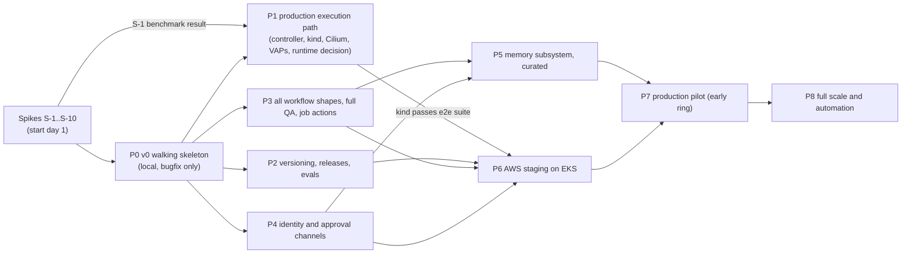
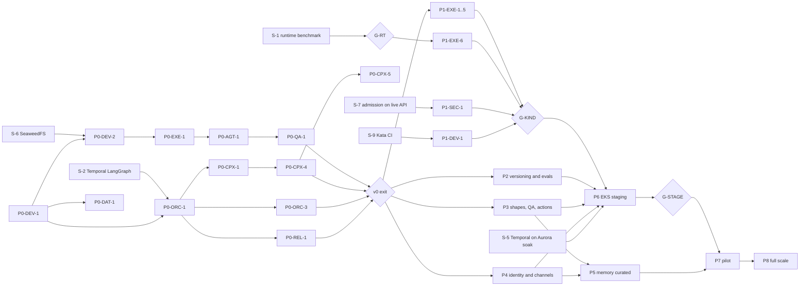

# Phased Implementation Plan

**Status:** final for spec close, 2026-10-24. **Owner:** Z (assembly). **Inputs:** every section 00–11 at the
final contract versions in [FROZEN.md](../00-contracts/FROZEN.md) (C-ARCH 2.0.0, C-STATE 2.0.0, C-IDS 2.0.0,
C-RUNNER 3.0.0, C-CRD 3.0.0, C-MSG 2.0.0, C-JOBREQ 2.0.0, C-DEF 3.0.0, C-ART 2.0.0, C-PG 2.0.0), the reviews in
[90-reviews/](../90-reviews/triage.md) and [known-issues.md](../90-reviews/known-issues.md).

## Purpose

This plan turns the specification into work that several coding agents and engineers can carry out in parallel
without colliding. It defines a small, runnable v0, the phases that follow it to full scope, the benchmark gates
that decide go or no-go, a task breakdown in which every task names its spec sections, contracts and acceptance
tests, the critical path, the spikes to run first, and a risk burndown.

## Decisions summary

| # | Decision | Constraints |
|---|---|---|
| 1 | **v0 is local only and runs one shape (bugfix) end to end**, from an issue on a personal GitHub org (dev App) or on local Gitea to a published PR, through the frozen Runner API, Temporal + LangGraph, Release Bundle pinning, one UI gate and `job_id`-correlated telemetry | D-20, D-24, D-01, D-03, D-04 |
| 2 | Ordering: **production execution path (controller, `kind`, runtime bake-off) and versioning/evals come before broad feature work.** The memory write path ships behind admin curation before any automatic activation. EKS starts only after the `kind` profile passes the same e2e suite | D-02, D-05, D-06, D-14, D-20, D-25 |
| 3 | The `B-*` benchmark gates of [runtime-evaluation.md §8.4](../02-execution/runtime-evaluation.md) are go/no-go points. A failed gate never stops the program: it selects the written fallback rule (§8.5) | D-06, D-07 |
| 4 | Work is cut into **streams that match the owning workstreams** (the CODEOWNERS map in [repo-layout.md §1](../11-local-dev/repo-layout.md)), so two tasks in one phase never edit the same package | — |
| 5 | **Frozen contracts are implemented byte for byte.** Tasks marked ★ implement a frozen contract surface; any deviation needs a CCR in [contract-change-requests.md](../_coordination/contract-change-requests.md) before code merges. CI enforces `contracts/` byte equality with `spec/00-contracts` | C-* |
| 6 | Every R1V row is "fixed per owner, unverified" ([known-issues.md §2](../90-reviews/known-issues.md)). The first task touching a section re-checks the R1V rows for that section, and fixes found there are spec PRs, not silent code divergence | — |

---

## 1. Phase v0: walking skeleton (local only)

### 1.1 Goal

Prove every core boundary once, on a laptop, with production code paths:

- the Runner API, through the frozen contract;
- Temporal and LangGraph, with the workflow in Temporal and the graph compiled from the bundle;
- state separation (Temporal, CRD or runner state, S3, Postgres);
- Release Bundle pinning;
- observability correlation by `job_id`.

### 1.2 Scope: what v0 includes

| Component | v0 form | Spec |
|---|---|---|
| Workflow shape | **bugfix only**, the shipped [bugfix.yaml](../01-orchestration/graphs/definitions/bugfix.yaml), unmodified, on `PregelEngine` | [graphs/bugfix.md](../01-orchestration/graphs/bugfix.md), [temporal-langgraph.md](../01-orchestration/temporal-langgraph.md) |
| Router | deterministic `router_rules` only. LLM intent parsing is off, and a non-matching trigger is rejected with a clarification comment | [router.md](../01-orchestration/router.md) |
| CLI | `claude -p` (Claude Code CLI image) for implementer and reviewer roles | [cli-invocation.md](../03-agents-and-tools/cli-invocation.md), [ADR-03-002](../03-agents-and-tools/adr/002-claude-code-cli-over-agent-sdk.md) |
| Runner | `runner-local` (Docker or rootless Podman) implementing C-RUNNER 3.0.0, with run grants, per-audience tokens, the inbox, the kill-switch mirror read and the exec revocation feed | [local-runner.md](../02-execution/local-runner.md), [runner-service.md](../02-execution/runner-service.md) |
| Artifacts | **SeaweedFS** (profile `s3-seaweedfs`) with WS-10's local bucket configs | [ADR-11-004](../11-local-dev/adr/004-challenge-d08-minio-locally.md), [object-storage.md](../10-data-platform/object-storage.md) |
| Replicant Postgres | PG 17 + pgvector 0.8.2. SQLAlchemy 2.0 models and Alembic migrations for **all 17 owner DDL files**, applied by the one-shot `migrate` service. Seeding only through `replicant dev seed` (API) | [schema-management.md](../10-data-platform/schema-management.md), [ddl/INDEX.md](../10-data-platform/ddl/INDEX.md), [stack.md §5](../11-local-dev/stack.md) |
| Human gate | **one gate, the publish gate, in the UI only** (`gate_rules` local: plan gate off, publish gate on, Slack and GitHub channels off) | [gates.md](../01-orchestration/gates.md), [approvals.md](../07-control-plane-and-ux/approvals.md) |
| Publishing | Publisher from the diff bundle with the approved digest, through `github-token-broker`, to local Gitea and to the dev App's personal org | [github-app.md](../07-control-plane-and-ux/github-app.md) |
| Observability | Langfuse v4 (core profile), Alloy, Loki, Tempo, Grafana; `job_id` and trace ID on every log line and Langfuse trace | [telemetry-model.md](../08-observability/telemetry-model.md), [dashboards.md](../08-observability/dashboards.md) |
| Identity | Dex stub IdP, SCIM emulated by the seeder, live repo-permission check, identity linking for the dev GitHub user | [identity.md](../07-control-plane-and-ux/identity.md), [ADR-11-003](../11-local-dev/adr/003-dex-stub-idp.md) |
| Gateway | `replicant-gateway-shim` with local backends (`replay` in CI, `passthrough` with a developer key) | [gateway-stub.md](../11-local-dev/gateway-stub.md), [gateway.md](../03-agents-and-tools/gateway.md) |
| Versioning | Release Bundle built from the local config repo, one worker deployment version registered and current, every job started PINNED to it, `release_bundle_id` recorded | [release-bundle.md](../06-releases-and-evals/release-bundle.md), [versioning.md](../01-orchestration/versioning.md) |
| GitHub | the dev GitHub App on a personal org, with webhooks through a Cloudflare quick tunnel | [ADR-07-004](../07-control-plane-and-ux/adr/004-dev-webhook-forwarding.md), [walkthroughs.md §11](../11-local-dev/walkthroughs.md) |

### 1.3 Deliberate adjustments to the brief's v0 list (with reasons)

| Adjustment | Reason |
|---|---|
| SeaweedFS instead of MinIO | D-08 was amended by the accepted CCR-11-02. The MinIO repository was archived and publishes no community images. `s3-minio` stays available as a profile |
| A **QA node** with a minimal harness profile (stages `install`, `unit`, `build` only: no services, Playwright or image builds) | Graph invariant I-3 ([extensibility.md](../01-orchestration/extensibility.md)) requires a `qa` node, a `verifier`, a diff-stage `risk_classify` and a `publish_approval` gate on every path from an implementer to a publisher. Removing QA would require modifying a protected shape, which is the wrong first lesson |
| A **reviewer run** (second `claude -p` invocation, role `reviewer`) | It is part of the shipped bugfix shape. It reuses the same CLI image and costs one run |
| `replicant-agentd` and `replicant-entrypoint` in the CLI image | C-RUNNER 2.x requires per-audience tokens and run grants, and agentd is the only token holder ([ADR-03-001](../03-agents-and-tools/adr/001-entrypoint-and-agentd-credential-isolation.md)). A v0 without them would test a credential model that production does not have |
| `repo-mirror` (read-only) for sandbox fetches | Sandboxes never hold Git credentials (D-21, [ADR-011](../00-contracts/adr/011-github-token-broker-and-repo-mirror.md)) |
| Memory: `memory.create_snapshot` returns a pinned empty snapshot under the default policy, and `memory_writer` records the outcome only | `memory_writer` and `context_assembler` are protected nodes (I-5). No candidate extraction, curation or injection in v0, so there is no memory promotion as the brief requires |
| PR wait handles `merged` and `closed` only. `repair_limits` sets 0 repair cycles locally | Review-comment repair is P3. The job still spans PR review ([ADR-009](../00-contracts/adr/009-job-lifetime-spans-pr-review.md)) |
| Tenant payload codec deferred to P2 | It changes history payload encoding. v0 histories are disposable, while P2 introduces the codec before any history must survive |

### 1.4 What v0 excludes

Memory candidates, curation and promotion. Slack, GitHub-review and Jira approvals. PR-comment repair, steering,
takeover. Workflow types other than bugfix. Plan gates. The `k8s` (kind) profile and the real controller. EKS and
AWS. LLM routing. Image builds, Playwright and QA services. Eval harness and ramps.

### 1.5 Entry criteria

- The contracts in `spec/00-contracts` are frozen at the versions above (met).
- Spike S-2 (Temporal and LangGraph) has re-run the WS-01 reference on the pinned `temporalio` and `langgraph` versions.
- A developer key or a recorded cassette set exists for the `ledger-api` sample.

### 1.6 Exit criteria (all measurable)

| # | Criterion | Measured by |
|---|---|---|
| X0-1 | `replicant dev up` on a clean machine (macOS 15 arm64 and Ubuntu 24.04) reaches healthy within 15 min, then `replicant dev seed` completes with no SQL typed by a human | `local-stack` CI job, walkthrough 0 |
| X0-2 | **E2E-01-v0** passes in the merge-queue `e2e` job with gateway `replay`: Gitea issue labelled `replicant` → ack comment ≤ 60 s → implementer, QA and reviewer runs `Succeeded` → publish gate approved through the UI API → PR opened by replicant-bot → PR merged → job `succeeded`. The projection equals `job.snapshot` | [test-strategy.md §6](../11-local-dev/test-strategy.md) (E2E-01 with the v0 gate and repair settings) |
| X0-3 | The same flow on a personal GitHub org through the dev App, from a clean laptop | walkthrough 11, run by two people who did not write it |
| X0-4 | The Runner contract suite passes on `runner-local`: every RC-* case except those marked `isolation:` | [test-strategy.md §5.3](../11-local-dev/test-strategy.md) |
| X0-5 | Determinism: every E2E-01-v0 history replays on the pinned build. `lint_activity_ids.py` reports 0 findings. WF-RUN-01..05, WF-CAN-01, WF-GATE-01, -04, -05, -07, -09 and WF-PROJ-01 pass | [test-strategy.md §3–§4](../11-local-dev/test-strategy.md) |
| X0-6 | Pinning: the job records `release_bundle_id` and `worker_deployment_version`. Its Temporal `TemporalWorkerDeploymentVersion` equals the bundle's build for every run of the job | search attributes, `GET /v1/jobs/{id}` |
| X0-7 | State separation: killing `replicant-worker` during the implementer run (CH-WRK-01), killing `runner-local` (CH-RUN-01) and pausing Postgres for 2 minutes (CH-PG-01) leave one AgentRun per logical run, no lost decision, and a converged projection | [test-strategy.md §7](../11-local-dev/test-strategy.md) |
| X0-8 | Correlation: from the `job_id` alone, the Grafana `replicant-job` dashboard shows the Loki lines, the Tempo trace and the Langfuse trace, and all three carry the same trace ID | walkthrough 9, automated assertion in the e2e driver |
| X0-9 | First visible progress ≤ 60 s from trigger (p95 over 20 runs in CI) | projection timestamps |
| X0-10 | Egress: SEC-EGRESS-01..08 pass on `runner-local` | [test-strategy.md §8.1](../11-local-dev/test-strategy.md) |

---

## 2. Spikes to run first

All spikes start on day 1, in parallel with P0. Each has an owner stream, a time box, the claim it retires and
the decision it feeds.

| ID | Spike | Owner | Retires | Feeds | Time box |
|---|---|---|---|---|---|
| **S-1** | **Runtime benchmark**: run `sbxbench` ([benchmark/README.md](../02-execution/benchmark/README.md)) over the §8.1 matrix (Kata CLH with `guestBlockDevice` and with `xfsProjectQuota`, gVisor, runc baseline; `m8id`/`c8id` nested virt, `m8id.metal-48xl`, `m8gd`) on a dedicated staging exec cluster | EXE (WS-02) | every B-* gate (§3), V02-36, the unverified runtime facts in [lifecycle-and-failures.md §4](../02-execution/lifecycle-and-failures.md) | runtime default per workload class (ADR-02-001), D-12 `memoryRequestPolicy` (B-MEM-01), `RuntimeClass.overhead`, log transport, node pool weights | 4 weeks |
| **S-2** | **Temporal LangGraph integration**: re-run WS-01's 43 scenarios on both engines (`PregelEngine`, `InterpreterEngine`) on the pinned `temporalio` and `langgraph` versions, `compare_engines`, replay of every history, and a versioning test with two builds and a pinned override to a non-current version (V00-04, V06-14) | ORC (WS-01) | in-workflow determinism, `versioning_override` keyword, Worker Deployment RPC behaviour (Experimental) | P0-ORC-1, ADR-01-001 fallback readiness | 2 weeks |
| **S-3** | **CLI session capture and resume**: Claude Code stream-json transcript capture, session state capture size, rule SR-1 resume (same cycle, same image digest, < 24 h, ≤ 256 MiB), Codex `exec resume` placement (V03-20), symlinked `AGENTS.md` (U-13, U-14), `managed-mcp.json` loopback HTTP (V03-33), downward-API annotation updates (V03-35) | AGT (WS-03) with MEM (WS-04) | session continuity claims in [cli-invocation.md §2.8](../03-agents-and-tools/cli-invocation.md) and [working-memory.md](../04-memory-and-context/working-memory.md) | P3 repair and steering, P5 handoffs | 2 weeks |
| S-4 | **Enterprise AI gateway capabilities** (OQ-00-09 / OQ-03-01): per-run credentials, dynamic budgets, attribution headers, usage export, protocol pass-through | AGT (WS-03) with the gateway owner | whether the shim is needed in front | P1 shim deployment model | 1 week |
| S-5 | **Temporal on Aurora PostgreSQL 16** staging soak ([temporal-persistence.md §8](../10-data-platform/temporal-persistence.md)); Temporal does not list Aurora in its tested matrix (V10-10) | DAT (WS-10) | OQ-10-04 | P6 Temporal persistence; fallback RDS for PostgreSQL 16 | 3 weeks (soak) |
| S-6 | **SeaweedFS semantics**: `If-Match`/`If-None-Match` on PutObject, STS session policies (V11-02, V10-27) | DEV (WS-11) | runner-local inbox CAS, write-once manifests, per-run credentials | P0-EXE-1; fallback per-run identities and the nightly real-S3 job | 3 days |
| S-7 | **Admission and authorizer code on real servers**: WS-09 VAP CEL and Kyverno `ImageValidatingPolicy` on a live kube-apiserver (envtest and kind), compile the Temporal custom Authorizer against server modules | SEC (WS-09) | known-issues §4 rows "never run against a live API server" and "not compiled" | P1 SEC tasks | 1 week |
| S-8 | **Langfuse v4 at shape**: direct OTel ingestion S3 write pattern (V08-32), startup migrations (V00-40), trace-name resolution with early spans (OQ-08-04) | OBS (WS-08) | Langfuse cost and operability | P6 Langfuse sizing | 1 week |
| S-9 | **Kata in CI**: nested-virt ARC runners (`c8id`/`m8id`) in the CI account, Kata runtime-rs inside kind nodes (V11-17), kata-deploy value names | DEV (WS-11) with DAT (WS-10) | OQ-11-05, the `k8s-kata` job | P1 exit | 2 weeks |
| S-10 | **Okta live reads on gate decisions** (OQ-07-01): Users API latency and rate limits at the approval rate, replica fallback freshness | CPX (WS-07) with SEC | the live-read design in [identity.md §10](../07-control-plane-and-ux/identity.md) | P4 identity | 1 week |

---

## 3. Benchmark gates (go/no-go)

Each gate is evaluated in S-1, again at P1 exit on `kind` where the gate applies locally, again at P6 exit on EKS
staging, and nightly afterwards on a reduced set. "No-go" never stops the program: it applies the named fallback
and the gate is re-run on the fallback configuration.

| Gate | Pass threshold (from runtime-evaluation.md §8.4) | Decides | When | No-go action |
|---|---|---|---|---|
| B-START-01 | p95 pod-create → `AgentRunning` ≤ 25 s warm, ≤ 55 s cold, at concurrency 16 | the 90 s sandbox-ready SLO | S-1, P6 | larger warm placeholder reserve ([fast-path.md](../02-execution/fast-path.md)); disable SOCI `FastImagePull` if incompatible |
| B-START-02 | EBS overflow attach + format time measured | `fixedSizeVolume` startup budget | S-1 | overflow runs get `startupSeconds ≥ 300` |
| B-NPM-01, B-GO-01, B-CARGO-01 | wall ≤ 1.6× / 1.35× / 1.35× runc | Kata CLH on nested virt as coding default | S-1, P6 | fallback rule 1 (metal pool weight 20), then rule 2 (gVisor for coding/review/utility) |
| B-DENS-01 | 20 coding sandboxes per `m8id.24xlarge`, no OOM or eviction, per-sandbox W-GO ≤ 1.25× | node count and cost model | S-1, P6 | fallback rule 1; resize density table |
| B-OVH-01 | runtime overhead ≤ 512 MiB | `RuntimeClass.overhead.podFixed` | S-1 | use the measured value; re-run B-DENS-01 |
| B-DISK-01..03 | ENOSPC at the hard limit ± 1 % before any eviction, 50/50; `statfs` reports the limit; `Failed/WorkspaceDiskExceeded` with a partial manifest | D-07 enforcement mode per runtime (ADR-02-004) | S-1, P1 (kind+Kata), P6 | rules 3–5: `xfsProjectQuota` on virtio-fs (residual 12, conditions, never for restricted tenants), `fixedSizeVolume` |
| B-DISK-04 | `guestBlockDevice` shared by several containers | QA services on the workspace device | S-1 | rule 3 |
| B-BUILD-01, B-BUILD-03 | rootless BuildKit 20/20 with exactly the WS-05 privileges | QA image builds (D-16) | S-1 | QA runs without image builds (`runtime_unsupported`); CI builds images |
| B-QA-01 | sidecars ready ≤ 60 s p95, zero flaky failures in 50 | QA with Postgres and Kafka sidecars | S-1, P3 | per-codebase readiness tuning; contract stubs instead of the sidecar |
| **B-NET-01** | 0 denied probes succeed, allowed succeed 100 %, ClusterIP reachability (probe 38) | **gates Kata as the default at all** (R2-037) | S-1, P1, P6 | rule 6: repo-mirror and the OTLP collector behind internal NLBs with `toFQDNs`, then re-run B-NET-01 and B-START-01 |
| B-NODE-01 | `NodeLost` within 90 s p95 with partial transcript chunks | node-loss handling | S-1, P6 chaos | tune `node-monitor-grace-period` and the lease timeout |
| **B-LOG-01** | sandbox stdout reaches `/var/log/pods` 100 % within 5 s per RuntimeClass | log transport per RuntimeClass | S-1, P1, P6 | annotation `replicant.example.com/log-transport: otlp` on the failing RuntimeClass (C-IDS 2.0.0) |
| B-MEM-01 | evidence: host footprint ÷ limit | D-12 amended: `match_limit` when p50 ≥ 0.8 | S-1 | — (evidence feeds rp-2) |
| B-MEM-02 | 24 h soak at density: 0 memory-pressure evictions, 0 VMM OOM kills | production density | P6 | lower density; `match_limit` for the class |

**Program go/no-go points**

| Point | Go when | If no-go |
|---|---|---|
| G-RT (end of S-1) | a runtime/node pair passes every applicable gate for each workload class | the fallback rules pick the configuration. The decision, with evidence, is recorded as a revision of ADR-02-001 |
| G-KIND (P1 exit) | B-NET-01, B-DISK-01..03 and B-LOG-01 pass on kind with Kata on the KVM CI runners, and the RC suite passes unchanged on runner-api | P6 does not start |
| G-STAGE (P6 exit) | all applicable B-* gates pass on EKS staging, plus B-MEM-02, S-5 soak, CH-PG-03 failover, DR drill | P7 does not start |

---

## 4. Phases after v0

Each phase lists its goal, components, entry and exit criteria, dependencies and risks. Exit criteria are tests
or numbers, never "done".

### P1. Production execution path (local `k8s` profile)

- **Goal:** the real AgentRun controller, runner-api and run-notifier run the same jobs as runner-local, under
  Cilium and WS-09's admission policies, with Kata where KVM exists; the runtime default is decided from S-1.
- **Components:** agentrun-controller (bare Pod, phase function, finalizers), runner-api (Go), run-notifier, Cilium
  FQDN policies and the eight network profiles, VAPs and Kyverno, NRI workspace plugin, workspace-guard and
  watchdog, uploader, kind bootstrap with Kata runtime-rs, `k8s-kata` CI.
- **Entry:** P0 exit; S-7 done; S-9 runners available.
- **Exit:** RC-* suite passes unchanged on runner-api + controller (including RC-ISO-01..03 on Kata); envtest +
  SEC-ADM-01..20 pass; E2E-01 passes on the `k8s` profile (walkthrough 10); CH-CTL-01, CH-NOT-01, CH-NODE-01 pass;
  G-KIND passes; ADR-02-001 revised with S-1 evidence.
- **Depends on:** P0, S-1, S-7, S-9.
- **Risks:** Kata inside kind is unverified (fallback: `isolation.degraded` runc classes locally, with the
  `k8s-kata` job as proof); `guestBlockDevice` uses a Kata interface in an uncommon way.

### P2. Versioning, releases and evaluation

- **Goal:** new behaviour reaches jobs only through evaluated, ramped, reversible Release Bundles; long waits never
  break replay.
- **Components:** multi-version Worker Deployments, pinned starts per assignment, up to three ramps (`ramps[]`),
  consented migration (Migration Handoff Protocol v1), emergency patch builds, rollback, replay corpus and
  `replay-live`, tenant payload codec (local key provider, then KMS in P6), eval harness (`replicant-eval` tenant,
  smoke-local, T0–T2), ReleasePipeline, release UI, overlay bundle requests, prompt escrow, bundle-ref image tags.
- **Entry:** P0 exit.
- **Exit:** E2E-08 passes (job at a gate stays on B1 while new jobs get B2, offered migration moves it); WF
  versioning test §3.3 passes; rollback system path < 2 s and full operator path < 5 min in a timed drill; a
  `smoke-local@1` T1 run produces a report and a T0 tenant-derived bundle auto-promotes; replay of every live
  build's corpus passes nightly for 14 consecutive nights; WF-GATE-03 (30-day scaled wait) passes.
- **Depends on:** P0, S-2.
- **Risks:** Worker Deployment RPCs are Experimental in the protos; eval power is low online at 300 jobs/day.

### P3. All workflow shapes, full QA, job actions

- **Goal:** every workflow type in shared context §4 runs, QA is complete, and users can steer, pause, cancel and
  take over.
- **Components:** feature, api-change, docs/low-risk, hotfix, maintenance (fan-out, MaintenanceShard), pr-repair,
  qa-only graph definitions; router LLM intent parsing (raise-only); plan gates; reviewer, skeptic, verifier;
  rebase-and-reverify; QA services, Playwright, visual and axe diffs, image builds on Kata, flake protocol, test
  inventory delta; steering through the run inbox; pause (node, gate); cancel; takeover package; budgets with the
  `budget_extension` gate; PR-comment repair cycles (identity-gated, debounced, bounded, per-PR job cap).
- **Entry:** P0 exit; S-3 done.
- **Exit:** E2E-01 (with repair), E2E-04, E2E-06, E2E-07, E2E-09, E2E-10 pass; WF-PR-01..04, WF-PAUSE-01,
  WF-STEER-01, WF-REBASE-01 pass; all 43 WS-01 scenarios pass on both engines; WS-05's 94 validator checks and the
  `route_after_qa` vectors pass; B-QA-01 passes in S-1 data.
- **Depends on:** P0, S-3; QA image builds depend on G-RT.
- **Risks:** environment definitions are the main source of inconclusive QA; CLI behaviour drift between versions.

### P4. Identity and approval channels

- **Goal:** every trigger and approval channel in D-18, D-19 and D-24 works with confused-deputy protection.
- **Components:** Okta OIDC (Dex locally), SCIM, event hooks, live group reads on decisions, identity linking by
  provider proof (GitHub, Slack, Atlassian, Gitea), the in-code authorization evaluator; Slack app (Block Kit
  gates, shortcuts, slash command), GitHub `/replicant` commands and review mapping, Jira triggers, schedules,
  `replicant` CLI device flow; reminders, escalation, expiry, auto-cancel; deterministic risk rules including
  `ci_executed_paths`; notifications; kill switches at all four scopes (S3 mirror first).
- **Entry:** P0 exit; S-10 done.
- **Exit:** E2E-02, E2E-03, E2E-05, E2E-11 pass; WF-GATE-02, -06, -08 pass; the Slack/GitHub one-second race
  ([approvals.md §9](../07-control-plane-and-ux/approvals.md)) passes 100/100; an in-flight group removal produces
  `gate.decision_identity_contested` and reopens an unpublished gate; a kill switch stops new starts within 60 s
  with Postgres down.
- **Depends on:** P0, S-10.
- **Risks:** the live Okta read puts Okta in the approval path; Jira webhook signing is unverified (fallback
  specified in [triggers.md §3](../07-control-plane-and-ux/triggers.md)).

### P5. Memory subsystem, curated

- **Goal:** memory improves jobs measurably, and nothing becomes active without an admin or an admin-configured
  policy (D-25).
- **Components:** feedback triage and candidate extraction (human comment text only), generalization and content
  gates, dedupe and contradictions, admin curation API and UI (D-25 server-side checks, audited denials), snapshot
  pinning with holdouts, push injection and the memory MCP (pull), retrieval (hybrid FTS + vector per tenant
  partition), quarantine and purge, provenance view and `/replicant memory-wrong`, post-merge outcome signals,
  memory evals, ecosystem context (catalog, contracts, dependency graph, Zoekt via context-mcp), briefings,
  embeddings through the gateway.
- **Entry:** P3 PR-repair cycles and P4 identity linking (comment authors must be linked).
- **Exit:** walkthroughs 6 and 7 pass; E2E-12 (non-admins get 403 on every `memory:admin` operation, with audited
  denials) passes; SEC-MEM-01..08 pass; a 3-week-old job is reproduced with its exact memory (must-answer 4 of
  WS-04) in an eval case; **every activation in this phase is admin-approved** (auto-activation policy disabled);
  memory evals report injected recall and the 2 % memory-off holdout on at least 300 jobs.
- **Depends on:** P3, P4.
- **Risks:** poisoning through reviewer comments; admin curation throughput at 1,500 repos.

### P6. AWS staging on EKS

- **Goal:** the production topology in two AWS accounts runs the same e2e suite that passed on `kind`.
- **Components:** core and exec accounts and clusters, PrivateLink, egress firewall, Karpenter sandbox pools
  (nested virt and metal), Aurora (`replicant` 17, `temporal` 16, `langfuse` 16), S3 buckets with KMS per tenant,
  Object Lock audit bucket (30-day trial at 1 day, then COMPLIANCE 730 days), Secrets Manager, Pod Identity,
  GitHub App key in KMS, Temporal self-hosted (512 shards) with mTLS and the custom Authorizer, Grafana stack
  (Mimir, Loki distributed, Tempo monolithic), Langfuse v4, redaction pipeline and leak-scanner, audit-exporter,
  LeakPurge, retention sweepers, Argo CD with the migrate PreSync Job, DR replicas.
- **Entry:** G-KIND passed; P2, P3 and P4 exits; P5 may enter staging later.
- **Exit:** G-STAGE: E2E-01..12 pass on staging unchanged; all applicable B-* gates and B-MEM-02 pass on EKS;
  S-5 soak passes (or the RDS fallback is applied); CH-PG-03 failover ≤ 60 s with no lost decision; restore drill
  (Replicant DB to 15 minutes ago, [recovery.md §4.2](../10-data-platform/recovery.md)) completes with every repair
  step; region DR drill within the RTO chosen in OQ-10-01; IAM Access Analyzer `validate-policy` clean on every
  policy; TMP-AUTHZ and the `aws-sandbox` RC-ART job pass; an external red-team pass finds no critical.
- **Depends on:** P1, P2, P3, P4, S-5, S-8.
- **Risks:** Temporal on Aurora outside the tested matrix; nested-virt performance; cross-account KMS aliases.

### P7. Production pilot (early ring)

- **Goal:** real tenants use Replicant with the release process live.
- **Components:** production accounts, early-ring tenants (OQ-06-09), tenant onboarding checklist (CI excluded
  from `replicant/**` and `replicant-takeover/**`), budgets and the platform ceiling, SLOs and alerts, on-call
  runbooks, canary process with the 72 h minimum for prompt-only changes.
- **Entry:** G-STAGE; P5 exit (curated memory); human decisions on the open questions marked "before P7" in
  [open-questions-summary.md](../_coordination/open-questions-summary.md).
- **Exit:** 30 days at the pilot volume with control-plane availability ≥ 99.9 %, SLO-1 (first progress ≤ 60 s)
  met at the chosen objective, p95 sandbox-ready ≤ 90 s, zero security incidents of severity high or above, one
  full canary → promote and one rollback executed in production.
- **Depends on:** P6, P5.
- **Risks:** gate fatigue from `ci_executed_paths` at `critical`; eval spend.

### P8. Full scale and automation

- **Goal:** all 40 tenants and 1,500 repositories, with automation that the evidence now supports.
- **Components:** remaining tenants by ring; `restricted` tenants with isolation groups (OQ-09-01); maintenance
  fan-out at full scale; memory auto-activation for repo and path scope with 14-day probation and 20 % holdout
  (only if P5/P7 memory evals show benefit and OQ-04-01 is approved); self-improvement proposals (never
  auto-promoted); weekly CLI candidates; model upgrades with holdback.
- **Entry:** P7 exit.
- **Exit:** sustained 300 jobs/day with 1,000-job peaks and 150 concurrent AgentRuns without SLO breach for 30
  days; memory evals show non-negative effect on merge rate at the auto-activation policy for 60 days, or the
  policy is rolled back.
- **Depends on:** P7.
- **Risks:** online power for small regressions; admin workload; drift in vendor CLIs and models.

---

## 5. Work breakdown

Streams: **ORC** orchestration (WS-01), **EXE** execution (WS-02), **AGT** agents, tools, gateway (WS-03), **MEM**
memory and context (WS-04), **QA** (WS-05), **REL** releases and evals (WS-06), **CPX** control plane and UX
(WS-07), **OBS** observability (WS-08), **SEC** security (WS-09), **DAT** data platform (WS-10), **DEV** local dev
and test (WS-11). Each task is sized for one agent or engineer. Two tasks in the same phase and stream may run in
parallel only when their package paths differ (CODEOWNERS in [repo-layout.md §1](../11-local-dev/repo-layout.md)).

**★** marks a task that implements a frozen contract surface. Its wire format must match `spec/00-contracts`
exactly, and a deviation needs an accepted CCR first.

Spec paths below are relative to `spec/`.

### 5.1 P0 tasks

| ID | Task | Spec sections | Contracts | Acceptance tests | Depends on |
|---|---|---|---|---|---|
| P0-DEV-1 | Monorepo skeleton per repo-layout; `contracts/` byte copies; `generate-drift` CI; `replicant-ids` (Python, Go) | 11-local-dev/repo-layout.md §1–§4; 00-contracts/ids-and-naming.md | ★ C-IDS, all contract files | `generate-drift`; C-IDS test vectors (`test_vectors.py`) | — |
| P0-DAT-1 | `replicant-db`: SQLAlchemy 2.0 models and Alembic revisions for all 17 owner DDL files; `migrate` one-shot service; startup compatibility check; squawk lint | 10-data-platform/schema-management.md; postgres.md; ddl/INDEX.md | ★ C-PG | `STRICT=1 validate.sh`; `spec_ddl_equivalence.py` (182 facts); migration tests (test-strategy §9) | P0-DEV-1 |
| P0-DEV-2 | Compose `core` and `observability` subsets for v0 (Temporal + PG16, Replicant PG17, SeaweedFS + s3-init, Langfuse, Dex, Gitea, shim + Valkey, run-grants, runner-local, repo-mirror, sbx-edge, sbx-dns, egress proxy, Alloy, Loki, Tempo, Grafana) | 11-local-dev/stack.md §1–§4; compose/compose.yaml; ADR-11-001..007 | C-ARCH §3 | walkthrough 0; `docker compose config -q`; preflight | P0-DEV-1, S-6 |
| P0-DEV-3 | `replicant dev seed` and `reset` through the APIs only | 11-local-dev/stack.md §5, §7 | — | seed idempotent twice; no SQL client in the seed path (grep check) | P0-DAT-1, P0-CPX-1 |
| P0-ORC-1 | `replicant-worker`: ReplicantJob, `GraphEngine` with `PregelEngine`, NodeContext, node registry, explicit activity IDs, projections, Continue-As-New points, pinned start | 01-orchestration/temporal-langgraph.md; graphs/README.md §1–§9; graphs/bugfix.md; extensibility.md; versioning.md §1–§3 | ★ C-MSG, ★ C-IDS (activity IDs, search attributes, task queues) | WF-RUN-01..05, WF-CAN-01, WF-PROJ-01; `lint_activity_ids.py`; replay | P0-DEV-1, S-2 |
| P0-ORC-2 | Router, deterministic `router_rules` only; RouterDecision | 01-orchestration/router.md | ★ C-JOBREQ (input) | router rule vectors; non-matching trigger gets a clarification | P0-ORC-1 |
| P0-ORC-3 | Publish gate: `gate.decide` Update, validators, first decision wins, `gates.resolve_routing` against local `gate_rules` | 01-orchestration/gates.md; 07-control-plane-and-ux/approvals.md §1–§3 | ★ C-MSG (Update, validators, GateView) | WF-GATE-01, -04, -05, -07, -09 | P0-ORC-1 |
| P0-ORC-4 | Verifier and diff-stage `risk_classify` nodes with WS-07's global risk rules (incl. `ci_executed_paths`) | 01-orchestration/graphs/README.md §5; 07-control-plane-and-ux/schemas/examples/risk-rules.global.yaml; 09-security/agent-capabilities.md §6 | — | risk rule vectors; a `.github/workflows` change yields `critical` | P0-ORC-1 |
| P0-REL-1 | Registry and config publishing for the local config repo; Release Bundle full build; default assignment for env `local`; intake resolves the bundle and pins the worker version | 06-releases-and-evals/release-bundle.md §3, §8; 03-agents-and-tools/config-publishing.md; ADR-005; ADR-006 | ★ C-DEF | bundle validates against `release-bundle.schema.json`; X0-6 | P0-DAT-1, P0-ORC-1 |
| P0-EXE-1 | `runner-local`: orchestration and sandbox listeners, run-grant verification, idempotency, per-audience tokens, inbox, kill-switch mirror read, exec revocation feed, run-notifier Signal hint | 02-execution/local-runner.md; runner-service.md §2–§7 | ★ C-RUNNER, ★ C-ART | RC-* on runner-local (non-isolation); RC-ART-01..08 against SeaweedFS | P0-DEV-2 |
| P0-AGT-1 | Claude Code CLI image with `replicant-entrypoint` and `replicant-agentd` (loopback proxy, token custody, heartbeats, exit-code contract); implementer and reviewer agent definitions; `ledger-api` environment definition | 03-agents-and-tools/cli-invocation.md §1–§6; agent-definition.md; environment-definition.md; ADR-03-001, -004, -006 | ★ C-RUNNER run-result, ★ C-ART inputs and outputs, ★ C-IDS §7 | RC-ENV-01..04, RC-SBX-01..06; CLI adapter contract tests; `validate.py` | P0-EXE-1 |
| P0-AGT-2 | Gateway shim with local backends, run policy registration, job hard cap, usage events to `cost` | 03-agents-and-tools/gateway.md §3–§6; 11-local-dev/gateway-stub.md | gateway-interface.openapi.yaml | GW suite subset; CH-GW-01 | P0-DEV-2 |
| P0-AGT-3 | Activities `agents.build_run_plan`, `agents.stage_inputs`, `context.stage_inputs` (single manifest writer), `budget.allocate_run`, `cost.record_run` | 03-agents-and-tools/README.md decision 12; 04-memory-and-context/working-memory.md; context-budget.md | ★ C-ART §4 | run-inputs and run-plan schema validation in E2E-01-v0 | P0-ORC-1, P0-AGT-1 |
| P0-QA-1 | QA node with the minimal harness profile (`install`, `unit`, `build`), `route_after_qa`, `qa.classify`, QA report to S3 | 05-qa/stage-design.md §1–§6; failure-feedback.md §1–§3; configuration.md | C-ART QA types | `route_after_qa` 10 vectors; `validate_examples.py`; QA run `Succeeded` in E2E-01-v0 | P0-AGT-1 |
| P0-MEM-1 | memory-service minimum: `memory.create_snapshot` (pinned empty snapshot, default policy), `memory.record_outcome` | 04-memory-and-context/data-model.md; retrieval-injection.md §7; ADR-04-006 | C-PG `memory` | `sql/run_tests.sh` subset; snapshot ID in `JobSnapshot` | P0-DAT-1 |
| P0-CPX-1 | control-plane-api: intake `POST /v1/jobs`, dedupe, job reads, gate decision endpoint through the sender outbox, SSE; identity-service with linking; authz evaluator (groups ∧ bindings ∧ live repo permission) | 07-control-plane-and-ux/architecture.md §2; identity.md; triggers.md; ADR-07-001, -002, -003 | ★ C-JOBREQ, ★ C-MSG | OpenAPI contract tests; E2E-11; authz unit tests | P0-DAT-1, P0-ORC-1 |
| P0-CPX-2 | control-plane-web: job list, job detail (phase, node, sandbox status, cost so far), approval inbox, on the design tokens | 07-control-plane-and-ux/ui/job-list.md, job-detail.md, approval-inbox.md; design/direction.md; design/components.md | — | Playwright UI tests; contrast checks (`build_tokens.py`); X0-9 | P0-CPX-1 |
| P0-CPX-3 | replicant-projector (`projection.apply`, reconciler) | 00-contracts/state-ownership.md §2; 07-control-plane-and-ux/architecture.md | ★ C-STATE, ★ C-MSG ProjectionEvent | WF-PROJ-01; CH-WRK-04 | P0-DAT-1, P0-ORC-1 |
| P0-CPX-4 | github-integration (Gitea and GitHub), github-token-broker (local file key), publisher-worker (approved digest, idempotent branch and PR), `pr.event` merged/closed | 07-control-plane-and-ux/github-app.md; ADR-011; ADR-07-005 | ★ C-JOBREQ, ★ C-MSG `pr.event`, ★ C-ART diff bundle | CH-WRK-03; E2E-01-v0 | P0-CPX-1, P0-EXE-1 |
| P0-CPX-5 | Dev GitHub App: manifest, `replicant dev github-app`, Cloudflare quick tunnel and hook URL patch | 07-control-plane-and-ux/github-app.md §5; ADR-07-004; 11-local-dev/walkthroughs.md §11 | — | walkthrough 11 (X0-3) | P0-CPX-4 |
| P0-OBS-1 | `replicant-telemetry` (Python, Go), trace rule T-5, `job_id` in structured metadata, Temporal OTel plugin, shim spans to Langfuse, `local.alloy`, `replicant-job` dashboard, source redaction | 08-observability/telemetry-model.md; session-capture.md §1–§3; dashboards.md §2; ADR-08-004, -006, -007, -008 | ★ C-IDS §9–§11 | X0-8; redaction corpus 49/49 | P0-DEV-2, P0-ORC-1, P0-AGT-2 |
| P0-OBS-2 | `audit.emit` for gate decisions and authz denials | 08-observability/audit.md; sql/audit.sql | C-PG `audit` | `sql/test_audit.py` | P0-DAT-1 |
| P0-SEC-1 | Local sandbox network (internal network, sbx-edge, sbx-dns, egress proxy); local run-grant file signer and JWKS | 11-local-dev/adr/007-sandbox-network-local.md; 09-security/adr/005-run-grants-bound-exec-side-minting.md | ★ C-RUNNER run grants | SEC-EGRESS-01..08; RC-GRANT-01..07 | P0-DEV-2, P0-EXE-1 |
| P0-DEV-4 | E2E-01-v0 driver, cassettes, merge-queue `e2e` job, chaos subset (CH-WRK-01, CH-RUN-01, CH-PG-01) | 11-local-dev/test-strategy.md §6–§7 | — | X0-2, X0-7 | all P0 tasks |

### 5.2 P1 tasks

| ID | Task | Spec sections | Contracts | Acceptance tests | Depends on |
|---|---|---|---|---|---|
| P1-EXE-1 | runner-api (Go): listeners, authN, createRun pipeline, admission A-1..A-15, translation, idempotency on AgentRun name + spec digest, STS session vending, KMS-signed tokens | 02-execution/runner-service.md | ★ C-RUNNER, ★ C-CRD | RC-* on kind | P0-EXE-1 |
| P1-EXE-2 | agentrun-controller: bare Pod, pod-creation marker, `derive.go` phase function, finalizers, artifact collection, deadlines, orphan GC | 02-execution/controller.md; ADR-02-002; controller/derive.go | ★ C-CRD | `derive_test.go` 41 cases; envtest; CH-CTL-01 | P1-EXE-1 |
| P1-EXE-3 | run-notifier (encrypt-only codec, Signal hint) | 02-execution/runner-service.md §8; 09-security/policies/temporal/kmskeyprovider/ | ★ C-MSG `run.status_changed` | CH-NOT-01; Go `kmskeyprovider` tests | P1-EXE-1 |
| P1-EXE-4 | Workspace enforcement: NRI plugin (`guestBlockDevice`), XFS `prjquota`, workspace-guard, watchdog → `WorkspaceDiskExceeded` | 02-execution/workspace-storage.md; ADR-02-004; ADR-014 | ★ C-CRD failure reasons | B-DISK-01..04 on kind+Kata | P1-EXE-2, S-9 |
| P1-EXE-5 | Cilium install, per-run `toFQDNs` policies, DNS allowlist, eight network profiles | 02-execution/network.md; ADR-02-005; 09-security/agent-capabilities.md §3 | — | B-NET-01; SEC-EGRESS-01..08 on kind | P1-EXE-2 |
| P1-SEC-1 | WS-09 VAPs, Kyverno `replicant-images-signed`, tenant namespace bundle, Kata and containerd hardening | 09-security/policies/kubernetes/; 02-execution/runtime-evaluation.md §11 | — | SEC-ADM-01..20; SEC-ESC-01..06 | S-7 |
| P1-DEV-1 | `k8s` profile: kind bootstrap, Kata runtime-rs when `/dev/kvm` exists, degraded classes otherwise; `contract-runner-kind` and `k8s-kata` CI jobs | 11-local-dev/stack.md §1; compose/kind/; repo-layout.md §4 | ★ C-CRD (unmodified CRD) | walkthrough 10; RC-ISO-01..03 | P1-EXE-1, S-9 |
| P1-OBS-1 | B-LOG-01 probes and the OTLP log fallback (`alloy-sandbox-otlp`) | 08-observability/session-capture.md §1; platform.md §3.1 | C-IDS annotation `log-transport` | B-LOG-01 | P1-EXE-2 |
| P1-EXE-6 | Record G-RT: revise ADR-02-001 and the `runtime_selection` policy with S-1 evidence; rp-2 Kata memory policy from B-MEM-01 | 02-execution/runtime-evaluation.md §8–§10; 03-agents-and-tools/adr/008-challenge-d12-kata-memory-requests.md | C-DEF policy | G-RT checklist | S-1 |

### 5.3 P2 tasks

| ID | Task | Spec sections | Contracts | Acceptance tests | Depends on |
|---|---|---|---|---|---|
| P2-ORC-1 | Multi-version Worker Deployments, set-current/ramp operations isolated in control-plane-api, drain and retire guards | 01-orchestration/versioning.md §1–§5; temporal-platform.md | ★ C-DEF assignment | test-strategy §3.3 versioning test | S-2, P0-REL-1 |
| P2-ORC-2 | Migration Handoff Protocol v1, `bundle_migration` gate, revoked-bundle hold, `model_retiring` forced move, `bundle_patched` lineage | 01-orchestration/versioning.md §6–§7; ADR-01-002, -003 | ★ C-MSG | scenarios `migration`, `migration_failure`, `revoked_migrate`, `revoked_deadline`, `bundle_patched` | P2-ORC-1 |
| P2-ORC-3 | Tenant-routed payload codec (local key provider; KMS provider in P6) | ADR-01-010; 09-security/secrets.md §6.2 | ★ C-MSG §1 | scenario `tenant_codec`; codec vectors | P0-ORC-1 |
| P2-ORC-4 | Replay corpus export and `replay-live` nightly | 01-orchestration/versioning.md §8; 11-local-dev/test-strategy.md §4 | — | 14 consecutive green nights | P2-ORC-1 |
| P2-REL-1 | Promotion state machine, ReleasePipeline, `ramps[]`, rollback (one transaction), rollback preview and gate banners | 06-releases-and-evals/promotion.md; release-bundle.md §8–§10 | ★ C-DEF 3.0.0 | promotion trigger rejects illegal edges; timed rollback drill (< 2 s system path) | P2-ORC-1 |
| P2-REL-2 | Eval harness: `replicant-eval` tenant, EvalCase as ReplicantJob, evaluation-mode gates, deterministic scoring runs, judges, smoke-local@1, statistics | 06-releases-and-evals/eval-harness.md; ADR-06-002, -003, -006 | ★ C-JOBREQ `options.evaluation` | `eval_sizing.py --simulate`; smoke-local T1 report | P2-REL-1, P0-DEV-4 |
| P2-REL-3 | Overlay requests, change classes → tiers, T0 tightening-only tenant-derived bundles, prompt escrow, bundle-ref image tags | 06-releases-and-evals/release-bundle.md §3–§7; ADR-06-001, -005; upgrades.md §8 | ★ C-DEF | T0 auto-promotion test; escrow digest check | P2-REL-1 |
| P2-CPX-1 | Release and registry UI (versions, pinned job counts, ramps, rollback dialog with `migrate_running`), registries screens | 07-control-plane-and-ux/ui/releases.md, registries.md; architecture.md §2.5, §9 | — | E2E-08; walkthrough 8 | P2-REL-1 |
| P2-OBS-1 | Online metrics, cohort labels, release rules (`ReplicantReleaseFailureSpike`) | 06-releases-and-evals/online-metrics.md; config/replicant-release.rules.yaml; 08-observability/rules/ | ★ C-IDS Prometheus labels | `promtool test rules` | P2-REL-1 |

### 5.4 P3 tasks

| ID | Task | Spec sections | Contracts | Acceptance tests | Depends on |
|---|---|---|---|---|---|
| P3-ORC-1 | Graph definitions feature, api-change, docs-low-risk, hotfix, qa-only; plan gate; skeptic and verifier nodes; `contract_check` | 01-orchestration/graphs/feature-and-api-change.md, hotfix-and-docs.md; definitions/ | ★ C-DEF GraphDefinition | scenarios `feature_parallel`, `low_risk_rebase`, `license_prestep` | P0-ORC-1 |
| P3-ORC-2 | PR-comment repair: debounce, identity-gated trigger, bounded cycles, per-PR job cap, standalone `pr_repair` | 01-orchestration/graphs/pr-repair.md; 04-memory-and-context/pr-replies.md | ★ C-MSG `pr.event` | WF-PR-01..04; E2E-01 (repair), E2E-10 | P0-CPX-4 |
| P3-ORC-3 | Maintenance fan-out (ABANDON child jobs, MaintenanceShard per 2,000 repos, sliding window) and schedules | 01-orchestration/graphs/maintenance-fanout.md; ADR-01-007 | ★ C-JOBREQ `target_selector`, ★ C-IDS `MaintenanceShard` | scenario `maintenance_batch` | P3-ORC-1 |
| P3-ORC-4 | Router LLM intent parsing (tool-less, closed schema, may raise risk only) and clarification | 01-orchestration/router.md §3 | — | `router_clarify` scenario; injection fixtures (test-strategy §8.2) | P0-ORC-2 |
| P3-ORC-5 | Rebase-and-reverify at publish; waiting-state explanations; `ops.retry_node`; dependency holds and circuit breakers | 01-orchestration/gates.md; graphs/README.md §2.1–§2.5 | ★ C-MSG `JobSnapshot.waiting` | WF-REBASE-01; E2E-09; CH-TMP-01 | P0-ORC-3 |
| P3-AGT-1 | Steering through the run inbox, run-level turn budget, SR-1 session resume, takeover role and package | 03-agents-and-tools/cli-invocation.md §2.6–§2.8; ADR-010; 07-control-plane-and-ux/ui/job-actions.md | ★ C-RUNNER inbox, ★ C-ART `takeover_package` | WF-STEER-01; E2E-06; E2E-07 | S-3, P0-AGT-1 |
| P3-AGT-2 | Budgets: reservation admission in Valkey, 402 handling, `budget_extension` gate, tenant quotas and platform ceiling | 03-agents-and-tools/gateway.md §6; ADR-03-009 | ★ C-MSG `budget_extension` | scenario `budget_extension` | P0-AGT-2 |
| P3-AGT-3 | Codex CLI image and reviewer definition (`codex exec --json`) | 03-agents-and-tools/cli-invocation.md §3; ADR-03-003 | ★ C-RUNNER run-result | adapter contract tests | P0-AGT-1 |
| P3-QA-1 | Full QA harness: services as sidecars, contract stubs, health, Playwright, axe and visual diffs, flake protocol, test inventory delta, checkpoints, `rerun_qa` | 05-qa/ (all files) | C-ART QA types, ★ C-MSG `rerun_qa` | WS-05 94 checks; E2E-04; B-QA-01 | P0-QA-1 |
| P3-QA-2 | Image builds with rootless BuildKit in the `builder` sidecar (Kata `qa_build` only) | 05-qa/adr/003-image-builder.md; 02-execution/controller.md §4.2a | — | B-BUILD-01, B-BUILD-03 | G-RT, P1-EXE-2 |
| P3-CPX-1 | Job actions in UI and CLI: steer, pause (node, gate), cancel, take over; error and edge states | 07-control-plane-and-ux/ui/job-actions.md; triggers.md (CLI) | ★ C-MSG job-control Updates | WF-PAUSE-01; Playwright UI tests | P0-CPX-2 |
| P3-CPX-2 | Approval packet complete: plan, diff, QA section (`replicant.approval-packet.qa/v1`), screenshots, risk rationale, memory used, cost | 07-control-plane-and-ux/approvals.md §3; ui/approval-inbox.md; 05-qa/artifacts.md §3 | — | packet validates against the QA packet schema; E2E-04 | P3-QA-1 |

### 5.5 P4 tasks

| ID | Task | Spec sections | Contracts | Acceptance tests | Depends on |
|---|---|---|---|---|---|
| P4-CPX-1 | Okta OIDC (BFF session), device flow, SCIM, event hooks, live group read on decisions with bounded replica fallback | 07-control-plane-and-ux/identity.md; ADR-07-006 | — | WF-GATE-08; in-flight removal must-answer test | S-10, P0-CPX-1 |
| P4-CPX-2 | Slack app: Block Kit gates, shortcut and slash command triggers, message updates on decision | 07-control-plane-and-ux/approvals.md §4–§9; slack-app/manifest.yaml; triggers.md | ★ C-MSG `decision_channel` | E2E-02, E2E-03 | P0-ORC-3 |
| P4-CPX-3 | GitHub `/replicant` commands, review-to-gate mapping, check runs | 07-control-plane-and-ux/github-app.md; ADR-07-005 | ★ C-MSG | E2E-03 variant (Slack vs GitHub, 100/100) | P0-CPX-4 |
| P4-CPX-4 | Jira integration and schedules as triggers | 07-control-plane-and-ux/triggers.md §3 | ★ C-JOBREQ | trigger mapping tests | P0-CPX-1 |
| P4-CPX-5 | Reminders, escalation, expiry, auto-cancel; fatigue controls; notifications and digest | 07-control-plane-and-ux/approvals.md; notifications.md | ★ C-MSG | WF-GATE-01, -02, -04; E2E-05 | P0-ORC-3 |
| P4-CPX-6 | Kill switches at global, tenant, repo and bundle scope (S3 mirror, ConfigMap copy, Temporal batch Signal, Postgres record) | 07-control-plane-and-ux/architecture.md §2.9; 09-security/secrets.md §12 | ★ C-MSG `ops.kill_switch` | scenario `kill_switch`; Postgres-down drill | P0-CPX-1 |
| P4-SEC-1 | Risk and gate rule policies complete, tenant onboarding checklist, takeover push to `replicant-takeover/**` gated | 07-control-plane-and-ux/onboarding.md; 09-security/agent-capabilities.md §6, §8; threat-model.md T-PI-13 | — | `validate_policies.py`; risk vectors | P0-ORC-4 |

### 5.6 P5 tasks

| ID | Task | Spec sections | Contracts | Acceptance tests | Depends on |
|---|---|---|---|---|---|
| P5-MEM-1 | Feedback triage, identity-gated extraction (human text only), six-gate generalization test, dedupe, contradictions, candidates | 04-memory-and-context/write-path.md; safety.md §6 | C-PG `memory` | walkthrough 6; SEC-MEM-01..04 | P3-ORC-2, P4-CPX-1 |
| P5-MEM-2 | Admin curation API with D-25 checks in control-plane-api and memory-service, audited denials; curation UI | 04-memory-and-context/curation-ui.md; api/memory-service.openapi.yaml; 07-control-plane-and-ux/ui/memory.md; identity.md §7 | — | E2E-12; walkthrough 7 | P5-MEM-1 |
| P5-MEM-3 | Snapshots with holdouts, push injection (`memory-injection.json`), memory MCP pull, hybrid retrieval per tenant partition | 04-memory-and-context/retrieval-injection.md; ADR-04-002, -003, -007 | ★ C-RUNNER audience `memory-mcp` | must-answer 4 replay; ANN recall probe | P5-MEM-2 |
| P5-MEM-4 | Quarantine, purge (ledger first), provenance view, `/replicant memory-wrong`, flags, post-merge outcome signals | 04-memory-and-context/safety.md; write-path.md §9; data-model.md §8 | ★ C-ART purge rules | SEC-MEM-05..08 | P5-MEM-3 |
| P5-MEM-5 | Memory evals: holdouts (2 %, 20 % probation), auto-disable, component suites | 04-memory-and-context/memory-evals.md | — | eval report on ≥ 300 jobs | P5-MEM-3, P2-REL-2 |
| P5-MEM-6 | Ecosystem context: derived catalog, contract extraction, dependency graph, Zoekt, context-mcp, briefings; embeddings through the shim | 04-memory-and-context/ecosystem-context.md; ADR-04-004 | ★ C-RUNNER audience `context-mcp` | briefing schema validation; existence-oracle tests (no hidden counts) | P0-MEM-1 |

### 5.7 P6 tasks

| ID | Task | Spec sections | Contracts | Acceptance tests | Depends on |
|---|---|---|---|---|---|
| P6-SEC-1 | Accounts, SCPs, IAM, KMS key policies (tenant, run token, GitHub App, ops), Secrets Manager, Pod Identity, PrivateLink | 09-security/secrets.md; policies/iam/; ADR-09-001..006 | ★ C-ARCH §6 | IAM Access Analyzer clean; `aws-sandbox` RC-ART | G-KIND |
| P6-EXE-1 | Exec cluster: Karpenter pools (nested virt, metal), EC2NodeClasses, RuntimeClasses, exec VPC and egress firewall | 02-execution/manifests/; ADR-02-007; network.md §6.1 | — | B-* gates on EKS (§3) | P6-SEC-1 |
| P6-DAT-1 | Aurora `replicant` 17, `temporal` 16, `langfuse` 16; S3 buckets and lifecycle; Object Lock audit bucket trial then COMPLIANCE; ECR lifecycle; DR replicas | 10-data-platform/ (all); ADR-WS10-001..009 | ★ C-PG, ★ C-ART | S-5 soak; CH-PG-03; restore and region DR drills | P6-SEC-1, S-5 |
| P6-ORC-1 | Temporal self-hosted (512 shards, mTLS, custom Authorizer, dynamic config, SQL visibility) | 01-orchestration/temporal-platform.md; 10-data-platform/temporal-persistence.md; 09-security/policies/temporal/authorizer.go | ★ C-MSG §1 client identities | TMP-AUTHZ | P6-DAT-1 |
| P6-OBS-1 | Grafana stack (Mimir, Loki distributed, Tempo), Langfuse v4, Alloy pipelines, redaction, leak-scanner, audit-exporter, LeakPurge, retention sweepers | 08-observability/ (all); 10-data-platform/lifecycle.md | ★ C-IDS §9–§11 | Alloy functional tests; LeakPurge drill (two admins) | P6-DAT-1, S-8 |
| P6-DEV-1 | Argo CD ApplicationSets, migrate PreSync Job, Helm charts `replicant-core` and `replicant-exec` | 10-data-platform/adr/006-migrations-argocd-presync.md; 11-local-dev/repo-layout.md | — | migrate under advisory lock with concurrent runs | P6-DAT-1 |
| P6-DEV-2 | Run E2E-01..12 unchanged against staging; chaos and security suites; external red team | 11-local-dev/test-strategy.md | — | G-STAGE | all P6 tasks |

### 5.8 P7 and P8 tasks

| ID | Task | Spec sections | Contracts | Acceptance tests | Depends on |
|---|---|---|---|---|---|
| P7-CPX-1 | Tenant onboarding for the early ring (budgets, bindings, CI exclusion, environments) | 07-control-plane-and-ux/onboarding.md; ui/admin.md | — | onboarding checklist complete per tenant | G-STAGE |
| P7-OBS-1 | SLOs, alert routing, on-call runbooks, break-glass drills | 08-observability/dashboards.md; 10-data-platform/schema-management.md (break-glass) | — | P7 exit numbers | G-STAGE |
| P7-REL-1 | First production canary → promote and first rollback | 06-releases-and-evals/promotion.md | ★ C-DEF | P7 exit | P7-CPX-1 |
| P8-SEC-1 | `restricted` tenants: isolation groups, opaque slugs, mandatory publish gate | 09-security/tenancy.md §3.2 | — | isolation-group VAP tests | P7 exit, OQ-09-01 |
| P8-MEM-1 | Repo/path auto-activation with probation and holdout (only after evidence and OQ-04-01) | 04-memory-and-context/write-path.md §5 | — | P8 memory exit | P7 exit, P5-MEM-5 |
| P8-REL-1 | Self-improvement proposals, weekly CLI candidates, model upgrades with holdback | 06-releases-and-evals/self-improvement.md, upgrades.md | ★ C-DEF | proposal reviewed and evaluated end to end | P7 exit |

---

## 6. Critical path and parallel streams

The critical path is **S-1 → P1 (G-KIND) → P6 (G-STAGE) → P7**. It runs in parallel with a second chain, **S-2 →
P0 → P2**, which joins at P6. P3 and P4 run in parallel off P0. P5 needs P3's repair loop and P4's identity
linking, but it is not on the path to staging, because curated memory may enter staging after P6 starts.

Parallel streams in P0, by package (no shared paths): `libs/python/replicant-db` (DAT), `workers/replicant-worker`
(ORC), `go/cmd/runner-local` and `go/internal/runner` (EXE), `go/cmd/replicant-entrypoint`, `replicant-agentd`,
`replicant-gateway-shim` and `images/cli-*` (AGT), `services/control-plane-api`, `identity-service`,
`github-*` and `workers/publisher-worker`, `replicant-projector` (CPX), `web/control-plane-web` (CPX, second
agent), `libs/*/replicant-telemetry` (OBS), `dev/` and `tests/` (DEV).

---

## 7. Risk burndown

Severity is now (before the program) and after the retiring activity. Each risk names the evidence that retires it.

| Risk | Now | Retired by | Evidence | Phase | Residual after |
|---|---|---|---|---|---|
| Kata on nested virt is slower than budgeted or breaks builds | High | S-1, G-RT | B-NPM/GO/CARGO, B-DENS, B-BUILD | S | Low (metal and gVisor fallbacks proven) |
| Workspace hard limit does not enforce under Kata (`guestBlockDevice`) | High | S-1, P1-EXE-4 | B-DISK-01..04 | S, P1 | Low, or Medium with the virtio-fs fallback (residual 12, time-boxed) |
| ClusterIP unreachable from Kata under Cilium | Medium | S-1, P1-EXE-5 | B-NET-01 probe 38 | S, P1 | Low (rule 6) |
| Sandbox logs do not reach `/var/log/pods` | Medium | S-1, P1-OBS-1 | B-LOG-01 | S, P1 | Low (OTLP fallback) |
| In-workflow LangGraph nondeterminism across upgrades | Medium | S-2, P2-ORC-4 | 43 scenarios on both engines; nightly `replay-live` | S, P2 | Low (interpreter fallback) |
| Worker Deployment RPCs change (Experimental) | Medium | S-2, P2-ORC-1 | contract tests on release operations | P2 | Low |
| CLI session resume fails or differs by CLI version | Medium | S-3, P3-AGT-1 | SR-1 tests; adapter contract tests per image | S, P3 | Low (handoff-first design) |
| Enterprise gateway lacks per-run credentials and budgets | Medium | S-4 | capability checklist GW-1..17 | S | Low (shim in front) |
| Temporal on Aurora misbehaves | Medium | S-5 | 3-week staging soak | P6 | Low (RDS fallback) |
| Admission CEL or Authorizer code never ran on a real server | Medium | S-7, P1-SEC-1, P6-ORC-1 | SEC-ADM, TMP-AUTHZ | P1, P6 | Low |
| Prompt-injected agent code runs in target CI before review (R2-001) | High | P0-ORC-4, P4-SEC-1, P7 onboarding | `ci_executed_paths` vectors; onboarding checklist per tenant | P0–P7 | Medium (accepted until fork publishing, OQ-ORCH-01) |
| Memory poisoning | High | P5 | SEC-MEM-01..08; all activations admin-approved in P5 | P5 | Low–Medium; auto-activation only in P8 with evidence |
| Eval spend overruns | Medium | P2-REL-2, P7 | spend ceilings enforced at the gateway; measured cost per case | P2, P7 | Low |
| Gate fatigue from `critical` CI-path gates | Medium | P7 | gate volume per tenant | P7 | Medium (fork publishing per tenant) |
| Owner-reported wave-3 fixes are wrong (unverified) | Medium | first task per section re-checks its R1V rows | spec PRs for any residue | P0–P3 | Low |
| Laptop footprint above 32 GB | Low | P0-DEV-2 | `replicant dev measure` in `local-stack` | P0 | Low (lean profile) |

## Open questions

The plan depends on the human decisions flagged in
[open-questions-summary.md](../_coordination/open-questions-summary.md). The ones that gate a phase:

| Gate | Questions |
|---|---|
| before P6 | OQ-00-09/OQ-03-01 (gateway), OQ-10-01 (RTO), OQ-10-04 (Temporal on Aurora, decided by S-5) |
| before P7 | OQ-01-06 (60-day job lifetime), OQ-ORCH-01 (fork publishing), OQ-01-04/OQ-05-01 (QA failure default), OQ-06-05 (eval budget), OQ-06-09 (early ring), OQ-09-01 (restricted tenants), OQ-09-06 (SOC 2 scope), OQ-03-04 (ZDR) |
| before P8 memory automation | OQ-04-01, OQ-04-02 |

## Risks

See §7. The largest plan-level risk is the unverified wave-3 fix round. Every task's first step is to re-read
its sections against [R1-verification.md §2](../90-reviews/R1-verification.md) and fix residue in the spec.

## Interfaces consumed / provided

- **Consumed:** every section 00–11, the frozen contracts at the versions above, the reviews and coordination
  files.
- **Provided:** the phase plan, gates, task breakdown and critical path used to assign implementation work. The
  traceability matrix is in [traceability.md](traceability.md).
