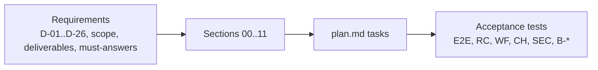

# Traceability Matrix

**Status:** final for spec close, 2026-10-24. **Owner:** Z (assembly).

## Purpose

Map every requirement to the sections that satisfy it:

- every decided constraint D-01..D-26 (shared context §3, as amended);
- every functional-scope item (shared context §4: workflow types, graph roles, triggers, UX requirements, the
  visual design bar) and the v1 out-of-scope list;
- every original and added deliverable;
- every "Must answer" question from the briefs;
- every trade-off topic the assembly brief names.

Anything without a satisfying section is flagged in §7.

## Decisions summary

| Status value | Meaning |
|---|---|
| **Satisfied** | A section specifies it concretely, and the reviews found no open defect against it |
| **Satisfied (amended)** | Satisfied against the constraint as amended by an accepted challenge or CCR |
| **Satisfied, gated** | Specified, with a load-bearing fact that a benchmark or spike must confirm. The fallback is specified too |
| **Partial** | Some of the requirement is specified, and the gap is named |
| **Not satisfied** | No section satisfies it |

Statuses reflect the spec as of the wave-3 fix round. Wave-3 fixes were reported by owners but not independently
re-verified ([known-issues.md §2](../90-reviews/known-issues.md)). The five must-answers that R1 verification left
partial were spot-checked here against the current files, and all five now read as answered.

Paths are relative to `spec/`. `adr/NNN` is shorthand for the ADR with that number in the same section's `adr/`
directory (every ADR is linked from [../README.md](../README.md)). A bare file name after a path belongs to the
same section.

## 1. Decided constraints

| ID | Constraint | Satisfied by | Status |
|---|---|---|---|
| D-01 | Temporal + LangGraph; history is the source of truth; gates via Updates; integration maturity verified, with an adapter and fallback | 01-orchestration/temporal-langgraph.md, gates.md, adr/001 (Challenge: D-01, accepted), 00-contracts/adr/001; reference/ (43 scenarios on both engines) | Satisfied (amended: LangGraph runs in the workflow, and the `temporalio-langgraph` plugin is not a runtime dependency) |
| D-02 | Worker Versioning, pinning, CAN, UI version management, config-vs-code stated plainly | 01-orchestration/versioning.md, history-budget.md, extensibility.md, adr/002–004, 008; 00-contracts/definitions-contracts.md §1 (CC-1..CC-4), adr/006; 07-control-plane-and-ux/ui/releases.md | Satisfied |
| D-03 | Immutable, content-addressed Release Bundle; promoted only after evals; every job records its bundle | 00-contracts/schemas/release-bundle.schema.json, adr/005, adr/013; 06-releases-and-evals/release-bundle.md, promotion.md, eval-harness.md, adr/001 | Satisfied |
| D-04 | Narrow Runner API boundary; Signal hint + timer + polling; idempotency | 00-contracts/runner-api.openapi.yaml, adr/002, adr/008; 02-execution/runner-service.md; 01-orchestration/graphs/README.md §2 | Satisfied |
| D-05 | AgentRun CRD and controller own the lifecycle; state separation | 00-contracts/agentrun-crd.yaml, agentrun-crd.md, state-ownership.md; 02-execution/controller.md, adr/02-002 | Satisfied |
| D-06 | Pluggable runtime, default chosen by evidence | 02-execution/runtime-evaluation.md (§8 benchmark plan and gates), adr/02-001, adr/02-007; runner-service.md §3.4 (runtime override) | Satisfied, gated (B-* gates, S-1) |
| D-07 | Local ephemeral NVMe, enforcing hard limit, watchdog, generic ephemeral overflow, no inline CSI or snapshots | 00-contracts/adr/014 (Challenge: D-07, accepted); 02-execution/workspace-storage.md, adr/02-004 | Satisfied (amended), gated (B-DISK-01..04) |
| D-08 | Durable artifacts in S3; local S3-compatible store | 00-contracts/artifact-layout.md; 10-data-platform/object-storage.md, lifecycle.md, adr/007; 11-local-dev/adr/004 | Satisfied (amended: SeaweedFS locally, CCR-11-02) |
| D-09 | Replicant Postgres as relational system of record; separate Temporal and Langfuse instances | 00-contracts/postgres-ownership.md; 10-data-platform/postgres.md, adr/001, ddl/INDEX.md | Satisfied |
| D-10 | Native CLIs only; no committed agent files; CLI versions pinned by digest | 03-agents-and-tools/cli-invocation.md, adr/002, 003, 004, 007; 04-memory-and-context/adr/007 | Satisfied |
| D-11 | Gateway routing, per-run short-lived credentials, local stub | 03-agents-and-tools/gateway.md, gateway-interface.openapi.yaml, adr/005, 006, 009; 11-local-dev/gateway-stub.md | Satisfied, gated (S-4 decides whether the shim is needed in front) |
| D-12 | Declarative environment definitions from a config repo; measured resource profiles; Kata memory rule | 03-agents-and-tools/environment-definition.md, config-publishing.md, adr/008 (Challenge: D-12, accepted), adr/010 | Satisfied (amended), gated (B-MEM-01) |
| D-13 | Ecosystem awareness from derived sources; Zoekt allowed; no full-repo embeddings or manual schema registry | 04-memory-and-context/ecosystem-context.md, adr/004 | Satisfied |
| D-14 | Memory as a first-class subsystem (long-term, working, budgeting; scoped, provenance, lifecycle, poisoning defence, evals, pinning, deletion) | 04-memory-and-context/ (all files), adr/001–007 | Satisfied |
| D-15 | PR feedback loop, bounded repairs, only authorized humans trigger | 01-orchestration/graphs/pr-repair.md; 04-memory-and-context/pr-replies.md, write-path.md; 07-control-plane-and-ux/identity.md; 00-contracts/adr/009 | Satisfied |
| D-16 | QA in the sandbox: builds, app + dependencies, health, Playwright; Testcontainers answered | 05-qa/ (all files), adr/001–006 | Satisfied, gated (B-BUILD-01/03, B-QA-01) |
| D-17 | Self-hosted Langfuse and Grafana stack; OTel correlation; Loki label discipline; no SaaS | 08-observability/ (all files), adr/001–008 | Satisfied (Langfuse v4, Alloy instead of Promtail per FROZEN.md facts) |
| D-18 | Okta OIDC + SCIM; groups and repo permission (no confused deputy); identity linking; stub IdP | 07-control-plane-and-ux/identity.md, adr/002, 003, 006; 11-local-dev/adr/003 | Satisfied |
| D-19 | UI, Slack and GitHub approvals to one Update; first decision wins; reminders, escalation, expiry; rebase and re-verify; deterministic risk, LLM raise-only | 07-control-plane-and-ux/approvals.md, adr/005; 01-orchestration/gates.md, adr/009; 09-security/agent-capabilities.md §6 | Satisfied |
| D-20 | Local-first: one command; second profile with the real controller on kind | 11-local-dev/stack.md, compose/, walkthroughs.md, parity.md; 02-execution/local-runner.md | Satisfied (amended: SeaweedFS for MinIO) |
| D-21 | No push credentials in the sandbox; short-lived run-scoped credentials; default-deny FQDN egress via mirrors; capability-based injection containment; redaction | 09-security/ (all files); 02-execution/network.md, adr/02-003, adr/02-005; 03-agents-and-tools/adr/001; 08-observability/adr/008 | Satisfied |
| D-22 | AWS production target; Temporal hosting decided | 10-data-platform/adr/001, adr/002; 09-security/adr/001–003; 00-contracts/adr/003, adr/007 | Satisfied (self-hosted Temporal; Aurora gated by S-5) |
| D-23 | Default languages | 11-local-dev/repo-layout.md §1; 02-execution/ (Go); 07-control-plane-and-ux/architecture.md §1 (TypeScript frontend) | Satisfied (no challenge filed) |
| D-24 | Companion GitHub App with a dev variant; webhook forwarding chosen | 07-control-plane-and-ux/github-app.md, github-app/manifest.json, adr/004; 11-local-dev/walkthroughs.md §11 | Satisfied (Cloudflare quick tunnel; ADR-07-004 supersedes ADR-11-006) |
| D-25 | Memory management admin-only, enforced server-side, audited; read-only job view for others | 07-control-plane-and-ux/identity.md §7, ui/memory.md; 04-memory-and-context/curation-ui.md, api/memory-service.openapi.yaml; 11-local-dev/test-strategy.md (E2E-12) | Satisfied |
| D-26 | No routine database connection: SQLAlchemy + Alembic, CI gates, automatic migrations, API seeding, break-glass only | 10-data-platform/schema-management.md, adr/005, adr/006, postgres.md; 11-local-dev/stack.md §5; 07-control-plane-and-ux/ui/admin.md | Satisfied (amended by CCR-10-01: compatibility range, not strict equality) |

## 2. Functional scope (shared context §4)

### 2.1 Workflow types

| Item | Satisfied by | Status |
|---|---|---|
| Bugfix | 01-orchestration/graphs/bugfix.md, definitions/bugfix.yaml | Satisfied |
| Feature / API change | 01-orchestration/graphs/feature-and-api-change.md, definitions/feature.yaml, api-change.yaml | Satisfied |
| Docs / low-risk | 01-orchestration/graphs/hotfix-and-docs.md, definitions/docs-low-risk.yaml | Satisfied |
| Hotfix | 01-orchestration/graphs/hotfix-and-docs.md, definitions/hotfix.yaml | Satisfied |
| Scheduled maintenance (dependency upgrades, codemod sweeps) | 01-orchestration/graphs/maintenance-fanout.md, adr/007, definitions/maintenance-repo.yaml; 07-control-plane-and-ux/triggers.md (schedules) | Satisfied |
| PR-comment repair (first-class) | 01-orchestration/graphs/pr-repair.md, definitions/pr-repair.yaml | Satisfied |
| QA/QE (first-class, reused) | 05-qa/stage-design.md; 01-orchestration/graphs/definitions/qa-only.yaml | Satisfied |
| Router selects a subgraph per type | 01-orchestration/router.md | Satisfied |

### 2.2 Graph roles

| Role | Satisfied by | Status |
|---|---|---|
| Intake/Router | 01-orchestration/router.md; 07-control-plane-and-ux/triggers.md | Satisfied |
| Planner/Spec | 01-orchestration/graphs/feature-and-api-change.md; 03-agents-and-tools/schemas/ (role-result planner) | Satisfied |
| Implementer | 03-agents-and-tools/cli-invocation.md; 01-orchestration/graphs/README.md §2 | Satisfied |
| Reviewer | 03-agents-and-tools/cli-invocation.md §6 | Satisfied |
| Skeptic/Challenger (optional) | 01-orchestration/graphs/feature-and-api-change.md, extensibility.md | Satisfied |
| Verifier | 01-orchestration/extensibility.md (I-3, I-5), graphs/README.md | Satisfied |
| QA/QE | 05-qa/ | Satisfied |
| Human Gate | 01-orchestration/gates.md; 07-control-plane-and-ux/approvals.md | Satisfied |
| Publisher | 07-control-plane-and-ux/github-app.md §10; 01-orchestration/graphs/README.md §5 | Satisfied |
| Feedback Ingestor | 04-memory-and-context/write-path.md; 01-orchestration/graphs/pr-repair.md | Satisfied |
| Memory Writer | 04-memory-and-context/write-path.md; 01-orchestration/extensibility.md (protected node) | Satisfied |
| Context Assembler | 04-memory-and-context/retrieval-injection.md, context-budget.md, working-memory.md | Satisfied |
| Steps inserted without changing core roles | 01-orchestration/extensibility.md (modifiers, invariants, license-scan worked example) | Satisfied |

### 2.3 Triggers

| Trigger | Satisfied by | Status |
|---|---|---|
| GitHub issue opened or labelled | 07-control-plane-and-ux/github-app.md, triggers.md | Satisfied |
| GitHub PR review comment | 07-control-plane-and-ux/github-app.md; 01-orchestration/graphs/pr-repair.md | Satisfied |
| `/replicant` command | 07-control-plane-and-ux/github-app.md, triggers.md | Satisfied |
| Jira | 07-control-plane-and-ux/triggers.md §3 | Satisfied (webhook signing unverified, fallback specified) |
| Slack shortcut or slash command | 07-control-plane-and-ux/triggers.md; slack-app/manifest.yaml | Satisfied |
| Control-plane UI | 07-control-plane-and-ux/ui/README.md, triggers.md | Satisfied |
| CLI | 07-control-plane-and-ux/triggers.md (CLI), adr/006 (device flow) | Satisfied |
| Schedules | 07-control-plane-and-ux/triggers.md; 01-orchestration/graphs/maintenance-fanout.md | Satisfied |
| All normalize into one JobRequest | 00-contracts/job-request.schema.json | Satisfied |
| GitHub App only, never PATs | 07-control-plane-and-ux/github-app.md; 00-contracts/adr/011; 09-security/adr/004 | Satisfied |

### 2.4 User experience requirements

| Requirement | Satisfied by | Status |
|---|---|---|
| Live progress (phase, node, sandbox status, cost so far) within 60 s | 07-control-plane-and-ux/architecture.md §8, ui/job-detail.md, adr/001; 01-orchestration/graphs/README.md §8 | Satisfied |
| Cancel | 07-control-plane-and-ux/ui/job-actions.md; 00-contracts/events-and-signals.md | Satisfied |
| Pause at next gate | 07-control-plane-and-ux/ui/job-actions.md (pause at next node or gate) | Satisfied |
| Steer | 07-control-plane-and-ux/ui/job-actions.md; 00-contracts/adr/010; 03-agents-and-tools/cli-invocation.md §2.6 | Satisfied |
| Take over (branch, workspace snapshot archive, transcript, plan) | 07-control-plane-and-ux/ui/job-actions.md; 00-contracts/artifact-layout.md (`takeover_package`, `workspace_archive`) | Satisfied |
| Approval inbox: plan, diff, QA results and screenshots, risk rationale, memory used, cost | 07-control-plane-and-ux/ui/approval-inbox.md, approvals.md §3; 05-qa/artifacts.md §3 | Satisfied |
| Release/version management | 07-control-plane-and-ux/ui/releases.md; 06-releases-and-evals/promotion.md | Satisfied |
| Definition registries | 07-control-plane-and-ux/ui/registries.md | Satisfied |
| Eval results | 07-control-plane-and-ux/ui/releases.md; 06-releases-and-evals/eval-harness.md | Satisfied |
| Cost views | 07-control-plane-and-ux/ui/cost-quotas.md; 03-agents-and-tools/ddl/ (`cost` views) | Satisfied |
| Memory management for admins only | 07-control-plane-and-ux/ui/memory.md; 04-memory-and-context/curation-ui.md | Satisfied |

### 2.5 Visual design bar

| Requirement | Satisfied by | Status |
|---|---|---|
| Deliberate design system (tokens, type scale, neutral palette with one accent, semantic status colours safe for CVD, both themes) | 07-control-plane-and-ux/design/direction.md, tokens.json, contrast-report.md | Satisfied |
| Banned AI-generated signatures avoided, density, hierarchy, monospace for IDs, motion only for state | 07-control-plane-and-ux/design/direction.md, components.md, critique.md | Satisfied |
| Command palette and keyboard shortcuts | 07-control-plane-and-ux/ui/README.md, ui/job-actions.md | Satisfied |
| Rendered prototype with realistic data | 07-control-plane-and-ux/design/prototype/, screenshots/ (70 screenshots) | Satisfied |

### 2.6 Out of scope for v1 (must not be designed in)

| Item | Where respected | Status |
|---|---|---|
| Remote dev/staging deploys | 05-qa/README.md (QA local in sandbox) | Respected |
| GUI/desktop environments | 05-qa/headless-validation.md (headless only) | Respected |
| Firecracker snapshot warm pools | 02-execution/runtime-evaluation.md (Firecracker disabled), fast-path.md (warm placeholders, no snapshots) | Respected |
| Full-repo embedding indexes | 04-memory-and-context/adr/003, ecosystem-context.md | Respected |
| Manual schema registries | 04-memory-and-context/ecosystem-context.md | Respected |
| Committed agent files in target repos | 03-agents-and-tools/adr/007 | Respected |

## 3. Deliverables

| Deliverable | Satisfied by | Status |
|---|---|---|
| Architecture overview | 00-contracts/architecture.md; [../README.md](../README.md) | Satisfied |
| Graph patterns | 01-orchestration/graphs/ | Satisfied |
| Isolation model | 02-execution/runtime-evaluation.md, controller.md, network.md; 09-security/threat-model.md | Satisfied, gated |
| Storage design | 02-execution/workspace-storage.md; 10-data-platform/object-storage.md, postgres.md | Satisfied |
| Tool/environment/agent-config provisioning | 03-agents-and-tools/ | Satisfied |
| Context injection | 04-memory-and-context/retrieval-injection.md, context-budget.md, ecosystem-context.md | Satisfied |
| Feedback memory | 04-memory-and-context/write-path.md, pr-replies.md | Satisfied |
| QA/QE stage | 05-qa/ | Satisfied |
| Observability | 08-observability/ | Satisfied |
| Identity | 07-control-plane-and-ux/identity.md | Satisfied |
| AI/ML gateway integration | 03-agents-and-tools/gateway.md | Satisfied |
| Approval channels | 07-control-plane-and-ux/approvals.md | Satisfied |
| State model and durability | 00-contracts/state-ownership.md; 01-orchestration/temporal-platform.md; 10-data-platform/recovery.md | Satisfied |
| Security and tenancy | 09-security/ | Satisfied |
| Local development and test plan | 11-local-dev/ | Satisfied |
| Trade-offs and rejected alternatives | every ADR (Options, Decision, Consequences); topic map in §6 below | **Partial**: the consolidated `tradeoffs.md` was not written at spec close (scope restricted to blockers). §6 maps every required topic to its ADRs |
| Phased implementation plan | [plan.md](plan.md) | Satisfied |
| Workflow versioning and UI management (added) | 01-orchestration/versioning.md; 07-control-plane-and-ux/ui/releases.md | Satisfied |
| Release Bundles and evaluation (added) | 06-releases-and-evals/ | Satisfied |
| Postgres and data platform (added) | 10-data-platform/ | Satisfied |
| Memory as a full subsystem (added) | 04-memory-and-context/ | Satisfied |
| User experience design (added) | 07-control-plane-and-ux/ui/, design/ | Satisfied |

## 4. Must-answer questions

Answers verified by R1 verification ([R1-verification.md §5](../90-reviews/R1-verification.md): 34 answered, 5
partial). The five partials were re-checked here after wave 3 and are now answered (noted below).

| WS | Question | Answer | Status |
|---|---|---|---|
| WS-00 | Which process holds Temporal client credentials to Signal workflows on Runner completion? | 00-contracts/events-and-signals.md §1.1; adr/002 | Answered |
| WS-00 | How is a job identified across Continue-As-New and child workflows? | 00-contracts/ids-and-naming.md §3 | Answered |
| WS-00 | How does the UI show a consistent job view without querying four stores? | 00-contracts/state-ownership.md §2 | Answered |
| WS-00 | Where is the configuration-versus-code boundary? | 00-contracts/definitions-contracts.md §1 | Answered |
| WS-01 | What happens if the LangGraph integration is abandoned upstream? | 01-orchestration/temporal-langgraph.md §3.4 | Answered |
| WS-01 | How does a running job pick up a fix in node code it has not reached? | 01-orchestration/versioning.md §6–§7 | Answered |
| WS-01 | How is a graph change tested before production use? | 01-orchestration/versioning.md §8 | Answered |
| WS-01 | Maximum history of a 30-day job with 5 repair cycles, and its bound | 01-orchestration/history-budget.md | Answered (minor number drift noted by R1V) |
| WS-02 | What does the sandbox contain when the CLI starts? | 02-execution/lifecycle-and-failures.md §1 | Answered |
| WS-02 | What happens when a node is lost mid-run? | 02-execution/lifecycle-and-failures.md §2 | Answered |
| WS-02 | How many sandboxes fit per node, per workload class? | 02-execution/runtime-evaluation.md §9 | Answered, gated (B-DENS-01) |
| WS-02 | Which runtime facts are unverified, and the fallbacks? | 02-execution/lifecycle-and-failures.md §4 | Answered |
| WS-03 | Which files exist in the sandbox home when the CLI starts? | 03-agents-and-tools/cli-invocation.md §1.4 | Answered |
| WS-03 | How is a CLI upgrade rolled out, evaluated, rolled back? | 03-agents-and-tools/cli-invocation.md §7 | Answered |
| WS-03 | How does a reviewer run read-only while executing tests? | 03-agents-and-tools/cli-invocation.md §6 | Answered |
| WS-03 | Gateway rate-limit or budget errors mid-run | 03-agents-and-tools/gateway.md §6.6 | Answered |
| WS-04 | A bad comment becomes an active rule: detection and stop time | 04-memory-and-context/README.md must-answer 1; write-path.md §5, §9 | Answered |
| WS-04 | Two scopes contradict: what does the agent see? | 04-memory-and-context/scoping.md §3 | Answered |
| WS-04 | How large can repo memory grow, and what bounds it? | 04-memory-and-context/retrieval-injection.md §6 | Answered |
| WS-04 | Reproduce a 3-week-old job with its exact memory | 04-memory-and-context/retrieval-injection.md §7 | Answered |
| WS-05 | QA for an app needing Postgres and Kafka within the profile | 05-qa/dependencies.md §7 | Answered (R1V partial; wave 3: WS-02 §9 and WS-05 now agree, XD-W3-R1V-106; example overflow policy canonical) |
| WS-05 | What does a reviewer see when QA passed or failed? | 05-qa/artifacts.md §3; 07-control-plane-and-ux/approvals.md §3, design/components.md | Answered (R1V partial; WS-07 packet now uses `test_inventory_delta`, Re-run QA in components.md) |
| WS-05 | Flaky test vs regression | 05-qa/failure-feedback.md §4 | Answered |
| WS-06 | Golden tasks needed to detect a 5-point change | 06-releases-and-evals/eval-harness.md §6.3 | Answered |
| WS-06 | Cost of a full eval run | 06-releases-and-evals/eval-harness.md §8 | Answered |
| WS-06 | Roll back a bad prompt in under five minutes, and pinned jobs | 06-releases-and-evals/promotion.md §7 | Answered |
| WS-06 | LLM-judge drift detection | 06-releases-and-evals/eval-harness.md §5 | Answered (R1V partial; J1 now uses the response body's `model`, R1V-036) |
| WS-07 | Approver removed from the group while the click is in flight | 07-control-plane-and-ux/identity.md §10 | Answered |
| WS-07 | Same gate approved in Slack and rejected in GitHub within one second | 07-control-plane-and-ux/approvals.md §9 | Answered |
| WS-07 | What a requester sees in the first 60 seconds | 07-control-plane-and-ux/architecture.md §8 | Answered |
| WS-07 | Find and roll back the release behind a failure spike | 07-control-plane-and-ux/architecture.md §9 | Answered |
| WS-08 | From a merged PR, find everything the agent did | 08-observability/dashboards.md §2.1 | Answered |
| WS-08 | Loki and ClickHouse ingest volume and storage cost | 08-observability/platform.md §4 | Answered (prices partly unverified) |
| WS-08 | Find and purge a leaked secret from every sink | 08-observability/session-capture.md §8 | Answered |
| WS-08 | Who approved this change and what did they see? | 08-observability/audit.md §6 | Answered |
| WS-09 | Everything a fully prompt-injected QA agent can and cannot do | 09-security/threat-model.md §7.1 | Answered |
| WS-09 | Where a tenant repo secret can end up, and what stops it | 09-security/threat-model.md §7.2 | Answered |
| WS-09 | Blast radius of a compromised Runner API | 09-security/threat-model.md §7.3 | Answered (R1V partial; revocation-feed suppression now analysed) |
| WS-10 | Restore the Replicant DB to 15 minutes ago: inconsistencies and repair | 10-data-platform/recovery.md §4.2 | Answered |
| WS-10 | Number of Temporal history shards, and why | 10-data-platform/adr/003 | Answered |
| WS-10 | Monthly storage cost per store | 10-data-platform/capacity-and-cost.md | Answered |
| WS-11 | Minimum laptop for `core` + `observability` | 11-local-dev/stack.md §6.2 | Answered (estimates until measured) |
| WS-11 | Production behaviours not reproducible locally, and their coverage | 11-local-dev/parity.md §3 | Answered (R1V partial; the 30-day wait row now cites the scaled policy clock) |

## 5. Accepted challenges to decided constraints

| Constraint | Challenge | Decision |
|---|---|---|
| D-01 | [ADR-01-001](../01-orchestration/adr/001-challenge-d01-langgraph-runs-in-workflow-not-plugin-activity-nodes.md) | Accepted (FROZEN.md) |
| D-07 | [ADR-014](../00-contracts/adr/014-challenge-d07-fsquota-monitoring-is-not-enforcement.md) | Accepted; D-07 text amended |
| D-08 | [ADR-11-004](../11-local-dev/adr/004-challenge-d08-minio-locally.md), [ADR-WS10-007](../10-data-platform/adr/007-challenge-d08-minio-community-archived.md) | Accepted via CCR-11-02; D-08 text amended |
| D-12 | [ADR-03-008](../03-agents-and-tools/adr/008-challenge-d12-kata-memory-requests.md) | Accepted; D-12 text amended |
| D-26 | CCR-10-01 (compatibility range instead of strict schema equality) | Accepted; D-26 text amended |

## 6. Trade-off topics → ADRs

The assembly brief requires each topic below to be covered with reasoning grounded in the final design. Each is
covered in the ADRs listed. A consolidated `tradeoffs.md` was not written (see §7).

| Topic | Covered by |
|---|---|
| Temporal activities creating or watching Kubernetes objects directly | [ADR-002](../00-contracts/adr/002-runner-completion-callback-vs-poll.md), [ADR-007](../00-contracts/adr/007-separate-execution-cluster.md), [ADR-008](../00-contracts/adr/008-deterministic-run-identity.md) |
| Pure LangGraph or pure Temporal | [ADR-01-001](../01-orchestration/adr/001-challenge-d01-langgraph-runs-in-workflow-not-plugin-activity-nodes.md), [temporal-langgraph.md](../01-orchestration/temporal-langgraph.md) |
| LangGraph checkpointer as authoritative state | [temporal-langgraph.md](../01-orchestration/temporal-langgraph.md) (checkpointer section), [state-ownership.md](../00-contracts/state-ownership.md) |
| Fixed linear pipelines instead of selectable, extensible graphs | [ADR-01-008](../01-orchestration/adr/008-graph-definitions-are-configuration-compiled-per-job.md), [extensibility.md](../01-orchestration/extensibility.md) |
| Manual schema/version registries | [ADR-04-004](../04-memory-and-context/adr/004-ecosystem-graph-in-postgres.md), [ecosystem-context.md](../04-memory-and-context/ecosystem-context.md) |
| Full-repository embedding indexes | [ADR-04-003](../04-memory-and-context/adr/003-embeddings-and-hybrid-retrieval.md) |
| Agent configuration files committed to target repos | [ADR-03-007](../03-agents-and-tools/adr/007-repo-instruction-files.md), [ADR-04-007](../04-memory-and-context/adr/007-injection-slots-and-cli-native-memory.md) |
| Reimplementing a coding harness | [ADR-03-002](../03-agents-and-tools/adr/002-claude-code-cli-over-agent-sdk.md), [ADR-03-003](../03-agents-and-tools/adr/003-codex-exec-over-app-server.md) |
| Non-local-first architectures | [ADR-11-001](../11-local-dev/adr/001-temporal-full-server-locally.md), [parity.md](../11-local-dev/parity.md) |
| Memory only in CLI-native memory files | [ADR-04-007](../04-memory-and-context/adr/007-injection-slots-and-cli-native-memory.md), [ADR-04-001](../04-memory-and-context/adr/001-cli-session-continuity-per-role.md) |
| Remote-environment QA from day one | [ADR-05-001](../05-qa/adr/001-separate-qa-agentrun-fresh-checkout.md), [ADR-05-002](../05-qa/adr/002-dependency-strategy.md) |
| GUI/desktop environments in sandboxes | [headless-validation.md](../05-qa/headless-validation.md) |
| A single hardcoded isolation runtime | [ADR-02-001](../02-execution/adr/02-001-default-runtime-per-workload-class.md), [runtime-evaluation.md](../02-execution/runtime-evaluation.md) |
| CSI ephemeral inline EBS volumes; EBS snapshots as checkpoints | [ADR-02-004](../02-execution/adr/02-004-workspace-hard-limit-per-runtime.md), [workspace-storage.md](../02-execution/workspace-storage.md) (rejected options) |
| Unversioned workflow code under long-running workflows | [ADR-006](../00-contracts/adr/006-bundle-assignment-drives-version-pinning.md), [ADR-01-003](../01-orchestration/adr/003-patching-only-for-emergency-patch-builds.md), [versioning.md](../01-orchestration/versioning.md) |
| LLM-decided gate removal | [ADR-01-009](../01-orchestration/adr/009-gate-routing-delegated-to-ws07-and-one-decision-transition.md), [approvals.md](../07-control-plane-and-ux/approvals.md) |
| SaaS observability | [ADR-08-001](../08-observability/adr/001-mimir-over-prometheus.md), [ADR-08-003](../08-observability/adr/003-single-langfuse-project-per-environment.md) |
| One Postgres shared by Replicant, Temporal and Langfuse | [ADR-WS10-001](../10-data-platform/adr/001-replicant-postgres-hosting-aurora.md), [ADR-WS10-002](../10-data-platform/adr/002-temporal-self-hosted-final.md) |

## 7. Not satisfied or partial

| Item | Status | Gap | Disposition |
|---|---|---|---|
| Deliverable: trade-offs and rejected alternatives (`tradeoffs.md`) | Partial | The consolidated reference the assembly brief asks for was not written. The content exists in the ADRs, and §6 maps every required topic | Known issue, not a blocker. Write it at the start of implementation from §6 |
| All rows above | Owner-reported | Wave-3 fixes are not independently re-verified ([known-issues.md §2](../90-reviews/known-issues.md)) | plan.md decision 6: each first task re-checks its R1V rows |

No D-xx constraint and no functional-scope item is unmapped. The constraints marked "gated" depend on S-1, S-4 or
S-5 evidence, and each has a specified fallback.

## Open questions

See [open-questions-summary.md](../_coordination/open-questions-summary.md).

## Risks

The matrix records specification coverage, not implementation. Gated rows can change status when the benchmarks
run, and the fallback then becomes the satisfying design.

## Interfaces consumed / provided

- **Consumed:** shared context §3–§5, all sections, the reviews.
- **Provided:** requirement → section map for [plan.md](plan.md) and reviewers.
